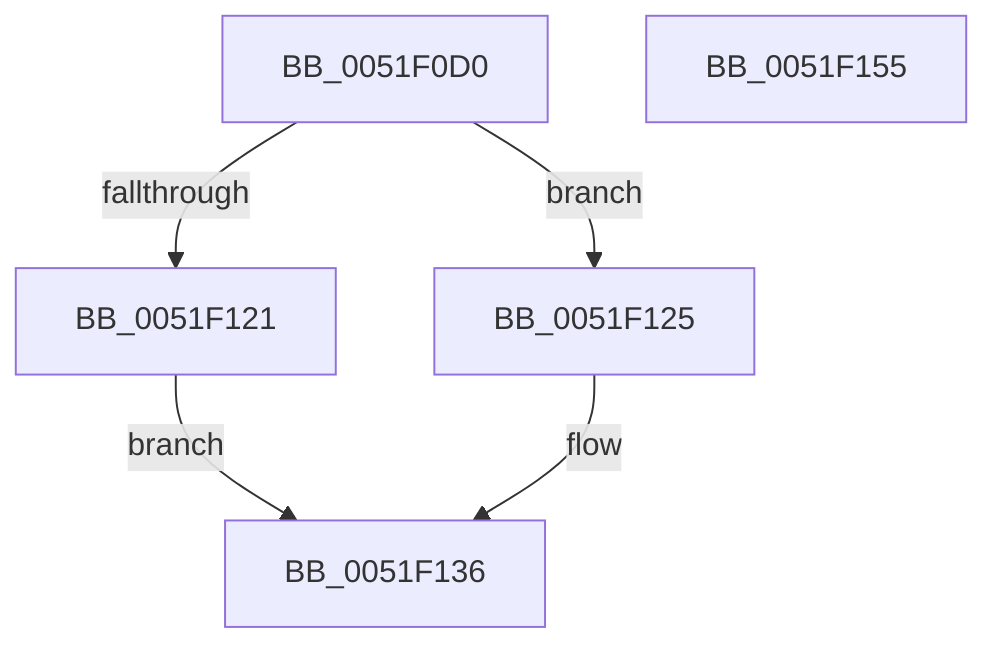

# SymCryptParallelSha256Result1

- RVA: `0x0051F0D0`–`0x0051F156` (길이 `134` bytes)
- VA: `0x000000014051F0D0`
- 실행 섹션: `.text`
- PDB 이름 있음: `예`; PDB Function 태그: `아니요`
- unwind 정보 RVA: `0x0006F978`
- 디코드: `39`개 명령, `134/134` bytes 표시
- 미해석 바이트: `0` (있으면 어셈블리에 `.byte`로 보존)

> 이 문서는 커널 이미지의 기계어와 PDB 기호를 분석해 생성했습니다. 4번과 5번은 함수 원형과 자료형을 바이너리 사용 방식에서 추정한 C 해석이며 원본 소스 복구 결과는 아닙니다.

## 1. Dependencies

- 직접 호출 지점: **1**; 고유 호출 대상: **1**
- 직접 호출자로 확인된 함수: **0**
- RIP 상대 이미지 참조: **0**

### Outgoing calls
- `0x0051F107` → [SymCryptWipe](SymCryptWipe_function_0051F914.md) (function, `0x0051F914`)

### Direct callers
- 이 함수 시작 RVA로 연결되는 직접 call은 확인되지 않았습니다. 간접 호출은 완전히 역산할 수 없습니다.

### Static image references
- 디코드된 RIP-relative 메모리 참조가 없습니다.

## 2. Other-region calls and transfers

- 다른 실행 섹션으로 향하는 call: **0**
- 별도 외부 분기/꼬리 이동을 확인하지 못했습니다.

## 3. Assembly (complete function range)

```asm
0051F0D0  48 89 5C 24 08                  mov qword ptr [rsp + 8], rbx
0051F0D5  48 89 74 24 10                  mov qword ptr [rsp + 0x10], rsi
0051F0DA  48 89 7C 24 18                  mov qword ptr [rsp + 0x18], rdi
0051F0DF  41 56                           push r14
0051F0E1  48 83 EC 20                     sub rsp, 0x20
0051F0E5  8B 1A                           mov ebx, dword ptr [rdx]
0051F0E7  48 8B FA                        mov rdi, rdx
0051F0EA  4D 8B F1                        mov r14, r9
0051F0ED  49 8B F0                        mov rsi, r8
0051F0F0  C6 44 13 20 80                  mov byte ptr [rbx + rdx + 0x20], 0x80
0051F0F5  48 8D 4F 20                     lea rcx, [rdi + 0x20]
0051F0F9  FF C3                           inc ebx
0051F0FB  BA 40 00 00 00                  mov edx, 0x40
0051F100  8B C3                           mov eax, ebx
0051F102  2B D3                           sub edx, ebx
0051F104  48 03 C8                        add rcx, rax
0051F107  E8 08 08 00 00                  call 0x14051f914
0051F10C  48 C7 46 28 40 00 00 00         mov qword ptr [rsi + 0x28], 0x40
0051F114  48 8D 47 20                     lea rax, [rdi + 0x20]
0051F118  48 89 46 20                     mov qword ptr [rsi + 0x20], rax
0051F11C  83 FB 38                        cmp ebx, 0x38
0051F11F  76 04                           jbe 0x14051f125
0051F121  B0 03                           mov al, 3
0051F123  EB 11                           jmp 0x14051f136
0051F125  48 8B 4F 10                     mov rcx, qword ptr [rdi + 0x10]
0051F129  B0 04                           mov al, 4
0051F12B  48 C1 E1 03                     shl rcx, 3
0051F12F  48 0F C9                        bswap rcx
0051F132  48 89 4F 58                     mov qword ptr [rdi + 0x58], rcx
0051F136  88 46 08                        mov byte ptr [rsi + 8], al
0051F139  B0 01                           mov al, 1
0051F13B  48 8B 5C 24 30                  mov rbx, qword ptr [rsp + 0x30]
0051F140  48 8B 74 24 38                  mov rsi, qword ptr [rsp + 0x38]
0051F145  48 8B 7C 24 40                  mov rdi, qword ptr [rsp + 0x40]
0051F14A  41 C6 06 01                     mov byte ptr [r14], 1
0051F14E  48 83 C4 20                     add rsp, 0x20
0051F152  41 5E                           pop r14
0051F154  C3                              ret
0051F155  CC                              int3
```

## 4. C-style interpretation (structured pseudocode)

```c
__int64 __fastcall SymCryptParallelSha256Result1(__int64 a1, __int64 a2, __int64 a3, __int64 a4)
{
    __int64 result;
    __int64 v_rbx;
    __int64 v_rsp;
    unsigned __int64 v_stack_p10;
    unsigned __int64 v_stack_p18;
    unsigned __int64 v_stack_p8;

    v_stack_p8 = v_rbx;
    v_stack_p10 = v_rsi;
    v_stack_p18 = v_rdi;
    v_rsp = (v_rsp) - (32);
    *(unsigned __int8 *)((unsigned int)(*(unsigned int *)(a2)) + a2 * 1 + 32) = 128;
    v_rbx = (unsigned int)(((unsigned int)(*(unsigned int *)(a2))) + 1);
    a2 = (unsigned int)((64) - ((unsigned int)(v_rbx)));
    a1 = (a2 + 32) + ((unsigned int)((unsigned int)(v_rbx)));
    result = SymCryptWipe(a1, a2, a3, a4);
    *(unsigned __int64 *)(a3 + 40) = 64;
    *(unsigned __int64 *)(a3 + 32) = a2 + 32;
    if (((unsigned int)(v_rbx)) <= 56) goto loc_0051F125;
    goto loc_0051F136;
loc_0051F125:
    a1 = (*(unsigned __int64 *)(a2 + 16)) << (3);
    *(unsigned __int64 *)(a2 + 88) = a1;
loc_0051F136:
    *(unsigned __int8 *)(a3 + 8) = 4;
    *(unsigned __int8 *)(a4) = 1;
    v_rsp = (v_rsp) + (32);
    return 1;
}
```

## 5. (Beta) C Style

```c
int64_t SymCryptParallelSha256Result1(int64_t Arg1, void *Arg2, void *Arg3, void *Arg4)
{
    uint8_t *arg2 = (uint8_t *)Arg2;
    uint8_t *arg3 = (uint8_t *)Arg3;
    uint8_t *arg4 = (uint8_t *)Arg4;

    int64_t result;
    int64_t local_rbx;
    int64_t local_rsp;
    uint64_t v_stack_p10;
    uint64_t v_stack_p18;
    uint64_t v_stack_p8;

    v_stack_p8 = local_rbx;
    v_stack_p10 = local_rsi;
    v_stack_p18 = local_rdi;
    local_rsp = (local_rsp) - (32);
    *(uint8_t *)((uint32_t)(*(uint32_t *)(arg2)) + arg2 * 1 + 0x20) = 128;
    local_rbx = (uint32_t)(((uint32_t)(*(uint32_t *)(arg2))) + 1);
    Arg2 = (uint32_t)((64) - ((uint32_t)(local_rbx)));
    Arg1 = (Arg2 + 32) + ((uint32_t)((uint32_t)(local_rbx)));
    result = SymCryptWipe(Arg1, Arg2, Arg3, Arg4);
    *(uint64_t *)(arg3 + 0x28) = 64;
    *(void **)(arg3 + 0x20) = Arg2 + 32;
    if (((uint32_t)(local_rbx)) <= 56) goto loc_0051F125;
    goto loc_0051F136;
loc_0051F125:
    Arg1 = (*(uint64_t *)(arg2 + 0x10)) << (3);
    *(uint64_t *)(arg2 + 0x58) = Arg1;
loc_0051F136:
    *(uint8_t *)(arg3 + 0x8) = 4;
    *(uint8_t *)(arg4) = 1;
    local_rsp = (local_rsp) + (32);
    return 1;
}
```

### 관측된 메모리 오프셋

구조체 형식이 확인되지 않은 접근은 인자 기준의 오프셋으로만 기록했습니다.

| 기준 인자 | 오프셋 표현 | 폭 (bit) | 접근 |
|---|---:|---:|---|
| `Arg2` | `+ 0x0` | `32` | `R` |
| `Arg2` | `+ 0x10` | `64` | `R` |
| `Arg2` | `+ 0x20` | `64` | `R` |
| `Arg2` | `+ 0x58` | `64` | `W` |
| `Arg3` | `+ 0x8` | `8` | `W` |
| `Arg3` | `+ 0x20` | `64` | `W` |
| `Arg3` | `+ 0x28` | `64` | `W` |
| `Arg4` | `+ 0x0` | `8` | `W` |

## 6. Execution-region graph

[열기: 2D/3D 그래프와 함수 탐색 컨트롤 패널](../../../control-panel.html?section=text&rva=0x0051F0D0&view=graph)

- 2D 그래프는 위에서 아래로 흐르고, 3D 그래프는 빈 공간을 드래그해 회전합니다. Shift+드래그는 이동, 휠은 확대·축소, 함수 노드 선택은 대상 보고서 이동입니다.

### Static fallback


