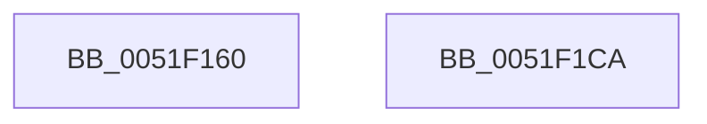

# SymCryptParallelSha256Result2

- RVA: `0x0051F160`–`0x0051F1CB` (길이 `107` bytes)
- VA: `0x000000014051F160`
- 실행 섹션: `.text`
- PDB 이름 있음: `예`; PDB Function 태그: `아니요`
- unwind 정보 RVA: `0x0006F978`
- 디코드: `28`개 명령, `107/107` bytes 표시
- 미해석 바이트: `0` (있으면 어셈블리에 `.byte`로 보존)

> 이 문서는 커널 이미지의 기계어와 PDB 기호를 분석해 생성했습니다. 4번과 5번은 함수 원형과 자료형을 바이너리 사용 방식에서 추정한 C 해석이며 원본 소스 복구 결과는 아닙니다.

## 1. Dependencies

- 직접 호출 지점: **1**; 고유 호출 대상: **1**
- 직접 호출자로 확인된 함수: **0**
- RIP 상대 이미지 참조: **0**

### Outgoing calls
- `0x0051F18A` → [SymCryptWipe](SymCryptWipe_function_0051F914.md) (function, `0x0051F914`)

### Direct callers
- 이 함수 시작 RVA로 연결되는 직접 call은 확인되지 않았습니다. 간접 호출은 완전히 역산할 수 없습니다.

### Static image references
- 디코드된 RIP-relative 메모리 참조가 없습니다.

## 2. Other-region calls and transfers

- 다른 실행 섹션으로 향하는 call: **0**
- 별도 외부 분기/꼬리 이동을 확인하지 못했습니다.

## 3. Assembly (complete function range)

```asm
0051F160  48 89 5C 24 08                  mov qword ptr [rsp + 8], rbx
0051F165  48 89 74 24 10                  mov qword ptr [rsp + 0x10], rsi
0051F16A  48 89 7C 24 18                  mov qword ptr [rsp + 0x18], rdi
0051F16F  41 56                           push r14
0051F171  48 83 EC 20                     sub rsp, 0x20
0051F175  48 8D 5A 20                     lea rbx, [rdx + 0x20]
0051F179  48 8B FA                        mov rdi, rdx
0051F17C  48 8B CB                        mov rcx, rbx
0051F17F  BA 40 00 00 00                  mov edx, 0x40
0051F184  4D 8B F1                        mov r14, r9
0051F187  49 8B F0                        mov rsi, r8
0051F18A  E8 85 07 00 00                  call 0x14051f914
0051F18F  48 8B 47 10                     mov rax, qword ptr [rdi + 0x10]
0051F193  48 C1 E0 03                     shl rax, 3
0051F197  48 0F C8                        bswap rax
0051F19A  48 89 47 58                     mov qword ptr [rdi + 0x58], rax
0051F19E  B0 01                           mov al, 1
0051F1A0  48 8B 7C 24 40                  mov rdi, qword ptr [rsp + 0x40]
0051F1A5  48 89 5E 20                     mov qword ptr [rsi + 0x20], rbx
0051F1A9  48 8B 5C 24 30                  mov rbx, qword ptr [rsp + 0x30]
0051F1AE  48 C7 46 28 40 00 00 00         mov qword ptr [rsi + 0x28], 0x40
0051F1B6  C6 46 08 04                     mov byte ptr [rsi + 8], 4
0051F1BA  48 8B 74 24 38                  mov rsi, qword ptr [rsp + 0x38]
0051F1BF  41 C6 06 01                     mov byte ptr [r14], 1
0051F1C3  48 83 C4 20                     add rsp, 0x20
0051F1C7  41 5E                           pop r14
0051F1C9  C3                              ret
0051F1CA  CC                              int3
```

## 4. C-style interpretation (structured pseudocode)

```c
__int64 __fastcall SymCryptParallelSha256Result2(__int64 a1, __int64 a2, __int64 a3, __int64 a4)
{
    __int64 result;
    __int64 v_rsp;
    unsigned __int64 v_stack_p10;
    unsigned __int64 v_stack_p18;
    unsigned __int64 v_stack_p8;

    v_stack_p8 = v_rbx;
    v_stack_p10 = v_rsi;
    v_stack_p18 = v_rdi;
    v_rsp = (v_rsp) - (32);
    result = SymCryptWipe(a2 + 32, 64, a3, a4);
    result = (*(unsigned __int64 *)(a2 + 16)) << (3);
    *(unsigned __int64 *)(a2 + 88) = result;
    *(unsigned __int64 *)(a3 + 32) = a2 + 32;
    *(unsigned __int64 *)(a3 + 40) = 64;
    *(unsigned __int8 *)(a3 + 8) = 4;
    *(unsigned __int8 *)(a4) = 1;
    v_rsp = (v_rsp) + (32);
    return 1;
}
```

## 5. (Beta) C Style

```c
int64_t SymCryptParallelSha256Result2(int64_t Arg1, void *Arg2, void *Arg3, void *Arg4)
{
    uint8_t *arg2 = (uint8_t *)Arg2;
    uint8_t *arg3 = (uint8_t *)Arg3;
    uint8_t *arg4 = (uint8_t *)Arg4;

    int64_t result;
    int64_t local_rsp;
    uint64_t v_stack_p10;
    uint64_t v_stack_p18;
    uint64_t v_stack_p8;

    v_stack_p8 = local_rbx;
    v_stack_p10 = local_rsi;
    v_stack_p18 = local_rdi;
    local_rsp = (local_rsp) - (32);
    result = SymCryptWipe(Arg2 + 32, 64, Arg3, Arg4);
    result = (*(uint64_t *)(arg2 + 0x10)) << (3);
    *(uint64_t *)(arg2 + 0x58) = result;
    *(void **)(arg3 + 0x20) = Arg2 + 32;
    *(uint64_t *)(arg3 + 0x28) = 64;
    *(uint8_t *)(arg3 + 0x8) = 4;
    *(uint8_t *)(arg4) = 1;
    local_rsp = (local_rsp) + (32);
    return 1;
}
```

### 관측된 메모리 오프셋

구조체 형식이 확인되지 않은 접근은 인자 기준의 오프셋으로만 기록했습니다.

| 기준 인자 | 오프셋 표현 | 폭 (bit) | 접근 |
|---|---:|---:|---|
| `Arg2` | `+ 0x10` | `64` | `R` |
| `Arg2` | `+ 0x20` | `64` | `R` |
| `Arg2` | `+ 0x58` | `64` | `W` |
| `Arg3` | `+ 0x8` | `8` | `W` |
| `Arg3` | `+ 0x20` | `64` | `W` |
| `Arg3` | `+ 0x28` | `64` | `W` |
| `Arg4` | `+ 0x0` | `8` | `W` |

## 6. Execution-region graph

[열기: 2D/3D 그래프와 함수 탐색 컨트롤 패널](../../../control-panel.html?section=text&rva=0x0051F160&view=graph)

- 2D 그래프는 위에서 아래로 흐르고, 3D 그래프는 빈 공간을 드래그해 회전합니다. Shift+드래그는 이동, 휠은 확대·축소, 함수 노드 선택은 대상 보고서 이동입니다.

### Static fallback


