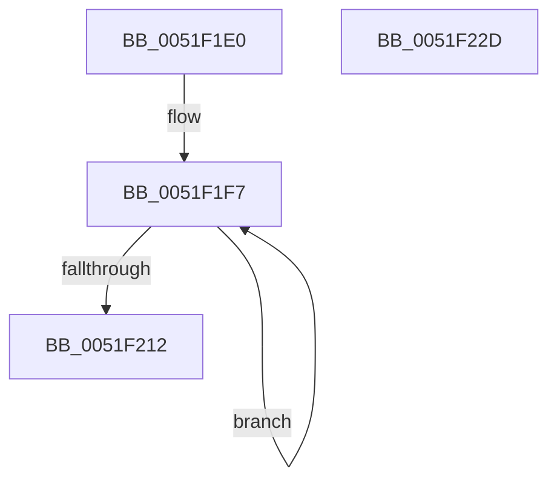

# SymCryptParallelSha256ResultDone

- RVA: `0x0051F1E0`–`0x0051F22E` (길이 `78` bytes)
- VA: `0x000000014051F1E0`
- 실행 섹션: `.text`
- PDB 이름 있음: `예`; PDB Function 태그: `아니요`
- unwind 정보 RVA: `0x0005CF00`
- 디코드: `23`개 명령, `78/78` bytes 표시
- 미해석 바이트: `0` (있으면 어셈블리에 `.byte`로 보존)

> 이 문서는 커널 이미지의 기계어와 PDB 기호를 분석해 생성했습니다. 4번과 5번은 함수 원형과 자료형을 바이너리 사용 방식에서 추정한 C 해석이며 원본 소스 복구 결과는 아닙니다.

## 1. Dependencies

- 직접 호출 지점: **2**; 고유 호출 대상: **2**
- 직접 호출자로 확인된 함수: **0**
- RIP 상대 이미지 참조: **0**

### Outgoing calls
- `0x0051F21A` → [SymCryptWipe](SymCryptWipe_function_0051F914.md) (function, `0x0051F914`)
- `0x0051F222` → [SymCryptSha256Init](SymCryptSha256Init_function_0051E2C0.md) (function, `0x0051E2C0`)

### Direct callers
- 이 함수 시작 RVA로 연결되는 직접 call은 확인되지 않았습니다. 간접 호출은 완전히 역산할 수 없습니다.

### Static image references
- 디코드된 RIP-relative 메모리 참조가 없습니다.

## 2. Other-region calls and transfers

- 다른 실행 섹션으로 향하는 call: **0**
- 별도 외부 분기/꼬리 이동을 확인하지 못했습니다.

## 3. Assembly (complete function range)

```asm
0051F1E0  40 53                           push rbx
0051F1E2  48 83 EC 20                     sub rsp, 0x20
0051F1E6  49 8B 48 10                     mov rcx, qword ptr [r8 + 0x10]
0051F1EA  48 8B DA                        mov rbx, rdx
0051F1ED  48 83 C2 60                     add rdx, 0x60
0051F1F1  41 B8 04 00 00 00               mov r8d, 4
0051F1F7  48 8B 02                        mov rax, qword ptr [rdx]
0051F1FA  48 8D 52 08                     lea rdx, [rdx + 8]
0051F1FE  48 C1 C0 20                     rol rax, 0x20
0051F202  48 0F C8                        bswap rax
0051F205  48 89 01                        mov qword ptr [rcx], rax
0051F208  48 8D 49 08                     lea rcx, [rcx + 8]
0051F20C  49 83 E8 01                     sub r8, 1
0051F210  75 E5                           jne 0x14051f1f7
0051F212  BA 80 00 00 00                  mov edx, 0x80
0051F217  48 8B CB                        mov rcx, rbx
0051F21A  E8 F5 06 00 00                  call 0x14051f914
0051F21F  48 8B CB                        mov rcx, rbx
0051F222  E8 99 F0 FF FF                  call 0x14051e2c0
0051F227  48 83 C4 20                     add rsp, 0x20
0051F22B  5B                              pop rbx
0051F22C  C3                              ret
0051F22D  CC                              int3
```

## 4. C-style interpretation (structured pseudocode)

```c
__int64 __fastcall SymCryptParallelSha256ResultDone(__int64 a1, __int64 a2, __int64 a3)
{
    __int64 result;
    __int64 v_rsp;

    v_rsp = (v_rsp) - (32);
    a2 = (a2) + (96);
loc_0051F1F7:
    *(unsigned __int64 *)(*(unsigned __int64 *)(a3 + 16)) = *(unsigned __int64 *)(a2);
    a3 = (4) - (1);
    if (condition_is_not_equal) goto loc_0051F1F7;
    result = SymCryptWipe(a2, 128, a3, a4);
    result = SymCryptSha256Init(a2, 128, a3, a4);
    v_rsp = (v_rsp) + (32);
    return result;
}
```

## 5. (Beta) C Style

```c
int64_t SymCryptParallelSha256ResultDone(int64_t Arg1, void *Arg2, void *Arg3)
{
    uint8_t *arg2 = (uint8_t *)Arg2;
    uint8_t *arg3 = (uint8_t *)Arg3;

    int64_t result;
    int64_t local_rsp;

    local_rsp = (local_rsp) - (32);
    Arg2 = (Arg2) + (96);
loc_0051F1F7:
    *(uint64_t *)(*(uint64_t *)(arg3 + 0x10)) = *(uint64_t *)(arg2);
    Arg3 = (4) - (1);
    if (condition_is_not_equal) goto loc_0051F1F7;
    result = SymCryptWipe(Arg2, 128, Arg3, a4);
    result = SymCryptSha256Init(Arg2, 128, Arg3, a4);
    local_rsp = (local_rsp) + (32);
    return result;
}
```

### 관측된 메모리 오프셋

구조체 형식이 확인되지 않은 접근은 인자 기준의 오프셋으로만 기록했습니다.

| 기준 인자 | 오프셋 표현 | 폭 (bit) | 접근 |
|---|---:|---:|---|
| `Arg2` | `+ 0x0` | `64` | `R` |
| `Arg2` | `+ 0x8` | `64` | `R` |
| `Arg3` | `+ 0x10` | `64` | `R` |

## 6. Execution-region graph

[열기: 2D/3D 그래프와 함수 탐색 컨트롤 패널](../../../control-panel.html?section=text&rva=0x0051F1E0&view=graph)

- 2D 그래프는 위에서 아래로 흐르고, 3D 그래프는 빈 공간을 드래그해 회전합니다. Shift+드래그는 이동, 휠은 확대·축소, 함수 노드 선택은 대상 보고서 이동입니다.

### Static fallback


