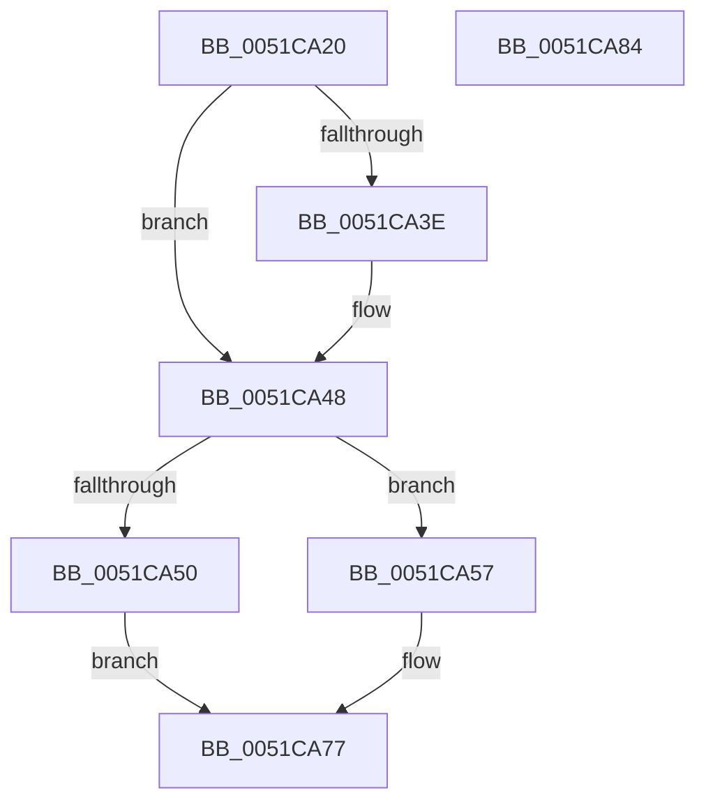

# SymCryptSaveYmmEnvWindowsKernelmodeWin8_1nLater

- RVA: `0x0051CA20`–`0x0051CA85` (길이 `101` bytes)
- VA: `0x000000014051CA20`
- 실행 섹션: `.text`
- PDB 이름 있음: `예`; PDB Function 태그: `아니요`
- unwind 정보 RVA: `0x0005CAAC`
- 디코드: `30`개 명령, `101/101` bytes 표시
- 미해석 바이트: `0` (있으면 어셈블리에 `.byte`로 보존)

> 이 문서는 커널 이미지의 기계어와 PDB 기호를 분석해 생성했습니다. 4번과 5번은 함수 원형과 자료형을 바이너리 사용 방식에서 추정한 C 해석이며 원본 소스 복구 결과는 아닙니다.

## 1. Dependencies

- 직접 호출 지점: **3**; 고유 호출 대상: **3**
- 직접 호출자로 확인된 함수: **1**
- RIP 상대 이미지 참조: **2**

### Outgoing calls
- `0x0051CA2F` → [SymCryptCpuFeaturesNeverPresent](../49/SymCryptCpuFeaturesNeverPresent_function_00498CB0.md) (function, `0x00498CB0`)
- `0x0051CA43` → [SymCryptFatal](../5B/SymCryptFatal_function_005B24E0.md) (function, `0x005B24E0`)
- `0x0051CA5F` → `indirect target` (indirect, 간접 대상)

### Direct callers
- [SymCryptSaveYmm](../5B/SymCryptSaveYmm_function_005B252C.md) at `0x005B2530`

### Static image references
- `0x0051CA34` → RVA `0x00E0A730` (`.data`; read)
- `0x0051CA5F` → RVA `0x00042FE0` (`.rdata`; read)

## 2. Other-region calls and transfers

- 다른 실행 섹션으로 향하는 call: **0**
- 별도 외부 분기/꼬리 이동을 확인하지 못했습니다.

## 3. Assembly (complete function range)

```asm
0051CA20  48 89 5C 24 08                  mov qword ptr [rsp + 8], rbx
0051CA25  57                              push rdi
0051CA26  48 83 EC 20                     sub rsp, 0x20
0051CA2A  48 8B F9                        mov rdi, rcx
0051CA2D  33 DB                           xor ebx, ebx
0051CA2F  E8 7C C2 F7 FF                  call 0x140498cb0
0051CA34  0B 05 F6 DC 8E 00               or eax, dword ptr [rip + 0x8edcf6]
0051CA3A  A8 10                           test al, 0x10
0051CA3C  74 0A                           je 0x14051ca48
0051CA3E  B9 79 6D 6D 20                  mov ecx, 0x206d6d79
0051CA43  E8 98 5A 09 00                  call 0x1405b24e0
0051CA48  44 0F 20 C0                     mov rax, cr8
0051CA4C  3C 02                           cmp al, 2
0051CA4E  76 07                           jbe 0x14051ca57
0051CA50  B9 08 80 00 00                  mov ecx, 0x8008
0051CA55  EB 20                           jmp 0x14051ca77
0051CA57  48 8B D7                        mov rdx, rdi
0051CA5A  B9 04 00 00 00                  mov ecx, 4
0051CA5F  48 FF 15 7A 65 B2 FF            call qword ptr [rip - 0x4d9a86]
0051CA66  0F 1F 44 00 00                  nop dword ptr [rax + rax]
0051CA6B  B9 08 80 00 00                  mov ecx, 0x8008
0051CA70  85 C0                           test eax, eax
0051CA72  0F 48 D9                        cmovs ebx, ecx
0051CA75  8B CB                           mov ecx, ebx
0051CA77  48 8B 5C 24 30                  mov rbx, qword ptr [rsp + 0x30]
0051CA7C  8B C1                           mov eax, ecx
0051CA7E  48 83 C4 20                     add rsp, 0x20
0051CA82  5F                              pop rdi
0051CA83  C3                              ret
0051CA84  CC                              int3
```

## 4. C-style interpretation (structured pseudocode)

```c
__int64 __fastcall SymCryptSaveYmmEnvWindowsKernelmodeWin8_1nLater(__int64 a1)
{
    __int64 result;
    __int64 v_rbx;
    __int64 v_rsp;
    unsigned __int64 v_stack_p8;

    v_stack_p8 = v_rbx;
    v_rsp = (v_rsp) - (32);
    v_rbx = 0;
    result = SymCryptCpuFeaturesNeverPresent(a1, a2, a3, a4);
    result = (unsigned int)((result) | (*(unsigned int *)(v_rip + 9362678)));
    if ((((unsigned __int8)(result)) & (16)) != 0) {
        a1 = 0x206D6D79ULL;
        result = SymCryptFatal(a1, a2, a3, a4);
    }
    if (((unsigned __int8)(v_cr8)) <= 2) goto loc_0051CA57;
    goto loc_0051CA77;
loc_0051CA57:
    result = kernel_indirect_call(4, a1, a3, a4);
    if (sign_flag) { v_rbx = (unsigned int)((unsigned int)(0x8008ULL)); }
loc_0051CA77:
    v_rsp = (v_rsp) + (32);
    return (unsigned int)((unsigned int)((unsigned int)((unsigned int)(v_rbx))));
}
```

## 5. (Beta) C Style

```c
int64_t SymCryptSaveYmmEnvWindowsKernelmodeWin8_1nLater(int64_t Arg1)
{
    int64_t result;
    int64_t local_rbx;
    int64_t local_rsp;
    uint64_t v_stack_p8;

    v_stack_p8 = local_rbx;
    local_rsp = (local_rsp) - (32);
    local_rbx = 0;
    result = SymCryptCpuFeaturesNeverPresent(Arg1, a2, a3, a4);
    result = (uint32_t)((result) | (*(uint32_t *)(v_rip + 0x8EDCF6)));
    if ((((uint8_t)(result)) & (16)) != 0) {
        Arg1 = 0x206D6D79ULL;
        result = SymCryptFatal(Arg1, a2, a3, a4);
    }
    if (((uint8_t)(v_cr8)) <= 2) goto loc_0051CA57;
    goto loc_0051CA77;
loc_0051CA57:
    result = kernel_indirect_call(4, Arg1, a3, a4);
    if (sign_flag) { local_rbx = (uint32_t)((uint32_t)(0x8008ULL)); }
loc_0051CA77:
    local_rsp = (local_rsp) + (32);
    return (uint32_t)((uint32_t)((uint32_t)((uint32_t)(local_rbx))));
}
```

## 6. Execution-region graph

[열기: 2D/3D 그래프와 함수 탐색 컨트롤 패널](../../../control-panel.html?section=text&rva=0x0051CA20&view=graph)

- 2D 그래프는 위에서 아래로 흐르고, 3D 그래프는 빈 공간을 드래그해 회전합니다. Shift+드래그는 이동, 휠은 확대·축소, 함수 노드 선택은 대상 보고서 이동입니다.

### Static fallback


