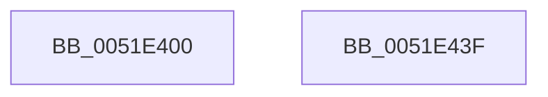

# SymCryptSha1StateCopy

- RVA: `0x0051E400`–`0x0051E440` (길이 `64` bytes)
- VA: `0x000000014051E400`
- 실행 섹션: `.text`
- PDB 이름 있음: `예`; PDB Function 태그: `아니요`
- unwind 정보 RVA: `0x000DB714`
- 디코드: `18`개 명령, `64/64` bytes 표시
- 미해석 바이트: `0` (있으면 어셈블리에 `.byte`로 보존)

> 이 문서는 커널 이미지의 기계어와 PDB 기호를 분석해 생성했습니다. 4번과 5번은 함수 원형과 자료형을 바이너리 사용 방식에서 추정한 C 해석이며 원본 소스 복구 결과는 아닙니다.

## 1. Dependencies

- 직접 호출 지점: **0**; 고유 호출 대상: **0**
- 직접 호출자로 확인된 함수: **0**
- RIP 상대 이미지 참조: **0**

### Outgoing calls
- 직접 디코드된 call 명령이 없습니다.

### Direct callers
- 이 함수 시작 RVA로 연결되는 직접 call은 확인되지 않았습니다. 간접 호출은 완전히 역산할 수 없습니다.

### Static image references
- 디코드된 RIP-relative 메모리 참조가 없습니다.

## 2. Other-region calls and transfers

- 다른 실행 섹션으로 향하는 call: **0**
- 별도 외부 분기/꼬리 이동을 확인하지 못했습니다.

## 3. Assembly (complete function range)

```asm
0051E400  0F 28 01                        movaps xmm0, xmmword ptr [rcx]
0051E403  0F 29 02                        movaps xmmword ptr [rdx], xmm0
0051E406  0F 28 49 10                     movaps xmm1, xmmword ptr [rcx + 0x10]
0051E40A  0F 29 4A 10                     movaps xmmword ptr [rdx + 0x10], xmm1
0051E40E  0F 28 41 20                     movaps xmm0, xmmword ptr [rcx + 0x20]
0051E412  0F 29 42 20                     movaps xmmword ptr [rdx + 0x20], xmm0
0051E416  0F 28 49 30                     movaps xmm1, xmmword ptr [rcx + 0x30]
0051E41A  0F 29 4A 30                     movaps xmmword ptr [rdx + 0x30], xmm1
0051E41E  0F 28 41 40                     movaps xmm0, xmmword ptr [rcx + 0x40]
0051E422  0F 29 42 40                     movaps xmmword ptr [rdx + 0x40], xmm0
0051E426  0F 28 49 50                     movaps xmm1, xmmword ptr [rcx + 0x50]
0051E42A  0F 29 4A 50                     movaps xmmword ptr [rdx + 0x50], xmm1
0051E42E  0F 28 41 60                     movaps xmm0, xmmword ptr [rcx + 0x60]
0051E432  0F 29 42 60                     movaps xmmword ptr [rdx + 0x60], xmm0
0051E436  0F 28 49 70                     movaps xmm1, xmmword ptr [rcx + 0x70]
0051E43A  0F 29 4A 70                     movaps xmmword ptr [rdx + 0x70], xmm1
0051E43E  C3                              ret
0051E43F  CC                              int3
```

## 4. C-style interpretation (structured pseudocode)

```c
void __fastcall SymCryptSha1StateCopy(__int64 a1, __int64 a2)
{
    *(unsigned __int64 *)(a2) = v_xmm0;
    *(unsigned __int64 *)(a2 + 16) = v_xmm1;
    *(unsigned __int64 *)(a2 + 32) = v_xmm0;
    *(unsigned __int64 *)(a2 + 48) = v_xmm1;
    *(unsigned __int64 *)(a2 + 64) = v_xmm0;
    *(unsigned __int64 *)(a2 + 80) = v_xmm1;
    *(unsigned __int64 *)(a2 + 96) = v_xmm0;
    *(unsigned __int64 *)(a2 + 112) = v_xmm1;
    return;
}
```

## 5. (Beta) C Style

```c
void SymCryptSha1StateCopy(void *Arg1, void *Arg2)
{
    uint8_t *arg1 = (uint8_t *)Arg1;
    uint8_t *arg2 = (uint8_t *)Arg2;

    *(uint64_t *)(arg2) = v_xmm0;
    *(uint64_t *)(arg2 + 0x10) = v_xmm1;
    *(uint64_t *)(arg2 + 0x20) = v_xmm0;
    *(uint64_t *)(arg2 + 0x30) = v_xmm1;
    *(uint64_t *)(arg2 + 0x40) = v_xmm0;
    *(uint64_t *)(arg2 + 0x50) = v_xmm1;
    *(uint64_t *)(arg2 + 0x60) = v_xmm0;
    *(uint64_t *)(arg2 + 0x70) = v_xmm1;
    return;
}
```

### 관측된 메모리 오프셋

구조체 형식이 확인되지 않은 접근은 인자 기준의 오프셋으로만 기록했습니다.

| 기준 인자 | 오프셋 표현 | 폭 (bit) | 접근 |
|---|---:|---:|---|
| `Arg1` | `+ 0x0` | `128` | `R` |
| `Arg1` | `+ 0x10` | `128` | `R` |
| `Arg1` | `+ 0x20` | `128` | `R` |
| `Arg1` | `+ 0x30` | `128` | `R` |
| `Arg1` | `+ 0x40` | `128` | `R` |
| `Arg1` | `+ 0x50` | `128` | `R` |
| `Arg1` | `+ 0x60` | `128` | `R` |
| `Arg1` | `+ 0x70` | `128` | `R` |
| `Arg2` | `+ 0x0` | `128` | `W` |
| `Arg2` | `+ 0x10` | `128` | `W` |
| `Arg2` | `+ 0x20` | `128` | `W` |
| `Arg2` | `+ 0x30` | `128` | `W` |
| `Arg2` | `+ 0x40` | `128` | `W` |
| `Arg2` | `+ 0x50` | `128` | `W` |
| `Arg2` | `+ 0x60` | `128` | `W` |
| `Arg2` | `+ 0x70` | `128` | `W` |

## 6. Execution-region graph

[열기: 2D/3D 그래프와 함수 탐색 컨트롤 패널](../../../control-panel.html?section=text&rva=0x0051E400&view=graph)

- 2D 그래프는 위에서 아래로 흐르고, 3D 그래프는 빈 공간을 드래그해 회전합니다. Shift+드래그는 이동, 휠은 확대·축소, 함수 노드 선택은 대상 보고서 이동입니다.

### Static fallback


