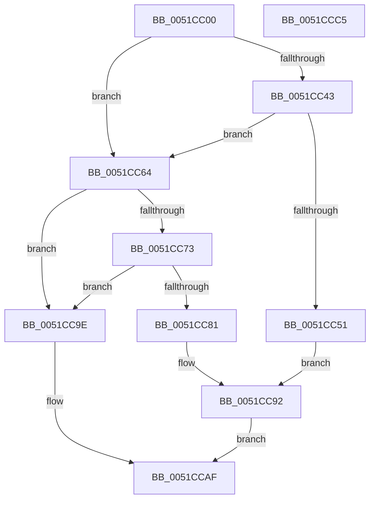

# SymCryptSha256AppendBlocks

- RVA: `0x0051CC00`–`0x0051CCC6` (길이 `198` bytes)
- VA: `0x000000014051CC00`
- 실행 섹션: `.text`
- PDB 이름 있음: `예`; PDB Function 태그: `아니요`
- unwind 정보 RVA: `0x000C2FFC`
- 디코드: `61`개 명령, `198/198` bytes 표시
- 미해석 바이트: `0` (있으면 어셈블리에 `.byte`로 보존)

> 이 문서는 커널 이미지의 기계어와 PDB 기호를 분석해 생성했습니다. 4번과 5번은 함수 원형과 자료형을 바이너리 사용 방식에서 추정한 C 해석이며 원본 소스 복구 결과는 아닙니다.

## 1. Dependencies

- 직접 호출 지점: **10**; 고유 호출 대상: **8**
- 직접 호출자로 확인된 함수: **3**
- RIP 상대 이미지 참조: **2**

### Outgoing calls
- `0x0051CC2F` → [memset](../6C/memset_function_006C6C40.md) (function, `0x006C6C40`)
- `0x0051CC34` → [SymCryptCpuFeaturesNeverPresent](../49/SymCryptCpuFeaturesNeverPresent_function_00498CB0.md) (function, `0x00498CB0`)
- `0x0051CC48` → [SymCryptSaveXmm](../49/SymCryptSaveXmm_function_004990EC.md) (function, `0x004990EC`)
- `0x0051CC5D` → [SymCryptSha256AppendBlocks_shani](SymCryptSha256AppendBlocks_shani_function_0051CCCC.md) (function, `0x0051CCCC`)
- `0x0051CC64` → [SymCryptCpuFeaturesNeverPresent](../49/SymCryptCpuFeaturesNeverPresent_function_00498CB0.md) (function, `0x00498CB0`)
- `0x0051CC78` → [SymCryptSaveXmm](../49/SymCryptSaveXmm_function_004990EC.md) (function, `0x004990EC`)
- `0x0051CC8D` → [SymCryptSha256AppendBlocks_xmm_ssse3_asm](SymCryptSha256AppendBlocks_xmm_ssse3_asm_function_0051F950.md) (function, `0x0051F950`)
- `0x0051CC97` → [SymCryptInjectError](../4A/SymCryptInjectError_function_004A4FCC.md) (function, `0x004A4FCC`)
- `0x0051CCAA` → [SymCryptSha256AppendBlocks_ul1](SymCryptSha256AppendBlocks_ul1_function_0051D090.md) (function, `0x0051D090`)
- `0x0051CCB7` → [_security_check_cookie](../6A/_security_check_cookie_function_006AC640.md) (function, `0x006AC640`)

### Direct callers
- [SymCryptSha256Append](SymCryptSha256Append_function_0051CB20.md) at `0x0051CB89`
- [SymCryptSha256Append](SymCryptSha256Append_function_0051CB20.md) at `0x0051CBA5`
- [SymCryptSha256Result](SymCryptSha256Result_function_0051E2F0.md) at `0x0051E355`
- [SymCryptSha256Result](SymCryptSha256Result_function_0051E2F0.md) at `0x0051E38B`
- [SymCryptParallelSha256AppendBytes_serial](SymCryptParallelSha256AppendBytes_serial_function_0051EEA4.md) at `0x0051EEEB`

### Static image references
- `0x0051CC09` → RVA `0x00E0A740` (`.data`; read)
- `0x0051CC39` → RVA `0x00E0A730` (`.data`; read)

## 2. Other-region calls and transfers

- 다른 실행 섹션으로 향하는 call: **0**
- 별도 외부 분기/꼬리 이동을 확인하지 못했습니다.

## 3. Assembly (complete function range)

```asm
0051CC00  40 53                           push rbx
0051CC02  55                              push rbp
0051CC03  56                              push rsi
0051CC04  57                              push rdi
0051CC05  48 83 EC 78                     sub rsp, 0x78
0051CC09  48 8B 05 30 DB 8E 00            mov rax, qword ptr [rip + 0x8edb30]
0051CC10  48 33 C4                        xor rax, rsp
0051CC13  48 89 44 24 60                  mov qword ptr [rsp + 0x60], rax
0051CC18  48 8B FA                        mov rdi, rdx
0051CC1B  49 8B F0                        mov rsi, r8
0051CC1E  33 D2                           xor edx, edx
0051CC20  48 8B D9                        mov rbx, rcx
0051CC23  48 8D 4C 24 20                  lea rcx, [rsp + 0x20]
0051CC28  49 8B E9                        mov rbp, r9
0051CC2B  44 8D 42 40                     lea r8d, [rdx + 0x40]
0051CC2F  E8 0C A0 1A 00                  call 0x1406c6c40
0051CC34  E8 77 C0 F7 FF                  call 0x140498cb0
0051CC39  0B 05 F1 DA 8E 00               or eax, dword ptr [rip + 0x8edaf1]
0051CC3F  A8 42                           test al, 0x42
0051CC41  75 21                           jne 0x14051cc64
0051CC43  48 8D 4C 24 20                  lea rcx, [rsp + 0x20]
0051CC48  E8 9F C4 F7 FF                  call 0x1404990ec
0051CC4D  85 C0                           test eax, eax
0051CC4F  75 13                           jne 0x14051cc64
0051CC51  4C 8B CD                        mov r9, rbp
0051CC54  4C 8B C6                        mov r8, rsi
0051CC57  48 8B D7                        mov rdx, rdi
0051CC5A  48 8B CB                        mov rcx, rbx
0051CC5D  E8 6A 00 00 00                  call 0x14051cccc
0051CC62  EB 2E                           jmp 0x14051cc92
0051CC64  E8 47 C0 F7 FF                  call 0x140498cb0
0051CC69  0B 05 C1 DA 8E 00               or eax, dword ptr [rip + 0x8edac1]
0051CC6F  A8 82                           test al, 0x82
0051CC71  75 2B                           jne 0x14051cc9e
0051CC73  48 8D 4C 24 20                  lea rcx, [rsp + 0x20]
0051CC78  E8 6F C4 F7 FF                  call 0x1404990ec
0051CC7D  85 C0                           test eax, eax
0051CC7F  75 1D                           jne 0x14051cc9e
0051CC81  4C 8B CD                        mov r9, rbp
0051CC84  4C 8B C6                        mov r8, rsi
0051CC87  48 8B D7                        mov rdx, rdi
0051CC8A  48 8B CB                        mov rcx, rbx
0051CC8D  E8 BE 2C 00 00                  call 0x14051f950
0051CC92  48 8D 4C 24 20                  lea rcx, [rsp + 0x20]
0051CC97  E8 30 83 F8 FF                  call 0x1404a4fcc
0051CC9C  EB 11                           jmp 0x14051ccaf
0051CC9E  4C 8B CD                        mov r9, rbp
0051CCA1  4C 8B C6                        mov r8, rsi
0051CCA4  48 8B D7                        mov rdx, rdi
0051CCA7  48 8B CB                        mov rcx, rbx
0051CCAA  E8 E1 03 00 00                  call 0x14051d090
0051CCAF  48 8B 4C 24 60                  mov rcx, qword ptr [rsp + 0x60]
0051CCB4  48 33 CC                        xor rcx, rsp
0051CCB7  E8 84 F9 18 00                  call 0x1406ac640
0051CCBC  48 83 C4 78                     add rsp, 0x78
0051CCC0  5F                              pop rdi
0051CCC1  5E                              pop rsi
0051CCC2  5D                              pop rbp
0051CCC3  5B                              pop rbx
0051CCC4  C3                              ret
0051CCC5  CC                              int3
```

## 4. C-style interpretation (structured pseudocode)

```c
__int64 __fastcall SymCryptSha256AppendBlocks(__int64 a1, __int64 a2, __int64 a3, __int64 a4)
{
    __int64 result;
    __int64 v_rsp;
    unsigned __int64 v_stack_m38;
    unsigned __int64 v_stack_m78;

    v_rsp = (v_rsp) - (120);
    result = (*(unsigned __int64 *)(v_rip + 9362224)) ^ (v_rsp);
    v_stack_m38 = result;
    a2 = 0;
    result = memset(v_stack_m78, a2, a2 + 64, a4);
    result = SymCryptCpuFeaturesNeverPresent(v_stack_m78, a2, a2 + 64, a4);
    result = (unsigned int)((result) | (*(unsigned int *)(v_rip + 9362161)));
    if ((((unsigned __int8)(result)) & (66)) != 0) goto loc_0051CC64;
    result = SymCryptSaveXmm(v_stack_m78, a2, a2 + 64, a4);
    if ((unsigned int)(result) != 0) goto loc_0051CC64;
    result = SymCryptSha256AppendBlocks_shani(a1, 0, a3, a4);
    goto loc_0051CC92;
loc_0051CC64:
    result = SymCryptCpuFeaturesNeverPresent(a1, 0, a3, a4);
    result = (unsigned int)((result) | (*(unsigned int *)(v_rip + 9362113)));
    if ((((unsigned __int8)(result)) & (130)) != 0) goto loc_0051CC9E;
    result = SymCryptSaveXmm(v_stack_m78, 0, a3, a4);
    if ((unsigned int)(result) != 0) goto loc_0051CC9E;
    result = SymCryptSha256AppendBlocks_xmm_ssse3_asm(a1, 0, a3, a4);
loc_0051CC92:
    result = SymCryptInjectError(v_stack_m78, 0, a3, a4);
    goto loc_0051CCAF;
loc_0051CC9E:
    result = SymCryptSha256AppendBlocks_ul1(a1, 0, a3, a4);
loc_0051CCAF:
    a1 = (v_stack_m38) ^ (v_rsp);
    result = _security_check_cookie(a1, 0, a3, a4);
    v_rsp = (v_rsp) + (120);
    return result;
}
```

## 5. (Beta) C Style

```c
int64_t SymCryptSha256AppendBlocks(int64_t Arg1, int64_t Arg2, int64_t Arg3, int64_t Arg4)
{
    int64_t result;
    int64_t local_rsp;
    uint64_t v_stack_m38;
    uint64_t v_stack_m78;

    local_rsp = (local_rsp) - (120);
    result = (*(uint64_t *)(v_rip + 0x8EDB30)) ^ (local_rsp);
    v_stack_m38 = result;
    Arg2 = 0;
    result = memset(v_stack_m78, Arg2, Arg2 + 64, Arg4);
    result = SymCryptCpuFeaturesNeverPresent(v_stack_m78, Arg2, Arg2 + 64, Arg4);
    result = (uint32_t)((result) | (*(uint32_t *)(v_rip + 0x8EDAF1)));
    if ((((uint8_t)(result)) & (66)) != 0) goto loc_0051CC64;
    result = SymCryptSaveXmm(v_stack_m78, Arg2, Arg2 + 64, Arg4);
    if ((uint32_t)(result) != 0) goto loc_0051CC64;
    result = SymCryptSha256AppendBlocks_shani(Arg1, 0, Arg3, Arg4);
    goto loc_0051CC92;
loc_0051CC64:
    result = SymCryptCpuFeaturesNeverPresent(Arg1, 0, Arg3, Arg4);
    result = (uint32_t)((result) | (*(uint32_t *)(v_rip + 0x8EDAC1)));
    if ((((uint8_t)(result)) & (130)) != 0) goto loc_0051CC9E;
    result = SymCryptSaveXmm(v_stack_m78, 0, Arg3, Arg4);
    if ((uint32_t)(result) != 0) goto loc_0051CC9E;
    result = SymCryptSha256AppendBlocks_xmm_ssse3_asm(Arg1, 0, Arg3, Arg4);
loc_0051CC92:
    result = SymCryptInjectError(v_stack_m78, 0, Arg3, Arg4);
    goto loc_0051CCAF;
loc_0051CC9E:
    result = SymCryptSha256AppendBlocks_ul1(Arg1, 0, Arg3, Arg4);
loc_0051CCAF:
    Arg1 = (v_stack_m38) ^ (local_rsp);
    result = _security_check_cookie(Arg1, 0, Arg3, Arg4);
    local_rsp = (local_rsp) + (120);
    return result;
}
```

## 6. Execution-region graph

[열기: 2D/3D 그래프와 함수 탐색 컨트롤 패널](../../../control-panel.html?section=text&rva=0x0051CC00&view=graph)

- 2D 그래프는 위에서 아래로 흐르고, 3D 그래프는 빈 공간을 드래그해 회전합니다. Shift+드래그는 이동, 휠은 확대·축소, 함수 노드 선택은 대상 보고서 이동입니다.

### Static fallback


