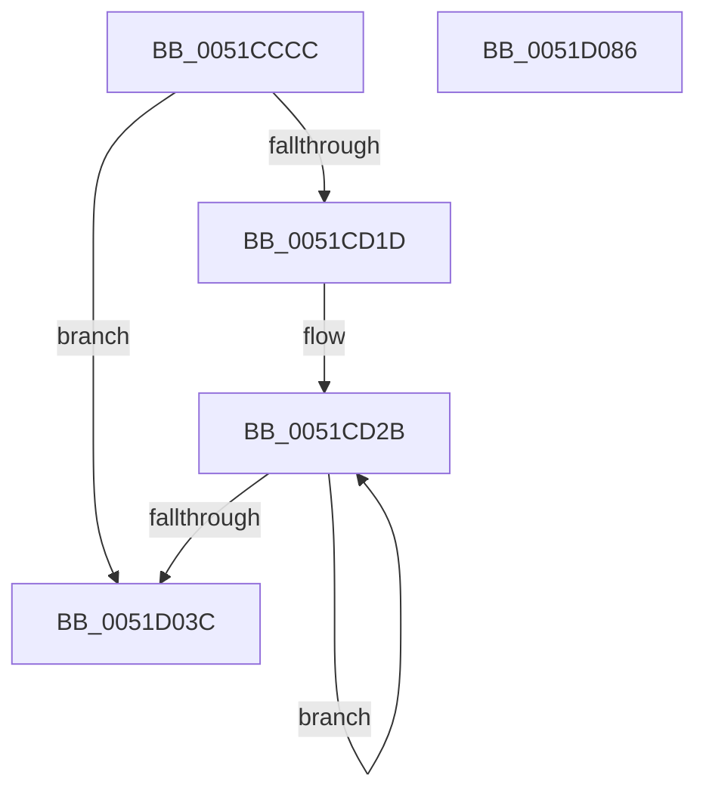

# SymCryptSha256AppendBlocks_shani

- RVA: `0x0051CCCC`–`0x0051D087` (길이 `955` bytes)
- VA: `0x000000014051CCCC`
- 실행 섹션: `.text`
- PDB 이름 있음: `예`; PDB Function 태그: `아니요`
- unwind 정보 RVA: `0x000C3018`
- 디코드: `193`개 명령, `955/955` bytes 표시
- 미해석 바이트: `0` (있으면 어셈블리에 `.byte`로 보존)

> 이 문서는 커널 이미지의 기계어와 PDB 기호를 분석해 생성했습니다. 4번과 5번은 함수 원형과 자료형을 바이너리 사용 방식에서 추정한 C 해석이며 원본 소스 복구 결과는 아닙니다.

## 1. Dependencies

- 직접 호출 지점: **0**; 고유 호출 대상: **0**
- 직접 호출자로 확인된 함수: **1**
- RIP 상대 이미지 참조: **17**

### Outgoing calls
- 직접 디코드된 call 명령이 없습니다.

### Direct callers
- [SymCryptSha256AppendBlocks](SymCryptSha256AppendBlocks_function_0051CC00.md) at `0x0051CC5D`

### Static image references
- `0x0051CD36` → RVA `0x0001FA00` (`.rdata`; read)
- `0x0051CD6A` → RVA `0x0001F900` (`.rdata`; read)
- `0x0051CDA1` → RVA `0x0001F910` (`.rdata`; read)
- `0x0051CDBC` → RVA `0x0001F920` (`.rdata`; read)
- `0x0051CDD7` → RVA `0x0001F930` (`.rdata`; read)
- `0x0051CDF2` → RVA `0x0001F940` (`.rdata`; read)
- `0x0051CE15` → RVA `0x0001F950` (`.rdata`; read)
- `0x0051CE4E` → RVA `0x0001F960` (`.rdata`; read)
- `0x0051CE7B` → RVA `0x0001F970` (`.rdata`; read)
- `0x0051CEA8` → RVA `0x0001F980` (`.rdata`; read)
- `0x0051CED5` → RVA `0x0001F990` (`.rdata`; read)
- `0x0051CF18` → RVA `0x0001F9A0` (`.rdata`; read)
- `0x0051CF41` → RVA `0x0001F9B0` (`.rdata`; read)
- `0x0051CF72` → RVA `0x0001F9C0` (`.rdata`; read)
- `0x0051CFA3` → RVA `0x0001F9D0` (`.rdata`; read)
- `0x0051CFD4` → RVA `0x0001F9E0` (`.rdata`; read)
- `0x0051D011` → RVA `0x0001F9F0` (`.rdata`; read)

## 2. Other-region calls and transfers

- 다른 실행 섹션으로 향하는 call: **0**
- 별도 외부 분기/꼬리 이동을 확인하지 못했습니다.

## 3. Assembly (complete function range)

```asm
0051CCCC  48 8B C4                        mov rax, rsp
0051CCCF  48 83 EC 68                     sub rsp, 0x68
0051CCD3  0F 29 70 E8                     movaps xmmword ptr [rax - 0x18], xmm6
0051CCD7  4C 8B D2                        mov r10, rdx
0051CCDA  0F 29 78 D8                     movaps xmmword ptr [rax - 0x28], xmm7
0051CCDE  44 0F 29 40 C8                  movaps xmmword ptr [rax - 0x38], xmm8
0051CCE3  44 0F 29 48 B8                  movaps xmmword ptr [rax - 0x48], xmm9
0051CCE8  44 0F 29 50 A8                  movaps xmmword ptr [rax - 0x58], xmm10
0051CCED  44 0F 29 1C 24                  movaps xmmword ptr [rsp], xmm11
0051CCF2  F3 0F 6F 11                     movdqu xmm2, xmmword ptr [rcx]
0051CCF6  F3 0F 6F 49 10                  movdqu xmm1, xmmword ptr [rcx + 0x10]
0051CCFB  66 0F 6F C2                     movdqa xmm0, xmm2
0051CCFF  66 0F 6C C1                     punpcklqdq xmm0, xmm1
0051CD03  66 0F 6D D1                     punpckhqdq xmm2, xmm1
0051CD07  66 44 0F 70 D0 1B               pshufd xmm10, xmm0, 0x1b
0051CD0D  66 44 0F 70 DA 1B               pshufd xmm11, xmm2, 0x1b
0051CD13  49 83 F8 40                     cmp r8, 0x40
0051CD17  0F 82 1F 03 00 00               jb 0x14051d03c
0051CD1D  49 8B D0                        mov rdx, r8
0051CD20  48 C1 EA 06                     shr rdx, 6
0051CD24  48 6B C2 C0                     imul rax, rdx, -0x40
0051CD28  4C 03 C0                        add r8, rax
0051CD2B  F3 41 0F 6F 0A                  movdqu xmm1, xmmword ptr [r10]
0051CD30  F3 41 0F 6F 52 10               movdqu xmm2, xmmword ptr [r10 + 0x10]
0051CD36  66 0F 38 00 0D C1 2C B0 FF      pshufb xmm1, xmmword ptr [rip - 0x4fd33f]
0051CD3F  66 0F 38 00 15 B8 2C B0 FF      pshufb xmm2, xmmword ptr [rip - 0x4fd348]
0051CD48  F3 41 0F 6F 5A 20               movdqu xmm3, xmmword ptr [r10 + 0x20]
0051CD4E  F3 41 0F 6F 62 30               movdqu xmm4, xmmword ptr [r10 + 0x30]
0051CD54  4D 8D 52 40                     lea r10, [r10 + 0x40]
0051CD58  66 0F 38 00 1D 9F 2C B0 FF      pshufb xmm3, xmmword ptr [rip - 0x4fd361]
0051CD61  66 0F 38 00 25 96 2C B0 FF      pshufb xmm4, xmmword ptr [rip - 0x4fd36a]
0051CD6A  66 0F 6F 05 8E 2B B0 FF         movdqa xmm0, xmmword ptr [rip - 0x4fd472]
0051CD72  66 45 0F 6F CA                  movdqa xmm9, xmm10
0051CD77  66 0F FE C1                     paddd xmm0, xmm1
0051CD7B  66 0F 6F EC                     movdqa xmm5, xmm4
0051CD7F  0F 38 CC CA                     sha256msg1 xmm1, xmm2
0051CD83  66 0F 3A 0F EB 04               palignr xmm5, xmm3, 4
0051CD89  66 45 0F 6F C3                  movdqa xmm8, xmm11
0051CD8E  45 0F 38 CB C2                  sha256rnds2 xmm8, xmm10, xmm0
0051CD93  66 0F 70 C0 0E                  pshufd xmm0, xmm0, 0xe
0051CD98  66 0F FE E9                     paddd xmm5, xmm1
0051CD9C  45 0F 38 CB D0                  sha256rnds2 xmm10, xmm8, xmm0
0051CDA1  66 0F 6F 05 67 2B B0 FF         movdqa xmm0, xmmword ptr [rip - 0x4fd499]
0051CDA9  66 0F FE C2                     paddd xmm0, xmm2
0051CDAD  45 0F 38 CB C2                  sha256rnds2 xmm8, xmm10, xmm0
0051CDB2  66 0F 70 C0 0E                  pshufd xmm0, xmm0, 0xe
0051CDB7  45 0F 38 CB D0                  sha256rnds2 xmm10, xmm8, xmm0
0051CDBC  66 0F 6F 05 5C 2B B0 FF         movdqa xmm0, xmmword ptr [rip - 0x4fd4a4]
0051CDC4  66 0F FE C3                     paddd xmm0, xmm3
0051CDC8  45 0F 38 CB C2                  sha256rnds2 xmm8, xmm10, xmm0
0051CDCD  66 0F 70 C0 0E                  pshufd xmm0, xmm0, 0xe
0051CDD2  45 0F 38 CB D0                  sha256rnds2 xmm10, xmm8, xmm0
0051CDD7  66 0F 6F 05 51 2B B0 FF         movdqa xmm0, xmmword ptr [rip - 0x4fd4af]
0051CDDF  66 0F FE C4                     paddd xmm0, xmm4
0051CDE3  45 0F 38 CB C2                  sha256rnds2 xmm8, xmm10, xmm0
0051CDE8  66 0F 70 C0 0E                  pshufd xmm0, xmm0, 0xe
0051CDED  45 0F 38 CB D0                  sha256rnds2 xmm10, xmm8, xmm0
0051CDF2  66 0F 6F 05 46 2B B0 FF         movdqa xmm0, xmmword ptr [rip - 0x4fd4ba]
0051CDFA  0F 38 CD EC                     sha256msg2 xmm5, xmm4
0051CDFE  66 0F FE C5                     paddd xmm0, xmm5
0051CE02  66 0F 6F CD                     movdqa xmm1, xmm5
0051CE06  45 0F 38 CB C2                  sha256rnds2 xmm8, xmm10, xmm0
0051CE0B  66 0F 70 C0 0E                  pshufd xmm0, xmm0, 0xe
0051CE10  45 0F 38 CB D0                  sha256rnds2 xmm10, xmm8, xmm0
0051CE15  66 0F 6F 05 33 2B B0 FF         movdqa xmm0, xmmword ptr [rip - 0x4fd4cd]
0051CE1D  0F 38 CC D3                     sha256msg1 xmm2, xmm3
0051CE21  0F 38 CC DC                     sha256msg1 xmm3, xmm4
0051CE25  66 0F 3A 0F CC 04               palignr xmm1, xmm4, 4
0051CE2B  0F 38 CC E5                     sha256msg1 xmm4, xmm5
0051CE2F  66 0F FE CA                     paddd xmm1, xmm2
0051CE33  0F 38 CD CD                     sha256msg2 xmm1, xmm5
0051CE37  66 0F FE C1                     paddd xmm0, xmm1
0051CE3B  66 0F 6F D1                     movdqa xmm2, xmm1
0051CE3F  45 0F 38 CB C2                  sha256rnds2 xmm8, xmm10, xmm0
0051CE44  66 0F 70 C0 0E                  pshufd xmm0, xmm0, 0xe
0051CE49  45 0F 38 CB D0                  sha256rnds2 xmm10, xmm8, xmm0
0051CE4E  66 0F 6F 05 0A 2B B0 FF         movdqa xmm0, xmmword ptr [rip - 0x4fd4f6]
0051CE56  66 0F 3A 0F D5 04               palignr xmm2, xmm5, 4
0051CE5C  66 0F FE D3                     paddd xmm2, xmm3
0051CE60  0F 38 CD D1                     sha256msg2 xmm2, xmm1
0051CE64  66 0F FE C2                     paddd xmm0, xmm2
0051CE68  66 0F 6F DA                     movdqa xmm3, xmm2
0051CE6C  45 0F 38 CB C2                  sha256rnds2 xmm8, xmm10, xmm0
0051CE71  66 0F 70 C0 0E                  pshufd xmm0, xmm0, 0xe
0051CE76  45 0F 38 CB D0                  sha256rnds2 xmm10, xmm8, xmm0
0051CE7B  66 0F 6F 05 ED 2A B0 FF         movdqa xmm0, xmmword ptr [rip - 0x4fd513]
0051CE83  66 0F 3A 0F D9 04               palignr xmm3, xmm1, 4
0051CE89  66 0F FE DC                     paddd xmm3, xmm4
0051CE8D  0F 38 CD DA                     sha256msg2 xmm3, xmm2
0051CE91  66 0F FE C3                     paddd xmm0, xmm3
0051CE95  66 0F 6F E3                     movdqa xmm4, xmm3
0051CE99  45 0F 38 CB C2                  sha256rnds2 xmm8, xmm10, xmm0
0051CE9E  66 0F 70 C0 0E                  pshufd xmm0, xmm0, 0xe
0051CEA3  45 0F 38 CB D0                  sha256rnds2 xmm10, xmm8, xmm0
0051CEA8  66 0F 6F 05 D0 2A B0 FF         movdqa xmm0, xmmword ptr [rip - 0x4fd530]
0051CEB0  66 0F 3A 0F E2 04               palignr xmm4, xmm2, 4
0051CEB6  0F 38 CC E9                     sha256msg1 xmm5, xmm1
0051CEBA  66 0F FE E5                     paddd xmm4, xmm5
0051CEBE  0F 38 CD E3                     sha256msg2 xmm4, xmm3
0051CEC2  66 0F FE C4                     paddd xmm0, xmm4
0051CEC6  45 0F 38 CB C2                  sha256rnds2 xmm8, xmm10, xmm0
0051CECB  66 0F 70 C0 0E                  pshufd xmm0, xmm0, 0xe
0051CED0  45 0F 38 CB D0                  sha256rnds2 xmm10, xmm8, xmm0
0051CED5  66 0F 6F 05 B3 2A B0 FF         movdqa xmm0, xmmword ptr [rip - 0x4fd54d]
0051CEDD  66 0F 6F EC                     movdqa xmm5, xmm4
0051CEE1  66 0F 3A 0F EB 04               palignr xmm5, xmm3, 4
0051CEE7  0F 38 CC CA                     sha256msg1 xmm1, xmm2
0051CEEB  66 0F FE E9                     paddd xmm5, xmm1
0051CEEF  0F 38 CC D3                     sha256msg1 xmm2, xmm3
0051CEF3  0F 38 CD EC                     sha256msg2 xmm5, xmm4
0051CEF7  66 0F FE C5                     paddd xmm0, xmm5
0051CEFB  66 0F 6F F5                     movdqa xmm6, xmm5
0051CEFF  66 0F 3A 0F F4 04               palignr xmm6, xmm4, 4
0051CF05  66 0F FE F2                     paddd xmm6, xmm2
0051CF09  45 0F 38 CB C2                  sha256rnds2 xmm8, xmm10, xmm0
0051CF0E  66 0F 70 C0 0E                  pshufd xmm0, xmm0, 0xe
0051CF13  45 0F 38 CB D0                  sha256rnds2 xmm10, xmm8, xmm0
0051CF18  66 0F 6F 05 80 2A B0 FF         movdqa xmm0, xmmword ptr [rip - 0x4fd580]
0051CF20  0F 38 CD F5                     sha256msg2 xmm6, xmm5
0051CF24  66 0F FE C6                     paddd xmm0, xmm6
0051CF28  66 0F 6F FE                     movdqa xmm7, xmm6
0051CF2C  66 0F 3A 0F FD 04               palignr xmm7, xmm5, 4
0051CF32  45 0F 38 CB C2                  sha256rnds2 xmm8, xmm10, xmm0
0051CF37  66 0F 70 C0 0E                  pshufd xmm0, xmm0, 0xe
0051CF3C  45 0F 38 CB D0                  sha256rnds2 xmm10, xmm8, xmm0
0051CF41  66 0F 6F 05 67 2A B0 FF         movdqa xmm0, xmmword ptr [rip - 0x4fd599]
0051CF49  0F 38 CC DC                     sha256msg1 xmm3, xmm4
0051CF4D  66 0F FE FB                     paddd xmm7, xmm3
0051CF51  0F 38 CD FE                     sha256msg2 xmm7, xmm6
0051CF55  66 0F FE C7                     paddd xmm0, xmm7
0051CF59  66 0F 6F DF                     movdqa xmm3, xmm7
0051CF5D  66 0F 3A 0F DE 04               palignr xmm3, xmm6, 4
0051CF63  45 0F 38 CB C2                  sha256rnds2 xmm8, xmm10, xmm0
0051CF68  66 0F 70 C0 0E                  pshufd xmm0, xmm0, 0xe
0051CF6D  45 0F 38 CB D0                  sha256rnds2 xmm10, xmm8, xmm0
0051CF72  66 0F 6F 05 46 2A B0 FF         movdqa xmm0, xmmword ptr [rip - 0x4fd5ba]
0051CF7A  0F 38 CC E5                     sha256msg1 xmm4, xmm5
0051CF7E  66 0F FE DC                     paddd xmm3, xmm4
0051CF82  0F 38 CD DF                     sha256msg2 xmm3, xmm7
0051CF86  66 0F FE C3                     paddd xmm0, xmm3
0051CF8A  66 0F 6F D3                     movdqa xmm2, xmm3
0051CF8E  66 0F 3A 0F D7 04               palignr xmm2, xmm7, 4
0051CF94  45 0F 38 CB C2                  sha256rnds2 xmm8, xmm10, xmm0
0051CF99  66 0F 70 C0 0E                  pshufd xmm0, xmm0, 0xe
0051CF9E  45 0F 38 CB D0                  sha256rnds2 xmm10, xmm8, xmm0
0051CFA3  66 0F 6F 05 25 2A B0 FF         movdqa xmm0, xmmword ptr [rip - 0x4fd5db]
0051CFAB  0F 38 CC EE                     sha256msg1 xmm5, xmm6
0051CFAF  66 0F FE D5                     paddd xmm2, xmm5
0051CFB3  0F 38 CD D3                     sha256msg2 xmm2, xmm3
0051CFB7  66 0F FE C2                     paddd xmm0, xmm2
0051CFBB  66 0F 6F CA                     movdqa xmm1, xmm2
0051CFBF  66 0F 3A 0F CB 04               palignr xmm1, xmm3, 4
0051CFC5  45 0F 38 CB C2                  sha256rnds2 xmm8, xmm10, xmm0
0051CFCA  66 0F 70 C0 0E                  pshufd xmm0, xmm0, 0xe
0051CFCF  45 0F 38 CB D0                  sha256rnds2 xmm10, xmm8, xmm0
0051CFD4  66 0F 6F 05 04 2A B0 FF         movdqa xmm0, xmmword ptr [rip - 0x4fd5fc]
0051CFDC  0F 38 CC F7                     sha256msg1 xmm6, xmm7
0051CFE0  66 0F FE CE                     paddd xmm1, xmm6
0051CFE4  0F 38 CD CA                     sha256msg2 xmm1, xmm2
0051CFE8  66 0F FE C1                     paddd xmm0, xmm1
0051CFEC  45 0F 38 CB C2                  sha256rnds2 xmm8, xmm10, xmm0
0051CFF1  66 0F 70 C0 0E                  pshufd xmm0, xmm0, 0xe
0051CFF6  45 0F 38 CB D0                  sha256rnds2 xmm10, xmm8, xmm0
0051CFFB  66 0F 6F C1                     movdqa xmm0, xmm1
0051CFFF  66 0F 3A 0F C2 04               palignr xmm0, xmm2, 4
0051D005  0F 38 CC FB                     sha256msg1 xmm7, xmm3
0051D009  66 0F FE C7                     paddd xmm0, xmm7
0051D00D  0F 38 CD C1                     sha256msg2 xmm0, xmm1
0051D011  66 0F FE 05 D7 29 B0 FF         paddd xmm0, xmmword ptr [rip - 0x4fd629]
0051D019  45 0F 38 CB C2                  sha256rnds2 xmm8, xmm10, xmm0
0051D01E  66 0F 70 C0 0E                  pshufd xmm0, xmm0, 0xe
0051D023  66 45 0F FE D8                  paddd xmm11, xmm8
0051D028  45 0F 38 CB D0                  sha256rnds2 xmm10, xmm8, xmm0
0051D02D  66 45 0F FE D1                  paddd xmm10, xmm9
0051D032  48 83 EA 01                     sub rdx, 1
0051D036  0F 85 EF FC FF FF               jne 0x14051cd2b
0051D03C  0F 28 74 24 50                  movaps xmm6, xmmword ptr [rsp + 0x50]
0051D041  0F 28 7C 24 40                  movaps xmm7, xmmword ptr [rsp + 0x40]
0051D046  44 0F 28 44 24 30               movaps xmm8, xmmword ptr [rsp + 0x30]
0051D04C  44 0F 28 4C 24 20               movaps xmm9, xmmword ptr [rsp + 0x20]
0051D052  66 41 0F 70 D2 1B               pshufd xmm2, xmm10, 0x1b
0051D058  44 0F 28 54 24 10               movaps xmm10, xmmword ptr [rsp + 0x10]
0051D05E  66 0F 6F C2                     movdqa xmm0, xmm2
0051D062  66 41 0F 70 CB 1B               pshufd xmm1, xmm11, 0x1b
0051D068  44 0F 28 1C 24                  movaps xmm11, xmmword ptr [rsp]
0051D06D  66 0F 6C C1                     punpcklqdq xmm0, xmm1
0051D071  F3 0F 7F 01                     movdqu xmmword ptr [rcx], xmm0
0051D075  66 0F 6D D1                     punpckhqdq xmm2, xmm1
0051D079  F3 0F 7F 51 10                  movdqu xmmword ptr [rcx + 0x10], xmm2
0051D07E  4D 89 01                        mov qword ptr [r9], r8
0051D081  48 83 C4 68                     add rsp, 0x68
0051D085  C3                              ret
0051D086  CC                              int3
```

## 4. C-style interpretation (structured pseudocode)

```c
__int64 __fastcall SymCryptSha256AppendBlocks_shani(__int64 a1, __int64 a2, __int64 a3, __int64 a4)
{
    __int64 result;
    __int64 v_rsp;
    unsigned __int64 v_stack_m18;
    unsigned __int64 v_stack_m28;
    unsigned __int64 v_stack_m38;
    unsigned __int64 v_stack_m48;
    unsigned __int64 v_stack_m58;
    unsigned __int64 v_stack_m68;

    v_rsp = (v_rsp) - (104);
    *(unsigned __int64 *)(v_rsp - 24) = v_xmm6;
    *(unsigned __int64 *)(v_rsp - 40) = v_xmm7;
    *(unsigned __int64 *)(v_rsp - 56) = v_xmm8;
    *(unsigned __int64 *)(v_rsp - 72) = v_xmm9;
    *(unsigned __int64 *)(v_rsp - 88) = v_xmm10;
    v_stack_m68 = v_xmm11;
    if (a3 < 64) goto loc_0051D03C;
    a2 = (a3) >> (6);
    result = (v_rsp) * (a2);
    a3 = (a3) + (result);
loc_0051CD2B:
    a2 = (a2) - (1);
    if (condition_is_not_equal) goto loc_0051CD2B;
loc_0051D03C:
    *(unsigned __int64 *)(a1) = v_xmm0;
    *(unsigned __int64 *)(a1 + 16) = v_xmm2;
    *(unsigned __int64 *)(a4) = a3;
    v_rsp = (v_rsp) + (104);
    return result;
}
```

## 5. (Beta) C Style

```c
int64_t SymCryptSha256AppendBlocks_shani(void *Arg1, void *Arg2, int64_t Arg3, void *Arg4)
{
    uint8_t *arg1 = (uint8_t *)Arg1;
    uint8_t *arg2 = (uint8_t *)Arg2;
    uint8_t *arg4 = (uint8_t *)Arg4;

    int64_t result;
    int64_t local_rsp;
    uint64_t v_stack_m18;
    uint64_t v_stack_m28;
    uint64_t v_stack_m38;
    uint64_t v_stack_m48;
    uint64_t v_stack_m58;
    uint64_t v_stack_m68;

    local_rsp = (local_rsp) - (104);
    *(uint64_t *)(local_rsp - 0x18) = v_xmm6;
    *(uint64_t *)(local_rsp - 0x28) = v_xmm7;
    *(uint64_t *)(local_rsp - 0x38) = v_xmm8;
    *(uint64_t *)(local_rsp - 0x48) = v_xmm9;
    *(uint64_t *)(local_rsp - 0x58) = v_xmm10;
    v_stack_m68 = v_xmm11;
    if (Arg3 < 64) goto loc_0051D03C;
    Arg2 = (Arg3) >> (6);
    result = (local_rsp) * (Arg2);
    Arg3 = (Arg3) + (result);
loc_0051CD2B:
    Arg2 = (Arg2) - (1);
    if (condition_is_not_equal) goto loc_0051CD2B;
loc_0051D03C:
    *(uint64_t *)(arg1) = v_xmm0;
    *(uint64_t *)(arg1 + 0x10) = v_xmm2;
    *(uint64_t *)(arg4) = Arg3;
    local_rsp = (local_rsp) + (104);
    return result;
}
```

### 관측된 메모리 오프셋

구조체 형식이 확인되지 않은 접근은 인자 기준의 오프셋으로만 기록했습니다.

| 기준 인자 | 오프셋 표현 | 폭 (bit) | 접근 |
|---|---:|---:|---|
| `Arg1` | `+ 0x0` | `128` | `R` |
| `Arg1` | `+ 0x0` | `128` | `W` |
| `Arg1` | `+ 0x10` | `128` | `R` |
| `Arg1` | `+ 0x10` | `128` | `W` |
| `Arg2` | `+ 0x0` | `128` | `R` |
| `Arg2` | `+ 0x10` | `128` | `R` |
| `Arg2` | `+ 0x20` | `128` | `R` |
| `Arg2` | `+ 0x30` | `128` | `R` |
| `Arg2` | `+ 0x40` | `64` | `R` |
| `Arg4` | `+ 0x0` | `64` | `W` |

## 6. Execution-region graph

[열기: 2D/3D 그래프와 함수 탐색 컨트롤 패널](../../../control-panel.html?section=text&rva=0x0051CCCC&view=graph)

- 2D 그래프는 위에서 아래로 흐르고, 3D 그래프는 빈 공간을 드래그해 회전합니다. Shift+드래그는 이동, 휠은 확대·축소, 함수 노드 선택은 대상 보고서 이동입니다.

### Static fallback


