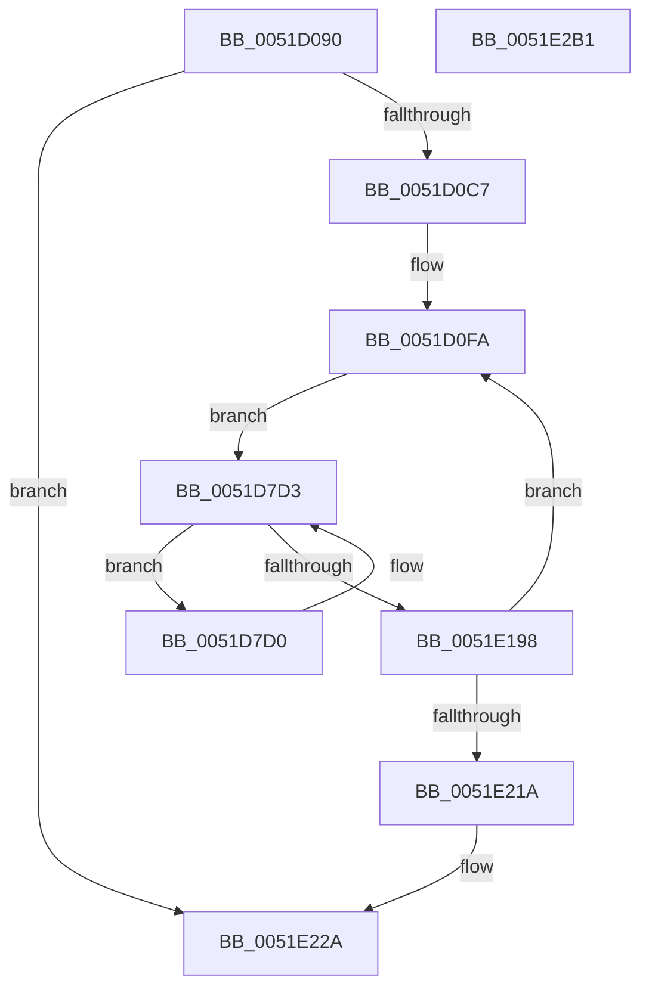

# SymCryptSha256AppendBlocks_ul1

- RVA: `0x0051D090`–`0x0051E2B2` (길이 `4,642` bytes)
- VA: `0x000000014051D090`
- 실행 섹션: `.text`
- PDB 이름 있음: `예`; PDB Function 태그: `아니요`
- unwind 정보 RVA: `0x000C303C`
- 디코드: `1,562`개 명령, `4,642/4,642` bytes 표시
- 미해석 바이트: `0` (있으면 어셈블리에 `.byte`로 보존)

> 이 문서는 커널 이미지의 기계어와 PDB 기호를 분석해 생성했습니다. 4번과 5번은 함수 원형과 자료형을 바이너리 사용 방식에서 추정한 C 해석이며 원본 소스 복구 결과는 아닙니다.

## 1. Dependencies

- 직접 호출 지점: **0**; 고유 호출 대상: **0**
- 직접 호출자로 확인된 함수: **1**
- RIP 상대 이미지 참조: **2**

### Outgoing calls
- 직접 디코드된 call 명령이 없습니다.

### Direct callers
- [SymCryptSha256AppendBlocks](SymCryptSha256AppendBlocks_function_0051CC00.md) at `0x0051CCAA`

### Static image references
- `0x0051D7C3` → RVA `0x0001F948` (`.rdata`; read)
- `0x0051E184` → RVA `0x0001FA08` (`.rdata`; read)

## 2. Other-region calls and transfers

- 다른 실행 섹션으로 향하는 call: **0**
- 별도 외부 분기/꼬리 이동을 확인하지 못했습니다.

## 3. Assembly (complete function range)

```asm
0051D090  48 89 5C 24 10                  mov qword ptr [rsp + 0x10], rbx
0051D095  55                              push rbp
0051D096  56                              push rsi
0051D097  57                              push rdi
0051D098  41 54                           push r12
0051D09A  41 55                           push r13
0051D09C  41 56                           push r14
0051D09E  41 57                           push r15
0051D0A0  48 81 EC 10 01 00 00            sub rsp, 0x110
0051D0A7  48 89 8C 24 B0 00 00 00         mov qword ptr [rsp + 0xb0], rcx
0051D0AF  49 8B C1                        mov rax, r9
0051D0B2  48 89 84 24 C0 00 00 00         mov qword ptr [rsp + 0xc0], rax
0051D0BA  48 8B F9                        mov rdi, rcx
0051D0BD  49 83 F8 40                     cmp r8, 0x40
0051D0C1  0F 82 63 11 00 00               jb 0x14051e22a
0051D0C7  F3 0F 6F 21                     movdqu xmm4, xmmword ptr [rcx]
0051D0CB  49 8B C0                        mov rax, r8
0051D0CE  4C 8D 6A 08                     lea r13, [rdx + 8]
0051D0D2  F3 0F 6F 69 10                  movdqu xmm5, xmmword ptr [rcx + 0x10]
0051D0D7  48 C1 E8 06                     shr rax, 6
0051D0DB  48 89 84 24 A8 00 00 00         mov qword ptr [rsp + 0xa8], rax
0051D0E3  48 6B C0 C0                     imul rax, rax, -0x40
0051D0E7  4C 89 AC 24 A0 00 00 00         mov qword ptr [rsp + 0xa0], r13
0051D0EF  4C 03 C0                        add r8, rax
0051D0F2  4C 89 84 24 B8 00 00 00         mov qword ptr [rsp + 0xb8], r8
0051D0FA  8B 77 10                        mov esi, dword ptr [rdi + 0x10]
0051D0FD  8B D6                           mov edx, esi
0051D0FF  8B 2F                           mov ebp, dword ptr [rdi]
0051D101  8B C6                           mov eax, esi
0051D103  44 8B 4F 18                     mov r9d, dword ptr [rdi + 0x18]
0051D107  41 8B C9                        mov ecx, r9d
0051D10A  44 8B 5F 14                     mov r11d, dword ptr [rdi + 0x14]
0051D10E  41 33 CB                        xor ecx, r11d
0051D111  8B 5F 04                        mov ebx, dword ptr [rdi + 4]
0051D114  23 CE                           and ecx, esi
0051D116  44 8B 57 08                     mov r10d, dword ptr [rdi + 8]
0051D11A  41 33 C9                        xor ecx, r9d
0051D11D  44 8B 77 0C                     mov r14d, dword ptr [rdi + 0xc]
0051D121  45 8B 45 F8                     mov r8d, dword ptr [r13 - 8]
0051D125  C1 C8 0B                        ror eax, 0xb
0051D128  C1 CA 19                        ror edx, 0x19
0051D12B  33 D0                           xor edx, eax
0051D12D  8B C6                           mov eax, esi
0051D12F  C1 C8 06                        ror eax, 6
0051D132  33 C2                           xor eax, edx
0051D134  8B D5                           mov edx, ebp
0051D136  C1 CA 16                        ror edx, 0x16
0051D139  41 0F C8                        bswap r8d
0051D13C  44 89 44 24 50                  mov dword ptr [rsp + 0x50], r8d
0051D141  41 81 C0 98 2F 8A 42            add r8d, 0x428a2f98
0051D148  41 03 C0                        add eax, r8d
0051D14B  44 8B 47 1C                     mov r8d, dword ptr [rdi + 0x1c]
0051D14F  03 C8                           add ecx, eax
0051D151  41 8B FA                        mov edi, r10d
0051D154  44 03 C1                        add r8d, ecx
0051D157  0B FB                           or edi, ebx
0051D159  45 03 F0                        add r14d, r8d
0051D15C  23 FD                           and edi, ebp
0051D15E  8B C5                           mov eax, ebp
0051D160  41 8B CB                        mov ecx, r11d
0051D163  C1 C8 0D                        ror eax, 0xd
0051D166  33 CE                           xor ecx, esi
0051D168  33 D0                           xor edx, eax
0051D16A  41 23 CE                        and ecx, r14d
0051D16D  41 33 CB                        xor ecx, r11d
0051D170  8B C5                           mov eax, ebp
0051D172  C1 C8 02                        ror eax, 2
0051D175  33 D0                           xor edx, eax
0051D177  41 8B C2                        mov eax, r10d
0051D17A  23 C3                           and eax, ebx
0051D17C  0B F8                           or edi, eax
0051D17E  41 8D 04 10                     lea eax, [r8 + rdx]
0051D182  45 8B 45 FC                     mov r8d, dword ptr [r13 - 4]
0051D186  03 F8                           add edi, eax
0051D188  41 8B D6                        mov edx, r14d
0051D18B  C1 CA 19                        ror edx, 0x19
0051D18E  41 8B C6                        mov eax, r14d
0051D191  C1 C8 0B                        ror eax, 0xb
0051D194  33 D0                           xor edx, eax
0051D196  41 8B C6                        mov eax, r14d
0051D199  C1 C8 06                        ror eax, 6
0051D19C  33 C2                           xor eax, edx
0051D19E  8B D7                           mov edx, edi
0051D1A0  41 0F C8                        bswap r8d
0051D1A3  41 03 C0                        add eax, r8d
0051D1A6  C1 CA 16                        ror edx, 0x16
0051D1A9  03 C8                           add ecx, eax
0051D1AB  44 89 44 24 64                  mov dword ptr [rsp + 0x64], r8d
0051D1B0  45 8D 81 91 44 37 71            lea r8d, [r9 + 0x71374491]
0051D1B7  8B C7                           mov eax, edi
0051D1B9  C1 C8 0D                        ror eax, 0xd
0051D1BC  44 03 C1                        add r8d, ecx
0051D1BF  33 D0                           xor edx, eax
0051D1C1  44 8B CB                        mov r9d, ebx
0051D1C4  44 0B CD                        or r9d, ebp
0051D1C7  8B C7                           mov eax, edi
0051D1C9  C1 C8 02                        ror eax, 2
0051D1CC  44 23 CF                        and r9d, edi
0051D1CF  33 D0                           xor edx, eax
0051D1D1  47 8D 3C 10                     lea r15d, [r8 + r10]
0051D1D5  8B C3                           mov eax, ebx
0051D1D7  23 C5                           and eax, ebp
0051D1D9  44 0B C8                        or r9d, eax
0051D1DC  41 8D 04 10                     lea eax, [r8 + rdx]
0051D1E0  45 8B 45 00                     mov r8d, dword ptr [r13]
0051D1E4  44 03 C8                        add r9d, eax
0051D1E7  41 0F C8                        bswap r8d
0051D1EA  44 89 44 24 28                  mov dword ptr [rsp + 0x28], r8d
0051D1EF  41 8B D7                        mov edx, r15d
0051D1F2  C1 CA 19                        ror edx, 0x19
0051D1F5  41 8B C7                        mov eax, r15d
0051D1F8  C1 C8 0B                        ror eax, 0xb
0051D1FB  41 8B CE                        mov ecx, r14d
0051D1FE  33 D0                           xor edx, eax
0051D200  33 CE                           xor ecx, esi
0051D202  41 23 CF                        and ecx, r15d
0051D205  41 8B C7                        mov eax, r15d
0051D208  C1 C8 06                        ror eax, 6
0051D20B  33 CE                           xor ecx, esi
0051D20D  33 D0                           xor edx, eax
0051D20F  81 C1 CF FB C0 B5               add ecx, 0xb5c0fbcf
0051D215  44 03 C2                        add r8d, edx
0051D218  81 C6 A5 DB B5 E9               add esi, 0xe9b5dba5
0051D21E  44 03 C1                        add r8d, ecx
0051D221  41 8B D1                        mov edx, r9d
0051D224  45 03 C3                        add r8d, r11d
0051D227  C1 CA 16                        ror edx, 0x16
0051D22A  41 8B C1                        mov eax, r9d
0051D22D  44 8B D7                        mov r10d, edi
0051D230  C1 C8 0D                        ror eax, 0xd
0051D233  44 0B D5                        or r10d, ebp
0051D236  33 D0                           xor edx, eax
0051D238  45 23 D1                        and r10d, r9d
0051D23B  45 8D 24 18                     lea r12d, [r8 + rbx]
0051D23F  41 8B C1                        mov eax, r9d
0051D242  C1 C8 02                        ror eax, 2
0051D245  41 8B CF                        mov ecx, r15d
0051D248  33 D0                           xor edx, eax
0051D24A  41 33 CE                        xor ecx, r14d
0051D24D  41 23 CC                        and ecx, r12d
0051D250  8B C7                           mov eax, edi
0051D252  23 C5                           and eax, ebp
0051D254  41 33 CE                        xor ecx, r14d
0051D257  44 0B D0                        or r10d, eax
0051D25A  45 8B D9                        mov r11d, r9d
0051D25D  41 8D 04 10                     lea eax, [r8 + rdx]
0051D261  44 0B DF                        or r11d, edi
0051D264  45 8B 45 04                     mov r8d, dword ptr [r13 + 4]
0051D268  44 03 D0                        add r10d, eax
0051D26B  41 0F C8                        bswap r8d
0051D26E  44 89 44 24 0C                  mov dword ptr [rsp + 0xc], r8d
0051D273  45 23 DA                        and r11d, r10d
0051D276  41 8B C4                        mov eax, r12d
0051D279  41 8B D4                        mov edx, r12d
0051D27C  C1 C8 0B                        ror eax, 0xb
0051D27F  C1 CA 19                        ror edx, 0x19
0051D282  33 D0                           xor edx, eax
0051D284  41 8B C4                        mov eax, r12d
0051D287  C1 C8 06                        ror eax, 6
0051D28A  33 D0                           xor edx, eax
0051D28C  41 8B C2                        mov eax, r10d
0051D28F  44 03 C2                        add r8d, edx
0051D292  C1 C8 0D                        ror eax, 0xd
0051D295  44 03 C1                        add r8d, ecx
0051D298  41 8B D2                        mov edx, r10d
0051D29B  C1 CA 16                        ror edx, 0x16
0051D29E  44 03 C6                        add r8d, esi
0051D2A1  33 D0                           xor edx, eax
0051D2A3  41 8B C2                        mov eax, r10d
0051D2A6  C1 C8 02                        ror eax, 2
0051D2A9  33 D0                           xor edx, eax
0051D2AB  41 8B C1                        mov eax, r9d
0051D2AE  23 C7                           and eax, edi
0051D2B0  41 8D 34 28                     lea esi, [r8 + rbp]
0051D2B4  44 0B D8                        or r11d, eax
0051D2B7  41 8D 04 10                     lea eax, [r8 + rdx]
0051D2BB  45 8B 45 08                     mov r8d, dword ptr [r13 + 8]
0051D2BF  44 03 D8                        add r11d, eax
0051D2C2  8B D6                           mov edx, esi
0051D2C4  C1 CA 19                        ror edx, 0x19
0051D2C7  8B C6                           mov eax, esi
0051D2C9  C1 C8 0B                        ror eax, 0xb
0051D2CC  33 D0                           xor edx, eax
0051D2CE  8B C6                           mov eax, esi
0051D2D0  41 0F C8                        bswap r8d
0051D2D3  C1 C8 06                        ror eax, 6
0051D2D6  44 89 44 24 10                  mov dword ptr [rsp + 0x10], r8d
0051D2DB  33 D0                           xor edx, eax
0051D2DD  41 8B CC                        mov ecx, r12d
0051D2E0  44 03 C2                        add r8d, edx
0051D2E3  41 33 CF                        xor ecx, r15d
0051D2E6  23 CE                           and ecx, esi
0051D2E8  41 8B D3                        mov edx, r11d
0051D2EB  C1 CA 16                        ror edx, 0x16
0051D2EE  41 33 CF                        xor ecx, r15d
0051D2F1  81 C1 5B C2 56 39               add ecx, 0x3956c25b
0051D2F7  41 81 C7 F1 11 F1 59            add r15d, 0x59f111f1
0051D2FE  44 03 C1                        add r8d, ecx
0051D301  41 8B C3                        mov eax, r11d
0051D304  C1 C8 0D                        ror eax, 0xd
0051D307  45 03 C6                        add r8d, r14d
0051D30A  33 D0                           xor edx, eax
0051D30C  41 8B DA                        mov ebx, r10d
0051D30F  41 0B D9                        or ebx, r9d
0051D312  41 8B C3                        mov eax, r11d
0051D315  C1 C8 02                        ror eax, 2
0051D318  41 23 DB                        and ebx, r11d
0051D31B  33 D0                           xor edx, eax
0051D31D  41 8D 2C 38                     lea ebp, [r8 + rdi]
0051D321  41 8B C2                        mov eax, r10d
0051D324  8B CE                           mov ecx, esi
0051D326  41 23 C1                        and eax, r9d
0051D329  41 33 CC                        xor ecx, r12d
0051D32C  0B D8                           or ebx, eax
0051D32E  23 CD                           and ecx, ebp
0051D330  41 8D 04 10                     lea eax, [r8 + rdx]
0051D334  41 33 CC                        xor ecx, r12d
0051D337  45 8B 45 0C                     mov r8d, dword ptr [r13 + 0xc]
0051D33B  03 D8                           add ebx, eax
0051D33D  41 0F C8                        bswap r8d
0051D340  44 89 44 24 08                  mov dword ptr [rsp + 8], r8d
0051D345  8B C5                           mov eax, ebp
0051D347  C1 C8 0B                        ror eax, 0xb
0051D34A  8B D5                           mov edx, ebp
0051D34C  C1 CA 19                        ror edx, 0x19
0051D34F  33 D0                           xor edx, eax
0051D351  8B C5                           mov eax, ebp
0051D353  C1 C8 06                        ror eax, 6
0051D356  33 C2                           xor eax, edx
0051D358  8B D3                           mov edx, ebx
0051D35A  44 03 C0                        add r8d, eax
0051D35D  C1 CA 16                        ror edx, 0x16
0051D360  44 03 C1                        add r8d, ecx
0051D363  8B C3                           mov eax, ebx
0051D365  C1 C8 0D                        ror eax, 0xd
0051D368  45 03 C7                        add r8d, r15d
0051D36B  33 D0                           xor edx, eax
0051D36D  8B CD                           mov ecx, ebp
0051D36F  33 CE                           xor ecx, esi
0051D371  8B C3                           mov eax, ebx
0051D373  C1 C8 02                        ror eax, 2
0051D376  47 8D 3C 08                     lea r15d, [r8 + r9]
0051D37A  33 D0                           xor edx, eax
0051D37C  41 23 CF                        and ecx, r15d
0051D37F  45 8B CB                        mov r9d, r11d
0051D382  45 0B CA                        or r9d, r10d
0051D385  33 CE                           xor ecx, esi
0051D387  44 23 CB                        and r9d, ebx
0051D38A  81 C1 A4 82 3F 92               add ecx, 0x923f82a4
0051D390  41 8B C3                        mov eax, r11d
0051D393  41 23 C2                        and eax, r10d
0051D396  44 0B C8                        or r9d, eax
0051D399  41 8D 04 10                     lea eax, [r8 + rdx]
0051D39D  45 8B 45 10                     mov r8d, dword ptr [r13 + 0x10]
0051D3A1  44 03 C8                        add r9d, eax
0051D3A4  41 0F C8                        bswap r8d
0051D3A7  44 89 44 24 20                  mov dword ptr [rsp + 0x20], r8d
0051D3AC  41 8B C7                        mov eax, r15d
0051D3AF  C1 C8 0B                        ror eax, 0xb
0051D3B2  41 8B D7                        mov edx, r15d
0051D3B5  C1 CA 19                        ror edx, 0x19
0051D3B8  33 D0                           xor edx, eax
0051D3BA  41 8B C7                        mov eax, r15d
0051D3BD  C1 C8 06                        ror eax, 6
0051D3C0  33 D0                           xor edx, eax
0051D3C2  44 03 C2                        add r8d, edx
0051D3C5  44 03 C1                        add r8d, ecx
0051D3C8  45 03 C4                        add r8d, r12d
0051D3CB  43 8D 3C 10                     lea edi, [r8 + r10]
0051D3CF  81 C6 D5 5E 1C AB               add esi, 0xab1c5ed5
0051D3D5  41 8B D1                        mov edx, r9d
0051D3D8  41 8B C1                        mov eax, r9d
0051D3DB  C1 C8 0D                        ror eax, 0xd
0051D3DE  44 8B D3                        mov r10d, ebx
0051D3E1  C1 CA 16                        ror edx, 0x16
0051D3E4  45 0B D3                        or r10d, r11d
0051D3E7  33 D0                           xor edx, eax
0051D3E9  45 23 D1                        and r10d, r9d
0051D3EC  41 8B C1                        mov eax, r9d
0051D3EF  41 8B CF                        mov ecx, r15d
0051D3F2  C1 C8 02                        ror eax, 2
0051D3F5  33 CD                           xor ecx, ebp
0051D3F7  33 D0                           xor edx, eax
0051D3F9  23 CF                           and ecx, edi
0051D3FB  33 CD                           xor ecx, ebp
0051D3FD  8B C3                           mov eax, ebx
0051D3FF  41 23 C3                        and eax, r11d
0051D402  44 0B D0                        or r10d, eax
0051D405  41 8D 04 10                     lea eax, [r8 + rdx]
0051D409  45 8B 45 14                     mov r8d, dword ptr [r13 + 0x14]
0051D40D  44 03 D0                        add r10d, eax
0051D410  8B D7                           mov edx, edi
0051D412  C1 CA 19                        ror edx, 0x19
0051D415  8B C7                           mov eax, edi
0051D417  C1 C8 0B                        ror eax, 0xb
0051D41A  33 D0                           xor edx, eax
0051D41C  8B C7                           mov eax, edi
0051D41E  C1 C8 06                        ror eax, 6
0051D421  33 C2                           xor eax, edx
0051D423  41 8B D2                        mov edx, r10d
0051D426  C1 CA 16                        ror edx, 0x16
0051D429  41 0F C8                        bswap r8d
0051D42C  44 89 44 24 34                  mov dword ptr [rsp + 0x34], r8d
0051D431  44 03 C0                        add r8d, eax
0051D434  44 03 C1                        add r8d, ecx
0051D437  41 8B C2                        mov eax, r10d
0051D43A  C1 C8 0D                        ror eax, 0xd
0051D43D  44 03 C6                        add r8d, esi
0051D440  33 D0                           xor edx, eax
0051D442  8B CF                           mov ecx, edi
0051D444  41 33 CF                        xor ecx, r15d
0051D447  41 8B C2                        mov eax, r10d
0051D44A  C1 C8 02                        ror eax, 2
0051D44D  33 D0                           xor edx, eax
0051D44F  43 8D 34 18                     lea esi, [r8 + r11]
0051D453  23 CE                           and ecx, esi
0051D455  45 8B D9                        mov r11d, r9d
0051D458  44 0B DB                        or r11d, ebx
0051D45B  41 33 CF                        xor ecx, r15d
0051D45E  45 23 DA                        and r11d, r10d
0051D461  81 C1 98 AA 07 D8               add ecx, 0xd807aa98
0051D467  41 8B C1                        mov eax, r9d
0051D46A  23 C3                           and eax, ebx
0051D46C  44 0B D8                        or r11d, eax
0051D46F  41 8D 04 10                     lea eax, [r8 + rdx]
0051D473  45 8B 45 18                     mov r8d, dword ptr [r13 + 0x18]
0051D477  44 03 D8                        add r11d, eax
0051D47A  41 0F C8                        bswap r8d
0051D47D  44 89 84 24 90 00 00 00         mov dword ptr [rsp + 0x90], r8d
0051D485  8B C6                           mov eax, esi
0051D487  C1 C8 0B                        ror eax, 0xb
0051D48A  8B D6                           mov edx, esi
0051D48C  C1 CA 19                        ror edx, 0x19
0051D48F  33 D0                           xor edx, eax
0051D491  8B C6                           mov eax, esi
0051D493  C1 C8 06                        ror eax, 6
0051D496  33 D0                           xor edx, eax
0051D498  41 8B C3                        mov eax, r11d
0051D49B  44 03 C2                        add r8d, edx
0051D49E  C1 C8 0D                        ror eax, 0xd
0051D4A1  44 03 C1                        add r8d, ecx
0051D4A4  41 8B D3                        mov edx, r11d
0051D4A7  C1 CA 16                        ror edx, 0x16
0051D4AA  44 03 C5                        add r8d, ebp
0051D4AD  33 D0                           xor edx, eax
0051D4AF  41 8B C3                        mov eax, r11d
0051D4B2  C1 C8 02                        ror eax, 2
0051D4B5  33 D0                           xor edx, eax
0051D4B7  45 8D 34 18                     lea r14d, [r8 + rbx]
0051D4BB  41 8B DA                        mov ebx, r10d
0051D4BE  41 8B C2                        mov eax, r10d
0051D4C1  41 23 C1                        and eax, r9d
0051D4C4  41 0B D9                        or ebx, r9d
0051D4C7  41 23 DB                        and ebx, r11d
0051D4CA  8B CE                           mov ecx, esi
0051D4CC  0B D8                           or ebx, eax
0051D4CE  33 CF                           xor ecx, edi
0051D4D0  41 8D 04 10                     lea eax, [r8 + rdx]
0051D4D4  41 23 CE                        and ecx, r14d
0051D4D7  45 8B 45 1C                     mov r8d, dword ptr [r13 + 0x1c]
0051D4DB  03 D8                           add ebx, eax
0051D4DD  33 CF                           xor ecx, edi
0051D4DF  41 8B C6                        mov eax, r14d
0051D4E2  C1 C8 0B                        ror eax, 0xb
0051D4E5  81 C1 01 5B 83 12               add ecx, 0x12835b01
0051D4EB  41 0F C8                        bswap r8d
0051D4EE  44 89 44 24 30                  mov dword ptr [rsp + 0x30], r8d
0051D4F3  81 C7 BE 85 31 24               add edi, 0x243185be
0051D4F9  41 8B D6                        mov edx, r14d
0051D4FC  C1 CA 19                        ror edx, 0x19
0051D4FF  33 D0                           xor edx, eax
0051D501  41 8B C6                        mov eax, r14d
0051D504  C1 C8 06                        ror eax, 6
0051D507  33 D0                           xor edx, eax
0051D509  8B C3                           mov eax, ebx
0051D50B  C1 C8 0D                        ror eax, 0xd
0051D50E  44 03 C2                        add r8d, edx
0051D511  44 03 C1                        add r8d, ecx
0051D514  8B D3                           mov edx, ebx
0051D516  C1 CA 16                        ror edx, 0x16
0051D519  45 03 C7                        add r8d, r15d
0051D51C  33 D0                           xor edx, eax
0051D51E  41 8B CE                        mov ecx, r14d
0051D521  33 CE                           xor ecx, esi
0051D523  8B C3                           mov eax, ebx
0051D525  C1 C8 02                        ror eax, 2
0051D528  33 D0                           xor edx, eax
0051D52A  43 8D 2C 01                     lea ebp, [r9 + r8]
0051D52E  23 CD                           and ecx, ebp
0051D530  45 8B CB                        mov r9d, r11d
0051D533  45 0B CA                        or r9d, r10d
0051D536  33 CE                           xor ecx, esi
0051D538  44 23 CB                        and r9d, ebx
0051D53B  41 8B C3                        mov eax, r11d
0051D53E  41 23 C2                        and eax, r10d
0051D541  44 0B C8                        or r9d, eax
0051D544  41 8D 04 10                     lea eax, [r8 + rdx]
0051D548  45 8B 45 20                     mov r8d, dword ptr [r13 + 0x20]
0051D54C  44 03 C8                        add r9d, eax
0051D54F  41 0F C8                        bswap r8d
0051D552  44 89 44 24 68                  mov dword ptr [rsp + 0x68], r8d
0051D557  8B C5                           mov eax, ebp
0051D559  C1 C8 0B                        ror eax, 0xb
0051D55C  8B D5                           mov edx, ebp
0051D55E  C1 CA 19                        ror edx, 0x19
0051D561  33 D0                           xor edx, eax
0051D563  8B C5                           mov eax, ebp
0051D565  C1 C8 06                        ror eax, 6
0051D568  33 C2                           xor eax, edx
0051D56A  41 8B D1                        mov edx, r9d
0051D56D  03 C7                           add eax, edi
0051D56F  C1 CA 16                        ror edx, 0x16
0051D572  03 C8                           add ecx, eax
0051D574  41 8B C1                        mov eax, r9d
0051D577  C1 C8 0D                        ror eax, 0xd
0051D57A  44 03 C1                        add r8d, ecx
0051D57D  33 D0                           xor edx, eax
0051D57F  41 8B C1                        mov eax, r9d
0051D582  C1 C8 02                        ror eax, 2
0051D585  33 D0                           xor edx, eax
0051D587  8B C3                           mov eax, ebx
0051D589  43 8D 3C 02                     lea edi, [r10 + r8]
0051D58D  41 23 C3                        and eax, r11d
0051D590  44 8B D3                        mov r10d, ebx
0051D593  45 0B D3                        or r10d, r11d
0051D596  45 23 D1                        and r10d, r9d
0051D599  44 0B D0                        or r10d, eax
0051D59C  41 8D 04 10                     lea eax, [r8 + rdx]
0051D5A0  45 8B 45 24                     mov r8d, dword ptr [r13 + 0x24]
0051D5A4  44 03 D0                        add r10d, eax
0051D5A7  41 0F C8                        bswap r8d
0051D5AA  44 89 44 24 70                  mov dword ptr [rsp + 0x70], r8d
0051D5AF  41 8B CE                        mov ecx, r14d
0051D5B2  33 CD                           xor ecx, ebp
0051D5B4  81 C6 C3 7D 0C 55               add esi, 0x550c7dc3
0051D5BA  23 CF                           and ecx, edi
0051D5BC  8B D7                           mov edx, edi
0051D5BE  C1 CA 19                        ror edx, 0x19
0051D5C1  41 33 CE                        xor ecx, r14d
0051D5C4  41 81 C6 74 5D BE 72            add r14d, 0x72be5d74
0051D5CB  8B C7                           mov eax, edi
0051D5CD  C1 C8 0B                        ror eax, 0xb
0051D5D0  33 D0                           xor edx, eax
0051D5D2  8B C7                           mov eax, edi
0051D5D4  C1 C8 06                        ror eax, 6
0051D5D7  33 C2                           xor eax, edx
0051D5D9  41 8B D2                        mov edx, r10d
0051D5DC  03 C6                           add eax, esi
0051D5DE  C1 CA 16                        ror edx, 0x16
0051D5E1  03 C8                           add ecx, eax
0051D5E3  41 8B C2                        mov eax, r10d
0051D5E6  C1 C8 0D                        ror eax, 0xd
0051D5E9  44 03 C1                        add r8d, ecx
0051D5EC  33 D0                           xor edx, eax
0051D5EE  8B CF                           mov ecx, edi
0051D5F0  33 CD                           xor ecx, ebp
0051D5F2  41 8B C2                        mov eax, r10d
0051D5F5  C1 C8 02                        ror eax, 2
0051D5F8  33 D0                           xor edx, eax
0051D5FA  43 8D 34 03                     lea esi, [r11 + r8]
0051D5FE  44 8B DB                        mov r11d, ebx
0051D601  8B C3                           mov eax, ebx
0051D603  41 23 C1                        and eax, r9d
0051D606  45 0B D9                        or r11d, r9d
0051D609  45 23 DA                        and r11d, r10d
0051D60C  23 CE                           and ecx, esi
0051D60E  44 0B D8                        or r11d, eax
0051D611  33 CD                           xor ecx, ebp
0051D613  41 8D 04 10                     lea eax, [r8 + rdx]
0051D617  45 8B 45 28                     mov r8d, dword ptr [r13 + 0x28]
0051D61B  44 03 D8                        add r11d, eax
0051D61E  8B D6                           mov edx, esi
0051D620  C1 CA 19                        ror edx, 0x19
0051D623  8B C6                           mov eax, esi
0051D625  C1 C8 0B                        ror eax, 0xb
0051D628  33 D0                           xor edx, eax
0051D62A  8B C6                           mov eax, esi
0051D62C  C1 C8 06                        ror eax, 6
0051D62F  33 C2                           xor eax, edx
0051D631  41 8B D3                        mov edx, r11d
0051D634  41 03 C6                        add eax, r14d
0051D637  C1 CA 16                        ror edx, 0x16
0051D63A  03 C8                           add ecx, eax
0051D63C  41 8B C3                        mov eax, r11d
0051D63F  C1 C8 0D                        ror eax, 0xd
0051D642  33 D0                           xor edx, eax
0051D644  41 8B C3                        mov eax, r11d
0051D647  C1 C8 02                        ror eax, 2
0051D64A  33 D0                           xor edx, eax
0051D64C  41 8B C2                        mov eax, r10d
0051D64F  41 23 C1                        and eax, r9d
0051D652  41 0F C8                        bswap r8d
0051D655  44 89 84 24 80 00 00 00         mov dword ptr [rsp + 0x80], r8d
0051D65D  44 03 C1                        add r8d, ecx
0051D660  46 8D 34 03                     lea r14d, [rbx + r8]
0051D664  41 8B DA                        mov ebx, r10d
0051D667  41 0B D9                        or ebx, r9d
0051D66A  41 23 DB                        and ebx, r11d
0051D66D  0B D8                           or ebx, eax
0051D66F  41 8D 04 10                     lea eax, [r8 + rdx]
0051D673  45 8B 45 2C                     mov r8d, dword ptr [r13 + 0x2c]
0051D677  03 D8                           add ebx, eax
0051D679  41 8B C6                        mov eax, r14d
0051D67C  41 8B D6                        mov edx, r14d
0051D67F  C1 C8 0B                        ror eax, 0xb
0051D682  C1 CA 19                        ror edx, 0x19
0051D685  33 D0                           xor edx, eax
0051D687  41 8B C6                        mov eax, r14d
0051D68A  41 0F C8                        bswap r8d
0051D68D  C1 C8 06                        ror eax, 6
0051D690  44 89 44 24 38                  mov dword ptr [rsp + 0x38], r8d
0051D695  33 C2                           xor eax, edx
0051D697  8B CE                           mov ecx, esi
0051D699  41 03 C0                        add eax, r8d
0051D69C  33 CF                           xor ecx, edi
0051D69E  41 23 CE                        and ecx, r14d
0051D6A1  44 8D 85 FE B1 DE 80            lea r8d, [rbp - 0x7f214e02]
0051D6A8  41 8B 6D 30                     mov ebp, dword ptr [r13 + 0x30]
0051D6AC  33 CF                           xor ecx, edi
0051D6AE  03 C8                           add ecx, eax
0051D6B0  8B D3                           mov edx, ebx
0051D6B2  44 03 C1                        add r8d, ecx
0051D6B5  C1 CA 16                        ror edx, 0x16
0051D6B8  0F CD                           bswap ebp
0051D6BA  8B C3                           mov eax, ebx
0051D6BC  89 6C 24 40                     mov dword ptr [rsp + 0x40], ebp
0051D6C0  C1 C8 0D                        ror eax, 0xd
0051D6C3  33 D0                           xor edx, eax
0051D6C5  47 8D 3C 08                     lea r15d, [r8 + r9]
0051D6C9  8B C3                           mov eax, ebx
0051D6CB  45 8B CB                        mov r9d, r11d
0051D6CE  C1 C8 02                        ror eax, 2
0051D6D1  45 0B CA                        or r9d, r10d
0051D6D4  33 D0                           xor edx, eax
0051D6D6  44 23 CB                        and r9d, ebx
0051D6D9  41 8B C3                        mov eax, r11d
0051D6DC  41 8B CF                        mov ecx, r15d
0051D6DF  41 23 C2                        and eax, r10d
0051D6E2  41 33 CE                        xor ecx, r14d
0051D6E5  44 0B C8                        or r9d, eax
0051D6E8  41 8D 04 10                     lea eax, [r8 + rdx]
0051D6EC  41 8B D7                        mov edx, r15d
0051D6EF  44 03 C8                        add r9d, eax
0051D6F2  C1 CA 19                        ror edx, 0x19
0051D6F5  41 8B C7                        mov eax, r15d
0051D6F8  45 8B C6                        mov r8d, r14d
0051D6FB  C1 C8 0B                        ror eax, 0xb
0051D6FE  44 33 C6                        xor r8d, esi
0051D701  33 D0                           xor edx, eax
0051D703  45 23 C7                        and r8d, r15d
0051D706  44 33 C6                        xor r8d, esi
0051D709  41 8B C7                        mov eax, r15d
0051D70C  C1 C8 06                        ror eax, 6
0051D70F  33 C2                           xor eax, edx
0051D711  41 8B D1                        mov edx, r9d
0051D714  05 A7 06 DC 9B                  add eax, 0x9bdc06a7
0051D719  C1 CA 16                        ror edx, 0x16
0051D71C  03 C5                           add eax, ebp
0051D71E  44 03 C0                        add r8d, eax
0051D721  41 8B C1                        mov eax, r9d
0051D724  C1 C8 0D                        ror eax, 0xd
0051D727  44 03 C7                        add r8d, edi
0051D72A  33 D0                           xor edx, eax
0051D72C  41 8B C1                        mov eax, r9d
0051D72F  C1 C8 02                        ror eax, 2
0051D732  33 D0                           xor edx, eax
0051D734  8B C3                           mov eax, ebx
0051D736  47 8D 24 10                     lea r12d, [r8 + r10]
0051D73A  41 23 C3                        and eax, r11d
0051D73D  41 23 CC                        and ecx, r12d
0051D740  44 8B D3                        mov r10d, ebx
0051D743  45 0B D3                        or r10d, r11d
0051D746  41 33 CE                        xor ecx, r14d
0051D749  45 23 D1                        and r10d, r9d
0051D74C  81 C1 74 F1 9B C1               add ecx, 0xc19bf174
0051D752  44 0B D0                        or r10d, eax
0051D755  41 8D 04 10                     lea eax, [r8 + rdx]
0051D759  45 8B 45 34                     mov r8d, dword ptr [r13 + 0x34]
0051D75D  44 03 D0                        add r10d, eax
0051D760  41 0F C8                        bswap r8d
0051D763  41 8B C4                        mov eax, r12d
0051D766  44 89 44 24 60                  mov dword ptr [rsp + 0x60], r8d
0051D76B  C1 C8 0B                        ror eax, 0xb
0051D76E  41 8B D4                        mov edx, r12d
0051D771  C1 CA 19                        ror edx, 0x19
0051D774  33 D0                           xor edx, eax
0051D776  41 8B C4                        mov eax, r12d
0051D779  C1 C8 06                        ror eax, 6
0051D77C  33 D0                           xor edx, eax
0051D77E  41 03 D0                        add edx, r8d
0051D781  03 D1                           add edx, ecx
0051D783  03 D6                           add edx, esi
0051D785  44 8B AC 24 90 00 00 00         mov r13d, dword ptr [rsp + 0x90]
0051D78D  46 8D 04 1A                     lea r8d, [rdx + r11]
0051D791  41 8B C2                        mov eax, r10d
0051D794  44 89 44 24 3C                  mov dword ptr [rsp + 0x3c], r8d
0051D799  C1 C8 0D                        ror eax, 0xd
0051D79C  41 8B CA                        mov ecx, r10d
0051D79F  C1 C9 16                        ror ecx, 0x16
0051D7A2  45 8B D9                        mov r11d, r9d
0051D7A5  33 C8                           xor ecx, eax
0051D7A7  44 0B DB                        or r11d, ebx
0051D7AA  41 8B C2                        mov eax, r10d
0051D7AD  45 23 DA                        and r11d, r10d
0051D7B0  C1 C8 02                        ror eax, 2
0051D7B3  33 C8                           xor ecx, eax
0051D7B5  41 8B C1                        mov eax, r9d
0051D7B8  23 C3                           and eax, ebx
0051D7BA  44 0B D8                        or r11d, eax
0051D7BD  8D 04 0A                        lea eax, [rdx + rcx]
0051D7C0  44 03 D8                        add r11d, eax
0051D7C3  48 8D 05 7E 21 B0 FF            lea rax, [rip - 0x4fde82]
0051D7CA  48 89 04 24                     mov qword ptr [rsp], rax
0051D7CE  EB 03                           jmp 0x14051d7d3
0051D7D0  44 8B C6                        mov r8d, esi
0051D7D3  8B 7C 24 64                     mov edi, dword ptr [rsp + 0x64]
0051D7D7  8B C5                           mov eax, ebp
0051D7D9  C1 C8 11                        ror eax, 0x11
0051D7DC  8B D5                           mov edx, ebp
0051D7DE  C1 CA 13                        ror edx, 0x13
0051D7E1  8B CF                           mov ecx, edi
0051D7E3  33 D0                           xor edx, eax
0051D7E5  C1 C9 12                        ror ecx, 0x12
0051D7E8  8B C5                           mov eax, ebp
0051D7EA  C1 E8 0A                        shr eax, 0xa
0051D7ED  33 D0                           xor edx, eax
0051D7EF  8B C7                           mov eax, edi
0051D7F1  C1 C8 07                        ror eax, 7
0051D7F4  33 C8                           xor ecx, eax
0051D7F6  8B C7                           mov eax, edi
0051D7F8  C1 E8 03                        shr eax, 3
0051D7FB  33 C8                           xor ecx, eax
0051D7FD  8B 44 24 30                     mov eax, dword ptr [rsp + 0x30]
0051D801  03 C2                           add eax, edx
0051D803  41 8B D0                        mov edx, r8d
0051D806  03 C8                           add ecx, eax
0051D808  C1 CA 19                        ror edx, 0x19
0051D80B  03 4C 24 50                     add ecx, dword ptr [rsp + 0x50]
0051D80F  41 8B C0                        mov eax, r8d
0051D812  C1 C8 0B                        ror eax, 0xb
0051D815  8B F1                           mov esi, ecx
0051D817  33 D0                           xor edx, eax
0051D819  89 4C 24 50                     mov dword ptr [rsp + 0x50], ecx
0051D81D  41 8B C0                        mov eax, r8d
0051D820  C1 C8 06                        ror eax, 6
0051D823  33 D0                           xor edx, eax
0051D825  41 8B C7                        mov eax, r15d
0051D828  41 33 C4                        xor eax, r12d
0051D82B  41 23 C0                        and eax, r8d
0051D82E  45 8B C1                        mov r8d, r9d
0051D831  41 33 C7                        xor eax, r15d
0051D834  45 0B C2                        or r8d, r10d
0051D837  03 D0                           add edx, eax
0051D839  45 23 C3                        and r8d, r11d
0051D83C  48 8B 04 24                     mov rax, qword ptr [rsp]
0051D840  03 50 F8                        add edx, dword ptr [rax - 8]
0051D843  41 8B C3                        mov eax, r11d
0051D846  C1 C8 0D                        ror eax, 0xd
0051D849  41 03 D6                        add edx, r14d
0051D84C  44 8B 74 24 28                  mov r14d, dword ptr [rsp + 0x28]
0051D851  03 D1                           add edx, ecx
0051D853  03 DA                           add ebx, edx
0051D855  41 8B CB                        mov ecx, r11d
0051D858  C1 C9 16                        ror ecx, 0x16
0051D85B  33 C8                           xor ecx, eax
0051D85D  41 8B C3                        mov eax, r11d
0051D860  C1 C8 02                        ror eax, 2
0051D863  33 C8                           xor ecx, eax
0051D865  41 8B C1                        mov eax, r9d
0051D868  41 23 C2                        and eax, r10d
0051D86B  44 0B C0                        or r8d, eax
0051D86E  8D 04 0A                        lea eax, [rdx + rcx]
0051D871  8B 4C 24 60                     mov ecx, dword ptr [rsp + 0x60]
0051D875  44 03 C0                        add r8d, eax
0051D878  8B D1                           mov edx, ecx
0051D87A  8B C1                           mov eax, ecx
0051D87C  C1 CA 13                        ror edx, 0x13
0051D87F  C1 C8 11                        ror eax, 0x11
0051D882  33 D0                           xor edx, eax
0051D884  8B C1                           mov eax, ecx
0051D886  C1 E8 0A                        shr eax, 0xa
0051D889  41 8B CE                        mov ecx, r14d
0051D88C  33 D0                           xor edx, eax
0051D88E  C1 C9 12                        ror ecx, 0x12
0051D891  41 8B C6                        mov eax, r14d
0051D894  C1 C8 07                        ror eax, 7
0051D897  33 C8                           xor ecx, eax
0051D899  41 8B C6                        mov eax, r14d
0051D89C  44 8B 74 24 68                  mov r14d, dword ptr [rsp + 0x68]
0051D8A1  C1 E8 03                        shr eax, 3
0051D8A4  33 C8                           xor ecx, eax
0051D8A6  41 8D 04 16                     lea eax, [r14 + rdx]
0051D8AA  03 C8                           add ecx, eax
0051D8AC  03 CF                           add ecx, edi
0051D8AE  8B E9                           mov ebp, ecx
0051D8B0  89 4C 24 64                     mov dword ptr [rsp + 0x64], ecx
0051D8B4  8B C3                           mov eax, ebx
0051D8B6  8B D3                           mov edx, ebx
0051D8B8  C1 C8 0B                        ror eax, 0xb
0051D8BB  C1 CA 19                        ror edx, 0x19
0051D8BE  33 D0                           xor edx, eax
0051D8C0  8B C3                           mov eax, ebx
0051D8C2  C1 C8 06                        ror eax, 6
0051D8C5  33 D0                           xor edx, eax
0051D8C7  41 8B C4                        mov eax, r12d
0051D8CA  33 44 24 3C                     xor eax, dword ptr [rsp + 0x3c]
0051D8CE  23 C3                           and eax, ebx
0051D8D0  41 33 C4                        xor eax, r12d
0051D8D3  03 D0                           add edx, eax
0051D8D5  48 8B 04 24                     mov rax, qword ptr [rsp]
0051D8D9  03 50 FC                        add edx, dword ptr [rax - 4]
0051D8DC  41 8B C0                        mov eax, r8d
0051D8DF  C1 C8 0D                        ror eax, 0xd
0051D8E2  41 03 D7                        add edx, r15d
0051D8E5  44 8B 7C 24 70                  mov r15d, dword ptr [rsp + 0x70]
0051D8EA  03 D1                           add edx, ecx
0051D8EC  41 8B C8                        mov ecx, r8d
0051D8EF  C1 C9 16                        ror ecx, 0x16
0051D8F2  33 C8                           xor ecx, eax
0051D8F4  41 8B C0                        mov eax, r8d
0051D8F7  C1 C8 02                        ror eax, 2
0051D8FA  42 8D 3C 0A                     lea edi, [rdx + r9]
0051D8FE  33 C8                           xor ecx, eax
0051D900  45 8B CA                        mov r9d, r10d
0051D903  45 0B CB                        or r9d, r11d
0051D906  41 8B C2                        mov eax, r10d
0051D909  41 23 C3                        and eax, r11d
0051D90C  45 23 C8                        and r9d, r8d
0051D90F  44 0B C8                        or r9d, eax
0051D912  8D 04 0A                        lea eax, [rdx + rcx]
0051D915  8B 4C 24 0C                     mov ecx, dword ptr [rsp + 0xc]
0051D919  44 03 C8                        add r9d, eax
0051D91C  8B D1                           mov edx, ecx
0051D91E  8B C1                           mov eax, ecx
0051D920  C1 CA 12                        ror edx, 0x12
0051D923  C1 C8 07                        ror eax, 7
0051D926  33 D0                           xor edx, eax
0051D928  8B C1                           mov eax, ecx
0051D92A  C1 E8 03                        shr eax, 3
0051D92D  8B CE                           mov ecx, esi
0051D92F  33 D0                           xor edx, eax
0051D931  C1 C9 13                        ror ecx, 0x13
0051D934  41 03 D7                        add edx, r15d
0051D937  8B C6                           mov eax, esi
0051D939  C1 C8 11                        ror eax, 0x11
0051D93C  33 C8                           xor ecx, eax
0051D93E  8B C6                           mov eax, esi
0051D940  C1 E8 0A                        shr eax, 0xa
0051D943  33 C8                           xor ecx, eax
0051D945  8B C7                           mov eax, edi
0051D947  03 D1                           add edx, ecx
0051D949  C1 C8 0B                        ror eax, 0xb
0051D94C  03 54 24 28                     add edx, dword ptr [rsp + 0x28]
0051D950  8B CF                           mov ecx, edi
0051D952  C1 C9 19                        ror ecx, 0x19
0051D955  33 C8                           xor ecx, eax
0051D957  89 54 24 28                     mov dword ptr [rsp + 0x28], edx
0051D95B  8B C7                           mov eax, edi
0051D95D  C1 C8 06                        ror eax, 6
0051D960  33 C8                           xor ecx, eax
0051D962  8B C3                           mov eax, ebx
0051D964  33 44 24 3C                     xor eax, dword ptr [rsp + 0x3c]
0051D968  23 C7                           and eax, edi
0051D96A  33 44 24 3C                     xor eax, dword ptr [rsp + 0x3c]
0051D96E  03 C8                           add ecx, eax
0051D970  48 8B 04 24                     mov rax, qword ptr [rsp]
0051D974  03 08                           add ecx, dword ptr [rax]
0051D976  41 8B C1                        mov eax, r9d
0051D979  41 03 CC                        add ecx, r12d
0051D97C  C1 C8 0D                        ror eax, 0xd
0051D97F  03 D1                           add edx, ecx
0051D981  41 8B C9                        mov ecx, r9d
0051D984  C1 C9 16                        ror ecx, 0x16
0051D987  33 C8                           xor ecx, eax
0051D989  41 8B C1                        mov eax, r9d
0051D98C  C1 C8 02                        ror eax, 2
0051D98F  42 8D 34 12                     lea esi, [rdx + r10]
0051D993  33 C8                           xor ecx, eax
0051D995  44 8B A4 24 80 00 00 00         mov r12d, dword ptr [rsp + 0x80]
0051D99D  41 8B C0                        mov eax, r8d
0051D9A0  45 8B D0                        mov r10d, r8d
0051D9A3  41 23 C3                        and eax, r11d
0051D9A6  45 0B D3                        or r10d, r11d
0051D9A9  45 23 D1                        and r10d, r9d
0051D9AC  44 0B D0                        or r10d, eax
0051D9AF  8D 04 0A                        lea eax, [rdx + rcx]
0051D9B2  8B 4C 24 10                     mov ecx, dword ptr [rsp + 0x10]
0051D9B6  44 03 D0                        add r10d, eax
0051D9B9  8B C1                           mov eax, ecx
0051D9BB  8B D1                           mov edx, ecx
0051D9BD  C1 C8 07                        ror eax, 7
0051D9C0  C1 CA 12                        ror edx, 0x12
0051D9C3  33 D0                           xor edx, eax
0051D9C5  8B C1                           mov eax, ecx
0051D9C7  C1 E8 03                        shr eax, 3
0051D9CA  8B CD                           mov ecx, ebp
0051D9CC  33 D0                           xor edx, eax
0051D9CE  C1 C9 13                        ror ecx, 0x13
0051D9D1  41 03 D4                        add edx, r12d
0051D9D4  8B C5                           mov eax, ebp
0051D9D6  C1 C8 11                        ror eax, 0x11
0051D9D9  33 C8                           xor ecx, eax
0051D9DB  8B C5                           mov eax, ebp
0051D9DD  C1 E8 0A                        shr eax, 0xa
0051D9E0  33 C8                           xor ecx, eax
0051D9E2  8B C6                           mov eax, esi
0051D9E4  C1 C8 0B                        ror eax, 0xb
0051D9E7  03 D1                           add edx, ecx
0051D9E9  03 54 24 0C                     add edx, dword ptr [rsp + 0xc]
0051D9ED  8B CE                           mov ecx, esi
0051D9EF  C1 C9 19                        ror ecx, 0x19
0051D9F2  33 C8                           xor ecx, eax
0051D9F4  89 54 24 0C                     mov dword ptr [rsp + 0xc], edx
0051D9F8  8B C6                           mov eax, esi
0051D9FA  C1 C8 06                        ror eax, 6
0051D9FD  33 C8                           xor ecx, eax
0051D9FF  8B C3                           mov eax, ebx
0051DA01  33 C7                           xor eax, edi
0051DA03  23 C6                           and eax, esi
0051DA05  33 C3                           xor eax, ebx
0051DA07  03 C8                           add ecx, eax
0051DA09  48 8B 04 24                     mov rax, qword ptr [rsp]
0051DA0D  03 48 04                        add ecx, dword ptr [rax + 4]
0051DA10  41 8B C2                        mov eax, r10d
0051DA13  03 4C 24 3C                     add ecx, dword ptr [rsp + 0x3c]
0051DA17  03 D1                           add edx, ecx
0051DA19  C1 C8 0D                        ror eax, 0xd
0051DA1C  41 8B CA                        mov ecx, r10d
0051DA1F  C1 C9 16                        ror ecx, 0x16
0051DA22  33 C8                           xor ecx, eax
0051DA24  41 8B C2                        mov eax, r10d
0051DA27  C1 C8 02                        ror eax, 2
0051DA2A  42 8D 2C 1A                     lea ebp, [rdx + r11]
0051DA2E  33 C8                           xor ecx, eax
0051DA30  45 8B D8                        mov r11d, r8d
0051DA33  45 0B D9                        or r11d, r9d
0051DA36  41 8B C0                        mov eax, r8d
0051DA39  41 23 C1                        and eax, r9d
0051DA3C  45 23 DA                        and r11d, r10d
0051DA3F  44 0B D8                        or r11d, eax
0051DA42  8D 04 0A                        lea eax, [rdx + rcx]
0051DA45  8B 4C 24 28                     mov ecx, dword ptr [rsp + 0x28]
0051DA49  44 03 D8                        add r11d, eax
0051DA4C  8B D1                           mov edx, ecx
0051DA4E  8B C1                           mov eax, ecx
0051DA50  C1 CA 13                        ror edx, 0x13
0051DA53  C1 C8 11                        ror eax, 0x11
0051DA56  33 D0                           xor edx, eax
0051DA58  8B C1                           mov eax, ecx
0051DA5A  C1 E8 0A                        shr eax, 0xa
0051DA5D  33 D0                           xor edx, eax
0051DA5F  8B 44 24 08                     mov eax, dword ptr [rsp + 8]
0051DA63  8B C8                           mov ecx, eax
0051DA65  C1 C8 07                        ror eax, 7
0051DA68  C1 C9 12                        ror ecx, 0x12
0051DA6B  33 C8                           xor ecx, eax
0051DA6D  8B 44 24 08                     mov eax, dword ptr [rsp + 8]
0051DA71  C1 E8 03                        shr eax, 3
0051DA74  33 C8                           xor ecx, eax
0051DA76  03 54 24 38                     add edx, dword ptr [rsp + 0x38]
0051DA7A  03 D1                           add edx, ecx
0051DA7C  8B C5                           mov eax, ebp
0051DA7E  03 54 24 10                     add edx, dword ptr [rsp + 0x10]
0051DA82  8B CD                           mov ecx, ebp
0051DA84  C1 C8 0B                        ror eax, 0xb
0051DA87  C1 C9 19                        ror ecx, 0x19
0051DA8A  33 C8                           xor ecx, eax
0051DA8C  89 54 24 10                     mov dword ptr [rsp + 0x10], edx
0051DA90  8B C5                           mov eax, ebp
0051DA92  C1 C8 06                        ror eax, 6
0051DA95  33 C8                           xor ecx, eax
0051DA97  8B C7                           mov eax, edi
0051DA99  33 C6                           xor eax, esi
0051DA9B  23 C5                           and eax, ebp
0051DA9D  33 C7                           xor eax, edi
0051DA9F  03 C8                           add ecx, eax
0051DAA1  48 8B 04 24                     mov rax, qword ptr [rsp]
0051DAA5  03 48 08                        add ecx, dword ptr [rax + 8]
0051DAA8  41 8B C3                        mov eax, r11d
0051DAAB  C1 C8 0D                        ror eax, 0xd
0051DAAE  03 CB                           add ecx, ebx
0051DAB0  03 D1                           add edx, ecx
0051DAB2  41 8B CB                        mov ecx, r11d
0051DAB5  C1 C9 16                        ror ecx, 0x16
0051DAB8  33 C8                           xor ecx, eax
0051DABA  41 8B C3                        mov eax, r11d
0051DABD  C1 C8 02                        ror eax, 2
0051DAC0  33 C8                           xor ecx, eax
0051DAC2  42 8D 1C 02                     lea ebx, [rdx + r8]
0051DAC6  41 8B C1                        mov eax, r9d
0051DAC9  45 8B C1                        mov r8d, r9d
0051DACC  41 23 C2                        and eax, r10d
0051DACF  45 0B C2                        or r8d, r10d
0051DAD2  45 23 C3                        and r8d, r11d
0051DAD5  44 0B C0                        or r8d, eax
0051DAD8  8D 04 0A                        lea eax, [rdx + rcx]
0051DADB  8B 4C 24 20                     mov ecx, dword ptr [rsp + 0x20]
0051DADF  44 03 C0                        add r8d, eax
0051DAE2  8B C1                           mov eax, ecx
0051DAE4  8B D1                           mov edx, ecx
0051DAE6  C1 C8 07                        ror eax, 7
0051DAE9  C1 CA 12                        ror edx, 0x12
0051DAEC  33 D0                           xor edx, eax
0051DAEE  8B C1                           mov eax, ecx
0051DAF0  C1 E8 03                        shr eax, 3
0051DAF3  33 D0                           xor edx, eax
0051DAF5  8B 44 24 0C                     mov eax, dword ptr [rsp + 0xc]
0051DAF9  03 54 24 40                     add edx, dword ptr [rsp + 0x40]
0051DAFD  8B C8                           mov ecx, eax
0051DAFF  C1 C8 11                        ror eax, 0x11
0051DB02  C1 C9 13                        ror ecx, 0x13
0051DB05  33 C8                           xor ecx, eax
0051DB07  8B 44 24 0C                     mov eax, dword ptr [rsp + 0xc]
0051DB0B  C1 E8 0A                        shr eax, 0xa
0051DB0E  33 C8                           xor ecx, eax
0051DB10  8B C3                           mov eax, ebx
0051DB12  03 D1                           add edx, ecx
0051DB14  C1 C8 0B                        ror eax, 0xb
0051DB17  03 54 24 08                     add edx, dword ptr [rsp + 8]
0051DB1B  8B CB                           mov ecx, ebx
0051DB1D  C1 C9 19                        ror ecx, 0x19
0051DB20  33 C8                           xor ecx, eax
0051DB22  89 54 24 08                     mov dword ptr [rsp + 8], edx
0051DB26  8B C3                           mov eax, ebx
0051DB28  C1 C8 06                        ror eax, 6
0051DB2B  33 C8                           xor ecx, eax
0051DB2D  8B C6                           mov eax, esi
0051DB2F  33 C5                           xor eax, ebp
0051DB31  23 C3                           and eax, ebx
0051DB33  33 C6                           xor eax, esi
0051DB35  03 C8                           add ecx, eax
0051DB37  48 8B 04 24                     mov rax, qword ptr [rsp]
0051DB3B  03 48 0C                        add ecx, dword ptr [rax + 0xc]
0051DB3E  41 8B C0                        mov eax, r8d
0051DB41  03 CF                           add ecx, edi
0051DB43  03 D1                           add edx, ecx
0051DB45  41 8B C8                        mov ecx, r8d
0051DB48  C1 C9 16                        ror ecx, 0x16
0051DB4B  42 8D 3C 0A                     lea edi, [rdx + r9]
0051DB4F  C1 C8 0D                        ror eax, 0xd
0051DB52  45 8B CA                        mov r9d, r10d
0051DB55  33 C8                           xor ecx, eax
0051DB57  45 0B CB                        or r9d, r11d
0051DB5A  45 23 C8                        and r9d, r8d
0051DB5D  41 8B C0                        mov eax, r8d
0051DB60  C1 C8 02                        ror eax, 2
0051DB63  33 C8                           xor ecx, eax
0051DB65  41 8B C2                        mov eax, r10d
0051DB68  41 23 C3                        and eax, r11d
0051DB6B  44 0B C8                        or r9d, eax
0051DB6E  8D 04 0A                        lea eax, [rdx + rcx]
0051DB71  8B 4C 24 34                     mov ecx, dword ptr [rsp + 0x34]
0051DB75  44 03 C8                        add r9d, eax
0051DB78  8B D1                           mov edx, ecx
0051DB7A  8B C1                           mov eax, ecx
0051DB7C  C1 CA 12                        ror edx, 0x12
0051DB7F  C1 C8 07                        ror eax, 7
0051DB82  33 D0                           xor edx, eax
0051DB84  8B C1                           mov eax, ecx
0051DB86  C1 E8 03                        shr eax, 3
0051DB89  33 D0                           xor edx, eax
0051DB8B  8B 44 24 10                     mov eax, dword ptr [rsp + 0x10]
0051DB8F  03 54 24 60                     add edx, dword ptr [rsp + 0x60]
0051DB93  8B C8                           mov ecx, eax
0051DB95  C1 C8 11                        ror eax, 0x11
0051DB98  C1 C9 13                        ror ecx, 0x13
0051DB9B  33 C8                           xor ecx, eax
0051DB9D  8B 44 24 10                     mov eax, dword ptr [rsp + 0x10]
0051DBA1  C1 E8 0A                        shr eax, 0xa
0051DBA4  33 C8                           xor ecx, eax
0051DBA6  8B C7                           mov eax, edi
0051DBA8  C1 C8 0B                        ror eax, 0xb
0051DBAB  03 D1                           add edx, ecx
0051DBAD  03 54 24 20                     add edx, dword ptr [rsp + 0x20]
0051DBB1  8B CF                           mov ecx, edi
0051DBB3  C1 C9 19                        ror ecx, 0x19
0051DBB6  33 C8                           xor ecx, eax
0051DBB8  89 54 24 20                     mov dword ptr [rsp + 0x20], edx
0051DBBC  8B C7                           mov eax, edi
0051DBBE  C1 C8 06                        ror eax, 6
0051DBC1  33 C8                           xor ecx, eax
0051DBC3  8B C5                           mov eax, ebp
0051DBC5  33 C3                           xor eax, ebx
0051DBC7  23 C7                           and eax, edi
0051DBC9  33 C5                           xor eax, ebp
0051DBCB  03 C8                           add ecx, eax
0051DBCD  48 8B 04 24                     mov rax, qword ptr [rsp]
0051DBD1  03 48 10                        add ecx, dword ptr [rax + 0x10]
0051DBD4  41 8B C1                        mov eax, r9d
0051DBD7  C1 C8 0D                        ror eax, 0xd
0051DBDA  03 CE                           add ecx, esi
0051DBDC  03 D1                           add edx, ecx
0051DBDE  41 8B C9                        mov ecx, r9d
0051DBE1  C1 C9 16                        ror ecx, 0x16
0051DBE4  33 C8                           xor ecx, eax
0051DBE6  41 8B C1                        mov eax, r9d
0051DBE9  C1 C8 02                        ror eax, 2
0051DBEC  33 C8                           xor ecx, eax
0051DBEE  42 8D 34 12                     lea esi, [rdx + r10]
0051DBF2  45 8B D3                        mov r10d, r11d
0051DBF5  41 8B C3                        mov eax, r11d
0051DBF8  41 23 C0                        and eax, r8d
0051DBFB  45 0B D0                        or r10d, r8d
0051DBFE  45 23 D1                        and r10d, r9d
0051DC01  44 0B D0                        or r10d, eax
0051DC04  8D 04 0A                        lea eax, [rdx + rcx]
0051DC07  44 03 D0                        add r10d, eax
0051DC0A  41 8B D5                        mov edx, r13d
0051DC0D  C1 CA 12                        ror edx, 0x12
0051DC10  41 8B C5                        mov eax, r13d
0051DC13  C1 C8 07                        ror eax, 7
0051DC16  33 D0                           xor edx, eax
0051DC18  41 8B C5                        mov eax, r13d
0051DC1B  C1 E8 03                        shr eax, 3
0051DC1E  33 D0                           xor edx, eax
0051DC20  8B 44 24 08                     mov eax, dword ptr [rsp + 8]
0051DC24  8B C8                           mov ecx, eax
0051DC26  C1 C8 11                        ror eax, 0x11
0051DC29  C1 C9 13                        ror ecx, 0x13
0051DC2C  33 C8                           xor ecx, eax
0051DC2E  03 54 24 50                     add edx, dword ptr [rsp + 0x50]
0051DC32  8B 44 24 08                     mov eax, dword ptr [rsp + 8]
0051DC36  C1 E8 0A                        shr eax, 0xa
0051DC39  33 C8                           xor ecx, eax
0051DC3B  8B C6                           mov eax, esi
0051DC3D  C1 C8 0B                        ror eax, 0xb
0051DC40  03 D1                           add edx, ecx
0051DC42  03 54 24 34                     add edx, dword ptr [rsp + 0x34]
0051DC46  8B CE                           mov ecx, esi
0051DC48  C1 C9 19                        ror ecx, 0x19
0051DC4B  33 C8                           xor ecx, eax
0051DC4D  89 54 24 34                     mov dword ptr [rsp + 0x34], edx
0051DC51  8B C6                           mov eax, esi
0051DC53  C1 C8 06                        ror eax, 6
0051DC56  33 C8                           xor ecx, eax
0051DC58  8B C3                           mov eax, ebx
0051DC5A  33 C7                           xor eax, edi
0051DC5C  23 C6                           and eax, esi
0051DC5E  33 C3                           xor eax, ebx
0051DC60  03 C8                           add ecx, eax
0051DC62  48 8B 04 24                     mov rax, qword ptr [rsp]
0051DC66  03 48 14                        add ecx, dword ptr [rax + 0x14]
0051DC69  41 8B C2                        mov eax, r10d
0051DC6C  C1 C8 0D                        ror eax, 0xd
0051DC6F  03 CD                           add ecx, ebp
0051DC71  03 D1                           add edx, ecx
0051DC73  41 8B CA                        mov ecx, r10d
0051DC76  C1 C9 16                        ror ecx, 0x16
0051DC79  33 C8                           xor ecx, eax
0051DC7B  41 8B C2                        mov eax, r10d
0051DC7E  C1 C8 02                        ror eax, 2
0051DC81  33 C8                           xor ecx, eax
0051DC83  42 8D 2C 1A                     lea ebp, [rdx + r11]
0051DC87  41 8B C0                        mov eax, r8d
0051DC8A  45 8B D8                        mov r11d, r8d
0051DC8D  41 23 C1                        and eax, r9d
0051DC90  45 0B D9                        or r11d, r9d
0051DC93  45 23 DA                        and r11d, r10d
0051DC96  44 0B D8                        or r11d, eax
0051DC99  8D 04 0A                        lea eax, [rdx + rcx]
0051DC9C  8B 4C 24 30                     mov ecx, dword ptr [rsp + 0x30]
0051DCA0  44 03 D8                        add r11d, eax
0051DCA3  8B C1                           mov eax, ecx
0051DCA5  8B D1                           mov edx, ecx
0051DCA7  C1 C8 07                        ror eax, 7
0051DCAA  C1 CA 12                        ror edx, 0x12
0051DCAD  33 D0                           xor edx, eax
0051DCAF  8B C1                           mov eax, ecx
0051DCB1  C1 E8 03                        shr eax, 3
0051DCB4  33 D0                           xor edx, eax
0051DCB6  8B 44 24 20                     mov eax, dword ptr [rsp + 0x20]
0051DCBA  8B C8                           mov ecx, eax
0051DCBC  44 03 EA                        add r13d, edx
0051DCBF  C1 C8 11                        ror eax, 0x11
0051DCC2  8B D5                           mov edx, ebp
0051DCC4  C1 CA 19                        ror edx, 0x19
0051DCC7  C1 C9 13                        ror ecx, 0x13
0051DCCA  33 C8                           xor ecx, eax
0051DCCC  8B 44 24 20                     mov eax, dword ptr [rsp + 0x20]
0051DCD0  C1 E8 0A                        shr eax, 0xa
0051DCD3  33 C8                           xor ecx, eax
0051DCD5  8B C5                           mov eax, ebp
0051DCD7  C1 C8 0B                        ror eax, 0xb
0051DCDA  44 03 E9                        add r13d, ecx
0051DCDD  44 03 6C 24 64                  add r13d, dword ptr [rsp + 0x64]
0051DCE2  33 D0                           xor edx, eax
0051DCE4  8B C5                           mov eax, ebp
0051DCE6  41 8B CB                        mov ecx, r11d
0051DCE9  C1 C8 06                        ror eax, 6
0051DCEC  33 D0                           xor edx, eax
0051DCEE  8B C7                           mov eax, edi
0051DCF0  33 C6                           xor eax, esi
0051DCF2  23 C5                           and eax, ebp
0051DCF4  33 C7                           xor eax, edi
0051DCF6  03 D0                           add edx, eax
0051DCF8  48 8B 04 24                     mov rax, qword ptr [rsp]
0051DCFC  03 50 18                        add edx, dword ptr [rax + 0x18]
0051DCFF  03 D3                           add edx, ebx
0051DD01  41 03 D5                        add edx, r13d
0051DD04  44 03 C2                        add r8d, edx
0051DD07  C1 C9 16                        ror ecx, 0x16
0051DD0A  41 8B D9                        mov ebx, r9d
0051DD0D  41 8B C3                        mov eax, r11d
0051DD10  C1 C8 0D                        ror eax, 0xd
0051DD13  41 0B DA                        or ebx, r10d
0051DD16  33 C8                           xor ecx, eax
0051DD18  41 23 DB                        and ebx, r11d
0051DD1B  41 8B C3                        mov eax, r11d
0051DD1E  C1 C8 02                        ror eax, 2
0051DD21  33 C8                           xor ecx, eax
0051DD23  41 8B C1                        mov eax, r9d
0051DD26  41 23 C2                        and eax, r10d
0051DD29  0B D8                           or ebx, eax
0051DD2B  8D 04 0A                        lea eax, [rdx + rcx]
0051DD2E  8B 4C 24 34                     mov ecx, dword ptr [rsp + 0x34]
0051DD32  03 D8                           add ebx, eax
0051DD34  8B D1                           mov edx, ecx
0051DD36  8B C1                           mov eax, ecx
0051DD38  C1 CA 13                        ror edx, 0x13
0051DD3B  C1 C8 11                        ror eax, 0x11
0051DD3E  33 D0                           xor edx, eax
0051DD40  8B C1                           mov eax, ecx
0051DD42  C1 E8 0A                        shr eax, 0xa
0051DD45  41 8B CE                        mov ecx, r14d
0051DD48  33 D0                           xor edx, eax
0051DD4A  C1 C9 12                        ror ecx, 0x12
0051DD4D  03 54 24 28                     add edx, dword ptr [rsp + 0x28]
0051DD51  41 8B C6                        mov eax, r14d
0051DD54  C1 C8 07                        ror eax, 7
0051DD57  33 C8                           xor ecx, eax
0051DD59  41 8B C6                        mov eax, r14d
0051DD5C  C1 E8 03                        shr eax, 3
0051DD5F  33 C8                           xor ecx, eax
0051DD61  41 8B C0                        mov eax, r8d
0051DD64  C1 C8 0B                        ror eax, 0xb
0051DD67  03 D1                           add edx, ecx
0051DD69  03 54 24 30                     add edx, dword ptr [rsp + 0x30]
0051DD6D  41 8B C8                        mov ecx, r8d
0051DD70  C1 C9 19                        ror ecx, 0x19
0051DD73  33 C8                           xor ecx, eax
0051DD75  89 54 24 30                     mov dword ptr [rsp + 0x30], edx
0051DD79  41 8B C0                        mov eax, r8d
0051DD7C  C1 C8 06                        ror eax, 6
0051DD7F  33 C8                           xor ecx, eax
0051DD81  8B C6                           mov eax, esi
0051DD83  33 C5                           xor eax, ebp
0051DD85  41 23 C0                        and eax, r8d
0051DD88  33 C6                           xor eax, esi
0051DD8A  03 C8                           add ecx, eax
0051DD8C  48 8B 04 24                     mov rax, qword ptr [rsp]
0051DD90  03 48 1C                        add ecx, dword ptr [rax + 0x1c]
0051DD93  8B C3                           mov eax, ebx
0051DD95  C1 C8 0D                        ror eax, 0xd
0051DD98  03 CF                           add ecx, edi
0051DD9A  03 D1                           add edx, ecx
0051DD9C  8B CB                           mov ecx, ebx
0051DD9E  C1 C9 16                        ror ecx, 0x16
0051DDA1  33 C8                           xor ecx, eax
0051DDA3  8B C3                           mov eax, ebx
0051DDA5  C1 C8 02                        ror eax, 2
0051DDA8  33 C8                           xor ecx, eax
0051DDAA  42 8D 3C 0A                     lea edi, [rdx + r9]
0051DDAE  45 8B CB                        mov r9d, r11d
0051DDB1  41 8B C3                        mov eax, r11d
0051DDB4  41 23 C2                        and eax, r10d
0051DDB7  45 0B CA                        or r9d, r10d
0051DDBA  44 23 CB                        and r9d, ebx
0051DDBD  44 0B C8                        or r9d, eax
0051DDC0  8D 04 0A                        lea eax, [rdx + rcx]
0051DDC3  44 03 C8                        add r9d, eax
0051DDC6  41 8B D7                        mov edx, r15d
0051DDC9  C1 CA 12                        ror edx, 0x12
0051DDCC  41 8B C7                        mov eax, r15d
0051DDCF  C1 C8 07                        ror eax, 7
0051DDD2  41 8B CD                        mov ecx, r13d
0051DDD5  33 D0                           xor edx, eax
0051DDD7  C1 C9 13                        ror ecx, 0x13
0051DDDA  41 8B C7                        mov eax, r15d
0051DDDD  C1 E8 03                        shr eax, 3
0051DDE0  33 D0                           xor edx, eax
0051DDE2  41 8B C5                        mov eax, r13d
0051DDE5  C1 C8 11                        ror eax, 0x11
0051DDE8  33 C8                           xor ecx, eax
0051DDEA  44 03 F2                        add r14d, edx
0051DDED  41 8B C5                        mov eax, r13d
0051DDF0  8B D7                           mov edx, edi
0051DDF2  C1 E8 0A                        shr eax, 0xa
0051DDF5  33 C8                           xor ecx, eax
0051DDF7  C1 CA 19                        ror edx, 0x19
0051DDFA  44 03 F1                        add r14d, ecx
0051DDFD  8B C7                           mov eax, edi
0051DDFF  44 03 74 24 0C                  add r14d, dword ptr [rsp + 0xc]
0051DE04  41 8B C9                        mov ecx, r9d
0051DE07  C1 C8 0B                        ror eax, 0xb
0051DE0A  33 D0                           xor edx, eax
0051DE0C  C1 C9 16                        ror ecx, 0x16
0051DE0F  8B C7                           mov eax, edi
0051DE11  44 89 74 24 68                  mov dword ptr [rsp + 0x68], r14d
0051DE16  C1 C8 06                        ror eax, 6
0051DE19  33 D0                           xor edx, eax
0051DE1B  41 8B C0                        mov eax, r8d
0051DE1E  33 C5                           xor eax, ebp
0051DE20  23 C7                           and eax, edi
0051DE22  33 C5                           xor eax, ebp
0051DE24  03 D0                           add edx, eax
0051DE26  48 8B 04 24                     mov rax, qword ptr [rsp]
0051DE2A  03 50 20                        add edx, dword ptr [rax + 0x20]
0051DE2D  41 8B C1                        mov eax, r9d
0051DE30  C1 C8 0D                        ror eax, 0xd
0051DE33  03 D6                           add edx, esi
0051DE35  33 C8                           xor ecx, eax
0051DE37  41 03 D6                        add edx, r14d
0051DE3A  41 8B C1                        mov eax, r9d
0051DE3D  C1 C8 02                        ror eax, 2
0051DE40  33 C8                           xor ecx, eax
0051DE42  41 8B C3                        mov eax, r11d
0051DE45  42 8D 34 12                     lea esi, [rdx + r10]
0051DE49  23 C3                           and eax, ebx
0051DE4B  45 8B D3                        mov r10d, r11d
0051DE4E  44 0B D3                        or r10d, ebx
0051DE51  45 23 D1                        and r10d, r9d
0051DE54  44 0B D0                        or r10d, eax
0051DE57  8D 04 0A                        lea eax, [rdx + rcx]
0051DE5A  8B 4C 24 30                     mov ecx, dword ptr [rsp + 0x30]
0051DE5E  44 03 D0                        add r10d, eax
0051DE61  8B C1                           mov eax, ecx
0051DE63  8B D1                           mov edx, ecx
0051DE65  C1 C8 11                        ror eax, 0x11
0051DE68  C1 CA 13                        ror edx, 0x13
0051DE6B  33 D0                           xor edx, eax
0051DE6D  8B C1                           mov eax, ecx
0051DE6F  C1 E8 0A                        shr eax, 0xa
0051DE72  41 8B CC                        mov ecx, r12d
0051DE75  33 D0                           xor edx, eax
0051DE77  C1 C9 12                        ror ecx, 0x12
0051DE7A  44 03 FA                        add r15d, edx
0051DE7D  41 8B C4                        mov eax, r12d
0051DE80  C1 C8 07                        ror eax, 7
0051DE83  8B D6                           mov edx, esi
0051DE85  33 C8                           xor ecx, eax
0051DE87  C1 CA 19                        ror edx, 0x19
0051DE8A  41 8B C4                        mov eax, r12d
0051DE8D  C1 E8 03                        shr eax, 3
0051DE90  33 C8                           xor ecx, eax
0051DE92  8B C6                           mov eax, esi
0051DE94  C1 C8 0B                        ror eax, 0xb
0051DE97  44 03 F9                        add r15d, ecx
0051DE9A  44 03 7C 24 10                  add r15d, dword ptr [rsp + 0x10]
0051DE9F  33 D0                           xor edx, eax
0051DEA1  8B C6                           mov eax, esi
0051DEA3  44 89 7C 24 70                  mov dword ptr [rsp + 0x70], r15d
0051DEA8  C1 C8 06                        ror eax, 6
0051DEAB  33 D0                           xor edx, eax
0051DEAD  8B C7                           mov eax, edi
0051DEAF  41 33 C0                        xor eax, r8d
0051DEB2  23 C6                           and eax, esi
0051DEB4  41 33 C0                        xor eax, r8d
0051DEB7  03 D0                           add edx, eax
0051DEB9  48 8B 04 24                     mov rax, qword ptr [rsp]
0051DEBD  03 50 24                        add edx, dword ptr [rax + 0x24]
0051DEC0  03 D5                           add edx, ebp
0051DEC2  41 03 D7                        add edx, r15d
0051DEC5  41 8D 2C 13                     lea ebp, [r11 + rdx]
0051DEC9  44 8B DB                        mov r11d, ebx
0051DECC  41 8B C2                        mov eax, r10d
0051DECF  C1 C8 0D                        ror eax, 0xd
0051DED2  45 0B D9                        or r11d, r9d
0051DED5  45 23 DA                        and r11d, r10d
0051DED8  41 8B CA                        mov ecx, r10d
0051DEDB  C1 C9 16                        ror ecx, 0x16
0051DEDE  33 C8                           xor ecx, eax
0051DEE0  41 8B C2                        mov eax, r10d
0051DEE3  C1 C8 02                        ror eax, 2
0051DEE6  33 C8                           xor ecx, eax
0051DEE8  8B C3                           mov eax, ebx
0051DEEA  41 23 C1                        and eax, r9d
0051DEED  44 0B D8                        or r11d, eax
0051DEF0  8D 04 0A                        lea eax, [rdx + rcx]
0051DEF3  8B 4C 24 38                     mov ecx, dword ptr [rsp + 0x38]
0051DEF7  44 03 D8                        add r11d, eax
0051DEFA  8B D1                           mov edx, ecx
0051DEFC  8B C1                           mov eax, ecx
0051DEFE  C1 CA 12                        ror edx, 0x12
0051DF01  C1 C8 07                        ror eax, 7
0051DF04  33 D0                           xor edx, eax
0051DF06  8B C1                           mov eax, ecx
0051DF08  C1 E8 03                        shr eax, 3
0051DF0B  41 8B CE                        mov ecx, r14d
0051DF0E  33 D0                           xor edx, eax
0051DF10  C1 C9 13                        ror ecx, 0x13
0051DF13  44 03 E2                        add r12d, edx
0051DF16  41 8B C6                        mov eax, r14d
0051DF19  C1 C8 11                        ror eax, 0x11
0051DF1C  41 8B D3                        mov edx, r11d
0051DF1F  33 C8                           xor ecx, eax
0051DF21  C1 CA 16                        ror edx, 0x16
0051DF24  41 8B C6                        mov eax, r14d
0051DF27  C1 E8 0A                        shr eax, 0xa
0051DF2A  33 C8                           xor ecx, eax
0051DF2C  8B C5                           mov eax, ebp
0051DF2E  C1 C8 0B                        ror eax, 0xb
0051DF31  44 03 E1                        add r12d, ecx
0051DF34  44 03 64 24 08                  add r12d, dword ptr [rsp + 8]
0051DF39  8B CD                           mov ecx, ebp
0051DF3B  C1 C9 19                        ror ecx, 0x19
0051DF3E  33 C8                           xor ecx, eax
0051DF40  44 89 A4 24 80 00 00 00         mov dword ptr [rsp + 0x80], r12d
0051DF48  8B C5                           mov eax, ebp
0051DF4A  C1 C8 06                        ror eax, 6
0051DF4D  33 C8                           xor ecx, eax
0051DF4F  8B C7                           mov eax, edi
0051DF51  33 C6                           xor eax, esi
0051DF53  23 C5                           and eax, ebp
0051DF55  33 C7                           xor eax, edi
0051DF57  03 C8                           add ecx, eax
0051DF59  48 8B 04 24                     mov rax, qword ptr [rsp]
0051DF5D  03 48 28                        add ecx, dword ptr [rax + 0x28]
0051DF60  41 8B C3                        mov eax, r11d
0051DF63  C1 C8 0D                        ror eax, 0xd
0051DF66  44 03 C1                        add r8d, ecx
0051DF69  8B 4C 24 40                     mov ecx, dword ptr [rsp + 0x40]
0051DF6D  33 D0                           xor edx, eax
0051DF6F  45 03 C4                        add r8d, r12d
0051DF72  41 8B C3                        mov eax, r11d
0051DF75  C1 C8 02                        ror eax, 2
0051DF78  33 D0                           xor edx, eax
0051DF7A  41 8B C1                        mov eax, r9d
0051DF7D  41 23 C2                        and eax, r10d
0051DF80  46 8D 34 03                     lea r14d, [rbx + r8]
0051DF84  41 8B D9                        mov ebx, r9d
0051DF87  41 0B DA                        or ebx, r10d
0051DF8A  41 23 DB                        and ebx, r11d
0051DF8D  0B D8                           or ebx, eax
0051DF8F  41 8D 04 10                     lea eax, [r8 + rdx]
0051DF93  03 D8                           add ebx, eax
0051DF95  8B D1                           mov edx, ecx
0051DF97  8B C1                           mov eax, ecx
0051DF99  C1 CA 12                        ror edx, 0x12
0051DF9C  C1 C8 07                        ror eax, 7
0051DF9F  33 D0                           xor edx, eax
0051DFA1  8B C1                           mov eax, ecx
0051DFA3  C1 E8 03                        shr eax, 3
0051DFA6  41 8B CF                        mov ecx, r15d
0051DFA9  33 D0                           xor edx, eax
0051DFAB  03 54 24 38                     add edx, dword ptr [rsp + 0x38]
0051DFAF  41 8B C7                        mov eax, r15d
0051DFB2  C1 C8 11                        ror eax, 0x11
0051DFB5  45 8B C6                        mov r8d, r14d
0051DFB8  41 C1 C8 19                     ror r8d, 0x19
0051DFBC  C1 C9 13                        ror ecx, 0x13
0051DFBF  33 C8                           xor ecx, eax
0051DFC1  41 8B C7                        mov eax, r15d
0051DFC4  C1 E8 0A                        shr eax, 0xa
0051DFC7  33 C8                           xor ecx, eax
0051DFC9  41 8B C6                        mov eax, r14d
0051DFCC  C1 C8 0B                        ror eax, 0xb
0051DFCF  03 D1                           add edx, ecx
0051DFD1  44 33 C0                        xor r8d, eax
0051DFD4  03 54 24 20                     add edx, dword ptr [rsp + 0x20]
0051DFD8  89 54 24 38                     mov dword ptr [rsp + 0x38], edx
0051DFDC  41 8B C6                        mov eax, r14d
0051DFDF  C1 C8 06                        ror eax, 6
0051DFE2  41 8B CC                        mov ecx, r12d
0051DFE5  44 33 C0                        xor r8d, eax
0051DFE8  C1 C9 13                        ror ecx, 0x13
0051DFEB  8B C6                           mov eax, esi
0051DFED  33 C5                           xor eax, ebp
0051DFEF  41 23 C6                        and eax, r14d
0051DFF2  33 C6                           xor eax, esi
0051DFF4  44 03 C0                        add r8d, eax
0051DFF7  48 8B 04 24                     mov rax, qword ptr [rsp]
0051DFFB  44 03 40 2C                     add r8d, dword ptr [rax + 0x2c]
0051DFFF  8B C3                           mov eax, ebx
0051E001  C1 C8 0D                        ror eax, 0xd
0051E004  44 03 C7                        add r8d, edi
0051E007  8B 7C 24 60                     mov edi, dword ptr [rsp + 0x60]
0051E00B  44 03 C2                        add r8d, edx
0051E00E  8B D3                           mov edx, ebx
0051E010  C1 CA 16                        ror edx, 0x16
0051E013  33 D0                           xor edx, eax
0051E015  8B C3                           mov eax, ebx
0051E017  C1 C8 02                        ror eax, 2
0051E01A  47 8D 3C 01                     lea r15d, [r9 + r8]
0051E01E  33 D0                           xor edx, eax
0051E020  45 8B CA                        mov r9d, r10d
0051E023  45 0B CB                        or r9d, r11d
0051E026  41 8B C2                        mov eax, r10d
0051E029  41 23 C3                        and eax, r11d
0051E02C  44 23 CB                        and r9d, ebx
0051E02F  44 0B C8                        or r9d, eax
0051E032  41 8D 04 10                     lea eax, [r8 + rdx]
0051E036  8B D7                           mov edx, edi
0051E038  44 03 C8                        add r9d, eax
0051E03B  C1 CA 12                        ror edx, 0x12
0051E03E  8B C7                           mov eax, edi
0051E040  45 8B C7                        mov r8d, r15d
0051E043  C1 C8 07                        ror eax, 7
0051E046  33 D0                           xor edx, eax
0051E048  41 C1 C8 19                     ror r8d, 0x19
0051E04C  8B C7                           mov eax, edi
0051E04E  C1 E8 03                        shr eax, 3
0051E051  33 D0                           xor edx, eax
0051E053  41 8B C4                        mov eax, r12d
0051E056  C1 C8 11                        ror eax, 0x11
0051E059  33 C8                           xor ecx, eax
0051E05B  41 8B C4                        mov eax, r12d
0051E05E  C1 E8 0A                        shr eax, 0xa
0051E061  33 C8                           xor ecx, eax
0051E063  8B 44 24 34                     mov eax, dword ptr [rsp + 0x34]
0051E067  03 C2                           add eax, edx
0051E069  03 C8                           add ecx, eax
0051E06B  41 8B C7                        mov eax, r15d
0051E06E  03 4C 24 40                     add ecx, dword ptr [rsp + 0x40]
0051E072  C1 C8 0B                        ror eax, 0xb
0051E075  44 33 C0                        xor r8d, eax
0051E078  89 4C 24 40                     mov dword ptr [rsp + 0x40], ecx
0051E07C  41 8B C7                        mov eax, r15d
0051E07F  C1 C8 06                        ror eax, 6
0051E082  44 33 C0                        xor r8d, eax
0051E085  8B C5                           mov eax, ebp
0051E087  41 33 C6                        xor eax, r14d
0051E08A  41 23 C7                        and eax, r15d
0051E08D  33 C5                           xor eax, ebp
0051E08F  44 03 C0                        add r8d, eax
0051E092  48 8B 04 24                     mov rax, qword ptr [rsp]
0051E096  44 03 40 30                     add r8d, dword ptr [rax + 0x30]
0051E09A  41 8B D1                        mov edx, r9d
0051E09D  44 03 C6                        add r8d, esi
0051E0A0  C1 CA 16                        ror edx, 0x16
0051E0A3  44 03 C1                        add r8d, ecx
0051E0A6  41 8B C1                        mov eax, r9d
0051E0A9  8B 4C 24 50                     mov ecx, dword ptr [rsp + 0x50]
0051E0AD  C1 C8 0D                        ror eax, 0xd
0051E0B0  33 D0                           xor edx, eax
0051E0B2  41 8B C1                        mov eax, r9d
0051E0B5  C1 C8 02                        ror eax, 2
0051E0B8  47 8D 24 02                     lea r12d, [r10 + r8]
0051E0BC  33 D0                           xor edx, eax
0051E0BE  45 8B D3                        mov r10d, r11d
0051E0C1  41 8B C3                        mov eax, r11d
0051E0C4  44 0B D3                        or r10d, ebx
0051E0C7  23 C3                           and eax, ebx
0051E0C9  45 23 D1                        and r10d, r9d
0051E0CC  44 0B D0                        or r10d, eax
0051E0CF  41 8D 04 10                     lea eax, [r8 + rdx]
0051E0D3  44 8B 44 24 38                  mov r8d, dword ptr [rsp + 0x38]
0051E0D8  44 03 D0                        add r10d, eax
0051E0DB  8B D1                           mov edx, ecx
0051E0DD  8B C1                           mov eax, ecx
0051E0DF  C1 CA 12                        ror edx, 0x12
0051E0E2  C1 C8 07                        ror eax, 7
0051E0E5  33 D0                           xor edx, eax
0051E0E7  8B C1                           mov eax, ecx
0051E0E9  C1 E8 03                        shr eax, 3
0051E0EC  41 8B C8                        mov ecx, r8d
0051E0EF  33 D0                           xor edx, eax
0051E0F1  C1 C9 13                        ror ecx, 0x13
0051E0F4  41 8B C0                        mov eax, r8d
0051E0F7  C1 C8 11                        ror eax, 0x11
0051E0FA  33 C8                           xor ecx, eax
0051E0FC  41 8B C0                        mov eax, r8d
0051E0FF  C1 E8 0A                        shr eax, 0xa
0051E102  45 8B C4                        mov r8d, r12d
0051E105  33 C8                           xor ecx, eax
0051E107  41 C1 C8 19                     ror r8d, 0x19
0051E10B  42 8D 04 2A                     lea eax, [rdx + r13]
0051E10F  41 8B D2                        mov edx, r10d
0051E112  03 C8                           add ecx, eax
0051E114  C1 CA 16                        ror edx, 0x16
0051E117  03 CF                           add ecx, edi
0051E119  41 8B C4                        mov eax, r12d
0051E11C  48 8B 3C 24                     mov rdi, qword ptr [rsp]
0051E120  C1 C8 0B                        ror eax, 0xb
0051E123  44 33 C0                        xor r8d, eax
0051E126  89 4C 24 60                     mov dword ptr [rsp + 0x60], ecx
0051E12A  41 8B C4                        mov eax, r12d
0051E12D  C1 C8 06                        ror eax, 6
0051E130  44 33 C0                        xor r8d, eax
0051E133  41 8B C6                        mov eax, r14d
0051E136  41 33 C7                        xor eax, r15d
0051E139  41 23 C4                        and eax, r12d
0051E13C  41 33 C6                        xor eax, r14d
0051E13F  44 03 C0                        add r8d, eax
0051E142  41 8B C2                        mov eax, r10d
0051E145  44 03 47 34                     add r8d, dword ptr [rdi + 0x34]
0051E149  48 83 C7 40                     add rdi, 0x40
0051E14D  C1 C8 0D                        ror eax, 0xd
0051E150  44 03 C5                        add r8d, ebp
0051E153  33 D0                           xor edx, eax
0051E155  48 89 3C 24                     mov qword ptr [rsp], rdi
0051E159  44 03 C1                        add r8d, ecx
0051E15C  41 8B C2                        mov eax, r10d
0051E15F  C1 C8 02                        ror eax, 2
0051E162  33 D0                           xor edx, eax
0051E164  8B C3                           mov eax, ebx
0051E166  41 23 C1                        and eax, r9d
0051E169  43 8D 34 03                     lea esi, [r11 + r8]
0051E16D  44 8B DB                        mov r11d, ebx
0051E170  45 0B D9                        or r11d, r9d
0051E173  89 74 24 3C                     mov dword ptr [rsp + 0x3c], esi
0051E177  45 23 DA                        and r11d, r10d
0051E17A  44 0B D8                        or r11d, eax
0051E17D  41 8D 04 10                     lea eax, [r8 + rdx]
0051E181  44 03 D8                        add r11d, eax
0051E184  48 8D 05 7D 18 B0 FF            lea rax, [rip - 0x4fe783]
0051E18B  48 3B F8                        cmp rdi, rax
0051E18E  8B 6C 24 40                     mov ebp, dword ptr [rsp + 0x40]
0051E192  0F 8C 38 F6 FF FF               jl 0x14051d7d0
0051E198  48 8B BC 24 B0 00 00 00         mov rdi, qword ptr [rsp + 0xb0]
0051E1A0  4C 8B AC 24 A0 00 00 00         mov r13, qword ptr [rsp + 0xa0]
0051E1A8  66 0F 6E CB                     movd xmm1, ebx
0051E1AC  49 83 C5 40                     add r13, 0x40
0051E1B0  48 83 AC 24 A8 00 00 00 01      sub qword ptr [rsp + 0xa8], 1
0051E1B9  66 41 0F 6E C2                  movd xmm0, r10d
0051E1BE  66 41 0F 6E D1                  movd xmm2, r9d
0051E1C3  66 0F 62 D1                     punpckldq xmm2, xmm1
0051E1C7  66 41 0F 6E DB                  movd xmm3, r11d
0051E1CC  66 0F 62 D8                     punpckldq xmm3, xmm0
0051E1D0  66 0F 6C DA                     punpcklqdq xmm3, xmm2
0051E1D4  66 0F FE DC                     paddd xmm3, xmm4
0051E1D8  66 41 0F 6E CE                  movd xmm1, r14d
0051E1DD  66 0F 6F E3                     movdqa xmm4, xmm3
0051E1E1  66 41 0F 6E D7                  movd xmm2, r15d
0051E1E6  F3 0F 7F 1F                     movdqu xmmword ptr [rdi], xmm3
0051E1EA  4C 89 AC 24 A0 00 00 00         mov qword ptr [rsp + 0xa0], r13
0051E1F2  66 0F 6E DE                     movd xmm3, esi
0051E1F6  66 41 0F 6E C4                  movd xmm0, r12d
0051E1FB  66 0F 62 D8                     punpckldq xmm3, xmm0
0051E1FF  66 0F 62 D1                     punpckldq xmm2, xmm1
0051E203  66 0F 6C DA                     punpcklqdq xmm3, xmm2
0051E207  66 0F FE DD                     paddd xmm3, xmm5
0051E20B  66 0F 6F EB                     movdqa xmm5, xmm3
0051E20F  F3 0F 7F 5F 10                  movdqu xmmword ptr [rdi + 0x10], xmm3
0051E214  0F 85 E0 EE FF FF               jne 0x14051d0fa
0051E21A  4C 8B 84 24 B8 00 00 00         mov r8, qword ptr [rsp + 0xb8]
0051E222  48 8B 84 24 C0 00 00 00         mov rax, qword ptr [rsp + 0xc0]
0051E22A  48 8B 9C 24 58 01 00 00         mov rbx, qword ptr [rsp + 0x158]
0051E232  4C 89 00                        mov qword ptr [rax], r8
0051E235  33 C0                           xor eax, eax
0051E237  48 89 84 24 D0 00 00 00         mov qword ptr [rsp + 0xd0], rax
0051E23F  48 89 84 24 D8 00 00 00         mov qword ptr [rsp + 0xd8], rax
0051E247  48 89 84 24 E0 00 00 00         mov qword ptr [rsp + 0xe0], rax
0051E24F  48 89 84 24 E8 00 00 00         mov qword ptr [rsp + 0xe8], rax
0051E257  48 89 84 24 D0 00 00 00         mov qword ptr [rsp + 0xd0], rax
0051E25F  48 89 84 24 D8 00 00 00         mov qword ptr [rsp + 0xd8], rax
0051E267  48 89 84 24 E0 00 00 00         mov qword ptr [rsp + 0xe0], rax
0051E26F  48 89 84 24 E8 00 00 00         mov qword ptr [rsp + 0xe8], rax
0051E277  48 89 84 24 F0 00 00 00         mov qword ptr [rsp + 0xf0], rax
0051E27F  48 89 84 24 F8 00 00 00         mov qword ptr [rsp + 0xf8], rax
0051E287  48 89 84 24 00 01 00 00         mov qword ptr [rsp + 0x100], rax
0051E28F  48 89 84 24 08 01 00 00         mov qword ptr [rsp + 0x108], rax
0051E297  89 84 24 90 00 00 00            mov dword ptr [rsp + 0x90], eax
0051E29E  48 81 C4 10 01 00 00            add rsp, 0x110
0051E2A5  41 5F                           pop r15
0051E2A7  41 5E                           pop r14
0051E2A9  41 5D                           pop r13
0051E2AB  41 5C                           pop r12
0051E2AD  5F                              pop rdi
0051E2AE  5E                              pop rsi
0051E2AF  5D                              pop rbp
0051E2B0  C3                              ret
0051E2B1  CC                              int3
```

## 4. C-style interpretation (structured pseudocode)

```c
__int64 __fastcall SymCryptSha256AppendBlocks_ul1(__int64 a1, __int64 a2, __int64 a3, __int64 a4)
{
    __int64 result;
    __int64 v_r10;
    __int64 v_r11;
    __int64 v_r12;
    __int64 v_r13;
    __int64 v_r14;
    __int64 v_r15;
    __int64 v_rbx;
    __int64 v_rdi;
    __int64 v_rsi;
    __int64 v_rsp;
    unsigned int v_stack_m108;
    unsigned int v_stack_m10C;
    unsigned int v_stack_m110;
    unsigned int v_stack_m114;
    unsigned int v_stack_m118;
    unsigned int v_stack_m120;
    unsigned int v_stack_m128;
    unsigned int v_stack_m138;
    unsigned int v_stack_m13C;
    unsigned int v_stack_m140;
    unsigned __int64 v_stack_m148;
    unsigned __int64 v_stack_m40;
    unsigned __int64 v_stack_m48;
    unsigned __int64 v_stack_m50;
    unsigned __int64 v_stack_m58;
    unsigned __int64 v_stack_m60;
    unsigned __int64 v_stack_m68;
    unsigned __int64 v_stack_m70;
    unsigned __int64 v_stack_m78;
    unsigned __int64 v_stack_m88;
    unsigned __int64 v_stack_m90;
    unsigned __int64 v_stack_m98;
    unsigned __int64 v_stack_mA0;
    unsigned __int64 v_stack_mA8;
    unsigned int v_stack_mB8;
    unsigned int v_stack_mC8;
    unsigned int v_stack_mD8;
    unsigned int v_stack_mE0;
    unsigned int v_stack_mE4;
    unsigned int v_stack_mE8;
    unsigned int v_stack_mF8;
    unsigned __int64 v_stack_p10;

    v_stack_p10 = v_rbx;
    v_rsp = (v_rsp) - (272);
    v_stack_m98 = a1;
    v_stack_m88 = a4;
    if (a3 < 64) goto loc_0051E22A;
    result = (a3) >> (6);
    v_stack_mA0 = result;
    result = (result) * (result);
    v_stack_mA8 = a2 + 8;
    a3 = (a3) + (result);
    v_stack_m90 = a3;
loc_0051D0FA:
    a1 = (unsigned int)(((unsigned int)((unsigned int)((unsigned int)(*(unsigned int *)(a1 + 24))))) ^ ((unsigned int)((unsigned int)(*(unsigned int *)(a1 + 20)))));
    a1 = (unsigned int)((a1) & ((unsigned int)((unsigned int)(*(unsigned int *)(a1 + 16)))));
    a1 = (unsigned int)((a1) ^ ((unsigned int)((unsigned int)(*(unsigned int *)(a1 + 24)))));
    a2 = (unsigned int)(((unsigned int)((unsigned int)((unsigned int)(*(unsigned int *)(a1 + 16))))) ^ ((unsigned int)((unsigned int)((unsigned int)((unsigned int)(*(unsigned int *)(a1 + 16)))))));
    result = (unsigned int)(((unsigned int)((unsigned int)((unsigned int)(*(unsigned int *)(a1 + 16))))) ^ ((unsigned int)(a2)));
    v_stack_mF8 = (unsigned int)((unsigned int)(*(unsigned int *)(a2 + 8 - 8)));
    a3 = (unsigned int)(((unsigned int)(*(unsigned int *)(a2 + 8 - 8))) + (0x428A2F98ULL));
    result = (unsigned int)((result) + ((unsigned int)(a3)));
    a1 = (unsigned int)((a1) + ((unsigned int)(result)));
    a3 = (unsigned int)(((unsigned int)(*(unsigned int *)(a1 + 28))) + ((unsigned int)(a1)));
    v_rdi = (unsigned int)(((unsigned int)((unsigned int)((unsigned int)(*(unsigned int *)(a1 + 8))))) | ((unsigned int)((unsigned int)(*(unsigned int *)(a1 + 4)))));
    v_r14 = (unsigned int)(((unsigned int)(*(unsigned int *)(a1 + 12))) + ((unsigned int)(a3)));
    v_rdi = (unsigned int)((v_rdi) & ((unsigned int)((unsigned int)(*(unsigned int *)(a1)))));
    a1 = (unsigned int)(((unsigned int)((unsigned int)((unsigned int)(*(unsigned int *)(a1 + 20))))) ^ ((unsigned int)((unsigned int)(*(unsigned int *)(a1 + 16)))));
    a2 = (unsigned int)(((unsigned int)((unsigned int)((unsigned int)(*(unsigned int *)(a1))))) ^ ((unsigned int)((unsigned int)((unsigned int)((unsigned int)(*(unsigned int *)(a1)))))));
    a1 = (unsigned int)((a1) & ((unsigned int)(v_r14)));
    a1 = (unsigned int)((a1) ^ ((unsigned int)((unsigned int)(*(unsigned int *)(a1 + 20)))));
    a2 = (unsigned int)((a2) ^ ((unsigned int)((unsigned int)((unsigned int)((unsigned int)(*(unsigned int *)(a1)))))));
    result = (unsigned int)(((unsigned int)((unsigned int)((unsigned int)(*(unsigned int *)(a1 + 8))))) & ((unsigned int)((unsigned int)(*(unsigned int *)(a1 + 4)))));
    v_rdi = (unsigned int)((v_rdi) | ((unsigned int)(result)));
    v_rdi = (unsigned int)((v_rdi) + ((unsigned int)(a3 + a2 * 1)));
    a2 = (unsigned int)(((unsigned int)((unsigned int)(v_r14))) ^ ((unsigned int)((unsigned int)((unsigned int)(v_r14)))));
    result = (unsigned int)(((unsigned int)((unsigned int)(v_r14))) ^ ((unsigned int)(a2)));
    result = (unsigned int)((result) + ((unsigned int)((unsigned int)(*(unsigned int *)(a2 + 8 - 4)))));
    a1 = (unsigned int)((a1) + ((unsigned int)(result)));
    v_stack_mE4 = (unsigned int)((unsigned int)(*(unsigned int *)(a2 + 8 - 4)));
    a3 = (unsigned int)(((unsigned int)(*(unsigned int *)(a1 + 24)) + 1899447441) + ((unsigned int)(a1)));
    a2 = (unsigned int)(((unsigned int)((unsigned int)(v_rdi))) ^ ((unsigned int)((unsigned int)((unsigned int)(v_rdi)))));
    a4 = (unsigned int)(((unsigned int)((unsigned int)((unsigned int)(*(unsigned int *)(a1 + 4))))) | ((unsigned int)((unsigned int)(*(unsigned int *)(a1)))));
    a4 = (unsigned int)((a4) & ((unsigned int)(v_rdi)));
    a2 = (unsigned int)((a2) ^ ((unsigned int)((unsigned int)((unsigned int)(v_rdi)))));
    result = (unsigned int)(((unsigned int)((unsigned int)((unsigned int)(*(unsigned int *)(a1 + 4))))) & ((unsigned int)((unsigned int)(*(unsigned int *)(a1)))));
    a4 = (unsigned int)((a4) | ((unsigned int)(result)));
    a4 = (unsigned int)((a4) + ((unsigned int)(a3 + a2 * 1)));
    v_stack_m120 = (unsigned int)((unsigned int)(*(unsigned int *)(a2 + 8)));
    a2 = (unsigned int)(((unsigned int)((unsigned int)(a3 + (unsigned int)(*(unsigned int *)(a1 + 8)) * 1))) ^ ((unsigned int)((unsigned int)((unsigned int)(a3 + (unsigned int)(*(unsigned int *)(a1 + 8)) * 1)))));
    a1 = (unsigned int)(((unsigned int)((unsigned int)(v_r14))) ^ ((unsigned int)((unsigned int)(*(unsigned int *)(a1 + 16)))));
    a1 = (unsigned int)((a1) & ((unsigned int)(a3 + (unsigned int)(*(unsigned int *)(a1 + 8)) * 1)));
    a1 = (unsigned int)((a1) ^ ((unsigned int)((unsigned int)(*(unsigned int *)(a1 + 16)))));
    a2 = (unsigned int)((a2) ^ ((unsigned int)((unsigned int)((unsigned int)(a3 + (unsigned int)(*(unsigned int *)(a1 + 8)) * 1)))));
    a1 = (unsigned int)((a1) + (0xB5C0FBCFULL));
    a3 = (unsigned int)(((unsigned int)(*(unsigned int *)(a2 + 8))) + ((unsigned int)(a2)));
    v_rsi = (unsigned int)(((unsigned int)(*(unsigned int *)(a1 + 16))) + (0xE9B5DBA5ULL));
    a3 = (unsigned int)((a3) + ((unsigned int)(a1)));
    a3 = (unsigned int)((a3) + ((unsigned int)((unsigned int)(*(unsigned int *)(a1 + 20)))));
    v_r10 = (unsigned int)(((unsigned int)((unsigned int)(v_rdi))) | ((unsigned int)((unsigned int)(*(unsigned int *)(a1)))));
    a2 = (unsigned int)(((unsigned int)((unsigned int)(a4))) ^ ((unsigned int)((unsigned int)((unsigned int)(a4)))));
    v_r10 = (unsigned int)((v_r10) & ((unsigned int)(a4)));
    a2 = (unsigned int)((a2) ^ ((unsigned int)((unsigned int)((unsigned int)(a4)))));
    a1 = (unsigned int)(((unsigned int)((unsigned int)(a3 + (unsigned int)(*(unsigned int *)(a1 + 8)) * 1))) ^ ((unsigned int)(v_r14)));
    a1 = (unsigned int)((a1) & ((unsigned int)(a3 + (unsigned int)(*(unsigned int *)(a1 + 4)) * 1)));
    result = (unsigned int)(((unsigned int)((unsigned int)(v_rdi))) & ((unsigned int)((unsigned int)(*(unsigned int *)(a1)))));
    a1 = (unsigned int)((a1) ^ ((unsigned int)(v_r14)));
    v_r10 = (unsigned int)((v_r10) | ((unsigned int)(result)));
    v_r11 = (unsigned int)(((unsigned int)((unsigned int)(a4))) | ((unsigned int)(v_rdi)));
    v_r10 = (unsigned int)((v_r10) + ((unsigned int)(a3 + a2 * 1)));
    v_stack_m13C = (unsigned int)((unsigned int)(*(unsigned int *)(a2 + 8 + 4)));
    v_r11 = (unsigned int)((v_r11) & ((unsigned int)(v_r10)));
    a2 = (unsigned int)(((unsigned int)((unsigned int)(a3 + (unsigned int)(*(unsigned int *)(a1 + 4)) * 1))) ^ ((unsigned int)((unsigned int)((unsigned int)(a3 + (unsigned int)(*(unsigned int *)(a1 + 4)) * 1)))));
    a2 = (unsigned int)((a2) ^ ((unsigned int)((unsigned int)((unsigned int)(a3 + (unsigned int)(*(unsigned int *)(a1 + 4)) * 1)))));
    a3 = (unsigned int)(((unsigned int)(*(unsigned int *)(a2 + 8 + 4))) + ((unsigned int)(a2)));
    a3 = (unsigned int)((a3) + ((unsigned int)(a1)));
    a3 = (unsigned int)((a3) + ((unsigned int)(v_rsi)));
    a2 = (unsigned int)(((unsigned int)((unsigned int)(v_r10))) ^ ((unsigned int)((unsigned int)((unsigned int)(v_r10)))));
    a2 = (unsigned int)((a2) ^ ((unsigned int)((unsigned int)((unsigned int)(v_r10)))));
    result = (unsigned int)(((unsigned int)((unsigned int)(a4))) & ((unsigned int)(v_rdi)));
    v_r11 = (unsigned int)((v_r11) | ((unsigned int)(result)));
    v_r11 = (unsigned int)((v_r11) + ((unsigned int)(a3 + a2 * 1)));
    a2 = (unsigned int)(((unsigned int)((unsigned int)(a3 + (unsigned int)(*(unsigned int *)(a1)) * 1))) ^ ((unsigned int)((unsigned int)((unsigned int)(a3 + (unsigned int)(*(unsigned int *)(a1)) * 1)))));
    v_stack_m138 = (unsigned int)((unsigned int)(*(unsigned int *)(a2 + 8 + 8)));
    a2 = (unsigned int)((a2) ^ ((unsigned int)((unsigned int)((unsigned int)(a3 + (unsigned int)(*(unsigned int *)(a1)) * 1)))));
    a3 = (unsigned int)(((unsigned int)(*(unsigned int *)(a2 + 8 + 8))) + ((unsigned int)(a2)));
    a1 = (unsigned int)(((unsigned int)((unsigned int)(a3 + (unsigned int)(*(unsigned int *)(a1 + 4)) * 1))) ^ ((unsigned int)(a3 + (unsigned int)(*(unsigned int *)(a1 + 8)) * 1)));
    a1 = (unsigned int)((a1) & ((unsigned int)(a3 + (unsigned int)(*(unsigned int *)(a1)) * 1)));
    a1 = (unsigned int)((a1) ^ ((unsigned int)(a3 + (unsigned int)(*(unsigned int *)(a1 + 8)) * 1)));
    a1 = (unsigned int)((a1) + (0x3956C25BULL));
    v_r15 = (unsigned int)((a3 + (unsigned int)(*(unsigned int *)(a1 + 8)) * 1) + (0x59F111F1ULL));
    a3 = (unsigned int)((a3) + ((unsigned int)(a1)));
    a3 = (unsigned int)((a3) + ((unsigned int)(v_r14)));
    a2 = (unsigned int)(((unsigned int)((unsigned int)(v_r11))) ^ ((unsigned int)((unsigned int)((unsigned int)(v_r11)))));
    v_rbx = (unsigned int)(((unsigned int)((unsigned int)(v_r10))) | ((unsigned int)(a4)));
    v_rbx = (unsigned int)((v_rbx) & ((unsigned int)(v_r11)));
    a2 = (unsigned int)((a2) ^ ((unsigned int)((unsigned int)((unsigned int)(v_r11)))));
    result = (unsigned int)(((unsigned int)((unsigned int)(v_r10))) & ((unsigned int)(a4)));
    a1 = (unsigned int)(((unsigned int)((unsigned int)(a3 + (unsigned int)(*(unsigned int *)(a1)) * 1))) ^ ((unsigned int)(a3 + (unsigned int)(*(unsigned int *)(a1 + 4)) * 1)));
    v_rbx = (unsigned int)((v_rbx) | ((unsigned int)(result)));
    a1 = (unsigned int)((a1) & ((unsigned int)(a3 + v_rdi * 1)));
    a1 = (unsigned int)((a1) ^ ((unsigned int)(a3 + (unsigned int)(*(unsigned int *)(a1 + 4)) * 1)));
    v_rbx = (unsigned int)((v_rbx) + ((unsigned int)(a3 + a2 * 1)));
    v_stack_m140 = (unsigned int)((unsigned int)(*(unsigned int *)(a2 + 8 + 12)));
    a2 = (unsigned int)(((unsigned int)((unsigned int)(a3 + v_rdi * 1))) ^ ((unsigned int)((unsigned int)((unsigned int)(a3 + v_rdi * 1)))));
    result = (unsigned int)(((unsigned int)((unsigned int)(a3 + v_rdi * 1))) ^ ((unsigned int)(a2)));
    a3 = (unsigned int)(((unsigned int)(*(unsigned int *)(a2 + 8 + 12))) + ((unsigned int)(result)));
    a3 = (unsigned int)((a3) + ((unsigned int)(a1)));
    a3 = (unsigned int)((a3) + ((unsigned int)(v_r15)));
    a2 = (unsigned int)(((unsigned int)((unsigned int)(v_rbx))) ^ ((unsigned int)((unsigned int)((unsigned int)(v_rbx)))));
    a1 = (unsigned int)(((unsigned int)((unsigned int)(a3 + v_rdi * 1))) ^ ((unsigned int)(a3 + (unsigned int)(*(unsigned int *)(a1)) * 1)));
    a2 = (unsigned int)((a2) ^ ((unsigned int)((unsigned int)((unsigned int)(v_rbx)))));
    a1 = (unsigned int)((a1) & ((unsigned int)(a3 + a4 * 1)));
    a4 = (unsigned int)(((unsigned int)((unsigned int)(v_r11))) | ((unsigned int)(v_r10)));
    a1 = (unsigned int)((a1) ^ ((unsigned int)(a3 + (unsigned int)(*(unsigned int *)(a1)) * 1)));
    a4 = (unsigned int)((a4) & ((unsigned int)(v_rbx)));
    a1 = (unsigned int)((a1) + (0x923F82A4ULL));
    result = (unsigned int)(((unsigned int)((unsigned int)(v_r11))) & ((unsigned int)(v_r10)));
    a4 = (unsigned int)((a4) | ((unsigned int)(result)));
    a4 = (unsigned int)((a4) + ((unsigned int)(a3 + a2 * 1)));
    v_stack_m128 = (unsigned int)((unsigned int)(*(unsigned int *)(a2 + 8 + 16)));
    a2 = (unsigned int)(((unsigned int)((unsigned int)(a3 + a4 * 1))) ^ ((unsigned int)((unsigned int)((unsigned int)(a3 + a4 * 1)))));
    a2 = (unsigned int)((a2) ^ ((unsigned int)((unsigned int)((unsigned int)(a3 + a4 * 1)))));
    a3 = (unsigned int)(((unsigned int)(*(unsigned int *)(a2 + 8 + 16))) + ((unsigned int)(a2)));
    a3 = (unsigned int)((a3) + ((unsigned int)(a1)));
    a3 = (unsigned int)((a3) + ((unsigned int)(a3 + (unsigned int)(*(unsigned int *)(a1 + 4)) * 1)));
    v_rsi = (unsigned int)((a3 + (unsigned int)(*(unsigned int *)(a1)) * 1) + (0xAB1C5ED5ULL));
    v_r10 = (unsigned int)(((unsigned int)((unsigned int)(v_rbx))) | ((unsigned int)(v_r11)));
    a2 = (unsigned int)(((unsigned int)((unsigned int)(a4))) ^ ((unsigned int)((unsigned int)((unsigned int)(a4)))));
    v_r10 = (unsigned int)((v_r10) & ((unsigned int)(a4)));
    a1 = (unsigned int)(((unsigned int)((unsigned int)(a3 + a4 * 1))) ^ ((unsigned int)(a3 + v_rdi * 1)));
    a2 = (unsigned int)((a2) ^ ((unsigned int)((unsigned int)((unsigned int)(a4)))));
    a1 = (unsigned int)((a1) & ((unsigned int)(a3 + v_r10 * 1)));
    a1 = (unsigned int)((a1) ^ ((unsigned int)(a3 + v_rdi * 1)));
    result = (unsigned int)(((unsigned int)((unsigned int)(v_rbx))) & ((unsigned int)(v_r11)));
    v_r10 = (unsigned int)((v_r10) | ((unsigned int)(result)));
    v_r10 = (unsigned int)((v_r10) + ((unsigned int)(a3 + a2 * 1)));
    a2 = (unsigned int)(((unsigned int)((unsigned int)(a3 + v_r10 * 1))) ^ ((unsigned int)((unsigned int)((unsigned int)(a3 + v_r10 * 1)))));
    result = (unsigned int)(((unsigned int)((unsigned int)(a3 + v_r10 * 1))) ^ ((unsigned int)(a2)));
    v_stack_m114 = (unsigned int)((unsigned int)(*(unsigned int *)(a2 + 8 + 20)));
    a3 = (unsigned int)(((unsigned int)(*(unsigned int *)(a2 + 8 + 20))) + ((unsigned int)(result)));
    a3 = (unsigned int)((a3) + ((unsigned int)(a1)));
    a3 = (unsigned int)((a3) + ((unsigned int)(v_rsi)));
    a2 = (unsigned int)(((unsigned int)((unsigned int)(v_r10))) ^ ((unsigned int)((unsigned int)((unsigned int)(v_r10)))));
    a1 = (unsigned int)(((unsigned int)((unsigned int)(a3 + v_r10 * 1))) ^ ((unsigned int)(a3 + a4 * 1)));
    a2 = (unsigned int)((a2) ^ ((unsigned int)((unsigned int)((unsigned int)(v_r10)))));
    a1 = (unsigned int)((a1) & ((unsigned int)(a3 + v_r11 * 1)));
    v_r11 = (unsigned int)(((unsigned int)((unsigned int)(a4))) | ((unsigned int)(v_rbx)));
    a1 = (unsigned int)((a1) ^ ((unsigned int)(a3 + a4 * 1)));
    v_r11 = (unsigned int)((v_r11) & ((unsigned int)(v_r10)));
    a1 = (unsigned int)((a1) + (0xD807AA98ULL));
    result = (unsigned int)(((unsigned int)((unsigned int)(a4))) & ((unsigned int)(v_rbx)));
    v_r11 = (unsigned int)((v_r11) | ((unsigned int)(result)));
    v_r11 = (unsigned int)((v_r11) + ((unsigned int)(a3 + a2 * 1)));
    v_stack_mB8 = (unsigned int)((unsigned int)(*(unsigned int *)(a2 + 8 + 24)));
    a2 = (unsigned int)(((unsigned int)((unsigned int)(a3 + v_r11 * 1))) ^ ((unsigned int)((unsigned int)((unsigned int)(a3 + v_r11 * 1)))));
    a2 = (unsigned int)((a2) ^ ((unsigned int)((unsigned int)((unsigned int)(a3 + v_r11 * 1)))));
    a3 = (unsigned int)(((unsigned int)(*(unsigned int *)(a2 + 8 + 24))) + ((unsigned int)(a2)));
    a3 = (unsigned int)((a3) + ((unsigned int)(a1)));
    a3 = (unsigned int)((a3) + ((unsigned int)(a3 + v_rdi * 1)));
    a2 = (unsigned int)(((unsigned int)((unsigned int)(v_r11))) ^ ((unsigned int)((unsigned int)((unsigned int)(v_r11)))));
    a2 = (unsigned int)((a2) ^ ((unsigned int)((unsigned int)((unsigned int)(v_r11)))));
    result = (unsigned int)(((unsigned int)((unsigned int)(v_r10))) & ((unsigned int)(a4)));
    v_rbx = (unsigned int)(((unsigned int)((unsigned int)(v_r10))) | ((unsigned int)(a4)));
    v_rbx = (unsigned int)((v_rbx) & ((unsigned int)(v_r11)));
    v_rbx = (unsigned int)((v_rbx) | ((unsigned int)(result)));
    a1 = (unsigned int)(((unsigned int)((unsigned int)(a3 + v_r11 * 1))) ^ ((unsigned int)(a3 + v_r10 * 1)));
    a1 = (unsigned int)((a1) & ((unsigned int)(a3 + v_rbx * 1)));
    v_rbx = (unsigned int)((v_rbx) + ((unsigned int)(a3 + a2 * 1)));
    a1 = (unsigned int)((a1) ^ ((unsigned int)(a3 + v_r10 * 1)));
    a1 = (unsigned int)((a1) + (0x12835B01ULL));
    v_stack_m118 = (unsigned int)((unsigned int)(*(unsigned int *)(a2 + 8 + 28)));
    v_rdi = (unsigned int)((a3 + v_r10 * 1) + (0x243185BEULL));
    a2 = (unsigned int)(((unsigned int)((unsigned int)(a3 + v_rbx * 1))) ^ ((unsigned int)((unsigned int)((unsigned int)(a3 + v_rbx * 1)))));
    a2 = (unsigned int)((a2) ^ ((unsigned int)((unsigned int)((unsigned int)(a3 + v_rbx * 1)))));
    a3 = (unsigned int)(((unsigned int)(*(unsigned int *)(a2 + 8 + 28))) + ((unsigned int)(a2)));
    a3 = (unsigned int)((a3) + ((unsigned int)(a1)));
    a3 = (unsigned int)((a3) + ((unsigned int)(a3 + a4 * 1)));
    a2 = (unsigned int)(((unsigned int)((unsigned int)(v_rbx))) ^ ((unsigned int)((unsigned int)((unsigned int)(v_rbx)))));
    a1 = (unsigned int)(((unsigned int)((unsigned int)(a3 + v_rbx * 1))) ^ ((unsigned int)(a3 + v_r11 * 1)));
    a2 = (unsigned int)((a2) ^ ((unsigned int)((unsigned int)((unsigned int)(v_rbx)))));
    a1 = (unsigned int)((a1) & ((unsigned int)(a4 + a3 * 1)));
    a4 = (unsigned int)(((unsigned int)((unsigned int)(v_r11))) | ((unsigned int)(v_r10)));
    a1 = (unsigned int)((a1) ^ ((unsigned int)(a3 + v_r11 * 1)));
    a4 = (unsigned int)((a4) & ((unsigned int)(v_rbx)));
    result = (unsigned int)(((unsigned int)((unsigned int)(v_r11))) & ((unsigned int)(v_r10)));
    a4 = (unsigned int)((a4) | ((unsigned int)(result)));
    a4 = (unsigned int)((a4) + ((unsigned int)(a3 + a2 * 1)));
    v_stack_mE0 = (unsigned int)((unsigned int)(*(unsigned int *)(a2 + 8 + 32)));
    a2 = (unsigned int)(((unsigned int)((unsigned int)(a4 + a3 * 1))) ^ ((unsigned int)((unsigned int)((unsigned int)(a4 + a3 * 1)))));
    result = (unsigned int)(((unsigned int)((unsigned int)(a4 + a3 * 1))) ^ ((unsigned int)(a2)));
    result = (unsigned int)((result) + ((unsigned int)(v_rdi)));
    a1 = (unsigned int)((a1) + ((unsigned int)(result)));
    a3 = (unsigned int)(((unsigned int)(*(unsigned int *)(a2 + 8 + 32))) + ((unsigned int)(a1)));
    a2 = (unsigned int)(((unsigned int)((unsigned int)(a4))) ^ ((unsigned int)((unsigned int)((unsigned int)(a4)))));
    a2 = (unsigned int)((a2) ^ ((unsigned int)((unsigned int)((unsigned int)(a4)))));
    result = (unsigned int)(((unsigned int)((unsigned int)(v_rbx))) & ((unsigned int)(v_r11)));
    v_r10 = (unsigned int)(((unsigned int)((unsigned int)(v_rbx))) | ((unsigned int)(v_r11)));
    v_r10 = (unsigned int)((v_r10) & ((unsigned int)(a4)));
    v_r10 = (unsigned int)((v_r10) | ((unsigned int)(result)));
    v_r10 = (unsigned int)((v_r10) + ((unsigned int)(a3 + a2 * 1)));
    v_stack_mD8 = (unsigned int)((unsigned int)(*(unsigned int *)(a2 + 8 + 36)));
    a1 = (unsigned int)(((unsigned int)((unsigned int)(a3 + v_rbx * 1))) ^ ((unsigned int)(a4 + a3 * 1)));
    v_rsi = (unsigned int)((a3 + v_r11 * 1) + (0x550C7DC3ULL));
    a1 = (unsigned int)((a1) & ((unsigned int)(v_r10 + a3 * 1)));
    a1 = (unsigned int)((a1) ^ ((unsigned int)(a3 + v_rbx * 1)));
    v_r14 = (unsigned int)((a3 + v_rbx * 1) + (0x72BE5D74ULL));
    a2 = (unsigned int)(((unsigned int)((unsigned int)(v_r10 + a3 * 1))) ^ ((unsigned int)((unsigned int)((unsigned int)(v_r10 + a3 * 1)))));
    result = (unsigned int)(((unsigned int)((unsigned int)(v_r10 + a3 * 1))) ^ ((unsigned int)(a2)));
    result = (unsigned int)((result) + ((unsigned int)(v_rsi)));
    a1 = (unsigned int)((a1) + ((unsigned int)(result)));
    a3 = (unsigned int)(((unsigned int)(*(unsigned int *)(a2 + 8 + 36))) + ((unsigned int)(a1)));
    a2 = (unsigned int)(((unsigned int)((unsigned int)(v_r10))) ^ ((unsigned int)((unsigned int)((unsigned int)(v_r10)))));
    a1 = (unsigned int)(((unsigned int)((unsigned int)(v_r10 + a3 * 1))) ^ ((unsigned int)(a4 + a3 * 1)));
    a2 = (unsigned int)((a2) ^ ((unsigned int)((unsigned int)((unsigned int)(v_r10)))));
    result = (unsigned int)(((unsigned int)((unsigned int)(v_rbx))) & ((unsigned int)(a4)));
    v_r11 = (unsigned int)(((unsigned int)((unsigned int)(v_rbx))) | ((unsigned int)(a4)));
    v_r11 = (unsigned int)((v_r11) & ((unsigned int)(v_r10)));
    a1 = (unsigned int)((a1) & ((unsigned int)(v_r11 + a3 * 1)));
    v_r11 = (unsigned int)((v_r11) | ((unsigned int)(result)));
    a1 = (unsigned int)((a1) ^ ((unsigned int)(a4 + a3 * 1)));
    v_r11 = (unsigned int)((v_r11) + ((unsigned int)(a3 + a2 * 1)));
    a2 = (unsigned int)(((unsigned int)((unsigned int)(v_r11 + a3 * 1))) ^ ((unsigned int)((unsigned int)((unsigned int)(v_r11 + a3 * 1)))));
    result = (unsigned int)(((unsigned int)((unsigned int)(v_r11 + a3 * 1))) ^ ((unsigned int)(a2)));
    result = (unsigned int)((result) + ((unsigned int)(v_r14)));
    a1 = (unsigned int)((a1) + ((unsigned int)(result)));
    a2 = (unsigned int)(((unsigned int)((unsigned int)(v_r11))) ^ ((unsigned int)((unsigned int)((unsigned int)(v_r11)))));
    a2 = (unsigned int)((a2) ^ ((unsigned int)((unsigned int)((unsigned int)(v_r11)))));
    result = (unsigned int)(((unsigned int)((unsigned int)(v_r10))) & ((unsigned int)(a4)));
    v_stack_mC8 = (unsigned int)((unsigned int)(*(unsigned int *)(a2 + 8 + 40)));
    a3 = (unsigned int)(((unsigned int)(*(unsigned int *)(a2 + 8 + 40))) + ((unsigned int)(a1)));
    v_rbx = (unsigned int)(((unsigned int)((unsigned int)(v_r10))) | ((unsigned int)(a4)));
    v_rbx = (unsigned int)((v_rbx) & ((unsigned int)(v_r11)));
    v_rbx = (unsigned int)((v_rbx) | ((unsigned int)(result)));
    v_rbx = (unsigned int)((v_rbx) + ((unsigned int)(a3 + a2 * 1)));
    a2 = (unsigned int)(((unsigned int)((unsigned int)(v_rbx + a3 * 1))) ^ ((unsigned int)((unsigned int)((unsigned int)(v_rbx + a3 * 1)))));
    v_stack_m110 = (unsigned int)((unsigned int)(*(unsigned int *)(a2 + 8 + 44)));
    result = (unsigned int)(((unsigned int)((unsigned int)(v_rbx + a3 * 1))) ^ ((unsigned int)(a2)));
    result = (unsigned int)((result) + ((unsigned int)((unsigned int)(*(unsigned int *)(a2 + 8 + 44)))));
    a1 = (unsigned int)(((unsigned int)((unsigned int)(v_r11 + a3 * 1))) ^ ((unsigned int)(v_r10 + a3 * 1)));
    a1 = (unsigned int)((a1) & ((unsigned int)(v_rbx + a3 * 1)));
    a1 = (unsigned int)((a1) ^ ((unsigned int)(v_r10 + a3 * 1)));
    a1 = (unsigned int)((a1) + ((unsigned int)(result)));
    a3 = (unsigned int)((a4 + a3 * 1 - 2132889090) + ((unsigned int)(a1)));
    v_stack_m108 = (unsigned int)((unsigned int)(*(unsigned int *)(a2 + 8 + 48)));
    a2 = (unsigned int)(((unsigned int)((unsigned int)(v_rbx))) ^ ((unsigned int)((unsigned int)((unsigned int)(v_rbx)))));
    a4 = (unsigned int)(((unsigned int)((unsigned int)(v_r11))) | ((unsigned int)(v_r10)));
    a2 = (unsigned int)((a2) ^ ((unsigned int)((unsigned int)((unsigned int)(v_rbx)))));
    a4 = (unsigned int)((a4) & ((unsigned int)(v_rbx)));
    result = (unsigned int)(((unsigned int)((unsigned int)(v_r11))) & ((unsigned int)(v_r10)));
    a1 = (unsigned int)(((unsigned int)((unsigned int)(a3 + a4 * 1))) ^ ((unsigned int)(v_rbx + a3 * 1)));
    a4 = (unsigned int)((a4) | ((unsigned int)(result)));
    a4 = (unsigned int)((a4) + ((unsigned int)(a3 + a2 * 1)));
    a3 = (unsigned int)(((unsigned int)((unsigned int)(v_rbx + a3 * 1))) ^ ((unsigned int)(v_r11 + a3 * 1)));
    a2 = (unsigned int)(((unsigned int)((unsigned int)(a3 + a4 * 1))) ^ ((unsigned int)((unsigned int)((unsigned int)(a3 + a4 * 1)))));
    a3 = (unsigned int)((a3) & ((unsigned int)(a3 + a4 * 1)));
    a3 = (unsigned int)((a3) ^ ((unsigned int)(v_r11 + a3 * 1)));
    result = (unsigned int)(((unsigned int)((unsigned int)(a3 + a4 * 1))) ^ ((unsigned int)(a2)));
    result = (unsigned int)((result) + (0x9BDC06A7ULL));
    result = (unsigned int)((result) + ((unsigned int)((unsigned int)(*(unsigned int *)(a2 + 8 + 48)))));
    a3 = (unsigned int)((a3) + ((unsigned int)(result)));
    a3 = (unsigned int)((a3) + ((unsigned int)(v_r10 + a3 * 1)));
    a2 = (unsigned int)(((unsigned int)((unsigned int)(a4))) ^ ((unsigned int)((unsigned int)((unsigned int)(a4)))));
    a2 = (unsigned int)((a2) ^ ((unsigned int)((unsigned int)((unsigned int)(a4)))));
    result = (unsigned int)(((unsigned int)((unsigned int)(v_rbx))) & ((unsigned int)(v_r11)));
    a1 = (unsigned int)((a1) & ((unsigned int)(a3 + v_r10 * 1)));
    v_r10 = (unsigned int)(((unsigned int)((unsigned int)(v_rbx))) | ((unsigned int)(v_r11)));
    a1 = (unsigned int)((a1) ^ ((unsigned int)(v_rbx + a3 * 1)));
    v_r10 = (unsigned int)((v_r10) & ((unsigned int)(a4)));
    a1 = (unsigned int)((a1) + (0xC19BF174ULL));
    v_r10 = (unsigned int)((v_r10) | ((unsigned int)(result)));
    v_r10 = (unsigned int)((v_r10) + ((unsigned int)(a3 + a2 * 1)));
    v_stack_mE8 = (unsigned int)((unsigned int)(*(unsigned int *)(a2 + 8 + 52)));
    a2 = (unsigned int)(((unsigned int)((unsigned int)(a3 + v_r10 * 1))) ^ ((unsigned int)((unsigned int)((unsigned int)(a3 + v_r10 * 1)))));
    a2 = (unsigned int)((a2) ^ ((unsigned int)((unsigned int)((unsigned int)(a3 + v_r10 * 1)))));
    a2 = (unsigned int)((a2) + ((unsigned int)((unsigned int)(*(unsigned int *)(a2 + 8 + 52)))));
    a2 = (unsigned int)((a2) + ((unsigned int)(a1)));
    a2 = (unsigned int)((a2) + ((unsigned int)(v_r11 + a3 * 1)));
    v_stack_m10C = (unsigned int)(a2 + v_r11 * 1);
    a1 = (unsigned int)(((unsigned int)((unsigned int)(v_r10))) ^ ((unsigned int)((unsigned int)((unsigned int)(v_r10)))));
    v_r11 = (unsigned int)(((unsigned int)((unsigned int)(a4))) | ((unsigned int)(v_rbx)));
    v_r11 = (unsigned int)((v_r11) & ((unsigned int)(v_r10)));
    a1 = (unsigned int)((a1) ^ ((unsigned int)((unsigned int)((unsigned int)(v_r10)))));
    result = (unsigned int)(((unsigned int)((unsigned int)(a4))) & ((unsigned int)(v_rbx)));
    v_r11 = (unsigned int)((v_r11) | ((unsigned int)(result)));
    v_r11 = (unsigned int)((v_r11) + ((unsigned int)(a2 + a1 * 1)));
    v_stack_m148 = v_rip - 5234306;
    goto loc_0051D7D3;
loc_0051D7D0:
loc_0051D7D3:
    a2 = (unsigned int)(((unsigned int)((unsigned int)((unsigned int)(*(unsigned int *)(a2 + 8 + 48))))) ^ ((unsigned int)((unsigned int)((unsigned int)((unsigned int)(*(unsigned int *)(a2 + 8 + 48)))))));
    result = (unsigned int)(((unsigned int)((unsigned int)((unsigned int)(*(unsigned int *)(a2 + 8 + 48))))) >> (10));
    a2 = (unsigned int)((a2) ^ ((unsigned int)(result)));
    a1 = (unsigned int)(((unsigned int)((unsigned int)((unsigned int)(v_stack_mE4)))) ^ ((unsigned int)((unsigned int)((unsigned int)((unsigned int)(v_stack_mE4))))));
    result = (unsigned int)(((unsigned int)((unsigned int)((unsigned int)(v_stack_mE4)))) >> (3));
    a1 = (unsigned int)((a1) ^ ((unsigned int)(result)));
    result = (unsigned int)(((unsigned int)(v_stack_m118)) + ((unsigned int)(a2)));
    a1 = (unsigned int)((a1) + ((unsigned int)(result)));
    a1 = (unsigned int)((a1) + (v_stack_mF8));
    a2 = (unsigned int)(((unsigned int)((unsigned int)((unsigned int)((unsigned int)(v_r11 + a3 * 1))))) ^ ((unsigned int)((unsigned int)((unsigned int)((unsigned int)((unsigned int)(v_r11 + a3 * 1)))))));
    v_stack_mF8 = (unsigned int)(a1);
    a2 = (unsigned int)((a2) ^ ((unsigned int)((unsigned int)((unsigned int)((unsigned int)((unsigned int)(v_r11 + a3 * 1)))))));
    result = (unsigned int)(((unsigned int)((unsigned int)(a3 + a4 * 1))) ^ ((unsigned int)(a3 + v_r10 * 1)));
    result = (unsigned int)((result) & ((unsigned int)((unsigned int)((unsigned int)(v_r11 + a3 * 1)))));
    result = (unsigned int)((result) ^ ((unsigned int)(a3 + a4 * 1)));
    a3 = (unsigned int)(((unsigned int)((unsigned int)(a4))) | ((unsigned int)(v_r10)));
    a2 = (unsigned int)((a2) + ((unsigned int)(result)));
    a3 = (unsigned int)((a3) & ((unsigned int)(v_r11)));
    a2 = (unsigned int)((a2) + (*(unsigned int *)(v_stack_m148 - 8)));
    a2 = (unsigned int)((a2) + ((unsigned int)(v_rbx + a3 * 1)));
    a2 = (unsigned int)((a2) + ((unsigned int)(a1)));
    v_rbx = (unsigned int)((v_rbx) + ((unsigned int)(a2)));
    a1 = (unsigned int)(((unsigned int)((unsigned int)(v_r11))) ^ ((unsigned int)((unsigned int)((unsigned int)(v_r11)))));
    a1 = (unsigned int)((a1) ^ ((unsigned int)((unsigned int)((unsigned int)(v_r11)))));
    result = (unsigned int)(((unsigned int)((unsigned int)(a4))) & ((unsigned int)(v_r10)));
    a3 = (unsigned int)((a3) | ((unsigned int)(result)));
    a3 = (unsigned int)((a3) + ((unsigned int)(a2 + a1 * 1)));
    a2 = (unsigned int)(((unsigned int)((unsigned int)((unsigned int)(v_stack_mE8)))) ^ ((unsigned int)((unsigned int)((unsigned int)((unsigned int)(v_stack_mE8))))));
    result = (unsigned int)(((unsigned int)((unsigned int)((unsigned int)(v_stack_mE8)))) >> (10));
    a2 = (unsigned int)((a2) ^ ((unsigned int)(result)));
    a1 = (unsigned int)(((unsigned int)((unsigned int)((unsigned int)(v_stack_m120)))) ^ ((unsigned int)((unsigned int)((unsigned int)((unsigned int)(v_stack_m120))))));
    result = (unsigned int)(((unsigned int)((unsigned int)((unsigned int)(v_stack_m120)))) >> (3));
    a1 = (unsigned int)((a1) ^ ((unsigned int)(result)));
    a1 = (unsigned int)((a1) + ((unsigned int)((unsigned int)(v_stack_mE0) + a2 * 1)));
    a1 = (unsigned int)((a1) + ((unsigned int)((unsigned int)(v_stack_mE4))));
    v_stack_mE4 = (unsigned int)(a1);
    a2 = (unsigned int)(((unsigned int)((unsigned int)(v_rbx))) ^ ((unsigned int)((unsigned int)((unsigned int)(v_rbx)))));
    a2 = (unsigned int)((a2) ^ ((unsigned int)((unsigned int)((unsigned int)(v_rbx)))));
    result = (unsigned int)(((unsigned int)((unsigned int)(a3 + v_r10 * 1))) ^ (v_stack_m10C));
    result = (unsigned int)((result) & ((unsigned int)(v_rbx)));
    result = (unsigned int)((result) ^ ((unsigned int)(a3 + v_r10 * 1)));
    a2 = (unsigned int)((a2) + ((unsigned int)(result)));
    a2 = (unsigned int)((a2) + (*(unsigned int *)(v_stack_m148 - 4)));
    a2 = (unsigned int)((a2) + ((unsigned int)(a3 + a4 * 1)));
    a2 = (unsigned int)((a2) + ((unsigned int)(a1)));
    a1 = (unsigned int)(((unsigned int)((unsigned int)(a3))) ^ ((unsigned int)((unsigned int)((unsigned int)(a3)))));
    a1 = (unsigned int)((a1) ^ ((unsigned int)((unsigned int)((unsigned int)(a3)))));
    a4 = (unsigned int)(((unsigned int)((unsigned int)(v_r10))) | ((unsigned int)(v_r11)));
    result = (unsigned int)(((unsigned int)((unsigned int)(v_r10))) & ((unsigned int)(v_r11)));
    a4 = (unsigned int)((a4) & ((unsigned int)(a3)));
    a4 = (unsigned int)((a4) | ((unsigned int)(result)));
    a4 = (unsigned int)((a4) + ((unsigned int)(a2 + a1 * 1)));
    a2 = (unsigned int)(((unsigned int)((unsigned int)((unsigned int)(v_stack_m13C)))) ^ ((unsigned int)((unsigned int)((unsigned int)((unsigned int)(v_stack_m13C))))));
    result = (unsigned int)(((unsigned int)((unsigned int)((unsigned int)(v_stack_m13C)))) >> (3));
    a2 = (unsigned int)((a2) ^ ((unsigned int)(result)));
    a2 = (unsigned int)((a2) + ((unsigned int)((unsigned int)(v_stack_mD8))));
    a1 = (unsigned int)(((unsigned int)((unsigned int)((unsigned int)((unsigned int)(a1))))) ^ ((unsigned int)((unsigned int)((unsigned int)((unsigned int)((unsigned int)(a1)))))));
    result = (unsigned int)(((unsigned int)((unsigned int)((unsigned int)((unsigned int)(a1))))) >> (10));
    a1 = (unsigned int)((a1) ^ ((unsigned int)(result)));
    a2 = (unsigned int)((a2) + ((unsigned int)(a1)));
    a2 = (unsigned int)((a2) + (v_stack_m120));
    a1 = (unsigned int)(((unsigned int)((unsigned int)(a2 + a4 * 1))) ^ ((unsigned int)((unsigned int)((unsigned int)(a2 + a4 * 1)))));
    v_stack_m120 = (unsigned int)(a2);
    a1 = (unsigned int)((a1) ^ ((unsigned int)((unsigned int)((unsigned int)(a2 + a4 * 1)))));
    result = (unsigned int)(((unsigned int)((unsigned int)(v_rbx))) ^ (v_stack_m10C));
    result = (unsigned int)((result) & ((unsigned int)(a2 + a4 * 1)));
    result = (unsigned int)((result) ^ (v_stack_m10C));
    a1 = (unsigned int)((a1) + ((unsigned int)(result)));
    a1 = (unsigned int)((a1) + (*(unsigned int *)(v_stack_m148)));
    a1 = (unsigned int)((a1) + ((unsigned int)(a3 + v_r10 * 1)));
    a2 = (unsigned int)((a2) + ((unsigned int)(a1)));
    a1 = (unsigned int)(((unsigned int)((unsigned int)(a4))) ^ ((unsigned int)((unsigned int)((unsigned int)(a4)))));
    a1 = (unsigned int)((a1) ^ ((unsigned int)((unsigned int)((unsigned int)(a4)))));
    result = (unsigned int)(((unsigned int)((unsigned int)(a3))) & ((unsigned int)(v_r11)));
    v_r10 = (unsigned int)(((unsigned int)((unsigned int)(a3))) | ((unsigned int)(v_r11)));
    v_r10 = (unsigned int)((v_r10) & ((unsigned int)(a4)));
    v_r10 = (unsigned int)((v_r10) | ((unsigned int)(result)));
    v_r10 = (unsigned int)((v_r10) + ((unsigned int)(a2 + a1 * 1)));
    a2 = (unsigned int)(((unsigned int)((unsigned int)((unsigned int)(v_stack_m138)))) ^ ((unsigned int)((unsigned int)((unsigned int)((unsigned int)(v_stack_m138))))));
    result = (unsigned int)(((unsigned int)((unsigned int)((unsigned int)(v_stack_m138)))) >> (3));
    a2 = (unsigned int)((a2) ^ ((unsigned int)(result)));
    a2 = (unsigned int)((a2) + ((unsigned int)((unsigned int)(v_stack_mC8))));
    a1 = (unsigned int)(((unsigned int)((unsigned int)((unsigned int)((unsigned int)(a1))))) ^ ((unsigned int)((unsigned int)((unsigned int)((unsigned int)((unsigned int)(a1)))))));
    result = (unsigned int)(((unsigned int)((unsigned int)((unsigned int)((unsigned int)(a1))))) >> (10));
    a1 = (unsigned int)((a1) ^ ((unsigned int)(result)));
    a2 = (unsigned int)((a2) + ((unsigned int)(a1)));
    a2 = (unsigned int)((a2) + (v_stack_m13C));
    a1 = (unsigned int)(((unsigned int)((unsigned int)(a2 + v_r10 * 1))) ^ ((unsigned int)((unsigned int)((unsigned int)(a2 + v_r10 * 1)))));
    v_stack_m13C = (unsigned int)(a2);
    a1 = (unsigned int)((a1) ^ ((unsigned int)((unsigned int)((unsigned int)(a2 + v_r10 * 1)))));
    result = (unsigned int)(((unsigned int)((unsigned int)(v_rbx))) ^ ((unsigned int)(a2 + a4 * 1)));
    result = (unsigned int)((result) & ((unsigned int)(a2 + v_r10 * 1)));
    result = (unsigned int)((result) ^ ((unsigned int)(v_rbx)));
    a1 = (unsigned int)((a1) + ((unsigned int)(result)));
    a1 = (unsigned int)((a1) + (*(unsigned int *)(v_stack_m148 + 4)));
    a1 = (unsigned int)((a1) + (v_stack_m10C));
    a2 = (unsigned int)((a2) + ((unsigned int)(a1)));
    a1 = (unsigned int)(((unsigned int)((unsigned int)(v_r10))) ^ ((unsigned int)((unsigned int)((unsigned int)(v_r10)))));
    a1 = (unsigned int)((a1) ^ ((unsigned int)((unsigned int)((unsigned int)(v_r10)))));
    v_r11 = (unsigned int)(((unsigned int)((unsigned int)(a3))) | ((unsigned int)(a4)));
    result = (unsigned int)(((unsigned int)((unsigned int)(a3))) & ((unsigned int)(a4)));
    v_r11 = (unsigned int)((v_r11) & ((unsigned int)(v_r10)));
    v_r11 = (unsigned int)((v_r11) | ((unsigned int)(result)));
    v_r11 = (unsigned int)((v_r11) + ((unsigned int)(a2 + a1 * 1)));
    a2 = (unsigned int)(((unsigned int)((unsigned int)((unsigned int)(v_stack_m120)))) ^ ((unsigned int)((unsigned int)((unsigned int)((unsigned int)(v_stack_m120))))));
    result = (unsigned int)(((unsigned int)((unsigned int)((unsigned int)(v_stack_m120)))) >> (10));
    a2 = (unsigned int)((a2) ^ ((unsigned int)(result)));
    a1 = (unsigned int)(((unsigned int)((unsigned int)((unsigned int)(v_stack_m140)))) ^ ((unsigned int)((unsigned int)(v_stack_m140))));
    result = (unsigned int)(((unsigned int)(v_stack_m140)) >> (3));
    a1 = (unsigned int)((a1) ^ ((unsigned int)(result)));
    a2 = (unsigned int)((a2) + (v_stack_m110));
    a2 = (unsigned int)((a2) + ((unsigned int)(a1)));
    a2 = (unsigned int)((a2) + (v_stack_m138));
    a1 = (unsigned int)(((unsigned int)((unsigned int)(a2 + v_r11 * 1))) ^ ((unsigned int)((unsigned int)((unsigned int)(a2 + v_r11 * 1)))));
    v_stack_m138 = (unsigned int)(a2);
    a1 = (unsigned int)((a1) ^ ((unsigned int)((unsigned int)((unsigned int)(a2 + v_r11 * 1)))));
    result = (unsigned int)(((unsigned int)((unsigned int)(a2 + a4 * 1))) ^ ((unsigned int)(a2 + v_r10 * 1)));
    result = (unsigned int)((result) & ((unsigned int)(a2 + v_r11 * 1)));
    result = (unsigned int)((result) ^ ((unsigned int)(a2 + a4 * 1)));
    a1 = (unsigned int)((a1) + ((unsigned int)(result)));
    a1 = (unsigned int)((a1) + (*(unsigned int *)(v_stack_m148 + 8)));
    a1 = (unsigned int)((a1) + ((unsigned int)(v_rbx)));
    a2 = (unsigned int)((a2) + ((unsigned int)(a1)));
    a1 = (unsigned int)(((unsigned int)((unsigned int)(v_r11))) ^ ((unsigned int)((unsigned int)((unsigned int)(v_r11)))));
    a1 = (unsigned int)((a1) ^ ((unsigned int)((unsigned int)((unsigned int)(v_r11)))));
    result = (unsigned int)(((unsigned int)((unsigned int)(a4))) & ((unsigned int)(v_r10)));
    a3 = (unsigned int)(((unsigned int)((unsigned int)(a4))) | ((unsigned int)(v_r10)));
    a3 = (unsigned int)((a3) & ((unsigned int)(v_r11)));
    a3 = (unsigned int)((a3) | ((unsigned int)(result)));
    a3 = (unsigned int)((a3) + ((unsigned int)(a2 + a1 * 1)));
    a2 = (unsigned int)(((unsigned int)((unsigned int)((unsigned int)(v_stack_m128)))) ^ ((unsigned int)((unsigned int)((unsigned int)((unsigned int)(v_stack_m128))))));
    result = (unsigned int)(((unsigned int)((unsigned int)((unsigned int)(v_stack_m128)))) >> (3));
    a2 = (unsigned int)((a2) ^ ((unsigned int)(result)));
    a2 = (unsigned int)((a2) + (v_stack_m108));
    a1 = (unsigned int)(((unsigned int)((unsigned int)((unsigned int)(v_stack_m13C)))) ^ ((unsigned int)((unsigned int)(v_stack_m13C))));
    result = (unsigned int)(((unsigned int)(v_stack_m13C)) >> (10));
    a1 = (unsigned int)((a1) ^ ((unsigned int)(result)));
    a2 = (unsigned int)((a2) + ((unsigned int)(a1)));
    a2 = (unsigned int)((a2) + (v_stack_m140));
    a1 = (unsigned int)(((unsigned int)((unsigned int)(a2 + a3 * 1))) ^ ((unsigned int)((unsigned int)((unsigned int)(a2 + a3 * 1)))));
    v_stack_m140 = (unsigned int)(a2);
    a1 = (unsigned int)((a1) ^ ((unsigned int)((unsigned int)((unsigned int)(a2 + a3 * 1)))));
    result = (unsigned int)(((unsigned int)((unsigned int)(a2 + v_r10 * 1))) ^ ((unsigned int)(a2 + v_r11 * 1)));
    result = (unsigned int)((result) & ((unsigned int)(a2 + a3 * 1)));
    result = (unsigned int)((result) ^ ((unsigned int)(a2 + v_r10 * 1)));
    a1 = (unsigned int)((a1) + ((unsigned int)(result)));
    a1 = (unsigned int)((a1) + (*(unsigned int *)(v_stack_m148 + 12)));
    a1 = (unsigned int)((a1) + ((unsigned int)(a2 + a4 * 1)));
    a2 = (unsigned int)((a2) + ((unsigned int)(a1)));
    a1 = (unsigned int)(((unsigned int)((unsigned int)(a3))) ^ ((unsigned int)((unsigned int)((unsigned int)(a3)))));
    a4 = (unsigned int)(((unsigned int)((unsigned int)(v_r10))) | ((unsigned int)(v_r11)));
    a4 = (unsigned int)((a4) & ((unsigned int)(a3)));
    a1 = (unsigned int)((a1) ^ ((unsigned int)((unsigned int)((unsigned int)(a3)))));
    result = (unsigned int)(((unsigned int)((unsigned int)(v_r10))) & ((unsigned int)(v_r11)));
    a4 = (unsigned int)((a4) | ((unsigned int)(result)));
    a4 = (unsigned int)((a4) + ((unsigned int)(a2 + a1 * 1)));
    a2 = (unsigned int)(((unsigned int)((unsigned int)((unsigned int)(v_stack_m114)))) ^ ((unsigned int)((unsigned int)((unsigned int)((unsigned int)(v_stack_m114))))));
    result = (unsigned int)(((unsigned int)((unsigned int)((unsigned int)(v_stack_m114)))) >> (3));
    a2 = (unsigned int)((a2) ^ ((unsigned int)(result)));
    a2 = (unsigned int)((a2) + (v_stack_mE8));
    a1 = (unsigned int)(((unsigned int)((unsigned int)((unsigned int)(v_stack_m138)))) ^ ((unsigned int)((unsigned int)(v_stack_m138))));
    result = (unsigned int)(((unsigned int)(v_stack_m138)) >> (10));
    a1 = (unsigned int)((a1) ^ ((unsigned int)(result)));
    a2 = (unsigned int)((a2) + ((unsigned int)(a1)));
    a2 = (unsigned int)((a2) + (v_stack_m128));
    a1 = (unsigned int)(((unsigned int)((unsigned int)(a2 + a4 * 1))) ^ ((unsigned int)((unsigned int)((unsigned int)(a2 + a4 * 1)))));
    v_stack_m128 = (unsigned int)(a2);
    a1 = (unsigned int)((a1) ^ ((unsigned int)((unsigned int)((unsigned int)(a2 + a4 * 1)))));
    result = (unsigned int)(((unsigned int)((unsigned int)(a2 + v_r11 * 1))) ^ ((unsigned int)(a2 + a3 * 1)));
    result = (unsigned int)((result) & ((unsigned int)(a2 + a4 * 1)));
    result = (unsigned int)((result) ^ ((unsigned int)(a2 + v_r11 * 1)));
    a1 = (unsigned int)((a1) + ((unsigned int)(result)));
    a1 = (unsigned int)((a1) + (*(unsigned int *)(v_stack_m148 + 16)));
    a1 = (unsigned int)((a1) + ((unsigned int)(a2 + v_r10 * 1)));
    a2 = (unsigned int)((a2) + ((unsigned int)(a1)));
    a1 = (unsigned int)(((unsigned int)((unsigned int)(a4))) ^ ((unsigned int)((unsigned int)((unsigned int)(a4)))));
    a1 = (unsigned int)((a1) ^ ((unsigned int)((unsigned int)((unsigned int)(a4)))));
    result = (unsigned int)(((unsigned int)((unsigned int)(v_r11))) & ((unsigned int)(a3)));
    v_r10 = (unsigned int)(((unsigned int)((unsigned int)(v_r11))) | ((unsigned int)(a3)));
    v_r10 = (unsigned int)((v_r10) & ((unsigned int)(a4)));
    v_r10 = (unsigned int)((v_r10) | ((unsigned int)(result)));
    v_r10 = (unsigned int)((v_r10) + ((unsigned int)(a2 + a1 * 1)));
    a2 = (unsigned int)(((unsigned int)((unsigned int)((unsigned int)(v_stack_mB8)))) ^ ((unsigned int)((unsigned int)((unsigned int)((unsigned int)(v_stack_mB8))))));
    result = (unsigned int)(((unsigned int)((unsigned int)((unsigned int)(v_stack_mB8)))) >> (3));
    a2 = (unsigned int)((a2) ^ ((unsigned int)(result)));
    a1 = (unsigned int)(((unsigned int)((unsigned int)((unsigned int)(v_stack_m140)))) ^ ((unsigned int)((unsigned int)(v_stack_m140))));
    a2 = (unsigned int)((a2) + (v_stack_mF8));
    result = (unsigned int)(((unsigned int)(v_stack_m140)) >> (10));
    a1 = (unsigned int)((a1) ^ ((unsigned int)(result)));
    a2 = (unsigned int)((a2) + ((unsigned int)(a1)));
    a2 = (unsigned int)((a2) + (v_stack_m114));
    a1 = (unsigned int)(((unsigned int)((unsigned int)(a2 + v_r10 * 1))) ^ ((unsigned int)((unsigned int)((unsigned int)(a2 + v_r10 * 1)))));
    v_stack_m114 = (unsigned int)(a2);
    a1 = (unsigned int)((a1) ^ ((unsigned int)((unsigned int)((unsigned int)(a2 + v_r10 * 1)))));
    result = (unsigned int)(((unsigned int)((unsigned int)(a2 + a3 * 1))) ^ ((unsigned int)(a2 + a4 * 1)));
    result = (unsigned int)((result) & ((unsigned int)(a2 + v_r10 * 1)));
    result = (unsigned int)((result) ^ ((unsigned int)(a2 + a3 * 1)));
    a1 = (unsigned int)((a1) + ((unsigned int)(result)));
    a1 = (unsigned int)((a1) + (*(unsigned int *)(v_stack_m148 + 20)));
    a1 = (unsigned int)((a1) + ((unsigned int)(a2 + v_r11 * 1)));
    a2 = (unsigned int)((a2) + ((unsigned int)(a1)));
    a1 = (unsigned int)(((unsigned int)((unsigned int)(v_r10))) ^ ((unsigned int)((unsigned int)((unsigned int)(v_r10)))));
    a1 = (unsigned int)((a1) ^ ((unsigned int)((unsigned int)((unsigned int)(v_r10)))));
    result = (unsigned int)(((unsigned int)((unsigned int)(a3))) & ((unsigned int)(a4)));
    v_r11 = (unsigned int)(((unsigned int)((unsigned int)(a3))) | ((unsigned int)(a4)));
    v_r11 = (unsigned int)((v_r11) & ((unsigned int)(v_r10)));
    v_r11 = (unsigned int)((v_r11) | ((unsigned int)(result)));
    v_r11 = (unsigned int)((v_r11) + ((unsigned int)(a2 + a1 * 1)));
    a2 = (unsigned int)(((unsigned int)((unsigned int)((unsigned int)(v_stack_m118)))) ^ ((unsigned int)((unsigned int)((unsigned int)((unsigned int)(v_stack_m118))))));
    result = (unsigned int)(((unsigned int)((unsigned int)((unsigned int)(v_stack_m118)))) >> (3));
    a2 = (unsigned int)((a2) ^ ((unsigned int)(result)));
    v_r13 = (unsigned int)(((unsigned int)(v_stack_mB8)) + ((unsigned int)(a2)));
    a1 = (unsigned int)(((unsigned int)((unsigned int)((unsigned int)(v_stack_m128)))) ^ ((unsigned int)((unsigned int)(v_stack_m128))));
    result = (unsigned int)(((unsigned int)(v_stack_m128)) >> (10));
    a1 = (unsigned int)((a1) ^ ((unsigned int)(result)));
    v_r13 = (unsigned int)((v_r13) + ((unsigned int)(a1)));
    v_r13 = (unsigned int)((v_r13) + (v_stack_mE4));
    a2 = (unsigned int)(((unsigned int)((unsigned int)(a2 + v_r11 * 1))) ^ ((unsigned int)((unsigned int)((unsigned int)(a2 + v_r11 * 1)))));
    a2 = (unsigned int)((a2) ^ ((unsigned int)((unsigned int)((unsigned int)(a2 + v_r11 * 1)))));
    result = (unsigned int)(((unsigned int)((unsigned int)(a2 + a4 * 1))) ^ ((unsigned int)(a2 + v_r10 * 1)));
    result = (unsigned int)((result) & ((unsigned int)(a2 + v_r11 * 1)));
    result = (unsigned int)((result) ^ ((unsigned int)(a2 + a4 * 1)));
    a2 = (unsigned int)((a2) + ((unsigned int)(result)));
    a2 = (unsigned int)((a2) + (*(unsigned int *)(v_stack_m148 + 24)));
    a2 = (unsigned int)((a2) + ((unsigned int)(a2 + a3 * 1)));
    a2 = (unsigned int)((a2) + ((unsigned int)(v_r13)));
    a3 = (unsigned int)((a3) + ((unsigned int)(a2)));
    v_rbx = (unsigned int)(((unsigned int)((unsigned int)(a4))) | ((unsigned int)(v_r10)));
    a1 = (unsigned int)(((unsigned int)((unsigned int)(v_r11))) ^ ((unsigned int)((unsigned int)((unsigned int)(v_r11)))));
    v_rbx = (unsigned int)((v_rbx) & ((unsigned int)(v_r11)));
    a1 = (unsigned int)((a1) ^ ((unsigned int)((unsigned int)((unsigned int)(v_r11)))));
    result = (unsigned int)(((unsigned int)((unsigned int)(a4))) & ((unsigned int)(v_r10)));
    v_rbx = (unsigned int)((v_rbx) | ((unsigned int)(result)));
    v_rbx = (unsigned int)((v_rbx) + ((unsigned int)(a2 + a1 * 1)));
    a2 = (unsigned int)(((unsigned int)((unsigned int)((unsigned int)(v_stack_m114)))) ^ ((unsigned int)((unsigned int)((unsigned int)((unsigned int)(v_stack_m114))))));
    result = (unsigned int)(((unsigned int)((unsigned int)((unsigned int)(v_stack_m114)))) >> (10));
    a2 = (unsigned int)((a2) ^ ((unsigned int)(result)));
    a2 = (unsigned int)((a2) + (v_stack_m120));
    a1 = (unsigned int)(((unsigned int)((unsigned int)((unsigned int)(v_stack_mE0)))) ^ ((unsigned int)((unsigned int)((unsigned int)((unsigned int)(v_stack_mE0))))));
    result = (unsigned int)(((unsigned int)((unsigned int)((unsigned int)(v_stack_mE0)))) >> (3));
    a1 = (unsigned int)((a1) ^ ((unsigned int)(result)));
    a2 = (unsigned int)((a2) + ((unsigned int)(a1)));
    a2 = (unsigned int)((a2) + (v_stack_m118));
    a1 = (unsigned int)(((unsigned int)((unsigned int)(a3))) ^ ((unsigned int)((unsigned int)((unsigned int)(a3)))));
    v_stack_m118 = (unsigned int)(a2);
    a1 = (unsigned int)((a1) ^ ((unsigned int)((unsigned int)((unsigned int)(a3)))));
    result = (unsigned int)(((unsigned int)((unsigned int)(a2 + v_r10 * 1))) ^ ((unsigned int)(a2 + v_r11 * 1)));
    result = (unsigned int)((result) & ((unsigned int)(a3)));
    result = (unsigned int)((result) ^ ((unsigned int)(a2 + v_r10 * 1)));
    a1 = (unsigned int)((a1) + ((unsigned int)(result)));
    a1 = (unsigned int)((a1) + (*(unsigned int *)(v_stack_m148 + 28)));
    a1 = (unsigned int)((a1) + ((unsigned int)(a2 + a4 * 1)));
    a2 = (unsigned int)((a2) + ((unsigned int)(a1)));
    a1 = (unsigned int)(((unsigned int)((unsigned int)(v_rbx))) ^ ((unsigned int)((unsigned int)((unsigned int)(v_rbx)))));
    a1 = (unsigned int)((a1) ^ ((unsigned int)((unsigned int)((unsigned int)(v_rbx)))));
    result = (unsigned int)(((unsigned int)((unsigned int)(v_r11))) & ((unsigned int)(v_r10)));
    a4 = (unsigned int)(((unsigned int)((unsigned int)(v_r11))) | ((unsigned int)(v_r10)));
    a4 = (unsigned int)((a4) & ((unsigned int)(v_rbx)));
    a4 = (unsigned int)((a4) | ((unsigned int)(result)));
    a4 = (unsigned int)((a4) + ((unsigned int)(a2 + a1 * 1)));
    a2 = (unsigned int)(((unsigned int)((unsigned int)((unsigned int)(v_stack_mD8)))) ^ ((unsigned int)((unsigned int)((unsigned int)((unsigned int)(v_stack_mD8))))));
    result = (unsigned int)(((unsigned int)((unsigned int)((unsigned int)(v_stack_mD8)))) >> (3));
    a2 = (unsigned int)((a2) ^ ((unsigned int)(result)));
    a1 = (unsigned int)(((unsigned int)((unsigned int)(v_r13))) ^ ((unsigned int)((unsigned int)((unsigned int)(v_r13)))));
    v_r14 = (unsigned int)(((unsigned int)(v_stack_mE0)) + ((unsigned int)(a2)));
    result = (unsigned int)(((unsigned int)((unsigned int)(v_r13))) >> (10));
    a1 = (unsigned int)((a1) ^ ((unsigned int)(result)));
    v_r14 = (unsigned int)((v_r14) + ((unsigned int)(a1)));
    v_r14 = (unsigned int)((v_r14) + (v_stack_m13C));
    a2 = (unsigned int)(((unsigned int)((unsigned int)(a2 + a4 * 1))) ^ ((unsigned int)((unsigned int)((unsigned int)(a2 + a4 * 1)))));
    v_stack_mE0 = (unsigned int)(v_r14);
    a2 = (unsigned int)((a2) ^ ((unsigned int)((unsigned int)((unsigned int)(a2 + a4 * 1)))));
    result = (unsigned int)(((unsigned int)((unsigned int)(a3))) ^ ((unsigned int)(a2 + v_r11 * 1)));
    result = (unsigned int)((result) & ((unsigned int)(a2 + a4 * 1)));
    result = (unsigned int)((result) ^ ((unsigned int)(a2 + v_r11 * 1)));
    a2 = (unsigned int)((a2) + ((unsigned int)(result)));
    a2 = (unsigned int)((a2) + (*(unsigned int *)(v_stack_m148 + 32)));
    a2 = (unsigned int)((a2) + ((unsigned int)(a2 + v_r10 * 1)));
    a1 = (unsigned int)(((unsigned int)((unsigned int)(a4))) ^ ((unsigned int)((unsigned int)((unsigned int)(a4)))));
    a2 = (unsigned int)((a2) + ((unsigned int)(v_r14)));
    a1 = (unsigned int)((a1) ^ ((unsigned int)((unsigned int)((unsigned int)(a4)))));
    result = (unsigned int)(((unsigned int)((unsigned int)(v_r11))) & ((unsigned int)(v_rbx)));
    v_r10 = (unsigned int)(((unsigned int)((unsigned int)(v_r11))) | ((unsigned int)(v_rbx)));
    v_r10 = (unsigned int)((v_r10) & ((unsigned int)(a4)));
    v_r10 = (unsigned int)((v_r10) | ((unsigned int)(result)));
    v_r10 = (unsigned int)((v_r10) + ((unsigned int)(a2 + a1 * 1)));
    a2 = (unsigned int)(((unsigned int)((unsigned int)((unsigned int)(v_stack_m118)))) ^ ((unsigned int)((unsigned int)((unsigned int)((unsigned int)(v_stack_m118))))));
    result = (unsigned int)(((unsigned int)((unsigned int)((unsigned int)(v_stack_m118)))) >> (10));
    a2 = (unsigned int)((a2) ^ ((unsigned int)(result)));
    v_r15 = (unsigned int)(((unsigned int)(v_stack_mD8)) + ((unsigned int)(a2)));
    a1 = (unsigned int)(((unsigned int)((unsigned int)((unsigned int)(v_stack_mC8)))) ^ ((unsigned int)((unsigned int)((unsigned int)((unsigned int)(v_stack_mC8))))));
    result = (unsigned int)(((unsigned int)((unsigned int)((unsigned int)(v_stack_mC8)))) >> (3));
    a1 = (unsigned int)((a1) ^ ((unsigned int)(result)));
    v_r15 = (unsigned int)((v_r15) + ((unsigned int)(a1)));
    v_r15 = (unsigned int)((v_r15) + (v_stack_m138));
    a2 = (unsigned int)(((unsigned int)((unsigned int)(a2 + v_r10 * 1))) ^ ((unsigned int)((unsigned int)((unsigned int)(a2 + v_r10 * 1)))));
    v_stack_mD8 = (unsigned int)(v_r15);
    a2 = (unsigned int)((a2) ^ ((unsigned int)((unsigned int)((unsigned int)(a2 + v_r10 * 1)))));
    result = (unsigned int)(((unsigned int)((unsigned int)(a2 + a4 * 1))) ^ ((unsigned int)(a3)));
    result = (unsigned int)((result) & ((unsigned int)(a2 + v_r10 * 1)));
    result = (unsigned int)((result) ^ ((unsigned int)(a3)));
    a2 = (unsigned int)((a2) + ((unsigned int)(result)));
    a2 = (unsigned int)((a2) + (*(unsigned int *)(v_stack_m148 + 36)));
    a2 = (unsigned int)((a2) + ((unsigned int)(a2 + v_r11 * 1)));
    a2 = (unsigned int)((a2) + ((unsigned int)(v_r15)));
    v_r11 = (unsigned int)(((unsigned int)((unsigned int)(v_rbx))) | ((unsigned int)(a4)));
    v_r11 = (unsigned int)((v_r11) & ((unsigned int)(v_r10)));
    a1 = (unsigned int)(((unsigned int)((unsigned int)(v_r10))) ^ ((unsigned int)((unsigned int)((unsigned int)(v_r10)))));
    a1 = (unsigned int)((a1) ^ ((unsigned int)((unsigned int)((unsigned int)(v_r10)))));
    result = (unsigned int)(((unsigned int)((unsigned int)(v_rbx))) & ((unsigned int)(a4)));
    v_r11 = (unsigned int)((v_r11) | ((unsigned int)(result)));
    v_r11 = (unsigned int)((v_r11) + ((unsigned int)(a2 + a1 * 1)));
    a2 = (unsigned int)(((unsigned int)((unsigned int)((unsigned int)(v_stack_m110)))) ^ ((unsigned int)((unsigned int)((unsigned int)((unsigned int)(v_stack_m110))))));
    result = (unsigned int)(((unsigned int)((unsigned int)((unsigned int)(v_stack_m110)))) >> (3));
    a2 = (unsigned int)((a2) ^ ((unsigned int)(result)));
    v_r12 = (unsigned int)(((unsigned int)(v_stack_mC8)) + ((unsigned int)(a2)));
    a1 = (unsigned int)(((unsigned int)((unsigned int)(v_r14))) ^ ((unsigned int)((unsigned int)((unsigned int)(v_r14)))));
    result = (unsigned int)(((unsigned int)((unsigned int)(v_r14))) >> (10));
    a1 = (unsigned int)((a1) ^ ((unsigned int)(result)));
    v_r12 = (unsigned int)((v_r12) + ((unsigned int)(a1)));
    v_r12 = (unsigned int)((v_r12) + (v_stack_m140));
    a1 = (unsigned int)(((unsigned int)((unsigned int)(v_r11 + a2 * 1))) ^ ((unsigned int)((unsigned int)((unsigned int)(v_r11 + a2 * 1)))));
    v_stack_mC8 = (unsigned int)(v_r12);
    a1 = (unsigned int)((a1) ^ ((unsigned int)((unsigned int)((unsigned int)(v_r11 + a2 * 1)))));
    result = (unsigned int)(((unsigned int)((unsigned int)(a2 + a4 * 1))) ^ ((unsigned int)(a2 + v_r10 * 1)));
    result = (unsigned int)((result) & ((unsigned int)(v_r11 + a2 * 1)));
    result = (unsigned int)((result) ^ ((unsigned int)(a2 + a4 * 1)));
    a1 = (unsigned int)((a1) + ((unsigned int)(result)));
    a1 = (unsigned int)((a1) + (*(unsigned int *)(v_stack_m148 + 40)));
    a3 = (unsigned int)((a3) + ((unsigned int)(a1)));
    a2 = (unsigned int)(((unsigned int)((unsigned int)(v_r11))) ^ ((unsigned int)((unsigned int)((unsigned int)(v_r11)))));
    a3 = (unsigned int)((a3) + ((unsigned int)(v_r12)));
    a2 = (unsigned int)((a2) ^ ((unsigned int)((unsigned int)((unsigned int)(v_r11)))));
    result = (unsigned int)(((unsigned int)((unsigned int)(a4))) & ((unsigned int)(v_r10)));
    v_rbx = (unsigned int)(((unsigned int)((unsigned int)(a4))) | ((unsigned int)(v_r10)));
    v_rbx = (unsigned int)((v_rbx) & ((unsigned int)(v_r11)));
    v_rbx = (unsigned int)((v_rbx) | ((unsigned int)(result)));
    v_rbx = (unsigned int)((v_rbx) + ((unsigned int)(a3 + a2 * 1)));
    a2 = (unsigned int)(((unsigned int)((unsigned int)((unsigned int)(v_stack_m108)))) ^ ((unsigned int)((unsigned int)((unsigned int)((unsigned int)(v_stack_m108))))));
    result = (unsigned int)(((unsigned int)((unsigned int)((unsigned int)(v_stack_m108)))) >> (3));
    a2 = (unsigned int)((a2) ^ ((unsigned int)(result)));
    a2 = (unsigned int)((a2) + (v_stack_m110));
    a1 = (unsigned int)(((unsigned int)((unsigned int)(v_r15))) ^ ((unsigned int)((unsigned int)((unsigned int)(v_r15)))));
    result = (unsigned int)(((unsigned int)((unsigned int)(v_r15))) >> (10));
    a1 = (unsigned int)((a1) ^ ((unsigned int)(result)));
    a2 = (unsigned int)((a2) + ((unsigned int)(a1)));
    a3 = (unsigned int)(((unsigned int)((unsigned int)(v_rbx + a3 * 1))) ^ ((unsigned int)((unsigned int)((unsigned int)(v_rbx + a3 * 1)))));
    a2 = (unsigned int)((a2) + (v_stack_m128));
    v_stack_m110 = (unsigned int)(a2);
    a3 = (unsigned int)((a3) ^ ((unsigned int)((unsigned int)((unsigned int)(v_rbx + a3 * 1)))));
    result = (unsigned int)(((unsigned int)((unsigned int)(a2 + v_r10 * 1))) ^ ((unsigned int)(v_r11 + a2 * 1)));
    result = (unsigned int)((result) & ((unsigned int)(v_rbx + a3 * 1)));
    result = (unsigned int)((result) ^ ((unsigned int)(a2 + v_r10 * 1)));
    a3 = (unsigned int)((a3) + ((unsigned int)(result)));
    a3 = (unsigned int)((a3) + (*(unsigned int *)(v_stack_m148 + 44)));
    a3 = (unsigned int)((a3) + ((unsigned int)(a2 + a4 * 1)));
    a3 = (unsigned int)((a3) + ((unsigned int)(a2)));
    a2 = (unsigned int)(((unsigned int)((unsigned int)(v_rbx))) ^ ((unsigned int)((unsigned int)((unsigned int)(v_rbx)))));
    a2 = (unsigned int)((a2) ^ ((unsigned int)((unsigned int)((unsigned int)(v_rbx)))));
    a4 = (unsigned int)(((unsigned int)((unsigned int)(v_r10))) | ((unsigned int)(v_r11)));
    result = (unsigned int)(((unsigned int)((unsigned int)(v_r10))) & ((unsigned int)(v_r11)));
    a4 = (unsigned int)((a4) & ((unsigned int)(v_rbx)));
    a4 = (unsigned int)((a4) | ((unsigned int)(result)));
    a4 = (unsigned int)((a4) + ((unsigned int)(a3 + a2 * 1)));
    a2 = (unsigned int)(((unsigned int)((unsigned int)((unsigned int)(v_stack_mE8)))) ^ ((unsigned int)((unsigned int)((unsigned int)((unsigned int)(v_stack_mE8))))));
    result = (unsigned int)(((unsigned int)((unsigned int)((unsigned int)(v_stack_mE8)))) >> (3));
    a2 = (unsigned int)((a2) ^ ((unsigned int)(result)));
    a1 = (unsigned int)(((unsigned int)((unsigned int)(v_r12))) ^ ((unsigned int)((unsigned int)((unsigned int)(v_r12)))));
    result = (unsigned int)(((unsigned int)((unsigned int)(v_r12))) >> (10));
    a1 = (unsigned int)((a1) ^ ((unsigned int)(result)));
    result = (unsigned int)(((unsigned int)(v_stack_m114)) + ((unsigned int)(a2)));
    a1 = (unsigned int)((a1) + ((unsigned int)(result)));
    a1 = (unsigned int)((a1) + (v_stack_m108));
    a3 = (unsigned int)(((unsigned int)((unsigned int)(a4 + a3 * 1))) ^ ((unsigned int)((unsigned int)((unsigned int)(a4 + a3 * 1)))));
    v_stack_m108 = (unsigned int)(a1);
    a3 = (unsigned int)((a3) ^ ((unsigned int)((unsigned int)((unsigned int)(a4 + a3 * 1)))));
    result = (unsigned int)(((unsigned int)((unsigned int)(v_r11 + a2 * 1))) ^ ((unsigned int)(v_rbx + a3 * 1)));
    result = (unsigned int)((result) & ((unsigned int)(a4 + a3 * 1)));
    result = (unsigned int)((result) ^ ((unsigned int)(v_r11 + a2 * 1)));
    a3 = (unsigned int)((a3) + ((unsigned int)(result)));
    a3 = (unsigned int)((a3) + (*(unsigned int *)(v_stack_m148 + 48)));
    a3 = (unsigned int)((a3) + ((unsigned int)(a2 + v_r10 * 1)));
    a3 = (unsigned int)((a3) + ((unsigned int)(a1)));
    a2 = (unsigned int)(((unsigned int)((unsigned int)(a4))) ^ ((unsigned int)((unsigned int)((unsigned int)(a4)))));
    a2 = (unsigned int)((a2) ^ ((unsigned int)((unsigned int)((unsigned int)(a4)))));
    v_r10 = (unsigned int)(((unsigned int)((unsigned int)(v_r11))) | ((unsigned int)(v_rbx)));
    result = (unsigned int)(((unsigned int)((unsigned int)(v_r11))) & ((unsigned int)(v_rbx)));
    v_r10 = (unsigned int)((v_r10) & ((unsigned int)(a4)));
    v_r10 = (unsigned int)((v_r10) | ((unsigned int)(result)));
    v_r10 = (unsigned int)((v_r10) + ((unsigned int)(a3 + a2 * 1)));
    a2 = (unsigned int)(((unsigned int)((unsigned int)((unsigned int)(v_stack_mF8)))) ^ ((unsigned int)((unsigned int)((unsigned int)((unsigned int)(v_stack_mF8))))));
    result = (unsigned int)(((unsigned int)((unsigned int)((unsigned int)(v_stack_mF8)))) >> (3));
    a2 = (unsigned int)((a2) ^ ((unsigned int)(result)));
    a1 = (unsigned int)(((unsigned int)((unsigned int)((unsigned int)(v_stack_m110)))) ^ ((unsigned int)((unsigned int)((unsigned int)((unsigned int)(v_stack_m110))))));
    result = (unsigned int)(((unsigned int)((unsigned int)((unsigned int)(v_stack_m110)))) >> (10));
    a1 = (unsigned int)((a1) ^ ((unsigned int)(result)));
    a1 = (unsigned int)((a1) + ((unsigned int)(a2 + v_r13 * 1)));
    a1 = (unsigned int)((a1) + ((unsigned int)((unsigned int)(v_stack_mE8))));
    a3 = (unsigned int)(((unsigned int)((unsigned int)(v_r10 + a3 * 1))) ^ ((unsigned int)((unsigned int)((unsigned int)(v_r10 + a3 * 1)))));
    v_stack_mE8 = (unsigned int)(a1);
    a3 = (unsigned int)((a3) ^ ((unsigned int)((unsigned int)((unsigned int)(v_r10 + a3 * 1)))));
    result = (unsigned int)(((unsigned int)((unsigned int)(v_rbx + a3 * 1))) ^ ((unsigned int)(a4 + a3 * 1)));
    result = (unsigned int)((result) & ((unsigned int)(v_r10 + a3 * 1)));
    result = (unsigned int)((result) ^ ((unsigned int)(v_rbx + a3 * 1)));
    a3 = (unsigned int)((a3) + ((unsigned int)(result)));
    a3 = (unsigned int)((a3) + (*(unsigned int *)(v_stack_m148 + 52)));
    v_rdi = (v_stack_m148) + (64);
    a3 = (unsigned int)((a3) + ((unsigned int)(v_r11 + a2 * 1)));
    a2 = (unsigned int)(((unsigned int)((unsigned int)(v_r10))) ^ ((unsigned int)((unsigned int)((unsigned int)(v_r10)))));
    v_stack_m148 = v_rdi;
    a3 = (unsigned int)((a3) + ((unsigned int)(a1)));
    a2 = (unsigned int)((a2) ^ ((unsigned int)((unsigned int)((unsigned int)(v_r10)))));
    result = (unsigned int)(((unsigned int)((unsigned int)(v_rbx))) & ((unsigned int)(a4)));
    v_r11 = (unsigned int)(((unsigned int)((unsigned int)(v_rbx))) | ((unsigned int)(a4)));
    v_stack_m10C = (unsigned int)(v_r11 + a3 * 1);
    v_r11 = (unsigned int)((v_r11) & ((unsigned int)(v_r10)));
    v_r11 = (unsigned int)((v_r11) | ((unsigned int)(result)));
    v_r11 = (unsigned int)((v_r11) + ((unsigned int)(a3 + a2 * 1)));
    if (v_rdi < (v_rip - 5236611)) goto loc_0051D7D0;
    v_r13 = (v_stack_mA8) + (64);
    *(unsigned __int64 *)(v_stack_m98) = v_xmm3;
    v_stack_mA8 = v_r13;
    *(unsigned __int64 *)(v_stack_m98 + 16) = v_xmm3;
    if (condition_is_not_equal) goto loc_0051D0FA;
loc_0051E22A:
    *(unsigned __int64 *)(v_stack_m88) = v_stack_m90;
    result = 0;
    v_stack_m78 = 0;
    v_stack_m70 = 0;
    v_stack_m68 = 0;
    v_stack_m60 = 0;
    v_stack_m78 = 0;
    v_stack_m70 = 0;
    v_stack_m68 = 0;
    v_stack_m60 = 0;
    v_stack_m58 = 0;
    v_stack_m50 = 0;
    v_stack_m48 = 0;
    v_stack_m40 = 0;
    v_stack_mB8 = 0;
    v_rsp = (v_rsp) + (272);
    return result;
}
```

## 5. (Beta) C Style

```c
int64_t SymCryptSha256AppendBlocks_ul1(void *Arg1, void *Arg2, int64_t Arg3, int64_t Arg4)
{
    uint8_t *arg1 = (uint8_t *)Arg1;
    uint8_t *arg2 = (uint8_t *)Arg2;

    int64_t result;
    int64_t local_r10;
    int64_t local_r11;
    int64_t local_r12;
    int64_t local_r13;
    int64_t local_r14;
    int64_t local_r15;
    int64_t local_rbx;
    int64_t local_rdi;
    int64_t local_rsi;
    int64_t local_rsp;
    uint32_t v_stack_m108;
    uint32_t v_stack_m10C;
    uint32_t v_stack_m110;
    uint32_t v_stack_m114;
    uint32_t v_stack_m118;
    uint32_t v_stack_m120;
    uint32_t v_stack_m128;
    uint32_t v_stack_m138;
    uint32_t v_stack_m13C;
    uint32_t v_stack_m140;
    uint64_t v_stack_m148;
    uint64_t v_stack_m40;
    uint64_t v_stack_m48;
    uint64_t v_stack_m50;
    uint64_t v_stack_m58;
    uint64_t v_stack_m60;
    uint64_t v_stack_m68;
    uint64_t v_stack_m70;
    uint64_t v_stack_m78;
    uint64_t v_stack_m88;
    uint64_t v_stack_m90;
    uint64_t v_stack_m98;
    uint64_t v_stack_mA0;
    uint64_t v_stack_mA8;
    uint32_t v_stack_mB8;
    uint32_t v_stack_mC8;
    uint32_t v_stack_mD8;
    uint32_t v_stack_mE0;
    uint32_t v_stack_mE4;
    uint32_t v_stack_mE8;
    uint32_t v_stack_mF8;
    uint64_t v_stack_p10;

    v_stack_p10 = local_rbx;
    local_rsp = (local_rsp) - (272);
    v_stack_m98 = Arg1;
    v_stack_m88 = Arg4;
    if (Arg3 < 64) goto loc_0051E22A;
    result = (Arg3) >> (6);
    v_stack_mA0 = result;
    result = (result) * (result);
    v_stack_mA8 = Arg2 + 8;
    Arg3 = (Arg3) + (result);
    v_stack_m90 = Arg3;
loc_0051D0FA:
    Arg1 = (uint32_t)(((uint32_t)((uint32_t)((uint32_t)(*(uint32_t *)(arg1 + 0x18))))) ^ ((uint32_t)((uint32_t)(*(uint32_t *)(arg1 + 0x14)))));
    Arg1 = (uint32_t)((Arg1) & ((uint32_t)((uint32_t)(*(uint32_t *)(arg1 + 0x10)))));
    Arg1 = (uint32_t)((Arg1) ^ ((uint32_t)((uint32_t)(*(uint32_t *)(arg1 + 0x18)))));
    Arg2 = (uint32_t)(((uint32_t)((uint32_t)((uint32_t)(*(uint32_t *)(arg1 + 0x10))))) ^ ((uint32_t)((uint32_t)((uint32_t)((uint32_t)(*(uint32_t *)(arg1 + 0x10)))))));
    result = (uint32_t)(((uint32_t)((uint32_t)((uint32_t)(*(uint32_t *)(arg1 + 0x10))))) ^ ((uint32_t)(Arg2)));
    v_stack_mF8 = (uint32_t)((uint32_t)(*(uint32_t *)(arg2 + 0x8 - 0x8)));
    Arg3 = (uint32_t)(((uint32_t)(*(uint32_t *)(arg2 + 0x8 - 0x8))) + (0x428A2F98ULL));
    result = (uint32_t)((result) + ((uint32_t)(Arg3)));
    Arg1 = (uint32_t)((Arg1) + ((uint32_t)(result)));
    Arg3 = (uint32_t)(((uint32_t)(*(uint32_t *)(arg1 + 0x1C))) + ((uint32_t)(Arg1)));
    local_rdi = (uint32_t)(((uint32_t)((uint32_t)((uint32_t)(*(uint32_t *)(arg1 + 0x8))))) | ((uint32_t)((uint32_t)(*(uint32_t *)(arg1 + 0x4)))));
    local_r14 = (uint32_t)(((uint32_t)(*(uint32_t *)(arg1 + 0xC))) + ((uint32_t)(Arg3)));
    local_rdi = (uint32_t)((local_rdi) & ((uint32_t)((uint32_t)(*(uint32_t *)(arg1)))));
    Arg1 = (uint32_t)(((uint32_t)((uint32_t)((uint32_t)(*(uint32_t *)(arg1 + 0x14))))) ^ ((uint32_t)((uint32_t)(*(uint32_t *)(arg1 + 0x10)))));
    Arg2 = (uint32_t)(((uint32_t)((uint32_t)((uint32_t)(*(uint32_t *)(arg1))))) ^ ((uint32_t)((uint32_t)((uint32_t)((uint32_t)(*(uint32_t *)(arg1)))))));
    Arg1 = (uint32_t)((Arg1) & ((uint32_t)(local_r14)));
    Arg1 = (uint32_t)((Arg1) ^ ((uint32_t)((uint32_t)(*(uint32_t *)(arg1 + 0x14)))));
    Arg2 = (uint32_t)((Arg2) ^ ((uint32_t)((uint32_t)((uint32_t)((uint32_t)(*(uint32_t *)(arg1)))))));
    result = (uint32_t)(((uint32_t)((uint32_t)((uint32_t)(*(uint32_t *)(arg1 + 0x8))))) & ((uint32_t)((uint32_t)(*(uint32_t *)(arg1 + 0x4)))));
    local_rdi = (uint32_t)((local_rdi) | ((uint32_t)(result)));
    local_rdi = (uint32_t)((local_rdi) + ((uint32_t)(Arg3 + Arg2 * 1)));
    Arg2 = (uint32_t)(((uint32_t)((uint32_t)(local_r14))) ^ ((uint32_t)((uint32_t)((uint32_t)(local_r14)))));
    result = (uint32_t)(((uint32_t)((uint32_t)(local_r14))) ^ ((uint32_t)(Arg2)));
    result = (uint32_t)((result) + ((uint32_t)((uint32_t)(*(uint32_t *)(arg2 + 0x8 - 0x4)))));
    Arg1 = (uint32_t)((Arg1) + ((uint32_t)(result)));
    v_stack_mE4 = (uint32_t)((uint32_t)(*(uint32_t *)(arg2 + 0x8 - 0x4)));
    Arg3 = (uint32_t)(((uint32_t)(*(uint32_t *)(arg1 + 0x18)) + 1899447441) + ((uint32_t)(Arg1)));
    Arg2 = (uint32_t)(((uint32_t)((uint32_t)(local_rdi))) ^ ((uint32_t)((uint32_t)((uint32_t)(local_rdi)))));
    Arg4 = (uint32_t)(((uint32_t)((uint32_t)((uint32_t)(*(uint32_t *)(arg1 + 0x4))))) | ((uint32_t)((uint32_t)(*(uint32_t *)(arg1)))));
    Arg4 = (uint32_t)((Arg4) & ((uint32_t)(local_rdi)));
    Arg2 = (uint32_t)((Arg2) ^ ((uint32_t)((uint32_t)((uint32_t)(local_rdi)))));
    result = (uint32_t)(((uint32_t)((uint32_t)((uint32_t)(*(uint32_t *)(arg1 + 0x4))))) & ((uint32_t)((uint32_t)(*(uint32_t *)(arg1)))));
    Arg4 = (uint32_t)((Arg4) | ((uint32_t)(result)));
    Arg4 = (uint32_t)((Arg4) + ((uint32_t)(Arg3 + Arg2 * 1)));
    v_stack_m120 = (uint32_t)((uint32_t)(*(uint32_t *)(arg2 + 0x8)));
    Arg2 = (uint32_t)(((uint32_t)((uint32_t)(Arg3 + (uint32_t)(*(uint32_t *)(arg1 + 0x8)) * 1))) ^ ((uint32_t)((uint32_t)((uint32_t)(Arg3 + (uint32_t)(*(uint32_t *)(arg1 + 0x8)) * 1)))));
    Arg1 = (uint32_t)(((uint32_t)((uint32_t)(local_r14))) ^ ((uint32_t)((uint32_t)(*(uint32_t *)(arg1 + 0x10)))));
    Arg1 = (uint32_t)((Arg1) & ((uint32_t)(Arg3 + (uint32_t)(*(uint32_t *)(arg1 + 0x8)) * 1)));
    Arg1 = (uint32_t)((Arg1) ^ ((uint32_t)((uint32_t)(*(uint32_t *)(arg1 + 0x10)))));
    Arg2 = (uint32_t)((Arg2) ^ ((uint32_t)((uint32_t)((uint32_t)(Arg3 + (uint32_t)(*(uint32_t *)(arg1 + 0x8)) * 1)))));
    Arg1 = (uint32_t)((Arg1) + (0xB5C0FBCFULL));
    Arg3 = (uint32_t)(((uint32_t)(*(uint32_t *)(arg2 + 0x8))) + ((uint32_t)(Arg2)));
    local_rsi = (uint32_t)(((uint32_t)(*(uint32_t *)(arg1 + 0x10))) + (0xE9B5DBA5ULL));
    Arg3 = (uint32_t)((Arg3) + ((uint32_t)(Arg1)));
    Arg3 = (uint32_t)((Arg3) + ((uint32_t)((uint32_t)(*(uint32_t *)(arg1 + 0x14)))));
    local_r10 = (uint32_t)(((uint32_t)((uint32_t)(local_rdi))) | ((uint32_t)((uint32_t)(*(uint32_t *)(arg1)))));
    Arg2 = (uint32_t)(((uint32_t)((uint32_t)(Arg4))) ^ ((uint32_t)((uint32_t)((uint32_t)(Arg4)))));
    local_r10 = (uint32_t)((local_r10) & ((uint32_t)(Arg4)));
    Arg2 = (uint32_t)((Arg2) ^ ((uint32_t)((uint32_t)((uint32_t)(Arg4)))));
    Arg1 = (uint32_t)(((uint32_t)((uint32_t)(Arg3 + (uint32_t)(*(uint32_t *)(arg1 + 0x8)) * 1))) ^ ((uint32_t)(local_r14)));
    Arg1 = (uint32_t)((Arg1) & ((uint32_t)(Arg3 + (uint32_t)(*(uint32_t *)(arg1 + 0x4)) * 1)));
    result = (uint32_t)(((uint32_t)((uint32_t)(local_rdi))) & ((uint32_t)((uint32_t)(*(uint32_t *)(arg1)))));
    Arg1 = (uint32_t)((Arg1) ^ ((uint32_t)(local_r14)));
    local_r10 = (uint32_t)((local_r10) | ((uint32_t)(result)));
    local_r11 = (uint32_t)(((uint32_t)((uint32_t)(Arg4))) | ((uint32_t)(local_rdi)));
    local_r10 = (uint32_t)((local_r10) + ((uint32_t)(Arg3 + Arg2 * 1)));
    v_stack_m13C = (uint32_t)((uint32_t)(*(uint32_t *)(arg2 + 0x8 + 0x4)));
    local_r11 = (uint32_t)((local_r11) & ((uint32_t)(local_r10)));
    Arg2 = (uint32_t)(((uint32_t)((uint32_t)(Arg3 + (uint32_t)(*(uint32_t *)(arg1 + 0x4)) * 1))) ^ ((uint32_t)((uint32_t)((uint32_t)(Arg3 + (uint32_t)(*(uint32_t *)(arg1 + 0x4)) * 1)))));
    Arg2 = (uint32_t)((Arg2) ^ ((uint32_t)((uint32_t)((uint32_t)(Arg3 + (uint32_t)(*(uint32_t *)(arg1 + 0x4)) * 1)))));
    Arg3 = (uint32_t)(((uint32_t)(*(uint32_t *)(arg2 + 0x8 + 0x4))) + ((uint32_t)(Arg2)));
    Arg3 = (uint32_t)((Arg3) + ((uint32_t)(Arg1)));
    Arg3 = (uint32_t)((Arg3) + ((uint32_t)(local_rsi)));
    Arg2 = (uint32_t)(((uint32_t)((uint32_t)(local_r10))) ^ ((uint32_t)((uint32_t)((uint32_t)(local_r10)))));
    Arg2 = (uint32_t)((Arg2) ^ ((uint32_t)((uint32_t)((uint32_t)(local_r10)))));
    result = (uint32_t)(((uint32_t)((uint32_t)(Arg4))) & ((uint32_t)(local_rdi)));
    local_r11 = (uint32_t)((local_r11) | ((uint32_t)(result)));
    local_r11 = (uint32_t)((local_r11) + ((uint32_t)(Arg3 + Arg2 * 1)));
    Arg2 = (uint32_t)(((uint32_t)((uint32_t)(Arg3 + (uint32_t)(*(uint32_t *)(arg1)) * 1))) ^ ((uint32_t)((uint32_t)((uint32_t)(Arg3 + (uint32_t)(*(uint32_t *)(arg1)) * 1)))));
    v_stack_m138 = (uint32_t)((uint32_t)(*(uint32_t *)(arg2 + 0x8 + 0x8)));
    Arg2 = (uint32_t)((Arg2) ^ ((uint32_t)((uint32_t)((uint32_t)(Arg3 + (uint32_t)(*(uint32_t *)(arg1)) * 1)))));
    Arg3 = (uint32_t)(((uint32_t)(*(uint32_t *)(arg2 + 0x8 + 0x8))) + ((uint32_t)(Arg2)));
    Arg1 = (uint32_t)(((uint32_t)((uint32_t)(Arg3 + (uint32_t)(*(uint32_t *)(arg1 + 0x4)) * 1))) ^ ((uint32_t)(Arg3 + (uint32_t)(*(uint32_t *)(arg1 + 0x8)) * 1)));
    Arg1 = (uint32_t)((Arg1) & ((uint32_t)(Arg3 + (uint32_t)(*(uint32_t *)(arg1)) * 1)));
    Arg1 = (uint32_t)((Arg1) ^ ((uint32_t)(Arg3 + (uint32_t)(*(uint32_t *)(arg1 + 0x8)) * 1)));
    Arg1 = (uint32_t)((Arg1) + (0x3956C25BULL));
    local_r15 = (uint32_t)((Arg3 + (uint32_t)(*(uint32_t *)(arg1 + 0x8)) * 1) + (0x59F111F1ULL));
    Arg3 = (uint32_t)((Arg3) + ((uint32_t)(Arg1)));
    Arg3 = (uint32_t)((Arg3) + ((uint32_t)(local_r14)));
    Arg2 = (uint32_t)(((uint32_t)((uint32_t)(local_r11))) ^ ((uint32_t)((uint32_t)((uint32_t)(local_r11)))));
    local_rbx = (uint32_t)(((uint32_t)((uint32_t)(local_r10))) | ((uint32_t)(Arg4)));
    local_rbx = (uint32_t)((local_rbx) & ((uint32_t)(local_r11)));
    Arg2 = (uint32_t)((Arg2) ^ ((uint32_t)((uint32_t)((uint32_t)(local_r11)))));
    result = (uint32_t)(((uint32_t)((uint32_t)(local_r10))) & ((uint32_t)(Arg4)));
    Arg1 = (uint32_t)(((uint32_t)((uint32_t)(Arg3 + (uint32_t)(*(uint32_t *)(arg1)) * 1))) ^ ((uint32_t)(Arg3 + (uint32_t)(*(uint32_t *)(arg1 + 0x4)) * 1)));
    local_rbx = (uint32_t)((local_rbx) | ((uint32_t)(result)));
    Arg1 = (uint32_t)((Arg1) & ((uint32_t)(Arg3 + local_rdi * 1)));
    Arg1 = (uint32_t)((Arg1) ^ ((uint32_t)(Arg3 + (uint32_t)(*(uint32_t *)(arg1 + 0x4)) * 1)));
    local_rbx = (uint32_t)((local_rbx) + ((uint32_t)(Arg3 + Arg2 * 1)));
    v_stack_m140 = (uint32_t)((uint32_t)(*(uint32_t *)(arg2 + 0x8 + 0xC)));
    Arg2 = (uint32_t)(((uint32_t)((uint32_t)(Arg3 + local_rdi * 1))) ^ ((uint32_t)((uint32_t)((uint32_t)(Arg3 + local_rdi * 1)))));
    result = (uint32_t)(((uint32_t)((uint32_t)(Arg3 + local_rdi * 1))) ^ ((uint32_t)(Arg2)));
    Arg3 = (uint32_t)(((uint32_t)(*(uint32_t *)(arg2 + 0x8 + 0xC))) + ((uint32_t)(result)));
    Arg3 = (uint32_t)((Arg3) + ((uint32_t)(Arg1)));
    Arg3 = (uint32_t)((Arg3) + ((uint32_t)(local_r15)));
    Arg2 = (uint32_t)(((uint32_t)((uint32_t)(local_rbx))) ^ ((uint32_t)((uint32_t)((uint32_t)(local_rbx)))));
    Arg1 = (uint32_t)(((uint32_t)((uint32_t)(Arg3 + local_rdi * 1))) ^ ((uint32_t)(Arg3 + (uint32_t)(*(uint32_t *)(arg1)) * 1)));
    Arg2 = (uint32_t)((Arg2) ^ ((uint32_t)((uint32_t)((uint32_t)(local_rbx)))));
    Arg1 = (uint32_t)((Arg1) & ((uint32_t)(Arg3 + Arg4 * 1)));
    Arg4 = (uint32_t)(((uint32_t)((uint32_t)(local_r11))) | ((uint32_t)(local_r10)));
    Arg1 = (uint32_t)((Arg1) ^ ((uint32_t)(Arg3 + (uint32_t)(*(uint32_t *)(arg1)) * 1)));
    Arg4 = (uint32_t)((Arg4) & ((uint32_t)(local_rbx)));
    Arg1 = (uint32_t)((Arg1) + (0x923F82A4ULL));
    result = (uint32_t)(((uint32_t)((uint32_t)(local_r11))) & ((uint32_t)(local_r10)));
    Arg4 = (uint32_t)((Arg4) | ((uint32_t)(result)));
    Arg4 = (uint32_t)((Arg4) + ((uint32_t)(Arg3 + Arg2 * 1)));
    v_stack_m128 = (uint32_t)((uint32_t)(*(uint32_t *)(arg2 + 0x8 + 0x10)));
    Arg2 = (uint32_t)(((uint32_t)((uint32_t)(Arg3 + Arg4 * 1))) ^ ((uint32_t)((uint32_t)((uint32_t)(Arg3 + Arg4 * 1)))));
    Arg2 = (uint32_t)((Arg2) ^ ((uint32_t)((uint32_t)((uint32_t)(Arg3 + Arg4 * 1)))));
    Arg3 = (uint32_t)(((uint32_t)(*(uint32_t *)(arg2 + 0x8 + 0x10))) + ((uint32_t)(Arg2)));
    Arg3 = (uint32_t)((Arg3) + ((uint32_t)(Arg1)));
    Arg3 = (uint32_t)((Arg3) + ((uint32_t)(Arg3 + (uint32_t)(*(uint32_t *)(arg1 + 0x4)) * 1)));
    local_rsi = (uint32_t)((Arg3 + (uint32_t)(*(uint32_t *)(arg1)) * 1) + (0xAB1C5ED5ULL));
    local_r10 = (uint32_t)(((uint32_t)((uint32_t)(local_rbx))) | ((uint32_t)(local_r11)));
    Arg2 = (uint32_t)(((uint32_t)((uint32_t)(Arg4))) ^ ((uint32_t)((uint32_t)((uint32_t)(Arg4)))));
    local_r10 = (uint32_t)((local_r10) & ((uint32_t)(Arg4)));
    Arg1 = (uint32_t)(((uint32_t)((uint32_t)(Arg3 + Arg4 * 1))) ^ ((uint32_t)(Arg3 + local_rdi * 1)));
    Arg2 = (uint32_t)((Arg2) ^ ((uint32_t)((uint32_t)((uint32_t)(Arg4)))));
    Arg1 = (uint32_t)((Arg1) & ((uint32_t)(Arg3 + local_r10 * 1)));
    Arg1 = (uint32_t)((Arg1) ^ ((uint32_t)(Arg3 + local_rdi * 1)));
    result = (uint32_t)(((uint32_t)((uint32_t)(local_rbx))) & ((uint32_t)(local_r11)));
    local_r10 = (uint32_t)((local_r10) | ((uint32_t)(result)));
    local_r10 = (uint32_t)((local_r10) + ((uint32_t)(Arg3 + Arg2 * 1)));
    Arg2 = (uint32_t)(((uint32_t)((uint32_t)(Arg3 + local_r10 * 1))) ^ ((uint32_t)((uint32_t)((uint32_t)(Arg3 + local_r10 * 1)))));
    result = (uint32_t)(((uint32_t)((uint32_t)(Arg3 + local_r10 * 1))) ^ ((uint32_t)(Arg2)));
    v_stack_m114 = (uint32_t)((uint32_t)(*(uint32_t *)(arg2 + 0x8 + 0x14)));
    Arg3 = (uint32_t)(((uint32_t)(*(uint32_t *)(arg2 + 0x8 + 0x14))) + ((uint32_t)(result)));
    Arg3 = (uint32_t)((Arg3) + ((uint32_t)(Arg1)));
    Arg3 = (uint32_t)((Arg3) + ((uint32_t)(local_rsi)));
    Arg2 = (uint32_t)(((uint32_t)((uint32_t)(local_r10))) ^ ((uint32_t)((uint32_t)((uint32_t)(local_r10)))));
    Arg1 = (uint32_t)(((uint32_t)((uint32_t)(Arg3 + local_r10 * 1))) ^ ((uint32_t)(Arg3 + Arg4 * 1)));
    Arg2 = (uint32_t)((Arg2) ^ ((uint32_t)((uint32_t)((uint32_t)(local_r10)))));
    Arg1 = (uint32_t)((Arg1) & ((uint32_t)(Arg3 + local_r11 * 1)));
    local_r11 = (uint32_t)(((uint32_t)((uint32_t)(Arg4))) | ((uint32_t)(local_rbx)));
    Arg1 = (uint32_t)((Arg1) ^ ((uint32_t)(Arg3 + Arg4 * 1)));
    local_r11 = (uint32_t)((local_r11) & ((uint32_t)(local_r10)));
    Arg1 = (uint32_t)((Arg1) + (0xD807AA98ULL));
    result = (uint32_t)(((uint32_t)((uint32_t)(Arg4))) & ((uint32_t)(local_rbx)));
    local_r11 = (uint32_t)((local_r11) | ((uint32_t)(result)));
    local_r11 = (uint32_t)((local_r11) + ((uint32_t)(Arg3 + Arg2 * 1)));
    v_stack_mB8 = (uint32_t)((uint32_t)(*(uint32_t *)(arg2 + 0x8 + 0x18)));
    Arg2 = (uint32_t)(((uint32_t)((uint32_t)(Arg3 + local_r11 * 1))) ^ ((uint32_t)((uint32_t)((uint32_t)(Arg3 + local_r11 * 1)))));
    Arg2 = (uint32_t)((Arg2) ^ ((uint32_t)((uint32_t)((uint32_t)(Arg3 + local_r11 * 1)))));
    Arg3 = (uint32_t)(((uint32_t)(*(uint32_t *)(arg2 + 0x8 + 0x18))) + ((uint32_t)(Arg2)));
    Arg3 = (uint32_t)((Arg3) + ((uint32_t)(Arg1)));
    Arg3 = (uint32_t)((Arg3) + ((uint32_t)(Arg3 + local_rdi * 1)));
    Arg2 = (uint32_t)(((uint32_t)((uint32_t)(local_r11))) ^ ((uint32_t)((uint32_t)((uint32_t)(local_r11)))));
    Arg2 = (uint32_t)((Arg2) ^ ((uint32_t)((uint32_t)((uint32_t)(local_r11)))));
    result = (uint32_t)(((uint32_t)((uint32_t)(local_r10))) & ((uint32_t)(Arg4)));
    local_rbx = (uint32_t)(((uint32_t)((uint32_t)(local_r10))) | ((uint32_t)(Arg4)));
    local_rbx = (uint32_t)((local_rbx) & ((uint32_t)(local_r11)));
    local_rbx = (uint32_t)((local_rbx) | ((uint32_t)(result)));
    Arg1 = (uint32_t)(((uint32_t)((uint32_t)(Arg3 + local_r11 * 1))) ^ ((uint32_t)(Arg3 + local_r10 * 1)));
    Arg1 = (uint32_t)((Arg1) & ((uint32_t)(Arg3 + local_rbx * 1)));
    local_rbx = (uint32_t)((local_rbx) + ((uint32_t)(Arg3 + Arg2 * 1)));
    Arg1 = (uint32_t)((Arg1) ^ ((uint32_t)(Arg3 + local_r10 * 1)));
    Arg1 = (uint32_t)((Arg1) + (0x12835B01ULL));
    v_stack_m118 = (uint32_t)((uint32_t)(*(uint32_t *)(arg2 + 0x8 + 0x1C)));
    local_rdi = (uint32_t)((Arg3 + local_r10 * 1) + (0x243185BEULL));
    Arg2 = (uint32_t)(((uint32_t)((uint32_t)(Arg3 + local_rbx * 1))) ^ ((uint32_t)((uint32_t)((uint32_t)(Arg3 + local_rbx * 1)))));
    Arg2 = (uint32_t)((Arg2) ^ ((uint32_t)((uint32_t)((uint32_t)(Arg3 + local_rbx * 1)))));
    Arg3 = (uint32_t)(((uint32_t)(*(uint32_t *)(arg2 + 0x8 + 0x1C))) + ((uint32_t)(Arg2)));
    Arg3 = (uint32_t)((Arg3) + ((uint32_t)(Arg1)));
    Arg3 = (uint32_t)((Arg3) + ((uint32_t)(Arg3 + Arg4 * 1)));
    Arg2 = (uint32_t)(((uint32_t)((uint32_t)(local_rbx))) ^ ((uint32_t)((uint32_t)((uint32_t)(local_rbx)))));
    Arg1 = (uint32_t)(((uint32_t)((uint32_t)(Arg3 + local_rbx * 1))) ^ ((uint32_t)(Arg3 + local_r11 * 1)));
    Arg2 = (uint32_t)((Arg2) ^ ((uint32_t)((uint32_t)((uint32_t)(local_rbx)))));
    Arg1 = (uint32_t)((Arg1) & ((uint32_t)(Arg4 + Arg3 * 1)));
    Arg4 = (uint32_t)(((uint32_t)((uint32_t)(local_r11))) | ((uint32_t)(local_r10)));
    Arg1 = (uint32_t)((Arg1) ^ ((uint32_t)(Arg3 + local_r11 * 1)));
    Arg4 = (uint32_t)((Arg4) & ((uint32_t)(local_rbx)));
    result = (uint32_t)(((uint32_t)((uint32_t)(local_r11))) & ((uint32_t)(local_r10)));
    Arg4 = (uint32_t)((Arg4) | ((uint32_t)(result)));
    Arg4 = (uint32_t)((Arg4) + ((uint32_t)(Arg3 + Arg2 * 1)));
    v_stack_mE0 = (uint32_t)((uint32_t)(*(uint32_t *)(arg2 + 0x8 + 0x20)));
    Arg2 = (uint32_t)(((uint32_t)((uint32_t)(Arg4 + Arg3 * 1))) ^ ((uint32_t)((uint32_t)((uint32_t)(Arg4 + Arg3 * 1)))));
    result = (uint32_t)(((uint32_t)((uint32_t)(Arg4 + Arg3 * 1))) ^ ((uint32_t)(Arg2)));
    result = (uint32_t)((result) + ((uint32_t)(local_rdi)));
    Arg1 = (uint32_t)((Arg1) + ((uint32_t)(result)));
    Arg3 = (uint32_t)(((uint32_t)(*(uint32_t *)(arg2 + 0x8 + 0x20))) + ((uint32_t)(Arg1)));
    Arg2 = (uint32_t)(((uint32_t)((uint32_t)(Arg4))) ^ ((uint32_t)((uint32_t)((uint32_t)(Arg4)))));
    Arg2 = (uint32_t)((Arg2) ^ ((uint32_t)((uint32_t)((uint32_t)(Arg4)))));
    result = (uint32_t)(((uint32_t)((uint32_t)(local_rbx))) & ((uint32_t)(local_r11)));
    local_r10 = (uint32_t)(((uint32_t)((uint32_t)(local_rbx))) | ((uint32_t)(local_r11)));
    local_r10 = (uint32_t)((local_r10) & ((uint32_t)(Arg4)));
    local_r10 = (uint32_t)((local_r10) | ((uint32_t)(result)));
    local_r10 = (uint32_t)((local_r10) + ((uint32_t)(Arg3 + Arg2 * 1)));
    v_stack_mD8 = (uint32_t)((uint32_t)(*(uint32_t *)(arg2 + 0x8 + 0x24)));
    Arg1 = (uint32_t)(((uint32_t)((uint32_t)(Arg3 + local_rbx * 1))) ^ ((uint32_t)(Arg4 + Arg3 * 1)));
    local_rsi = (uint32_t)((Arg3 + local_r11 * 1) + (0x550C7DC3ULL));
    Arg1 = (uint32_t)((Arg1) & ((uint32_t)(local_r10 + Arg3 * 1)));
    Arg1 = (uint32_t)((Arg1) ^ ((uint32_t)(Arg3 + local_rbx * 1)));
    local_r14 = (uint32_t)((Arg3 + local_rbx * 1) + (0x72BE5D74ULL));
    Arg2 = (uint32_t)(((uint32_t)((uint32_t)(local_r10 + Arg3 * 1))) ^ ((uint32_t)((uint32_t)((uint32_t)(local_r10 + Arg3 * 1)))));
    result = (uint32_t)(((uint32_t)((uint32_t)(local_r10 + Arg3 * 1))) ^ ((uint32_t)(Arg2)));
    result = (uint32_t)((result) + ((uint32_t)(local_rsi)));
    Arg1 = (uint32_t)((Arg1) + ((uint32_t)(result)));
    Arg3 = (uint32_t)(((uint32_t)(*(uint32_t *)(arg2 + 0x8 + 0x24))) + ((uint32_t)(Arg1)));
    Arg2 = (uint32_t)(((uint32_t)((uint32_t)(local_r10))) ^ ((uint32_t)((uint32_t)((uint32_t)(local_r10)))));
    Arg1 = (uint32_t)(((uint32_t)((uint32_t)(local_r10 + Arg3 * 1))) ^ ((uint32_t)(Arg4 + Arg3 * 1)));
    Arg2 = (uint32_t)((Arg2) ^ ((uint32_t)((uint32_t)((uint32_t)(local_r10)))));
    result = (uint32_t)(((uint32_t)((uint32_t)(local_rbx))) & ((uint32_t)(Arg4)));
    local_r11 = (uint32_t)(((uint32_t)((uint32_t)(local_rbx))) | ((uint32_t)(Arg4)));
    local_r11 = (uint32_t)((local_r11) & ((uint32_t)(local_r10)));
    Arg1 = (uint32_t)((Arg1) & ((uint32_t)(local_r11 + Arg3 * 1)));
    local_r11 = (uint32_t)((local_r11) | ((uint32_t)(result)));
    Arg1 = (uint32_t)((Arg1) ^ ((uint32_t)(Arg4 + Arg3 * 1)));
    local_r11 = (uint32_t)((local_r11) + ((uint32_t)(Arg3 + Arg2 * 1)));
    Arg2 = (uint32_t)(((uint32_t)((uint32_t)(local_r11 + Arg3 * 1))) ^ ((uint32_t)((uint32_t)((uint32_t)(local_r11 + Arg3 * 1)))));
    result = (uint32_t)(((uint32_t)((uint32_t)(local_r11 + Arg3 * 1))) ^ ((uint32_t)(Arg2)));
    result = (uint32_t)((result) + ((uint32_t)(local_r14)));
    Arg1 = (uint32_t)((Arg1) + ((uint32_t)(result)));
    Arg2 = (uint32_t)(((uint32_t)((uint32_t)(local_r11))) ^ ((uint32_t)((uint32_t)((uint32_t)(local_r11)))));
    Arg2 = (uint32_t)((Arg2) ^ ((uint32_t)((uint32_t)((uint32_t)(local_r11)))));
    result = (uint32_t)(((uint32_t)((uint32_t)(local_r10))) & ((uint32_t)(Arg4)));
    v_stack_mC8 = (uint32_t)((uint32_t)(*(uint32_t *)(arg2 + 0x8 + 0x28)));
    Arg3 = (uint32_t)(((uint32_t)(*(uint32_t *)(arg2 + 0x8 + 0x28))) + ((uint32_t)(Arg1)));
    local_rbx = (uint32_t)(((uint32_t)((uint32_t)(local_r10))) | ((uint32_t)(Arg4)));
    local_rbx = (uint32_t)((local_rbx) & ((uint32_t)(local_r11)));
    local_rbx = (uint32_t)((local_rbx) | ((uint32_t)(result)));
    local_rbx = (uint32_t)((local_rbx) + ((uint32_t)(Arg3 + Arg2 * 1)));
    Arg2 = (uint32_t)(((uint32_t)((uint32_t)(local_rbx + Arg3 * 1))) ^ ((uint32_t)((uint32_t)((uint32_t)(local_rbx + Arg3 * 1)))));
    v_stack_m110 = (uint32_t)((uint32_t)(*(uint32_t *)(arg2 + 0x8 + 0x2C)));
    result = (uint32_t)(((uint32_t)((uint32_t)(local_rbx + Arg3 * 1))) ^ ((uint32_t)(Arg2)));
    result = (uint32_t)((result) + ((uint32_t)((uint32_t)(*(uint32_t *)(arg2 + 0x8 + 0x2C)))));
    Arg1 = (uint32_t)(((uint32_t)((uint32_t)(local_r11 + Arg3 * 1))) ^ ((uint32_t)(local_r10 + Arg3 * 1)));
    Arg1 = (uint32_t)((Arg1) & ((uint32_t)(local_rbx + Arg3 * 1)));
    Arg1 = (uint32_t)((Arg1) ^ ((uint32_t)(local_r10 + Arg3 * 1)));
    Arg1 = (uint32_t)((Arg1) + ((uint32_t)(result)));
    Arg3 = (uint32_t)((Arg4 + Arg3 * 1 - 2132889090) + ((uint32_t)(Arg1)));
    v_stack_m108 = (uint32_t)((uint32_t)(*(uint32_t *)(arg2 + 0x8 + 0x30)));
    Arg2 = (uint32_t)(((uint32_t)((uint32_t)(local_rbx))) ^ ((uint32_t)((uint32_t)((uint32_t)(local_rbx)))));
    Arg4 = (uint32_t)(((uint32_t)((uint32_t)(local_r11))) | ((uint32_t)(local_r10)));
    Arg2 = (uint32_t)((Arg2) ^ ((uint32_t)((uint32_t)((uint32_t)(local_rbx)))));
    Arg4 = (uint32_t)((Arg4) & ((uint32_t)(local_rbx)));
    result = (uint32_t)(((uint32_t)((uint32_t)(local_r11))) & ((uint32_t)(local_r10)));
    Arg1 = (uint32_t)(((uint32_t)((uint32_t)(Arg3 + Arg4 * 1))) ^ ((uint32_t)(local_rbx + Arg3 * 1)));
    Arg4 = (uint32_t)((Arg4) | ((uint32_t)(result)));
    Arg4 = (uint32_t)((Arg4) + ((uint32_t)(Arg3 + Arg2 * 1)));
    Arg3 = (uint32_t)(((uint32_t)((uint32_t)(local_rbx + Arg3 * 1))) ^ ((uint32_t)(local_r11 + Arg3 * 1)));
    Arg2 = (uint32_t)(((uint32_t)((uint32_t)(Arg3 + Arg4 * 1))) ^ ((uint32_t)((uint32_t)((uint32_t)(Arg3 + Arg4 * 1)))));
    Arg3 = (uint32_t)((Arg3) & ((uint32_t)(Arg3 + Arg4 * 1)));
    Arg3 = (uint32_t)((Arg3) ^ ((uint32_t)(local_r11 + Arg3 * 1)));
    result = (uint32_t)(((uint32_t)((uint32_t)(Arg3 + Arg4 * 1))) ^ ((uint32_t)(Arg2)));
    result = (uint32_t)((result) + (0x9BDC06A7ULL));
    result = (uint32_t)((result) + ((uint32_t)((uint32_t)(*(uint32_t *)(arg2 + 0x8 + 0x30)))));
    Arg3 = (uint32_t)((Arg3) + ((uint32_t)(result)));
    Arg3 = (uint32_t)((Arg3) + ((uint32_t)(local_r10 + Arg3 * 1)));
    Arg2 = (uint32_t)(((uint32_t)((uint32_t)(Arg4))) ^ ((uint32_t)((uint32_t)((uint32_t)(Arg4)))));
    Arg2 = (uint32_t)((Arg2) ^ ((uint32_t)((uint32_t)((uint32_t)(Arg4)))));
    result = (uint32_t)(((uint32_t)((uint32_t)(local_rbx))) & ((uint32_t)(local_r11)));
    Arg1 = (uint32_t)((Arg1) & ((uint32_t)(Arg3 + local_r10 * 1)));
    local_r10 = (uint32_t)(((uint32_t)((uint32_t)(local_rbx))) | ((uint32_t)(local_r11)));
    Arg1 = (uint32_t)((Arg1) ^ ((uint32_t)(local_rbx + Arg3 * 1)));
    local_r10 = (uint32_t)((local_r10) & ((uint32_t)(Arg4)));
    Arg1 = (uint32_t)((Arg1) + (0xC19BF174ULL));
    local_r10 = (uint32_t)((local_r10) | ((uint32_t)(result)));
    local_r10 = (uint32_t)((local_r10) + ((uint32_t)(Arg3 + Arg2 * 1)));
    v_stack_mE8 = (uint32_t)((uint32_t)(*(uint32_t *)(arg2 + 0x8 + 0x34)));
    Arg2 = (uint32_t)(((uint32_t)((uint32_t)(Arg3 + local_r10 * 1))) ^ ((uint32_t)((uint32_t)((uint32_t)(Arg3 + local_r10 * 1)))));
    Arg2 = (uint32_t)((Arg2) ^ ((uint32_t)((uint32_t)((uint32_t)(Arg3 + local_r10 * 1)))));
    Arg2 = (uint32_t)((Arg2) + ((uint32_t)((uint32_t)(*(uint32_t *)(arg2 + 0x8 + 0x34)))));
    Arg2 = (uint32_t)((Arg2) + ((uint32_t)(Arg1)));
    Arg2 = (uint32_t)((Arg2) + ((uint32_t)(local_r11 + Arg3 * 1)));
    v_stack_m10C = (uint32_t)(Arg2 + local_r11 * 1);
    Arg1 = (uint32_t)(((uint32_t)((uint32_t)(local_r10))) ^ ((uint32_t)((uint32_t)((uint32_t)(local_r10)))));
    local_r11 = (uint32_t)(((uint32_t)((uint32_t)(Arg4))) | ((uint32_t)(local_rbx)));
    local_r11 = (uint32_t)((local_r11) & ((uint32_t)(local_r10)));
    Arg1 = (uint32_t)((Arg1) ^ ((uint32_t)((uint32_t)((uint32_t)(local_r10)))));
    result = (uint32_t)(((uint32_t)((uint32_t)(Arg4))) & ((uint32_t)(local_rbx)));
    local_r11 = (uint32_t)((local_r11) | ((uint32_t)(result)));
    local_r11 = (uint32_t)((local_r11) + ((uint32_t)(Arg2 + Arg1 * 1)));
    v_stack_m148 = v_rip - 5234306;
    goto loc_0051D7D3;
loc_0051D7D0:
loc_0051D7D3:
    Arg2 = (uint32_t)(((uint32_t)((uint32_t)((uint32_t)(*(uint32_t *)(arg2 + 0x8 + 0x30))))) ^ ((uint32_t)((uint32_t)((uint32_t)((uint32_t)(*(uint32_t *)(arg2 + 0x8 + 0x30)))))));
    result = (uint32_t)(((uint32_t)((uint32_t)((uint32_t)(*(uint32_t *)(arg2 + 0x8 + 0x30))))) >> (10));
    Arg2 = (uint32_t)((Arg2) ^ ((uint32_t)(result)));
    Arg1 = (uint32_t)(((uint32_t)((uint32_t)((uint32_t)(v_stack_mE4)))) ^ ((uint32_t)((uint32_t)((uint32_t)((uint32_t)(v_stack_mE4))))));
    result = (uint32_t)(((uint32_t)((uint32_t)((uint32_t)(v_stack_mE4)))) >> (3));
    Arg1 = (uint32_t)((Arg1) ^ ((uint32_t)(result)));
    result = (uint32_t)(((uint32_t)(v_stack_m118)) + ((uint32_t)(Arg2)));
    Arg1 = (uint32_t)((Arg1) + ((uint32_t)(result)));
    Arg1 = (uint32_t)((Arg1) + (v_stack_mF8));
    Arg2 = (uint32_t)(((uint32_t)((uint32_t)((uint32_t)((uint32_t)(local_r11 + Arg3 * 1))))) ^ ((uint32_t)((uint32_t)((uint32_t)((uint32_t)((uint32_t)(local_r11 + Arg3 * 1)))))));
    v_stack_mF8 = (uint32_t)(Arg1);
    Arg2 = (uint32_t)((Arg2) ^ ((uint32_t)((uint32_t)((uint32_t)((uint32_t)((uint32_t)(local_r11 + Arg3 * 1)))))));
    result = (uint32_t)(((uint32_t)((uint32_t)(Arg3 + Arg4 * 1))) ^ ((uint32_t)(Arg3 + local_r10 * 1)));
    result = (uint32_t)((result) & ((uint32_t)((uint32_t)((uint32_t)(local_r11 + Arg3 * 1)))));
    result = (uint32_t)((result) ^ ((uint32_t)(Arg3 + Arg4 * 1)));
    Arg3 = (uint32_t)(((uint32_t)((uint32_t)(Arg4))) | ((uint32_t)(local_r10)));
    Arg2 = (uint32_t)((Arg2) + ((uint32_t)(result)));
    Arg3 = (uint32_t)((Arg3) & ((uint32_t)(local_r11)));
    Arg2 = (uint32_t)((Arg2) + (*(uint32_t *)(v_stack_m148 - 0x8)));
    Arg2 = (uint32_t)((Arg2) + ((uint32_t)(local_rbx + Arg3 * 1)));
    Arg2 = (uint32_t)((Arg2) + ((uint32_t)(Arg1)));
    local_rbx = (uint32_t)((local_rbx) + ((uint32_t)(Arg2)));
    Arg1 = (uint32_t)(((uint32_t)((uint32_t)(local_r11))) ^ ((uint32_t)((uint32_t)((uint32_t)(local_r11)))));
    Arg1 = (uint32_t)((Arg1) ^ ((uint32_t)((uint32_t)((uint32_t)(local_r11)))));
    result = (uint32_t)(((uint32_t)((uint32_t)(Arg4))) & ((uint32_t)(local_r10)));
    Arg3 = (uint32_t)((Arg3) | ((uint32_t)(result)));
    Arg3 = (uint32_t)((Arg3) + ((uint32_t)(Arg2 + Arg1 * 1)));
    Arg2 = (uint32_t)(((uint32_t)((uint32_t)((uint32_t)(v_stack_mE8)))) ^ ((uint32_t)((uint32_t)((uint32_t)((uint32_t)(v_stack_mE8))))));
    result = (uint32_t)(((uint32_t)((uint32_t)((uint32_t)(v_stack_mE8)))) >> (10));
    Arg2 = (uint32_t)((Arg2) ^ ((uint32_t)(result)));
    Arg1 = (uint32_t)(((uint32_t)((uint32_t)((uint32_t)(v_stack_m120)))) ^ ((uint32_t)((uint32_t)((uint32_t)((uint32_t)(v_stack_m120))))));
    result = (uint32_t)(((uint32_t)((uint32_t)((uint32_t)(v_stack_m120)))) >> (3));
    Arg1 = (uint32_t)((Arg1) ^ ((uint32_t)(result)));
    Arg1 = (uint32_t)((Arg1) + ((uint32_t)((uint32_t)(v_stack_mE0) + Arg2 * 1)));
    Arg1 = (uint32_t)((Arg1) + ((uint32_t)((uint32_t)(v_stack_mE4))));
    v_stack_mE4 = (uint32_t)(Arg1);
    Arg2 = (uint32_t)(((uint32_t)((uint32_t)(local_rbx))) ^ ((uint32_t)((uint32_t)((uint32_t)(local_rbx)))));
    Arg2 = (uint32_t)((Arg2) ^ ((uint32_t)((uint32_t)((uint32_t)(local_rbx)))));
    result = (uint32_t)(((uint32_t)((uint32_t)(Arg3 + local_r10 * 1))) ^ (v_stack_m10C));
    result = (uint32_t)((result) & ((uint32_t)(local_rbx)));
    result = (uint32_t)((result) ^ ((uint32_t)(Arg3 + local_r10 * 1)));
    Arg2 = (uint32_t)((Arg2) + ((uint32_t)(result)));
    Arg2 = (uint32_t)((Arg2) + (*(uint32_t *)(v_stack_m148 - 0x4)));
    Arg2 = (uint32_t)((Arg2) + ((uint32_t)(Arg3 + Arg4 * 1)));
    Arg2 = (uint32_t)((Arg2) + ((uint32_t)(Arg1)));
    Arg1 = (uint32_t)(((uint32_t)((uint32_t)(Arg3))) ^ ((uint32_t)((uint32_t)((uint32_t)(Arg3)))));
    Arg1 = (uint32_t)((Arg1) ^ ((uint32_t)((uint32_t)((uint32_t)(Arg3)))));
    Arg4 = (uint32_t)(((uint32_t)((uint32_t)(local_r10))) | ((uint32_t)(local_r11)));
    result = (uint32_t)(((uint32_t)((uint32_t)(local_r10))) & ((uint32_t)(local_r11)));
    Arg4 = (uint32_t)((Arg4) & ((uint32_t)(Arg3)));
    Arg4 = (uint32_t)((Arg4) | ((uint32_t)(result)));
    Arg4 = (uint32_t)((Arg4) + ((uint32_t)(Arg2 + Arg1 * 1)));
    Arg2 = (uint32_t)(((uint32_t)((uint32_t)((uint32_t)(v_stack_m13C)))) ^ ((uint32_t)((uint32_t)((uint32_t)((uint32_t)(v_stack_m13C))))));
    result = (uint32_t)(((uint32_t)((uint32_t)((uint32_t)(v_stack_m13C)))) >> (3));
    Arg2 = (uint32_t)((Arg2) ^ ((uint32_t)(result)));
    Arg2 = (uint32_t)((Arg2) + ((uint32_t)((uint32_t)(v_stack_mD8))));
    Arg1 = (uint32_t)(((uint32_t)((uint32_t)((uint32_t)((uint32_t)(Arg1))))) ^ ((uint32_t)((uint32_t)((uint32_t)((uint32_t)((uint32_t)(Arg1)))))));
    result = (uint32_t)(((uint32_t)((uint32_t)((uint32_t)((uint32_t)(Arg1))))) >> (10));
    Arg1 = (uint32_t)((Arg1) ^ ((uint32_t)(result)));
    Arg2 = (uint32_t)((Arg2) + ((uint32_t)(Arg1)));
    Arg2 = (uint32_t)((Arg2) + (v_stack_m120));
    Arg1 = (uint32_t)(((uint32_t)((uint32_t)(Arg2 + Arg4 * 1))) ^ ((uint32_t)((uint32_t)((uint32_t)(Arg2 + Arg4 * 1)))));
    v_stack_m120 = (uint32_t)(Arg2);
    Arg1 = (uint32_t)((Arg1) ^ ((uint32_t)((uint32_t)((uint32_t)(Arg2 + Arg4 * 1)))));
    result = (uint32_t)(((uint32_t)((uint32_t)(local_rbx))) ^ (v_stack_m10C));
    result = (uint32_t)((result) & ((uint32_t)(Arg2 + Arg4 * 1)));
    result = (uint32_t)((result) ^ (v_stack_m10C));
    Arg1 = (uint32_t)((Arg1) + ((uint32_t)(result)));
    Arg1 = (uint32_t)((Arg1) + (*(uint32_t *)(v_stack_m148)));
    Arg1 = (uint32_t)((Arg1) + ((uint32_t)(Arg3 + local_r10 * 1)));
    Arg2 = (uint32_t)((Arg2) + ((uint32_t)(Arg1)));
    Arg1 = (uint32_t)(((uint32_t)((uint32_t)(Arg4))) ^ ((uint32_t)((uint32_t)((uint32_t)(Arg4)))));
    Arg1 = (uint32_t)((Arg1) ^ ((uint32_t)((uint32_t)((uint32_t)(Arg4)))));
    result = (uint32_t)(((uint32_t)((uint32_t)(Arg3))) & ((uint32_t)(local_r11)));
    local_r10 = (uint32_t)(((uint32_t)((uint32_t)(Arg3))) | ((uint32_t)(local_r11)));
    local_r10 = (uint32_t)((local_r10) & ((uint32_t)(Arg4)));
    local_r10 = (uint32_t)((local_r10) | ((uint32_t)(result)));
    local_r10 = (uint32_t)((local_r10) + ((uint32_t)(Arg2 + Arg1 * 1)));
    Arg2 = (uint32_t)(((uint32_t)((uint32_t)((uint32_t)(v_stack_m138)))) ^ ((uint32_t)((uint32_t)((uint32_t)((uint32_t)(v_stack_m138))))));
    result = (uint32_t)(((uint32_t)((uint32_t)((uint32_t)(v_stack_m138)))) >> (3));
    Arg2 = (uint32_t)((Arg2) ^ ((uint32_t)(result)));
    Arg2 = (uint32_t)((Arg2) + ((uint32_t)((uint32_t)(v_stack_mC8))));
    Arg1 = (uint32_t)(((uint32_t)((uint32_t)((uint32_t)((uint32_t)(Arg1))))) ^ ((uint32_t)((uint32_t)((uint32_t)((uint32_t)((uint32_t)(Arg1)))))));
    result = (uint32_t)(((uint32_t)((uint32_t)((uint32_t)((uint32_t)(Arg1))))) >> (10));
    Arg1 = (uint32_t)((Arg1) ^ ((uint32_t)(result)));
    Arg2 = (uint32_t)((Arg2) + ((uint32_t)(Arg1)));
    Arg2 = (uint32_t)((Arg2) + (v_stack_m13C));
    Arg1 = (uint32_t)(((uint32_t)((uint32_t)(Arg2 + local_r10 * 1))) ^ ((uint32_t)((uint32_t)((uint32_t)(Arg2 + local_r10 * 1)))));
    v_stack_m13C = (uint32_t)(Arg2);
    Arg1 = (uint32_t)((Arg1) ^ ((uint32_t)((uint32_t)((uint32_t)(Arg2 + local_r10 * 1)))));
    result = (uint32_t)(((uint32_t)((uint32_t)(local_rbx))) ^ ((uint32_t)(Arg2 + Arg4 * 1)));
    result = (uint32_t)((result) & ((uint32_t)(Arg2 + local_r10 * 1)));
    result = (uint32_t)((result) ^ ((uint32_t)(local_rbx)));
    Arg1 = (uint32_t)((Arg1) + ((uint32_t)(result)));
    Arg1 = (uint32_t)((Arg1) + (*(uint32_t *)(v_stack_m148 + 0x4)));
    Arg1 = (uint32_t)((Arg1) + (v_stack_m10C));
    Arg2 = (uint32_t)((Arg2) + ((uint32_t)(Arg1)));
    Arg1 = (uint32_t)(((uint32_t)((uint32_t)(local_r10))) ^ ((uint32_t)((uint32_t)((uint32_t)(local_r10)))));
    Arg1 = (uint32_t)((Arg1) ^ ((uint32_t)((uint32_t)((uint32_t)(local_r10)))));
    local_r11 = (uint32_t)(((uint32_t)((uint32_t)(Arg3))) | ((uint32_t)(Arg4)));
    result = (uint32_t)(((uint32_t)((uint32_t)(Arg3))) & ((uint32_t)(Arg4)));
    local_r11 = (uint32_t)((local_r11) & ((uint32_t)(local_r10)));
    local_r11 = (uint32_t)((local_r11) | ((uint32_t)(result)));
    local_r11 = (uint32_t)((local_r11) + ((uint32_t)(Arg2 + Arg1 * 1)));
    Arg2 = (uint32_t)(((uint32_t)((uint32_t)((uint32_t)(v_stack_m120)))) ^ ((uint32_t)((uint32_t)((uint32_t)((uint32_t)(v_stack_m120))))));
    result = (uint32_t)(((uint32_t)((uint32_t)((uint32_t)(v_stack_m120)))) >> (10));
    Arg2 = (uint32_t)((Arg2) ^ ((uint32_t)(result)));
    Arg1 = (uint32_t)(((uint32_t)((uint32_t)((uint32_t)(v_stack_m140)))) ^ ((uint32_t)((uint32_t)(v_stack_m140))));
    result = (uint32_t)(((uint32_t)(v_stack_m140)) >> (3));
    Arg1 = (uint32_t)((Arg1) ^ ((uint32_t)(result)));
    Arg2 = (uint32_t)((Arg2) + (v_stack_m110));
    Arg2 = (uint32_t)((Arg2) + ((uint32_t)(Arg1)));
    Arg2 = (uint32_t)((Arg2) + (v_stack_m138));
    Arg1 = (uint32_t)(((uint32_t)((uint32_t)(Arg2 + local_r11 * 1))) ^ ((uint32_t)((uint32_t)((uint32_t)(Arg2 + local_r11 * 1)))));
    v_stack_m138 = (uint32_t)(Arg2);
    Arg1 = (uint32_t)((Arg1) ^ ((uint32_t)((uint32_t)((uint32_t)(Arg2 + local_r11 * 1)))));
    result = (uint32_t)(((uint32_t)((uint32_t)(Arg2 + Arg4 * 1))) ^ ((uint32_t)(Arg2 + local_r10 * 1)));
    result = (uint32_t)((result) & ((uint32_t)(Arg2 + local_r11 * 1)));
    result = (uint32_t)((result) ^ ((uint32_t)(Arg2 + Arg4 * 1)));
    Arg1 = (uint32_t)((Arg1) + ((uint32_t)(result)));
    Arg1 = (uint32_t)((Arg1) + (*(uint32_t *)(v_stack_m148 + 0x8)));
    Arg1 = (uint32_t)((Arg1) + ((uint32_t)(local_rbx)));
    Arg2 = (uint32_t)((Arg2) + ((uint32_t)(Arg1)));
    Arg1 = (uint32_t)(((uint32_t)((uint32_t)(local_r11))) ^ ((uint32_t)((uint32_t)((uint32_t)(local_r11)))));
    Arg1 = (uint32_t)((Arg1) ^ ((uint32_t)((uint32_t)((uint32_t)(local_r11)))));
    result = (uint32_t)(((uint32_t)((uint32_t)(Arg4))) & ((uint32_t)(local_r10)));
    Arg3 = (uint32_t)(((uint32_t)((uint32_t)(Arg4))) | ((uint32_t)(local_r10)));
    Arg3 = (uint32_t)((Arg3) & ((uint32_t)(local_r11)));
    Arg3 = (uint32_t)((Arg3) | ((uint32_t)(result)));
    Arg3 = (uint32_t)((Arg3) + ((uint32_t)(Arg2 + Arg1 * 1)));
    Arg2 = (uint32_t)(((uint32_t)((uint32_t)((uint32_t)(v_stack_m128)))) ^ ((uint32_t)((uint32_t)((uint32_t)((uint32_t)(v_stack_m128))))));
    result = (uint32_t)(((uint32_t)((uint32_t)((uint32_t)(v_stack_m128)))) >> (3));
    Arg2 = (uint32_t)((Arg2) ^ ((uint32_t)(result)));
    Arg2 = (uint32_t)((Arg2) + (v_stack_m108));
    Arg1 = (uint32_t)(((uint32_t)((uint32_t)((uint32_t)(v_stack_m13C)))) ^ ((uint32_t)((uint32_t)(v_stack_m13C))));
    result = (uint32_t)(((uint32_t)(v_stack_m13C)) >> (10));
    Arg1 = (uint32_t)((Arg1) ^ ((uint32_t)(result)));
    Arg2 = (uint32_t)((Arg2) + ((uint32_t)(Arg1)));
    Arg2 = (uint32_t)((Arg2) + (v_stack_m140));
    Arg1 = (uint32_t)(((uint32_t)((uint32_t)(Arg2 + Arg3 * 1))) ^ ((uint32_t)((uint32_t)((uint32_t)(Arg2 + Arg3 * 1)))));
    v_stack_m140 = (uint32_t)(Arg2);
    Arg1 = (uint32_t)((Arg1) ^ ((uint32_t)((uint32_t)((uint32_t)(Arg2 + Arg3 * 1)))));
    result = (uint32_t)(((uint32_t)((uint32_t)(Arg2 + local_r10 * 1))) ^ ((uint32_t)(Arg2 + local_r11 * 1)));
    result = (uint32_t)((result) & ((uint32_t)(Arg2 + Arg3 * 1)));
    result = (uint32_t)((result) ^ ((uint32_t)(Arg2 + local_r10 * 1)));
    Arg1 = (uint32_t)((Arg1) + ((uint32_t)(result)));
    Arg1 = (uint32_t)((Arg1) + (*(uint32_t *)(v_stack_m148 + 0xC)));
    Arg1 = (uint32_t)((Arg1) + ((uint32_t)(Arg2 + Arg4 * 1)));
    Arg2 = (uint32_t)((Arg2) + ((uint32_t)(Arg1)));
    Arg1 = (uint32_t)(((uint32_t)((uint32_t)(Arg3))) ^ ((uint32_t)((uint32_t)((uint32_t)(Arg3)))));
    Arg4 = (uint32_t)(((uint32_t)((uint32_t)(local_r10))) | ((uint32_t)(local_r11)));
    Arg4 = (uint32_t)((Arg4) & ((uint32_t)(Arg3)));
    Arg1 = (uint32_t)((Arg1) ^ ((uint32_t)((uint32_t)((uint32_t)(Arg3)))));
    result = (uint32_t)(((uint32_t)((uint32_t)(local_r10))) & ((uint32_t)(local_r11)));
    Arg4 = (uint32_t)((Arg4) | ((uint32_t)(result)));
    Arg4 = (uint32_t)((Arg4) + ((uint32_t)(Arg2 + Arg1 * 1)));
    Arg2 = (uint32_t)(((uint32_t)((uint32_t)((uint32_t)(v_stack_m114)))) ^ ((uint32_t)((uint32_t)((uint32_t)((uint32_t)(v_stack_m114))))));
    result = (uint32_t)(((uint32_t)((uint32_t)((uint32_t)(v_stack_m114)))) >> (3));
    Arg2 = (uint32_t)((Arg2) ^ ((uint32_t)(result)));
    Arg2 = (uint32_t)((Arg2) + (v_stack_mE8));
    Arg1 = (uint32_t)(((uint32_t)((uint32_t)((uint32_t)(v_stack_m138)))) ^ ((uint32_t)((uint32_t)(v_stack_m138))));
    result = (uint32_t)(((uint32_t)(v_stack_m138)) >> (10));
    Arg1 = (uint32_t)((Arg1) ^ ((uint32_t)(result)));
    Arg2 = (uint32_t)((Arg2) + ((uint32_t)(Arg1)));
    Arg2 = (uint32_t)((Arg2) + (v_stack_m128));
    Arg1 = (uint32_t)(((uint32_t)((uint32_t)(Arg2 + Arg4 * 1))) ^ ((uint32_t)((uint32_t)((uint32_t)(Arg2 + Arg4 * 1)))));
    v_stack_m128 = (uint32_t)(Arg2);
    Arg1 = (uint32_t)((Arg1) ^ ((uint32_t)((uint32_t)((uint32_t)(Arg2 + Arg4 * 1)))));
    result = (uint32_t)(((uint32_t)((uint32_t)(Arg2 + local_r11 * 1))) ^ ((uint32_t)(Arg2 + Arg3 * 1)));
    result = (uint32_t)((result) & ((uint32_t)(Arg2 + Arg4 * 1)));
    result = (uint32_t)((result) ^ ((uint32_t)(Arg2 + local_r11 * 1)));
    Arg1 = (uint32_t)((Arg1) + ((uint32_t)(result)));
    Arg1 = (uint32_t)((Arg1) + (*(uint32_t *)(v_stack_m148 + 0x10)));
    Arg1 = (uint32_t)((Arg1) + ((uint32_t)(Arg2 + local_r10 * 1)));
    Arg2 = (uint32_t)((Arg2) + ((uint32_t)(Arg1)));
    Arg1 = (uint32_t)(((uint32_t)((uint32_t)(Arg4))) ^ ((uint32_t)((uint32_t)((uint32_t)(Arg4)))));
    Arg1 = (uint32_t)((Arg1) ^ ((uint32_t)((uint32_t)((uint32_t)(Arg4)))));
    result = (uint32_t)(((uint32_t)((uint32_t)(local_r11))) & ((uint32_t)(Arg3)));
    local_r10 = (uint32_t)(((uint32_t)((uint32_t)(local_r11))) | ((uint32_t)(Arg3)));
    local_r10 = (uint32_t)((local_r10) & ((uint32_t)(Arg4)));
    local_r10 = (uint32_t)((local_r10) | ((uint32_t)(result)));
    local_r10 = (uint32_t)((local_r10) + ((uint32_t)(Arg2 + Arg1 * 1)));
    Arg2 = (uint32_t)(((uint32_t)((uint32_t)((uint32_t)(v_stack_mB8)))) ^ ((uint32_t)((uint32_t)((uint32_t)((uint32_t)(v_stack_mB8))))));
    result = (uint32_t)(((uint32_t)((uint32_t)((uint32_t)(v_stack_mB8)))) >> (3));
    Arg2 = (uint32_t)((Arg2) ^ ((uint32_t)(result)));
    Arg1 = (uint32_t)(((uint32_t)((uint32_t)((uint32_t)(v_stack_m140)))) ^ ((uint32_t)((uint32_t)(v_stack_m140))));
    Arg2 = (uint32_t)((Arg2) + (v_stack_mF8));
    result = (uint32_t)(((uint32_t)(v_stack_m140)) >> (10));
    Arg1 = (uint32_t)((Arg1) ^ ((uint32_t)(result)));
    Arg2 = (uint32_t)((Arg2) + ((uint32_t)(Arg1)));
    Arg2 = (uint32_t)((Arg2) + (v_stack_m114));
    Arg1 = (uint32_t)(((uint32_t)((uint32_t)(Arg2 + local_r10 * 1))) ^ ((uint32_t)((uint32_t)((uint32_t)(Arg2 + local_r10 * 1)))));
    v_stack_m114 = (uint32_t)(Arg2);
    Arg1 = (uint32_t)((Arg1) ^ ((uint32_t)((uint32_t)((uint32_t)(Arg2 + local_r10 * 1)))));
    result = (uint32_t)(((uint32_t)((uint32_t)(Arg2 + Arg3 * 1))) ^ ((uint32_t)(Arg2 + Arg4 * 1)));
    result = (uint32_t)((result) & ((uint32_t)(Arg2 + local_r10 * 1)));
    result = (uint32_t)((result) ^ ((uint32_t)(Arg2 + Arg3 * 1)));
    Arg1 = (uint32_t)((Arg1) + ((uint32_t)(result)));
    Arg1 = (uint32_t)((Arg1) + (*(uint32_t *)(v_stack_m148 + 0x14)));
    Arg1 = (uint32_t)((Arg1) + ((uint32_t)(Arg2 + local_r11 * 1)));
    Arg2 = (uint32_t)((Arg2) + ((uint32_t)(Arg1)));
    Arg1 = (uint32_t)(((uint32_t)((uint32_t)(local_r10))) ^ ((uint32_t)((uint32_t)((uint32_t)(local_r10)))));
    Arg1 = (uint32_t)((Arg1) ^ ((uint32_t)((uint32_t)((uint32_t)(local_r10)))));
    result = (uint32_t)(((uint32_t)((uint32_t)(Arg3))) & ((uint32_t)(Arg4)));
    local_r11 = (uint32_t)(((uint32_t)((uint32_t)(Arg3))) | ((uint32_t)(Arg4)));
    local_r11 = (uint32_t)((local_r11) & ((uint32_t)(local_r10)));
    local_r11 = (uint32_t)((local_r11) | ((uint32_t)(result)));
    local_r11 = (uint32_t)((local_r11) + ((uint32_t)(Arg2 + Arg1 * 1)));
    Arg2 = (uint32_t)(((uint32_t)((uint32_t)((uint32_t)(v_stack_m118)))) ^ ((uint32_t)((uint32_t)((uint32_t)((uint32_t)(v_stack_m118))))));
    result = (uint32_t)(((uint32_t)((uint32_t)((uint32_t)(v_stack_m118)))) >> (3));
    Arg2 = (uint32_t)((Arg2) ^ ((uint32_t)(result)));
    local_r13 = (uint32_t)(((uint32_t)(v_stack_mB8)) + ((uint32_t)(Arg2)));
    Arg1 = (uint32_t)(((uint32_t)((uint32_t)((uint32_t)(v_stack_m128)))) ^ ((uint32_t)((uint32_t)(v_stack_m128))));
    result = (uint32_t)(((uint32_t)(v_stack_m128)) >> (10));
    Arg1 = (uint32_t)((Arg1) ^ ((uint32_t)(result)));
    local_r13 = (uint32_t)((local_r13) + ((uint32_t)(Arg1)));
    local_r13 = (uint32_t)((local_r13) + (v_stack_mE4));
    Arg2 = (uint32_t)(((uint32_t)((uint32_t)(Arg2 + local_r11 * 1))) ^ ((uint32_t)((uint32_t)((uint32_t)(Arg2 + local_r11 * 1)))));
    Arg2 = (uint32_t)((Arg2) ^ ((uint32_t)((uint32_t)((uint32_t)(Arg2 + local_r11 * 1)))));
    result = (uint32_t)(((uint32_t)((uint32_t)(Arg2 + Arg4 * 1))) ^ ((uint32_t)(Arg2 + local_r10 * 1)));
    result = (uint32_t)((result) & ((uint32_t)(Arg2 + local_r11 * 1)));
    result = (uint32_t)((result) ^ ((uint32_t)(Arg2 + Arg4 * 1)));
    Arg2 = (uint32_t)((Arg2) + ((uint32_t)(result)));
    Arg2 = (uint32_t)((Arg2) + (*(uint32_t *)(v_stack_m148 + 0x18)));
    Arg2 = (uint32_t)((Arg2) + ((uint32_t)(Arg2 + Arg3 * 1)));
    Arg2 = (uint32_t)((Arg2) + ((uint32_t)(local_r13)));
    Arg3 = (uint32_t)((Arg3) + ((uint32_t)(Arg2)));
    local_rbx = (uint32_t)(((uint32_t)((uint32_t)(Arg4))) | ((uint32_t)(local_r10)));
    Arg1 = (uint32_t)(((uint32_t)((uint32_t)(local_r11))) ^ ((uint32_t)((uint32_t)((uint32_t)(local_r11)))));
    local_rbx = (uint32_t)((local_rbx) & ((uint32_t)(local_r11)));
    Arg1 = (uint32_t)((Arg1) ^ ((uint32_t)((uint32_t)((uint32_t)(local_r11)))));
    result = (uint32_t)(((uint32_t)((uint32_t)(Arg4))) & ((uint32_t)(local_r10)));
    local_rbx = (uint32_t)((local_rbx) | ((uint32_t)(result)));
    local_rbx = (uint32_t)((local_rbx) + ((uint32_t)(Arg2 + Arg1 * 1)));
    Arg2 = (uint32_t)(((uint32_t)((uint32_t)((uint32_t)(v_stack_m114)))) ^ ((uint32_t)((uint32_t)((uint32_t)((uint32_t)(v_stack_m114))))));
    result = (uint32_t)(((uint32_t)((uint32_t)((uint32_t)(v_stack_m114)))) >> (10));
    Arg2 = (uint32_t)((Arg2) ^ ((uint32_t)(result)));
    Arg2 = (uint32_t)((Arg2) + (v_stack_m120));
    Arg1 = (uint32_t)(((uint32_t)((uint32_t)((uint32_t)(v_stack_mE0)))) ^ ((uint32_t)((uint32_t)((uint32_t)((uint32_t)(v_stack_mE0))))));
    result = (uint32_t)(((uint32_t)((uint32_t)((uint32_t)(v_stack_mE0)))) >> (3));
    Arg1 = (uint32_t)((Arg1) ^ ((uint32_t)(result)));
    Arg2 = (uint32_t)((Arg2) + ((uint32_t)(Arg1)));
    Arg2 = (uint32_t)((Arg2) + (v_stack_m118));
    Arg1 = (uint32_t)(((uint32_t)((uint32_t)(Arg3))) ^ ((uint32_t)((uint32_t)((uint32_t)(Arg3)))));
    v_stack_m118 = (uint32_t)(Arg2);
    Arg1 = (uint32_t)((Arg1) ^ ((uint32_t)((uint32_t)((uint32_t)(Arg3)))));
    result = (uint32_t)(((uint32_t)((uint32_t)(Arg2 + local_r10 * 1))) ^ ((uint32_t)(Arg2 + local_r11 * 1)));
    result = (uint32_t)((result) & ((uint32_t)(Arg3)));
    result = (uint32_t)((result) ^ ((uint32_t)(Arg2 + local_r10 * 1)));
    Arg1 = (uint32_t)((Arg1) + ((uint32_t)(result)));
    Arg1 = (uint32_t)((Arg1) + (*(uint32_t *)(v_stack_m148 + 0x1C)));
    Arg1 = (uint32_t)((Arg1) + ((uint32_t)(Arg2 + Arg4 * 1)));
    Arg2 = (uint32_t)((Arg2) + ((uint32_t)(Arg1)));
    Arg1 = (uint32_t)(((uint32_t)((uint32_t)(local_rbx))) ^ ((uint32_t)((uint32_t)((uint32_t)(local_rbx)))));
    Arg1 = (uint32_t)((Arg1) ^ ((uint32_t)((uint32_t)((uint32_t)(local_rbx)))));
    result = (uint32_t)(((uint32_t)((uint32_t)(local_r11))) & ((uint32_t)(local_r10)));
    Arg4 = (uint32_t)(((uint32_t)((uint32_t)(local_r11))) | ((uint32_t)(local_r10)));
    Arg4 = (uint32_t)((Arg4) & ((uint32_t)(local_rbx)));
    Arg4 = (uint32_t)((Arg4) | ((uint32_t)(result)));
    Arg4 = (uint32_t)((Arg4) + ((uint32_t)(Arg2 + Arg1 * 1)));
    Arg2 = (uint32_t)(((uint32_t)((uint32_t)((uint32_t)(v_stack_mD8)))) ^ ((uint32_t)((uint32_t)((uint32_t)((uint32_t)(v_stack_mD8))))));
    result = (uint32_t)(((uint32_t)((uint32_t)((uint32_t)(v_stack_mD8)))) >> (3));
    Arg2 = (uint32_t)((Arg2) ^ ((uint32_t)(result)));
    Arg1 = (uint32_t)(((uint32_t)((uint32_t)(local_r13))) ^ ((uint32_t)((uint32_t)((uint32_t)(local_r13)))));
    local_r14 = (uint32_t)(((uint32_t)(v_stack_mE0)) + ((uint32_t)(Arg2)));
    result = (uint32_t)(((uint32_t)((uint32_t)(local_r13))) >> (10));
    Arg1 = (uint32_t)((Arg1) ^ ((uint32_t)(result)));
    local_r14 = (uint32_t)((local_r14) + ((uint32_t)(Arg1)));
    local_r14 = (uint32_t)((local_r14) + (v_stack_m13C));
    Arg2 = (uint32_t)(((uint32_t)((uint32_t)(Arg2 + Arg4 * 1))) ^ ((uint32_t)((uint32_t)((uint32_t)(Arg2 + Arg4 * 1)))));
    v_stack_mE0 = (uint32_t)(local_r14);
    Arg2 = (uint32_t)((Arg2) ^ ((uint32_t)((uint32_t)((uint32_t)(Arg2 + Arg4 * 1)))));
    result = (uint32_t)(((uint32_t)((uint32_t)(Arg3))) ^ ((uint32_t)(Arg2 + local_r11 * 1)));
    result = (uint32_t)((result) & ((uint32_t)(Arg2 + Arg4 * 1)));
    result = (uint32_t)((result) ^ ((uint32_t)(Arg2 + local_r11 * 1)));
    Arg2 = (uint32_t)((Arg2) + ((uint32_t)(result)));
    Arg2 = (uint32_t)((Arg2) + (*(uint32_t *)(v_stack_m148 + 0x20)));
    Arg2 = (uint32_t)((Arg2) + ((uint32_t)(Arg2 + local_r10 * 1)));
    Arg1 = (uint32_t)(((uint32_t)((uint32_t)(Arg4))) ^ ((uint32_t)((uint32_t)((uint32_t)(Arg4)))));
    Arg2 = (uint32_t)((Arg2) + ((uint32_t)(local_r14)));
    Arg1 = (uint32_t)((Arg1) ^ ((uint32_t)((uint32_t)((uint32_t)(Arg4)))));
    result = (uint32_t)(((uint32_t)((uint32_t)(local_r11))) & ((uint32_t)(local_rbx)));
    local_r10 = (uint32_t)(((uint32_t)((uint32_t)(local_r11))) | ((uint32_t)(local_rbx)));
    local_r10 = (uint32_t)((local_r10) & ((uint32_t)(Arg4)));
    local_r10 = (uint32_t)((local_r10) | ((uint32_t)(result)));
    local_r10 = (uint32_t)((local_r10) + ((uint32_t)(Arg2 + Arg1 * 1)));
    Arg2 = (uint32_t)(((uint32_t)((uint32_t)((uint32_t)(v_stack_m118)))) ^ ((uint32_t)((uint32_t)((uint32_t)((uint32_t)(v_stack_m118))))));
    result = (uint32_t)(((uint32_t)((uint32_t)((uint32_t)(v_stack_m118)))) >> (10));
    Arg2 = (uint32_t)((Arg2) ^ ((uint32_t)(result)));
    local_r15 = (uint32_t)(((uint32_t)(v_stack_mD8)) + ((uint32_t)(Arg2)));
    Arg1 = (uint32_t)(((uint32_t)((uint32_t)((uint32_t)(v_stack_mC8)))) ^ ((uint32_t)((uint32_t)((uint32_t)((uint32_t)(v_stack_mC8))))));
    result = (uint32_t)(((uint32_t)((uint32_t)((uint32_t)(v_stack_mC8)))) >> (3));
    Arg1 = (uint32_t)((Arg1) ^ ((uint32_t)(result)));
    local_r15 = (uint32_t)((local_r15) + ((uint32_t)(Arg1)));
    local_r15 = (uint32_t)((local_r15) + (v_stack_m138));
    Arg2 = (uint32_t)(((uint32_t)((uint32_t)(Arg2 + local_r10 * 1))) ^ ((uint32_t)((uint32_t)((uint32_t)(Arg2 + local_r10 * 1)))));
    v_stack_mD8 = (uint32_t)(local_r15);
    Arg2 = (uint32_t)((Arg2) ^ ((uint32_t)((uint32_t)((uint32_t)(Arg2 + local_r10 * 1)))));
    result = (uint32_t)(((uint32_t)((uint32_t)(Arg2 + Arg4 * 1))) ^ ((uint32_t)(Arg3)));
    result = (uint32_t)((result) & ((uint32_t)(Arg2 + local_r10 * 1)));
    result = (uint32_t)((result) ^ ((uint32_t)(Arg3)));
    Arg2 = (uint32_t)((Arg2) + ((uint32_t)(result)));
    Arg2 = (uint32_t)((Arg2) + (*(uint32_t *)(v_stack_m148 + 0x24)));
    Arg2 = (uint32_t)((Arg2) + ((uint32_t)(Arg2 + local_r11 * 1)));
    Arg2 = (uint32_t)((Arg2) + ((uint32_t)(local_r15)));
    local_r11 = (uint32_t)(((uint32_t)((uint32_t)(local_rbx))) | ((uint32_t)(Arg4)));
    local_r11 = (uint32_t)((local_r11) & ((uint32_t)(local_r10)));
    Arg1 = (uint32_t)(((uint32_t)((uint32_t)(local_r10))) ^ ((uint32_t)((uint32_t)((uint32_t)(local_r10)))));
    Arg1 = (uint32_t)((Arg1) ^ ((uint32_t)((uint32_t)((uint32_t)(local_r10)))));
    result = (uint32_t)(((uint32_t)((uint32_t)(local_rbx))) & ((uint32_t)(Arg4)));
    local_r11 = (uint32_t)((local_r11) | ((uint32_t)(result)));
    local_r11 = (uint32_t)((local_r11) + ((uint32_t)(Arg2 + Arg1 * 1)));
    Arg2 = (uint32_t)(((uint32_t)((uint32_t)((uint32_t)(v_stack_m110)))) ^ ((uint32_t)((uint32_t)((uint32_t)((uint32_t)(v_stack_m110))))));
    result = (uint32_t)(((uint32_t)((uint32_t)((uint32_t)(v_stack_m110)))) >> (3));
    Arg2 = (uint32_t)((Arg2) ^ ((uint32_t)(result)));
    local_r12 = (uint32_t)(((uint32_t)(v_stack_mC8)) + ((uint32_t)(Arg2)));
    Arg1 = (uint32_t)(((uint32_t)((uint32_t)(local_r14))) ^ ((uint32_t)((uint32_t)((uint32_t)(local_r14)))));
    result = (uint32_t)(((uint32_t)((uint32_t)(local_r14))) >> (10));
    Arg1 = (uint32_t)((Arg1) ^ ((uint32_t)(result)));
    local_r12 = (uint32_t)((local_r12) + ((uint32_t)(Arg1)));
    local_r12 = (uint32_t)((local_r12) + (v_stack_m140));
    Arg1 = (uint32_t)(((uint32_t)((uint32_t)(local_r11 + Arg2 * 1))) ^ ((uint32_t)((uint32_t)((uint32_t)(local_r11 + Arg2 * 1)))));
    v_stack_mC8 = (uint32_t)(local_r12);
    Arg1 = (uint32_t)((Arg1) ^ ((uint32_t)((uint32_t)((uint32_t)(local_r11 + Arg2 * 1)))));
    result = (uint32_t)(((uint32_t)((uint32_t)(Arg2 + Arg4 * 1))) ^ ((uint32_t)(Arg2 + local_r10 * 1)));
    result = (uint32_t)((result) & ((uint32_t)(local_r11 + Arg2 * 1)));
    result = (uint32_t)((result) ^ ((uint32_t)(Arg2 + Arg4 * 1)));
    Arg1 = (uint32_t)((Arg1) + ((uint32_t)(result)));
    Arg1 = (uint32_t)((Arg1) + (*(uint32_t *)(v_stack_m148 + 0x28)));
    Arg3 = (uint32_t)((Arg3) + ((uint32_t)(Arg1)));
    Arg2 = (uint32_t)(((uint32_t)((uint32_t)(local_r11))) ^ ((uint32_t)((uint32_t)((uint32_t)(local_r11)))));
    Arg3 = (uint32_t)((Arg3) + ((uint32_t)(local_r12)));
    Arg2 = (uint32_t)((Arg2) ^ ((uint32_t)((uint32_t)((uint32_t)(local_r11)))));
    result = (uint32_t)(((uint32_t)((uint32_t)(Arg4))) & ((uint32_t)(local_r10)));
    local_rbx = (uint32_t)(((uint32_t)((uint32_t)(Arg4))) | ((uint32_t)(local_r10)));
    local_rbx = (uint32_t)((local_rbx) & ((uint32_t)(local_r11)));
    local_rbx = (uint32_t)((local_rbx) | ((uint32_t)(result)));
    local_rbx = (uint32_t)((local_rbx) + ((uint32_t)(Arg3 + Arg2 * 1)));
    Arg2 = (uint32_t)(((uint32_t)((uint32_t)((uint32_t)(v_stack_m108)))) ^ ((uint32_t)((uint32_t)((uint32_t)((uint32_t)(v_stack_m108))))));
    result = (uint32_t)(((uint32_t)((uint32_t)((uint32_t)(v_stack_m108)))) >> (3));
    Arg2 = (uint32_t)((Arg2) ^ ((uint32_t)(result)));
    Arg2 = (uint32_t)((Arg2) + (v_stack_m110));
    Arg1 = (uint32_t)(((uint32_t)((uint32_t)(local_r15))) ^ ((uint32_t)((uint32_t)((uint32_t)(local_r15)))));
    result = (uint32_t)(((uint32_t)((uint32_t)(local_r15))) >> (10));
    Arg1 = (uint32_t)((Arg1) ^ ((uint32_t)(result)));
    Arg2 = (uint32_t)((Arg2) + ((uint32_t)(Arg1)));
    Arg3 = (uint32_t)(((uint32_t)((uint32_t)(local_rbx + Arg3 * 1))) ^ ((uint32_t)((uint32_t)((uint32_t)(local_rbx + Arg3 * 1)))));
    Arg2 = (uint32_t)((Arg2) + (v_stack_m128));
    v_stack_m110 = (uint32_t)(Arg2);
    Arg3 = (uint32_t)((Arg3) ^ ((uint32_t)((uint32_t)((uint32_t)(local_rbx + Arg3 * 1)))));
    result = (uint32_t)(((uint32_t)((uint32_t)(Arg2 + local_r10 * 1))) ^ ((uint32_t)(local_r11 + Arg2 * 1)));
    result = (uint32_t)((result) & ((uint32_t)(local_rbx + Arg3 * 1)));
    result = (uint32_t)((result) ^ ((uint32_t)(Arg2 + local_r10 * 1)));
    Arg3 = (uint32_t)((Arg3) + ((uint32_t)(result)));
    Arg3 = (uint32_t)((Arg3) + (*(uint32_t *)(v_stack_m148 + 0x2C)));
    Arg3 = (uint32_t)((Arg3) + ((uint32_t)(Arg2 + Arg4 * 1)));
    Arg3 = (uint32_t)((Arg3) + ((uint32_t)(Arg2)));
    Arg2 = (uint32_t)(((uint32_t)((uint32_t)(local_rbx))) ^ ((uint32_t)((uint32_t)((uint32_t)(local_rbx)))));
    Arg2 = (uint32_t)((Arg2) ^ ((uint32_t)((uint32_t)((uint32_t)(local_rbx)))));
    Arg4 = (uint32_t)(((uint32_t)((uint32_t)(local_r10))) | ((uint32_t)(local_r11)));
    result = (uint32_t)(((uint32_t)((uint32_t)(local_r10))) & ((uint32_t)(local_r11)));
    Arg4 = (uint32_t)((Arg4) & ((uint32_t)(local_rbx)));
    Arg4 = (uint32_t)((Arg4) | ((uint32_t)(result)));
    Arg4 = (uint32_t)((Arg4) + ((uint32_t)(Arg3 + Arg2 * 1)));
    Arg2 = (uint32_t)(((uint32_t)((uint32_t)((uint32_t)(v_stack_mE8)))) ^ ((uint32_t)((uint32_t)((uint32_t)((uint32_t)(v_stack_mE8))))));
    result = (uint32_t)(((uint32_t)((uint32_t)((uint32_t)(v_stack_mE8)))) >> (3));
    Arg2 = (uint32_t)((Arg2) ^ ((uint32_t)(result)));
    Arg1 = (uint32_t)(((uint32_t)((uint32_t)(local_r12))) ^ ((uint32_t)((uint32_t)((uint32_t)(local_r12)))));
    result = (uint32_t)(((uint32_t)((uint32_t)(local_r12))) >> (10));
    Arg1 = (uint32_t)((Arg1) ^ ((uint32_t)(result)));
    result = (uint32_t)(((uint32_t)(v_stack_m114)) + ((uint32_t)(Arg2)));
    Arg1 = (uint32_t)((Arg1) + ((uint32_t)(result)));
    Arg1 = (uint32_t)((Arg1) + (v_stack_m108));
    Arg3 = (uint32_t)(((uint32_t)((uint32_t)(Arg4 + Arg3 * 1))) ^ ((uint32_t)((uint32_t)((uint32_t)(Arg4 + Arg3 * 1)))));
    v_stack_m108 = (uint32_t)(Arg1);
    Arg3 = (uint32_t)((Arg3) ^ ((uint32_t)((uint32_t)((uint32_t)(Arg4 + Arg3 * 1)))));
    result = (uint32_t)(((uint32_t)((uint32_t)(local_r11 + Arg2 * 1))) ^ ((uint32_t)(local_rbx + Arg3 * 1)));
    result = (uint32_t)((result) & ((uint32_t)(Arg4 + Arg3 * 1)));
    result = (uint32_t)((result) ^ ((uint32_t)(local_r11 + Arg2 * 1)));
    Arg3 = (uint32_t)((Arg3) + ((uint32_t)(result)));
    Arg3 = (uint32_t)((Arg3) + (*(uint32_t *)(v_stack_m148 + 0x30)));
    Arg3 = (uint32_t)((Arg3) + ((uint32_t)(Arg2 + local_r10 * 1)));
    Arg3 = (uint32_t)((Arg3) + ((uint32_t)(Arg1)));
    Arg2 = (uint32_t)(((uint32_t)((uint32_t)(Arg4))) ^ ((uint32_t)((uint32_t)((uint32_t)(Arg4)))));
    Arg2 = (uint32_t)((Arg2) ^ ((uint32_t)((uint32_t)((uint32_t)(Arg4)))));
    local_r10 = (uint32_t)(((uint32_t)((uint32_t)(local_r11))) | ((uint32_t)(local_rbx)));
    result = (uint32_t)(((uint32_t)((uint32_t)(local_r11))) & ((uint32_t)(local_rbx)));
    local_r10 = (uint32_t)((local_r10) & ((uint32_t)(Arg4)));
    local_r10 = (uint32_t)((local_r10) | ((uint32_t)(result)));
    local_r10 = (uint32_t)((local_r10) + ((uint32_t)(Arg3 + Arg2 * 1)));
    Arg2 = (uint32_t)(((uint32_t)((uint32_t)((uint32_t)(v_stack_mF8)))) ^ ((uint32_t)((uint32_t)((uint32_t)((uint32_t)(v_stack_mF8))))));
    result = (uint32_t)(((uint32_t)((uint32_t)((uint32_t)(v_stack_mF8)))) >> (3));
    Arg2 = (uint32_t)((Arg2) ^ ((uint32_t)(result)));
    Arg1 = (uint32_t)(((uint32_t)((uint32_t)((uint32_t)(v_stack_m110)))) ^ ((uint32_t)((uint32_t)((uint32_t)((uint32_t)(v_stack_m110))))));
    result = (uint32_t)(((uint32_t)((uint32_t)((uint32_t)(v_stack_m110)))) >> (10));
    Arg1 = (uint32_t)((Arg1) ^ ((uint32_t)(result)));
    Arg1 = (uint32_t)((Arg1) + ((uint32_t)(Arg2 + local_r13 * 1)));
    Arg1 = (uint32_t)((Arg1) + ((uint32_t)((uint32_t)(v_stack_mE8))));
    Arg3 = (uint32_t)(((uint32_t)((uint32_t)(local_r10 + Arg3 * 1))) ^ ((uint32_t)((uint32_t)((uint32_t)(local_r10 + Arg3 * 1)))));
    v_stack_mE8 = (uint32_t)(Arg1);
    Arg3 = (uint32_t)((Arg3) ^ ((uint32_t)((uint32_t)((uint32_t)(local_r10 + Arg3 * 1)))));
    result = (uint32_t)(((uint32_t)((uint32_t)(local_rbx + Arg3 * 1))) ^ ((uint32_t)(Arg4 + Arg3 * 1)));
    result = (uint32_t)((result) & ((uint32_t)(local_r10 + Arg3 * 1)));
    result = (uint32_t)((result) ^ ((uint32_t)(local_rbx + Arg3 * 1)));
    Arg3 = (uint32_t)((Arg3) + ((uint32_t)(result)));
    Arg3 = (uint32_t)((Arg3) + (*(uint32_t *)(v_stack_m148 + 0x34)));
    local_rdi = (v_stack_m148) + (64);
    Arg3 = (uint32_t)((Arg3) + ((uint32_t)(local_r11 + Arg2 * 1)));
    Arg2 = (uint32_t)(((uint32_t)((uint32_t)(local_r10))) ^ ((uint32_t)((uint32_t)((uint32_t)(local_r10)))));
    v_stack_m148 = local_rdi;
    Arg3 = (uint32_t)((Arg3) + ((uint32_t)(Arg1)));
    Arg2 = (uint32_t)((Arg2) ^ ((uint32_t)((uint32_t)((uint32_t)(local_r10)))));
    result = (uint32_t)(((uint32_t)((uint32_t)(local_rbx))) & ((uint32_t)(Arg4)));
    local_r11 = (uint32_t)(((uint32_t)((uint32_t)(local_rbx))) | ((uint32_t)(Arg4)));
    v_stack_m10C = (uint32_t)(local_r11 + Arg3 * 1);
    local_r11 = (uint32_t)((local_r11) & ((uint32_t)(local_r10)));
    local_r11 = (uint32_t)((local_r11) | ((uint32_t)(result)));
    local_r11 = (uint32_t)((local_r11) + ((uint32_t)(Arg3 + Arg2 * 1)));
    if (local_rdi < (v_rip - 5236611)) goto loc_0051D7D0;
    local_r13 = (v_stack_mA8) + (64);
    *(uint64_t *)(v_stack_m98) = v_xmm3;
    v_stack_mA8 = local_r13;
    *(uint64_t *)(v_stack_m98 + 0x10) = v_xmm3;
    if (condition_is_not_equal) goto loc_0051D0FA;
loc_0051E22A:
    *(uint64_t *)(v_stack_m88) = v_stack_m90;
    result = 0;
    v_stack_m78 = 0;
    v_stack_m70 = 0;
    v_stack_m68 = 0;
    v_stack_m60 = 0;
    v_stack_m78 = 0;
    v_stack_m70 = 0;
    v_stack_m68 = 0;
    v_stack_m60 = 0;
    v_stack_m58 = 0;
    v_stack_m50 = 0;
    v_stack_m48 = 0;
    v_stack_m40 = 0;
    v_stack_mB8 = 0;
    local_rsp = (local_rsp) + (272);
    return result;
}
```

### 관측된 메모리 오프셋

구조체 형식이 확인되지 않은 접근은 인자 기준의 오프셋으로만 기록했습니다.

| 기준 인자 | 오프셋 표현 | 폭 (bit) | 접근 |
|---|---:|---:|---|
| `Arg1` | `+ 0x0` | `128` | `R` |
| `Arg1` | `+ 0x10` | `128` | `R` |
| `Arg2` | `+ 0x8` | `64` | `R` |

## 6. Execution-region graph

[열기: 2D/3D 그래프와 함수 탐색 컨트롤 패널](../../../control-panel.html?section=text&rva=0x0051D090&view=graph)

- 2D 그래프는 위에서 아래로 흐르고, 3D 그래프는 빈 공간을 드래그해 회전합니다. Shift+드래그는 이동, 휠은 확대·축소, 함수 노드 선택은 대상 보고서 이동입니다.

### Static fallback


