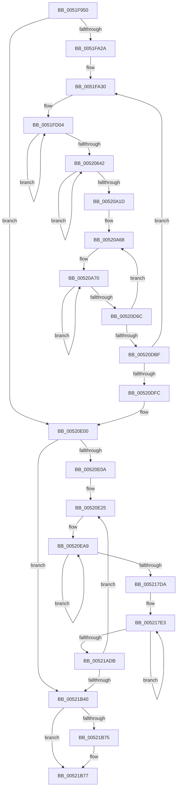

# SymCryptSha256AppendBlocks_xmm_ssse3_asm

- RVA: `0x0051F950`–`0x00521BED` (길이 `8,861` bytes)
- VA: `0x000000014051F950`
- 실행 섹션: `.text`
- PDB 이름 있음: `예`; PDB Function 태그: `아니요`
- unwind 정보 RVA: `0x000C3138`
- 디코드: `2,086`개 명령, `8,861/8,861` bytes 표시
- 미해석 바이트: `0` (있으면 어셈블리에 `.byte`로 보존)

> 이 문서는 커널 이미지의 기계어와 PDB 기호를 분석해 생성했습니다. 4번과 5번은 함수 원형과 자료형을 바이너리 사용 방식에서 추정한 C 해석이며 원본 소스 복구 결과는 아닙니다.

## 1. Dependencies

- 직접 호출 지점: **0**; 고유 호출 대상: **0**
- 직접 호출자로 확인된 함수: **1**
- RIP 상대 이미지 참조: **6**

### Outgoing calls
- 직접 디코드된 call 명령이 없습니다.

### Direct callers
- [SymCryptSha256AppendBlocks](SymCryptSha256AppendBlocks_function_0051CC00.md) at `0x0051CC8D`

### Static image references
- `0x0051FA52` → RVA `0x0001FB40` (`.rdata`; read)
- `0x0051FCFD` → RVA `0x0001F900` (`.rdata`; read)
- `0x00520627` → RVA `0x0001F9C0` (`.rdata`; read)
- `0x00520A02` → RVA `0x0001FA00` (`.rdata`; read)
- `0x00520E13` → RVA `0x0001FB30` (`.rdata`; read)
- `0x00520E1C` → RVA `0x0001FB20` (`.rdata`; read)

## 2. Other-region calls and transfers

- 다른 실행 섹션으로 향하는 call: **0**
- 별도 외부 분기/꼬리 이동을 확인하지 못했습니다.

## 3. Assembly (complete function range)

```asm
0051F950  48 56                           push rsi
0051F952  57                              push rdi
0051F953  55                              push rbp
0051F954  53                              push rbx
0051F955  41 54                           push r12
0051F957  41 55                           push r13
0051F959  41 56                           push r14
0051F95B  41 57                           push r15
0051F95D  48 81 EC B8 04 00 00            sub rsp, 0x4b8
0051F964  0F 29 B4 24 10 04 00 00         movaps xmmword ptr [rsp + 0x410], xmm6
0051F96C  0F 29 BC 24 20 04 00 00         movaps xmmword ptr [rsp + 0x420], xmm7
0051F974  44 0F 29 84 24 30 04 00 00      movaps xmmword ptr [rsp + 0x430], xmm8
0051F97D  44 0F 29 8C 24 40 04 00 00      movaps xmmword ptr [rsp + 0x440], xmm9
0051F986  44 0F 29 94 24 50 04 00 00      movaps xmmword ptr [rsp + 0x450], xmm10
0051F98F  44 0F 29 9C 24 60 04 00 00      movaps xmmword ptr [rsp + 0x460], xmm11
0051F998  44 0F 29 A4 24 70 04 00 00      movaps xmmword ptr [rsp + 0x470], xmm12
0051F9A1  44 0F 29 AC 24 80 04 00 00      movaps xmmword ptr [rsp + 0x480], xmm13
0051F9AA  44 0F 29 B4 24 90 04 00 00      movaps xmmword ptr [rsp + 0x490], xmm14
0051F9B3  44 0F 29 BC 24 A0 04 00 00      movaps xmmword ptr [rsp + 0x4a0], xmm15
0051F9BC  48 89 8C 24 00 05 00 00         mov qword ptr [rsp + 0x500], rcx
0051F9C4  48 89 94 24 08 05 00 00         mov qword ptr [rsp + 0x508], rdx
0051F9CC  4C 89 84 24 10 05 00 00         mov qword ptr [rsp + 0x510], r8
0051F9D4  4C 89 8C 24 18 05 00 00         mov qword ptr [rsp + 0x518], r9
0051F9DC  BF 40 00 00 00                  mov edi, 0x40
0051F9E1  BD 00 04 00 00                  mov ebp, 0x400
0051F9E6  49 81 F8 C0 00 00 00            cmp r8, 0xc0
0051F9ED  0F 43 FD                        cmovae edi, ebp
0051F9F0  89 BC 24 08 04 00 00            mov dword ptr [rsp + 0x408], edi
0051F9F7  48 8B D9                        mov rbx, rcx
0051F9FA  8B 03                           mov eax, dword ptr [rbx]
0051F9FC  8B 4B 04                        mov ecx, dword ptr [rbx + 4]
0051F9FF  8B 53 08                        mov edx, dword ptr [rbx + 8]
0051FA02  44 8B 43 0C                     mov r8d, dword ptr [rbx + 0xc]
0051FA06  44 8B 4B 10                     mov r9d, dword ptr [rbx + 0x10]
0051FA0A  44 8B 53 14                     mov r10d, dword ptr [rbx + 0x14]
0051FA0E  44 8B 5B 18                     mov r11d, dword ptr [rbx + 0x18]
0051FA12  8B 73 1C                        mov esi, dword ptr [rbx + 0x1c]
0051FA15  48 8B BC 24 10 05 00 00         mov rdi, qword ptr [rsp + 0x510]
0051FA1D  48 81 FF C0 00 00 00            cmp rdi, 0xc0
0051FA24  0F 82 D6 13 00 00               jb 0x140520e00
0051FA2A  66 0F 1F 44 00 00               nop word ptr [rax + rax]
0051FA30  48 C1 EF 06                     shr rdi, 6
0051FA34  48 C7 C5 04 00 00 00            mov rbp, 4
0051FA3B  48 3B FD                        cmp rdi, rbp
0051FA3E  48 0F 47 FD                     cmova rdi, rbp
0051FA42  48 89 BC 24 00 04 00 00         mov qword ptr [rsp + 0x400], rdi
0051FA4A  48 8B AC 24 08 05 00 00         mov rbp, qword ptr [rsp + 0x508]
0051FA52  66 44 0F 6F 05 E5 00 B0 FF      movdqa xmm8, xmmword ptr [rip - 0x4fff1b]
0051FA5B  49 C7 C4 80 00 00 00            mov r12, 0x80
0051FA62  48 C7 C3 C0 00 00 00            mov rbx, 0xc0
0051FA69  48 83 FF 04                     cmp rdi, 4
0051FA6D  4C 0F 44 E3                     cmove r12, rbx
0051FA71  F3 0F 6F 45 00                  movdqu xmm0, xmmword ptr [rbp]
0051FA76  66 41 0F 38 00 C0               pshufb xmm0, xmm8
0051FA7C  F3 0F 6F 4D 40                  movdqu xmm1, xmmword ptr [rbp + 0x40]
0051FA81  66 41 0F 38 00 C8               pshufb xmm1, xmm8
0051FA87  F3 0F 6F 95 80 00 00 00         movdqu xmm2, xmmword ptr [rbp + 0x80]
0051FA8F  66 41 0F 38 00 D0               pshufb xmm2, xmm8
0051FA95  F3 42 0F 6F 5C 25 00            movdqu xmm3, xmmword ptr [rbp + r12]
0051FA9C  66 41 0F 38 00 D8               pshufb xmm3, xmm8
0051FAA2  66 0F 6F E0                     movdqa xmm4, xmm0
0051FAA6  66 0F 6A E1                     punpckhdq xmm4, xmm1
0051FAAA  66 0F 62 C1                     punpckldq xmm0, xmm1
0051FAAE  66 0F 6F EA                     movdqa xmm5, xmm2
0051FAB2  66 0F 6A EB                     punpckhdq xmm5, xmm3
0051FAB6  66 0F 62 D3                     punpckldq xmm2, xmm3
0051FABA  66 0F 6F C8                     movdqa xmm1, xmm0
0051FABE  66 0F 6D CA                     punpckhqdq xmm1, xmm2
0051FAC2  66 0F 6C C2                     punpcklqdq xmm0, xmm2
0051FAC6  66 0F 7F 04 24                  movdqa xmmword ptr [rsp], xmm0
0051FACB  66 0F 7F 4C 24 10               movdqa xmmword ptr [rsp + 0x10], xmm1
0051FAD1  66 0F 6F DC                     movdqa xmm3, xmm4
0051FAD5  66 0F 6D DD                     punpckhqdq xmm3, xmm5
0051FAD9  66 0F 6C E5                     punpcklqdq xmm4, xmm5
0051FADD  66 0F 7F 64 24 20               movdqa xmmword ptr [rsp + 0x20], xmm4
0051FAE3  66 0F 7F 5C 24 30               movdqa xmmword ptr [rsp + 0x30], xmm3
0051FAE9  49 C7 C4 90 00 00 00            mov r12, 0x90
0051FAF0  48 C7 C3 D0 00 00 00            mov rbx, 0xd0
0051FAF7  48 83 FF 04                     cmp rdi, 4
0051FAFB  4C 0F 44 E3                     cmove r12, rbx
0051FAFF  F3 0F 6F 45 10                  movdqu xmm0, xmmword ptr [rbp + 0x10]
0051FB04  66 41 0F 38 00 C0               pshufb xmm0, xmm8
0051FB0A  F3 0F 6F 4D 50                  movdqu xmm1, xmmword ptr [rbp + 0x50]
0051FB0F  66 41 0F 38 00 C8               pshufb xmm1, xmm8
0051FB15  F3 0F 6F 95 90 00 00 00         movdqu xmm2, xmmword ptr [rbp + 0x90]
0051FB1D  66 41 0F 38 00 D0               pshufb xmm2, xmm8
0051FB23  F3 42 0F 6F 5C 25 00            movdqu xmm3, xmmword ptr [rbp + r12]
0051FB2A  66 41 0F 38 00 D8               pshufb xmm3, xmm8
0051FB30  66 0F 6F E0                     movdqa xmm4, xmm0
0051FB34  66 0F 6A E1                     punpckhdq xmm4, xmm1
0051FB38  66 0F 62 C1                     punpckldq xmm0, xmm1
0051FB3C  66 0F 6F EA                     movdqa xmm5, xmm2
0051FB40  66 0F 6A EB                     punpckhdq xmm5, xmm3
0051FB44  66 0F 62 D3                     punpckldq xmm2, xmm3
0051FB48  66 0F 6F C8                     movdqa xmm1, xmm0
0051FB4C  66 0F 6D CA                     punpckhqdq xmm1, xmm2
0051FB50  66 0F 6C C2                     punpcklqdq xmm0, xmm2
0051FB54  66 0F 7F 44 24 40               movdqa xmmword ptr [rsp + 0x40], xmm0
0051FB5A  66 0F 7F 4C 24 50               movdqa xmmword ptr [rsp + 0x50], xmm1
0051FB60  66 0F 6F DC                     movdqa xmm3, xmm4
0051FB64  66 0F 6D DD                     punpckhqdq xmm3, xmm5
0051FB68  66 0F 6C E5                     punpcklqdq xmm4, xmm5
0051FB6C  66 0F 7F 64 24 60               movdqa xmmword ptr [rsp + 0x60], xmm4
0051FB72  66 0F 7F 5C 24 70               movdqa xmmword ptr [rsp + 0x70], xmm3
0051FB78  49 C7 C4 A0 00 00 00            mov r12, 0xa0
0051FB7F  48 C7 C3 E0 00 00 00            mov rbx, 0xe0
0051FB86  48 83 FF 04                     cmp rdi, 4
0051FB8A  4C 0F 44 E3                     cmove r12, rbx
0051FB8E  F3 0F 6F 45 20                  movdqu xmm0, xmmword ptr [rbp + 0x20]
0051FB93  66 41 0F 38 00 C0               pshufb xmm0, xmm8
0051FB99  F3 0F 6F 4D 60                  movdqu xmm1, xmmword ptr [rbp + 0x60]
0051FB9E  66 41 0F 38 00 C8               pshufb xmm1, xmm8
0051FBA4  F3 0F 6F 95 A0 00 00 00         movdqu xmm2, xmmword ptr [rbp + 0xa0]
0051FBAC  66 41 0F 38 00 D0               pshufb xmm2, xmm8
0051FBB2  F3 42 0F 6F 5C 25 00            movdqu xmm3, xmmword ptr [rbp + r12]
0051FBB9  66 41 0F 38 00 D8               pshufb xmm3, xmm8
0051FBBF  66 0F 6F E0                     movdqa xmm4, xmm0
0051FBC3  66 0F 6A E1                     punpckhdq xmm4, xmm1
0051FBC7  66 0F 62 C1                     punpckldq xmm0, xmm1
0051FBCB  66 0F 6F EA                     movdqa xmm5, xmm2
0051FBCF  66 0F 6A EB                     punpckhdq xmm5, xmm3
0051FBD3  66 0F 62 D3                     punpckldq xmm2, xmm3
0051FBD7  66 0F 6F C8                     movdqa xmm1, xmm0
0051FBDB  66 0F 6D CA                     punpckhqdq xmm1, xmm2
0051FBDF  66 0F 6C C2                     punpcklqdq xmm0, xmm2
0051FBE3  66 0F 7F 84 24 80 00 00 00      movdqa xmmword ptr [rsp + 0x80], xmm0
0051FBEC  66 0F 7F 8C 24 90 00 00 00      movdqa xmmword ptr [rsp + 0x90], xmm1
0051FBF5  66 0F 6F DC                     movdqa xmm3, xmm4
0051FBF9  66 0F 6D DD                     punpckhqdq xmm3, xmm5
0051FBFD  66 0F 6C E5                     punpcklqdq xmm4, xmm5
0051FC01  66 0F 7F A4 24 A0 00 00 00      movdqa xmmword ptr [rsp + 0xa0], xmm4
0051FC0A  66 0F 7F 9C 24 B0 00 00 00      movdqa xmmword ptr [rsp + 0xb0], xmm3
0051FC13  49 C7 C4 B0 00 00 00            mov r12, 0xb0
0051FC1A  48 C7 C3 F0 00 00 00            mov rbx, 0xf0
0051FC21  48 83 FF 04                     cmp rdi, 4
0051FC25  4C 0F 44 E3                     cmove r12, rbx
0051FC29  F3 0F 6F 45 30                  movdqu xmm0, xmmword ptr [rbp + 0x30]
0051FC2E  66 41 0F 38 00 C0               pshufb xmm0, xmm8
0051FC34  F3 0F 6F 4D 70                  movdqu xmm1, xmmword ptr [rbp + 0x70]
0051FC39  66 41 0F 38 00 C8               pshufb xmm1, xmm8
0051FC3F  F3 0F 6F 95 B0 00 00 00         movdqu xmm2, xmmword ptr [rbp + 0xb0]
0051FC47  66 41 0F 38 00 D0               pshufb xmm2, xmm8
0051FC4D  F3 42 0F 6F 5C 25 00            movdqu xmm3, xmmword ptr [rbp + r12]
0051FC54  66 41 0F 38 00 D8               pshufb xmm3, xmm8
0051FC5A  66 0F 6F E0                     movdqa xmm4, xmm0
0051FC5E  66 0F 6A E1                     punpckhdq xmm4, xmm1
0051FC62  66 0F 62 C1                     punpckldq xmm0, xmm1
0051FC66  66 0F 6F EA                     movdqa xmm5, xmm2
0051FC6A  66 0F 6A EB                     punpckhdq xmm5, xmm3
0051FC6E  66 0F 62 D3                     punpckldq xmm2, xmm3
0051FC72  66 0F 6F C8                     movdqa xmm1, xmm0
0051FC76  66 0F 6D CA                     punpckhqdq xmm1, xmm2
0051FC7A  66 0F 6C C2                     punpcklqdq xmm0, xmm2
0051FC7E  66 0F 7F 84 24 C0 00 00 00      movdqa xmmword ptr [rsp + 0xc0], xmm0
0051FC87  66 0F 7F 8C 24 D0 00 00 00      movdqa xmmword ptr [rsp + 0xd0], xmm1
0051FC90  66 0F 6F DC                     movdqa xmm3, xmm4
0051FC94  66 0F 6D DD                     punpckhqdq xmm3, xmm5
0051FC98  66 0F 6C E5                     punpcklqdq xmm4, xmm5
0051FC9C  66 0F 7F A4 24 E0 00 00 00      movdqa xmmword ptr [rsp + 0xe0], xmm4
0051FCA5  66 0F 7F 9C 24 F0 00 00 00      movdqa xmmword ptr [rsp + 0xf0], xmm3
0051FCAE  66 0F 6F 04 24                  movdqa xmm0, xmmword ptr [rsp]
0051FCB3  66 0F 6F 4C 24 10               movdqa xmm1, xmmword ptr [rsp + 0x10]
0051FCB9  66 0F 6F 94 24 90 00 00 00      movdqa xmm2, xmmword ptr [rsp + 0x90]
0051FCC2  66 0F 6F 9C 24 A0 00 00 00      movdqa xmm3, xmmword ptr [rsp + 0xa0]
0051FCCB  66 0F 6F A4 24 B0 00 00 00      movdqa xmm4, xmmword ptr [rsp + 0xb0]
0051FCD4  66 0F 6F AC 24 C0 00 00 00      movdqa xmm5, xmmword ptr [rsp + 0xc0]
0051FCDD  66 0F 6F B4 24 D0 00 00 00      movdqa xmm6, xmmword ptr [rsp + 0xd0]
0051FCE6  66 0F 6F BC 24 E0 00 00 00      movdqa xmm7, xmmword ptr [rsp + 0xe0]
0051FCEF  66 44 0F 6F 84 24 F0 00 00 00   movdqa xmm8, xmmword ptr [rsp + 0xf0]
0051FCF9  4C 8D 34 24                     lea r14, [rsp]
0051FCFD  4C 8D 3D FC FB AF FF            lea r15, [rip - 0x500404]
0051FD04  66 45 0F 6E 0F                  movd xmm9, dword ptr [r15]
0051FD09  66 45 0F 70 C9 00               pshufd xmm9, xmm9, 0
0051FD0F  66 44 0F FE C8                  paddd xmm9, xmm0
0051FD14  66 45 0F 7F 0E                  movdqa xmmword ptr [r14], xmm9
0051FD19  66 44 0F 6F E7                  movdqa xmm12, xmm7
0051FD1E  66 44 0F 6F EF                  movdqa xmm13, xmm7
0051FD23  66 41 0F 72 D4 11               psrld xmm12, 0x11
0051FD29  66 41 0F 72 F5 0F               pslld xmm13, 0xf
0051FD2F  66 45 0F EF E5                  pxor xmm12, xmm13
0051FD34  66 44 0F 6F DF                  movdqa xmm11, xmm7
0051FD39  66 44 0F 6F EF                  movdqa xmm13, xmm7
0051FD3E  66 41 0F 72 D3 13               psrld xmm11, 0x13
0051FD44  66 41 0F 72 F5 0D               pslld xmm13, 0xd
0051FD4A  66 45 0F EF DD                  pxor xmm11, xmm13
0051FD4F  66 44 0F 6F EF                  movdqa xmm13, xmm7
0051FD54  66 41 0F 72 D5 0A               psrld xmm13, 0xa
0051FD5A  66 45 0F EF E3                  pxor xmm12, xmm11
0051FD5F  66 45 0F EF E5                  pxor xmm12, xmm13
0051FD64  66 44 0F 6F C9                  movdqa xmm9, xmm1
0051FD69  66 44 0F 6F E9                  movdqa xmm13, xmm1
0051FD6E  66 41 0F 72 D1 07               psrld xmm9, 7
0051FD74  66 41 0F 72 F5 19               pslld xmm13, 0x19
0051FD7A  66 45 0F EF CD                  pxor xmm9, xmm13
0051FD7F  66 44 0F 6F D9                  movdqa xmm11, xmm1
0051FD84  66 44 0F 6F E9                  movdqa xmm13, xmm1
0051FD89  66 41 0F 72 D3 12               psrld xmm11, 0x12
0051FD8F  66 41 0F 72 F5 0E               pslld xmm13, 0xe
0051FD95  66 45 0F EF DD                  pxor xmm11, xmm13
0051FD9A  66 44 0F 6F E9                  movdqa xmm13, xmm1
0051FD9F  66 41 0F 72 D5 03               psrld xmm13, 3
0051FDA5  66 45 0F EF CB                  pxor xmm9, xmm11
0051FDAA  66 45 0F EF CD                  pxor xmm9, xmm13
0051FDAF  66 0F FE C2                     paddd xmm0, xmm2
0051FDB3  66 44 0F FE C8                  paddd xmm9, xmm0
0051FDB8  66 45 0F FE CC                  paddd xmm9, xmm12
0051FDBD  66 41 0F 6F 46 20               movdqa xmm0, xmmword ptr [r14 + 0x20]
0051FDC3  66 45 0F 7F 8E 00 01 00 00      movdqa xmmword ptr [r14 + 0x100], xmm9
0051FDCC  66 41 0F 6E 57 04               movd xmm2, dword ptr [r15 + 4]
0051FDD2  66 0F 70 D2 00                  pshufd xmm2, xmm2, 0
0051FDD7  66 0F FE D1                     paddd xmm2, xmm1
0051FDDB  66 41 0F 7F 56 10               movdqa xmmword ptr [r14 + 0x10], xmm2
0051FDE1  66 45 0F 6F E0                  movdqa xmm12, xmm8
0051FDE6  66 45 0F 6F E8                  movdqa xmm13, xmm8
0051FDEB  66 41 0F 72 D4 11               psrld xmm12, 0x11
0051FDF1  66 41 0F 72 F5 0F               pslld xmm13, 0xf
0051FDF7  66 45 0F EF E5                  pxor xmm12, xmm13
0051FDFC  66 45 0F 6F D8                  movdqa xmm11, xmm8
0051FE01  66 45 0F 6F E8                  movdqa xmm13, xmm8
0051FE06  66 41 0F 72 D3 13               psrld xmm11, 0x13
0051FE0C  66 41 0F 72 F5 0D               pslld xmm13, 0xd
0051FE12  66 45 0F EF DD                  pxor xmm11, xmm13
0051FE17  66 45 0F 6F E8                  movdqa xmm13, xmm8
0051FE1C  66 41 0F 72 D5 0A               psrld xmm13, 0xa
0051FE22  66 45 0F EF E3                  pxor xmm12, xmm11
0051FE27  66 45 0F EF E5                  pxor xmm12, xmm13
0051FE2C  66 0F 6F D0                     movdqa xmm2, xmm0
0051FE30  66 44 0F 6F E8                  movdqa xmm13, xmm0
0051FE35  66 0F 72 D2 07                  psrld xmm2, 7
0051FE3A  66 41 0F 72 F5 19               pslld xmm13, 0x19
0051FE40  66 41 0F EF D5                  pxor xmm2, xmm13
0051FE45  66 44 0F 6F D8                  movdqa xmm11, xmm0
0051FE4A  66 44 0F 6F E8                  movdqa xmm13, xmm0
0051FE4F  66 41 0F 72 D3 12               psrld xmm11, 0x12
0051FE55  66 41 0F 72 F5 0E               pslld xmm13, 0xe
0051FE5B  66 45 0F EF DD                  pxor xmm11, xmm13
0051FE60  66 44 0F 6F E8                  movdqa xmm13, xmm0
0051FE65  66 41 0F 72 D5 03               psrld xmm13, 3
0051FE6B  66 41 0F EF D3                  pxor xmm2, xmm11
0051FE70  66 41 0F EF D5                  pxor xmm2, xmm13
0051FE75  66 0F FE CB                     paddd xmm1, xmm3
0051FE79  66 0F FE D1                     paddd xmm2, xmm1
0051FE7D  66 41 0F FE D4                  paddd xmm2, xmm12
0051FE82  66 41 0F 6F 4E 30               movdqa xmm1, xmmword ptr [r14 + 0x30]
0051FE88  66 41 0F 7F 96 10 01 00 00      movdqa xmmword ptr [r14 + 0x110], xmm2
0051FE91  66 41 0F 6E 5F 08               movd xmm3, dword ptr [r15 + 8]
0051FE97  66 0F 70 DB 00                  pshufd xmm3, xmm3, 0
0051FE9C  66 0F FE D8                     paddd xmm3, xmm0
0051FEA0  66 41 0F 7F 5E 20               movdqa xmmword ptr [r14 + 0x20], xmm3
0051FEA6  66 45 0F 6F E1                  movdqa xmm12, xmm9
0051FEAB  66 45 0F 6F E9                  movdqa xmm13, xmm9
0051FEB0  66 41 0F 72 D4 11               psrld xmm12, 0x11
0051FEB6  66 41 0F 72 F5 0F               pslld xmm13, 0xf
0051FEBC  66 45 0F EF E5                  pxor xmm12, xmm13
0051FEC1  66 45 0F 6F D9                  movdqa xmm11, xmm9
0051FEC6  66 45 0F 6F E9                  movdqa xmm13, xmm9
0051FECB  66 41 0F 72 D3 13               psrld xmm11, 0x13
0051FED1  66 41 0F 72 F5 0D               pslld xmm13, 0xd
0051FED7  66 45 0F EF DD                  pxor xmm11, xmm13
0051FEDC  66 45 0F 6F E9                  movdqa xmm13, xmm9
0051FEE1  66 41 0F 72 D5 0A               psrld xmm13, 0xa
0051FEE7  66 45 0F EF E3                  pxor xmm12, xmm11
0051FEEC  66 45 0F EF E5                  pxor xmm12, xmm13
0051FEF1  66 0F 6F D9                     movdqa xmm3, xmm1
0051FEF5  66 44 0F 6F E9                  movdqa xmm13, xmm1
0051FEFA  66 0F 72 D3 07                  psrld xmm3, 7
0051FEFF  66 41 0F 72 F5 19               pslld xmm13, 0x19
0051FF05  66 41 0F EF DD                  pxor xmm3, xmm13
0051FF0A  66 44 0F 6F D9                  movdqa xmm11, xmm1
0051FF0F  66 44 0F 6F E9                  movdqa xmm13, xmm1
0051FF14  66 41 0F 72 D3 12               psrld xmm11, 0x12
0051FF1A  66 41 0F 72 F5 0E               pslld xmm13, 0xe
0051FF20  66 45 0F EF DD                  pxor xmm11, xmm13
0051FF25  66 44 0F 6F E9                  movdqa xmm13, xmm1
0051FF2A  66 41 0F 72 D5 03               psrld xmm13, 3
0051FF30  66 41 0F EF DB                  pxor xmm3, xmm11
0051FF35  66 41 0F EF DD                  pxor xmm3, xmm13
0051FF3A  66 0F FE C4                     paddd xmm0, xmm4
0051FF3E  66 0F FE D8                     paddd xmm3, xmm0
0051FF42  66 41 0F FE DC                  paddd xmm3, xmm12
0051FF47  66 41 0F 6F 46 40               movdqa xmm0, xmmword ptr [r14 + 0x40]
0051FF4D  66 41 0F 7F 9E 20 01 00 00      movdqa xmmword ptr [r14 + 0x120], xmm3
0051FF56  66 41 0F 6E 67 0C               movd xmm4, dword ptr [r15 + 0xc]
0051FF5C  66 0F 70 E4 00                  pshufd xmm4, xmm4, 0
0051FF61  66 0F FE E1                     paddd xmm4, xmm1
0051FF65  66 41 0F 7F 66 30               movdqa xmmword ptr [r14 + 0x30], xmm4
0051FF6B  66 44 0F 6F E2                  movdqa xmm12, xmm2
0051FF70  66 44 0F 6F EA                  movdqa xmm13, xmm2
0051FF75  66 41 0F 72 D4 11               psrld xmm12, 0x11
0051FF7B  66 41 0F 72 F5 0F               pslld xmm13, 0xf
0051FF81  66 45 0F EF E5                  pxor xmm12, xmm13
0051FF86  66 44 0F 6F DA                  movdqa xmm11, xmm2
0051FF8B  66 44 0F 6F EA                  movdqa xmm13, xmm2
0051FF90  66 41 0F 72 D3 13               psrld xmm11, 0x13
0051FF96  66 41 0F 72 F5 0D               pslld xmm13, 0xd
0051FF9C  66 45 0F EF DD                  pxor xmm11, xmm13
0051FFA1  66 44 0F 6F EA                  movdqa xmm13, xmm2
0051FFA6  66 41 0F 72 D5 0A               psrld xmm13, 0xa
0051FFAC  66 45 0F EF E3                  pxor xmm12, xmm11
0051FFB1  66 45 0F EF E5                  pxor xmm12, xmm13
0051FFB6  66 0F 6F E0                     movdqa xmm4, xmm0
0051FFBA  66 44 0F 6F E8                  movdqa xmm13, xmm0
0051FFBF  66 0F 72 D4 07                  psrld xmm4, 7
0051FFC4  66 41 0F 72 F5 19               pslld xmm13, 0x19
0051FFCA  66 41 0F EF E5                  pxor xmm4, xmm13
0051FFCF  66 44 0F 6F D8                  movdqa xmm11, xmm0
0051FFD4  66 44 0F 6F E8                  movdqa xmm13, xmm0
0051FFD9  66 41 0F 72 D3 12               psrld xmm11, 0x12
0051FFDF  66 41 0F 72 F5 0E               pslld xmm13, 0xe
0051FFE5  66 45 0F EF DD                  pxor xmm11, xmm13
0051FFEA  66 44 0F 6F E8                  movdqa xmm13, xmm0
0051FFEF  66 41 0F 72 D5 03               psrld xmm13, 3
0051FFF5  66 41 0F EF E3                  pxor xmm4, xmm11
0051FFFA  66 41 0F EF E5                  pxor xmm4, xmm13
0051FFFF  66 0F FE CD                     paddd xmm1, xmm5
00520003  66 0F FE E1                     paddd xmm4, xmm1
00520007  66 41 0F FE E4                  paddd xmm4, xmm12
0052000C  66 41 0F 6F 4E 50               movdqa xmm1, xmmword ptr [r14 + 0x50]
00520012  66 41 0F 7F A6 30 01 00 00      movdqa xmmword ptr [r14 + 0x130], xmm4
0052001B  66 41 0F 6E 6F 10               movd xmm5, dword ptr [r15 + 0x10]
00520021  66 0F 70 ED 00                  pshufd xmm5, xmm5, 0
00520026  66 0F FE E8                     paddd xmm5, xmm0
0052002A  66 41 0F 7F 6E 40               movdqa xmmword ptr [r14 + 0x40], xmm5
00520030  66 44 0F 6F E3                  movdqa xmm12, xmm3
00520035  66 44 0F 6F EB                  movdqa xmm13, xmm3
0052003A  66 41 0F 72 D4 11               psrld xmm12, 0x11
00520040  66 41 0F 72 F5 0F               pslld xmm13, 0xf
00520046  66 45 0F EF E5                  pxor xmm12, xmm13
0052004B  66 44 0F 6F DB                  movdqa xmm11, xmm3
00520050  66 44 0F 6F EB                  movdqa xmm13, xmm3
00520055  66 41 0F 72 D3 13               psrld xmm11, 0x13
0052005B  66 41 0F 72 F5 0D               pslld xmm13, 0xd
00520061  66 45 0F EF DD                  pxor xmm11, xmm13
00520066  66 44 0F 6F EB                  movdqa xmm13, xmm3
0052006B  66 41 0F 72 D5 0A               psrld xmm13, 0xa
00520071  66 45 0F EF E3                  pxor xmm12, xmm11
00520076  66 45 0F EF E5                  pxor xmm12, xmm13
0052007B  66 0F 6F E9                     movdqa xmm5, xmm1
0052007F  66 44 0F 6F E9                  movdqa xmm13, xmm1
00520084  66 0F 72 D5 07                  psrld xmm5, 7
00520089  66 41 0F 72 F5 19               pslld xmm13, 0x19
0052008F  66 41 0F EF ED                  pxor xmm5, xmm13
00520094  66 44 0F 6F D9                  movdqa xmm11, xmm1
00520099  66 44 0F 6F E9                  movdqa xmm13, xmm1
0052009E  66 41 0F 72 D3 12               psrld xmm11, 0x12
005200A4  66 41 0F 72 F5 0E               pslld xmm13, 0xe
005200AA  66 45 0F EF DD                  pxor xmm11, xmm13
005200AF  66 44 0F 6F E9                  movdqa xmm13, xmm1
005200B4  66 41 0F 72 D5 03               psrld xmm13, 3
005200BA  66 41 0F EF EB                  pxor xmm5, xmm11
005200BF  66 41 0F EF ED                  pxor xmm5, xmm13
005200C4  66 0F FE C6                     paddd xmm0, xmm6
005200C8  66 0F FE E8                     paddd xmm5, xmm0
005200CC  66 41 0F FE EC                  paddd xmm5, xmm12
005200D1  66 41 0F 6F 46 60               movdqa xmm0, xmmword ptr [r14 + 0x60]
005200D7  66 41 0F 7F AE 40 01 00 00      movdqa xmmword ptr [r14 + 0x140], xmm5
005200E0  66 41 0F 6E 77 14               movd xmm6, dword ptr [r15 + 0x14]
005200E6  66 0F 70 F6 00                  pshufd xmm6, xmm6, 0
005200EB  66 0F FE F1                     paddd xmm6, xmm1
005200EF  66 41 0F 7F 76 50               movdqa xmmword ptr [r14 + 0x50], xmm6
005200F5  66 44 0F 6F E4                  movdqa xmm12, xmm4
005200FA  66 44 0F 6F EC                  movdqa xmm13, xmm4
005200FF  66 41 0F 72 D4 11               psrld xmm12, 0x11
00520105  66 41 0F 72 F5 0F               pslld xmm13, 0xf
0052010B  66 45 0F EF E5                  pxor xmm12, xmm13
00520110  66 44 0F 6F DC                  movdqa xmm11, xmm4
00520115  66 44 0F 6F EC                  movdqa xmm13, xmm4
0052011A  66 41 0F 72 D3 13               psrld xmm11, 0x13
00520120  66 41 0F 72 F5 0D               pslld xmm13, 0xd
00520126  66 45 0F EF DD                  pxor xmm11, xmm13
0052012B  66 44 0F 6F EC                  movdqa xmm13, xmm4
00520130  66 41 0F 72 D5 0A               psrld xmm13, 0xa
00520136  66 45 0F EF E3                  pxor xmm12, xmm11
0052013B  66 45 0F EF E5                  pxor xmm12, xmm13
00520140  66 0F 6F F0                     movdqa xmm6, xmm0
00520144  66 44 0F 6F E8                  movdqa xmm13, xmm0
00520149  66 0F 72 D6 07                  psrld xmm6, 7
0052014E  66 41 0F 72 F5 19               pslld xmm13, 0x19
00520154  66 41 0F EF F5                  pxor xmm6, xmm13
00520159  66 44 0F 6F D8                  movdqa xmm11, xmm0
0052015E  66 44 0F 6F E8                  movdqa xmm13, xmm0
00520163  66 41 0F 72 D3 12               psrld xmm11, 0x12
00520169  66 41 0F 72 F5 0E               pslld xmm13, 0xe
0052016F  66 45 0F EF DD                  pxor xmm11, xmm13
00520174  66 44 0F 6F E8                  movdqa xmm13, xmm0
00520179  66 41 0F 72 D5 03               psrld xmm13, 3
0052017F  66 41 0F EF F3                  pxor xmm6, xmm11
00520184  66 41 0F EF F5                  pxor xmm6, xmm13
00520189  66 0F FE CF                     paddd xmm1, xmm7
0052018D  66 0F FE F1                     paddd xmm6, xmm1
00520191  66 41 0F FE F4                  paddd xmm6, xmm12
00520196  66 41 0F 6F 4E 70               movdqa xmm1, xmmword ptr [r14 + 0x70]
0052019C  66 41 0F 7F B6 50 01 00 00      movdqa xmmword ptr [r14 + 0x150], xmm6
005201A5  66 41 0F 6E 7F 18               movd xmm7, dword ptr [r15 + 0x18]
005201AB  66 0F 70 FF 00                  pshufd xmm7, xmm7, 0
005201B0  66 0F FE F8                     paddd xmm7, xmm0
005201B4  66 41 0F 7F 7E 60               movdqa xmmword ptr [r14 + 0x60], xmm7
005201BA  66 44 0F 6F E5                  movdqa xmm12, xmm5
005201BF  66 44 0F 6F ED                  movdqa xmm13, xmm5
005201C4  66 41 0F 72 D4 11               psrld xmm12, 0x11
005201CA  66 41 0F 72 F5 0F               pslld xmm13, 0xf
005201D0  66 45 0F EF E5                  pxor xmm12, xmm13
005201D5  66 44 0F 6F DD                  movdqa xmm11, xmm5
005201DA  66 44 0F 6F ED                  movdqa xmm13, xmm5
005201DF  66 41 0F 72 D3 13               psrld xmm11, 0x13
005201E5  66 41 0F 72 F5 0D               pslld xmm13, 0xd
005201EB  66 45 0F EF DD                  pxor xmm11, xmm13
005201F0  66 44 0F 6F ED                  movdqa xmm13, xmm5
005201F5  66 41 0F 72 D5 0A               psrld xmm13, 0xa
005201FB  66 45 0F EF E3                  pxor xmm12, xmm11
00520200  66 45 0F EF E5                  pxor xmm12, xmm13
00520205  66 0F 6F F9                     movdqa xmm7, xmm1
00520209  66 44 0F 6F E9                  movdqa xmm13, xmm1
0052020E  66 0F 72 D7 07                  psrld xmm7, 7
00520213  66 41 0F 72 F5 19               pslld xmm13, 0x19
00520219  66 41 0F EF FD                  pxor xmm7, xmm13
0052021E  66 44 0F 6F D9                  movdqa xmm11, xmm1
00520223  66 44 0F 6F E9                  movdqa xmm13, xmm1
00520228  66 41 0F 72 D3 12               psrld xmm11, 0x12
0052022E  66 41 0F 72 F5 0E               pslld xmm13, 0xe
00520234  66 45 0F EF DD                  pxor xmm11, xmm13
00520239  66 44 0F 6F E9                  movdqa xmm13, xmm1
0052023E  66 41 0F 72 D5 03               psrld xmm13, 3
00520244  66 41 0F EF FB                  pxor xmm7, xmm11
00520249  66 41 0F EF FD                  pxor xmm7, xmm13
0052024E  66 41 0F FE C0                  paddd xmm0, xmm8
00520253  66 0F FE F8                     paddd xmm7, xmm0
00520257  66 41 0F FE FC                  paddd xmm7, xmm12
0052025C  66 41 0F 6F 86 80 00 00 00      movdqa xmm0, xmmword ptr [r14 + 0x80]
00520265  66 41 0F 7F BE 60 01 00 00      movdqa xmmword ptr [r14 + 0x160], xmm7
0052026E  66 45 0F 6E 47 1C               movd xmm8, dword ptr [r15 + 0x1c]
00520274  66 45 0F 70 C0 00               pshufd xmm8, xmm8, 0
0052027A  66 44 0F FE C1                  paddd xmm8, xmm1
0052027F  66 45 0F 7F 46 70               movdqa xmmword ptr [r14 + 0x70], xmm8
00520285  66 44 0F 6F E6                  movdqa xmm12, xmm6
0052028A  66 44 0F 6F EE                  movdqa xmm13, xmm6
0052028F  66 41 0F 72 D4 11               psrld xmm12, 0x11
00520295  66 41 0F 72 F5 0F               pslld xmm13, 0xf
0052029B  66 45 0F EF E5                  pxor xmm12, xmm13
005202A0  66 44 0F 6F DE                  movdqa xmm11, xmm6
005202A5  66 44 0F 6F EE                  movdqa xmm13, xmm6
005202AA  66 41 0F 72 D3 13               psrld xmm11, 0x13
005202B0  66 41 0F 72 F5 0D               pslld xmm13, 0xd
005202B6  66 45 0F EF DD                  pxor xmm11, xmm13
005202BB  66 44 0F 6F EE                  movdqa xmm13, xmm6
005202C0  66 41 0F 72 D5 0A               psrld xmm13, 0xa
005202C6  66 45 0F EF E3                  pxor xmm12, xmm11
005202CB  66 45 0F EF E5                  pxor xmm12, xmm13
005202D0  66 44 0F 6F C0                  movdqa xmm8, xmm0
005202D5  66 44 0F 6F E8                  movdqa xmm13, xmm0
005202DA  66 41 0F 72 D0 07               psrld xmm8, 7
005202E0  66 41 0F 72 F5 19               pslld xmm13, 0x19
005202E6  66 45 0F EF C5                  pxor xmm8, xmm13
005202EB  66 44 0F 6F D8                  movdqa xmm11, xmm0
005202F0  66 44 0F 6F E8                  movdqa xmm13, xmm0
005202F5  66 41 0F 72 D3 12               psrld xmm11, 0x12
005202FB  66 41 0F 72 F5 0E               pslld xmm13, 0xe
00520301  66 45 0F EF DD                  pxor xmm11, xmm13
00520306  66 44 0F 6F E8                  movdqa xmm13, xmm0
0052030B  66 41 0F 72 D5 03               psrld xmm13, 3
00520311  66 45 0F EF C3                  pxor xmm8, xmm11
00520316  66 45 0F EF C5                  pxor xmm8, xmm13
0052031B  66 41 0F FE C9                  paddd xmm1, xmm9
00520320  66 44 0F FE C1                  paddd xmm8, xmm1
00520325  66 45 0F FE C4                  paddd xmm8, xmm12
0052032A  66 41 0F 6F 8E 90 00 00 00      movdqa xmm1, xmmword ptr [r14 + 0x90]
00520333  66 45 0F 7F 86 70 01 00 00      movdqa xmmword ptr [r14 + 0x170], xmm8
0052033C  C4 43 7B F0 E9 06               rorx r13d, r9d, 6
00520342  C4 43 7B F0 E1 0B               rorx r12d, r9d, 0xb
00520348  41 8B FA                        mov edi, r10d
0052034B  C4 C2 30 F2 EB                  andn ebp, r9d, r11d
00520350  C4 C3 7B F0 D9 19               rorx ebx, r9d, 0x19
00520356  41 03 36                        add esi, dword ptr [r14]
00520359  41 23 F9                        and edi, r9d
0052035C  45 33 EC                        xor r13d, r12d
0052035F  33 FD                           xor edi, ebp
00520361  44 33 EB                        xor r13d, ebx
00520364  03 F7                           add esi, edi
00520366  C4 E3 7B F0 E8 02               rorx ebp, eax, 2
0052036C  8B D9                           mov ebx, ecx
0052036E  44 8B E1                        mov r12d, ecx
00520371  C4 E3 7B F0 F8 0D               rorx edi, eax, 0xd
00520377  41 03 F5                        add esi, r13d
0052037A  0B DA                           or ebx, edx
0052037C  44 23 E2                        and r12d, edx
0052037F  23 D8                           and ebx, eax
00520381  44 0B E3                        or r12d, ebx
00520384  44 03 C6                        add r8d, esi
00520387  33 EF                           xor ebp, edi
00520389  C4 63 7B F0 E8 16               rorx r13d, eax, 0x16
0052038F  41 33 ED                        xor ebp, r13d
00520392  41 03 F4                        add esi, r12d
00520395  03 F5                           add esi, ebp
00520397  C4 43 7B F0 E8 06               rorx r13d, r8d, 6
0052039D  C4 43 7B F0 E0 0B               rorx r12d, r8d, 0xb
005203A3  41 8B F9                        mov edi, r9d
005203A6  C4 C2 38 F2 EA                  andn ebp, r8d, r10d
005203AB  C4 C3 7B F0 D8 19               rorx ebx, r8d, 0x19
005203B1  45 03 5E 10                     add r11d, dword ptr [r14 + 0x10]
005203B5  41 23 F8                        and edi, r8d
005203B8  45 33 EC                        xor r13d, r12d
005203BB  33 FD                           xor edi, ebp
005203BD  44 33 EB                        xor r13d, ebx
005203C0  44 03 DF                        add r11d, edi
005203C3  C4 E3 7B F0 EE 02               rorx ebp, esi, 2
005203C9  8B D8                           mov ebx, eax
005203CB  44 8B E0                        mov r12d, eax
005203CE  C4 E3 7B F0 FE 0D               rorx edi, esi, 0xd
005203D4  45 03 DD                        add r11d, r13d
005203D7  0B D9                           or ebx, ecx
005203D9  44 23 E1                        and r12d, ecx
005203DC  23 DE                           and ebx, esi
005203DE  44 0B E3                        or r12d, ebx
005203E1  41 03 D3                        add edx, r11d
005203E4  33 EF                           xor ebp, edi
005203E6  C4 63 7B F0 EE 16               rorx r13d, esi, 0x16
005203EC  41 33 ED                        xor ebp, r13d
005203EF  45 03 DC                        add r11d, r12d
005203F2  44 03 DD                        add r11d, ebp
005203F5  C4 63 7B F0 EA 06               rorx r13d, edx, 6
005203FB  C4 63 7B F0 E2 0B               rorx r12d, edx, 0xb
00520401  41 8B F8                        mov edi, r8d
00520404  C4 C2 68 F2 E9                  andn ebp, edx, r9d
00520409  C4 E3 7B F0 DA 19               rorx ebx, edx, 0x19
0052040F  45 03 56 20                     add r10d, dword ptr [r14 + 0x20]
00520413  23 FA                           and edi, edx
00520415  45 33 EC                        xor r13d, r12d
00520418  33 FD                           xor edi, ebp
0052041A  44 33 EB                        xor r13d, ebx
0052041D  44 03 D7                        add r10d, edi
00520420  C4 C3 7B F0 EB 02               rorx ebp, r11d, 2
00520426  8B DE                           mov ebx, esi
00520428  44 8B E6                        mov r12d, esi
0052042B  C4 C3 7B F0 FB 0D               rorx edi, r11d, 0xd
00520431  45 03 D5                        add r10d, r13d
00520434  0B D8                           or ebx, eax
00520436  44 23 E0                        and r12d, eax
00520439  41 23 DB                        and ebx, r11d
0052043C  44 0B E3                        or r12d, ebx
0052043F  41 03 CA                        add ecx, r10d
00520442  33 EF                           xor ebp, edi
00520444  C4 43 7B F0 EB 16               rorx r13d, r11d, 0x16
0052044A  41 33 ED                        xor ebp, r13d
0052044D  45 03 D4                        add r10d, r12d
00520450  44 03 D5                        add r10d, ebp
00520453  C4 63 7B F0 E9 06               rorx r13d, ecx, 6
00520459  C4 63 7B F0 E1 0B               rorx r12d, ecx, 0xb
0052045F  8B FA                           mov edi, edx
00520461  C4 C2 70 F2 E8                  andn ebp, ecx, r8d
00520466  C4 E3 7B F0 D9 19               rorx ebx, ecx, 0x19
0052046C  45 03 4E 30                     add r9d, dword ptr [r14 + 0x30]
00520470  23 F9                           and edi, ecx
00520472  45 33 EC                        xor r13d, r12d
00520475  33 FD                           xor edi, ebp
00520477  44 33 EB                        xor r13d, ebx
0052047A  44 03 CF                        add r9d, edi
0052047D  C4 C3 7B F0 EA 02               rorx ebp, r10d, 2
00520483  41 8B DB                        mov ebx, r11d
00520486  45 8B E3                        mov r12d, r11d
00520489  C4 C3 7B F0 FA 0D               rorx edi, r10d, 0xd
0052048F  45 03 CD                        add r9d, r13d
00520492  0B DE                           or ebx, esi
00520494  44 23 E6                        and r12d, esi
00520497  41 23 DA                        and ebx, r10d
0052049A  44 0B E3                        or r12d, ebx
0052049D  41 03 C1                        add eax, r9d
005204A0  33 EF                           xor ebp, edi
005204A2  C4 43 7B F0 EA 16               rorx r13d, r10d, 0x16
005204A8  41 33 ED                        xor ebp, r13d
005204AB  45 03 CC                        add r9d, r12d
005204AE  44 03 CD                        add r9d, ebp
005204B1  C4 63 7B F0 E8 06               rorx r13d, eax, 6
005204B7  C4 63 7B F0 E0 0B               rorx r12d, eax, 0xb
005204BD  8B F9                           mov edi, ecx
005204BF  C4 E2 78 F2 EA                  andn ebp, eax, edx
005204C4  C4 E3 7B F0 D8 19               rorx ebx, eax, 0x19
005204CA  45 03 46 40                     add r8d, dword ptr [r14 + 0x40]
005204CE  23 F8                           and edi, eax
005204D0  45 33 EC                        xor r13d, r12d
005204D3  33 FD                           xor edi, ebp
005204D5  44 33 EB                        xor r13d, ebx
005204D8  44 03 C7                        add r8d, edi
005204DB  C4 C3 7B F0 E9 02               rorx ebp, r9d, 2
005204E1  41 8B DA                        mov ebx, r10d
005204E4  45 8B E2                        mov r12d, r10d
005204E7  C4 C3 7B F0 F9 0D               rorx edi, r9d, 0xd
005204ED  45 03 C5                        add r8d, r13d
005204F0  41 0B DB                        or ebx, r11d
005204F3  45 23 E3                        and r12d, r11d
005204F6  41 23 D9                        and ebx, r9d
005204F9  44 0B E3                        or r12d, ebx
005204FC  41 03 F0                        add esi, r8d
005204FF  33 EF                           xor ebp, edi
00520501  C4 43 7B F0 E9 16               rorx r13d, r9d, 0x16
00520507  41 33 ED                        xor ebp, r13d
0052050A  45 03 C4                        add r8d, r12d
0052050D  44 03 C5                        add r8d, ebp
00520510  C4 63 7B F0 EE 06               rorx r13d, esi, 6
00520516  C4 63 7B F0 E6 0B               rorx r12d, esi, 0xb
0052051C  8B F8                           mov edi, eax
0052051E  C4 E2 48 F2 E9                  andn ebp, esi, ecx
00520523  C4 E3 7B F0 DE 19               rorx ebx, esi, 0x19
00520529  41 03 56 50                     add edx, dword ptr [r14 + 0x50]
0052052D  23 FE                           and edi, esi
0052052F  45 33 EC                        xor r13d, r12d
00520532  33 FD                           xor edi, ebp
00520534  44 33 EB                        xor r13d, ebx
00520537  03 D7                           add edx, edi
00520539  C4 C3 7B F0 E8 02               rorx ebp, r8d, 2
0052053F  41 8B D9                        mov ebx, r9d
00520542  45 8B E1                        mov r12d, r9d
00520545  C4 C3 7B F0 F8 0D               rorx edi, r8d, 0xd
0052054B  41 03 D5                        add edx, r13d
0052054E  41 0B DA                        or ebx, r10d
00520551  45 23 E2                        and r12d, r10d
00520554  41 23 D8                        and ebx, r8d
00520557  44 0B E3                        or r12d, ebx
0052055A  44 03 DA                        add r11d, edx
0052055D  33 EF                           xor ebp, edi
0052055F  C4 43 7B F0 E8 16               rorx r13d, r8d, 0x16
00520565  41 33 ED                        xor ebp, r13d
00520568  41 03 D4                        add edx, r12d
0052056B  03 D5                           add edx, ebp
0052056D  C4 43 7B F0 EB 06               rorx r13d, r11d, 6
00520573  C4 43 7B F0 E3 0B               rorx r12d, r11d, 0xb
00520579  8B FE                           mov edi, esi
0052057B  C4 E2 20 F2 E8                  andn ebp, r11d, eax
00520580  C4 C3 7B F0 DB 19               rorx ebx, r11d, 0x19
00520586  41 03 4E 60                     add ecx, dword ptr [r14 + 0x60]
0052058A  41 23 FB                        and edi, r11d
0052058D  45 33 EC                        xor r13d, r12d
00520590  33 FD                           xor edi, ebp
00520592  44 33 EB                        xor r13d, ebx
00520595  03 CF                           add ecx, edi
00520597  C4 E3 7B F0 EA 02               rorx ebp, edx, 2
0052059D  41 8B D8                        mov ebx, r8d
005205A0  45 8B E0                        mov r12d, r8d
005205A3  C4 E3 7B F0 FA 0D               rorx edi, edx, 0xd
005205A9  41 03 CD                        add ecx, r13d
005205AC  41 0B D9                        or ebx, r9d
005205AF  45 23 E1                        and r12d, r9d
005205B2  23 DA                           and ebx, edx
005205B4  44 0B E3                        or r12d, ebx
005205B7  44 03 D1                        add r10d, ecx
005205BA  33 EF                           xor ebp, edi
005205BC  C4 63 7B F0 EA 16               rorx r13d, edx, 0x16
005205C2  41 33 ED                        xor ebp, r13d
005205C5  41 03 CC                        add ecx, r12d
005205C8  03 CD                           add ecx, ebp
005205CA  C4 43 7B F0 EA 06               rorx r13d, r10d, 6
005205D0  C4 43 7B F0 E2 0B               rorx r12d, r10d, 0xb
005205D6  41 8B FB                        mov edi, r11d
005205D9  C4 E2 28 F2 EE                  andn ebp, r10d, esi
005205DE  C4 C3 7B F0 DA 19               rorx ebx, r10d, 0x19
005205E4  41 03 46 70                     add eax, dword ptr [r14 + 0x70]
005205E8  41 23 FA                        and edi, r10d
005205EB  45 33 EC                        xor r13d, r12d
005205EE  33 FD                           xor edi, ebp
005205F0  44 33 EB                        xor r13d, ebx
005205F3  03 C7                           add eax, edi
005205F5  C4 E3 7B F0 E9 02               rorx ebp, ecx, 2
005205FB  8B DA                           mov ebx, edx
005205FD  44 8B E2                        mov r12d, edx
00520600  C4 E3 7B F0 F9 0D               rorx edi, ecx, 0xd
00520606  41 03 C5                        add eax, r13d
00520609  41 0B D8                        or ebx, r8d
0052060C  45 23 E0                        and r12d, r8d
0052060F  23 D9                           and ebx, ecx
00520611  44 0B E3                        or r12d, ebx
00520614  44 03 C8                        add r9d, eax
00520617  33 EF                           xor ebp, edi
00520619  C4 63 7B F0 E9 16               rorx r13d, ecx, 0x16
0052061F  41 33 ED                        xor ebp, r13d
00520622  41 03 C4                        add eax, r12d
00520625  03 C5                           add eax, ebp
00520627  48 8D 3D 92 F3 AF FF            lea rdi, [rip - 0x500c6e]
0052062E  49 81 C6 80 00 00 00            add r14, 0x80
00520635  49 83 C7 20                     add r15, 0x20
00520639  4C 3B FF                        cmp r15, rdi
0052063C  0F 82 C2 F6 FF FF               jb 0x14051fd04
00520642  66 41 0F 6E 0F                  movd xmm1, dword ptr [r15]
00520647  66 0F 70 C9 00                  pshufd xmm1, xmm1, 0
0052064C  66 41 0F 6F 16                  movdqa xmm2, xmmword ptr [r14]
00520651  66 0F FE CA                     paddd xmm1, xmm2
00520655  66 41 0F 7F 0E                  movdqa xmmword ptr [r14], xmm1
0052065A  66 41 0F 6E 4F 04               movd xmm1, dword ptr [r15 + 4]
00520660  66 0F 70 C9 00                  pshufd xmm1, xmm1, 0
00520665  66 41 0F 6F 56 10               movdqa xmm2, xmmword ptr [r14 + 0x10]
0052066B  66 0F FE CA                     paddd xmm1, xmm2
0052066F  66 41 0F 7F 4E 10               movdqa xmmword ptr [r14 + 0x10], xmm1
00520675  66 41 0F 6E 4F 08               movd xmm1, dword ptr [r15 + 8]
0052067B  66 0F 70 C9 00                  pshufd xmm1, xmm1, 0
00520680  66 41 0F 6F 56 20               movdqa xmm2, xmmword ptr [r14 + 0x20]
00520686  66 0F FE CA                     paddd xmm1, xmm2
0052068A  66 41 0F 7F 4E 20               movdqa xmmword ptr [r14 + 0x20], xmm1
00520690  66 41 0F 6E 4F 0C               movd xmm1, dword ptr [r15 + 0xc]
00520696  66 0F 70 C9 00                  pshufd xmm1, xmm1, 0
0052069B  66 41 0F 6F 56 30               movdqa xmm2, xmmword ptr [r14 + 0x30]
005206A1  66 0F FE CA                     paddd xmm1, xmm2
005206A5  66 41 0F 7F 4E 30               movdqa xmmword ptr [r14 + 0x30], xmm1
005206AB  66 41 0F 6E 4F 10               movd xmm1, dword ptr [r15 + 0x10]
005206B1  66 0F 70 C9 00                  pshufd xmm1, xmm1, 0
005206B6  66 41 0F 6F 56 40               movdqa xmm2, xmmword ptr [r14 + 0x40]
005206BC  66 0F FE CA                     paddd xmm1, xmm2
005206C0  66 41 0F 7F 4E 40               movdqa xmmword ptr [r14 + 0x40], xmm1
005206C6  66 41 0F 6E 4F 14               movd xmm1, dword ptr [r15 + 0x14]
005206CC  66 0F 70 C9 00                  pshufd xmm1, xmm1, 0
005206D1  66 41 0F 6F 56 50               movdqa xmm2, xmmword ptr [r14 + 0x50]
005206D7  66 0F FE CA                     paddd xmm1, xmm2
005206DB  66 41 0F 7F 4E 50               movdqa xmmword ptr [r14 + 0x50], xmm1
005206E1  66 41 0F 6E 4F 18               movd xmm1, dword ptr [r15 + 0x18]
005206E7  66 0F 70 C9 00                  pshufd xmm1, xmm1, 0
005206EC  66 41 0F 6F 56 60               movdqa xmm2, xmmword ptr [r14 + 0x60]
005206F2  66 0F FE CA                     paddd xmm1, xmm2
005206F6  66 41 0F 7F 4E 60               movdqa xmmword ptr [r14 + 0x60], xmm1
005206FC  66 41 0F 6E 4F 1C               movd xmm1, dword ptr [r15 + 0x1c]
00520702  66 0F 70 C9 00                  pshufd xmm1, xmm1, 0
00520707  66 41 0F 6F 56 70               movdqa xmm2, xmmword ptr [r14 + 0x70]
0052070D  66 0F FE CA                     paddd xmm1, xmm2
00520711  66 41 0F 7F 4E 70               movdqa xmmword ptr [r14 + 0x70], xmm1
00520717  C4 43 7B F0 E9 06               rorx r13d, r9d, 6
0052071D  C4 43 7B F0 E1 0B               rorx r12d, r9d, 0xb
00520723  41 8B FA                        mov edi, r10d
00520726  C4 C2 30 F2 EB                  andn ebp, r9d, r11d
0052072B  C4 C3 7B F0 D9 19               rorx ebx, r9d, 0x19
00520731  41 03 36                        add esi, dword ptr [r14]
00520734  41 23 F9                        and edi, r9d
00520737  45 33 EC                        xor r13d, r12d
0052073A  33 FD                           xor edi, ebp
0052073C  44 33 EB                        xor r13d, ebx
0052073F  03 F7                           add esi, edi
00520741  C4 E3 7B F0 E8 02               rorx ebp, eax, 2
00520747  8B D9                           mov ebx, ecx
00520749  44 8B E1                        mov r12d, ecx
0052074C  C4 E3 7B F0 F8 0D               rorx edi, eax, 0xd
00520752  41 03 F5                        add esi, r13d
00520755  0B DA                           or ebx, edx
00520757  44 23 E2                        and r12d, edx
0052075A  23 D8                           and ebx, eax
0052075C  44 0B E3                        or r12d, ebx
0052075F  44 03 C6                        add r8d, esi
00520762  33 EF                           xor ebp, edi
00520764  C4 63 7B F0 E8 16               rorx r13d, eax, 0x16
0052076A  41 33 ED                        xor ebp, r13d
0052076D  41 03 F4                        add esi, r12d
00520770  03 F5                           add esi, ebp
00520772  C4 43 7B F0 E8 06               rorx r13d, r8d, 6
00520778  C4 43 7B F0 E0 0B               rorx r12d, r8d, 0xb
0052077E  41 8B F9                        mov edi, r9d
00520781  C4 C2 38 F2 EA                  andn ebp, r8d, r10d
00520786  C4 C3 7B F0 D8 19               rorx ebx, r8d, 0x19
0052078C  45 03 5E 10                     add r11d, dword ptr [r14 + 0x10]
00520790  41 23 F8                        and edi, r8d
00520793  45 33 EC                        xor r13d, r12d
00520796  33 FD                           xor edi, ebp
00520798  44 33 EB                        xor r13d, ebx
0052079B  44 03 DF                        add r11d, edi
0052079E  C4 E3 7B F0 EE 02               rorx ebp, esi, 2
005207A4  8B D8                           mov ebx, eax
005207A6  44 8B E0                        mov r12d, eax
005207A9  C4 E3 7B F0 FE 0D               rorx edi, esi, 0xd
005207AF  45 03 DD                        add r11d, r13d
005207B2  0B D9                           or ebx, ecx
005207B4  44 23 E1                        and r12d, ecx
005207B7  23 DE                           and ebx, esi
005207B9  44 0B E3                        or r12d, ebx
005207BC  41 03 D3                        add edx, r11d
005207BF  33 EF                           xor ebp, edi
005207C1  C4 63 7B F0 EE 16               rorx r13d, esi, 0x16
005207C7  41 33 ED                        xor ebp, r13d
005207CA  45 03 DC                        add r11d, r12d
005207CD  44 03 DD                        add r11d, ebp
005207D0  C4 63 7B F0 EA 06               rorx r13d, edx, 6
005207D6  C4 63 7B F0 E2 0B               rorx r12d, edx, 0xb
005207DC  41 8B F8                        mov edi, r8d
005207DF  C4 C2 68 F2 E9                  andn ebp, edx, r9d
005207E4  C4 E3 7B F0 DA 19               rorx ebx, edx, 0x19
005207EA  45 03 56 20                     add r10d, dword ptr [r14 + 0x20]
005207EE  23 FA                           and edi, edx
005207F0  45 33 EC                        xor r13d, r12d
005207F3  33 FD                           xor edi, ebp
005207F5  44 33 EB                        xor r13d, ebx
005207F8  44 03 D7                        add r10d, edi
005207FB  C4 C3 7B F0 EB 02               rorx ebp, r11d, 2
00520801  8B DE                           mov ebx, esi
00520803  44 8B E6                        mov r12d, esi
00520806  C4 C3 7B F0 FB 0D               rorx edi, r11d, 0xd
0052080C  45 03 D5                        add r10d, r13d
0052080F  0B D8                           or ebx, eax
00520811  44 23 E0                        and r12d, eax
00520814  41 23 DB                        and ebx, r11d
00520817  44 0B E3                        or r12d, ebx
0052081A  41 03 CA                        add ecx, r10d
0052081D  33 EF                           xor ebp, edi
0052081F  C4 43 7B F0 EB 16               rorx r13d, r11d, 0x16
00520825  41 33 ED                        xor ebp, r13d
00520828  45 03 D4                        add r10d, r12d
0052082B  44 03 D5                        add r10d, ebp
0052082E  C4 63 7B F0 E9 06               rorx r13d, ecx, 6
00520834  C4 63 7B F0 E1 0B               rorx r12d, ecx, 0xb
0052083A  8B FA                           mov edi, edx
0052083C  C4 C2 70 F2 E8                  andn ebp, ecx, r8d
00520841  C4 E3 7B F0 D9 19               rorx ebx, ecx, 0x19
00520847  45 03 4E 30                     add r9d, dword ptr [r14 + 0x30]
0052084B  23 F9                           and edi, ecx
0052084D  45 33 EC                        xor r13d, r12d
00520850  33 FD                           xor edi, ebp
00520852  44 33 EB                        xor r13d, ebx
00520855  44 03 CF                        add r9d, edi
00520858  C4 C3 7B F0 EA 02               rorx ebp, r10d, 2
0052085E  41 8B DB                        mov ebx, r11d
00520861  45 8B E3                        mov r12d, r11d
00520864  C4 C3 7B F0 FA 0D               rorx edi, r10d, 0xd
0052086A  45 03 CD                        add r9d, r13d
0052086D  0B DE                           or ebx, esi
0052086F  44 23 E6                        and r12d, esi
00520872  41 23 DA                        and ebx, r10d
00520875  44 0B E3                        or r12d, ebx
00520878  41 03 C1                        add eax, r9d
0052087B  33 EF                           xor ebp, edi
0052087D  C4 43 7B F0 EA 16               rorx r13d, r10d, 0x16
00520883  41 33 ED                        xor ebp, r13d
00520886  45 03 CC                        add r9d, r12d
00520889  44 03 CD                        add r9d, ebp
0052088C  C4 63 7B F0 E8 06               rorx r13d, eax, 6
00520892  C4 63 7B F0 E0 0B               rorx r12d, eax, 0xb
00520898  8B F9                           mov edi, ecx
0052089A  C4 E2 78 F2 EA                  andn ebp, eax, edx
0052089F  C4 E3 7B F0 D8 19               rorx ebx, eax, 0x19
005208A5  45 03 46 40                     add r8d, dword ptr [r14 + 0x40]
005208A9  23 F8                           and edi, eax
005208AB  45 33 EC                        xor r13d, r12d
005208AE  33 FD                           xor edi, ebp
005208B0  44 33 EB                        xor r13d, ebx
005208B3  44 03 C7                        add r8d, edi
005208B6  C4 C3 7B F0 E9 02               rorx ebp, r9d, 2
005208BC  41 8B DA                        mov ebx, r10d
005208BF  45 8B E2                        mov r12d, r10d
005208C2  C4 C3 7B F0 F9 0D               rorx edi, r9d, 0xd
005208C8  45 03 C5                        add r8d, r13d
005208CB  41 0B DB                        or ebx, r11d
005208CE  45 23 E3                        and r12d, r11d
005208D1  41 23 D9                        and ebx, r9d
005208D4  44 0B E3                        or r12d, ebx
005208D7  41 03 F0                        add esi, r8d
005208DA  33 EF                           xor ebp, edi
005208DC  C4 43 7B F0 E9 16               rorx r13d, r9d, 0x16
005208E2  41 33 ED                        xor ebp, r13d
005208E5  45 03 C4                        add r8d, r12d
005208E8  44 03 C5                        add r8d, ebp
005208EB  C4 63 7B F0 EE 06               rorx r13d, esi, 6
005208F1  C4 63 7B F0 E6 0B               rorx r12d, esi, 0xb
005208F7  8B F8                           mov edi, eax
005208F9  C4 E2 48 F2 E9                  andn ebp, esi, ecx
005208FE  C4 E3 7B F0 DE 19               rorx ebx, esi, 0x19
00520904  41 03 56 50                     add edx, dword ptr [r14 + 0x50]
00520908  23 FE                           and edi, esi
0052090A  45 33 EC                        xor r13d, r12d
0052090D  33 FD                           xor edi, ebp
0052090F  44 33 EB                        xor r13d, ebx
00520912  03 D7                           add edx, edi
00520914  C4 C3 7B F0 E8 02               rorx ebp, r8d, 2
0052091A  41 8B D9                        mov ebx, r9d
0052091D  45 8B E1                        mov r12d, r9d
00520920  C4 C3 7B F0 F8 0D               rorx edi, r8d, 0xd
00520926  41 03 D5                        add edx, r13d
00520929  41 0B DA                        or ebx, r10d
0052092C  45 23 E2                        and r12d, r10d
0052092F  41 23 D8                        and ebx, r8d
00520932  44 0B E3                        or r12d, ebx
00520935  44 03 DA                        add r11d, edx
00520938  33 EF                           xor ebp, edi
0052093A  C4 43 7B F0 E8 16               rorx r13d, r8d, 0x16
00520940  41 33 ED                        xor ebp, r13d
00520943  41 03 D4                        add edx, r12d
00520946  03 D5                           add edx, ebp
00520948  C4 43 7B F0 EB 06               rorx r13d, r11d, 6
0052094E  C4 43 7B F0 E3 0B               rorx r12d, r11d, 0xb
00520954  8B FE                           mov edi, esi
00520956  C4 E2 20 F2 E8                  andn ebp, r11d, eax
0052095B  C4 C3 7B F0 DB 19               rorx ebx, r11d, 0x19
00520961  41 03 4E 60                     add ecx, dword ptr [r14 + 0x60]
00520965  41 23 FB                        and edi, r11d
00520968  45 33 EC                        xor r13d, r12d
0052096B  33 FD                           xor edi, ebp
0052096D  44 33 EB                        xor r13d, ebx
00520970  03 CF                           add ecx, edi
00520972  C4 E3 7B F0 EA 02               rorx ebp, edx, 2
00520978  41 8B D8                        mov ebx, r8d
0052097B  45 8B E0                        mov r12d, r8d
0052097E  C4 E3 7B F0 FA 0D               rorx edi, edx, 0xd
00520984  41 03 CD                        add ecx, r13d
00520987  41 0B D9                        or ebx, r9d
0052098A  45 23 E1                        and r12d, r9d
0052098D  23 DA                           and ebx, edx
0052098F  44 0B E3                        or r12d, ebx
00520992  44 03 D1                        add r10d, ecx
00520995  33 EF                           xor ebp, edi
00520997  C4 63 7B F0 EA 16               rorx r13d, edx, 0x16
0052099D  41 33 ED                        xor ebp, r13d
005209A0  41 03 CC                        add ecx, r12d
005209A3  03 CD                           add ecx, ebp
005209A5  C4 43 7B F0 EA 06               rorx r13d, r10d, 6
005209AB  C4 43 7B F0 E2 0B               rorx r12d, r10d, 0xb
005209B1  41 8B FB                        mov edi, r11d
005209B4  C4 E2 28 F2 EE                  andn ebp, r10d, esi
005209B9  C4 C3 7B F0 DA 19               rorx ebx, r10d, 0x19
005209BF  41 03 46 70                     add eax, dword ptr [r14 + 0x70]
005209C3  41 23 FA                        and edi, r10d
005209C6  45 33 EC                        xor r13d, r12d
005209C9  33 FD                           xor edi, ebp
005209CB  44 33 EB                        xor r13d, ebx
005209CE  03 C7                           add eax, edi
005209D0  C4 E3 7B F0 E9 02               rorx ebp, ecx, 2
005209D6  8B DA                           mov ebx, edx
005209D8  44 8B E2                        mov r12d, edx
005209DB  C4 E3 7B F0 F9 0D               rorx edi, ecx, 0xd
005209E1  41 03 C5                        add eax, r13d
005209E4  41 0B D8                        or ebx, r8d
005209E7  45 23 E0                        and r12d, r8d
005209EA  23 D9                           and ebx, ecx
005209EC  44 0B E3                        or r12d, ebx
005209EF  44 03 C8                        add r9d, eax
005209F2  33 EF                           xor ebp, edi
005209F4  C4 63 7B F0 E9 16               rorx r13d, ecx, 0x16
005209FA  41 33 ED                        xor ebp, r13d
005209FD  41 03 C4                        add eax, r12d
00520A00  03 C5                           add eax, ebp
00520A02  48 8D 3D F7 EF AF FF            lea rdi, [rip - 0x501009]
00520A09  49 81 C6 80 00 00 00            add r14, 0x80
00520A10  49 83 C7 20                     add r15, 0x20
00520A14  4C 3B FF                        cmp r15, rdi
00520A17  0F 82 25 FC FF FF               jb 0x140520642
00520A1D  48 8B BC 24 00 05 00 00         mov rdi, qword ptr [rsp + 0x500]
00520A25  03 07                           add eax, dword ptr [rdi]
00520A27  89 07                           mov dword ptr [rdi], eax
00520A29  03 4F 04                        add ecx, dword ptr [rdi + 4]
00520A2C  89 4F 04                        mov dword ptr [rdi + 4], ecx
00520A2F  03 57 08                        add edx, dword ptr [rdi + 8]
00520A32  89 57 08                        mov dword ptr [rdi + 8], edx
00520A35  44 03 47 0C                     add r8d, dword ptr [rdi + 0xc]
00520A39  44 89 47 0C                     mov dword ptr [rdi + 0xc], r8d
00520A3D  44 03 4F 10                     add r9d, dword ptr [rdi + 0x10]
00520A41  44 89 4F 10                     mov dword ptr [rdi + 0x10], r9d
00520A45  44 03 57 14                     add r10d, dword ptr [rdi + 0x14]
00520A49  44 89 57 14                     mov dword ptr [rdi + 0x14], r10d
00520A4D  44 03 5F 18                     add r11d, dword ptr [rdi + 0x18]
00520A51  44 89 5F 18                     mov dword ptr [rdi + 0x18], r11d
00520A55  03 77 1C                        add esi, dword ptr [rdi + 0x1c]
00520A58  89 77 1C                        mov dword ptr [rdi + 0x1c], esi
00520A5B  48 FF 8C 24 00 04 00 00         dec qword ptr [rsp + 0x400]
00520A63  4C 8D 74 24 04                  lea r14, [rsp + 4]
00520A68  41 BF 08 00 00 00               mov r15d, 8
00520A6E  66 90                           nop
00520A70  C4 43 7B F0 E9 06               rorx r13d, r9d, 6
00520A76  C4 43 7B F0 E1 0B               rorx r12d, r9d, 0xb
00520A7C  41 8B FA                        mov edi, r10d
00520A7F  C4 C2 30 F2 EB                  andn ebp, r9d, r11d
00520A84  C4 C3 7B F0 D9 19               rorx ebx, r9d, 0x19
00520A8A  41 03 36                        add esi, dword ptr [r14]
00520A8D  41 23 F9                        and edi, r9d
00520A90  45 33 EC                        xor r13d, r12d
00520A93  33 FD                           xor edi, ebp
00520A95  44 33 EB                        xor r13d, ebx
00520A98  03 F7                           add esi, edi
00520A9A  C4 E3 7B F0 E8 02               rorx ebp, eax, 2
00520AA0  8B D9                           mov ebx, ecx
00520AA2  44 8B E1                        mov r12d, ecx
00520AA5  C4 E3 7B F0 F8 0D               rorx edi, eax, 0xd
00520AAB  41 03 F5                        add esi, r13d
00520AAE  0B DA                           or ebx, edx
00520AB0  44 23 E2                        and r12d, edx
00520AB3  23 D8                           and ebx, eax
00520AB5  44 0B E3                        or r12d, ebx
00520AB8  44 03 C6                        add r8d, esi
00520ABB  33 EF                           xor ebp, edi
00520ABD  C4 63 7B F0 E8 16               rorx r13d, eax, 0x16
00520AC3  41 33 ED                        xor ebp, r13d
00520AC6  41 03 F4                        add esi, r12d
00520AC9  03 F5                           add esi, ebp
00520ACB  C4 43 7B F0 E8 06               rorx r13d, r8d, 6
00520AD1  C4 43 7B F0 E0 0B               rorx r12d, r8d, 0xb
00520AD7  41 8B F9                        mov edi, r9d
00520ADA  C4 C2 38 F2 EA                  andn ebp, r8d, r10d
00520ADF  C4 C3 7B F0 D8 19               rorx ebx, r8d, 0x19
00520AE5  45 03 5E 10                     add r11d, dword ptr [r14 + 0x10]
00520AE9  41 23 F8                        and edi, r8d
00520AEC  45 33 EC                        xor r13d, r12d
00520AEF  33 FD                           xor edi, ebp
00520AF1  44 33 EB                        xor r13d, ebx
00520AF4  44 03 DF                        add r11d, edi
00520AF7  C4 E3 7B F0 EE 02               rorx ebp, esi, 2
00520AFD  8B D8                           mov ebx, eax
00520AFF  44 8B E0                        mov r12d, eax
00520B02  C4 E3 7B F0 FE 0D               rorx edi, esi, 0xd
00520B08  45 03 DD                        add r11d, r13d
00520B0B  0B D9                           or ebx, ecx
00520B0D  44 23 E1                        and r12d, ecx
00520B10  23 DE                           and ebx, esi
00520B12  44 0B E3                        or r12d, ebx
00520B15  41 03 D3                        add edx, r11d
00520B18  33 EF                           xor ebp, edi
00520B1A  C4 63 7B F0 EE 16               rorx r13d, esi, 0x16
00520B20  41 33 ED                        xor ebp, r13d
00520B23  45 03 DC                        add r11d, r12d
00520B26  44 03 DD                        add r11d, ebp
00520B29  C4 63 7B F0 EA 06               rorx r13d, edx, 6
00520B2F  C4 63 7B F0 E2 0B               rorx r12d, edx, 0xb
00520B35  41 8B F8                        mov edi, r8d
00520B38  C4 C2 68 F2 E9                  andn ebp, edx, r9d
00520B3D  C4 E3 7B F0 DA 19               rorx ebx, edx, 0x19
00520B43  45 03 56 20                     add r10d, dword ptr [r14 + 0x20]
00520B47  23 FA                           and edi, edx
00520B49  45 33 EC                        xor r13d, r12d
00520B4C  33 FD                           xor edi, ebp
00520B4E  44 33 EB                        xor r13d, ebx
00520B51  44 03 D7                        add r10d, edi
00520B54  C4 C3 7B F0 EB 02               rorx ebp, r11d, 2
00520B5A  8B DE                           mov ebx, esi
00520B5C  44 8B E6                        mov r12d, esi
00520B5F  C4 C3 7B F0 FB 0D               rorx edi, r11d, 0xd
00520B65  45 03 D5                        add r10d, r13d
00520B68  0B D8                           or ebx, eax
00520B6A  44 23 E0                        and r12d, eax
00520B6D  41 23 DB                        and ebx, r11d
00520B70  44 0B E3                        or r12d, ebx
00520B73  41 03 CA                        add ecx, r10d
00520B76  33 EF                           xor ebp, edi
00520B78  C4 43 7B F0 EB 16               rorx r13d, r11d, 0x16
00520B7E  41 33 ED                        xor ebp, r13d
00520B81  45 03 D4                        add r10d, r12d
00520B84  44 03 D5                        add r10d, ebp
00520B87  C4 63 7B F0 E9 06               rorx r13d, ecx, 6
00520B8D  C4 63 7B F0 E1 0B               rorx r12d, ecx, 0xb
00520B93  8B FA                           mov edi, edx
00520B95  C4 C2 70 F2 E8                  andn ebp, ecx, r8d
00520B9A  C4 E3 7B F0 D9 19               rorx ebx, ecx, 0x19
00520BA0  45 03 4E 30                     add r9d, dword ptr [r14 + 0x30]
00520BA4  23 F9                           and edi, ecx
00520BA6  45 33 EC                        xor r13d, r12d
00520BA9  33 FD                           xor edi, ebp
00520BAB  44 33 EB                        xor r13d, ebx
00520BAE  44 03 CF                        add r9d, edi
00520BB1  C4 C3 7B F0 EA 02               rorx ebp, r10d, 2
00520BB7  41 8B DB                        mov ebx, r11d
00520BBA  45 8B E3                        mov r12d, r11d
00520BBD  C4 C3 7B F0 FA 0D               rorx edi, r10d, 0xd
00520BC3  45 03 CD                        add r9d, r13d
00520BC6  0B DE                           or ebx, esi
00520BC8  44 23 E6                        and r12d, esi
00520BCB  41 23 DA                        and ebx, r10d
00520BCE  44 0B E3                        or r12d, ebx
00520BD1  41 03 C1                        add eax, r9d
00520BD4  33 EF                           xor ebp, edi
00520BD6  C4 43 7B F0 EA 16               rorx r13d, r10d, 0x16
00520BDC  41 33 ED                        xor ebp, r13d
00520BDF  45 03 CC                        add r9d, r12d
00520BE2  44 03 CD                        add r9d, ebp
00520BE5  C4 63 7B F0 E8 06               rorx r13d, eax, 6
00520BEB  C4 63 7B F0 E0 0B               rorx r12d, eax, 0xb
00520BF1  8B F9                           mov edi, ecx
00520BF3  C4 E2 78 F2 EA                  andn ebp, eax, edx
00520BF8  C4 E3 7B F0 D8 19               rorx ebx, eax, 0x19
00520BFE  45 03 46 40                     add r8d, dword ptr [r14 + 0x40]
00520C02  23 F8                           and edi, eax
00520C04  45 33 EC                        xor r13d, r12d
00520C07  33 FD                           xor edi, ebp
00520C09  44 33 EB                        xor r13d, ebx
00520C0C  44 03 C7                        add r8d, edi
00520C0F  C4 C3 7B F0 E9 02               rorx ebp, r9d, 2
00520C15  41 8B DA                        mov ebx, r10d
00520C18  45 8B E2                        mov r12d, r10d
00520C1B  C4 C3 7B F0 F9 0D               rorx edi, r9d, 0xd
00520C21  45 03 C5                        add r8d, r13d
00520C24  41 0B DB                        or ebx, r11d
00520C27  45 23 E3                        and r12d, r11d
00520C2A  41 23 D9                        and ebx, r9d
00520C2D  44 0B E3                        or r12d, ebx
00520C30  41 03 F0                        add esi, r8d
00520C33  33 EF                           xor ebp, edi
00520C35  C4 43 7B F0 E9 16               rorx r13d, r9d, 0x16
00520C3B  41 33 ED                        xor ebp, r13d
00520C3E  45 03 C4                        add r8d, r12d
00520C41  44 03 C5                        add r8d, ebp
00520C44  C4 63 7B F0 EE 06               rorx r13d, esi, 6
00520C4A  C4 63 7B F0 E6 0B               rorx r12d, esi, 0xb
00520C50  8B F8                           mov edi, eax
00520C52  C4 E2 48 F2 E9                  andn ebp, esi, ecx
00520C57  C4 E3 7B F0 DE 19               rorx ebx, esi, 0x19
00520C5D  41 03 56 50                     add edx, dword ptr [r14 + 0x50]
00520C61  23 FE                           and edi, esi
00520C63  45 33 EC                        xor r13d, r12d
00520C66  33 FD                           xor edi, ebp
00520C68  44 33 EB                        xor r13d, ebx
00520C6B  03 D7                           add edx, edi
00520C6D  C4 C3 7B F0 E8 02               rorx ebp, r8d, 2
00520C73  41 8B D9                        mov ebx, r9d
00520C76  45 8B E1                        mov r12d, r9d
00520C79  C4 C3 7B F0 F8 0D               rorx edi, r8d, 0xd
00520C7F  41 03 D5                        add edx, r13d
00520C82  41 0B DA                        or ebx, r10d
00520C85  45 23 E2                        and r12d, r10d
00520C88  41 23 D8                        and ebx, r8d
00520C8B  44 0B E3                        or r12d, ebx
00520C8E  44 03 DA                        add r11d, edx
00520C91  33 EF                           xor ebp, edi
00520C93  C4 43 7B F0 E8 16               rorx r13d, r8d, 0x16
00520C99  41 33 ED                        xor ebp, r13d
00520C9C  41 03 D4                        add edx, r12d
00520C9F  03 D5                           add edx, ebp
00520CA1  C4 43 7B F0 EB 06               rorx r13d, r11d, 6
00520CA7  C4 43 7B F0 E3 0B               rorx r12d, r11d, 0xb
00520CAD  8B FE                           mov edi, esi
00520CAF  C4 E2 20 F2 E8                  andn ebp, r11d, eax
00520CB4  C4 C3 7B F0 DB 19               rorx ebx, r11d, 0x19
00520CBA  41 03 4E 60                     add ecx, dword ptr [r14 + 0x60]
00520CBE  41 23 FB                        and edi, r11d
00520CC1  45 33 EC                        xor r13d, r12d
00520CC4  33 FD                           xor edi, ebp
00520CC6  44 33 EB                        xor r13d, ebx
00520CC9  03 CF                           add ecx, edi
00520CCB  C4 E3 7B F0 EA 02               rorx ebp, edx, 2
00520CD1  41 8B D8                        mov ebx, r8d
00520CD4  45 8B E0                        mov r12d, r8d
00520CD7  C4 E3 7B F0 FA 0D               rorx edi, edx, 0xd
00520CDD  41 03 CD                        add ecx, r13d
00520CE0  41 0B D9                        or ebx, r9d
00520CE3  45 23 E1                        and r12d, r9d
00520CE6  23 DA                           and ebx, edx
00520CE8  44 0B E3                        or r12d, ebx
00520CEB  44 03 D1                        add r10d, ecx
00520CEE  33 EF                           xor ebp, edi
00520CF0  C4 63 7B F0 EA 16               rorx r13d, edx, 0x16
00520CF6  41 33 ED                        xor ebp, r13d
00520CF9  41 03 CC                        add ecx, r12d
00520CFC  03 CD                           add ecx, ebp
00520CFE  C4 43 7B F0 EA 06               rorx r13d, r10d, 6
00520D04  C4 43 7B F0 E2 0B               rorx r12d, r10d, 0xb
00520D0A  41 8B FB                        mov edi, r11d
00520D0D  C4 E2 28 F2 EE                  andn ebp, r10d, esi
00520D12  C4 C3 7B F0 DA 19               rorx ebx, r10d, 0x19
00520D18  41 03 46 70                     add eax, dword ptr [r14 + 0x70]
00520D1C  41 23 FA                        and edi, r10d
00520D1F  45 33 EC                        xor r13d, r12d
00520D22  33 FD                           xor edi, ebp
00520D24  44 33 EB                        xor r13d, ebx
00520D27  03 C7                           add eax, edi
00520D29  C4 E3 7B F0 E9 02               rorx ebp, ecx, 2
00520D2F  8B DA                           mov ebx, edx
00520D31  44 8B E2                        mov r12d, edx
00520D34  C4 E3 7B F0 F9 0D               rorx edi, ecx, 0xd
00520D3A  41 03 C5                        add eax, r13d
00520D3D  41 0B D8                        or ebx, r8d
00520D40  45 23 E0                        and r12d, r8d
00520D43  23 D9                           and ebx, ecx
00520D45  44 0B E3                        or r12d, ebx
00520D48  44 03 C8                        add r9d, eax
00520D4B  33 EF                           xor ebp, edi
00520D4D  C4 63 7B F0 E9 16               rorx r13d, ecx, 0x16
00520D53  41 33 ED                        xor ebp, r13d
00520D56  41 03 C4                        add eax, r12d
00520D59  03 C5                           add eax, ebp
00520D5B  49 81 C6 80 00 00 00            add r14, 0x80
00520D62  41 83 EF 01                     sub r15d, 1
00520D66  0F 85 04 FD FF FF               jne 0x140520a70
00520D6C  49 81 C6 04 FC FF FF            add r14, -0x3fc
00520D73  48 8B BC 24 00 05 00 00         mov rdi, qword ptr [rsp + 0x500]
00520D7B  03 07                           add eax, dword ptr [rdi]
00520D7D  89 07                           mov dword ptr [rdi], eax
00520D7F  03 4F 04                        add ecx, dword ptr [rdi + 4]
00520D82  89 4F 04                        mov dword ptr [rdi + 4], ecx
00520D85  03 57 08                        add edx, dword ptr [rdi + 8]
00520D88  89 57 08                        mov dword ptr [rdi + 8], edx
00520D8B  44 03 47 0C                     add r8d, dword ptr [rdi + 0xc]
00520D8F  44 89 47 0C                     mov dword ptr [rdi + 0xc], r8d
00520D93  44 03 4F 10                     add r9d, dword ptr [rdi + 0x10]
00520D97  44 89 4F 10                     mov dword ptr [rdi + 0x10], r9d
00520D9B  44 03 57 14                     add r10d, dword ptr [rdi + 0x14]
00520D9F  44 89 57 14                     mov dword ptr [rdi + 0x14], r10d
00520DA3  44 03 5F 18                     add r11d, dword ptr [rdi + 0x18]
00520DA7  44 89 5F 18                     mov dword ptr [rdi + 0x18], r11d
00520DAB  03 77 1C                        add esi, dword ptr [rdi + 0x1c]
00520DAE  89 77 1C                        mov dword ptr [rdi + 0x1c], esi
00520DB1  48 FF 8C 24 00 04 00 00         dec qword ptr [rsp + 0x400]
00520DB9  0F 85 A9 FC FF FF               jne 0x140520a68
00520DBF  48 8B BC 24 10 05 00 00         mov rdi, qword ptr [rsp + 0x510]
00520DC7  48 8B EF                        mov rbp, rdi
00520DCA  48 C7 C3 00 01 00 00            mov rbx, 0x100
00520DD1  48 3B EB                        cmp rbp, rbx
00520DD4  48 0F 47 EB                     cmova rbp, rbx
00520DD8  48 83 E5 C0                     and rbp, 0xffffffffffffffc0
00520DDC  48 2B FD                        sub rdi, rbp
00520DDF  48 01 AC 24 08 05 00 00         add qword ptr [rsp + 0x508], rbp
00520DE7  48 89 BC 24 10 05 00 00         mov qword ptr [rsp + 0x510], rdi
00520DEF  48 81 FF C0 00 00 00            cmp rdi, 0xc0
00520DF6  0F 83 34 EC FF FF               jae 0x14051fa30
00520DFC  0F 1F 40 00                     nop dword ptr [rax]
00520E00  48 83 FF 40                     cmp rdi, 0x40
00520E04  0F 82 36 0D 00 00               jb 0x140521b40
00520E0A  66 44 0F 6F 2D 2D ED AF FF      movdqa xmm13, xmmword ptr [rip - 0x5012d3]
00520E13  66 44 0F 6F 35 14 ED AF FF      movdqa xmm14, xmmword ptr [rip - 0x5012ec]
00520E1C  66 44 0F 6F 3D FB EC AF FF      movdqa xmm15, xmmword ptr [rip - 0x501305]
00520E25  4C 8B B4 24 08 05 00 00         mov r14, qword ptr [rsp + 0x508]
00520E2D  4C 8D 3D CC EA AF FF            lea r15, [rip - 0x501534]
00520E34  F3 41 0F 6F 06                  movdqu xmm0, xmmword ptr [r14]
00520E39  F3 41 0F 6F 4E 10               movdqu xmm1, xmmword ptr [r14 + 0x10]
00520E3F  F3 41 0F 6F 56 20               movdqu xmm2, xmmword ptr [r14 + 0x20]
00520E45  F3 41 0F 6F 5E 30               movdqu xmm3, xmmword ptr [r14 + 0x30]
00520E4B  66 41 0F 38 00 C5               pshufb xmm0, xmm13
00520E51  66 41 0F 38 00 CD               pshufb xmm1, xmm13
00520E57  66 41 0F 38 00 D5               pshufb xmm2, xmm13
00520E5D  66 41 0F 38 00 DD               pshufb xmm3, xmm13
00520E63  66 45 0F 6F 07                  movdqa xmm8, xmmword ptr [r15]
00520E68  66 45 0F 6F 4F 10               movdqa xmm9, xmmword ptr [r15 + 0x10]
00520E6E  66 45 0F 6F 57 20               movdqa xmm10, xmmword ptr [r15 + 0x20]
00520E74  66 45 0F 6F 5F 30               movdqa xmm11, xmmword ptr [r15 + 0x30]
00520E7A  66 44 0F FE C0                  paddd xmm8, xmm0
00520E7F  66 44 0F FE C9                  paddd xmm9, xmm1
00520E84  66 44 0F FE D2                  paddd xmm10, xmm2
00520E89  66 44 0F FE DB                  paddd xmm11, xmm3
00520E8E  66 44 0F 7F 04 24               movdqa xmmword ptr [rsp], xmm8
00520E94  66 44 0F 7F 4C 24 10            movdqa xmmword ptr [rsp + 0x10], xmm9
00520E9B  66 44 0F 7F 54 24 20            movdqa xmmword ptr [rsp + 0x20], xmm10
00520EA2  66 44 0F 7F 5C 24 30            movdqa xmmword ptr [rsp + 0x30], xmm11
00520EA9  49 83 C7 40                     add r15, 0x40
00520EAD  C4 43 7B F0 E9 06               rorx r13d, r9d, 6
00520EB3  C4 43 7B F0 E1 0B               rorx r12d, r9d, 0xb
00520EB9  41 8B FA                        mov edi, r10d
00520EBC  C4 C2 30 F2 EB                  andn ebp, r9d, r11d
00520EC1  C4 C3 7B F0 D9 19               rorx ebx, r9d, 0x19
00520EC7  03 34 24                        add esi, dword ptr [rsp]
00520ECA  41 23 F9                        and edi, r9d
00520ECD  45 33 EC                        xor r13d, r12d
00520ED0  33 FD                           xor edi, ebp
00520ED2  44 33 EB                        xor r13d, ebx
00520ED5  03 F7                           add esi, edi
00520ED7  C4 E3 7B F0 E8 02               rorx ebp, eax, 2
00520EDD  8B D9                           mov ebx, ecx
00520EDF  44 8B E1                        mov r12d, ecx
00520EE2  C4 E3 7B F0 F8 0D               rorx edi, eax, 0xd
00520EE8  41 03 F5                        add esi, r13d
00520EEB  0B DA                           or ebx, edx
00520EED  44 23 E2                        and r12d, edx
00520EF0  23 D8                           and ebx, eax
00520EF2  44 0B E3                        or r12d, ebx
00520EF5  44 03 C6                        add r8d, esi
00520EF8  33 EF                           xor ebp, edi
00520EFA  C4 63 7B F0 E8 16               rorx r13d, eax, 0x16
00520F00  41 33 ED                        xor ebp, r13d
00520F03  41 03 F4                        add esi, r12d
00520F06  03 F5                           add esi, ebp
00520F08  C4 43 7B F0 E8 06               rorx r13d, r8d, 6
00520F0E  C4 43 7B F0 E0 0B               rorx r12d, r8d, 0xb
00520F14  41 8B F9                        mov edi, r9d
00520F17  C4 C2 38 F2 EA                  andn ebp, r8d, r10d
00520F1C  C4 C3 7B F0 D8 19               rorx ebx, r8d, 0x19
00520F22  44 03 5C 24 04                  add r11d, dword ptr [rsp + 4]
00520F27  41 23 F8                        and edi, r8d
00520F2A  45 33 EC                        xor r13d, r12d
00520F2D  33 FD                           xor edi, ebp
00520F2F  44 33 EB                        xor r13d, ebx
00520F32  44 03 DF                        add r11d, edi
00520F35  C4 E3 7B F0 EE 02               rorx ebp, esi, 2
00520F3B  8B D8                           mov ebx, eax
00520F3D  44 8B E0                        mov r12d, eax
00520F40  C4 E3 7B F0 FE 0D               rorx edi, esi, 0xd
00520F46  45 03 DD                        add r11d, r13d
00520F49  0B D9                           or ebx, ecx
00520F4B  44 23 E1                        and r12d, ecx
00520F4E  23 DE                           and ebx, esi
00520F50  44 0B E3                        or r12d, ebx
00520F53  41 03 D3                        add edx, r11d
00520F56  33 EF                           xor ebp, edi
00520F58  C4 63 7B F0 EE 16               rorx r13d, esi, 0x16
00520F5E  41 33 ED                        xor ebp, r13d
00520F61  45 03 DC                        add r11d, r12d
00520F64  44 03 DD                        add r11d, ebp
00520F67  C4 63 7B F0 EA 06               rorx r13d, edx, 6
00520F6D  C4 63 7B F0 E2 0B               rorx r12d, edx, 0xb
00520F73  41 8B F8                        mov edi, r8d
00520F76  C4 C2 68 F2 E9                  andn ebp, edx, r9d
00520F7B  C4 E3 7B F0 DA 19               rorx ebx, edx, 0x19
00520F81  44 03 54 24 08                  add r10d, dword ptr [rsp + 8]
00520F86  23 FA                           and edi, edx
00520F88  45 33 EC                        xor r13d, r12d
00520F8B  33 FD                           xor edi, ebp
00520F8D  44 33 EB                        xor r13d, ebx
00520F90  44 03 D7                        add r10d, edi
00520F93  C4 C3 7B F0 EB 02               rorx ebp, r11d, 2
00520F99  8B DE                           mov ebx, esi
00520F9B  44 8B E6                        mov r12d, esi
00520F9E  C4 C3 7B F0 FB 0D               rorx edi, r11d, 0xd
00520FA4  45 03 D5                        add r10d, r13d
00520FA7  0B D8                           or ebx, eax
00520FA9  44 23 E0                        and r12d, eax
00520FAC  41 23 DB                        and ebx, r11d
00520FAF  44 0B E3                        or r12d, ebx
00520FB2  41 03 CA                        add ecx, r10d
00520FB5  33 EF                           xor ebp, edi
00520FB7  C4 43 7B F0 EB 16               rorx r13d, r11d, 0x16
00520FBD  41 33 ED                        xor ebp, r13d
00520FC0  45 03 D4                        add r10d, r12d
00520FC3  44 03 D5                        add r10d, ebp
00520FC6  C4 63 7B F0 E9 06               rorx r13d, ecx, 6
00520FCC  C4 63 7B F0 E1 0B               rorx r12d, ecx, 0xb
00520FD2  8B FA                           mov edi, edx
00520FD4  C4 C2 70 F2 E8                  andn ebp, ecx, r8d
00520FD9  C4 E3 7B F0 D9 19               rorx ebx, ecx, 0x19
00520FDF  44 03 4C 24 0C                  add r9d, dword ptr [rsp + 0xc]
00520FE4  23 F9                           and edi, ecx
00520FE6  45 33 EC                        xor r13d, r12d
00520FE9  33 FD                           xor edi, ebp
00520FEB  44 33 EB                        xor r13d, ebx
00520FEE  44 03 CF                        add r9d, edi
00520FF1  C4 C3 7B F0 EA 02               rorx ebp, r10d, 2
00520FF7  41 8B DB                        mov ebx, r11d
00520FFA  45 8B E3                        mov r12d, r11d
00520FFD  C4 C3 7B F0 FA 0D               rorx edi, r10d, 0xd
00521003  45 03 CD                        add r9d, r13d
00521006  0B DE                           or ebx, esi
00521008  44 23 E6                        and r12d, esi
0052100B  41 23 DA                        and ebx, r10d
0052100E  44 0B E3                        or r12d, ebx
00521011  41 03 C1                        add eax, r9d
00521014  33 EF                           xor ebp, edi
00521016  C4 43 7B F0 EA 16               rorx r13d, r10d, 0x16
0052101C  41 33 ED                        xor ebp, r13d
0052101F  45 03 CC                        add r9d, r12d
00521022  44 03 CD                        add r9d, ebp
00521025  66 0F 6F E9                     movdqa xmm5, xmm1
00521029  66 0F 3A 0F E8 04               palignr xmm5, xmm0, 4
0052102F  66 0F 70 E3 FA                  pshufd xmm4, xmm3, 0xfa
00521034  66 44 0F 6F C4                  movdqa xmm8, xmm4
00521039  66 0F 6F F4                     movdqa xmm6, xmm4
0052103D  66 41 0F 73 D0 11               psrlq xmm8, 0x11
00521043  66 0F 73 D6 13                  psrlq xmm6, 0x13
00521048  66 44 0F EF C6                  pxor xmm8, xmm6
0052104D  66 0F 72 D4 0A                  psrld xmm4, 0xa
00521052  66 44 0F EF C4                  pxor xmm8, xmm4
00521057  66 45 0F 38 00 C6               pshufb xmm8, xmm14
0052105D  66 0F 6F F5                     movdqa xmm6, xmm5
00521061  66 0F 6F E5                     movdqa xmm4, xmm5
00521065  66 0F 72 D6 07                  psrld xmm6, 7
0052106A  66 0F 72 F4 19                  pslld xmm4, 0x19
0052106F  66 0F EF F4                     pxor xmm6, xmm4
00521073  66 44 0F 6F CD                  movdqa xmm9, xmm5
00521078  66 0F 6F E5                     movdqa xmm4, xmm5
0052107C  66 41 0F 72 D1 12               psrld xmm9, 0x12
00521082  66 0F 72 F4 0E                  pslld xmm4, 0xe
00521087  66 44 0F EF CC                  pxor xmm9, xmm4
0052108C  66 0F 6F E5                     movdqa xmm4, xmm5
00521090  66 0F 72 D4 03                  psrld xmm4, 3
00521095  66 41 0F EF F1                  pxor xmm6, xmm9
0052109A  66 0F EF F4                     pxor xmm6, xmm4
0052109E  66 41 0F FE C0                  paddd xmm0, xmm8
005210A3  66 0F 6F FB                     movdqa xmm7, xmm3
005210A7  66 0F 3A 0F FA 04               palignr xmm7, xmm2, 4
005210AD  66 0F FE FE                     paddd xmm7, xmm6
005210B1  66 0F FE C7                     paddd xmm0, xmm7
005210B5  66 0F 70 E0 50                  pshufd xmm4, xmm0, 0x50
005210BA  66 0F 6F EC                     movdqa xmm5, xmm4
005210BE  66 0F 6F F4                     movdqa xmm6, xmm4
005210C2  66 0F 73 D5 11                  psrlq xmm5, 0x11
005210C7  66 0F 73 D6 13                  psrlq xmm6, 0x13
005210CC  66 0F EF EE                     pxor xmm5, xmm6
005210D0  66 0F 72 D4 0A                  psrld xmm4, 0xa
005210D5  66 0F EF EC                     pxor xmm5, xmm4
005210D9  66 41 0F 38 00 EF               pshufb xmm5, xmm15
005210DF  66 45 0F 6F 0F                  movdqa xmm9, xmmword ptr [r15]
005210E4  66 0F FE C5                     paddd xmm0, xmm5
005210E8  66 44 0F FE C8                  paddd xmm9, xmm0
005210ED  66 44 0F 7F 0C 24               movdqa xmmword ptr [rsp], xmm9
005210F3  C4 63 7B F0 E8 06               rorx r13d, eax, 6
005210F9  C4 63 7B F0 E0 0B               rorx r12d, eax, 0xb
005210FF  8B F9                           mov edi, ecx
00521101  C4 E2 78 F2 EA                  andn ebp, eax, edx
00521106  C4 E3 7B F0 D8 19               rorx ebx, eax, 0x19
0052110C  44 03 44 24 10                  add r8d, dword ptr [rsp + 0x10]
00521111  23 F8                           and edi, eax
00521113  45 33 EC                        xor r13d, r12d
00521116  33 FD                           xor edi, ebp
00521118  44 33 EB                        xor r13d, ebx
0052111B  44 03 C7                        add r8d, edi
0052111E  C4 C3 7B F0 E9 02               rorx ebp, r9d, 2
00521124  41 8B DA                        mov ebx, r10d
00521127  45 8B E2                        mov r12d, r10d
0052112A  C4 C3 7B F0 F9 0D               rorx edi, r9d, 0xd
00521130  45 03 C5                        add r8d, r13d
00521133  41 0B DB                        or ebx, r11d
00521136  45 23 E3                        and r12d, r11d
00521139  41 23 D9                        and ebx, r9d
0052113C  44 0B E3                        or r12d, ebx
0052113F  41 03 F0                        add esi, r8d
00521142  33 EF                           xor ebp, edi
00521144  C4 43 7B F0 E9 16               rorx r13d, r9d, 0x16
0052114A  41 33 ED                        xor ebp, r13d
0052114D  45 03 C4                        add r8d, r12d
00521150  44 03 C5                        add r8d, ebp
00521153  C4 63 7B F0 EE 06               rorx r13d, esi, 6
00521159  C4 63 7B F0 E6 0B               rorx r12d, esi, 0xb
0052115F  8B F8                           mov edi, eax
00521161  C4 E2 48 F2 E9                  andn ebp, esi, ecx
00521166  C4 E3 7B F0 DE 19               rorx ebx, esi, 0x19
0052116C  03 54 24 14                     add edx, dword ptr [rsp + 0x14]
00521170  23 FE                           and edi, esi
00521172  45 33 EC                        xor r13d, r12d
00521175  33 FD                           xor edi, ebp
00521177  44 33 EB                        xor r13d, ebx
0052117A  03 D7                           add edx, edi
0052117C  C4 C3 7B F0 E8 02               rorx ebp, r8d, 2
00521182  41 8B D9                        mov ebx, r9d
00521185  45 8B E1                        mov r12d, r9d
00521188  C4 C3 7B F0 F8 0D               rorx edi, r8d, 0xd
0052118E  41 03 D5                        add edx, r13d
00521191  41 0B DA                        or ebx, r10d
00521194  45 23 E2                        and r12d, r10d
00521197  41 23 D8                        and ebx, r8d
0052119A  44 0B E3                        or r12d, ebx
0052119D  44 03 DA                        add r11d, edx
005211A0  33 EF                           xor ebp, edi
005211A2  C4 43 7B F0 E8 16               rorx r13d, r8d, 0x16
005211A8  41 33 ED                        xor ebp, r13d
005211AB  41 03 D4                        add edx, r12d
005211AE  03 D5                           add edx, ebp
005211B0  C4 43 7B F0 EB 06               rorx r13d, r11d, 6
005211B6  C4 43 7B F0 E3 0B               rorx r12d, r11d, 0xb
005211BC  8B FE                           mov edi, esi
005211BE  C4 E2 20 F2 E8                  andn ebp, r11d, eax
005211C3  C4 C3 7B F0 DB 19               rorx ebx, r11d, 0x19
005211C9  03 4C 24 18                     add ecx, dword ptr [rsp + 0x18]
005211CD  41 23 FB                        and edi, r11d
005211D0  45 33 EC                        xor r13d, r12d
005211D3  33 FD                           xor edi, ebp
005211D5  44 33 EB                        xor r13d, ebx
005211D8  03 CF                           add ecx, edi
005211DA  C4 E3 7B F0 EA 02               rorx ebp, edx, 2
005211E0  41 8B D8                        mov ebx, r8d
005211E3  45 8B E0                        mov r12d, r8d
005211E6  C4 E3 7B F0 FA 0D               rorx edi, edx, 0xd
005211EC  41 03 CD                        add ecx, r13d
005211EF  41 0B D9                        or ebx, r9d
005211F2  45 23 E1                        and r12d, r9d
005211F5  23 DA                           and ebx, edx
005211F7  44 0B E3                        or r12d, ebx
005211FA  44 03 D1                        add r10d, ecx
005211FD  33 EF                           xor ebp, edi
005211FF  C4 63 7B F0 EA 16               rorx r13d, edx, 0x16
00521205  41 33 ED                        xor ebp, r13d
00521208  41 03 CC                        add ecx, r12d
0052120B  03 CD                           add ecx, ebp
0052120D  C4 43 7B F0 EA 06               rorx r13d, r10d, 6
00521213  C4 43 7B F0 E2 0B               rorx r12d, r10d, 0xb
00521219  41 8B FB                        mov edi, r11d
0052121C  C4 E2 28 F2 EE                  andn ebp, r10d, esi
00521221  C4 C3 7B F0 DA 19               rorx ebx, r10d, 0x19
00521227  03 44 24 1C                     add eax, dword ptr [rsp + 0x1c]
0052122B  41 23 FA                        and edi, r10d
0052122E  45 33 EC                        xor r13d, r12d
00521231  33 FD                           xor edi, ebp
00521233  44 33 EB                        xor r13d, ebx
00521236  03 C7                           add eax, edi
00521238  C4 E3 7B F0 E9 02               rorx ebp, ecx, 2
0052123E  8B DA                           mov ebx, edx
00521240  44 8B E2                        mov r12d, edx
00521243  C4 E3 7B F0 F9 0D               rorx edi, ecx, 0xd
00521249  41 03 C5                        add eax, r13d
0052124C  41 0B D8                        or ebx, r8d
0052124F  45 23 E0                        and r12d, r8d
00521252  23 D9                           and ebx, ecx
00521254  44 0B E3                        or r12d, ebx
00521257  44 03 C8                        add r9d, eax
0052125A  33 EF                           xor ebp, edi
0052125C  C4 63 7B F0 E9 16               rorx r13d, ecx, 0x16
00521262  41 33 ED                        xor ebp, r13d
00521265  41 03 C4                        add eax, r12d
00521268  03 C5                           add eax, ebp
0052126A  66 0F 6F EA                     movdqa xmm5, xmm2
0052126E  66 0F 3A 0F E9 04               palignr xmm5, xmm1, 4
00521274  66 0F 70 E0 FA                  pshufd xmm4, xmm0, 0xfa
00521279  66 44 0F 6F C4                  movdqa xmm8, xmm4
0052127E  66 0F 6F F4                     movdqa xmm6, xmm4
00521282  66 41 0F 73 D0 11               psrlq xmm8, 0x11
00521288  66 0F 73 D6 13                  psrlq xmm6, 0x13
0052128D  66 44 0F EF C6                  pxor xmm8, xmm6
00521292  66 0F 72 D4 0A                  psrld xmm4, 0xa
00521297  66 44 0F EF C4                  pxor xmm8, xmm4
0052129C  66 45 0F 38 00 C6               pshufb xmm8, xmm14
005212A2  66 0F 6F F5                     movdqa xmm6, xmm5
005212A6  66 0F 6F E5                     movdqa xmm4, xmm5
005212AA  66 0F 72 D6 07                  psrld xmm6, 7
005212AF  66 0F 72 F4 19                  pslld xmm4, 0x19
005212B4  66 0F EF F4                     pxor xmm6, xmm4
005212B8  66 44 0F 6F CD                  movdqa xmm9, xmm5
005212BD  66 0F 6F E5                     movdqa xmm4, xmm5
005212C1  66 41 0F 72 D1 12               psrld xmm9, 0x12
005212C7  66 0F 72 F4 0E                  pslld xmm4, 0xe
005212CC  66 44 0F EF CC                  pxor xmm9, xmm4
005212D1  66 0F 6F E5                     movdqa xmm4, xmm5
005212D5  66 0F 72 D4 03                  psrld xmm4, 3
005212DA  66 41 0F EF F1                  pxor xmm6, xmm9
005212DF  66 0F EF F4                     pxor xmm6, xmm4
005212E3  66 41 0F FE C8                  paddd xmm1, xmm8
005212E8  66 0F 6F F8                     movdqa xmm7, xmm0
005212EC  66 0F 3A 0F FB 04               palignr xmm7, xmm3, 4
005212F2  66 0F FE FE                     paddd xmm7, xmm6
005212F6  66 0F FE CF                     paddd xmm1, xmm7
005212FA  66 0F 70 E1 50                  pshufd xmm4, xmm1, 0x50
005212FF  66 0F 6F EC                     movdqa xmm5, xmm4
00521303  66 0F 6F F4                     movdqa xmm6, xmm4
00521307  66 0F 73 D5 11                  psrlq xmm5, 0x11
0052130C  66 0F 73 D6 13                  psrlq xmm6, 0x13
00521311  66 0F EF EE                     pxor xmm5, xmm6
00521315  66 0F 72 D4 0A                  psrld xmm4, 0xa
0052131A  66 0F EF EC                     pxor xmm5, xmm4
0052131E  66 41 0F 38 00 EF               pshufb xmm5, xmm15
00521324  66 45 0F 6F 4F 10               movdqa xmm9, xmmword ptr [r15 + 0x10]
0052132A  66 0F FE CD                     paddd xmm1, xmm5
0052132E  66 44 0F FE C9                  paddd xmm9, xmm1
00521333  66 44 0F 7F 4C 24 10            movdqa xmmword ptr [rsp + 0x10], xmm9
0052133A  C4 43 7B F0 E9 06               rorx r13d, r9d, 6
00521340  C4 43 7B F0 E1 0B               rorx r12d, r9d, 0xb
00521346  41 8B FA                        mov edi, r10d
00521349  C4 C2 30 F2 EB                  andn ebp, r9d, r11d
0052134E  C4 C3 7B F0 D9 19               rorx ebx, r9d, 0x19
00521354  03 74 24 20                     add esi, dword ptr [rsp + 0x20]
00521358  41 23 F9                        and edi, r9d
0052135B  45 33 EC                        xor r13d, r12d
0052135E  33 FD                           xor edi, ebp
00521360  44 33 EB                        xor r13d, ebx
00521363  03 F7                           add esi, edi
00521365  C4 E3 7B F0 E8 02               rorx ebp, eax, 2
0052136B  8B D9                           mov ebx, ecx
0052136D  44 8B E1                        mov r12d, ecx
00521370  C4 E3 7B F0 F8 0D               rorx edi, eax, 0xd
00521376  41 03 F5                        add esi, r13d
00521379  0B DA                           or ebx, edx
0052137B  44 23 E2                        and r12d, edx
0052137E  23 D8                           and ebx, eax
00521380  44 0B E3                        or r12d, ebx
00521383  44 03 C6                        add r8d, esi
00521386  33 EF                           xor ebp, edi
00521388  C4 63 7B F0 E8 16               rorx r13d, eax, 0x16
0052138E  41 33 ED                        xor ebp, r13d
00521391  41 03 F4                        add esi, r12d
00521394  03 F5                           add esi, ebp
00521396  C4 43 7B F0 E8 06               rorx r13d, r8d, 6
0052139C  C4 43 7B F0 E0 0B               rorx r12d, r8d, 0xb
005213A2  41 8B F9                        mov edi, r9d
005213A5  C4 C2 38 F2 EA                  andn ebp, r8d, r10d
005213AA  C4 C3 7B F0 D8 19               rorx ebx, r8d, 0x19
005213B0  44 03 5C 24 24                  add r11d, dword ptr [rsp + 0x24]
005213B5  41 23 F8                        and edi, r8d
005213B8  45 33 EC                        xor r13d, r12d
005213BB  33 FD                           xor edi, ebp
005213BD  44 33 EB                        xor r13d, ebx
005213C0  44 03 DF                        add r11d, edi
005213C3  C4 E3 7B F0 EE 02               rorx ebp, esi, 2
005213C9  8B D8                           mov ebx, eax
005213CB  44 8B E0                        mov r12d, eax
005213CE  C4 E3 7B F0 FE 0D               rorx edi, esi, 0xd
005213D4  45 03 DD                        add r11d, r13d
005213D7  0B D9                           or ebx, ecx
005213D9  44 23 E1                        and r12d, ecx
005213DC  23 DE                           and ebx, esi
005213DE  44 0B E3                        or r12d, ebx
005213E1  41 03 D3                        add edx, r11d
005213E4  33 EF                           xor ebp, edi
005213E6  C4 63 7B F0 EE 16               rorx r13d, esi, 0x16
005213EC  41 33 ED                        xor ebp, r13d
005213EF  45 03 DC                        add r11d, r12d
005213F2  44 03 DD                        add r11d, ebp
005213F5  C4 63 7B F0 EA 06               rorx r13d, edx, 6
005213FB  C4 63 7B F0 E2 0B               rorx r12d, edx, 0xb
00521401  41 8B F8                        mov edi, r8d
00521404  C4 C2 68 F2 E9                  andn ebp, edx, r9d
00521409  C4 E3 7B F0 DA 19               rorx ebx, edx, 0x19
0052140F  44 03 54 24 28                  add r10d, dword ptr [rsp + 0x28]
00521414  23 FA                           and edi, edx
00521416  45 33 EC                        xor r13d, r12d
00521419  33 FD                           xor edi, ebp
0052141B  44 33 EB                        xor r13d, ebx
0052141E  44 03 D7                        add r10d, edi
00521421  C4 C3 7B F0 EB 02               rorx ebp, r11d, 2
00521427  8B DE                           mov ebx, esi
00521429  44 8B E6                        mov r12d, esi
0052142C  C4 C3 7B F0 FB 0D               rorx edi, r11d, 0xd
00521432  45 03 D5                        add r10d, r13d
00521435  0B D8                           or ebx, eax
00521437  44 23 E0                        and r12d, eax
0052143A  41 23 DB                        and ebx, r11d
0052143D  44 0B E3                        or r12d, ebx
00521440  41 03 CA                        add ecx, r10d
00521443  33 EF                           xor ebp, edi
00521445  C4 43 7B F0 EB 16               rorx r13d, r11d, 0x16
0052144B  41 33 ED                        xor ebp, r13d
0052144E  45 03 D4                        add r10d, r12d
00521451  44 03 D5                        add r10d, ebp
00521454  C4 63 7B F0 E9 06               rorx r13d, ecx, 6
0052145A  C4 63 7B F0 E1 0B               rorx r12d, ecx, 0xb
00521460  8B FA                           mov edi, edx
00521462  C4 C2 70 F2 E8                  andn ebp, ecx, r8d
00521467  C4 E3 7B F0 D9 19               rorx ebx, ecx, 0x19
0052146D  44 03 4C 24 2C                  add r9d, dword ptr [rsp + 0x2c]
00521472  23 F9                           and edi, ecx
00521474  45 33 EC                        xor r13d, r12d
00521477  33 FD                           xor edi, ebp
00521479  44 33 EB                        xor r13d, ebx
0052147C  44 03 CF                        add r9d, edi
0052147F  C4 C3 7B F0 EA 02               rorx ebp, r10d, 2
00521485  41 8B DB                        mov ebx, r11d
00521488  45 8B E3                        mov r12d, r11d
0052148B  C4 C3 7B F0 FA 0D               rorx edi, r10d, 0xd
00521491  45 03 CD                        add r9d, r13d
00521494  0B DE                           or ebx, esi
00521496  44 23 E6                        and r12d, esi
00521499  41 23 DA                        and ebx, r10d
0052149C  44 0B E3                        or r12d, ebx
0052149F  41 03 C1                        add eax, r9d
005214A2  33 EF                           xor ebp, edi
005214A4  C4 43 7B F0 EA 16               rorx r13d, r10d, 0x16
005214AA  41 33 ED                        xor ebp, r13d
005214AD  45 03 CC                        add r9d, r12d
005214B0  44 03 CD                        add r9d, ebp
005214B3  66 0F 6F EB                     movdqa xmm5, xmm3
005214B7  66 0F 3A 0F EA 04               palignr xmm5, xmm2, 4
005214BD  66 0F 70 E1 FA                  pshufd xmm4, xmm1, 0xfa
005214C2  66 44 0F 6F C4                  movdqa xmm8, xmm4
005214C7  66 0F 6F F4                     movdqa xmm6, xmm4
005214CB  66 41 0F 73 D0 11               psrlq xmm8, 0x11
005214D1  66 0F 73 D6 13                  psrlq xmm6, 0x13
005214D6  66 44 0F EF C6                  pxor xmm8, xmm6
005214DB  66 0F 72 D4 0A                  psrld xmm4, 0xa
005214E0  66 44 0F EF C4                  pxor xmm8, xmm4
005214E5  66 45 0F 38 00 C6               pshufb xmm8, xmm14
005214EB  66 0F 6F F5                     movdqa xmm6, xmm5
005214EF  66 0F 6F E5                     movdqa xmm4, xmm5
005214F3  66 0F 72 D6 07                  psrld xmm6, 7
005214F8  66 0F 72 F4 19                  pslld xmm4, 0x19
005214FD  66 0F EF F4                     pxor xmm6, xmm4
00521501  66 44 0F 6F CD                  movdqa xmm9, xmm5
00521506  66 0F 6F E5                     movdqa xmm4, xmm5
0052150A  66 41 0F 72 D1 12               psrld xmm9, 0x12
00521510  66 0F 72 F4 0E                  pslld xmm4, 0xe
00521515  66 44 0F EF CC                  pxor xmm9, xmm4
0052151A  66 0F 6F E5                     movdqa xmm4, xmm5
0052151E  66 0F 72 D4 03                  psrld xmm4, 3
00521523  66 41 0F EF F1                  pxor xmm6, xmm9
00521528  66 0F EF F4                     pxor xmm6, xmm4
0052152C  66 41 0F FE D0                  paddd xmm2, xmm8
00521531  66 0F 6F F9                     movdqa xmm7, xmm1
00521535  66 0F 3A 0F F8 04               palignr xmm7, xmm0, 4
0052153B  66 0F FE FE                     paddd xmm7, xmm6
0052153F  66 0F FE D7                     paddd xmm2, xmm7
00521543  66 0F 70 E2 50                  pshufd xmm4, xmm2, 0x50
00521548  66 0F 6F EC                     movdqa xmm5, xmm4
0052154C  66 0F 6F F4                     movdqa xmm6, xmm4
00521550  66 0F 73 D5 11                  psrlq xmm5, 0x11
00521555  66 0F 73 D6 13                  psrlq xmm6, 0x13
0052155A  66 0F EF EE                     pxor xmm5, xmm6
0052155E  66 0F 72 D4 0A                  psrld xmm4, 0xa
00521563  66 0F EF EC                     pxor xmm5, xmm4
00521567  66 41 0F 38 00 EF               pshufb xmm5, xmm15
0052156D  66 45 0F 6F 4F 20               movdqa xmm9, xmmword ptr [r15 + 0x20]
00521573  66 0F FE D5                     paddd xmm2, xmm5
00521577  66 44 0F FE CA                  paddd xmm9, xmm2
0052157C  66 44 0F 7F 4C 24 20            movdqa xmmword ptr [rsp + 0x20], xmm9
00521583  C4 63 7B F0 E8 06               rorx r13d, eax, 6
00521589  C4 63 7B F0 E0 0B               rorx r12d, eax, 0xb
0052158F  8B F9                           mov edi, ecx
00521591  C4 E2 78 F2 EA                  andn ebp, eax, edx
00521596  C4 E3 7B F0 D8 19               rorx ebx, eax, 0x19
0052159C  44 03 44 24 30                  add r8d, dword ptr [rsp + 0x30]
005215A1  23 F8                           and edi, eax
005215A3  45 33 EC                        xor r13d, r12d
005215A6  33 FD                           xor edi, ebp
005215A8  44 33 EB                        xor r13d, ebx
005215AB  44 03 C7                        add r8d, edi
005215AE  C4 C3 7B F0 E9 02               rorx ebp, r9d, 2
005215B4  41 8B DA                        mov ebx, r10d
005215B7  45 8B E2                        mov r12d, r10d
005215BA  C4 C3 7B F0 F9 0D               rorx edi, r9d, 0xd
005215C0  45 03 C5                        add r8d, r13d
005215C3  41 0B DB                        or ebx, r11d
005215C6  45 23 E3                        and r12d, r11d
005215C9  41 23 D9                        and ebx, r9d
005215CC  44 0B E3                        or r12d, ebx
005215CF  41 03 F0                        add esi, r8d
005215D2  33 EF                           xor ebp, edi
005215D4  C4 43 7B F0 E9 16               rorx r13d, r9d, 0x16
005215DA  41 33 ED                        xor ebp, r13d
005215DD  45 03 C4                        add r8d, r12d
005215E0  44 03 C5                        add r8d, ebp
005215E3  C4 63 7B F0 EE 06               rorx r13d, esi, 6
005215E9  C4 63 7B F0 E6 0B               rorx r12d, esi, 0xb
005215EF  8B F8                           mov edi, eax
005215F1  C4 E2 48 F2 E9                  andn ebp, esi, ecx
005215F6  C4 E3 7B F0 DE 19               rorx ebx, esi, 0x19
005215FC  03 54 24 34                     add edx, dword ptr [rsp + 0x34]
00521600  23 FE                           and edi, esi
00521602  45 33 EC                        xor r13d, r12d
00521605  33 FD                           xor edi, ebp
00521607  44 33 EB                        xor r13d, ebx
0052160A  03 D7                           add edx, edi
0052160C  C4 C3 7B F0 E8 02               rorx ebp, r8d, 2
00521612  41 8B D9                        mov ebx, r9d
00521615  45 8B E1                        mov r12d, r9d
00521618  C4 C3 7B F0 F8 0D               rorx edi, r8d, 0xd
0052161E  41 03 D5                        add edx, r13d
00521621  41 0B DA                        or ebx, r10d
00521624  45 23 E2                        and r12d, r10d
00521627  41 23 D8                        and ebx, r8d
0052162A  44 0B E3                        or r12d, ebx
0052162D  44 03 DA                        add r11d, edx
00521630  33 EF                           xor ebp, edi
00521632  C4 43 7B F0 E8 16               rorx r13d, r8d, 0x16
00521638  41 33 ED                        xor ebp, r13d
0052163B  41 03 D4                        add edx, r12d
0052163E  03 D5                           add edx, ebp
00521640  C4 43 7B F0 EB 06               rorx r13d, r11d, 6
00521646  C4 43 7B F0 E3 0B               rorx r12d, r11d, 0xb
0052164C  8B FE                           mov edi, esi
0052164E  C4 E2 20 F2 E8                  andn ebp, r11d, eax
00521653  C4 C3 7B F0 DB 19               rorx ebx, r11d, 0x19
00521659  03 4C 24 38                     add ecx, dword ptr [rsp + 0x38]
0052165D  41 23 FB                        and edi, r11d
00521660  45 33 EC                        xor r13d, r12d
00521663  33 FD                           xor edi, ebp
00521665  44 33 EB                        xor r13d, ebx
00521668  03 CF                           add ecx, edi
0052166A  C4 E3 7B F0 EA 02               rorx ebp, edx, 2
00521670  41 8B D8                        mov ebx, r8d
00521673  45 8B E0                        mov r12d, r8d
00521676  C4 E3 7B F0 FA 0D               rorx edi, edx, 0xd
0052167C  41 03 CD                        add ecx, r13d
0052167F  41 0B D9                        or ebx, r9d
00521682  45 23 E1                        and r12d, r9d
00521685  23 DA                           and ebx, edx
00521687  44 0B E3                        or r12d, ebx
0052168A  44 03 D1                        add r10d, ecx
0052168D  33 EF                           xor ebp, edi
0052168F  C4 63 7B F0 EA 16               rorx r13d, edx, 0x16
00521695  41 33 ED                        xor ebp, r13d
00521698  41 03 CC                        add ecx, r12d
0052169B  03 CD                           add ecx, ebp
0052169D  C4 43 7B F0 EA 06               rorx r13d, r10d, 6
005216A3  C4 43 7B F0 E2 0B               rorx r12d, r10d, 0xb
005216A9  41 8B FB                        mov edi, r11d
005216AC  C4 E2 28 F2 EE                  andn ebp, r10d, esi
005216B1  C4 C3 7B F0 DA 19               rorx ebx, r10d, 0x19
005216B7  03 44 24 3C                     add eax, dword ptr [rsp + 0x3c]
005216BB  41 23 FA                        and edi, r10d
005216BE  45 33 EC                        xor r13d, r12d
005216C1  33 FD                           xor edi, ebp
005216C3  44 33 EB                        xor r13d, ebx
005216C6  03 C7                           add eax, edi
005216C8  C4 E3 7B F0 E9 02               rorx ebp, ecx, 2
005216CE  8B DA                           mov ebx, edx
005216D0  44 8B E2                        mov r12d, edx
005216D3  C4 E3 7B F0 F9 0D               rorx edi, ecx, 0xd
005216D9  41 03 C5                        add eax, r13d
005216DC  41 0B D8                        or ebx, r8d
005216DF  45 23 E0                        and r12d, r8d
005216E2  23 D9                           and ebx, ecx
005216E4  44 0B E3                        or r12d, ebx
005216E7  44 03 C8                        add r9d, eax
005216EA  33 EF                           xor ebp, edi
005216EC  C4 63 7B F0 E9 16               rorx r13d, ecx, 0x16
005216F2  41 33 ED                        xor ebp, r13d
005216F5  41 03 C4                        add eax, r12d
005216F8  03 C5                           add eax, ebp
005216FA  66 0F 6F E8                     movdqa xmm5, xmm0
005216FE  66 0F 3A 0F EB 04               palignr xmm5, xmm3, 4
00521704  66 0F 70 E2 FA                  pshufd xmm4, xmm2, 0xfa
00521709  66 44 0F 6F C4                  movdqa xmm8, xmm4
0052170E  66 0F 6F F4                     movdqa xmm6, xmm4
00521712  66 41 0F 73 D0 11               psrlq xmm8, 0x11
00521718  66 0F 73 D6 13                  psrlq xmm6, 0x13
0052171D  66 44 0F EF C6                  pxor xmm8, xmm6
00521722  66 0F 72 D4 0A                  psrld xmm4, 0xa
00521727  66 44 0F EF C4                  pxor xmm8, xmm4
0052172C  66 45 0F 38 00 C6               pshufb xmm8, xmm14
00521732  66 0F 6F F5                     movdqa xmm6, xmm5
00521736  66 0F 6F E5                     movdqa xmm4, xmm5
0052173A  66 0F 72 D6 07                  psrld xmm6, 7
0052173F  66 0F 72 F4 19                  pslld xmm4, 0x19
00521744  66 0F EF F4                     pxor xmm6, xmm4
00521748  66 44 0F 6F CD                  movdqa xmm9, xmm5
0052174D  66 0F 6F E5                     movdqa xmm4, xmm5
00521751  66 41 0F 72 D1 12               psrld xmm9, 0x12
00521757  66 0F 72 F4 0E                  pslld xmm4, 0xe
0052175C  66 44 0F EF CC                  pxor xmm9, xmm4
00521761  66 0F 6F E5                     movdqa xmm4, xmm5
00521765  66 0F 72 D4 03                  psrld xmm4, 3
0052176A  66 41 0F EF F1                  pxor xmm6, xmm9
0052176F  66 0F EF F4                     pxor xmm6, xmm4
00521773  66 41 0F FE D8                  paddd xmm3, xmm8
00521778  66 0F 6F FA                     movdqa xmm7, xmm2
0052177C  66 0F 3A 0F F9 04               palignr xmm7, xmm1, 4
00521782  66 0F FE FE                     paddd xmm7, xmm6
00521786  66 0F FE DF                     paddd xmm3, xmm7
0052178A  66 0F 70 E3 50                  pshufd xmm4, xmm3, 0x50
0052178F  66 0F 6F EC                     movdqa xmm5, xmm4
00521793  66 0F 6F F4                     movdqa xmm6, xmm4
00521797  66 0F 73 D5 11                  psrlq xmm5, 0x11
0052179C  66 0F 73 D6 13                  psrlq xmm6, 0x13
005217A1  66 0F EF EE                     pxor xmm5, xmm6
005217A5  66 0F 72 D4 0A                  psrld xmm4, 0xa
005217AA  66 0F EF EC                     pxor xmm5, xmm4
005217AE  66 41 0F 38 00 EF               pshufb xmm5, xmm15
005217B4  66 45 0F 6F 4F 30               movdqa xmm9, xmmword ptr [r15 + 0x30]
005217BA  66 0F FE DD                     paddd xmm3, xmm5
005217BE  66 44 0F FE CB                  paddd xmm9, xmm3
005217C3  66 44 0F 7F 4C 24 30            movdqa xmmword ptr [rsp + 0x30], xmm9
005217CA  48 8D 3D EF E1 AF FF            lea rdi, [rip - 0x501e11]
005217D1  4C 3B FF                        cmp r15, rdi
005217D4  0F 82 CF F6 FF FF               jb 0x140520ea9
005217DA  4C 8D 34 24                     lea r14, [rsp]
005217DE  4C 8D 7C 24 40                  lea r15, [rsp + 0x40]
005217E3  C4 43 7B F0 E9 06               rorx r13d, r9d, 6
005217E9  C4 43 7B F0 E1 0B               rorx r12d, r9d, 0xb
005217EF  41 8B FA                        mov edi, r10d
005217F2  C4 C2 30 F2 EB                  andn ebp, r9d, r11d
005217F7  C4 C3 7B F0 D9 19               rorx ebx, r9d, 0x19
005217FD  41 03 36                        add esi, dword ptr [r14]
00521800  41 23 F9                        and edi, r9d
00521803  45 33 EC                        xor r13d, r12d
00521806  33 FD                           xor edi, ebp
00521808  44 33 EB                        xor r13d, ebx
0052180B  03 F7                           add esi, edi
0052180D  C4 E3 7B F0 E8 02               rorx ebp, eax, 2
00521813  8B D9                           mov ebx, ecx
00521815  44 8B E1                        mov r12d, ecx
00521818  C4 E3 7B F0 F8 0D               rorx edi, eax, 0xd
0052181E  41 03 F5                        add esi, r13d
00521821  0B DA                           or ebx, edx
00521823  44 23 E2                        and r12d, edx
00521826  23 D8                           and ebx, eax
00521828  44 0B E3                        or r12d, ebx
0052182B  44 03 C6                        add r8d, esi
0052182E  33 EF                           xor ebp, edi
00521830  C4 63 7B F0 E8 16               rorx r13d, eax, 0x16
00521836  41 33 ED                        xor ebp, r13d
00521839  41 03 F4                        add esi, r12d
0052183C  03 F5                           add esi, ebp
0052183E  C4 43 7B F0 E8 06               rorx r13d, r8d, 6
00521844  C4 43 7B F0 E0 0B               rorx r12d, r8d, 0xb
0052184A  41 8B F9                        mov edi, r9d
0052184D  C4 C2 38 F2 EA                  andn ebp, r8d, r10d
00521852  C4 C3 7B F0 D8 19               rorx ebx, r8d, 0x19
00521858  45 03 5E 04                     add r11d, dword ptr [r14 + 4]
0052185C  41 23 F8                        and edi, r8d
0052185F  45 33 EC                        xor r13d, r12d
00521862  33 FD                           xor edi, ebp
00521864  44 33 EB                        xor r13d, ebx
00521867  44 03 DF                        add r11d, edi
0052186A  C4 E3 7B F0 EE 02               rorx ebp, esi, 2
00521870  8B D8                           mov ebx, eax
00521872  44 8B E0                        mov r12d, eax
00521875  C4 E3 7B F0 FE 0D               rorx edi, esi, 0xd
0052187B  45 03 DD                        add r11d, r13d
0052187E  0B D9                           or ebx, ecx
00521880  44 23 E1                        and r12d, ecx
00521883  23 DE                           and ebx, esi
00521885  44 0B E3                        or r12d, ebx
00521888  41 03 D3                        add edx, r11d
0052188B  33 EF                           xor ebp, edi
0052188D  C4 63 7B F0 EE 16               rorx r13d, esi, 0x16
00521893  41 33 ED                        xor ebp, r13d
00521896  45 03 DC                        add r11d, r12d
00521899  44 03 DD                        add r11d, ebp
0052189C  C4 63 7B F0 EA 06               rorx r13d, edx, 6
005218A2  C4 63 7B F0 E2 0B               rorx r12d, edx, 0xb
005218A8  41 8B F8                        mov edi, r8d
005218AB  C4 C2 68 F2 E9                  andn ebp, edx, r9d
005218B0  C4 E3 7B F0 DA 19               rorx ebx, edx, 0x19
005218B6  45 03 56 08                     add r10d, dword ptr [r14 + 8]
005218BA  23 FA                           and edi, edx
005218BC  45 33 EC                        xor r13d, r12d
005218BF  33 FD                           xor edi, ebp
005218C1  44 33 EB                        xor r13d, ebx
005218C4  44 03 D7                        add r10d, edi
005218C7  C4 C3 7B F0 EB 02               rorx ebp, r11d, 2
005218CD  8B DE                           mov ebx, esi
005218CF  44 8B E6                        mov r12d, esi
005218D2  C4 C3 7B F0 FB 0D               rorx edi, r11d, 0xd
005218D8  45 03 D5                        add r10d, r13d
005218DB  0B D8                           or ebx, eax
005218DD  44 23 E0                        and r12d, eax
005218E0  41 23 DB                        and ebx, r11d
005218E3  44 0B E3                        or r12d, ebx
005218E6  41 03 CA                        add ecx, r10d
005218E9  33 EF                           xor ebp, edi
005218EB  C4 43 7B F0 EB 16               rorx r13d, r11d, 0x16
005218F1  41 33 ED                        xor ebp, r13d
005218F4  45 03 D4                        add r10d, r12d
005218F7  44 03 D5                        add r10d, ebp
005218FA  C4 63 7B F0 E9 06               rorx r13d, ecx, 6
00521900  C4 63 7B F0 E1 0B               rorx r12d, ecx, 0xb
00521906  8B FA                           mov edi, edx
00521908  C4 C2 70 F2 E8                  andn ebp, ecx, r8d
0052190D  C4 E3 7B F0 D9 19               rorx ebx, ecx, 0x19
00521913  45 03 4E 0C                     add r9d, dword ptr [r14 + 0xc]
00521917  23 F9                           and edi, ecx
00521919  45 33 EC                        xor r13d, r12d
0052191C  33 FD                           xor edi, ebp
0052191E  44 33 EB                        xor r13d, ebx
00521921  44 03 CF                        add r9d, edi
00521924  C4 C3 7B F0 EA 02               rorx ebp, r10d, 2
0052192A  41 8B DB                        mov ebx, r11d
0052192D  45 8B E3                        mov r12d, r11d
00521930  C4 C3 7B F0 FA 0D               rorx edi, r10d, 0xd
00521936  45 03 CD                        add r9d, r13d
00521939  0B DE                           or ebx, esi
0052193B  44 23 E6                        and r12d, esi
0052193E  41 23 DA                        and ebx, r10d
00521941  44 0B E3                        or r12d, ebx
00521944  41 03 C1                        add eax, r9d
00521947  33 EF                           xor ebp, edi
00521949  C4 43 7B F0 EA 16               rorx r13d, r10d, 0x16
0052194F  41 33 ED                        xor ebp, r13d
00521952  45 03 CC                        add r9d, r12d
00521955  44 03 CD                        add r9d, ebp
00521958  C4 63 7B F0 E8 06               rorx r13d, eax, 6
0052195E  C4 63 7B F0 E0 0B               rorx r12d, eax, 0xb
00521964  8B F9                           mov edi, ecx
00521966  C4 E2 78 F2 EA                  andn ebp, eax, edx
0052196B  C4 E3 7B F0 D8 19               rorx ebx, eax, 0x19
00521971  45 03 46 10                     add r8d, dword ptr [r14 + 0x10]
00521975  23 F8                           and edi, eax
00521977  45 33 EC                        xor r13d, r12d
0052197A  33 FD                           xor edi, ebp
0052197C  44 33 EB                        xor r13d, ebx
0052197F  44 03 C7                        add r8d, edi
00521982  C4 C3 7B F0 E9 02               rorx ebp, r9d, 2
00521988  41 8B DA                        mov ebx, r10d
0052198B  45 8B E2                        mov r12d, r10d
0052198E  C4 C3 7B F0 F9 0D               rorx edi, r9d, 0xd
00521994  45 03 C5                        add r8d, r13d
00521997  41 0B DB                        or ebx, r11d
0052199A  45 23 E3                        and r12d, r11d
0052199D  41 23 D9                        and ebx, r9d
005219A0  44 0B E3                        or r12d, ebx
005219A3  41 03 F0                        add esi, r8d
005219A6  33 EF                           xor ebp, edi
005219A8  C4 43 7B F0 E9 16               rorx r13d, r9d, 0x16
005219AE  41 33 ED                        xor ebp, r13d
005219B1  45 03 C4                        add r8d, r12d
005219B4  44 03 C5                        add r8d, ebp
005219B7  C4 63 7B F0 EE 06               rorx r13d, esi, 6
005219BD  C4 63 7B F0 E6 0B               rorx r12d, esi, 0xb
005219C3  8B F8                           mov edi, eax
005219C5  C4 E2 48 F2 E9                  andn ebp, esi, ecx
005219CA  C4 E3 7B F0 DE 19               rorx ebx, esi, 0x19
005219D0  41 03 56 14                     add edx, dword ptr [r14 + 0x14]
005219D4  23 FE                           and edi, esi
005219D6  45 33 EC                        xor r13d, r12d
005219D9  33 FD                           xor edi, ebp
005219DB  44 33 EB                        xor r13d, ebx
005219DE  03 D7                           add edx, edi
005219E0  C4 C3 7B F0 E8 02               rorx ebp, r8d, 2
005219E6  41 8B D9                        mov ebx, r9d
005219E9  45 8B E1                        mov r12d, r9d
005219EC  C4 C3 7B F0 F8 0D               rorx edi, r8d, 0xd
005219F2  41 03 D5                        add edx, r13d
005219F5  41 0B DA                        or ebx, r10d
005219F8  45 23 E2                        and r12d, r10d
005219FB  41 23 D8                        and ebx, r8d
005219FE  44 0B E3                        or r12d, ebx
00521A01  44 03 DA                        add r11d, edx
00521A04  33 EF                           xor ebp, edi
00521A06  C4 43 7B F0 E8 16               rorx r13d, r8d, 0x16
00521A0C  41 33 ED                        xor ebp, r13d
00521A0F  41 03 D4                        add edx, r12d
00521A12  03 D5                           add edx, ebp
00521A14  C4 43 7B F0 EB 06               rorx r13d, r11d, 6
00521A1A  C4 43 7B F0 E3 0B               rorx r12d, r11d, 0xb
00521A20  8B FE                           mov edi, esi
00521A22  C4 E2 20 F2 E8                  andn ebp, r11d, eax
00521A27  C4 C3 7B F0 DB 19               rorx ebx, r11d, 0x19
00521A2D  41 03 4E 18                     add ecx, dword ptr [r14 + 0x18]
00521A31  41 23 FB                        and edi, r11d
00521A34  45 33 EC                        xor r13d, r12d
00521A37  33 FD                           xor edi, ebp
00521A39  44 33 EB                        xor r13d, ebx
00521A3C  03 CF                           add ecx, edi
00521A3E  C4 E3 7B F0 EA 02               rorx ebp, edx, 2
00521A44  41 8B D8                        mov ebx, r8d
00521A47  45 8B E0                        mov r12d, r8d
00521A4A  C4 E3 7B F0 FA 0D               rorx edi, edx, 0xd
00521A50  41 03 CD                        add ecx, r13d
00521A53  41 0B D9                        or ebx, r9d
00521A56  45 23 E1                        and r12d, r9d
00521A59  23 DA                           and ebx, edx
00521A5B  44 0B E3                        or r12d, ebx
00521A5E  44 03 D1                        add r10d, ecx
00521A61  33 EF                           xor ebp, edi
00521A63  C4 63 7B F0 EA 16               rorx r13d, edx, 0x16
00521A69  41 33 ED                        xor ebp, r13d
00521A6C  41 03 CC                        add ecx, r12d
00521A6F  03 CD                           add ecx, ebp
00521A71  C4 43 7B F0 EA 06               rorx r13d, r10d, 6
00521A77  C4 43 7B F0 E2 0B               rorx r12d, r10d, 0xb
00521A7D  41 8B FB                        mov edi, r11d
00521A80  C4 E2 28 F2 EE                  andn ebp, r10d, esi
00521A85  C4 C3 7B F0 DA 19               rorx ebx, r10d, 0x19
00521A8B  41 03 46 1C                     add eax, dword ptr [r14 + 0x1c]
00521A8F  41 23 FA                        and edi, r10d
00521A92  45 33 EC                        xor r13d, r12d
00521A95  33 FD                           xor edi, ebp
00521A97  44 33 EB                        xor r13d, ebx
00521A9A  03 C7                           add eax, edi
00521A9C  C4 E3 7B F0 E9 02               rorx ebp, ecx, 2
00521AA2  8B DA                           mov ebx, edx
00521AA4  44 8B E2                        mov r12d, edx
00521AA7  C4 E3 7B F0 F9 0D               rorx edi, ecx, 0xd
00521AAD  41 03 C5                        add eax, r13d
00521AB0  41 0B D8                        or ebx, r8d
00521AB3  45 23 E0                        and r12d, r8d
00521AB6  23 D9                           and ebx, ecx
00521AB8  44 0B E3                        or r12d, ebx
00521ABB  44 03 C8                        add r9d, eax
00521ABE  33 EF                           xor ebp, edi
00521AC0  C4 63 7B F0 E9 16               rorx r13d, ecx, 0x16
00521AC6  41 33 ED                        xor ebp, r13d
00521AC9  41 03 C4                        add eax, r12d
00521ACC  03 C5                           add eax, ebp
00521ACE  49 83 C6 20                     add r14, 0x20
00521AD2  4D 3B F7                        cmp r14, r15
00521AD5  0F 82 08 FD FF FF               jb 0x1405217e3
00521ADB  48 8B BC 24 00 05 00 00         mov rdi, qword ptr [rsp + 0x500]
00521AE3  03 07                           add eax, dword ptr [rdi]
00521AE5  89 07                           mov dword ptr [rdi], eax
00521AE7  03 4F 04                        add ecx, dword ptr [rdi + 4]
00521AEA  89 4F 04                        mov dword ptr [rdi + 4], ecx
00521AED  03 57 08                        add edx, dword ptr [rdi + 8]
00521AF0  89 57 08                        mov dword ptr [rdi + 8], edx
00521AF3  44 03 47 0C                     add r8d, dword ptr [rdi + 0xc]
00521AF7  44 89 47 0C                     mov dword ptr [rdi + 0xc], r8d
00521AFB  44 03 4F 10                     add r9d, dword ptr [rdi + 0x10]
00521AFF  44 89 4F 10                     mov dword ptr [rdi + 0x10], r9d
00521B03  44 03 57 14                     add r10d, dword ptr [rdi + 0x14]
00521B07  44 89 57 14                     mov dword ptr [rdi + 0x14], r10d
00521B0B  44 03 5F 18                     add r11d, dword ptr [rdi + 0x18]
00521B0F  44 89 5F 18                     mov dword ptr [rdi + 0x18], r11d
00521B13  03 77 1C                        add esi, dword ptr [rdi + 0x1c]
00521B16  89 77 1C                        mov dword ptr [rdi + 0x1c], esi
00521B19  48 8B BC 24 10 05 00 00         mov rdi, qword ptr [rsp + 0x510]
00521B21  48 83 EF 40                     sub rdi, 0x40
00521B25  48 83 84 24 08 05 00 00 40      add qword ptr [rsp + 0x508], 0x40
00521B2E  48 89 BC 24 10 05 00 00         mov qword ptr [rsp + 0x510], rdi
00521B36  48 83 FF 40                     cmp rdi, 0x40
00521B3A  0F 83 E5 F2 FF FF               jae 0x140520e25
00521B40  48 8B AC 24 18 05 00 00         mov rbp, qword ptr [rsp + 0x518]
00521B48  48 89 7D 00                     mov qword ptr [rbp], rdi
00521B4C  48 33 C0                        xor rax, rax
00521B4F  48 8B FC                        mov rdi, rsp
00521B52  8B 8C 24 08 04 00 00            mov ecx, dword ptr [rsp + 0x408]
00521B59  66 0F EF C0                     pxor xmm0, xmm0
00521B5D  0F 29 07                        movaps xmmword ptr [rdi], xmm0
00521B60  0F 29 47 10                     movaps xmmword ptr [rdi + 0x10], xmm0
00521B64  0F 29 47 20                     movaps xmmword ptr [rdi + 0x20], xmm0
00521B68  0F 29 47 30                     movaps xmmword ptr [rdi + 0x30], xmm0
00521B6C  48 83 C7 40                     add rdi, 0x40
00521B70  83 E9 40                        sub ecx, 0x40
00521B73  74 02                           je 0x140521b77
00521B75  F3 AA                           rep stosb byte ptr [rdi], al
00521B77  66 0F 6F B4 24 10 04 00 00      movdqa xmm6, xmmword ptr [rsp + 0x410]
00521B80  66 0F 6F BC 24 20 04 00 00      movdqa xmm7, xmmword ptr [rsp + 0x420]
00521B89  66 44 0F 6F 84 24 30 04 00 00   movdqa xmm8, xmmword ptr [rsp + 0x430]
00521B93  66 44 0F 6F 8C 24 40 04 00 00   movdqa xmm9, xmmword ptr [rsp + 0x440]
00521B9D  66 44 0F 6F 94 24 50 04 00 00   movdqa xmm10, xmmword ptr [rsp + 0x450]
00521BA7  66 44 0F 6F 9C 24 60 04 00 00   movdqa xmm11, xmmword ptr [rsp + 0x460]
00521BB1  66 44 0F 6F A4 24 70 04 00 00   movdqa xmm12, xmmword ptr [rsp + 0x470]
00521BBB  66 44 0F 6F AC 24 80 04 00 00   movdqa xmm13, xmmword ptr [rsp + 0x480]
00521BC5  66 44 0F 6F B4 24 90 04 00 00   movdqa xmm14, xmmword ptr [rsp + 0x490]
00521BCF  66 44 0F 6F BC 24 A0 04 00 00   movdqa xmm15, xmmword ptr [rsp + 0x4a0]
00521BD9  48 81 C4 B8 04 00 00            add rsp, 0x4b8
00521BE0  41 5F                           pop r15
00521BE2  41 5E                           pop r14
00521BE4  41 5D                           pop r13
00521BE6  41 5C                           pop r12
00521BE8  5B                              pop rbx
00521BE9  5D                              pop rbp
00521BEA  5F                              pop rdi
00521BEB  5E                              pop rsi
00521BEC  C3                              ret
```

## 4. C-style interpretation (structured pseudocode)

```c
__int64 __fastcall SymCryptSha256AppendBlocks_xmm_ssse3_asm(__int64 a1, __int64 a2, __int64 a3, __int64 a4)
{
    __int64 result;
    __int64 v_r10;
    __int64 v_r11;
    __int64 v_r12;
    __int64 v_r13;
    __int64 v_r14;
    __int64 v_r15;
    __int64 v_rbp;
    __int64 v_rbx;
    __int64 v_rdi;
    __int64 v_rsi;
    __int64 v_rsp;
    unsigned __int64 v_stack_m408;
    unsigned __int64 v_stack_m418;
    unsigned __int64 v_stack_m428;
    unsigned __int64 v_stack_m438;
    unsigned __int64 v_stack_m448;
    unsigned __int64 v_stack_m458;
    unsigned __int64 v_stack_m468;
    unsigned __int64 v_stack_m478;
    unsigned __int64 v_stack_m488;
    unsigned __int64 v_stack_m498;
    unsigned __int64 v_stack_m4A8;
    unsigned __int64 v_stack_m4B8;
    unsigned int v_stack_m4BC;
    unsigned int v_stack_m4C0;
    unsigned int v_stack_m4C4;
    unsigned __int64 v_stack_m4C8;
    unsigned int v_stack_m4CC;
    unsigned int v_stack_m4D0;
    unsigned int v_stack_m4D4;
    unsigned __int64 v_stack_m4D8;
    unsigned int v_stack_m4DC;
    unsigned int v_stack_m4E0;
    unsigned int v_stack_m4E4;
    unsigned __int64 v_stack_m4E8;
    unsigned int v_stack_m4EC;
    unsigned int v_stack_m4F0;
    unsigned __int64 v_stack_m4F4;
    unsigned __int64 v_stack_m4F8;
    unsigned __int64 v_stack_m58;
    unsigned __int64 v_stack_m68;
    unsigned __int64 v_stack_m78;
    unsigned __int64 v_stack_m88;
    unsigned __int64 v_stack_m98;
    unsigned __int64 v_stack_mA8;
    unsigned __int64 v_stack_mB8;
    unsigned __int64 v_stack_mC8;
    unsigned __int64 v_stack_mD8;
    unsigned __int64 v_stack_mE8;
    unsigned int v_stack_mF0;
    unsigned __int64 v_stack_mF8;
    unsigned __int64 v_stack_p10;
    unsigned __int64 v_stack_p18;
    unsigned __int64 v_stack_p20;
    unsigned __int64 v_stack_p8;

    v_rsp = (v_rsp) - (0x4B8ULL);
    v_stack_mE8 = v_xmm6;
    v_stack_mD8 = v_xmm7;
    v_stack_mC8 = v_xmm8;
    v_stack_mB8 = v_xmm9;
    v_stack_mA8 = v_xmm10;
    v_stack_m98 = v_xmm11;
    v_stack_m88 = v_xmm12;
    v_stack_m78 = v_xmm13;
    v_stack_m68 = v_xmm14;
    v_stack_m58 = v_xmm15;
    v_stack_p8 = a1;
    v_stack_p10 = a2;
    v_stack_p18 = a3;
    v_stack_p20 = a4;
    v_rdi = 64;
    if (a3 >= 192) { v_rdi = (unsigned int)((unsigned int)(0x400ULL)); }
    v_stack_mF0 = (unsigned int)(v_rdi);
    if (v_stack_p18 < 192) goto loc_00520E00;
loc_0051FA30:
    v_rdi = (v_stack_p18) >> (6);
    if (v_rdi > 4) { v_rdi = 4; }
    v_stack_mF8 = v_rdi;
    v_r12 = 128;
    if (v_rdi == 4) { v_r12 = 192; }
    v_stack_m4F8 = v_xmm0;
    v_stack_m4E8 = v_xmm1;
    v_stack_m4D8 = v_xmm4;
    v_stack_m4C8 = v_xmm3;
    v_r12 = 144;
    if (v_rdi == 4) { v_r12 = 208; }
    v_stack_m4B8 = v_xmm0;
    v_stack_m4A8 = v_xmm1;
    v_stack_m498 = v_xmm4;
    v_stack_m488 = v_xmm3;
    v_r12 = 160;
    if (v_rdi == 4) { v_r12 = 224; }
    v_stack_m478 = v_xmm0;
    v_stack_m468 = v_xmm1;
    v_stack_m458 = v_xmm4;
    v_stack_m448 = v_xmm3;
    v_r12 = 176;
    if (v_rdi == 4) { v_r12 = 240; }
    v_stack_m438 = v_xmm0;
    v_stack_m428 = v_xmm1;
    v_stack_m418 = v_xmm4;
    v_stack_m408 = v_xmm3;
loc_0051FD04:
    *(unsigned __int64 *)(v_stack_m4F8) = v_xmm9;
    *(unsigned __int64 *)(v_stack_m4F8 + 256) = v_xmm9;
    *(unsigned __int64 *)(v_stack_m4F8 + 16) = v_xmm2;
    *(unsigned __int64 *)(v_stack_m4F8 + 272) = v_xmm2;
    *(unsigned __int64 *)(v_stack_m4F8 + 32) = v_xmm3;
    *(unsigned __int64 *)(v_stack_m4F8 + 288) = v_xmm3;
    *(unsigned __int64 *)(v_stack_m4F8 + 48) = v_xmm4;
    *(unsigned __int64 *)(v_stack_m4F8 + 304) = v_xmm4;
    *(unsigned __int64 *)(v_stack_m4F8 + 64) = v_xmm5;
    *(unsigned __int64 *)(v_stack_m4F8 + 320) = v_xmm5;
    *(unsigned __int64 *)(v_stack_m4F8 + 80) = v_xmm6;
    *(unsigned __int64 *)(v_stack_m4F8 + 336) = v_xmm6;
    *(unsigned __int64 *)(v_stack_m4F8 + 96) = v_xmm7;
    *(unsigned __int64 *)(v_stack_m4F8 + 352) = v_xmm7;
    *(unsigned __int64 *)(v_stack_m4F8 + 112) = v_xmm8;
    *(unsigned __int64 *)(v_stack_m4F8 + 368) = v_xmm8;
    v_rsi = (unsigned int)(((unsigned int)(*(unsigned int *)(a1 + 28))) + (*(unsigned int *)(v_stack_m4F8)));
    v_rdi = (unsigned int)(((unsigned int)((unsigned int)((unsigned int)(*(unsigned int *)(a1 + 20))))) & ((unsigned int)((unsigned int)(*(unsigned int *)(a1 + 16)))));
    v_r13 = (unsigned int)((v_r13) ^ ((unsigned int)(v_r12)));
    v_rdi = (unsigned int)((v_rdi) ^ ((unsigned int)(v_stack_p10)));
    v_r13 = (unsigned int)((v_r13) ^ (240));
    v_rsi = (unsigned int)((v_rsi) + ((unsigned int)(v_rdi)));
    v_rsi = (unsigned int)((v_rsi) + ((unsigned int)(v_r13)));
    v_rbx = (unsigned int)(((unsigned int)((unsigned int)((unsigned int)(*(unsigned int *)(a1 + 4))))) | ((unsigned int)((unsigned int)(*(unsigned int *)(a1 + 8)))));
    v_r12 = (unsigned int)(((unsigned int)((unsigned int)((unsigned int)(*(unsigned int *)(a1 + 4))))) & ((unsigned int)((unsigned int)(*(unsigned int *)(a1 + 8)))));
    v_rbx = (unsigned int)((v_rbx) & ((unsigned int)((unsigned int)(*(unsigned int *)(a1)))));
    v_r12 = (unsigned int)((v_r12) | ((unsigned int)(v_rbx)));
    a3 = (unsigned int)(((unsigned int)(*(unsigned int *)(a1 + 12))) + ((unsigned int)(v_rsi)));
    v_rbp = (unsigned int)((v_stack_p10) ^ ((unsigned int)(v_rdi)));
    v_rbp = (unsigned int)((v_rbp) ^ ((unsigned int)(v_r13)));
    v_rsi = (unsigned int)((v_rsi) + ((unsigned int)(v_r12)));
    v_rsi = (unsigned int)((v_rsi) + ((unsigned int)(v_rbp)));
    v_r11 = (unsigned int)(((unsigned int)(*(unsigned int *)(a1 + 24))) + (*(unsigned int *)(v_stack_m4F8 + 16)));
    v_rdi = (unsigned int)(((unsigned int)((unsigned int)((unsigned int)(*(unsigned int *)(a1 + 16))))) & ((unsigned int)(a3)));
    v_r13 = (unsigned int)((v_r13) ^ ((unsigned int)(v_r12)));
    v_rdi = (unsigned int)((v_rdi) ^ ((unsigned int)(v_rbp)));
    v_r13 = (unsigned int)((v_r13) ^ ((unsigned int)(v_rbx)));
    v_r11 = (unsigned int)((v_r11) + ((unsigned int)(v_rdi)));
    v_r11 = (unsigned int)((v_r11) + ((unsigned int)(v_r13)));
    v_rbx = (unsigned int)(((unsigned int)((unsigned int)((unsigned int)(*(unsigned int *)(a1))))) | ((unsigned int)((unsigned int)(*(unsigned int *)(a1 + 4)))));
    v_r12 = (unsigned int)(((unsigned int)((unsigned int)((unsigned int)(*(unsigned int *)(a1))))) & ((unsigned int)((unsigned int)(*(unsigned int *)(a1 + 4)))));
    v_rbx = (unsigned int)((v_rbx) & ((unsigned int)(v_rsi)));
    v_r12 = (unsigned int)((v_r12) | ((unsigned int)(v_rbx)));
    a2 = (unsigned int)(((unsigned int)(*(unsigned int *)(a1 + 8))) + ((unsigned int)(v_r11)));
    v_rbp = (unsigned int)((v_rbp) ^ ((unsigned int)(v_rdi)));
    v_rbp = (unsigned int)((v_rbp) ^ ((unsigned int)(v_r13)));
    v_r11 = (unsigned int)((v_r11) + ((unsigned int)(v_r12)));
    v_r11 = (unsigned int)((v_r11) + ((unsigned int)(v_rbp)));
    v_r10 = (unsigned int)(((unsigned int)(*(unsigned int *)(a1 + 20))) + (*(unsigned int *)(v_stack_m4F8 + 32)));
    v_rdi = (unsigned int)(((unsigned int)((unsigned int)(a3))) & ((unsigned int)(a2)));
    v_r13 = (unsigned int)((v_r13) ^ ((unsigned int)(v_r12)));
    v_rdi = (unsigned int)((v_rdi) ^ ((unsigned int)(v_rbp)));
    v_r13 = (unsigned int)((v_r13) ^ ((unsigned int)(v_rbx)));
    v_r10 = (unsigned int)((v_r10) + ((unsigned int)(v_rdi)));
    v_r10 = (unsigned int)((v_r10) + ((unsigned int)(v_r13)));
    v_rbx = (unsigned int)(((unsigned int)((unsigned int)(v_rsi))) | ((unsigned int)((unsigned int)(*(unsigned int *)(a1)))));
    v_r12 = (unsigned int)(((unsigned int)((unsigned int)(v_rsi))) & ((unsigned int)((unsigned int)(*(unsigned int *)(a1)))));
    v_rbx = (unsigned int)((v_rbx) & ((unsigned int)(v_r11)));
    v_r12 = (unsigned int)((v_r12) | ((unsigned int)(v_rbx)));
    a1 = (unsigned int)(((unsigned int)(*(unsigned int *)(a1 + 4))) + ((unsigned int)(v_r10)));
    v_rbp = (unsigned int)((v_rbp) ^ ((unsigned int)(v_rdi)));
    v_rbp = (unsigned int)((v_rbp) ^ ((unsigned int)(v_r13)));
    v_r10 = (unsigned int)((v_r10) + ((unsigned int)(v_r12)));
    v_r10 = (unsigned int)((v_r10) + ((unsigned int)(v_rbp)));
    a4 = (unsigned int)(((unsigned int)(*(unsigned int *)(a1 + 16))) + (*(unsigned int *)(v_stack_m4F8 + 48)));
    v_rdi = (unsigned int)(((unsigned int)((unsigned int)(a2))) & ((unsigned int)(a1)));
    v_r13 = (unsigned int)((v_r13) ^ ((unsigned int)(v_r12)));
    v_rdi = (unsigned int)((v_rdi) ^ ((unsigned int)(v_rbp)));
    v_r13 = (unsigned int)((v_r13) ^ ((unsigned int)(v_rbx)));
    a4 = (unsigned int)((a4) + ((unsigned int)(v_rdi)));
    a4 = (unsigned int)((a4) + ((unsigned int)(v_r13)));
    v_rbx = (unsigned int)(((unsigned int)((unsigned int)(v_r11))) | ((unsigned int)(v_rsi)));
    v_r12 = (unsigned int)(((unsigned int)((unsigned int)(v_r11))) & ((unsigned int)(v_rsi)));
    v_rbx = (unsigned int)((v_rbx) & ((unsigned int)(v_r10)));
    v_r12 = (unsigned int)((v_r12) | ((unsigned int)(v_rbx)));
    result = (unsigned int)(((unsigned int)(*(unsigned int *)(a1))) + ((unsigned int)(a4)));
    v_rbp = (unsigned int)((v_rbp) ^ ((unsigned int)(v_rdi)));
    v_rbp = (unsigned int)((v_rbp) ^ ((unsigned int)(v_r13)));
    a4 = (unsigned int)((a4) + ((unsigned int)(v_r12)));
    a4 = (unsigned int)((a4) + ((unsigned int)(v_rbp)));
    a3 = (unsigned int)((a3) + (*(unsigned int *)(v_stack_m4F8 + 64)));
    v_rdi = (unsigned int)(((unsigned int)((unsigned int)(a1))) & ((unsigned int)(result)));
    v_r13 = (unsigned int)((v_r13) ^ ((unsigned int)(v_r12)));
    v_rdi = (unsigned int)((v_rdi) ^ ((unsigned int)(v_rbp)));
    v_r13 = (unsigned int)((v_r13) ^ ((unsigned int)(v_rbx)));
    a3 = (unsigned int)((a3) + ((unsigned int)(v_rdi)));
    a3 = (unsigned int)((a3) + ((unsigned int)(v_r13)));
    v_rbx = (unsigned int)(((unsigned int)((unsigned int)(v_r10))) | ((unsigned int)(v_r11)));
    v_r12 = (unsigned int)(((unsigned int)((unsigned int)(v_r10))) & ((unsigned int)(v_r11)));
    v_rbx = (unsigned int)((v_rbx) & ((unsigned int)(a4)));
    v_r12 = (unsigned int)((v_r12) | ((unsigned int)(v_rbx)));
    v_rsi = (unsigned int)((v_rsi) + ((unsigned int)(a3)));
    v_rbp = (unsigned int)((v_rbp) ^ ((unsigned int)(v_rdi)));
    v_rbp = (unsigned int)((v_rbp) ^ ((unsigned int)(v_r13)));
    a3 = (unsigned int)((a3) + ((unsigned int)(v_r12)));
    a3 = (unsigned int)((a3) + ((unsigned int)(v_rbp)));
    a2 = (unsigned int)((a2) + (*(unsigned int *)(v_stack_m4F8 + 80)));
    v_rdi = (unsigned int)(((unsigned int)((unsigned int)(result))) & ((unsigned int)(v_rsi)));
    v_r13 = (unsigned int)((v_r13) ^ ((unsigned int)(v_r12)));
    v_rdi = (unsigned int)((v_rdi) ^ ((unsigned int)(v_rbp)));
    v_r13 = (unsigned int)((v_r13) ^ ((unsigned int)(v_rbx)));
    a2 = (unsigned int)((a2) + ((unsigned int)(v_rdi)));
    a2 = (unsigned int)((a2) + ((unsigned int)(v_r13)));
    v_rbx = (unsigned int)(((unsigned int)((unsigned int)(a4))) | ((unsigned int)(v_r10)));
    v_r12 = (unsigned int)(((unsigned int)((unsigned int)(a4))) & ((unsigned int)(v_r10)));
    v_rbx = (unsigned int)((v_rbx) & ((unsigned int)(a3)));
    v_r12 = (unsigned int)((v_r12) | ((unsigned int)(v_rbx)));
    v_r11 = (unsigned int)((v_r11) + ((unsigned int)(a2)));
    v_rbp = (unsigned int)((v_rbp) ^ ((unsigned int)(v_rdi)));
    v_rbp = (unsigned int)((v_rbp) ^ ((unsigned int)(v_r13)));
    a2 = (unsigned int)((a2) + ((unsigned int)(v_r12)));
    a2 = (unsigned int)((a2) + ((unsigned int)(v_rbp)));
    a1 = (unsigned int)((a1) + (*(unsigned int *)(v_stack_m4F8 + 96)));
    v_rdi = (unsigned int)(((unsigned int)((unsigned int)(v_rsi))) & ((unsigned int)(v_r11)));
    v_r13 = (unsigned int)((v_r13) ^ ((unsigned int)(v_r12)));
    v_rdi = (unsigned int)((v_rdi) ^ ((unsigned int)(v_rbp)));
    v_r13 = (unsigned int)((v_r13) ^ ((unsigned int)(v_rbx)));
    a1 = (unsigned int)((a1) + ((unsigned int)(v_rdi)));
    a1 = (unsigned int)((a1) + ((unsigned int)(v_r13)));
    v_rbx = (unsigned int)(((unsigned int)((unsigned int)(a3))) | ((unsigned int)(a4)));
    v_r12 = (unsigned int)(((unsigned int)((unsigned int)(a3))) & ((unsigned int)(a4)));
    v_rbx = (unsigned int)((v_rbx) & ((unsigned int)(a2)));
    v_r12 = (unsigned int)((v_r12) | ((unsigned int)(v_rbx)));
    v_r10 = (unsigned int)((v_r10) + ((unsigned int)(a1)));
    v_rbp = (unsigned int)((v_rbp) ^ ((unsigned int)(v_rdi)));
    v_rbp = (unsigned int)((v_rbp) ^ ((unsigned int)(v_r13)));
    a1 = (unsigned int)((a1) + ((unsigned int)(v_r12)));
    a1 = (unsigned int)((a1) + ((unsigned int)(v_rbp)));
    result = (unsigned int)((result) + (*(unsigned int *)(v_stack_m4F8 + 112)));
    v_rdi = (unsigned int)(((unsigned int)((unsigned int)(v_r11))) & ((unsigned int)(v_r10)));
    v_r13 = (unsigned int)((v_r13) ^ ((unsigned int)(v_r12)));
    v_rdi = (unsigned int)((v_rdi) ^ ((unsigned int)(v_rbp)));
    v_r13 = (unsigned int)((v_r13) ^ ((unsigned int)(v_rbx)));
    result = (unsigned int)((result) + ((unsigned int)(v_rdi)));
    result = (unsigned int)((result) + ((unsigned int)(v_r13)));
    v_rbx = (unsigned int)(((unsigned int)((unsigned int)(a2))) | ((unsigned int)(a3)));
    v_r12 = (unsigned int)(((unsigned int)((unsigned int)(a2))) & ((unsigned int)(a3)));
    v_rbx = (unsigned int)((v_rbx) & ((unsigned int)(a1)));
    v_r12 = (unsigned int)((v_r12) | ((unsigned int)(v_rbx)));
    a4 = (unsigned int)((a4) + ((unsigned int)(result)));
    v_rbp = (unsigned int)((v_rbp) ^ ((unsigned int)(v_rdi)));
    v_rbp = (unsigned int)((v_rbp) ^ ((unsigned int)(v_r13)));
    result = (unsigned int)((result) + ((unsigned int)(v_r12)));
    result = (unsigned int)((result) + ((unsigned int)(v_rbp)));
    v_r14 = (v_stack_m4F8) + (128);
    v_r15 = (v_rip - 5243908) + (32);
    if (v_r15 < (v_rip - 5246062)) goto loc_0051FD04;
loc_00520642:
    *(unsigned __int64 *)(v_r14) = v_xmm1;
    *(unsigned __int64 *)(v_r14 + 16) = v_xmm1;
    *(unsigned __int64 *)(v_r14 + 32) = v_xmm1;
    *(unsigned __int64 *)(v_r14 + 48) = v_xmm1;
    *(unsigned __int64 *)(v_r14 + 64) = v_xmm1;
    *(unsigned __int64 *)(v_r14 + 80) = v_xmm1;
    *(unsigned __int64 *)(v_r14 + 96) = v_xmm1;
    *(unsigned __int64 *)(v_r14 + 112) = v_xmm1;
    v_rsi = (unsigned int)((v_rsi) + (*(unsigned int *)(v_r14)));
    v_rdi = (unsigned int)(((unsigned int)((unsigned int)(v_r10))) & ((unsigned int)(a4)));
    v_r13 = (unsigned int)((v_r13) ^ ((unsigned int)(v_r12)));
    v_rdi = (unsigned int)((v_rdi) ^ ((unsigned int)(v_rbp)));
    v_r13 = (unsigned int)((v_r13) ^ ((unsigned int)(v_rbx)));
    v_rsi = (unsigned int)((v_rsi) + ((unsigned int)(v_rdi)));
    v_rsi = (unsigned int)((v_rsi) + ((unsigned int)(v_r13)));
    v_rbx = (unsigned int)(((unsigned int)((unsigned int)(a1))) | ((unsigned int)(a2)));
    v_r12 = (unsigned int)(((unsigned int)((unsigned int)(a1))) & ((unsigned int)(a2)));
    v_rbx = (unsigned int)((v_rbx) & ((unsigned int)(result)));
    v_r12 = (unsigned int)((v_r12) | ((unsigned int)(v_rbx)));
    a3 = (unsigned int)((a3) + ((unsigned int)(v_rsi)));
    v_rbp = (unsigned int)((v_rbp) ^ ((unsigned int)(v_rdi)));
    v_rbp = (unsigned int)((v_rbp) ^ ((unsigned int)(v_r13)));
    v_rsi = (unsigned int)((v_rsi) + ((unsigned int)(v_r12)));
    v_rsi = (unsigned int)((v_rsi) + ((unsigned int)(v_rbp)));
    v_r11 = (unsigned int)((v_r11) + (*(unsigned int *)(v_r14 + 16)));
    v_rdi = (unsigned int)(((unsigned int)((unsigned int)(a4))) & ((unsigned int)(a3)));
    v_r13 = (unsigned int)((v_r13) ^ ((unsigned int)(v_r12)));
    v_rdi = (unsigned int)((v_rdi) ^ ((unsigned int)(v_rbp)));
    v_r13 = (unsigned int)((v_r13) ^ ((unsigned int)(v_rbx)));
    v_r11 = (unsigned int)((v_r11) + ((unsigned int)(v_rdi)));
    v_r11 = (unsigned int)((v_r11) + ((unsigned int)(v_r13)));
    v_rbx = (unsigned int)(((unsigned int)((unsigned int)(result))) | ((unsigned int)(a1)));
    v_r12 = (unsigned int)(((unsigned int)((unsigned int)(result))) & ((unsigned int)(a1)));
    v_rbx = (unsigned int)((v_rbx) & ((unsigned int)(v_rsi)));
    v_r12 = (unsigned int)((v_r12) | ((unsigned int)(v_rbx)));
    a2 = (unsigned int)((a2) + ((unsigned int)(v_r11)));
    v_rbp = (unsigned int)((v_rbp) ^ ((unsigned int)(v_rdi)));
    v_rbp = (unsigned int)((v_rbp) ^ ((unsigned int)(v_r13)));
    v_r11 = (unsigned int)((v_r11) + ((unsigned int)(v_r12)));
    v_r11 = (unsigned int)((v_r11) + ((unsigned int)(v_rbp)));
    v_r10 = (unsigned int)((v_r10) + (*(unsigned int *)(v_r14 + 32)));
    v_rdi = (unsigned int)(((unsigned int)((unsigned int)(a3))) & ((unsigned int)(a2)));
    v_r13 = (unsigned int)((v_r13) ^ ((unsigned int)(v_r12)));
    v_rdi = (unsigned int)((v_rdi) ^ ((unsigned int)(v_rbp)));
    v_r13 = (unsigned int)((v_r13) ^ ((unsigned int)(v_rbx)));
    v_r10 = (unsigned int)((v_r10) + ((unsigned int)(v_rdi)));
    v_r10 = (unsigned int)((v_r10) + ((unsigned int)(v_r13)));
    v_rbx = (unsigned int)(((unsigned int)((unsigned int)(v_rsi))) | ((unsigned int)(result)));
    v_r12 = (unsigned int)(((unsigned int)((unsigned int)(v_rsi))) & ((unsigned int)(result)));
    v_rbx = (unsigned int)((v_rbx) & ((unsigned int)(v_r11)));
    v_r12 = (unsigned int)((v_r12) | ((unsigned int)(v_rbx)));
    a1 = (unsigned int)((a1) + ((unsigned int)(v_r10)));
    v_rbp = (unsigned int)((v_rbp) ^ ((unsigned int)(v_rdi)));
    v_rbp = (unsigned int)((v_rbp) ^ ((unsigned int)(v_r13)));
    v_r10 = (unsigned int)((v_r10) + ((unsigned int)(v_r12)));
    v_r10 = (unsigned int)((v_r10) + ((unsigned int)(v_rbp)));
    a4 = (unsigned int)((a4) + (*(unsigned int *)(v_r14 + 48)));
    v_rdi = (unsigned int)(((unsigned int)((unsigned int)(a2))) & ((unsigned int)(a1)));
    v_r13 = (unsigned int)((v_r13) ^ ((unsigned int)(v_r12)));
    v_rdi = (unsigned int)((v_rdi) ^ ((unsigned int)(v_rbp)));
    v_r13 = (unsigned int)((v_r13) ^ ((unsigned int)(v_rbx)));
    a4 = (unsigned int)((a4) + ((unsigned int)(v_rdi)));
    a4 = (unsigned int)((a4) + ((unsigned int)(v_r13)));
    v_rbx = (unsigned int)(((unsigned int)((unsigned int)(v_r11))) | ((unsigned int)(v_rsi)));
    v_r12 = (unsigned int)(((unsigned int)((unsigned int)(v_r11))) & ((unsigned int)(v_rsi)));
    v_rbx = (unsigned int)((v_rbx) & ((unsigned int)(v_r10)));
    v_r12 = (unsigned int)((v_r12) | ((unsigned int)(v_rbx)));
    result = (unsigned int)((result) + ((unsigned int)(a4)));
    v_rbp = (unsigned int)((v_rbp) ^ ((unsigned int)(v_rdi)));
    v_rbp = (unsigned int)((v_rbp) ^ ((unsigned int)(v_r13)));
    a4 = (unsigned int)((a4) + ((unsigned int)(v_r12)));
    a4 = (unsigned int)((a4) + ((unsigned int)(v_rbp)));
    a3 = (unsigned int)((a3) + (*(unsigned int *)(v_r14 + 64)));
    v_rdi = (unsigned int)(((unsigned int)((unsigned int)(a1))) & ((unsigned int)(result)));
    v_r13 = (unsigned int)((v_r13) ^ ((unsigned int)(v_r12)));
    v_rdi = (unsigned int)((v_rdi) ^ ((unsigned int)(v_rbp)));
    v_r13 = (unsigned int)((v_r13) ^ ((unsigned int)(v_rbx)));
    a3 = (unsigned int)((a3) + ((unsigned int)(v_rdi)));
    a3 = (unsigned int)((a3) + ((unsigned int)(v_r13)));
    v_rbx = (unsigned int)(((unsigned int)((unsigned int)(v_r10))) | ((unsigned int)(v_r11)));
    v_r12 = (unsigned int)(((unsigned int)((unsigned int)(v_r10))) & ((unsigned int)(v_r11)));
    v_rbx = (unsigned int)((v_rbx) & ((unsigned int)(a4)));
    v_r12 = (unsigned int)((v_r12) | ((unsigned int)(v_rbx)));
    v_rsi = (unsigned int)((v_rsi) + ((unsigned int)(a3)));
    v_rbp = (unsigned int)((v_rbp) ^ ((unsigned int)(v_rdi)));
    v_rbp = (unsigned int)((v_rbp) ^ ((unsigned int)(v_r13)));
    a3 = (unsigned int)((a3) + ((unsigned int)(v_r12)));
    a3 = (unsigned int)((a3) + ((unsigned int)(v_rbp)));
    a2 = (unsigned int)((a2) + (*(unsigned int *)(v_r14 + 80)));
    v_rdi = (unsigned int)(((unsigned int)((unsigned int)(result))) & ((unsigned int)(v_rsi)));
    v_r13 = (unsigned int)((v_r13) ^ ((unsigned int)(v_r12)));
    v_rdi = (unsigned int)((v_rdi) ^ ((unsigned int)(v_rbp)));
    v_r13 = (unsigned int)((v_r13) ^ ((unsigned int)(v_rbx)));
    a2 = (unsigned int)((a2) + ((unsigned int)(v_rdi)));
    a2 = (unsigned int)((a2) + ((unsigned int)(v_r13)));
    v_rbx = (unsigned int)(((unsigned int)((unsigned int)(a4))) | ((unsigned int)(v_r10)));
    v_r12 = (unsigned int)(((unsigned int)((unsigned int)(a4))) & ((unsigned int)(v_r10)));
    v_rbx = (unsigned int)((v_rbx) & ((unsigned int)(a3)));
    v_r12 = (unsigned int)((v_r12) | ((unsigned int)(v_rbx)));
    v_r11 = (unsigned int)((v_r11) + ((unsigned int)(a2)));
    v_rbp = (unsigned int)((v_rbp) ^ ((unsigned int)(v_rdi)));
    v_rbp = (unsigned int)((v_rbp) ^ ((unsigned int)(v_r13)));
    a2 = (unsigned int)((a2) + ((unsigned int)(v_r12)));
    a2 = (unsigned int)((a2) + ((unsigned int)(v_rbp)));
    a1 = (unsigned int)((a1) + (*(unsigned int *)(v_r14 + 96)));
    v_rdi = (unsigned int)(((unsigned int)((unsigned int)(v_rsi))) & ((unsigned int)(v_r11)));
    v_r13 = (unsigned int)((v_r13) ^ ((unsigned int)(v_r12)));
    v_rdi = (unsigned int)((v_rdi) ^ ((unsigned int)(v_rbp)));
    v_r13 = (unsigned int)((v_r13) ^ ((unsigned int)(v_rbx)));
    a1 = (unsigned int)((a1) + ((unsigned int)(v_rdi)));
    a1 = (unsigned int)((a1) + ((unsigned int)(v_r13)));
    v_rbx = (unsigned int)(((unsigned int)((unsigned int)(a3))) | ((unsigned int)(a4)));
    v_r12 = (unsigned int)(((unsigned int)((unsigned int)(a3))) & ((unsigned int)(a4)));
    v_rbx = (unsigned int)((v_rbx) & ((unsigned int)(a2)));
    v_r12 = (unsigned int)((v_r12) | ((unsigned int)(v_rbx)));
    v_r10 = (unsigned int)((v_r10) + ((unsigned int)(a1)));
    v_rbp = (unsigned int)((v_rbp) ^ ((unsigned int)(v_rdi)));
    v_rbp = (unsigned int)((v_rbp) ^ ((unsigned int)(v_r13)));
    a1 = (unsigned int)((a1) + ((unsigned int)(v_r12)));
    a1 = (unsigned int)((a1) + ((unsigned int)(v_rbp)));
    result = (unsigned int)((result) + (*(unsigned int *)(v_r14 + 112)));
    v_rdi = (unsigned int)(((unsigned int)((unsigned int)(v_r11))) & ((unsigned int)(v_r10)));
    v_r13 = (unsigned int)((v_r13) ^ ((unsigned int)(v_r12)));
    v_rdi = (unsigned int)((v_rdi) ^ ((unsigned int)(v_rbp)));
    v_r13 = (unsigned int)((v_r13) ^ ((unsigned int)(v_rbx)));
    result = (unsigned int)((result) + ((unsigned int)(v_rdi)));
    result = (unsigned int)((result) + ((unsigned int)(v_r13)));
    v_rbx = (unsigned int)(((unsigned int)((unsigned int)(a2))) | ((unsigned int)(a3)));
    v_r12 = (unsigned int)(((unsigned int)((unsigned int)(a2))) & ((unsigned int)(a3)));
    v_rbx = (unsigned int)((v_rbx) & ((unsigned int)(a1)));
    v_r12 = (unsigned int)((v_r12) | ((unsigned int)(v_rbx)));
    a4 = (unsigned int)((a4) + ((unsigned int)(result)));
    v_rbp = (unsigned int)((v_rbp) ^ ((unsigned int)(v_rdi)));
    v_rbp = (unsigned int)((v_rbp) ^ ((unsigned int)(v_r13)));
    result = (unsigned int)((result) + ((unsigned int)(v_r12)));
    result = (unsigned int)((result) + ((unsigned int)(v_rbp)));
    v_r14 = (v_r14) + (128);
    v_r15 = (v_r15) + (32);
    if (v_r15 < (v_rip - 5246985)) goto loc_00520642;
    result = (unsigned int)((result) + (*(unsigned int *)(v_stack_p8)));
    *(unsigned int *)(v_stack_p8) = (unsigned int)(result);
    a1 = (unsigned int)((a1) + (*(unsigned int *)(v_stack_p8 + 4)));
    *(unsigned int *)(v_stack_p8 + 4) = (unsigned int)(a1);
    a2 = (unsigned int)((a2) + (*(unsigned int *)(v_stack_p8 + 8)));
    *(unsigned int *)(v_stack_p8 + 8) = (unsigned int)(a2);
    a3 = (unsigned int)((a3) + (*(unsigned int *)(v_stack_p8 + 12)));
    *(unsigned int *)(v_stack_p8 + 12) = (unsigned int)(a3);
    a4 = (unsigned int)((a4) + (*(unsigned int *)(v_stack_p8 + 16)));
    *(unsigned int *)(v_stack_p8 + 16) = (unsigned int)(a4);
    v_r10 = (unsigned int)((v_r10) + (*(unsigned int *)(v_stack_p8 + 20)));
    *(unsigned int *)(v_stack_p8 + 20) = (unsigned int)(v_r10);
    v_r11 = (unsigned int)((v_r11) + (*(unsigned int *)(v_stack_p8 + 24)));
    *(unsigned int *)(v_stack_p8 + 24) = (unsigned int)(v_r11);
    v_rsi = (unsigned int)((v_rsi) + (*(unsigned int *)(v_stack_p8 + 28)));
    *(unsigned int *)(v_stack_p8 + 28) = (unsigned int)(v_rsi);
loc_00520A68:
loc_00520A70:
    v_rsi = (unsigned int)((v_rsi) + (*(unsigned int *)(v_stack_m4F4)));
    v_rdi = (unsigned int)(((unsigned int)((unsigned int)(v_r10))) & ((unsigned int)(a4)));
    v_r13 = (unsigned int)((v_r13) ^ ((unsigned int)(v_r12)));
    v_rdi = (unsigned int)((v_rdi) ^ ((unsigned int)(v_rbp)));
    v_r13 = (unsigned int)((v_r13) ^ ((unsigned int)(v_rbx)));
    v_rsi = (unsigned int)((v_rsi) + ((unsigned int)(v_rdi)));
    v_rsi = (unsigned int)((v_rsi) + ((unsigned int)(v_r13)));
    v_rbx = (unsigned int)(((unsigned int)((unsigned int)(a1))) | ((unsigned int)(a2)));
    v_r12 = (unsigned int)(((unsigned int)((unsigned int)(a1))) & ((unsigned int)(a2)));
    v_rbx = (unsigned int)((v_rbx) & ((unsigned int)(result)));
    v_r12 = (unsigned int)((v_r12) | ((unsigned int)(v_rbx)));
    a3 = (unsigned int)((a3) + ((unsigned int)(v_rsi)));
    v_rbp = (unsigned int)((v_rbp) ^ ((unsigned int)(v_rdi)));
    v_rbp = (unsigned int)((v_rbp) ^ ((unsigned int)(v_r13)));
    v_rsi = (unsigned int)((v_rsi) + ((unsigned int)(v_r12)));
    v_rsi = (unsigned int)((v_rsi) + ((unsigned int)(v_rbp)));
    v_r11 = (unsigned int)((v_r11) + (*(unsigned int *)(v_stack_m4F4 + 16)));
    v_rdi = (unsigned int)(((unsigned int)((unsigned int)(a4))) & ((unsigned int)(a3)));
    v_r13 = (unsigned int)((v_r13) ^ ((unsigned int)(v_r12)));
    v_rdi = (unsigned int)((v_rdi) ^ ((unsigned int)(v_rbp)));
    v_r13 = (unsigned int)((v_r13) ^ ((unsigned int)(v_rbx)));
    v_r11 = (unsigned int)((v_r11) + ((unsigned int)(v_rdi)));
    v_r11 = (unsigned int)((v_r11) + ((unsigned int)(v_r13)));
    v_rbx = (unsigned int)(((unsigned int)((unsigned int)(result))) | ((unsigned int)(a1)));
    v_r12 = (unsigned int)(((unsigned int)((unsigned int)(result))) & ((unsigned int)(a1)));
    v_rbx = (unsigned int)((v_rbx) & ((unsigned int)(v_rsi)));
    v_r12 = (unsigned int)((v_r12) | ((unsigned int)(v_rbx)));
    a2 = (unsigned int)((a2) + ((unsigned int)(v_r11)));
    v_rbp = (unsigned int)((v_rbp) ^ ((unsigned int)(v_rdi)));
    v_rbp = (unsigned int)((v_rbp) ^ ((unsigned int)(v_r13)));
    v_r11 = (unsigned int)((v_r11) + ((unsigned int)(v_r12)));
    v_r11 = (unsigned int)((v_r11) + ((unsigned int)(v_rbp)));
    v_r10 = (unsigned int)((v_r10) + (*(unsigned int *)(v_stack_m4F4 + 32)));
    v_rdi = (unsigned int)(((unsigned int)((unsigned int)(a3))) & ((unsigned int)(a2)));
    v_r13 = (unsigned int)((v_r13) ^ ((unsigned int)(v_r12)));
    v_rdi = (unsigned int)((v_rdi) ^ ((unsigned int)(v_rbp)));
    v_r13 = (unsigned int)((v_r13) ^ ((unsigned int)(v_rbx)));
    v_r10 = (unsigned int)((v_r10) + ((unsigned int)(v_rdi)));
    v_r10 = (unsigned int)((v_r10) + ((unsigned int)(v_r13)));
    v_rbx = (unsigned int)(((unsigned int)((unsigned int)(v_rsi))) | ((unsigned int)(result)));
    v_r12 = (unsigned int)(((unsigned int)((unsigned int)(v_rsi))) & ((unsigned int)(result)));
    v_rbx = (unsigned int)((v_rbx) & ((unsigned int)(v_r11)));
    v_r12 = (unsigned int)((v_r12) | ((unsigned int)(v_rbx)));
    a1 = (unsigned int)((a1) + ((unsigned int)(v_r10)));
    v_rbp = (unsigned int)((v_rbp) ^ ((unsigned int)(v_rdi)));
    v_rbp = (unsigned int)((v_rbp) ^ ((unsigned int)(v_r13)));
    v_r10 = (unsigned int)((v_r10) + ((unsigned int)(v_r12)));
    v_r10 = (unsigned int)((v_r10) + ((unsigned int)(v_rbp)));
    a4 = (unsigned int)((a4) + (*(unsigned int *)(v_stack_m4F4 + 48)));
    v_rdi = (unsigned int)(((unsigned int)((unsigned int)(a2))) & ((unsigned int)(a1)));
    v_r13 = (unsigned int)((v_r13) ^ ((unsigned int)(v_r12)));
    v_rdi = (unsigned int)((v_rdi) ^ ((unsigned int)(v_rbp)));
    v_r13 = (unsigned int)((v_r13) ^ ((unsigned int)(v_rbx)));
    a4 = (unsigned int)((a4) + ((unsigned int)(v_rdi)));
    a4 = (unsigned int)((a4) + ((unsigned int)(v_r13)));
    v_rbx = (unsigned int)(((unsigned int)((unsigned int)(v_r11))) | ((unsigned int)(v_rsi)));
    v_r12 = (unsigned int)(((unsigned int)((unsigned int)(v_r11))) & ((unsigned int)(v_rsi)));
    v_rbx = (unsigned int)((v_rbx) & ((unsigned int)(v_r10)));
    v_r12 = (unsigned int)((v_r12) | ((unsigned int)(v_rbx)));
    result = (unsigned int)((result) + ((unsigned int)(a4)));
    v_rbp = (unsigned int)((v_rbp) ^ ((unsigned int)(v_rdi)));
    v_rbp = (unsigned int)((v_rbp) ^ ((unsigned int)(v_r13)));
    a4 = (unsigned int)((a4) + ((unsigned int)(v_r12)));
    a4 = (unsigned int)((a4) + ((unsigned int)(v_rbp)));
    a3 = (unsigned int)((a3) + (*(unsigned int *)(v_stack_m4F4 + 64)));
    v_rdi = (unsigned int)(((unsigned int)((unsigned int)(a1))) & ((unsigned int)(result)));
    v_r13 = (unsigned int)((v_r13) ^ ((unsigned int)(v_r12)));
    v_rdi = (unsigned int)((v_rdi) ^ ((unsigned int)(v_rbp)));
    v_r13 = (unsigned int)((v_r13) ^ ((unsigned int)(v_rbx)));
    a3 = (unsigned int)((a3) + ((unsigned int)(v_rdi)));
    a3 = (unsigned int)((a3) + ((unsigned int)(v_r13)));
    v_rbx = (unsigned int)(((unsigned int)((unsigned int)(v_r10))) | ((unsigned int)(v_r11)));
    v_r12 = (unsigned int)(((unsigned int)((unsigned int)(v_r10))) & ((unsigned int)(v_r11)));
    v_rbx = (unsigned int)((v_rbx) & ((unsigned int)(a4)));
    v_r12 = (unsigned int)((v_r12) | ((unsigned int)(v_rbx)));
    v_rsi = (unsigned int)((v_rsi) + ((unsigned int)(a3)));
    v_rbp = (unsigned int)((v_rbp) ^ ((unsigned int)(v_rdi)));
    v_rbp = (unsigned int)((v_rbp) ^ ((unsigned int)(v_r13)));
    a3 = (unsigned int)((a3) + ((unsigned int)(v_r12)));
    a3 = (unsigned int)((a3) + ((unsigned int)(v_rbp)));
    a2 = (unsigned int)((a2) + (*(unsigned int *)(v_stack_m4F4 + 80)));
    v_rdi = (unsigned int)(((unsigned int)((unsigned int)(result))) & ((unsigned int)(v_rsi)));
    v_r13 = (unsigned int)((v_r13) ^ ((unsigned int)(v_r12)));
    v_rdi = (unsigned int)((v_rdi) ^ ((unsigned int)(v_rbp)));
    v_r13 = (unsigned int)((v_r13) ^ ((unsigned int)(v_rbx)));
    a2 = (unsigned int)((a2) + ((unsigned int)(v_rdi)));
    a2 = (unsigned int)((a2) + ((unsigned int)(v_r13)));
    v_rbx = (unsigned int)(((unsigned int)((unsigned int)(a4))) | ((unsigned int)(v_r10)));
    v_r12 = (unsigned int)(((unsigned int)((unsigned int)(a4))) & ((unsigned int)(v_r10)));
    v_rbx = (unsigned int)((v_rbx) & ((unsigned int)(a3)));
    v_r12 = (unsigned int)((v_r12) | ((unsigned int)(v_rbx)));
    v_r11 = (unsigned int)((v_r11) + ((unsigned int)(a2)));
    v_rbp = (unsigned int)((v_rbp) ^ ((unsigned int)(v_rdi)));
    v_rbp = (unsigned int)((v_rbp) ^ ((unsigned int)(v_r13)));
    a2 = (unsigned int)((a2) + ((unsigned int)(v_r12)));
    a2 = (unsigned int)((a2) + ((unsigned int)(v_rbp)));
    a1 = (unsigned int)((a1) + (*(unsigned int *)(v_stack_m4F4 + 96)));
    v_rdi = (unsigned int)(((unsigned int)((unsigned int)(v_rsi))) & ((unsigned int)(v_r11)));
    v_r13 = (unsigned int)((v_r13) ^ ((unsigned int)(v_r12)));
    v_rdi = (unsigned int)((v_rdi) ^ ((unsigned int)(v_rbp)));
    v_r13 = (unsigned int)((v_r13) ^ ((unsigned int)(v_rbx)));
    a1 = (unsigned int)((a1) + ((unsigned int)(v_rdi)));
    a1 = (unsigned int)((a1) + ((unsigned int)(v_r13)));
    v_rbx = (unsigned int)(((unsigned int)((unsigned int)(a3))) | ((unsigned int)(a4)));
    v_r12 = (unsigned int)(((unsigned int)((unsigned int)(a3))) & ((unsigned int)(a4)));
    v_rbx = (unsigned int)((v_rbx) & ((unsigned int)(a2)));
    v_r12 = (unsigned int)((v_r12) | ((unsigned int)(v_rbx)));
    v_r10 = (unsigned int)((v_r10) + ((unsigned int)(a1)));
    v_rbp = (unsigned int)((v_rbp) ^ ((unsigned int)(v_rdi)));
    v_rbp = (unsigned int)((v_rbp) ^ ((unsigned int)(v_r13)));
    a1 = (unsigned int)((a1) + ((unsigned int)(v_r12)));
    a1 = (unsigned int)((a1) + ((unsigned int)(v_rbp)));
    result = (unsigned int)((result) + (*(unsigned int *)(v_stack_m4F4 + 112)));
    v_rdi = (unsigned int)(((unsigned int)((unsigned int)(v_r11))) & ((unsigned int)(v_r10)));
    v_r13 = (unsigned int)((v_r13) ^ ((unsigned int)(v_r12)));
    v_rdi = (unsigned int)((v_rdi) ^ ((unsigned int)(v_rbp)));
    v_r13 = (unsigned int)((v_r13) ^ ((unsigned int)(v_rbx)));
    result = (unsigned int)((result) + ((unsigned int)(v_rdi)));
    result = (unsigned int)((result) + ((unsigned int)(v_r13)));
    v_rbx = (unsigned int)(((unsigned int)((unsigned int)(a2))) | ((unsigned int)(a3)));
    v_r12 = (unsigned int)(((unsigned int)((unsigned int)(a2))) & ((unsigned int)(a3)));
    v_rbx = (unsigned int)((v_rbx) & ((unsigned int)(a1)));
    v_r12 = (unsigned int)((v_r12) | ((unsigned int)(v_rbx)));
    a4 = (unsigned int)((a4) + ((unsigned int)(result)));
    v_rbp = (unsigned int)((v_rbp) ^ ((unsigned int)(v_rdi)));
    v_rbp = (unsigned int)((v_rbp) ^ ((unsigned int)(v_r13)));
    result = (unsigned int)((result) + ((unsigned int)(v_r12)));
    result = (unsigned int)((result) + ((unsigned int)(v_rbp)));
    v_r14 = (v_stack_m4F4) + (128);
    v_r15 = (unsigned int)((8) - (1));
    if (condition_is_not_equal) goto loc_00520A70;
    v_r14 = (v_r14) + (0xFFFFFFFFFFFFFC04ULL);
    result = (unsigned int)((result) + (*(unsigned int *)(v_stack_p8)));
    *(unsigned int *)(v_stack_p8) = (unsigned int)(result);
    a1 = (unsigned int)((a1) + (*(unsigned int *)(v_stack_p8 + 4)));
    *(unsigned int *)(v_stack_p8 + 4) = (unsigned int)(a1);
    a2 = (unsigned int)((a2) + (*(unsigned int *)(v_stack_p8 + 8)));
    *(unsigned int *)(v_stack_p8 + 8) = (unsigned int)(a2);
    a3 = (unsigned int)((a3) + (*(unsigned int *)(v_stack_p8 + 12)));
    *(unsigned int *)(v_stack_p8 + 12) = (unsigned int)(a3);
    a4 = (unsigned int)((a4) + (*(unsigned int *)(v_stack_p8 + 16)));
    *(unsigned int *)(v_stack_p8 + 16) = (unsigned int)(a4);
    v_r10 = (unsigned int)((v_r10) + (*(unsigned int *)(v_stack_p8 + 20)));
    *(unsigned int *)(v_stack_p8 + 20) = (unsigned int)(v_r10);
    v_r11 = (unsigned int)((v_r11) + (*(unsigned int *)(v_stack_p8 + 24)));
    *(unsigned int *)(v_stack_p8 + 24) = (unsigned int)(v_r11);
    v_rsi = (unsigned int)((v_rsi) + (*(unsigned int *)(v_stack_p8 + 28)));
    *(unsigned int *)(v_stack_p8 + 28) = (unsigned int)(v_rsi);
    if (condition_is_not_equal) goto loc_00520A68;
    v_rbp = v_stack_p18;
    if (v_stack_p18 > 256) { v_rbp = 256; }
    v_rbp = (v_rbp) & (-64);
    v_rdi = (v_stack_p18) - (v_rbp);
    v_stack_p18 = v_rdi;
    if (v_rdi >= 192) goto loc_0051FA30;
loc_00520E00:
    if (v_rdi < 64) goto loc_00521B40;
loc_00520E25:
    v_stack_m4F8 = v_xmm8;
    v_stack_m4E8 = v_xmm9;
    v_stack_m4D8 = v_xmm10;
    v_stack_m4C8 = v_xmm11;
loc_00520EA9:
    v_r15 = (v_rip - 5248308) + (64);
    v_rsi = (unsigned int)((v_rsi) + (v_stack_m4F8));
    v_rdi = (unsigned int)(((unsigned int)((unsigned int)(v_r10))) & ((unsigned int)(a4)));
    v_r13 = (unsigned int)((v_r13) ^ ((unsigned int)(v_r12)));
    v_rdi = (unsigned int)((v_rdi) ^ ((unsigned int)(v_rbp)));
    v_r13 = (unsigned int)((v_r13) ^ (256));
    v_rsi = (unsigned int)((v_rsi) + ((unsigned int)(v_rdi)));
    v_rsi = (unsigned int)((v_rsi) + ((unsigned int)(v_r13)));
    v_rbx = (unsigned int)(((unsigned int)((unsigned int)(a1))) | ((unsigned int)(a2)));
    v_r12 = (unsigned int)(((unsigned int)((unsigned int)(a1))) & ((unsigned int)(a2)));
    v_rbx = (unsigned int)((v_rbx) & ((unsigned int)(result)));
    v_r12 = (unsigned int)((v_r12) | ((unsigned int)(v_rbx)));
    a3 = (unsigned int)((a3) + ((unsigned int)(v_rsi)));
    v_rbp = (unsigned int)((v_rbp) ^ ((unsigned int)(v_rdi)));
    v_rbp = (unsigned int)((v_rbp) ^ ((unsigned int)(v_r13)));
    v_rsi = (unsigned int)((v_rsi) + ((unsigned int)(v_r12)));
    v_rsi = (unsigned int)((v_rsi) + ((unsigned int)(v_rbp)));
    v_r11 = (unsigned int)((v_r11) + (v_stack_m4F4));
    v_rdi = (unsigned int)(((unsigned int)((unsigned int)(a4))) & ((unsigned int)(a3)));
    v_r13 = (unsigned int)((v_r13) ^ ((unsigned int)(v_r12)));
    v_rdi = (unsigned int)((v_rdi) ^ ((unsigned int)(v_rbp)));
    v_r13 = (unsigned int)((v_r13) ^ ((unsigned int)(v_rbx)));
    v_r11 = (unsigned int)((v_r11) + ((unsigned int)(v_rdi)));
    v_r11 = (unsigned int)((v_r11) + ((unsigned int)(v_r13)));
    v_rbx = (unsigned int)(((unsigned int)((unsigned int)(result))) | ((unsigned int)(a1)));
    v_r12 = (unsigned int)(((unsigned int)((unsigned int)(result))) & ((unsigned int)(a1)));
    v_rbx = (unsigned int)((v_rbx) & ((unsigned int)(v_rsi)));
    v_r12 = (unsigned int)((v_r12) | ((unsigned int)(v_rbx)));
    a2 = (unsigned int)((a2) + ((unsigned int)(v_r11)));
    v_rbp = (unsigned int)((v_rbp) ^ ((unsigned int)(v_rdi)));
    v_rbp = (unsigned int)((v_rbp) ^ ((unsigned int)(v_r13)));
    v_r11 = (unsigned int)((v_r11) + ((unsigned int)(v_r12)));
    v_r11 = (unsigned int)((v_r11) + ((unsigned int)(v_rbp)));
    v_r10 = (unsigned int)((v_r10) + (v_stack_m4F0));
    v_rdi = (unsigned int)(((unsigned int)((unsigned int)(a3))) & ((unsigned int)(a2)));
    v_r13 = (unsigned int)((v_r13) ^ ((unsigned int)(v_r12)));
    v_rdi = (unsigned int)((v_rdi) ^ ((unsigned int)(v_rbp)));
    v_r13 = (unsigned int)((v_r13) ^ ((unsigned int)(v_rbx)));
    v_r10 = (unsigned int)((v_r10) + ((unsigned int)(v_rdi)));
    v_r10 = (unsigned int)((v_r10) + ((unsigned int)(v_r13)));
    v_rbx = (unsigned int)(((unsigned int)((unsigned int)(v_rsi))) | ((unsigned int)(result)));
    v_r12 = (unsigned int)(((unsigned int)((unsigned int)(v_rsi))) & ((unsigned int)(result)));
    v_rbx = (unsigned int)((v_rbx) & ((unsigned int)(v_r11)));
    v_r12 = (unsigned int)((v_r12) | ((unsigned int)(v_rbx)));
    a1 = (unsigned int)((a1) + ((unsigned int)(v_r10)));
    v_rbp = (unsigned int)((v_rbp) ^ ((unsigned int)(v_rdi)));
    v_rbp = (unsigned int)((v_rbp) ^ ((unsigned int)(v_r13)));
    v_r10 = (unsigned int)((v_r10) + ((unsigned int)(v_r12)));
    v_r10 = (unsigned int)((v_r10) + ((unsigned int)(v_rbp)));
    a4 = (unsigned int)((a4) + (v_stack_m4EC));
    v_rdi = (unsigned int)(((unsigned int)((unsigned int)(a2))) & ((unsigned int)(a1)));
    v_r13 = (unsigned int)((v_r13) ^ ((unsigned int)(v_r12)));
    v_rdi = (unsigned int)((v_rdi) ^ ((unsigned int)(v_rbp)));
    v_r13 = (unsigned int)((v_r13) ^ ((unsigned int)(v_rbx)));
    a4 = (unsigned int)((a4) + ((unsigned int)(v_rdi)));
    a4 = (unsigned int)((a4) + ((unsigned int)(v_r13)));
    v_rbx = (unsigned int)(((unsigned int)((unsigned int)(v_r11))) | ((unsigned int)(v_rsi)));
    v_r12 = (unsigned int)(((unsigned int)((unsigned int)(v_r11))) & ((unsigned int)(v_rsi)));
    v_rbx = (unsigned int)((v_rbx) & ((unsigned int)(v_r10)));
    v_r12 = (unsigned int)((v_r12) | ((unsigned int)(v_rbx)));
    result = (unsigned int)((result) + ((unsigned int)(a4)));
    v_rbp = (unsigned int)((v_rbp) ^ ((unsigned int)(v_rdi)));
    v_rbp = (unsigned int)((v_rbp) ^ ((unsigned int)(v_r13)));
    a4 = (unsigned int)((a4) + ((unsigned int)(v_r12)));
    a4 = (unsigned int)((a4) + ((unsigned int)(v_rbp)));
    v_stack_m4F8 = v_xmm9;
    a3 = (unsigned int)((a3) + (v_stack_m4E8));
    v_rdi = (unsigned int)(((unsigned int)((unsigned int)(a1))) & ((unsigned int)(result)));
    v_r13 = (unsigned int)((v_r13) ^ ((unsigned int)(v_r12)));
    v_rdi = (unsigned int)((v_rdi) ^ ((unsigned int)(v_rbp)));
    v_r13 = (unsigned int)((v_r13) ^ ((unsigned int)(v_rbx)));
    a3 = (unsigned int)((a3) + ((unsigned int)(v_rdi)));
    a3 = (unsigned int)((a3) + ((unsigned int)(v_r13)));
    v_rbx = (unsigned int)(((unsigned int)((unsigned int)(v_r10))) | ((unsigned int)(v_r11)));
    v_r12 = (unsigned int)(((unsigned int)((unsigned int)(v_r10))) & ((unsigned int)(v_r11)));
    v_rbx = (unsigned int)((v_rbx) & ((unsigned int)(a4)));
    v_r12 = (unsigned int)((v_r12) | ((unsigned int)(v_rbx)));
    v_rsi = (unsigned int)((v_rsi) + ((unsigned int)(a3)));
    v_rbp = (unsigned int)((v_rbp) ^ ((unsigned int)(v_rdi)));
    v_rbp = (unsigned int)((v_rbp) ^ ((unsigned int)(v_r13)));
    a3 = (unsigned int)((a3) + ((unsigned int)(v_r12)));
    a3 = (unsigned int)((a3) + ((unsigned int)(v_rbp)));
    a2 = (unsigned int)((a2) + (v_stack_m4E4));
    v_rdi = (unsigned int)(((unsigned int)((unsigned int)(result))) & ((unsigned int)(v_rsi)));
    v_r13 = (unsigned int)((v_r13) ^ ((unsigned int)(v_r12)));
    v_rdi = (unsigned int)((v_rdi) ^ ((unsigned int)(v_rbp)));
    v_r13 = (unsigned int)((v_r13) ^ ((unsigned int)(v_rbx)));
    a2 = (unsigned int)((a2) + ((unsigned int)(v_rdi)));
    a2 = (unsigned int)((a2) + ((unsigned int)(v_r13)));
    v_rbx = (unsigned int)(((unsigned int)((unsigned int)(a4))) | ((unsigned int)(v_r10)));
    v_r12 = (unsigned int)(((unsigned int)((unsigned int)(a4))) & ((unsigned int)(v_r10)));
    v_rbx = (unsigned int)((v_rbx) & ((unsigned int)(a3)));
    v_r12 = (unsigned int)((v_r12) | ((unsigned int)(v_rbx)));
    v_r11 = (unsigned int)((v_r11) + ((unsigned int)(a2)));
    v_rbp = (unsigned int)((v_rbp) ^ ((unsigned int)(v_rdi)));
    v_rbp = (unsigned int)((v_rbp) ^ ((unsigned int)(v_r13)));
    a2 = (unsigned int)((a2) + ((unsigned int)(v_r12)));
    a2 = (unsigned int)((a2) + ((unsigned int)(v_rbp)));
    a1 = (unsigned int)((a1) + (v_stack_m4E0));
    v_rdi = (unsigned int)(((unsigned int)((unsigned int)(v_rsi))) & ((unsigned int)(v_r11)));
    v_r13 = (unsigned int)((v_r13) ^ ((unsigned int)(v_r12)));
    v_rdi = (unsigned int)((v_rdi) ^ ((unsigned int)(v_rbp)));
    v_r13 = (unsigned int)((v_r13) ^ ((unsigned int)(v_rbx)));
    a1 = (unsigned int)((a1) + ((unsigned int)(v_rdi)));
    a1 = (unsigned int)((a1) + ((unsigned int)(v_r13)));
    v_rbx = (unsigned int)(((unsigned int)((unsigned int)(a3))) | ((unsigned int)(a4)));
    v_r12 = (unsigned int)(((unsigned int)((unsigned int)(a3))) & ((unsigned int)(a4)));
    v_rbx = (unsigned int)((v_rbx) & ((unsigned int)(a2)));
    v_r12 = (unsigned int)((v_r12) | ((unsigned int)(v_rbx)));
    v_r10 = (unsigned int)((v_r10) + ((unsigned int)(a1)));
    v_rbp = (unsigned int)((v_rbp) ^ ((unsigned int)(v_rdi)));
    v_rbp = (unsigned int)((v_rbp) ^ ((unsigned int)(v_r13)));
    a1 = (unsigned int)((a1) + ((unsigned int)(v_r12)));
    a1 = (unsigned int)((a1) + ((unsigned int)(v_rbp)));
    result = (unsigned int)((result) + (v_stack_m4DC));
    v_rdi = (unsigned int)(((unsigned int)((unsigned int)(v_r11))) & ((unsigned int)(v_r10)));
    v_r13 = (unsigned int)((v_r13) ^ ((unsigned int)(v_r12)));
    v_rdi = (unsigned int)((v_rdi) ^ ((unsigned int)(v_rbp)));
    v_r13 = (unsigned int)((v_r13) ^ ((unsigned int)(v_rbx)));
    result = (unsigned int)((result) + ((unsigned int)(v_rdi)));
    result = (unsigned int)((result) + ((unsigned int)(v_r13)));
    v_rbx = (unsigned int)(((unsigned int)((unsigned int)(a2))) | ((unsigned int)(a3)));
    v_r12 = (unsigned int)(((unsigned int)((unsigned int)(a2))) & ((unsigned int)(a3)));
    v_rbx = (unsigned int)((v_rbx) & ((unsigned int)(a1)));
    v_r12 = (unsigned int)((v_r12) | ((unsigned int)(v_rbx)));
    a4 = (unsigned int)((a4) + ((unsigned int)(result)));
    v_rbp = (unsigned int)((v_rbp) ^ ((unsigned int)(v_rdi)));
    v_rbp = (unsigned int)((v_rbp) ^ ((unsigned int)(v_r13)));
    result = (unsigned int)((result) + ((unsigned int)(v_r12)));
    result = (unsigned int)((result) + ((unsigned int)(v_rbp)));
    v_stack_m4E8 = v_xmm9;
    v_rsi = (unsigned int)((v_rsi) + (v_stack_m4D8));
    v_rdi = (unsigned int)(((unsigned int)((unsigned int)(v_r10))) & ((unsigned int)(a4)));
    v_r13 = (unsigned int)((v_r13) ^ ((unsigned int)(v_r12)));
    v_rdi = (unsigned int)((v_rdi) ^ ((unsigned int)(v_rbp)));
    v_r13 = (unsigned int)((v_r13) ^ ((unsigned int)(v_rbx)));
    v_rsi = (unsigned int)((v_rsi) + ((unsigned int)(v_rdi)));
    v_rsi = (unsigned int)((v_rsi) + ((unsigned int)(v_r13)));
    v_rbx = (unsigned int)(((unsigned int)((unsigned int)(a1))) | ((unsigned int)(a2)));
    v_r12 = (unsigned int)(((unsigned int)((unsigned int)(a1))) & ((unsigned int)(a2)));
    v_rbx = (unsigned int)((v_rbx) & ((unsigned int)(result)));
    v_r12 = (unsigned int)((v_r12) | ((unsigned int)(v_rbx)));
    a3 = (unsigned int)((a3) + ((unsigned int)(v_rsi)));
    v_rbp = (unsigned int)((v_rbp) ^ ((unsigned int)(v_rdi)));
    v_rbp = (unsigned int)((v_rbp) ^ ((unsigned int)(v_r13)));
    v_rsi = (unsigned int)((v_rsi) + ((unsigned int)(v_r12)));
    v_rsi = (unsigned int)((v_rsi) + ((unsigned int)(v_rbp)));
    v_r11 = (unsigned int)((v_r11) + (v_stack_m4D4));
    v_rdi = (unsigned int)(((unsigned int)((unsigned int)(a4))) & ((unsigned int)(a3)));
    v_r13 = (unsigned int)((v_r13) ^ ((unsigned int)(v_r12)));
    v_rdi = (unsigned int)((v_rdi) ^ ((unsigned int)(v_rbp)));
    v_r13 = (unsigned int)((v_r13) ^ ((unsigned int)(v_rbx)));
    v_r11 = (unsigned int)((v_r11) + ((unsigned int)(v_rdi)));
    v_r11 = (unsigned int)((v_r11) + ((unsigned int)(v_r13)));
    v_rbx = (unsigned int)(((unsigned int)((unsigned int)(result))) | ((unsigned int)(a1)));
    v_r12 = (unsigned int)(((unsigned int)((unsigned int)(result))) & ((unsigned int)(a1)));
    v_rbx = (unsigned int)((v_rbx) & ((unsigned int)(v_rsi)));
    v_r12 = (unsigned int)((v_r12) | ((unsigned int)(v_rbx)));
    a2 = (unsigned int)((a2) + ((unsigned int)(v_r11)));
    v_rbp = (unsigned int)((v_rbp) ^ ((unsigned int)(v_rdi)));
    v_rbp = (unsigned int)((v_rbp) ^ ((unsigned int)(v_r13)));
    v_r11 = (unsigned int)((v_r11) + ((unsigned int)(v_r12)));
    v_r11 = (unsigned int)((v_r11) + ((unsigned int)(v_rbp)));
    v_r10 = (unsigned int)((v_r10) + (v_stack_m4D0));
    v_rdi = (unsigned int)(((unsigned int)((unsigned int)(a3))) & ((unsigned int)(a2)));
    v_r13 = (unsigned int)((v_r13) ^ ((unsigned int)(v_r12)));
    v_rdi = (unsigned int)((v_rdi) ^ ((unsigned int)(v_rbp)));
    v_r13 = (unsigned int)((v_r13) ^ ((unsigned int)(v_rbx)));
    v_r10 = (unsigned int)((v_r10) + ((unsigned int)(v_rdi)));
    v_r10 = (unsigned int)((v_r10) + ((unsigned int)(v_r13)));
    v_rbx = (unsigned int)(((unsigned int)((unsigned int)(v_rsi))) | ((unsigned int)(result)));
    v_r12 = (unsigned int)(((unsigned int)((unsigned int)(v_rsi))) & ((unsigned int)(result)));
    v_rbx = (unsigned int)((v_rbx) & ((unsigned int)(v_r11)));
    v_r12 = (unsigned int)((v_r12) | ((unsigned int)(v_rbx)));
    a1 = (unsigned int)((a1) + ((unsigned int)(v_r10)));
    v_rbp = (unsigned int)((v_rbp) ^ ((unsigned int)(v_rdi)));
    v_rbp = (unsigned int)((v_rbp) ^ ((unsigned int)(v_r13)));
    v_r10 = (unsigned int)((v_r10) + ((unsigned int)(v_r12)));
    v_r10 = (unsigned int)((v_r10) + ((unsigned int)(v_rbp)));
    a4 = (unsigned int)((a4) + (v_stack_m4CC));
    v_rdi = (unsigned int)(((unsigned int)((unsigned int)(a2))) & ((unsigned int)(a1)));
    v_r13 = (unsigned int)((v_r13) ^ ((unsigned int)(v_r12)));
    v_rdi = (unsigned int)((v_rdi) ^ ((unsigned int)(v_rbp)));
    v_r13 = (unsigned int)((v_r13) ^ ((unsigned int)(v_rbx)));
    a4 = (unsigned int)((a4) + ((unsigned int)(v_rdi)));
    a4 = (unsigned int)((a4) + ((unsigned int)(v_r13)));
    v_rbx = (unsigned int)(((unsigned int)((unsigned int)(v_r11))) | ((unsigned int)(v_rsi)));
    v_r12 = (unsigned int)(((unsigned int)((unsigned int)(v_r11))) & ((unsigned int)(v_rsi)));
    v_rbx = (unsigned int)((v_rbx) & ((unsigned int)(v_r10)));
    v_r12 = (unsigned int)((v_r12) | ((unsigned int)(v_rbx)));
    result = (unsigned int)((result) + ((unsigned int)(a4)));
    v_rbp = (unsigned int)((v_rbp) ^ ((unsigned int)(v_rdi)));
    v_rbp = (unsigned int)((v_rbp) ^ ((unsigned int)(v_r13)));
    a4 = (unsigned int)((a4) + ((unsigned int)(v_r12)));
    a4 = (unsigned int)((a4) + ((unsigned int)(v_rbp)));
    v_stack_m4D8 = v_xmm9;
    a3 = (unsigned int)((a3) + (v_stack_m4C8));
    v_rdi = (unsigned int)(((unsigned int)((unsigned int)(a1))) & ((unsigned int)(result)));
    v_r13 = (unsigned int)((v_r13) ^ ((unsigned int)(v_r12)));
    v_rdi = (unsigned int)((v_rdi) ^ ((unsigned int)(v_rbp)));
    v_r13 = (unsigned int)((v_r13) ^ ((unsigned int)(v_rbx)));
    a3 = (unsigned int)((a3) + ((unsigned int)(v_rdi)));
    a3 = (unsigned int)((a3) + ((unsigned int)(v_r13)));
    v_rbx = (unsigned int)(((unsigned int)((unsigned int)(v_r10))) | ((unsigned int)(v_r11)));
    v_r12 = (unsigned int)(((unsigned int)((unsigned int)(v_r10))) & ((unsigned int)(v_r11)));
    v_rbx = (unsigned int)((v_rbx) & ((unsigned int)(a4)));
    v_r12 = (unsigned int)((v_r12) | ((unsigned int)(v_rbx)));
    v_rsi = (unsigned int)((v_rsi) + ((unsigned int)(a3)));
    v_rbp = (unsigned int)((v_rbp) ^ ((unsigned int)(v_rdi)));
    v_rbp = (unsigned int)((v_rbp) ^ ((unsigned int)(v_r13)));
    a3 = (unsigned int)((a3) + ((unsigned int)(v_r12)));
    a3 = (unsigned int)((a3) + ((unsigned int)(v_rbp)));
    a2 = (unsigned int)((a2) + (v_stack_m4C4));
    v_rdi = (unsigned int)(((unsigned int)((unsigned int)(result))) & ((unsigned int)(v_rsi)));
    v_r13 = (unsigned int)((v_r13) ^ ((unsigned int)(v_r12)));
    v_rdi = (unsigned int)((v_rdi) ^ ((unsigned int)(v_rbp)));
    v_r13 = (unsigned int)((v_r13) ^ ((unsigned int)(v_rbx)));
    a2 = (unsigned int)((a2) + ((unsigned int)(v_rdi)));
    a2 = (unsigned int)((a2) + ((unsigned int)(v_r13)));
    v_rbx = (unsigned int)(((unsigned int)((unsigned int)(a4))) | ((unsigned int)(v_r10)));
    v_r12 = (unsigned int)(((unsigned int)((unsigned int)(a4))) & ((unsigned int)(v_r10)));
    v_rbx = (unsigned int)((v_rbx) & ((unsigned int)(a3)));
    v_r12 = (unsigned int)((v_r12) | ((unsigned int)(v_rbx)));
    v_r11 = (unsigned int)((v_r11) + ((unsigned int)(a2)));
    v_rbp = (unsigned int)((v_rbp) ^ ((unsigned int)(v_rdi)));
    v_rbp = (unsigned int)((v_rbp) ^ ((unsigned int)(v_r13)));
    a2 = (unsigned int)((a2) + ((unsigned int)(v_r12)));
    a2 = (unsigned int)((a2) + ((unsigned int)(v_rbp)));
    a1 = (unsigned int)((a1) + (v_stack_m4C0));
    v_rdi = (unsigned int)(((unsigned int)((unsigned int)(v_rsi))) & ((unsigned int)(v_r11)));
    v_r13 = (unsigned int)((v_r13) ^ ((unsigned int)(v_r12)));
    v_rdi = (unsigned int)((v_rdi) ^ ((unsigned int)(v_rbp)));
    v_r13 = (unsigned int)((v_r13) ^ ((unsigned int)(v_rbx)));
    a1 = (unsigned int)((a1) + ((unsigned int)(v_rdi)));
    a1 = (unsigned int)((a1) + ((unsigned int)(v_r13)));
    v_rbx = (unsigned int)(((unsigned int)((unsigned int)(a3))) | ((unsigned int)(a4)));
    v_r12 = (unsigned int)(((unsigned int)((unsigned int)(a3))) & ((unsigned int)(a4)));
    v_rbx = (unsigned int)((v_rbx) & ((unsigned int)(a2)));
    v_r12 = (unsigned int)((v_r12) | ((unsigned int)(v_rbx)));
    v_r10 = (unsigned int)((v_r10) + ((unsigned int)(a1)));
    v_rbp = (unsigned int)((v_rbp) ^ ((unsigned int)(v_rdi)));
    v_rbp = (unsigned int)((v_rbp) ^ ((unsigned int)(v_r13)));
    a1 = (unsigned int)((a1) + ((unsigned int)(v_r12)));
    a1 = (unsigned int)((a1) + ((unsigned int)(v_rbp)));
    result = (unsigned int)((result) + (v_stack_m4BC));
    v_rdi = (unsigned int)(((unsigned int)((unsigned int)(v_r11))) & ((unsigned int)(v_r10)));
    v_r13 = (unsigned int)((v_r13) ^ ((unsigned int)(v_r12)));
    v_rdi = (unsigned int)((v_rdi) ^ ((unsigned int)(v_rbp)));
    v_r13 = (unsigned int)((v_r13) ^ ((unsigned int)(v_rbx)));
    result = (unsigned int)((result) + ((unsigned int)(v_rdi)));
    result = (unsigned int)((result) + ((unsigned int)(v_r13)));
    v_rbx = (unsigned int)(((unsigned int)((unsigned int)(a2))) | ((unsigned int)(a3)));
    v_r12 = (unsigned int)(((unsigned int)((unsigned int)(a2))) & ((unsigned int)(a3)));
    v_rbx = (unsigned int)((v_rbx) & ((unsigned int)(a1)));
    v_r12 = (unsigned int)((v_r12) | ((unsigned int)(v_rbx)));
    a4 = (unsigned int)((a4) + ((unsigned int)(result)));
    v_rbp = (unsigned int)((v_rbp) ^ ((unsigned int)(v_rdi)));
    v_rbp = (unsigned int)((v_rbp) ^ ((unsigned int)(v_r13)));
    result = (unsigned int)((result) + ((unsigned int)(v_r12)));
    result = (unsigned int)((result) + ((unsigned int)(v_rbp)));
    v_stack_m4C8 = v_xmm9;
    if (v_r15 < (v_rip - 5250577)) goto loc_00520EA9;
loc_005217E3:
    v_rsi = (unsigned int)((v_rsi) + (*(unsigned int *)(v_stack_m4F8)));
    v_rdi = (unsigned int)(((unsigned int)((unsigned int)(v_r10))) & ((unsigned int)(a4)));
    v_r13 = (unsigned int)((v_r13) ^ ((unsigned int)(v_r12)));
    v_rdi = (unsigned int)((v_rdi) ^ ((unsigned int)(v_rbp)));
    v_r13 = (unsigned int)((v_r13) ^ ((unsigned int)(v_rbx)));
    v_rsi = (unsigned int)((v_rsi) + ((unsigned int)(v_rdi)));
    v_rsi = (unsigned int)((v_rsi) + ((unsigned int)(v_r13)));
    v_rbx = (unsigned int)(((unsigned int)((unsigned int)(a1))) | ((unsigned int)(a2)));
    v_r12 = (unsigned int)(((unsigned int)((unsigned int)(a1))) & ((unsigned int)(a2)));
    v_rbx = (unsigned int)((v_rbx) & ((unsigned int)(result)));
    v_r12 = (unsigned int)((v_r12) | ((unsigned int)(v_rbx)));
    a3 = (unsigned int)((a3) + ((unsigned int)(v_rsi)));
    v_rbp = (unsigned int)((v_rbp) ^ ((unsigned int)(v_rdi)));
    v_rbp = (unsigned int)((v_rbp) ^ ((unsigned int)(v_r13)));
    v_rsi = (unsigned int)((v_rsi) + ((unsigned int)(v_r12)));
    v_rsi = (unsigned int)((v_rsi) + ((unsigned int)(v_rbp)));
    v_r11 = (unsigned int)((v_r11) + (*(unsigned int *)(v_stack_m4F8 + 4)));
    v_rdi = (unsigned int)(((unsigned int)((unsigned int)(a4))) & ((unsigned int)(a3)));
    v_r13 = (unsigned int)((v_r13) ^ ((unsigned int)(v_r12)));
    v_rdi = (unsigned int)((v_rdi) ^ ((unsigned int)(v_rbp)));
    v_r13 = (unsigned int)((v_r13) ^ ((unsigned int)(v_rbx)));
    v_r11 = (unsigned int)((v_r11) + ((unsigned int)(v_rdi)));
    v_r11 = (unsigned int)((v_r11) + ((unsigned int)(v_r13)));
    v_rbx = (unsigned int)(((unsigned int)((unsigned int)(result))) | ((unsigned int)(a1)));
    v_r12 = (unsigned int)(((unsigned int)((unsigned int)(result))) & ((unsigned int)(a1)));
    v_rbx = (unsigned int)((v_rbx) & ((unsigned int)(v_rsi)));
    v_r12 = (unsigned int)((v_r12) | ((unsigned int)(v_rbx)));
    a2 = (unsigned int)((a2) + ((unsigned int)(v_r11)));
    v_rbp = (unsigned int)((v_rbp) ^ ((unsigned int)(v_rdi)));
    v_rbp = (unsigned int)((v_rbp) ^ ((unsigned int)(v_r13)));
    v_r11 = (unsigned int)((v_r11) + ((unsigned int)(v_r12)));
    v_r11 = (unsigned int)((v_r11) + ((unsigned int)(v_rbp)));
    v_r10 = (unsigned int)((v_r10) + (*(unsigned int *)(v_stack_m4F8 + 8)));
    v_rdi = (unsigned int)(((unsigned int)((unsigned int)(a3))) & ((unsigned int)(a2)));
    v_r13 = (unsigned int)((v_r13) ^ ((unsigned int)(v_r12)));
    v_rdi = (unsigned int)((v_rdi) ^ ((unsigned int)(v_rbp)));
    v_r13 = (unsigned int)((v_r13) ^ ((unsigned int)(v_rbx)));
    v_r10 = (unsigned int)((v_r10) + ((unsigned int)(v_rdi)));
    v_r10 = (unsigned int)((v_r10) + ((unsigned int)(v_r13)));
    v_rbx = (unsigned int)(((unsigned int)((unsigned int)(v_rsi))) | ((unsigned int)(result)));
    v_r12 = (unsigned int)(((unsigned int)((unsigned int)(v_rsi))) & ((unsigned int)(result)));
    v_rbx = (unsigned int)((v_rbx) & ((unsigned int)(v_r11)));
    v_r12 = (unsigned int)((v_r12) | ((unsigned int)(v_rbx)));
    a1 = (unsigned int)((a1) + ((unsigned int)(v_r10)));
    v_rbp = (unsigned int)((v_rbp) ^ ((unsigned int)(v_rdi)));
    v_rbp = (unsigned int)((v_rbp) ^ ((unsigned int)(v_r13)));
    v_r10 = (unsigned int)((v_r10) + ((unsigned int)(v_r12)));
    v_r10 = (unsigned int)((v_r10) + ((unsigned int)(v_rbp)));
    a4 = (unsigned int)((a4) + (*(unsigned int *)(v_stack_m4F8 + 12)));
    v_rdi = (unsigned int)(((unsigned int)((unsigned int)(a2))) & ((unsigned int)(a1)));
    v_r13 = (unsigned int)((v_r13) ^ ((unsigned int)(v_r12)));
    v_rdi = (unsigned int)((v_rdi) ^ ((unsigned int)(v_rbp)));
    v_r13 = (unsigned int)((v_r13) ^ ((unsigned int)(v_rbx)));
    a4 = (unsigned int)((a4) + ((unsigned int)(v_rdi)));
    a4 = (unsigned int)((a4) + ((unsigned int)(v_r13)));
    v_rbx = (unsigned int)(((unsigned int)((unsigned int)(v_r11))) | ((unsigned int)(v_rsi)));
    v_r12 = (unsigned int)(((unsigned int)((unsigned int)(v_r11))) & ((unsigned int)(v_rsi)));
    v_rbx = (unsigned int)((v_rbx) & ((unsigned int)(v_r10)));
    v_r12 = (unsigned int)((v_r12) | ((unsigned int)(v_rbx)));
    result = (unsigned int)((result) + ((unsigned int)(a4)));
    v_rbp = (unsigned int)((v_rbp) ^ ((unsigned int)(v_rdi)));
    v_rbp = (unsigned int)((v_rbp) ^ ((unsigned int)(v_r13)));
    a4 = (unsigned int)((a4) + ((unsigned int)(v_r12)));
    a4 = (unsigned int)((a4) + ((unsigned int)(v_rbp)));
    a3 = (unsigned int)((a3) + (*(unsigned int *)(v_stack_m4F8 + 16)));
    v_rdi = (unsigned int)(((unsigned int)((unsigned int)(a1))) & ((unsigned int)(result)));
    v_r13 = (unsigned int)((v_r13) ^ ((unsigned int)(v_r12)));
    v_rdi = (unsigned int)((v_rdi) ^ ((unsigned int)(v_rbp)));
    v_r13 = (unsigned int)((v_r13) ^ ((unsigned int)(v_rbx)));
    a3 = (unsigned int)((a3) + ((unsigned int)(v_rdi)));
    a3 = (unsigned int)((a3) + ((unsigned int)(v_r13)));
    v_rbx = (unsigned int)(((unsigned int)((unsigned int)(v_r10))) | ((unsigned int)(v_r11)));
    v_r12 = (unsigned int)(((unsigned int)((unsigned int)(v_r10))) & ((unsigned int)(v_r11)));
    v_rbx = (unsigned int)((v_rbx) & ((unsigned int)(a4)));
    v_r12 = (unsigned int)((v_r12) | ((unsigned int)(v_rbx)));
    v_rsi = (unsigned int)((v_rsi) + ((unsigned int)(a3)));
    v_rbp = (unsigned int)((v_rbp) ^ ((unsigned int)(v_rdi)));
    v_rbp = (unsigned int)((v_rbp) ^ ((unsigned int)(v_r13)));
    a3 = (unsigned int)((a3) + ((unsigned int)(v_r12)));
    a3 = (unsigned int)((a3) + ((unsigned int)(v_rbp)));
    a2 = (unsigned int)((a2) + (*(unsigned int *)(v_stack_m4F8 + 20)));
    v_rdi = (unsigned int)(((unsigned int)((unsigned int)(result))) & ((unsigned int)(v_rsi)));
    v_r13 = (unsigned int)((v_r13) ^ ((unsigned int)(v_r12)));
    v_rdi = (unsigned int)((v_rdi) ^ ((unsigned int)(v_rbp)));
    v_r13 = (unsigned int)((v_r13) ^ ((unsigned int)(v_rbx)));
    a2 = (unsigned int)((a2) + ((unsigned int)(v_rdi)));
    a2 = (unsigned int)((a2) + ((unsigned int)(v_r13)));
    v_rbx = (unsigned int)(((unsigned int)((unsigned int)(a4))) | ((unsigned int)(v_r10)));
    v_r12 = (unsigned int)(((unsigned int)((unsigned int)(a4))) & ((unsigned int)(v_r10)));
    v_rbx = (unsigned int)((v_rbx) & ((unsigned int)(a3)));
    v_r12 = (unsigned int)((v_r12) | ((unsigned int)(v_rbx)));
    v_r11 = (unsigned int)((v_r11) + ((unsigned int)(a2)));
    v_rbp = (unsigned int)((v_rbp) ^ ((unsigned int)(v_rdi)));
    v_rbp = (unsigned int)((v_rbp) ^ ((unsigned int)(v_r13)));
    a2 = (unsigned int)((a2) + ((unsigned int)(v_r12)));
    a2 = (unsigned int)((a2) + ((unsigned int)(v_rbp)));
    a1 = (unsigned int)((a1) + (*(unsigned int *)(v_stack_m4F8 + 24)));
    v_rdi = (unsigned int)(((unsigned int)((unsigned int)(v_rsi))) & ((unsigned int)(v_r11)));
    v_r13 = (unsigned int)((v_r13) ^ ((unsigned int)(v_r12)));
    v_rdi = (unsigned int)((v_rdi) ^ ((unsigned int)(v_rbp)));
    v_r13 = (unsigned int)((v_r13) ^ ((unsigned int)(v_rbx)));
    a1 = (unsigned int)((a1) + ((unsigned int)(v_rdi)));
    a1 = (unsigned int)((a1) + ((unsigned int)(v_r13)));
    v_rbx = (unsigned int)(((unsigned int)((unsigned int)(a3))) | ((unsigned int)(a4)));
    v_r12 = (unsigned int)(((unsigned int)((unsigned int)(a3))) & ((unsigned int)(a4)));
    v_rbx = (unsigned int)((v_rbx) & ((unsigned int)(a2)));
    v_r12 = (unsigned int)((v_r12) | ((unsigned int)(v_rbx)));
    v_r10 = (unsigned int)((v_r10) + ((unsigned int)(a1)));
    v_rbp = (unsigned int)((v_rbp) ^ ((unsigned int)(v_rdi)));
    v_rbp = (unsigned int)((v_rbp) ^ ((unsigned int)(v_r13)));
    a1 = (unsigned int)((a1) + ((unsigned int)(v_r12)));
    a1 = (unsigned int)((a1) + ((unsigned int)(v_rbp)));
    result = (unsigned int)((result) + (*(unsigned int *)(v_stack_m4F8 + 28)));
    v_rdi = (unsigned int)(((unsigned int)((unsigned int)(v_r11))) & ((unsigned int)(v_r10)));
    v_r13 = (unsigned int)((v_r13) ^ ((unsigned int)(v_r12)));
    v_rdi = (unsigned int)((v_rdi) ^ ((unsigned int)(v_rbp)));
    v_r13 = (unsigned int)((v_r13) ^ ((unsigned int)(v_rbx)));
    result = (unsigned int)((result) + ((unsigned int)(v_rdi)));
    result = (unsigned int)((result) + ((unsigned int)(v_r13)));
    v_rbx = (unsigned int)(((unsigned int)((unsigned int)(a2))) | ((unsigned int)(a3)));
    v_r12 = (unsigned int)(((unsigned int)((unsigned int)(a2))) & ((unsigned int)(a3)));
    v_rbx = (unsigned int)((v_rbx) & ((unsigned int)(a1)));
    v_r12 = (unsigned int)((v_r12) | ((unsigned int)(v_rbx)));
    a4 = (unsigned int)((a4) + ((unsigned int)(result)));
    v_rbp = (unsigned int)((v_rbp) ^ ((unsigned int)(v_rdi)));
    v_rbp = (unsigned int)((v_rbp) ^ ((unsigned int)(v_r13)));
    result = (unsigned int)((result) + ((unsigned int)(v_r12)));
    result = (unsigned int)((result) + ((unsigned int)(v_rbp)));
    v_r14 = (v_stack_m4F8) + (32);
    if (v_r14 < v_stack_m4B8) goto loc_005217E3;
    result = (unsigned int)((result) + (*(unsigned int *)(v_stack_p8)));
    *(unsigned int *)(v_stack_p8) = (unsigned int)(result);
    a1 = (unsigned int)((a1) + (*(unsigned int *)(v_stack_p8 + 4)));
    *(unsigned int *)(v_stack_p8 + 4) = (unsigned int)(a1);
    a2 = (unsigned int)((a2) + (*(unsigned int *)(v_stack_p8 + 8)));
    *(unsigned int *)(v_stack_p8 + 8) = (unsigned int)(a2);
    a3 = (unsigned int)((a3) + (*(unsigned int *)(v_stack_p8 + 12)));
    *(unsigned int *)(v_stack_p8 + 12) = (unsigned int)(a3);
    a4 = (unsigned int)((a4) + (*(unsigned int *)(v_stack_p8 + 16)));
    *(unsigned int *)(v_stack_p8 + 16) = (unsigned int)(a4);
    v_r10 = (unsigned int)((v_r10) + (*(unsigned int *)(v_stack_p8 + 20)));
    *(unsigned int *)(v_stack_p8 + 20) = (unsigned int)(v_r10);
    v_r11 = (unsigned int)((v_r11) + (*(unsigned int *)(v_stack_p8 + 24)));
    *(unsigned int *)(v_stack_p8 + 24) = (unsigned int)(v_r11);
    v_rsi = (unsigned int)((v_rsi) + (*(unsigned int *)(v_stack_p8 + 28)));
    *(unsigned int *)(v_stack_p8 + 28) = (unsigned int)(v_rsi);
    v_rdi = (v_stack_p18) - (64);
    v_stack_p18 = v_rdi;
    if (v_rdi >= 64) goto loc_00520E25;
loc_00521B40:
    *(unsigned __int64 *)(v_stack_p20) = v_rdi;
    result = 0;
    *(unsigned __int64 *)(v_rsp) = v_xmm0;
    *(unsigned __int64 *)(v_rsp + 16) = v_xmm0;
    *(unsigned __int64 *)(v_rsp + 32) = v_xmm0;
    *(unsigned __int64 *)(v_rsp + 48) = v_xmm0;
    v_rdi = (v_rsp) + (64);
    a1 = (unsigned int)(((unsigned int)(v_stack_mF0)) - (64));
    if (!(condition_is_equal)) {
    }
    v_rsp = (v_rsp) + (0x4B8ULL);
    return result;
}
```

## 5. (Beta) C Style

```c
int64_t SymCryptSha256AppendBlocks_xmm_ssse3_asm(void *Arg1, int64_t Arg2, int64_t Arg3, int64_t Arg4)
{
    uint8_t *arg1 = (uint8_t *)Arg1;

    int64_t result;
    int64_t local_r10;
    int64_t local_r11;
    int64_t local_r12;
    int64_t local_r13;
    int64_t local_r14;
    int64_t local_r15;
    int64_t local_rbp;
    int64_t local_rbx;
    int64_t local_rdi;
    int64_t local_rsi;
    int64_t local_rsp;
    uint64_t v_stack_m408;
    uint64_t v_stack_m418;
    uint64_t v_stack_m428;
    uint64_t v_stack_m438;
    uint64_t v_stack_m448;
    uint64_t v_stack_m458;
    uint64_t v_stack_m468;
    uint64_t v_stack_m478;
    uint64_t v_stack_m488;
    uint64_t v_stack_m498;
    uint64_t v_stack_m4A8;
    uint64_t v_stack_m4B8;
    uint32_t v_stack_m4BC;
    uint32_t v_stack_m4C0;
    uint32_t v_stack_m4C4;
    uint64_t v_stack_m4C8;
    uint32_t v_stack_m4CC;
    uint32_t v_stack_m4D0;
    uint32_t v_stack_m4D4;
    uint64_t v_stack_m4D8;
    uint32_t v_stack_m4DC;
    uint32_t v_stack_m4E0;
    uint32_t v_stack_m4E4;
    uint64_t v_stack_m4E8;
    uint32_t v_stack_m4EC;
    uint32_t v_stack_m4F0;
    uint64_t v_stack_m4F4;
    uint64_t v_stack_m4F8;
    uint64_t v_stack_m58;
    uint64_t v_stack_m68;
    uint64_t v_stack_m78;
    uint64_t v_stack_m88;
    uint64_t v_stack_m98;
    uint64_t v_stack_mA8;
    uint64_t v_stack_mB8;
    uint64_t v_stack_mC8;
    uint64_t v_stack_mD8;
    uint64_t v_stack_mE8;
    uint32_t v_stack_mF0;
    uint64_t v_stack_mF8;
    uint64_t v_stack_p10;
    uint64_t v_stack_p18;
    uint64_t v_stack_p20;
    uint64_t v_stack_p8;

    local_rsp = (local_rsp) - (0x4B8ULL);
    v_stack_mE8 = v_xmm6;
    v_stack_mD8 = v_xmm7;
    v_stack_mC8 = v_xmm8;
    v_stack_mB8 = v_xmm9;
    v_stack_mA8 = v_xmm10;
    v_stack_m98 = v_xmm11;
    v_stack_m88 = v_xmm12;
    v_stack_m78 = v_xmm13;
    v_stack_m68 = v_xmm14;
    v_stack_m58 = v_xmm15;
    v_stack_p8 = Arg1;
    v_stack_p10 = Arg2;
    v_stack_p18 = Arg3;
    v_stack_p20 = Arg4;
    local_rdi = 64;
    if (Arg3 >= 192) { local_rdi = (uint32_t)((uint32_t)(0x400ULL)); }
    v_stack_mF0 = (uint32_t)(local_rdi);
    if (v_stack_p18 < 192) goto loc_00520E00;
loc_0051FA30:
    local_rdi = (v_stack_p18) >> (6);
    if (local_rdi > 4) { local_rdi = 4; }
    v_stack_mF8 = local_rdi;
    local_r12 = 128;
    if (local_rdi == 4) { local_r12 = 192; }
    v_stack_m4F8 = v_xmm0;
    v_stack_m4E8 = v_xmm1;
    v_stack_m4D8 = v_xmm4;
    v_stack_m4C8 = v_xmm3;
    local_r12 = 144;
    if (local_rdi == 4) { local_r12 = 208; }
    v_stack_m4B8 = v_xmm0;
    v_stack_m4A8 = v_xmm1;
    v_stack_m498 = v_xmm4;
    v_stack_m488 = v_xmm3;
    local_r12 = 160;
    if (local_rdi == 4) { local_r12 = 224; }
    v_stack_m478 = v_xmm0;
    v_stack_m468 = v_xmm1;
    v_stack_m458 = v_xmm4;
    v_stack_m448 = v_xmm3;
    local_r12 = 176;
    if (local_rdi == 4) { local_r12 = 240; }
    v_stack_m438 = v_xmm0;
    v_stack_m428 = v_xmm1;
    v_stack_m418 = v_xmm4;
    v_stack_m408 = v_xmm3;
loc_0051FD04:
    *(uint64_t *)(v_stack_m4F8) = v_xmm9;
    *(uint64_t *)(v_stack_m4F8 + 0x100) = v_xmm9;
    *(uint64_t *)(v_stack_m4F8 + 0x10) = v_xmm2;
    *(uint64_t *)(v_stack_m4F8 + 0x110) = v_xmm2;
    *(uint64_t *)(v_stack_m4F8 + 0x20) = v_xmm3;
    *(uint64_t *)(v_stack_m4F8 + 0x120) = v_xmm3;
    *(uint64_t *)(v_stack_m4F8 + 0x30) = v_xmm4;
    *(uint64_t *)(v_stack_m4F8 + 0x130) = v_xmm4;
    *(uint64_t *)(v_stack_m4F8 + 0x40) = v_xmm5;
    *(uint64_t *)(v_stack_m4F8 + 0x140) = v_xmm5;
    *(uint64_t *)(v_stack_m4F8 + 0x50) = v_xmm6;
    *(uint64_t *)(v_stack_m4F8 + 0x150) = v_xmm6;
    *(uint64_t *)(v_stack_m4F8 + 0x60) = v_xmm7;
    *(uint64_t *)(v_stack_m4F8 + 0x160) = v_xmm7;
    *(uint64_t *)(v_stack_m4F8 + 0x70) = v_xmm8;
    *(uint64_t *)(v_stack_m4F8 + 0x170) = v_xmm8;
    local_rsi = (uint32_t)(((uint32_t)(*(uint32_t *)(arg1 + 0x1C))) + (*(uint32_t *)(v_stack_m4F8)));
    local_rdi = (uint32_t)(((uint32_t)((uint32_t)((uint32_t)(*(uint32_t *)(arg1 + 0x14))))) & ((uint32_t)((uint32_t)(*(uint32_t *)(arg1 + 0x10)))));
    local_r13 = (uint32_t)((local_r13) ^ ((uint32_t)(local_r12)));
    local_rdi = (uint32_t)((local_rdi) ^ ((uint32_t)(v_stack_p10)));
    local_r13 = (uint32_t)((local_r13) ^ (240));
    local_rsi = (uint32_t)((local_rsi) + ((uint32_t)(local_rdi)));
    local_rsi = (uint32_t)((local_rsi) + ((uint32_t)(local_r13)));
    local_rbx = (uint32_t)(((uint32_t)((uint32_t)((uint32_t)(*(uint32_t *)(arg1 + 0x4))))) | ((uint32_t)((uint32_t)(*(uint32_t *)(arg1 + 0x8)))));
    local_r12 = (uint32_t)(((uint32_t)((uint32_t)((uint32_t)(*(uint32_t *)(arg1 + 0x4))))) & ((uint32_t)((uint32_t)(*(uint32_t *)(arg1 + 0x8)))));
    local_rbx = (uint32_t)((local_rbx) & ((uint32_t)((uint32_t)(*(uint32_t *)(arg1)))));
    local_r12 = (uint32_t)((local_r12) | ((uint32_t)(local_rbx)));
    Arg3 = (uint32_t)(((uint32_t)(*(uint32_t *)(arg1 + 0xC))) + ((uint32_t)(local_rsi)));
    local_rbp = (uint32_t)((v_stack_p10) ^ ((uint32_t)(local_rdi)));
    local_rbp = (uint32_t)((local_rbp) ^ ((uint32_t)(local_r13)));
    local_rsi = (uint32_t)((local_rsi) + ((uint32_t)(local_r12)));
    local_rsi = (uint32_t)((local_rsi) + ((uint32_t)(local_rbp)));
    local_r11 = (uint32_t)(((uint32_t)(*(uint32_t *)(arg1 + 0x18))) + (*(uint32_t *)(v_stack_m4F8 + 0x10)));
    local_rdi = (uint32_t)(((uint32_t)((uint32_t)((uint32_t)(*(uint32_t *)(arg1 + 0x10))))) & ((uint32_t)(Arg3)));
    local_r13 = (uint32_t)((local_r13) ^ ((uint32_t)(local_r12)));
    local_rdi = (uint32_t)((local_rdi) ^ ((uint32_t)(local_rbp)));
    local_r13 = (uint32_t)((local_r13) ^ ((uint32_t)(local_rbx)));
    local_r11 = (uint32_t)((local_r11) + ((uint32_t)(local_rdi)));
    local_r11 = (uint32_t)((local_r11) + ((uint32_t)(local_r13)));
    local_rbx = (uint32_t)(((uint32_t)((uint32_t)((uint32_t)(*(uint32_t *)(arg1))))) | ((uint32_t)((uint32_t)(*(uint32_t *)(arg1 + 0x4)))));
    local_r12 = (uint32_t)(((uint32_t)((uint32_t)((uint32_t)(*(uint32_t *)(arg1))))) & ((uint32_t)((uint32_t)(*(uint32_t *)(arg1 + 0x4)))));
    local_rbx = (uint32_t)((local_rbx) & ((uint32_t)(local_rsi)));
    local_r12 = (uint32_t)((local_r12) | ((uint32_t)(local_rbx)));
    Arg2 = (uint32_t)(((uint32_t)(*(uint32_t *)(arg1 + 0x8))) + ((uint32_t)(local_r11)));
    local_rbp = (uint32_t)((local_rbp) ^ ((uint32_t)(local_rdi)));
    local_rbp = (uint32_t)((local_rbp) ^ ((uint32_t)(local_r13)));
    local_r11 = (uint32_t)((local_r11) + ((uint32_t)(local_r12)));
    local_r11 = (uint32_t)((local_r11) + ((uint32_t)(local_rbp)));
    local_r10 = (uint32_t)(((uint32_t)(*(uint32_t *)(arg1 + 0x14))) + (*(uint32_t *)(v_stack_m4F8 + 0x20)));
    local_rdi = (uint32_t)(((uint32_t)((uint32_t)(Arg3))) & ((uint32_t)(Arg2)));
    local_r13 = (uint32_t)((local_r13) ^ ((uint32_t)(local_r12)));
    local_rdi = (uint32_t)((local_rdi) ^ ((uint32_t)(local_rbp)));
    local_r13 = (uint32_t)((local_r13) ^ ((uint32_t)(local_rbx)));
    local_r10 = (uint32_t)((local_r10) + ((uint32_t)(local_rdi)));
    local_r10 = (uint32_t)((local_r10) + ((uint32_t)(local_r13)));
    local_rbx = (uint32_t)(((uint32_t)((uint32_t)(local_rsi))) | ((uint32_t)((uint32_t)(*(uint32_t *)(arg1)))));
    local_r12 = (uint32_t)(((uint32_t)((uint32_t)(local_rsi))) & ((uint32_t)((uint32_t)(*(uint32_t *)(arg1)))));
    local_rbx = (uint32_t)((local_rbx) & ((uint32_t)(local_r11)));
    local_r12 = (uint32_t)((local_r12) | ((uint32_t)(local_rbx)));
    Arg1 = (uint32_t)(((uint32_t)(*(uint32_t *)(arg1 + 0x4))) + ((uint32_t)(local_r10)));
    local_rbp = (uint32_t)((local_rbp) ^ ((uint32_t)(local_rdi)));
    local_rbp = (uint32_t)((local_rbp) ^ ((uint32_t)(local_r13)));
    local_r10 = (uint32_t)((local_r10) + ((uint32_t)(local_r12)));
    local_r10 = (uint32_t)((local_r10) + ((uint32_t)(local_rbp)));
    Arg4 = (uint32_t)(((uint32_t)(*(uint32_t *)(arg1 + 0x10))) + (*(uint32_t *)(v_stack_m4F8 + 0x30)));
    local_rdi = (uint32_t)(((uint32_t)((uint32_t)(Arg2))) & ((uint32_t)(Arg1)));
    local_r13 = (uint32_t)((local_r13) ^ ((uint32_t)(local_r12)));
    local_rdi = (uint32_t)((local_rdi) ^ ((uint32_t)(local_rbp)));
    local_r13 = (uint32_t)((local_r13) ^ ((uint32_t)(local_rbx)));
    Arg4 = (uint32_t)((Arg4) + ((uint32_t)(local_rdi)));
    Arg4 = (uint32_t)((Arg4) + ((uint32_t)(local_r13)));
    local_rbx = (uint32_t)(((uint32_t)((uint32_t)(local_r11))) | ((uint32_t)(local_rsi)));
    local_r12 = (uint32_t)(((uint32_t)((uint32_t)(local_r11))) & ((uint32_t)(local_rsi)));
    local_rbx = (uint32_t)((local_rbx) & ((uint32_t)(local_r10)));
    local_r12 = (uint32_t)((local_r12) | ((uint32_t)(local_rbx)));
    result = (uint32_t)(((uint32_t)(*(uint32_t *)(arg1))) + ((uint32_t)(Arg4)));
    local_rbp = (uint32_t)((local_rbp) ^ ((uint32_t)(local_rdi)));
    local_rbp = (uint32_t)((local_rbp) ^ ((uint32_t)(local_r13)));
    Arg4 = (uint32_t)((Arg4) + ((uint32_t)(local_r12)));
    Arg4 = (uint32_t)((Arg4) + ((uint32_t)(local_rbp)));
    Arg3 = (uint32_t)((Arg3) + (*(uint32_t *)(v_stack_m4F8 + 0x40)));
    local_rdi = (uint32_t)(((uint32_t)((uint32_t)(Arg1))) & ((uint32_t)(result)));
    local_r13 = (uint32_t)((local_r13) ^ ((uint32_t)(local_r12)));
    local_rdi = (uint32_t)((local_rdi) ^ ((uint32_t)(local_rbp)));
    local_r13 = (uint32_t)((local_r13) ^ ((uint32_t)(local_rbx)));
    Arg3 = (uint32_t)((Arg3) + ((uint32_t)(local_rdi)));
    Arg3 = (uint32_t)((Arg3) + ((uint32_t)(local_r13)));
    local_rbx = (uint32_t)(((uint32_t)((uint32_t)(local_r10))) | ((uint32_t)(local_r11)));
    local_r12 = (uint32_t)(((uint32_t)((uint32_t)(local_r10))) & ((uint32_t)(local_r11)));
    local_rbx = (uint32_t)((local_rbx) & ((uint32_t)(Arg4)));
    local_r12 = (uint32_t)((local_r12) | ((uint32_t)(local_rbx)));
    local_rsi = (uint32_t)((local_rsi) + ((uint32_t)(Arg3)));
    local_rbp = (uint32_t)((local_rbp) ^ ((uint32_t)(local_rdi)));
    local_rbp = (uint32_t)((local_rbp) ^ ((uint32_t)(local_r13)));
    Arg3 = (uint32_t)((Arg3) + ((uint32_t)(local_r12)));
    Arg3 = (uint32_t)((Arg3) + ((uint32_t)(local_rbp)));
    Arg2 = (uint32_t)((Arg2) + (*(uint32_t *)(v_stack_m4F8 + 0x50)));
    local_rdi = (uint32_t)(((uint32_t)((uint32_t)(result))) & ((uint32_t)(local_rsi)));
    local_r13 = (uint32_t)((local_r13) ^ ((uint32_t)(local_r12)));
    local_rdi = (uint32_t)((local_rdi) ^ ((uint32_t)(local_rbp)));
    local_r13 = (uint32_t)((local_r13) ^ ((uint32_t)(local_rbx)));
    Arg2 = (uint32_t)((Arg2) + ((uint32_t)(local_rdi)));
    Arg2 = (uint32_t)((Arg2) + ((uint32_t)(local_r13)));
    local_rbx = (uint32_t)(((uint32_t)((uint32_t)(Arg4))) | ((uint32_t)(local_r10)));
    local_r12 = (uint32_t)(((uint32_t)((uint32_t)(Arg4))) & ((uint32_t)(local_r10)));
    local_rbx = (uint32_t)((local_rbx) & ((uint32_t)(Arg3)));
    local_r12 = (uint32_t)((local_r12) | ((uint32_t)(local_rbx)));
    local_r11 = (uint32_t)((local_r11) + ((uint32_t)(Arg2)));
    local_rbp = (uint32_t)((local_rbp) ^ ((uint32_t)(local_rdi)));
    local_rbp = (uint32_t)((local_rbp) ^ ((uint32_t)(local_r13)));
    Arg2 = (uint32_t)((Arg2) + ((uint32_t)(local_r12)));
    Arg2 = (uint32_t)((Arg2) + ((uint32_t)(local_rbp)));
    Arg1 = (uint32_t)((Arg1) + (*(uint32_t *)(v_stack_m4F8 + 0x60)));
    local_rdi = (uint32_t)(((uint32_t)((uint32_t)(local_rsi))) & ((uint32_t)(local_r11)));
    local_r13 = (uint32_t)((local_r13) ^ ((uint32_t)(local_r12)));
    local_rdi = (uint32_t)((local_rdi) ^ ((uint32_t)(local_rbp)));
    local_r13 = (uint32_t)((local_r13) ^ ((uint32_t)(local_rbx)));
    Arg1 = (uint32_t)((Arg1) + ((uint32_t)(local_rdi)));
    Arg1 = (uint32_t)((Arg1) + ((uint32_t)(local_r13)));
    local_rbx = (uint32_t)(((uint32_t)((uint32_t)(Arg3))) | ((uint32_t)(Arg4)));
    local_r12 = (uint32_t)(((uint32_t)((uint32_t)(Arg3))) & ((uint32_t)(Arg4)));
    local_rbx = (uint32_t)((local_rbx) & ((uint32_t)(Arg2)));
    local_r12 = (uint32_t)((local_r12) | ((uint32_t)(local_rbx)));
    local_r10 = (uint32_t)((local_r10) + ((uint32_t)(Arg1)));
    local_rbp = (uint32_t)((local_rbp) ^ ((uint32_t)(local_rdi)));
    local_rbp = (uint32_t)((local_rbp) ^ ((uint32_t)(local_r13)));
    Arg1 = (uint32_t)((Arg1) + ((uint32_t)(local_r12)));
    Arg1 = (uint32_t)((Arg1) + ((uint32_t)(local_rbp)));
    result = (uint32_t)((result) + (*(uint32_t *)(v_stack_m4F8 + 0x70)));
    local_rdi = (uint32_t)(((uint32_t)((uint32_t)(local_r11))) & ((uint32_t)(local_r10)));
    local_r13 = (uint32_t)((local_r13) ^ ((uint32_t)(local_r12)));
    local_rdi = (uint32_t)((local_rdi) ^ ((uint32_t)(local_rbp)));
    local_r13 = (uint32_t)((local_r13) ^ ((uint32_t)(local_rbx)));
    result = (uint32_t)((result) + ((uint32_t)(local_rdi)));
    result = (uint32_t)((result) + ((uint32_t)(local_r13)));
    local_rbx = (uint32_t)(((uint32_t)((uint32_t)(Arg2))) | ((uint32_t)(Arg3)));
    local_r12 = (uint32_t)(((uint32_t)((uint32_t)(Arg2))) & ((uint32_t)(Arg3)));
    local_rbx = (uint32_t)((local_rbx) & ((uint32_t)(Arg1)));
    local_r12 = (uint32_t)((local_r12) | ((uint32_t)(local_rbx)));
    Arg4 = (uint32_t)((Arg4) + ((uint32_t)(result)));
    local_rbp = (uint32_t)((local_rbp) ^ ((uint32_t)(local_rdi)));
    local_rbp = (uint32_t)((local_rbp) ^ ((uint32_t)(local_r13)));
    result = (uint32_t)((result) + ((uint32_t)(local_r12)));
    result = (uint32_t)((result) + ((uint32_t)(local_rbp)));
    local_r14 = (v_stack_m4F8) + (128);
    local_r15 = (v_rip - 5243908) + (32);
    if (local_r15 < (v_rip - 5246062)) goto loc_0051FD04;
loc_00520642:
    *(uint64_t *)(local_r14) = v_xmm1;
    *(uint64_t *)(local_r14 + 0x10) = v_xmm1;
    *(uint64_t *)(local_r14 + 0x20) = v_xmm1;
    *(uint64_t *)(local_r14 + 0x30) = v_xmm1;
    *(uint64_t *)(local_r14 + 0x40) = v_xmm1;
    *(uint64_t *)(local_r14 + 0x50) = v_xmm1;
    *(uint64_t *)(local_r14 + 0x60) = v_xmm1;
    *(uint64_t *)(local_r14 + 0x70) = v_xmm1;
    local_rsi = (uint32_t)((local_rsi) + (*(uint32_t *)(local_r14)));
    local_rdi = (uint32_t)(((uint32_t)((uint32_t)(local_r10))) & ((uint32_t)(Arg4)));
    local_r13 = (uint32_t)((local_r13) ^ ((uint32_t)(local_r12)));
    local_rdi = (uint32_t)((local_rdi) ^ ((uint32_t)(local_rbp)));
    local_r13 = (uint32_t)((local_r13) ^ ((uint32_t)(local_rbx)));
    local_rsi = (uint32_t)((local_rsi) + ((uint32_t)(local_rdi)));
    local_rsi = (uint32_t)((local_rsi) + ((uint32_t)(local_r13)));
    local_rbx = (uint32_t)(((uint32_t)((uint32_t)(Arg1))) | ((uint32_t)(Arg2)));
    local_r12 = (uint32_t)(((uint32_t)((uint32_t)(Arg1))) & ((uint32_t)(Arg2)));
    local_rbx = (uint32_t)((local_rbx) & ((uint32_t)(result)));
    local_r12 = (uint32_t)((local_r12) | ((uint32_t)(local_rbx)));
    Arg3 = (uint32_t)((Arg3) + ((uint32_t)(local_rsi)));
    local_rbp = (uint32_t)((local_rbp) ^ ((uint32_t)(local_rdi)));
    local_rbp = (uint32_t)((local_rbp) ^ ((uint32_t)(local_r13)));
    local_rsi = (uint32_t)((local_rsi) + ((uint32_t)(local_r12)));
    local_rsi = (uint32_t)((local_rsi) + ((uint32_t)(local_rbp)));
    local_r11 = (uint32_t)((local_r11) + (*(uint32_t *)(local_r14 + 0x10)));
    local_rdi = (uint32_t)(((uint32_t)((uint32_t)(Arg4))) & ((uint32_t)(Arg3)));
    local_r13 = (uint32_t)((local_r13) ^ ((uint32_t)(local_r12)));
    local_rdi = (uint32_t)((local_rdi) ^ ((uint32_t)(local_rbp)));
    local_r13 = (uint32_t)((local_r13) ^ ((uint32_t)(local_rbx)));
    local_r11 = (uint32_t)((local_r11) + ((uint32_t)(local_rdi)));
    local_r11 = (uint32_t)((local_r11) + ((uint32_t)(local_r13)));
    local_rbx = (uint32_t)(((uint32_t)((uint32_t)(result))) | ((uint32_t)(Arg1)));
    local_r12 = (uint32_t)(((uint32_t)((uint32_t)(result))) & ((uint32_t)(Arg1)));
    local_rbx = (uint32_t)((local_rbx) & ((uint32_t)(local_rsi)));
    local_r12 = (uint32_t)((local_r12) | ((uint32_t)(local_rbx)));
    Arg2 = (uint32_t)((Arg2) + ((uint32_t)(local_r11)));
    local_rbp = (uint32_t)((local_rbp) ^ ((uint32_t)(local_rdi)));
    local_rbp = (uint32_t)((local_rbp) ^ ((uint32_t)(local_r13)));
    local_r11 = (uint32_t)((local_r11) + ((uint32_t)(local_r12)));
    local_r11 = (uint32_t)((local_r11) + ((uint32_t)(local_rbp)));
    local_r10 = (uint32_t)((local_r10) + (*(uint32_t *)(local_r14 + 0x20)));
    local_rdi = (uint32_t)(((uint32_t)((uint32_t)(Arg3))) & ((uint32_t)(Arg2)));
    local_r13 = (uint32_t)((local_r13) ^ ((uint32_t)(local_r12)));
    local_rdi = (uint32_t)((local_rdi) ^ ((uint32_t)(local_rbp)));
    local_r13 = (uint32_t)((local_r13) ^ ((uint32_t)(local_rbx)));
    local_r10 = (uint32_t)((local_r10) + ((uint32_t)(local_rdi)));
    local_r10 = (uint32_t)((local_r10) + ((uint32_t)(local_r13)));
    local_rbx = (uint32_t)(((uint32_t)((uint32_t)(local_rsi))) | ((uint32_t)(result)));
    local_r12 = (uint32_t)(((uint32_t)((uint32_t)(local_rsi))) & ((uint32_t)(result)));
    local_rbx = (uint32_t)((local_rbx) & ((uint32_t)(local_r11)));
    local_r12 = (uint32_t)((local_r12) | ((uint32_t)(local_rbx)));
    Arg1 = (uint32_t)((Arg1) + ((uint32_t)(local_r10)));
    local_rbp = (uint32_t)((local_rbp) ^ ((uint32_t)(local_rdi)));
    local_rbp = (uint32_t)((local_rbp) ^ ((uint32_t)(local_r13)));
    local_r10 = (uint32_t)((local_r10) + ((uint32_t)(local_r12)));
    local_r10 = (uint32_t)((local_r10) + ((uint32_t)(local_rbp)));
    Arg4 = (uint32_t)((Arg4) + (*(uint32_t *)(local_r14 + 0x30)));
    local_rdi = (uint32_t)(((uint32_t)((uint32_t)(Arg2))) & ((uint32_t)(Arg1)));
    local_r13 = (uint32_t)((local_r13) ^ ((uint32_t)(local_r12)));
    local_rdi = (uint32_t)((local_rdi) ^ ((uint32_t)(local_rbp)));
    local_r13 = (uint32_t)((local_r13) ^ ((uint32_t)(local_rbx)));
    Arg4 = (uint32_t)((Arg4) + ((uint32_t)(local_rdi)));
    Arg4 = (uint32_t)((Arg4) + ((uint32_t)(local_r13)));
    local_rbx = (uint32_t)(((uint32_t)((uint32_t)(local_r11))) | ((uint32_t)(local_rsi)));
    local_r12 = (uint32_t)(((uint32_t)((uint32_t)(local_r11))) & ((uint32_t)(local_rsi)));
    local_rbx = (uint32_t)((local_rbx) & ((uint32_t)(local_r10)));
    local_r12 = (uint32_t)((local_r12) | ((uint32_t)(local_rbx)));
    result = (uint32_t)((result) + ((uint32_t)(Arg4)));
    local_rbp = (uint32_t)((local_rbp) ^ ((uint32_t)(local_rdi)));
    local_rbp = (uint32_t)((local_rbp) ^ ((uint32_t)(local_r13)));
    Arg4 = (uint32_t)((Arg4) + ((uint32_t)(local_r12)));
    Arg4 = (uint32_t)((Arg4) + ((uint32_t)(local_rbp)));
    Arg3 = (uint32_t)((Arg3) + (*(uint32_t *)(local_r14 + 0x40)));
    local_rdi = (uint32_t)(((uint32_t)((uint32_t)(Arg1))) & ((uint32_t)(result)));
    local_r13 = (uint32_t)((local_r13) ^ ((uint32_t)(local_r12)));
    local_rdi = (uint32_t)((local_rdi) ^ ((uint32_t)(local_rbp)));
    local_r13 = (uint32_t)((local_r13) ^ ((uint32_t)(local_rbx)));
    Arg3 = (uint32_t)((Arg3) + ((uint32_t)(local_rdi)));
    Arg3 = (uint32_t)((Arg3) + ((uint32_t)(local_r13)));
    local_rbx = (uint32_t)(((uint32_t)((uint32_t)(local_r10))) | ((uint32_t)(local_r11)));
    local_r12 = (uint32_t)(((uint32_t)((uint32_t)(local_r10))) & ((uint32_t)(local_r11)));
    local_rbx = (uint32_t)((local_rbx) & ((uint32_t)(Arg4)));
    local_r12 = (uint32_t)((local_r12) | ((uint32_t)(local_rbx)));
    local_rsi = (uint32_t)((local_rsi) + ((uint32_t)(Arg3)));
    local_rbp = (uint32_t)((local_rbp) ^ ((uint32_t)(local_rdi)));
    local_rbp = (uint32_t)((local_rbp) ^ ((uint32_t)(local_r13)));
    Arg3 = (uint32_t)((Arg3) + ((uint32_t)(local_r12)));
    Arg3 = (uint32_t)((Arg3) + ((uint32_t)(local_rbp)));
    Arg2 = (uint32_t)((Arg2) + (*(uint32_t *)(local_r14 + 0x50)));
    local_rdi = (uint32_t)(((uint32_t)((uint32_t)(result))) & ((uint32_t)(local_rsi)));
    local_r13 = (uint32_t)((local_r13) ^ ((uint32_t)(local_r12)));
    local_rdi = (uint32_t)((local_rdi) ^ ((uint32_t)(local_rbp)));
    local_r13 = (uint32_t)((local_r13) ^ ((uint32_t)(local_rbx)));
    Arg2 = (uint32_t)((Arg2) + ((uint32_t)(local_rdi)));
    Arg2 = (uint32_t)((Arg2) + ((uint32_t)(local_r13)));
    local_rbx = (uint32_t)(((uint32_t)((uint32_t)(Arg4))) | ((uint32_t)(local_r10)));
    local_r12 = (uint32_t)(((uint32_t)((uint32_t)(Arg4))) & ((uint32_t)(local_r10)));
    local_rbx = (uint32_t)((local_rbx) & ((uint32_t)(Arg3)));
    local_r12 = (uint32_t)((local_r12) | ((uint32_t)(local_rbx)));
    local_r11 = (uint32_t)((local_r11) + ((uint32_t)(Arg2)));
    local_rbp = (uint32_t)((local_rbp) ^ ((uint32_t)(local_rdi)));
    local_rbp = (uint32_t)((local_rbp) ^ ((uint32_t)(local_r13)));
    Arg2 = (uint32_t)((Arg2) + ((uint32_t)(local_r12)));
    Arg2 = (uint32_t)((Arg2) + ((uint32_t)(local_rbp)));
    Arg1 = (uint32_t)((Arg1) + (*(uint32_t *)(local_r14 + 0x60)));
    local_rdi = (uint32_t)(((uint32_t)((uint32_t)(local_rsi))) & ((uint32_t)(local_r11)));
    local_r13 = (uint32_t)((local_r13) ^ ((uint32_t)(local_r12)));
    local_rdi = (uint32_t)((local_rdi) ^ ((uint32_t)(local_rbp)));
    local_r13 = (uint32_t)((local_r13) ^ ((uint32_t)(local_rbx)));
    Arg1 = (uint32_t)((Arg1) + ((uint32_t)(local_rdi)));
    Arg1 = (uint32_t)((Arg1) + ((uint32_t)(local_r13)));
    local_rbx = (uint32_t)(((uint32_t)((uint32_t)(Arg3))) | ((uint32_t)(Arg4)));
    local_r12 = (uint32_t)(((uint32_t)((uint32_t)(Arg3))) & ((uint32_t)(Arg4)));
    local_rbx = (uint32_t)((local_rbx) & ((uint32_t)(Arg2)));
    local_r12 = (uint32_t)((local_r12) | ((uint32_t)(local_rbx)));
    local_r10 = (uint32_t)((local_r10) + ((uint32_t)(Arg1)));
    local_rbp = (uint32_t)((local_rbp) ^ ((uint32_t)(local_rdi)));
    local_rbp = (uint32_t)((local_rbp) ^ ((uint32_t)(local_r13)));
    Arg1 = (uint32_t)((Arg1) + ((uint32_t)(local_r12)));
    Arg1 = (uint32_t)((Arg1) + ((uint32_t)(local_rbp)));
    result = (uint32_t)((result) + (*(uint32_t *)(local_r14 + 0x70)));
    local_rdi = (uint32_t)(((uint32_t)((uint32_t)(local_r11))) & ((uint32_t)(local_r10)));
    local_r13 = (uint32_t)((local_r13) ^ ((uint32_t)(local_r12)));
    local_rdi = (uint32_t)((local_rdi) ^ ((uint32_t)(local_rbp)));
    local_r13 = (uint32_t)((local_r13) ^ ((uint32_t)(local_rbx)));
    result = (uint32_t)((result) + ((uint32_t)(local_rdi)));
    result = (uint32_t)((result) + ((uint32_t)(local_r13)));
    local_rbx = (uint32_t)(((uint32_t)((uint32_t)(Arg2))) | ((uint32_t)(Arg3)));
    local_r12 = (uint32_t)(((uint32_t)((uint32_t)(Arg2))) & ((uint32_t)(Arg3)));
    local_rbx = (uint32_t)((local_rbx) & ((uint32_t)(Arg1)));
    local_r12 = (uint32_t)((local_r12) | ((uint32_t)(local_rbx)));
    Arg4 = (uint32_t)((Arg4) + ((uint32_t)(result)));
    local_rbp = (uint32_t)((local_rbp) ^ ((uint32_t)(local_rdi)));
    local_rbp = (uint32_t)((local_rbp) ^ ((uint32_t)(local_r13)));
    result = (uint32_t)((result) + ((uint32_t)(local_r12)));
    result = (uint32_t)((result) + ((uint32_t)(local_rbp)));
    local_r14 = (local_r14) + (128);
    local_r15 = (local_r15) + (32);
    if (local_r15 < (v_rip - 5246985)) goto loc_00520642;
    result = (uint32_t)((result) + (*(uint32_t *)(v_stack_p8)));
    *(uint32_t *)(v_stack_p8) = (uint32_t)(result);
    Arg1 = (uint32_t)((Arg1) + (*(uint32_t *)(v_stack_p8 + 0x4)));
    *(uint32_t *)(v_stack_p8 + 0x4) = (uint32_t)(Arg1);
    Arg2 = (uint32_t)((Arg2) + (*(uint32_t *)(v_stack_p8 + 0x8)));
    *(uint32_t *)(v_stack_p8 + 0x8) = (uint32_t)(Arg2);
    Arg3 = (uint32_t)((Arg3) + (*(uint32_t *)(v_stack_p8 + 0xC)));
    *(uint32_t *)(v_stack_p8 + 0xC) = (uint32_t)(Arg3);
    Arg4 = (uint32_t)((Arg4) + (*(uint32_t *)(v_stack_p8 + 0x10)));
    *(uint32_t *)(v_stack_p8 + 0x10) = (uint32_t)(Arg4);
    local_r10 = (uint32_t)((local_r10) + (*(uint32_t *)(v_stack_p8 + 0x14)));
    *(uint32_t *)(v_stack_p8 + 0x14) = (uint32_t)(local_r10);
    local_r11 = (uint32_t)((local_r11) + (*(uint32_t *)(v_stack_p8 + 0x18)));
    *(uint32_t *)(v_stack_p8 + 0x18) = (uint32_t)(local_r11);
    local_rsi = (uint32_t)((local_rsi) + (*(uint32_t *)(v_stack_p8 + 0x1C)));
    *(uint32_t *)(v_stack_p8 + 0x1C) = (uint32_t)(local_rsi);
loc_00520A68:
loc_00520A70:
    local_rsi = (uint32_t)((local_rsi) + (*(uint32_t *)(v_stack_m4F4)));
    local_rdi = (uint32_t)(((uint32_t)((uint32_t)(local_r10))) & ((uint32_t)(Arg4)));
    local_r13 = (uint32_t)((local_r13) ^ ((uint32_t)(local_r12)));
    local_rdi = (uint32_t)((local_rdi) ^ ((uint32_t)(local_rbp)));
    local_r13 = (uint32_t)((local_r13) ^ ((uint32_t)(local_rbx)));
    local_rsi = (uint32_t)((local_rsi) + ((uint32_t)(local_rdi)));
    local_rsi = (uint32_t)((local_rsi) + ((uint32_t)(local_r13)));
    local_rbx = (uint32_t)(((uint32_t)((uint32_t)(Arg1))) | ((uint32_t)(Arg2)));
    local_r12 = (uint32_t)(((uint32_t)((uint32_t)(Arg1))) & ((uint32_t)(Arg2)));
    local_rbx = (uint32_t)((local_rbx) & ((uint32_t)(result)));
    local_r12 = (uint32_t)((local_r12) | ((uint32_t)(local_rbx)));
    Arg3 = (uint32_t)((Arg3) + ((uint32_t)(local_rsi)));
    local_rbp = (uint32_t)((local_rbp) ^ ((uint32_t)(local_rdi)));
    local_rbp = (uint32_t)((local_rbp) ^ ((uint32_t)(local_r13)));
    local_rsi = (uint32_t)((local_rsi) + ((uint32_t)(local_r12)));
    local_rsi = (uint32_t)((local_rsi) + ((uint32_t)(local_rbp)));
    local_r11 = (uint32_t)((local_r11) + (*(uint32_t *)(v_stack_m4F4 + 0x10)));
    local_rdi = (uint32_t)(((uint32_t)((uint32_t)(Arg4))) & ((uint32_t)(Arg3)));
    local_r13 = (uint32_t)((local_r13) ^ ((uint32_t)(local_r12)));
    local_rdi = (uint32_t)((local_rdi) ^ ((uint32_t)(local_rbp)));
    local_r13 = (uint32_t)((local_r13) ^ ((uint32_t)(local_rbx)));
    local_r11 = (uint32_t)((local_r11) + ((uint32_t)(local_rdi)));
    local_r11 = (uint32_t)((local_r11) + ((uint32_t)(local_r13)));
    local_rbx = (uint32_t)(((uint32_t)((uint32_t)(result))) | ((uint32_t)(Arg1)));
    local_r12 = (uint32_t)(((uint32_t)((uint32_t)(result))) & ((uint32_t)(Arg1)));
    local_rbx = (uint32_t)((local_rbx) & ((uint32_t)(local_rsi)));
    local_r12 = (uint32_t)((local_r12) | ((uint32_t)(local_rbx)));
    Arg2 = (uint32_t)((Arg2) + ((uint32_t)(local_r11)));
    local_rbp = (uint32_t)((local_rbp) ^ ((uint32_t)(local_rdi)));
    local_rbp = (uint32_t)((local_rbp) ^ ((uint32_t)(local_r13)));
    local_r11 = (uint32_t)((local_r11) + ((uint32_t)(local_r12)));
    local_r11 = (uint32_t)((local_r11) + ((uint32_t)(local_rbp)));
    local_r10 = (uint32_t)((local_r10) + (*(uint32_t *)(v_stack_m4F4 + 0x20)));
    local_rdi = (uint32_t)(((uint32_t)((uint32_t)(Arg3))) & ((uint32_t)(Arg2)));
    local_r13 = (uint32_t)((local_r13) ^ ((uint32_t)(local_r12)));
    local_rdi = (uint32_t)((local_rdi) ^ ((uint32_t)(local_rbp)));
    local_r13 = (uint32_t)((local_r13) ^ ((uint32_t)(local_rbx)));
    local_r10 = (uint32_t)((local_r10) + ((uint32_t)(local_rdi)));
    local_r10 = (uint32_t)((local_r10) + ((uint32_t)(local_r13)));
    local_rbx = (uint32_t)(((uint32_t)((uint32_t)(local_rsi))) | ((uint32_t)(result)));
    local_r12 = (uint32_t)(((uint32_t)((uint32_t)(local_rsi))) & ((uint32_t)(result)));
    local_rbx = (uint32_t)((local_rbx) & ((uint32_t)(local_r11)));
    local_r12 = (uint32_t)((local_r12) | ((uint32_t)(local_rbx)));
    Arg1 = (uint32_t)((Arg1) + ((uint32_t)(local_r10)));
    local_rbp = (uint32_t)((local_rbp) ^ ((uint32_t)(local_rdi)));
    local_rbp = (uint32_t)((local_rbp) ^ ((uint32_t)(local_r13)));
    local_r10 = (uint32_t)((local_r10) + ((uint32_t)(local_r12)));
    local_r10 = (uint32_t)((local_r10) + ((uint32_t)(local_rbp)));
    Arg4 = (uint32_t)((Arg4) + (*(uint32_t *)(v_stack_m4F4 + 0x30)));
    local_rdi = (uint32_t)(((uint32_t)((uint32_t)(Arg2))) & ((uint32_t)(Arg1)));
    local_r13 = (uint32_t)((local_r13) ^ ((uint32_t)(local_r12)));
    local_rdi = (uint32_t)((local_rdi) ^ ((uint32_t)(local_rbp)));
    local_r13 = (uint32_t)((local_r13) ^ ((uint32_t)(local_rbx)));
    Arg4 = (uint32_t)((Arg4) + ((uint32_t)(local_rdi)));
    Arg4 = (uint32_t)((Arg4) + ((uint32_t)(local_r13)));
    local_rbx = (uint32_t)(((uint32_t)((uint32_t)(local_r11))) | ((uint32_t)(local_rsi)));
    local_r12 = (uint32_t)(((uint32_t)((uint32_t)(local_r11))) & ((uint32_t)(local_rsi)));
    local_rbx = (uint32_t)((local_rbx) & ((uint32_t)(local_r10)));
    local_r12 = (uint32_t)((local_r12) | ((uint32_t)(local_rbx)));
    result = (uint32_t)((result) + ((uint32_t)(Arg4)));
    local_rbp = (uint32_t)((local_rbp) ^ ((uint32_t)(local_rdi)));
    local_rbp = (uint32_t)((local_rbp) ^ ((uint32_t)(local_r13)));
    Arg4 = (uint32_t)((Arg4) + ((uint32_t)(local_r12)));
    Arg4 = (uint32_t)((Arg4) + ((uint32_t)(local_rbp)));
    Arg3 = (uint32_t)((Arg3) + (*(uint32_t *)(v_stack_m4F4 + 0x40)));
    local_rdi = (uint32_t)(((uint32_t)((uint32_t)(Arg1))) & ((uint32_t)(result)));
    local_r13 = (uint32_t)((local_r13) ^ ((uint32_t)(local_r12)));
    local_rdi = (uint32_t)((local_rdi) ^ ((uint32_t)(local_rbp)));
    local_r13 = (uint32_t)((local_r13) ^ ((uint32_t)(local_rbx)));
    Arg3 = (uint32_t)((Arg3) + ((uint32_t)(local_rdi)));
    Arg3 = (uint32_t)((Arg3) + ((uint32_t)(local_r13)));
    local_rbx = (uint32_t)(((uint32_t)((uint32_t)(local_r10))) | ((uint32_t)(local_r11)));
    local_r12 = (uint32_t)(((uint32_t)((uint32_t)(local_r10))) & ((uint32_t)(local_r11)));
    local_rbx = (uint32_t)((local_rbx) & ((uint32_t)(Arg4)));
    local_r12 = (uint32_t)((local_r12) | ((uint32_t)(local_rbx)));
    local_rsi = (uint32_t)((local_rsi) + ((uint32_t)(Arg3)));
    local_rbp = (uint32_t)((local_rbp) ^ ((uint32_t)(local_rdi)));
    local_rbp = (uint32_t)((local_rbp) ^ ((uint32_t)(local_r13)));
    Arg3 = (uint32_t)((Arg3) + ((uint32_t)(local_r12)));
    Arg3 = (uint32_t)((Arg3) + ((uint32_t)(local_rbp)));
    Arg2 = (uint32_t)((Arg2) + (*(uint32_t *)(v_stack_m4F4 + 0x50)));
    local_rdi = (uint32_t)(((uint32_t)((uint32_t)(result))) & ((uint32_t)(local_rsi)));
    local_r13 = (uint32_t)((local_r13) ^ ((uint32_t)(local_r12)));
    local_rdi = (uint32_t)((local_rdi) ^ ((uint32_t)(local_rbp)));
    local_r13 = (uint32_t)((local_r13) ^ ((uint32_t)(local_rbx)));
    Arg2 = (uint32_t)((Arg2) + ((uint32_t)(local_rdi)));
    Arg2 = (uint32_t)((Arg2) + ((uint32_t)(local_r13)));
    local_rbx = (uint32_t)(((uint32_t)((uint32_t)(Arg4))) | ((uint32_t)(local_r10)));
    local_r12 = (uint32_t)(((uint32_t)((uint32_t)(Arg4))) & ((uint32_t)(local_r10)));
    local_rbx = (uint32_t)((local_rbx) & ((uint32_t)(Arg3)));
    local_r12 = (uint32_t)((local_r12) | ((uint32_t)(local_rbx)));
    local_r11 = (uint32_t)((local_r11) + ((uint32_t)(Arg2)));
    local_rbp = (uint32_t)((local_rbp) ^ ((uint32_t)(local_rdi)));
    local_rbp = (uint32_t)((local_rbp) ^ ((uint32_t)(local_r13)));
    Arg2 = (uint32_t)((Arg2) + ((uint32_t)(local_r12)));
    Arg2 = (uint32_t)((Arg2) + ((uint32_t)(local_rbp)));
    Arg1 = (uint32_t)((Arg1) + (*(uint32_t *)(v_stack_m4F4 + 0x60)));
    local_rdi = (uint32_t)(((uint32_t)((uint32_t)(local_rsi))) & ((uint32_t)(local_r11)));
    local_r13 = (uint32_t)((local_r13) ^ ((uint32_t)(local_r12)));
    local_rdi = (uint32_t)((local_rdi) ^ ((uint32_t)(local_rbp)));
    local_r13 = (uint32_t)((local_r13) ^ ((uint32_t)(local_rbx)));
    Arg1 = (uint32_t)((Arg1) + ((uint32_t)(local_rdi)));
    Arg1 = (uint32_t)((Arg1) + ((uint32_t)(local_r13)));
    local_rbx = (uint32_t)(((uint32_t)((uint32_t)(Arg3))) | ((uint32_t)(Arg4)));
    local_r12 = (uint32_t)(((uint32_t)((uint32_t)(Arg3))) & ((uint32_t)(Arg4)));
    local_rbx = (uint32_t)((local_rbx) & ((uint32_t)(Arg2)));
    local_r12 = (uint32_t)((local_r12) | ((uint32_t)(local_rbx)));
    local_r10 = (uint32_t)((local_r10) + ((uint32_t)(Arg1)));
    local_rbp = (uint32_t)((local_rbp) ^ ((uint32_t)(local_rdi)));
    local_rbp = (uint32_t)((local_rbp) ^ ((uint32_t)(local_r13)));
    Arg1 = (uint32_t)((Arg1) + ((uint32_t)(local_r12)));
    Arg1 = (uint32_t)((Arg1) + ((uint32_t)(local_rbp)));
    result = (uint32_t)((result) + (*(uint32_t *)(v_stack_m4F4 + 0x70)));
    local_rdi = (uint32_t)(((uint32_t)((uint32_t)(local_r11))) & ((uint32_t)(local_r10)));
    local_r13 = (uint32_t)((local_r13) ^ ((uint32_t)(local_r12)));
    local_rdi = (uint32_t)((local_rdi) ^ ((uint32_t)(local_rbp)));
    local_r13 = (uint32_t)((local_r13) ^ ((uint32_t)(local_rbx)));
    result = (uint32_t)((result) + ((uint32_t)(local_rdi)));
    result = (uint32_t)((result) + ((uint32_t)(local_r13)));
    local_rbx = (uint32_t)(((uint32_t)((uint32_t)(Arg2))) | ((uint32_t)(Arg3)));
    local_r12 = (uint32_t)(((uint32_t)((uint32_t)(Arg2))) & ((uint32_t)(Arg3)));
    local_rbx = (uint32_t)((local_rbx) & ((uint32_t)(Arg1)));
    local_r12 = (uint32_t)((local_r12) | ((uint32_t)(local_rbx)));
    Arg4 = (uint32_t)((Arg4) + ((uint32_t)(result)));
    local_rbp = (uint32_t)((local_rbp) ^ ((uint32_t)(local_rdi)));
    local_rbp = (uint32_t)((local_rbp) ^ ((uint32_t)(local_r13)));
    result = (uint32_t)((result) + ((uint32_t)(local_r12)));
    result = (uint32_t)((result) + ((uint32_t)(local_rbp)));
    local_r14 = (v_stack_m4F4) + (128);
    local_r15 = (uint32_t)((8) - (1));
    if (condition_is_not_equal) goto loc_00520A70;
    local_r14 = (local_r14) + (0xFFFFFFFFFFFFFC04ULL);
    result = (uint32_t)((result) + (*(uint32_t *)(v_stack_p8)));
    *(uint32_t *)(v_stack_p8) = (uint32_t)(result);
    Arg1 = (uint32_t)((Arg1) + (*(uint32_t *)(v_stack_p8 + 0x4)));
    *(uint32_t *)(v_stack_p8 + 0x4) = (uint32_t)(Arg1);
    Arg2 = (uint32_t)((Arg2) + (*(uint32_t *)(v_stack_p8 + 0x8)));
    *(uint32_t *)(v_stack_p8 + 0x8) = (uint32_t)(Arg2);
    Arg3 = (uint32_t)((Arg3) + (*(uint32_t *)(v_stack_p8 + 0xC)));
    *(uint32_t *)(v_stack_p8 + 0xC) = (uint32_t)(Arg3);
    Arg4 = (uint32_t)((Arg4) + (*(uint32_t *)(v_stack_p8 + 0x10)));
    *(uint32_t *)(v_stack_p8 + 0x10) = (uint32_t)(Arg4);
    local_r10 = (uint32_t)((local_r10) + (*(uint32_t *)(v_stack_p8 + 0x14)));
    *(uint32_t *)(v_stack_p8 + 0x14) = (uint32_t)(local_r10);
    local_r11 = (uint32_t)((local_r11) + (*(uint32_t *)(v_stack_p8 + 0x18)));
    *(uint32_t *)(v_stack_p8 + 0x18) = (uint32_t)(local_r11);
    local_rsi = (uint32_t)((local_rsi) + (*(uint32_t *)(v_stack_p8 + 0x1C)));
    *(uint32_t *)(v_stack_p8 + 0x1C) = (uint32_t)(local_rsi);
    if (condition_is_not_equal) goto loc_00520A68;
    local_rbp = v_stack_p18;
    if (v_stack_p18 > 256) { local_rbp = 256; }
    local_rbp = (local_rbp) & (-64);
    local_rdi = (v_stack_p18) - (local_rbp);
    v_stack_p18 = local_rdi;
    if (local_rdi >= 192) goto loc_0051FA30;
loc_00520E00:
    if (local_rdi < 64) goto loc_00521B40;
loc_00520E25:
    v_stack_m4F8 = v_xmm8;
    v_stack_m4E8 = v_xmm9;
    v_stack_m4D8 = v_xmm10;
    v_stack_m4C8 = v_xmm11;
loc_00520EA9:
    local_r15 = (v_rip - 5248308) + (64);
    local_rsi = (uint32_t)((local_rsi) + (v_stack_m4F8));
    local_rdi = (uint32_t)(((uint32_t)((uint32_t)(local_r10))) & ((uint32_t)(Arg4)));
    local_r13 = (uint32_t)((local_r13) ^ ((uint32_t)(local_r12)));
    local_rdi = (uint32_t)((local_rdi) ^ ((uint32_t)(local_rbp)));
    local_r13 = (uint32_t)((local_r13) ^ (256));
    local_rsi = (uint32_t)((local_rsi) + ((uint32_t)(local_rdi)));
    local_rsi = (uint32_t)((local_rsi) + ((uint32_t)(local_r13)));
    local_rbx = (uint32_t)(((uint32_t)((uint32_t)(Arg1))) | ((uint32_t)(Arg2)));
    local_r12 = (uint32_t)(((uint32_t)((uint32_t)(Arg1))) & ((uint32_t)(Arg2)));
    local_rbx = (uint32_t)((local_rbx) & ((uint32_t)(result)));
    local_r12 = (uint32_t)((local_r12) | ((uint32_t)(local_rbx)));
    Arg3 = (uint32_t)((Arg3) + ((uint32_t)(local_rsi)));
    local_rbp = (uint32_t)((local_rbp) ^ ((uint32_t)(local_rdi)));
    local_rbp = (uint32_t)((local_rbp) ^ ((uint32_t)(local_r13)));
    local_rsi = (uint32_t)((local_rsi) + ((uint32_t)(local_r12)));
    local_rsi = (uint32_t)((local_rsi) + ((uint32_t)(local_rbp)));
    local_r11 = (uint32_t)((local_r11) + (v_stack_m4F4));
    local_rdi = (uint32_t)(((uint32_t)((uint32_t)(Arg4))) & ((uint32_t)(Arg3)));
    local_r13 = (uint32_t)((local_r13) ^ ((uint32_t)(local_r12)));
    local_rdi = (uint32_t)((local_rdi) ^ ((uint32_t)(local_rbp)));
    local_r13 = (uint32_t)((local_r13) ^ ((uint32_t)(local_rbx)));
    local_r11 = (uint32_t)((local_r11) + ((uint32_t)(local_rdi)));
    local_r11 = (uint32_t)((local_r11) + ((uint32_t)(local_r13)));
    local_rbx = (uint32_t)(((uint32_t)((uint32_t)(result))) | ((uint32_t)(Arg1)));
    local_r12 = (uint32_t)(((uint32_t)((uint32_t)(result))) & ((uint32_t)(Arg1)));
    local_rbx = (uint32_t)((local_rbx) & ((uint32_t)(local_rsi)));
    local_r12 = (uint32_t)((local_r12) | ((uint32_t)(local_rbx)));
    Arg2 = (uint32_t)((Arg2) + ((uint32_t)(local_r11)));
    local_rbp = (uint32_t)((local_rbp) ^ ((uint32_t)(local_rdi)));
    local_rbp = (uint32_t)((local_rbp) ^ ((uint32_t)(local_r13)));
    local_r11 = (uint32_t)((local_r11) + ((uint32_t)(local_r12)));
    local_r11 = (uint32_t)((local_r11) + ((uint32_t)(local_rbp)));
    local_r10 = (uint32_t)((local_r10) + (v_stack_m4F0));
    local_rdi = (uint32_t)(((uint32_t)((uint32_t)(Arg3))) & ((uint32_t)(Arg2)));
    local_r13 = (uint32_t)((local_r13) ^ ((uint32_t)(local_r12)));
    local_rdi = (uint32_t)((local_rdi) ^ ((uint32_t)(local_rbp)));
    local_r13 = (uint32_t)((local_r13) ^ ((uint32_t)(local_rbx)));
    local_r10 = (uint32_t)((local_r10) + ((uint32_t)(local_rdi)));
    local_r10 = (uint32_t)((local_r10) + ((uint32_t)(local_r13)));
    local_rbx = (uint32_t)(((uint32_t)((uint32_t)(local_rsi))) | ((uint32_t)(result)));
    local_r12 = (uint32_t)(((uint32_t)((uint32_t)(local_rsi))) & ((uint32_t)(result)));
    local_rbx = (uint32_t)((local_rbx) & ((uint32_t)(local_r11)));
    local_r12 = (uint32_t)((local_r12) | ((uint32_t)(local_rbx)));
    Arg1 = (uint32_t)((Arg1) + ((uint32_t)(local_r10)));
    local_rbp = (uint32_t)((local_rbp) ^ ((uint32_t)(local_rdi)));
    local_rbp = (uint32_t)((local_rbp) ^ ((uint32_t)(local_r13)));
    local_r10 = (uint32_t)((local_r10) + ((uint32_t)(local_r12)));
    local_r10 = (uint32_t)((local_r10) + ((uint32_t)(local_rbp)));
    Arg4 = (uint32_t)((Arg4) + (v_stack_m4EC));
    local_rdi = (uint32_t)(((uint32_t)((uint32_t)(Arg2))) & ((uint32_t)(Arg1)));
    local_r13 = (uint32_t)((local_r13) ^ ((uint32_t)(local_r12)));
    local_rdi = (uint32_t)((local_rdi) ^ ((uint32_t)(local_rbp)));
    local_r13 = (uint32_t)((local_r13) ^ ((uint32_t)(local_rbx)));
    Arg4 = (uint32_t)((Arg4) + ((uint32_t)(local_rdi)));
    Arg4 = (uint32_t)((Arg4) + ((uint32_t)(local_r13)));
    local_rbx = (uint32_t)(((uint32_t)((uint32_t)(local_r11))) | ((uint32_t)(local_rsi)));
    local_r12 = (uint32_t)(((uint32_t)((uint32_t)(local_r11))) & ((uint32_t)(local_rsi)));
    local_rbx = (uint32_t)((local_rbx) & ((uint32_t)(local_r10)));
    local_r12 = (uint32_t)((local_r12) | ((uint32_t)(local_rbx)));
    result = (uint32_t)((result) + ((uint32_t)(Arg4)));
    local_rbp = (uint32_t)((local_rbp) ^ ((uint32_t)(local_rdi)));
    local_rbp = (uint32_t)((local_rbp) ^ ((uint32_t)(local_r13)));
    Arg4 = (uint32_t)((Arg4) + ((uint32_t)(local_r12)));
    Arg4 = (uint32_t)((Arg4) + ((uint32_t)(local_rbp)));
    v_stack_m4F8 = v_xmm9;
    Arg3 = (uint32_t)((Arg3) + (v_stack_m4E8));
    local_rdi = (uint32_t)(((uint32_t)((uint32_t)(Arg1))) & ((uint32_t)(result)));
    local_r13 = (uint32_t)((local_r13) ^ ((uint32_t)(local_r12)));
    local_rdi = (uint32_t)((local_rdi) ^ ((uint32_t)(local_rbp)));
    local_r13 = (uint32_t)((local_r13) ^ ((uint32_t)(local_rbx)));
    Arg3 = (uint32_t)((Arg3) + ((uint32_t)(local_rdi)));
    Arg3 = (uint32_t)((Arg3) + ((uint32_t)(local_r13)));
    local_rbx = (uint32_t)(((uint32_t)((uint32_t)(local_r10))) | ((uint32_t)(local_r11)));
    local_r12 = (uint32_t)(((uint32_t)((uint32_t)(local_r10))) & ((uint32_t)(local_r11)));
    local_rbx = (uint32_t)((local_rbx) & ((uint32_t)(Arg4)));
    local_r12 = (uint32_t)((local_r12) | ((uint32_t)(local_rbx)));
    local_rsi = (uint32_t)((local_rsi) + ((uint32_t)(Arg3)));
    local_rbp = (uint32_t)((local_rbp) ^ ((uint32_t)(local_rdi)));
    local_rbp = (uint32_t)((local_rbp) ^ ((uint32_t)(local_r13)));
    Arg3 = (uint32_t)((Arg3) + ((uint32_t)(local_r12)));
    Arg3 = (uint32_t)((Arg3) + ((uint32_t)(local_rbp)));
    Arg2 = (uint32_t)((Arg2) + (v_stack_m4E4));
    local_rdi = (uint32_t)(((uint32_t)((uint32_t)(result))) & ((uint32_t)(local_rsi)));
    local_r13 = (uint32_t)((local_r13) ^ ((uint32_t)(local_r12)));
    local_rdi = (uint32_t)((local_rdi) ^ ((uint32_t)(local_rbp)));
    local_r13 = (uint32_t)((local_r13) ^ ((uint32_t)(local_rbx)));
    Arg2 = (uint32_t)((Arg2) + ((uint32_t)(local_rdi)));
    Arg2 = (uint32_t)((Arg2) + ((uint32_t)(local_r13)));
    local_rbx = (uint32_t)(((uint32_t)((uint32_t)(Arg4))) | ((uint32_t)(local_r10)));
    local_r12 = (uint32_t)(((uint32_t)((uint32_t)(Arg4))) & ((uint32_t)(local_r10)));
    local_rbx = (uint32_t)((local_rbx) & ((uint32_t)(Arg3)));
    local_r12 = (uint32_t)((local_r12) | ((uint32_t)(local_rbx)));
    local_r11 = (uint32_t)((local_r11) + ((uint32_t)(Arg2)));
    local_rbp = (uint32_t)((local_rbp) ^ ((uint32_t)(local_rdi)));
    local_rbp = (uint32_t)((local_rbp) ^ ((uint32_t)(local_r13)));
    Arg2 = (uint32_t)((Arg2) + ((uint32_t)(local_r12)));
    Arg2 = (uint32_t)((Arg2) + ((uint32_t)(local_rbp)));
    Arg1 = (uint32_t)((Arg1) + (v_stack_m4E0));
    local_rdi = (uint32_t)(((uint32_t)((uint32_t)(local_rsi))) & ((uint32_t)(local_r11)));
    local_r13 = (uint32_t)((local_r13) ^ ((uint32_t)(local_r12)));
    local_rdi = (uint32_t)((local_rdi) ^ ((uint32_t)(local_rbp)));
    local_r13 = (uint32_t)((local_r13) ^ ((uint32_t)(local_rbx)));
    Arg1 = (uint32_t)((Arg1) + ((uint32_t)(local_rdi)));
    Arg1 = (uint32_t)((Arg1) + ((uint32_t)(local_r13)));
    local_rbx = (uint32_t)(((uint32_t)((uint32_t)(Arg3))) | ((uint32_t)(Arg4)));
    local_r12 = (uint32_t)(((uint32_t)((uint32_t)(Arg3))) & ((uint32_t)(Arg4)));
    local_rbx = (uint32_t)((local_rbx) & ((uint32_t)(Arg2)));
    local_r12 = (uint32_t)((local_r12) | ((uint32_t)(local_rbx)));
    local_r10 = (uint32_t)((local_r10) + ((uint32_t)(Arg1)));
    local_rbp = (uint32_t)((local_rbp) ^ ((uint32_t)(local_rdi)));
    local_rbp = (uint32_t)((local_rbp) ^ ((uint32_t)(local_r13)));
    Arg1 = (uint32_t)((Arg1) + ((uint32_t)(local_r12)));
    Arg1 = (uint32_t)((Arg1) + ((uint32_t)(local_rbp)));
    result = (uint32_t)((result) + (v_stack_m4DC));
    local_rdi = (uint32_t)(((uint32_t)((uint32_t)(local_r11))) & ((uint32_t)(local_r10)));
    local_r13 = (uint32_t)((local_r13) ^ ((uint32_t)(local_r12)));
    local_rdi = (uint32_t)((local_rdi) ^ ((uint32_t)(local_rbp)));
    local_r13 = (uint32_t)((local_r13) ^ ((uint32_t)(local_rbx)));
    result = (uint32_t)((result) + ((uint32_t)(local_rdi)));
    result = (uint32_t)((result) + ((uint32_t)(local_r13)));
    local_rbx = (uint32_t)(((uint32_t)((uint32_t)(Arg2))) | ((uint32_t)(Arg3)));
    local_r12 = (uint32_t)(((uint32_t)((uint32_t)(Arg2))) & ((uint32_t)(Arg3)));
    local_rbx = (uint32_t)((local_rbx) & ((uint32_t)(Arg1)));
    local_r12 = (uint32_t)((local_r12) | ((uint32_t)(local_rbx)));
    Arg4 = (uint32_t)((Arg4) + ((uint32_t)(result)));
    local_rbp = (uint32_t)((local_rbp) ^ ((uint32_t)(local_rdi)));
    local_rbp = (uint32_t)((local_rbp) ^ ((uint32_t)(local_r13)));
    result = (uint32_t)((result) + ((uint32_t)(local_r12)));
    result = (uint32_t)((result) + ((uint32_t)(local_rbp)));
    v_stack_m4E8 = v_xmm9;
    local_rsi = (uint32_t)((local_rsi) + (v_stack_m4D8));
    local_rdi = (uint32_t)(((uint32_t)((uint32_t)(local_r10))) & ((uint32_t)(Arg4)));
    local_r13 = (uint32_t)((local_r13) ^ ((uint32_t)(local_r12)));
    local_rdi = (uint32_t)((local_rdi) ^ ((uint32_t)(local_rbp)));
    local_r13 = (uint32_t)((local_r13) ^ ((uint32_t)(local_rbx)));
    local_rsi = (uint32_t)((local_rsi) + ((uint32_t)(local_rdi)));
    local_rsi = (uint32_t)((local_rsi) + ((uint32_t)(local_r13)));
    local_rbx = (uint32_t)(((uint32_t)((uint32_t)(Arg1))) | ((uint32_t)(Arg2)));
    local_r12 = (uint32_t)(((uint32_t)((uint32_t)(Arg1))) & ((uint32_t)(Arg2)));
    local_rbx = (uint32_t)((local_rbx) & ((uint32_t)(result)));
    local_r12 = (uint32_t)((local_r12) | ((uint32_t)(local_rbx)));
    Arg3 = (uint32_t)((Arg3) + ((uint32_t)(local_rsi)));
    local_rbp = (uint32_t)((local_rbp) ^ ((uint32_t)(local_rdi)));
    local_rbp = (uint32_t)((local_rbp) ^ ((uint32_t)(local_r13)));
    local_rsi = (uint32_t)((local_rsi) + ((uint32_t)(local_r12)));
    local_rsi = (uint32_t)((local_rsi) + ((uint32_t)(local_rbp)));
    local_r11 = (uint32_t)((local_r11) + (v_stack_m4D4));
    local_rdi = (uint32_t)(((uint32_t)((uint32_t)(Arg4))) & ((uint32_t)(Arg3)));
    local_r13 = (uint32_t)((local_r13) ^ ((uint32_t)(local_r12)));
    local_rdi = (uint32_t)((local_rdi) ^ ((uint32_t)(local_rbp)));
    local_r13 = (uint32_t)((local_r13) ^ ((uint32_t)(local_rbx)));
    local_r11 = (uint32_t)((local_r11) + ((uint32_t)(local_rdi)));
    local_r11 = (uint32_t)((local_r11) + ((uint32_t)(local_r13)));
    local_rbx = (uint32_t)(((uint32_t)((uint32_t)(result))) | ((uint32_t)(Arg1)));
    local_r12 = (uint32_t)(((uint32_t)((uint32_t)(result))) & ((uint32_t)(Arg1)));
    local_rbx = (uint32_t)((local_rbx) & ((uint32_t)(local_rsi)));
    local_r12 = (uint32_t)((local_r12) | ((uint32_t)(local_rbx)));
    Arg2 = (uint32_t)((Arg2) + ((uint32_t)(local_r11)));
    local_rbp = (uint32_t)((local_rbp) ^ ((uint32_t)(local_rdi)));
    local_rbp = (uint32_t)((local_rbp) ^ ((uint32_t)(local_r13)));
    local_r11 = (uint32_t)((local_r11) + ((uint32_t)(local_r12)));
    local_r11 = (uint32_t)((local_r11) + ((uint32_t)(local_rbp)));
    local_r10 = (uint32_t)((local_r10) + (v_stack_m4D0));
    local_rdi = (uint32_t)(((uint32_t)((uint32_t)(Arg3))) & ((uint32_t)(Arg2)));
    local_r13 = (uint32_t)((local_r13) ^ ((uint32_t)(local_r12)));
    local_rdi = (uint32_t)((local_rdi) ^ ((uint32_t)(local_rbp)));
    local_r13 = (uint32_t)((local_r13) ^ ((uint32_t)(local_rbx)));
    local_r10 = (uint32_t)((local_r10) + ((uint32_t)(local_rdi)));
    local_r10 = (uint32_t)((local_r10) + ((uint32_t)(local_r13)));
    local_rbx = (uint32_t)(((uint32_t)((uint32_t)(local_rsi))) | ((uint32_t)(result)));
    local_r12 = (uint32_t)(((uint32_t)((uint32_t)(local_rsi))) & ((uint32_t)(result)));
    local_rbx = (uint32_t)((local_rbx) & ((uint32_t)(local_r11)));
    local_r12 = (uint32_t)((local_r12) | ((uint32_t)(local_rbx)));
    Arg1 = (uint32_t)((Arg1) + ((uint32_t)(local_r10)));
    local_rbp = (uint32_t)((local_rbp) ^ ((uint32_t)(local_rdi)));
    local_rbp = (uint32_t)((local_rbp) ^ ((uint32_t)(local_r13)));
    local_r10 = (uint32_t)((local_r10) + ((uint32_t)(local_r12)));
    local_r10 = (uint32_t)((local_r10) + ((uint32_t)(local_rbp)));
    Arg4 = (uint32_t)((Arg4) + (v_stack_m4CC));
    local_rdi = (uint32_t)(((uint32_t)((uint32_t)(Arg2))) & ((uint32_t)(Arg1)));
    local_r13 = (uint32_t)((local_r13) ^ ((uint32_t)(local_r12)));
    local_rdi = (uint32_t)((local_rdi) ^ ((uint32_t)(local_rbp)));
    local_r13 = (uint32_t)((local_r13) ^ ((uint32_t)(local_rbx)));
    Arg4 = (uint32_t)((Arg4) + ((uint32_t)(local_rdi)));
    Arg4 = (uint32_t)((Arg4) + ((uint32_t)(local_r13)));
    local_rbx = (uint32_t)(((uint32_t)((uint32_t)(local_r11))) | ((uint32_t)(local_rsi)));
    local_r12 = (uint32_t)(((uint32_t)((uint32_t)(local_r11))) & ((uint32_t)(local_rsi)));
    local_rbx = (uint32_t)((local_rbx) & ((uint32_t)(local_r10)));
    local_r12 = (uint32_t)((local_r12) | ((uint32_t)(local_rbx)));
    result = (uint32_t)((result) + ((uint32_t)(Arg4)));
    local_rbp = (uint32_t)((local_rbp) ^ ((uint32_t)(local_rdi)));
    local_rbp = (uint32_t)((local_rbp) ^ ((uint32_t)(local_r13)));
    Arg4 = (uint32_t)((Arg4) + ((uint32_t)(local_r12)));
    Arg4 = (uint32_t)((Arg4) + ((uint32_t)(local_rbp)));
    v_stack_m4D8 = v_xmm9;
    Arg3 = (uint32_t)((Arg3) + (v_stack_m4C8));
    local_rdi = (uint32_t)(((uint32_t)((uint32_t)(Arg1))) & ((uint32_t)(result)));
    local_r13 = (uint32_t)((local_r13) ^ ((uint32_t)(local_r12)));
    local_rdi = (uint32_t)((local_rdi) ^ ((uint32_t)(local_rbp)));
    local_r13 = (uint32_t)((local_r13) ^ ((uint32_t)(local_rbx)));
    Arg3 = (uint32_t)((Arg3) + ((uint32_t)(local_rdi)));
    Arg3 = (uint32_t)((Arg3) + ((uint32_t)(local_r13)));
    local_rbx = (uint32_t)(((uint32_t)((uint32_t)(local_r10))) | ((uint32_t)(local_r11)));
    local_r12 = (uint32_t)(((uint32_t)((uint32_t)(local_r10))) & ((uint32_t)(local_r11)));
    local_rbx = (uint32_t)((local_rbx) & ((uint32_t)(Arg4)));
    local_r12 = (uint32_t)((local_r12) | ((uint32_t)(local_rbx)));
    local_rsi = (uint32_t)((local_rsi) + ((uint32_t)(Arg3)));
    local_rbp = (uint32_t)((local_rbp) ^ ((uint32_t)(local_rdi)));
    local_rbp = (uint32_t)((local_rbp) ^ ((uint32_t)(local_r13)));
    Arg3 = (uint32_t)((Arg3) + ((uint32_t)(local_r12)));
    Arg3 = (uint32_t)((Arg3) + ((uint32_t)(local_rbp)));
    Arg2 = (uint32_t)((Arg2) + (v_stack_m4C4));
    local_rdi = (uint32_t)(((uint32_t)((uint32_t)(result))) & ((uint32_t)(local_rsi)));
    local_r13 = (uint32_t)((local_r13) ^ ((uint32_t)(local_r12)));
    local_rdi = (uint32_t)((local_rdi) ^ ((uint32_t)(local_rbp)));
    local_r13 = (uint32_t)((local_r13) ^ ((uint32_t)(local_rbx)));
    Arg2 = (uint32_t)((Arg2) + ((uint32_t)(local_rdi)));
    Arg2 = (uint32_t)((Arg2) + ((uint32_t)(local_r13)));
    local_rbx = (uint32_t)(((uint32_t)((uint32_t)(Arg4))) | ((uint32_t)(local_r10)));
    local_r12 = (uint32_t)(((uint32_t)((uint32_t)(Arg4))) & ((uint32_t)(local_r10)));
    local_rbx = (uint32_t)((local_rbx) & ((uint32_t)(Arg3)));
    local_r12 = (uint32_t)((local_r12) | ((uint32_t)(local_rbx)));
    local_r11 = (uint32_t)((local_r11) + ((uint32_t)(Arg2)));
    local_rbp = (uint32_t)((local_rbp) ^ ((uint32_t)(local_rdi)));
    local_rbp = (uint32_t)((local_rbp) ^ ((uint32_t)(local_r13)));
    Arg2 = (uint32_t)((Arg2) + ((uint32_t)(local_r12)));
    Arg2 = (uint32_t)((Arg2) + ((uint32_t)(local_rbp)));
    Arg1 = (uint32_t)((Arg1) + (v_stack_m4C0));
    local_rdi = (uint32_t)(((uint32_t)((uint32_t)(local_rsi))) & ((uint32_t)(local_r11)));
    local_r13 = (uint32_t)((local_r13) ^ ((uint32_t)(local_r12)));
    local_rdi = (uint32_t)((local_rdi) ^ ((uint32_t)(local_rbp)));
    local_r13 = (uint32_t)((local_r13) ^ ((uint32_t)(local_rbx)));
    Arg1 = (uint32_t)((Arg1) + ((uint32_t)(local_rdi)));
    Arg1 = (uint32_t)((Arg1) + ((uint32_t)(local_r13)));
    local_rbx = (uint32_t)(((uint32_t)((uint32_t)(Arg3))) | ((uint32_t)(Arg4)));
    local_r12 = (uint32_t)(((uint32_t)((uint32_t)(Arg3))) & ((uint32_t)(Arg4)));
    local_rbx = (uint32_t)((local_rbx) & ((uint32_t)(Arg2)));
    local_r12 = (uint32_t)((local_r12) | ((uint32_t)(local_rbx)));
    local_r10 = (uint32_t)((local_r10) + ((uint32_t)(Arg1)));
    local_rbp = (uint32_t)((local_rbp) ^ ((uint32_t)(local_rdi)));
    local_rbp = (uint32_t)((local_rbp) ^ ((uint32_t)(local_r13)));
    Arg1 = (uint32_t)((Arg1) + ((uint32_t)(local_r12)));
    Arg1 = (uint32_t)((Arg1) + ((uint32_t)(local_rbp)));
    result = (uint32_t)((result) + (v_stack_m4BC));
    local_rdi = (uint32_t)(((uint32_t)((uint32_t)(local_r11))) & ((uint32_t)(local_r10)));
    local_r13 = (uint32_t)((local_r13) ^ ((uint32_t)(local_r12)));
    local_rdi = (uint32_t)((local_rdi) ^ ((uint32_t)(local_rbp)));
    local_r13 = (uint32_t)((local_r13) ^ ((uint32_t)(local_rbx)));
    result = (uint32_t)((result) + ((uint32_t)(local_rdi)));
    result = (uint32_t)((result) + ((uint32_t)(local_r13)));
    local_rbx = (uint32_t)(((uint32_t)((uint32_t)(Arg2))) | ((uint32_t)(Arg3)));
    local_r12 = (uint32_t)(((uint32_t)((uint32_t)(Arg2))) & ((uint32_t)(Arg3)));
    local_rbx = (uint32_t)((local_rbx) & ((uint32_t)(Arg1)));
    local_r12 = (uint32_t)((local_r12) | ((uint32_t)(local_rbx)));
    Arg4 = (uint32_t)((Arg4) + ((uint32_t)(result)));
    local_rbp = (uint32_t)((local_rbp) ^ ((uint32_t)(local_rdi)));
    local_rbp = (uint32_t)((local_rbp) ^ ((uint32_t)(local_r13)));
    result = (uint32_t)((result) + ((uint32_t)(local_r12)));
    result = (uint32_t)((result) + ((uint32_t)(local_rbp)));
    v_stack_m4C8 = v_xmm9;
    if (local_r15 < (v_rip - 5250577)) goto loc_00520EA9;
loc_005217E3:
    local_rsi = (uint32_t)((local_rsi) + (*(uint32_t *)(v_stack_m4F8)));
    local_rdi = (uint32_t)(((uint32_t)((uint32_t)(local_r10))) & ((uint32_t)(Arg4)));
    local_r13 = (uint32_t)((local_r13) ^ ((uint32_t)(local_r12)));
    local_rdi = (uint32_t)((local_rdi) ^ ((uint32_t)(local_rbp)));
    local_r13 = (uint32_t)((local_r13) ^ ((uint32_t)(local_rbx)));
    local_rsi = (uint32_t)((local_rsi) + ((uint32_t)(local_rdi)));
    local_rsi = (uint32_t)((local_rsi) + ((uint32_t)(local_r13)));
    local_rbx = (uint32_t)(((uint32_t)((uint32_t)(Arg1))) | ((uint32_t)(Arg2)));
    local_r12 = (uint32_t)(((uint32_t)((uint32_t)(Arg1))) & ((uint32_t)(Arg2)));
    local_rbx = (uint32_t)((local_rbx) & ((uint32_t)(result)));
    local_r12 = (uint32_t)((local_r12) | ((uint32_t)(local_rbx)));
    Arg3 = (uint32_t)((Arg3) + ((uint32_t)(local_rsi)));
    local_rbp = (uint32_t)((local_rbp) ^ ((uint32_t)(local_rdi)));
    local_rbp = (uint32_t)((local_rbp) ^ ((uint32_t)(local_r13)));
    local_rsi = (uint32_t)((local_rsi) + ((uint32_t)(local_r12)));
    local_rsi = (uint32_t)((local_rsi) + ((uint32_t)(local_rbp)));
    local_r11 = (uint32_t)((local_r11) + (*(uint32_t *)(v_stack_m4F8 + 0x4)));
    local_rdi = (uint32_t)(((uint32_t)((uint32_t)(Arg4))) & ((uint32_t)(Arg3)));
    local_r13 = (uint32_t)((local_r13) ^ ((uint32_t)(local_r12)));
    local_rdi = (uint32_t)((local_rdi) ^ ((uint32_t)(local_rbp)));
    local_r13 = (uint32_t)((local_r13) ^ ((uint32_t)(local_rbx)));
    local_r11 = (uint32_t)((local_r11) + ((uint32_t)(local_rdi)));
    local_r11 = (uint32_t)((local_r11) + ((uint32_t)(local_r13)));
    local_rbx = (uint32_t)(((uint32_t)((uint32_t)(result))) | ((uint32_t)(Arg1)));
    local_r12 = (uint32_t)(((uint32_t)((uint32_t)(result))) & ((uint32_t)(Arg1)));
    local_rbx = (uint32_t)((local_rbx) & ((uint32_t)(local_rsi)));
    local_r12 = (uint32_t)((local_r12) | ((uint32_t)(local_rbx)));
    Arg2 = (uint32_t)((Arg2) + ((uint32_t)(local_r11)));
    local_rbp = (uint32_t)((local_rbp) ^ ((uint32_t)(local_rdi)));
    local_rbp = (uint32_t)((local_rbp) ^ ((uint32_t)(local_r13)));
    local_r11 = (uint32_t)((local_r11) + ((uint32_t)(local_r12)));
    local_r11 = (uint32_t)((local_r11) + ((uint32_t)(local_rbp)));
    local_r10 = (uint32_t)((local_r10) + (*(uint32_t *)(v_stack_m4F8 + 0x8)));
    local_rdi = (uint32_t)(((uint32_t)((uint32_t)(Arg3))) & ((uint32_t)(Arg2)));
    local_r13 = (uint32_t)((local_r13) ^ ((uint32_t)(local_r12)));
    local_rdi = (uint32_t)((local_rdi) ^ ((uint32_t)(local_rbp)));
    local_r13 = (uint32_t)((local_r13) ^ ((uint32_t)(local_rbx)));
    local_r10 = (uint32_t)((local_r10) + ((uint32_t)(local_rdi)));
    local_r10 = (uint32_t)((local_r10) + ((uint32_t)(local_r13)));
    local_rbx = (uint32_t)(((uint32_t)((uint32_t)(local_rsi))) | ((uint32_t)(result)));
    local_r12 = (uint32_t)(((uint32_t)((uint32_t)(local_rsi))) & ((uint32_t)(result)));
    local_rbx = (uint32_t)((local_rbx) & ((uint32_t)(local_r11)));
    local_r12 = (uint32_t)((local_r12) | ((uint32_t)(local_rbx)));
    Arg1 = (uint32_t)((Arg1) + ((uint32_t)(local_r10)));
    local_rbp = (uint32_t)((local_rbp) ^ ((uint32_t)(local_rdi)));
    local_rbp = (uint32_t)((local_rbp) ^ ((uint32_t)(local_r13)));
    local_r10 = (uint32_t)((local_r10) + ((uint32_t)(local_r12)));
    local_r10 = (uint32_t)((local_r10) + ((uint32_t)(local_rbp)));
    Arg4 = (uint32_t)((Arg4) + (*(uint32_t *)(v_stack_m4F8 + 0xC)));
    local_rdi = (uint32_t)(((uint32_t)((uint32_t)(Arg2))) & ((uint32_t)(Arg1)));
    local_r13 = (uint32_t)((local_r13) ^ ((uint32_t)(local_r12)));
    local_rdi = (uint32_t)((local_rdi) ^ ((uint32_t)(local_rbp)));
    local_r13 = (uint32_t)((local_r13) ^ ((uint32_t)(local_rbx)));
    Arg4 = (uint32_t)((Arg4) + ((uint32_t)(local_rdi)));
    Arg4 = (uint32_t)((Arg4) + ((uint32_t)(local_r13)));
    local_rbx = (uint32_t)(((uint32_t)((uint32_t)(local_r11))) | ((uint32_t)(local_rsi)));
    local_r12 = (uint32_t)(((uint32_t)((uint32_t)(local_r11))) & ((uint32_t)(local_rsi)));
    local_rbx = (uint32_t)((local_rbx) & ((uint32_t)(local_r10)));
    local_r12 = (uint32_t)((local_r12) | ((uint32_t)(local_rbx)));
    result = (uint32_t)((result) + ((uint32_t)(Arg4)));
    local_rbp = (uint32_t)((local_rbp) ^ ((uint32_t)(local_rdi)));
    local_rbp = (uint32_t)((local_rbp) ^ ((uint32_t)(local_r13)));
    Arg4 = (uint32_t)((Arg4) + ((uint32_t)(local_r12)));
    Arg4 = (uint32_t)((Arg4) + ((uint32_t)(local_rbp)));
    Arg3 = (uint32_t)((Arg3) + (*(uint32_t *)(v_stack_m4F8 + 0x10)));
    local_rdi = (uint32_t)(((uint32_t)((uint32_t)(Arg1))) & ((uint32_t)(result)));
    local_r13 = (uint32_t)((local_r13) ^ ((uint32_t)(local_r12)));
    local_rdi = (uint32_t)((local_rdi) ^ ((uint32_t)(local_rbp)));
    local_r13 = (uint32_t)((local_r13) ^ ((uint32_t)(local_rbx)));
    Arg3 = (uint32_t)((Arg3) + ((uint32_t)(local_rdi)));
    Arg3 = (uint32_t)((Arg3) + ((uint32_t)(local_r13)));
    local_rbx = (uint32_t)(((uint32_t)((uint32_t)(local_r10))) | ((uint32_t)(local_r11)));
    local_r12 = (uint32_t)(((uint32_t)((uint32_t)(local_r10))) & ((uint32_t)(local_r11)));
    local_rbx = (uint32_t)((local_rbx) & ((uint32_t)(Arg4)));
    local_r12 = (uint32_t)((local_r12) | ((uint32_t)(local_rbx)));
    local_rsi = (uint32_t)((local_rsi) + ((uint32_t)(Arg3)));
    local_rbp = (uint32_t)((local_rbp) ^ ((uint32_t)(local_rdi)));
    local_rbp = (uint32_t)((local_rbp) ^ ((uint32_t)(local_r13)));
    Arg3 = (uint32_t)((Arg3) + ((uint32_t)(local_r12)));
    Arg3 = (uint32_t)((Arg3) + ((uint32_t)(local_rbp)));
    Arg2 = (uint32_t)((Arg2) + (*(uint32_t *)(v_stack_m4F8 + 0x14)));
    local_rdi = (uint32_t)(((uint32_t)((uint32_t)(result))) & ((uint32_t)(local_rsi)));
    local_r13 = (uint32_t)((local_r13) ^ ((uint32_t)(local_r12)));
    local_rdi = (uint32_t)((local_rdi) ^ ((uint32_t)(local_rbp)));
    local_r13 = (uint32_t)((local_r13) ^ ((uint32_t)(local_rbx)));
    Arg2 = (uint32_t)((Arg2) + ((uint32_t)(local_rdi)));
    Arg2 = (uint32_t)((Arg2) + ((uint32_t)(local_r13)));
    local_rbx = (uint32_t)(((uint32_t)((uint32_t)(Arg4))) | ((uint32_t)(local_r10)));
    local_r12 = (uint32_t)(((uint32_t)((uint32_t)(Arg4))) & ((uint32_t)(local_r10)));
    local_rbx = (uint32_t)((local_rbx) & ((uint32_t)(Arg3)));
    local_r12 = (uint32_t)((local_r12) | ((uint32_t)(local_rbx)));
    local_r11 = (uint32_t)((local_r11) + ((uint32_t)(Arg2)));
    local_rbp = (uint32_t)((local_rbp) ^ ((uint32_t)(local_rdi)));
    local_rbp = (uint32_t)((local_rbp) ^ ((uint32_t)(local_r13)));
    Arg2 = (uint32_t)((Arg2) + ((uint32_t)(local_r12)));
    Arg2 = (uint32_t)((Arg2) + ((uint32_t)(local_rbp)));
    Arg1 = (uint32_t)((Arg1) + (*(uint32_t *)(v_stack_m4F8 + 0x18)));
    local_rdi = (uint32_t)(((uint32_t)((uint32_t)(local_rsi))) & ((uint32_t)(local_r11)));
    local_r13 = (uint32_t)((local_r13) ^ ((uint32_t)(local_r12)));
    local_rdi = (uint32_t)((local_rdi) ^ ((uint32_t)(local_rbp)));
    local_r13 = (uint32_t)((local_r13) ^ ((uint32_t)(local_rbx)));
    Arg1 = (uint32_t)((Arg1) + ((uint32_t)(local_rdi)));
    Arg1 = (uint32_t)((Arg1) + ((uint32_t)(local_r13)));
    local_rbx = (uint32_t)(((uint32_t)((uint32_t)(Arg3))) | ((uint32_t)(Arg4)));
    local_r12 = (uint32_t)(((uint32_t)((uint32_t)(Arg3))) & ((uint32_t)(Arg4)));
    local_rbx = (uint32_t)((local_rbx) & ((uint32_t)(Arg2)));
    local_r12 = (uint32_t)((local_r12) | ((uint32_t)(local_rbx)));
    local_r10 = (uint32_t)((local_r10) + ((uint32_t)(Arg1)));
    local_rbp = (uint32_t)((local_rbp) ^ ((uint32_t)(local_rdi)));
    local_rbp = (uint32_t)((local_rbp) ^ ((uint32_t)(local_r13)));
    Arg1 = (uint32_t)((Arg1) + ((uint32_t)(local_r12)));
    Arg1 = (uint32_t)((Arg1) + ((uint32_t)(local_rbp)));
    result = (uint32_t)((result) + (*(uint32_t *)(v_stack_m4F8 + 0x1C)));
    local_rdi = (uint32_t)(((uint32_t)((uint32_t)(local_r11))) & ((uint32_t)(local_r10)));
    local_r13 = (uint32_t)((local_r13) ^ ((uint32_t)(local_r12)));
    local_rdi = (uint32_t)((local_rdi) ^ ((uint32_t)(local_rbp)));
    local_r13 = (uint32_t)((local_r13) ^ ((uint32_t)(local_rbx)));
    result = (uint32_t)((result) + ((uint32_t)(local_rdi)));
    result = (uint32_t)((result) + ((uint32_t)(local_r13)));
    local_rbx = (uint32_t)(((uint32_t)((uint32_t)(Arg2))) | ((uint32_t)(Arg3)));
    local_r12 = (uint32_t)(((uint32_t)((uint32_t)(Arg2))) & ((uint32_t)(Arg3)));
    local_rbx = (uint32_t)((local_rbx) & ((uint32_t)(Arg1)));
    local_r12 = (uint32_t)((local_r12) | ((uint32_t)(local_rbx)));
    Arg4 = (uint32_t)((Arg4) + ((uint32_t)(result)));
    local_rbp = (uint32_t)((local_rbp) ^ ((uint32_t)(local_rdi)));
    local_rbp = (uint32_t)((local_rbp) ^ ((uint32_t)(local_r13)));
    result = (uint32_t)((result) + ((uint32_t)(local_r12)));
    result = (uint32_t)((result) + ((uint32_t)(local_rbp)));
    local_r14 = (v_stack_m4F8) + (32);
    if (local_r14 < v_stack_m4B8) goto loc_005217E3;
    result = (uint32_t)((result) + (*(uint32_t *)(v_stack_p8)));
    *(uint32_t *)(v_stack_p8) = (uint32_t)(result);
    Arg1 = (uint32_t)((Arg1) + (*(uint32_t *)(v_stack_p8 + 0x4)));
    *(uint32_t *)(v_stack_p8 + 0x4) = (uint32_t)(Arg1);
    Arg2 = (uint32_t)((Arg2) + (*(uint32_t *)(v_stack_p8 + 0x8)));
    *(uint32_t *)(v_stack_p8 + 0x8) = (uint32_t)(Arg2);
    Arg3 = (uint32_t)((Arg3) + (*(uint32_t *)(v_stack_p8 + 0xC)));
    *(uint32_t *)(v_stack_p8 + 0xC) = (uint32_t)(Arg3);
    Arg4 = (uint32_t)((Arg4) + (*(uint32_t *)(v_stack_p8 + 0x10)));
    *(uint32_t *)(v_stack_p8 + 0x10) = (uint32_t)(Arg4);
    local_r10 = (uint32_t)((local_r10) + (*(uint32_t *)(v_stack_p8 + 0x14)));
    *(uint32_t *)(v_stack_p8 + 0x14) = (uint32_t)(local_r10);
    local_r11 = (uint32_t)((local_r11) + (*(uint32_t *)(v_stack_p8 + 0x18)));
    *(uint32_t *)(v_stack_p8 + 0x18) = (uint32_t)(local_r11);
    local_rsi = (uint32_t)((local_rsi) + (*(uint32_t *)(v_stack_p8 + 0x1C)));
    *(uint32_t *)(v_stack_p8 + 0x1C) = (uint32_t)(local_rsi);
    local_rdi = (v_stack_p18) - (64);
    v_stack_p18 = local_rdi;
    if (local_rdi >= 64) goto loc_00520E25;
loc_00521B40:
    *(uint64_t *)(v_stack_p20) = local_rdi;
    result = 0;
    *(uint64_t *)(local_rsp) = v_xmm0;
    *(uint64_t *)(local_rsp + 0x10) = v_xmm0;
    *(uint64_t *)(local_rsp + 0x20) = v_xmm0;
    *(uint64_t *)(local_rsp + 0x30) = v_xmm0;
    local_rdi = (local_rsp) + (64);
    Arg1 = (uint32_t)(((uint32_t)(v_stack_mF0)) - (64));
    if (!(condition_is_equal)) {
    }
    local_rsp = (local_rsp) + (0x4B8ULL);
    return result;
}
```

### 관측된 메모리 오프셋

구조체 형식이 확인되지 않은 접근은 인자 기준의 오프셋으로만 기록했습니다.

| 기준 인자 | 오프셋 표현 | 폭 (bit) | 접근 |
|---|---:|---:|---|
| `Arg1` | `+ 0x0` | `32` | `R` |
| `Arg1` | `+ 0x4` | `32` | `R` |
| `Arg1` | `+ 0x8` | `32` | `R` |
| `Arg1` | `+ 0xC` | `32` | `R` |
| `Arg1` | `+ 0x10` | `32` | `R` |
| `Arg1` | `+ 0x14` | `32` | `R` |
| `Arg1` | `+ 0x18` | `32` | `R` |
| `Arg1` | `+ 0x1C` | `32` | `R` |

## 6. Execution-region graph

[열기: 2D/3D 그래프와 함수 탐색 컨트롤 패널](../../../control-panel.html?section=text&rva=0x0051F950&view=graph)

- 2D 그래프는 위에서 아래로 흐르고, 3D 그래프는 빈 공간을 드래그해 회전합니다. Shift+드래그는 이동, 휠은 확대·축소, 함수 노드 선택은 대상 보고서 이동입니다.

### Static fallback


