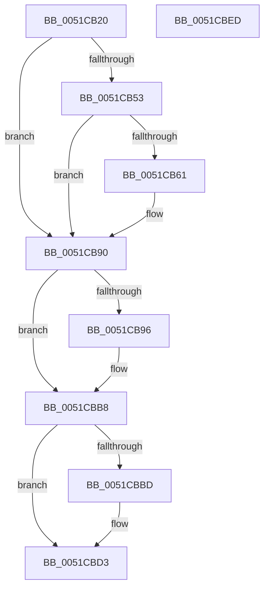

# SymCryptSha256Append

- RVA: `0x0051CB20`–`0x0051CBEE` (길이 `206` bytes)
- VA: `0x000000014051CB20`
- 실행 섹션: `.text`
- PDB 이름 있음: `예`; PDB Function 태그: `아니요`
- unwind 정보 RVA: `0x000C307C`
- 디코드: `65`개 명령, `206/206` bytes 표시
- 미해석 바이트: `0` (있으면 어셈블리에 `.byte`로 보존)

> 이 문서는 커널 이미지의 기계어와 PDB 기호를 분석해 생성했습니다. 4번과 5번은 함수 원형과 자료형을 바이너리 사용 방식에서 추정한 C 해석이며 원본 소스 복구 결과는 아닙니다.

## 1. Dependencies

- 직접 호출 지점: **5**; 고유 호출 대상: **3**
- 직접 호출자로 확인된 함수: **4**
- RIP 상대 이미지 참조: **1**

### Outgoing calls
- `0x0051CB6B` → [memcpy](../6C/memcpy_function_006C6840.md) (function, `0x006C6840`)
- `0x0051CB89` → [SymCryptSha256AppendBlocks](SymCryptSha256AppendBlocks_function_0051CC00.md) (function, `0x0051CC00`)
- `0x0051CBA5` → [SymCryptSha256AppendBlocks](SymCryptSha256AppendBlocks_function_0051CC00.md) (function, `0x0051CC00`)
- `0x0051CBCC` → [memcpy](../6C/memcpy_function_006C6840.md) (function, `0x006C6840`)
- `0x0051CBDD` → [_security_check_cookie](../6A/_security_check_cookie_function_006AC640.md) (function, `0x006AC640`)

### Direct callers
- [SymCryptSha256](SymCryptSha256_function_0051CA8C.md) at `0x0051CADD`
- [SepAppIdentityFromImageHash](../60/SepAppIdentityFromImageHash_function_00607AA4.md) at `0x00607CAB`
- [SepAppIdentityFromImageHash](../60/SepAppIdentityFromImageHash_function_00607AA4.md) at `0x00607CC6`
- [SepAppIdentityFromImageHash](../60/SepAppIdentityFromImageHash_function_00607AA4.md) at `0x00607CD9`
- [SepAppIdentityFromPackageInformation](../60/SepAppIdentityFromPackageInformation_function_00607D7C.md) at `0x00607E7A`
- [SepAppIdentityFromPackageInformation](../60/SepAppIdentityFromPackageInformation_function_00607D7C.md) at `0x00607E8F`
- [SepAppIdentityFromPackageInformation](../60/SepAppIdentityFromPackageInformation_function_00607D7C.md) at `0x00607ECF`
- [HashpHashBytes](../../page/84/HashpHashBytes_function_00841FA0.md) at `0x00841FEB`

### Static image references
- `0x0051CB2B` → RVA `0x00E0A740` (`.data`; read)

## 2. Other-region calls and transfers

- 다른 실행 섹션으로 향하는 call: **0**
- 별도 외부 분기/꼬리 이동을 확인하지 못했습니다.

## 3. Assembly (complete function range)

```asm
0051CB20  40 53                           push rbx
0051CB22  55                              push rbp
0051CB23  56                              push rsi
0051CB24  57                              push rdi
0051CB25  41 56                           push r14
0051CB27  48 83 EC 30                     sub rsp, 0x30
0051CB2B  48 8B 05 0E DC 8E 00            mov rax, qword ptr [rip + 0x8edc0e]
0051CB32  48 33 C4                        xor rax, rsp
0051CB35  48 89 44 24 28                  mov qword ptr [rsp + 0x28], rax
0051CB3A  48 83 64 24 20 00               and qword ptr [rsp + 0x20], 0
0051CB40  49 8B D8                        mov rbx, r8
0051CB43  48 01 59 10                     add qword ptr [rcx + 0x10], rbx
0051CB47  48 8B EA                        mov rbp, rdx
0051CB4A  8B 39                           mov edi, dword ptr [rcx]
0051CB4C  48 8B F1                        mov rsi, rcx
0051CB4F  85 FF                           test edi, edi
0051CB51  74 3D                           je 0x14051cb90
0051CB53  41 BE 40 00 00 00               mov r14d, 0x40
0051CB59  44 2B F7                        sub r14d, edi
0051CB5C  49 3B DE                        cmp rbx, r14
0051CB5F  72 2F                           jb 0x14051cb90
0051CB61  48 8D 4F 20                     lea rcx, [rdi + 0x20]
0051CB65  45 8B C6                        mov r8d, r14d
0051CB68  48 03 CE                        add rcx, rsi
0051CB6B  E8 D0 9C 1A 00                  call 0x1406c6840
0051CB70  48 8D 56 20                     lea rdx, [rsi + 0x20]
0051CB74  41 B8 40 00 00 00               mov r8d, 0x40
0051CB7A  48 8D 4E 60                     lea rcx, [rsi + 0x60]
0051CB7E  49 03 EE                        add rbp, r14
0051CB81  4C 8D 4C 24 20                  lea r9, [rsp + 0x20]
0051CB86  49 2B DE                        sub rbx, r14
0051CB89  E8 72 00 00 00                  call 0x14051cc00
0051CB8E  33 FF                           xor edi, edi
0051CB90  48 83 FB 40                     cmp rbx, 0x40
0051CB94  72 22                           jb 0x14051cbb8
0051CB96  48 8D 4E 60                     lea rcx, [rsi + 0x60]
0051CB9A  4C 8B C3                        mov r8, rbx
0051CB9D  4C 8D 4C 24 20                  lea r9, [rsp + 0x20]
0051CBA2  48 8B D5                        mov rdx, rbp
0051CBA5  E8 56 00 00 00                  call 0x14051cc00
0051CBAA  48 8B C3                        mov rax, rbx
0051CBAD  48 8B 5C 24 20                  mov rbx, qword ptr [rsp + 0x20]
0051CBB2  48 2B C3                        sub rax, rbx
0051CBB5  48 03 E8                        add rbp, rax
0051CBB8  48 85 DB                        test rbx, rbx
0051CBBB  74 16                           je 0x14051cbd3
0051CBBD  8B CF                           mov ecx, edi
0051CBBF  4C 8B C3                        mov r8, rbx
0051CBC2  48 83 C1 20                     add rcx, 0x20
0051CBC6  48 8B D5                        mov rdx, rbp
0051CBC9  48 03 CE                        add rcx, rsi
0051CBCC  E8 6F 9C 1A 00                  call 0x1406c6840
0051CBD1  03 FB                           add edi, ebx
0051CBD3  89 3E                           mov dword ptr [rsi], edi
0051CBD5  48 8B 4C 24 28                  mov rcx, qword ptr [rsp + 0x28]
0051CBDA  48 33 CC                        xor rcx, rsp
0051CBDD  E8 5E FA 18 00                  call 0x1406ac640
0051CBE2  48 83 C4 30                     add rsp, 0x30
0051CBE6  41 5E                           pop r14
0051CBE8  5F                              pop rdi
0051CBE9  5E                              pop rsi
0051CBEA  5D                              pop rbp
0051CBEB  5B                              pop rbx
0051CBEC  C3                              ret
0051CBED  CC                              int3
```

## 4. C-style interpretation (structured pseudocode)

```c
__int64 __fastcall SymCryptSha256Append(__int64 a1, __int64 a2, __int64 a3)
{
    __int64 result;
    __int64 v_r14;
    __int64 v_rbp;
    __int64 v_rbx;
    __int64 v_rdi;
    __int64 v_rsp;
    unsigned __int64 v_stack_m30;
    unsigned __int64 v_stack_m38;

    v_rsp = (v_rsp) - (48);
    result = (*(unsigned __int64 *)(v_rip + 9362446)) ^ (v_rsp);
    v_stack_m30 = result;
    if ((unsigned int)((unsigned int)(*(unsigned int *)(a1))) == 0) goto loc_0051CB90;
    v_r14 = (unsigned int)((64) - ((unsigned int)((unsigned int)(*(unsigned int *)(a1)))));
    v_rbx = a3;
    v_rdi = (unsigned int)(*(unsigned int *)(a1));
    v_rbp = a2;
    if (a3 >= v_r14) {
        a1 = (unsigned int)(*(unsigned int *)(a1)) + 32;
        a3 = (unsigned int)(v_r14);
        a1 = (a1) + (a1);
        result = memcpy(a1, a2, a3, a4);
        a2 = a1 + 32;
        a3 = 64;
        a1 = a1 + 96;
        v_rbp = (a2) + (v_r14);
        a4 = v_stack_m38;
        v_rbx = (a3) - (v_r14);
        result = SymCryptSha256AppendBlocks(a1, a2, a3, a4);
        v_rdi = 0;
    }
    if (v_rbx >= 64) {
        a1 = a1 + 96;
        a3 = v_rbx;
        a4 = v_stack_m38;
        a2 = v_rbp;
        result = SymCryptSha256AppendBlocks(a1, a2, a3, a4);
        result = v_rbx;
        v_rbx = v_stack_m38;
        result = (result) - (v_rbx);
        v_rbp = (v_rbp) + (result);
    }
    if (v_rbx != 0) {
        a1 = 0;
        a3 = v_rbx;
        a1 = (a1) + (32);
        a2 = v_rbp;
        a1 = (a1) + (a1);
        result = memcpy(a1, a2, a3, a4);
        v_rdi = (unsigned int)((v_rdi) + ((unsigned int)(v_rbx)));
    }
    *(unsigned int *)(a1) = (unsigned int)(v_rdi);
    a1 = (v_stack_m30) ^ (v_rsp);
    result = _security_check_cookie(a1, a2, a3, a4);
    v_rsp = (v_rsp) + (48);
    return result;
}
```

## 5. (Beta) C Style

```c
int64_t SymCryptSha256Append(void *Arg1, int64_t Arg2, int64_t Arg3)
{
    uint8_t *arg1 = (uint8_t *)Arg1;

    int64_t result;
    int64_t local_r14;
    int64_t local_rbp;
    int64_t local_rbx;
    int64_t local_rdi;
    int64_t local_rsp;
    uint64_t v_stack_m30;
    uint64_t v_stack_m38;

    local_rsp = (local_rsp) - (48);
    result = (*(uint64_t *)(v_rip + 0x8EDC0E)) ^ (local_rsp);
    v_stack_m30 = result;
    if ((uint32_t)((uint32_t)(*(uint32_t *)(arg1))) == 0) goto loc_0051CB90;
    local_r14 = (uint32_t)((64) - ((uint32_t)((uint32_t)(*(uint32_t *)(arg1)))));
    local_rbx = Arg3;
    local_rdi = (uint32_t)(*(uint32_t *)(arg1));
    local_rbp = Arg2;
    if (Arg3 >= local_r14) {
        Arg1 = (uint32_t)(*(uint32_t *)(arg1)) + 32;
        Arg3 = (uint32_t)(local_r14);
        Arg1 = (Arg1) + (Arg1);
        result = memcpy(Arg1, Arg2, Arg3, a4);
        Arg2 = Arg1 + 32;
        Arg3 = 64;
        Arg1 = Arg1 + 96;
        local_rbp = (Arg2) + (local_r14);
        a4 = v_stack_m38;
        local_rbx = (Arg3) - (local_r14);
        result = SymCryptSha256AppendBlocks(Arg1, Arg2, Arg3, a4);
        local_rdi = 0;
    }
    if (local_rbx >= 64) {
        Arg1 = Arg1 + 96;
        Arg3 = local_rbx;
        a4 = v_stack_m38;
        Arg2 = local_rbp;
        result = SymCryptSha256AppendBlocks(Arg1, Arg2, Arg3, a4);
        result = local_rbx;
        local_rbx = v_stack_m38;
        result = (result) - (local_rbx);
        local_rbp = (local_rbp) + (result);
    }
    if (local_rbx != 0) {
        Arg1 = 0;
        Arg3 = local_rbx;
        Arg1 = (Arg1) + (32);
        Arg2 = local_rbp;
        Arg1 = (Arg1) + (Arg1);
        result = memcpy(Arg1, Arg2, Arg3, a4);
        local_rdi = (uint32_t)((local_rdi) + ((uint32_t)(local_rbx)));
    }
    *(uint32_t *)(arg1) = (uint32_t)(local_rdi);
    Arg1 = (v_stack_m30) ^ (local_rsp);
    result = _security_check_cookie(Arg1, Arg2, Arg3, a4);
    local_rsp = (local_rsp) + (48);
    return result;
}
```

### 관측된 메모리 오프셋

구조체 형식이 확인되지 않은 접근은 인자 기준의 오프셋으로만 기록했습니다.

| 기준 인자 | 오프셋 표현 | 폭 (bit) | 접근 |
|---|---:|---:|---|
| `Arg1` | `+ 0x0` | `32` | `R` |
| `Arg1` | `+ 0x0` | `32` | `W` |
| `Arg1` | `+ 0x10` | `64` | `R/W` |
| `Arg1` | `+ 0x20` | `64` | `R` |
| `Arg1` | `+ 0x60` | `64` | `R` |

## 6. Execution-region graph

[열기: 2D/3D 그래프와 함수 탐색 컨트롤 패널](../../../control-panel.html?section=text&rva=0x0051CB20&view=graph)

- 2D 그래프는 위에서 아래로 흐르고, 3D 그래프는 빈 공간을 드래그해 회전합니다. Shift+드래그는 이동, 휠은 확대·축소, 함수 노드 선택은 대상 보고서 이동입니다.

### Static fallback


