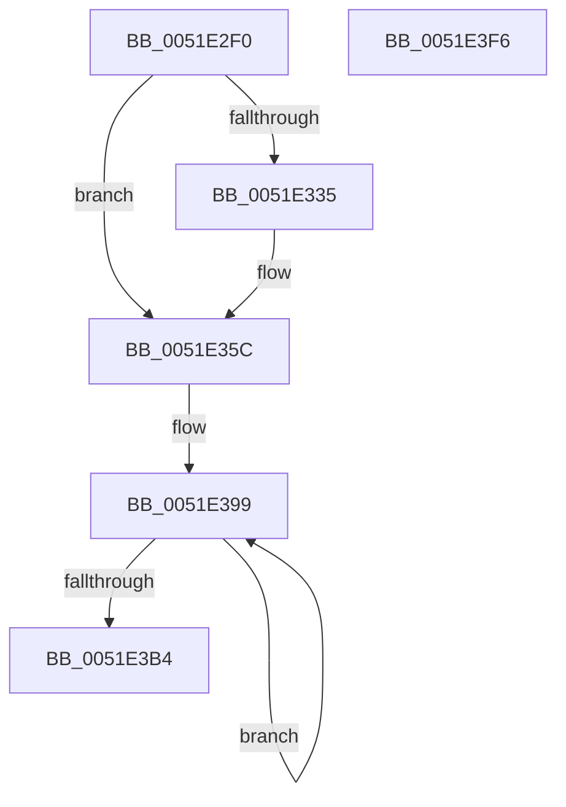

# SymCryptSha256Result

- RVA: `0x0051E2F0`–`0x0051E3F7` (길이 `263` bytes)
- VA: `0x000000014051E2F0`
- 실행 섹션: `.text`
- PDB 이름 있음: `예`; PDB Function 태그: `아니요`
- unwind 정보 RVA: `0x000C305C`
- 디코드: `72`개 명령, `263/263` bytes 표시
- 미해석 바이트: `0` (있으면 어셈블리에 `.byte`로 보존)

> 이 문서는 커널 이미지의 기계어와 PDB 기호를 분석해 생성했습니다. 4번과 5번은 함수 원형과 자료형을 바이너리 사용 방식에서 추정한 C 해석이며 원본 소스 복구 결과는 아닙니다.

## 1. Dependencies

- 직접 호출 지점: **6**; 고유 호출 대상: **3**
- 직접 호출자로 확인된 함수: **4**
- RIP 상대 이미지 참조: **3**

### Outgoing calls
- `0x0051E341` → [SymCryptWipe](SymCryptWipe_function_0051F914.md) (function, `0x0051F914`)
- `0x0051E355` → [SymCryptSha256AppendBlocks](SymCryptSha256AppendBlocks_function_0051CC00.md) (function, `0x0051CC00`)
- `0x0051E368` → [SymCryptWipe](SymCryptWipe_function_0051F914.md) (function, `0x0051F914`)
- `0x0051E38B` → [SymCryptSha256AppendBlocks](SymCryptSha256AppendBlocks_function_0051CC00.md) (function, `0x0051CC00`)
- `0x0051E3BC` → [SymCryptWipe](SymCryptWipe_function_0051F914.md) (function, `0x0051F914`)
- `0x0051E3DE` → [_security_check_cookie](../6A/_security_check_cookie_function_006AC640.md) (function, `0x006AC640`)

### Direct callers
- [SymCryptSha256](SymCryptSha256_function_0051CA8C.md) at `0x0051CAEA`
- [SepAppIdentityFromImageHash](../60/SepAppIdentityFromImageHash_function_00607AA4.md) at `0x00607CE6`
- [SepAppIdentityFromPackageInformation](../60/SepAppIdentityFromPackageInformation_function_00607D7C.md) at `0x00607E9C`
- [SepAppIdentityFromPackageInformation](../60/SepAppIdentityFromPackageInformation_function_00607D7C.md) at `0x00607EDC`
- [HashpFinalizeHash](../../page/84/HashpFinalizeHash_function_00841F34.md) at `0x00841F76`

### Static image references
- `0x0051E302` → RVA `0x00E0A740` (`.data`; read)
- `0x0051E3C1` → RVA `0x0001F8B0` (`.rdata`; read)
- `0x0051E3CB` → RVA `0x0001F8C0` (`.rdata`; read)

## 2. Other-region calls and transfers

- 다른 실행 섹션으로 향하는 call: **0**
- 별도 외부 분기/꼬리 이동을 확인하지 못했습니다.

## 3. Assembly (complete function range)

```asm
0051E2F0  48 89 5C 24 18                  mov qword ptr [rsp + 0x18], rbx
0051E2F5  48 89 6C 24 20                  mov qword ptr [rsp + 0x20], rbp
0051E2FA  56                              push rsi
0051E2FB  57                              push rdi
0051E2FC  41 56                           push r14
0051E2FE  48 83 EC 30                     sub rsp, 0x30
0051E302  48 8B 05 37 C4 8E 00            mov rax, qword ptr [rip + 0x8ec437]
0051E309  48 33 C4                        xor rax, rsp
0051E30C  48 89 44 24 28                  mov qword ptr [rsp + 0x28], rax
0051E311  48 83 64 24 20 00               and qword ptr [rsp + 0x20], 0
0051E317  48 8B D9                        mov rbx, rcx
0051E31A  8B 09                           mov ecx, dword ptr [rcx]
0051E31C  48 8B F2                        mov rsi, rdx
0051E31F  41 BE 40 00 00 00               mov r14d, 0x40
0051E325  48 8D 7B 60                     lea rdi, [rbx + 0x60]
0051E329  C6 44 19 20 80                  mov byte ptr [rcx + rbx + 0x20], 0x80
0051E32E  FF C1                           inc ecx
0051E330  83 F9 38                        cmp ecx, 0x38
0051E333  76 27                           jbe 0x14051e35c
0051E335  41 8B D6                        mov edx, r14d
0051E338  2B D1                           sub edx, ecx
0051E33A  48 83 C1 20                     add rcx, 0x20
0051E33E  48 03 CB                        add rcx, rbx
0051E341  E8 CE 15 00 00                  call 0x14051f914
0051E346  4C 8D 4C 24 20                  lea r9, [rsp + 0x20]
0051E34B  45 8B C6                        mov r8d, r14d
0051E34E  48 8D 53 20                     lea rdx, [rbx + 0x20]
0051E352  48 8B CF                        mov rcx, rdi
0051E355  E8 A6 E8 FF FF                  call 0x14051cc00
0051E35A  33 C9                           xor ecx, ecx
0051E35C  41 8B D6                        mov edx, r14d
0051E35F  2B D1                           sub edx, ecx
0051E361  48 83 C1 20                     add rcx, 0x20
0051E365  48 03 CB                        add rcx, rbx
0051E368  E8 A7 15 00 00                  call 0x14051f914
0051E36D  48 8B 43 10                     mov rax, qword ptr [rbx + 0x10]
0051E371  4C 8D 4C 24 20                  lea r9, [rsp + 0x20]
0051E376  48 C1 E0 03                     shl rax, 3
0051E37A  48 8D 53 20                     lea rdx, [rbx + 0x20]
0051E37E  48 0F C8                        bswap rax
0051E381  4D 8B C6                        mov r8, r14
0051E384  48 89 43 58                     mov qword ptr [rbx + 0x58], rax
0051E388  48 8B CF                        mov rcx, rdi
0051E38B  E8 70 E8 FF FF                  call 0x14051cc00
0051E390  48 8B CF                        mov rcx, rdi
0051E393  41 B8 04 00 00 00               mov r8d, 4
0051E399  48 8B 01                        mov rax, qword ptr [rcx]
0051E39C  48 8D 49 08                     lea rcx, [rcx + 8]
0051E3A0  48 C1 C0 20                     rol rax, 0x20
0051E3A4  48 0F C8                        bswap rax
0051E3A7  48 89 06                        mov qword ptr [rsi], rax
0051E3AA  48 8D 76 08                     lea rsi, [rsi + 8]
0051E3AE  49 83 E8 01                     sub r8, 1
0051E3B2  75 E5                           jne 0x14051e399
0051E3B4  BA 80 00 00 00                  mov edx, 0x80
0051E3B9  48 8B CB                        mov rcx, rbx
0051E3BC  E8 53 15 00 00                  call 0x14051f914
0051E3C1  0F 10 05 E8 14 B0 FF            movups xmm0, xmmword ptr [rip - 0x4feb18]
0051E3C8  0F 11 07                        movups xmmword ptr [rdi], xmm0
0051E3CB  0F 10 0D EE 14 B0 FF            movups xmm1, xmmword ptr [rip - 0x4feb12]
0051E3D2  0F 11 4F 10                     movups xmmword ptr [rdi + 0x10], xmm1
0051E3D6  48 8B 4C 24 28                  mov rcx, qword ptr [rsp + 0x28]
0051E3DB  48 33 CC                        xor rcx, rsp
0051E3DE  E8 5D E2 18 00                  call 0x1406ac640
0051E3E3  48 8B 5C 24 60                  mov rbx, qword ptr [rsp + 0x60]
0051E3E8  48 8B 6C 24 68                  mov rbp, qword ptr [rsp + 0x68]
0051E3ED  48 83 C4 30                     add rsp, 0x30
0051E3F1  41 5E                           pop r14
0051E3F3  5F                              pop rdi
0051E3F4  5E                              pop rsi
0051E3F5  C3                              ret
0051E3F6  CC                              int3
```

## 4. C-style interpretation (structured pseudocode)

```c
__int64 __fastcall SymCryptSha256Result(__int64 a1, __int64 a2)
{
    __int64 result;
    __int64 v_rsp;
    unsigned __int64 v_stack_m20;
    unsigned __int64 v_stack_m28;
    unsigned __int64 v_stack_p18;
    unsigned __int64 v_stack_p20;

    v_stack_p18 = v_rbx;
    v_stack_p20 = v_rbp;
    v_rsp = (v_rsp) - (48);
    result = (*(unsigned __int64 *)(v_rip + 9356343)) ^ (v_rsp);
    v_stack_m20 = result;
    *(unsigned __int8 *)((unsigned int)(*(unsigned int *)(a1)) + a1 * 1 + 32) = 128;
    a1 = (unsigned int)(((unsigned int)(*(unsigned int *)(a1))) + 1);
    if (((unsigned int)(a1)) >= = 56) {
        a2 = 64;
        a2 = (unsigned int)((a2) - ((unsigned int)(a1)));
        a1 = (a1) + (32);
        a1 = (a1) + (a1);
        result = SymCryptWipe(a1, a2, a3, a4);
        a4 = v_stack_m28;
        a3 = 64;
        a2 = a1 + 32;
        a1 = a1 + 96;
        result = SymCryptSha256AppendBlocks(a1, a2, a3, a4);
        a1 = 0;
    }
    a2 = (unsigned int)((64) - (0));
    a1 = (a1) + (32);
    a1 = (a1) + (a1);
    result = SymCryptWipe(a1, a2, a3, a4);
    result = (*(unsigned __int64 *)(a1 + 16)) << (3);
    *(unsigned __int64 *)(a1 + 88) = result;
    result = SymCryptSha256AppendBlocks(a1 + 96, a1 + 32, 64, v_stack_m28);
loc_0051E399:
    *(unsigned __int64 *)(a2) = *(unsigned __int64 *)(a1 + 96);
    a3 = (4) - (1);
    if (condition_is_not_equal) goto loc_0051E399;
    result = SymCryptWipe(a1, 128, a3, v_stack_m28);
    *(unsigned __int64 *)(a1 + 96) = v_xmm0;
    *(unsigned __int64 *)(a1 + 96 + 16) = v_xmm1;
    a1 = (v_stack_m20) ^ (v_rsp);
    result = _security_check_cookie(a1, 128, a3, v_stack_m28);
    v_rsp = (v_rsp) + (48);
    return result;
}
```

## 5. (Beta) C Style

```c
int64_t SymCryptSha256Result(void *Arg1, void *Arg2)
{
    uint8_t *arg1 = (uint8_t *)Arg1;
    uint8_t *arg2 = (uint8_t *)Arg2;

    int64_t result;
    int64_t local_rsp;
    uint64_t v_stack_m20;
    uint64_t v_stack_m28;
    uint64_t v_stack_p18;
    uint64_t v_stack_p20;

    v_stack_p18 = local_rbx;
    v_stack_p20 = local_rbp;
    local_rsp = (local_rsp) - (48);
    result = (*(uint64_t *)(v_rip + 0x8EC437)) ^ (local_rsp);
    v_stack_m20 = result;
    *(uint8_t *)((uint32_t)(*(uint32_t *)(arg1)) + arg1 * 1 + 0x20) = 128;
    Arg1 = (uint32_t)(((uint32_t)(*(uint32_t *)(arg1))) + 1);
    if (((uint32_t)(Arg1)) >= = 56) {
        Arg2 = 64;
        Arg2 = (uint32_t)((Arg2) - ((uint32_t)(Arg1)));
        Arg1 = (Arg1) + (32);
        Arg1 = (Arg1) + (Arg1);
        result = SymCryptWipe(Arg1, Arg2, a3, a4);
        a4 = v_stack_m28;
        a3 = 64;
        Arg2 = Arg1 + 32;
        Arg1 = Arg1 + 96;
        result = SymCryptSha256AppendBlocks(Arg1, Arg2, a3, a4);
        Arg1 = 0;
    }
    Arg2 = (uint32_t)((64) - (0));
    Arg1 = (Arg1) + (32);
    Arg1 = (Arg1) + (Arg1);
    result = SymCryptWipe(Arg1, Arg2, a3, a4);
    result = (*(uint64_t *)(arg1 + 0x10)) << (3);
    *(uint64_t *)(arg1 + 0x58) = result;
    result = SymCryptSha256AppendBlocks(Arg1 + 96, Arg1 + 32, 64, v_stack_m28);
loc_0051E399:
    *(uint64_t *)(arg2) = *(uint64_t *)(arg1 + 0x60);
    a3 = (4) - (1);
    if (condition_is_not_equal) goto loc_0051E399;
    result = SymCryptWipe(Arg1, 128, a3, v_stack_m28);
    *(uint64_t *)(arg1 + 0x60) = v_xmm0;
    *(uint64_t *)(arg1 + 0x60 + 0x10) = v_xmm1;
    Arg1 = (v_stack_m20) ^ (local_rsp);
    result = _security_check_cookie(Arg1, 128, a3, v_stack_m28);
    local_rsp = (local_rsp) + (48);
    return result;
}
```

### 관측된 메모리 오프셋

구조체 형식이 확인되지 않은 접근은 인자 기준의 오프셋으로만 기록했습니다.

| 기준 인자 | 오프셋 표현 | 폭 (bit) | 접근 |
|---|---:|---:|---|
| `Arg1` | `+ 0x0` | `32` | `R` |
| `Arg1` | `+ 0x0` | `64` | `R` |
| `Arg1` | `+ 0x0` | `128` | `R` |
| `Arg1` | `+ 0x8` | `64` | `R` |
| `Arg1` | `+ 0x10` | `64` | `R` |
| `Arg1` | `+ 0x10` | `128` | `R` |
| `Arg1` | `+ 0x20` | `64` | `R` |
| `Arg1` | `+ 0x58` | `64` | `W` |
| `Arg1` | `+ 0x60` | `64` | `R` |
| `Arg2` | `+ 0x0` | `64` | `W` |
| `Arg2` | `+ 0x8` | `64` | `R` |

## 6. Execution-region graph

[열기: 2D/3D 그래프와 함수 탐색 컨트롤 패널](../../../control-panel.html?section=text&rva=0x0051E2F0&view=graph)

- 2D 그래프는 위에서 아래로 흐르고, 3D 그래프는 빈 공간을 드래그해 회전합니다. Shift+드래그는 이동, 휠은 확대·축소, 함수 노드 선택은 대상 보고서 이동입니다.

### Static fallback


