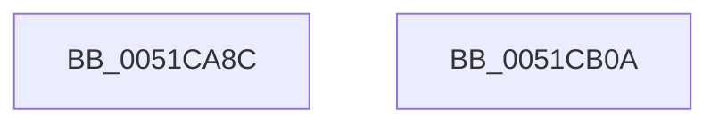

# SymCryptSha256

- RVA: `0x0051CA8C`–`0x0051CB0B` (길이 `127` bytes)
- VA: `0x000000014051CA8C`
- 실행 섹션: `.text`
- PDB 이름 있음: `예`; PDB Function 태그: `아니요`
- unwind 정보 RVA: `0x000A8988`
- 디코드: `34`개 명령, `127/127` bytes 표시
- 미해석 바이트: `0` (있으면 어셈블리에 `.byte`로 보존)

> 이 문서는 커널 이미지의 기계어와 PDB 기호를 분석해 생성했습니다. 4번과 5번은 함수 원형과 자료형을 바이너리 사용 방식에서 추정한 C 해석이며 원본 소스 복구 결과는 아닙니다.

## 1. Dependencies

- 직접 호출 지점: **5**; 고유 호출 대상: **5**
- 직접 호출자로 확인된 함수: **2**
- RIP 상대 이미지 참조: **1**

### Outgoing calls
- `0x0051CAC3` → [memset](../6C/memset_function_006C6C40.md) (function, `0x006C6C40`)
- `0x0051CACD` → [SymCryptSha256Init](SymCryptSha256Init_function_0051E2C0.md) (function, `0x0051E2C0`)
- `0x0051CADD` → [SymCryptSha256Append](SymCryptSha256Append_function_0051CB20.md) (function, `0x0051CB20`)
- `0x0051CAEA` → [SymCryptSha256Result](SymCryptSha256Result_function_0051E2F0.md) (function, `0x0051E2F0`)
- `0x0051CAFA` → [_security_check_cookie](../6A/_security_check_cookie_function_006AC640.md) (function, `0x006AC640`)

### Direct callers
- [RtlDeriveCapabilitySidsFromName](../47/RtlDeriveCapabilitySidsFromName_function_00474DC0.md) at `0x00474E4F`
- [KeComputeSha256](../4A/KeComputeSha256_function_004A7370.md) at `0x004A7374`

### Static image references
- `0x0051CA97` → RVA `0x00E0A740` (`.data`; read)

## 2. Other-region calls and transfers

- 다른 실행 섹션으로 향하는 call: **0**
- 별도 외부 분기/꼬리 이동을 확인하지 못했습니다.

## 3. Assembly (complete function range)

```asm
0051CA8C  40 53                           push rbx
0051CA8E  56                              push rsi
0051CA8F  57                              push rdi
0051CA90  48 81 EC B0 00 00 00            sub rsp, 0xb0
0051CA97  48 8B 05 A2 DC 8E 00            mov rax, qword ptr [rip + 0x8edca2]
0051CA9E  48 33 C4                        xor rax, rsp
0051CAA1  48 89 84 24 A0 00 00 00         mov qword ptr [rsp + 0xa0], rax
0051CAA9  33 C0                           xor eax, eax
0051CAAB  49 8B F0                        mov rsi, r8
0051CAAE  48 8B FA                        mov rdi, rdx
0051CAB1  89 44 24 24                     mov dword ptr [rsp + 0x24], eax
0051CAB5  48 8B D9                        mov rbx, rcx
0051CAB8  33 D2                           xor edx, edx
0051CABA  48 8D 4C 24 20                  lea rcx, [rsp + 0x20]
0051CABF  44 8D 40 7C                     lea r8d, [rax + 0x7c]
0051CAC3  E8 78 A1 1A 00                  call 0x1406c6c40
0051CAC8  48 8D 4C 24 20                  lea rcx, [rsp + 0x20]
0051CACD  E8 EE 17 00 00                  call 0x14051e2c0
0051CAD2  4C 8B C7                        mov r8, rdi
0051CAD5  48 8D 4C 24 20                  lea rcx, [rsp + 0x20]
0051CADA  48 8B D3                        mov rdx, rbx
0051CADD  E8 3E 00 00 00                  call 0x14051cb20
0051CAE2  48 8B D6                        mov rdx, rsi
0051CAE5  48 8D 4C 24 20                  lea rcx, [rsp + 0x20]
0051CAEA  E8 01 18 00 00                  call 0x14051e2f0
0051CAEF  48 8B 8C 24 A0 00 00 00         mov rcx, qword ptr [rsp + 0xa0]
0051CAF7  48 33 CC                        xor rcx, rsp
0051CAFA  E8 41 FB 18 00                  call 0x1406ac640
0051CAFF  48 81 C4 B0 00 00 00            add rsp, 0xb0
0051CB06  5F                              pop rdi
0051CB07  5E                              pop rsi
0051CB08  5B                              pop rbx
0051CB09  C3                              ret
0051CB0A  CC                              int3
```

## 4. C-style interpretation (structured pseudocode)

```c
__int64 __fastcall SymCryptSha256(__int64 a1, __int64 a2, __int64 a3)
{
    __int64 result;
    __int64 v_rsp;
    unsigned __int64 v_stack_m28;
    unsigned int v_stack_mA4;
    unsigned __int64 v_stack_mA8;

    v_rsp = (v_rsp) - (176);
    result = (*(unsigned __int64 *)(v_rip + 9362594)) ^ (v_rsp);
    v_stack_m28 = result;
    result = 0;
    v_stack_mA4 = 0;
    a2 = 0;
    result = memset(v_stack_mA8, a2, result + 124, a4);
    result = SymCryptSha256Init(v_stack_mA8, a2, result + 124, a4);
    result = SymCryptSha256Append(v_stack_mA8, a1, 0, a4);
    result = SymCryptSha256Result(v_stack_mA8, a3, 0, a4);
    a1 = (v_stack_m28) ^ (v_rsp);
    result = _security_check_cookie(a1, a3, 0, a4);
    v_rsp = (v_rsp) + (176);
    return result;
}
```

## 5. (Beta) C Style

```c
int64_t SymCryptSha256(int64_t Arg1, int64_t Arg2, int64_t Arg3)
{
    int64_t result;
    int64_t local_rsp;
    uint64_t v_stack_m28;
    uint32_t v_stack_mA4;
    uint64_t v_stack_mA8;

    local_rsp = (local_rsp) - (176);
    result = (*(uint64_t *)(v_rip + 0x8EDCA2)) ^ (local_rsp);
    v_stack_m28 = result;
    result = 0;
    v_stack_mA4 = 0;
    Arg2 = 0;
    result = memset(v_stack_mA8, Arg2, result + 124, a4);
    result = SymCryptSha256Init(v_stack_mA8, Arg2, result + 124, a4);
    result = SymCryptSha256Append(v_stack_mA8, Arg1, 0, a4);
    result = SymCryptSha256Result(v_stack_mA8, Arg3, 0, a4);
    Arg1 = (v_stack_m28) ^ (local_rsp);
    result = _security_check_cookie(Arg1, Arg3, 0, a4);
    local_rsp = (local_rsp) + (176);
    return result;
}
```

## 6. Execution-region graph

[열기: 2D/3D 그래프와 함수 탐색 컨트롤 패널](../../../control-panel.html?section=text&rva=0x0051CA8C&view=graph)

- 2D 그래프는 위에서 아래로 흐르고, 3D 그래프는 빈 공간을 드래그해 회전합니다. Shift+드래그는 이동, 휠은 확대·축소, 함수 노드 선택은 대상 보고서 이동입니다.

### Static fallback


