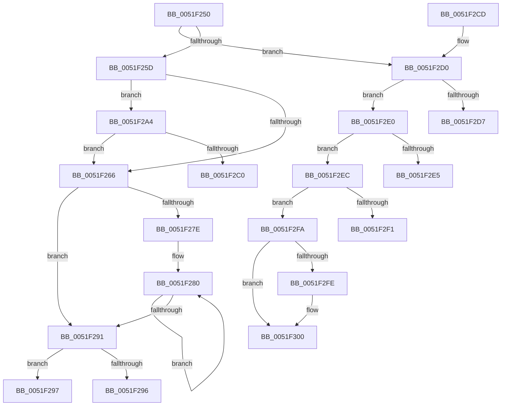

# SymCryptWipeAsm

- RVA: `0x0051F250`–`0x0051F301` (길이 `177` bytes)
- VA: `0x000000014051F250`
- 실행 섹션: `.text`
- PDB 이름 있음: `예`; PDB Function 태그: `아니요`
- unwind 정보 RVA: `0x000C3108`
- 디코드: `59`개 명령, `177/177` bytes 표시
- 미해석 바이트: `0` (있으면 어셈블리에 `.byte`로 보존)

> 이 문서는 커널 이미지의 기계어와 PDB 기호를 분석해 생성했습니다. 4번과 5번은 함수 원형과 자료형을 바이너리 사용 방식에서 추정한 C 해석이며 원본 소스 복구 결과는 아닙니다.

## 1. Dependencies

- 직접 호출 지점: **0**; 고유 호출 대상: **0**
- 직접 호출자로 확인된 함수: **1**
- RIP 상대 이미지 참조: **0**

### Outgoing calls
- 직접 디코드된 call 명령이 없습니다.

### Direct callers
- [SymCryptWipe](SymCryptWipe_function_0051F914.md) at `0x0051F918`

### Static image references
- 디코드된 RIP-relative 메모리 참조가 없습니다.

## 2. Other-region calls and transfers

- 다른 실행 섹션으로 향하는 call: **0**
- 별도 외부 분기/꼬리 이동을 확인하지 못했습니다.

## 3. Assembly (complete function range)

```asm
0051F250  0F 57 C0                        xorps xmm0, xmm0
0051F253  48 83 FA 10                     cmp rdx, 0x10
0051F257  0F 82 73 00 00 00               jb 0x14051f2d0
0051F25D  48 F7 C1 0F 00 00 00            test rcx, 0xf
0051F264  75 3E                           jne 0x14051f2a4
0051F266  48 F7 C2 10 00 00 00            test rdx, 0x10
0051F26D  0F 29 01                        movaps xmmword ptr [rcx], xmm0
0051F270  4C 8D 41 10                     lea r8, [rcx + 0x10]
0051F274  49 0F 45 C8                     cmovne rcx, r8
0051F278  48 83 EA 20                     sub rdx, 0x20
0051F27C  72 13                           jb 0x14051f291
0051F27E  66 90                           nop
0051F280  0F 29 01                        movaps xmmword ptr [rcx], xmm0
0051F283  0F 29 41 10                     movaps xmmword ptr [rcx + 0x10], xmm0
0051F287  48 83 C1 20                     add rcx, 0x20
0051F28B  48 83 EA 20                     sub rdx, 0x20
0051F28F  73 EF                           jae 0x14051f280
0051F291  83 E2 0F                        and edx, 0xf
0051F294  75 01                           jne 0x14051f297
0051F296  C3                              ret
0051F297  33 C0                           xor eax, eax
0051F299  48 89 44 11 F0                  mov qword ptr [rcx + rdx - 0x10], rax
0051F29E  48 89 44 11 F8                  mov qword ptr [rcx + rdx - 8], rax
0051F2A3  C3                              ret
0051F2A4  33 C0                           xor eax, eax
0051F2A6  48 89 01                        mov qword ptr [rcx], rax
0051F2A9  48 89 41 08                     mov qword ptr [rcx + 8], rax
0051F2AD  8B C1                           mov eax, ecx
0051F2AF  F7 D8                           neg eax
0051F2B1  83 E0 0F                        and eax, 0xf
0051F2B4  48 03 C8                        add rcx, rax
0051F2B7  48 2B D0                        sub rdx, rax
0051F2BA  48 83 FA 10                     cmp rdx, 0x10
0051F2BE  73 A6                           jae 0x14051f266
0051F2C0  33 C0                           xor eax, eax
0051F2C2  48 89 44 11 F0                  mov qword ptr [rcx + rdx - 0x10], rax
0051F2C7  48 89 44 11 F8                  mov qword ptr [rcx + rdx - 8], rax
0051F2CC  C3                              ret
0051F2CD  0F 1F 00                        nop dword ptr [rax]
0051F2D0  33 C0                           xor eax, eax
0051F2D2  83 FA 08                        cmp edx, 8
0051F2D5  72 09                           jb 0x14051f2e0
0051F2D7  48 89 01                        mov qword ptr [rcx], rax
0051F2DA  48 89 44 11 F8                  mov qword ptr [rcx + rdx - 8], rax
0051F2DF  C3                              ret
0051F2E0  83 FA 04                        cmp edx, 4
0051F2E3  72 07                           jb 0x14051f2ec
0051F2E5  89 01                           mov dword ptr [rcx], eax
0051F2E7  89 44 11 FC                     mov dword ptr [rcx + rdx - 4], eax
0051F2EB  C3                              ret
0051F2EC  83 FA 02                        cmp edx, 2
0051F2EF  72 09                           jb 0x14051f2fa
0051F2F1  66 89 01                        mov word ptr [rcx], ax
0051F2F4  66 89 44 11 FE                  mov word ptr [rcx + rdx - 2], ax
0051F2F9  C3                              ret
0051F2FA  0B D2                           or edx, edx
0051F2FC  74 02                           je 0x14051f300
0051F2FE  88 01                           mov byte ptr [rcx], al
0051F300  C3                              ret
```

## 4. C-style interpretation (structured pseudocode)

```c
__int64 __fastcall SymCryptWipeAsm(__int64 a1, __int64 a2)
{
    __int64 result;

    if (a2 < 16) goto loc_0051F2D0;
    if (((a1) & (15)) != 0) goto loc_0051F2A4;
loc_0051F266:
    *(unsigned __int64 *)(a1) = v_xmm0;
    if (((a2) & (16)) != 0) { a1 = a1 + 16; }
    a2 = (a2) - (32);
    if (condition_is_below) goto loc_0051F291;
loc_0051F280:
    *(unsigned __int64 *)(a1) = v_xmm0;
    *(unsigned __int64 *)(a1 + 16) = v_xmm0;
    a1 = (a1) + (32);
    a2 = (a2) - (32);
    if (condition_is_above_or_equal) goto loc_0051F280;
loc_0051F291:
    a2 = (unsigned int)((a2) & (15));
    if (condition_is_not_equal) goto loc_0051F297;
    return result;
loc_0051F297:
    result = 0;
    *(unsigned __int64 *)(a1 + a2 * 1 - 16) = 0;
    *(unsigned __int64 *)(a1 + a2 * 1 - 8) = 0;
    return result;
loc_0051F2A4:
    result = 0;
    *(unsigned __int64 *)(a1) = 0;
    *(unsigned __int64 *)(a1 + 8) = 0;
    result = (unsigned int)(-((unsigned int)((unsigned int)(a1))));
    result = (unsigned int)((result) & (15));
    a1 = (a1) + (result);
    a2 = (a2) - (result);
    if (a2 >= 16) goto loc_0051F266;
    result = 0;
    *(unsigned __int64 *)(a1 + a2 * 1 - 16) = 0;
    *(unsigned __int64 *)(a1 + a2 * 1 - 8) = 0;
    return result;
loc_0051F2D0:
    result = 0;
    if (((unsigned int)(a2)) < 8) goto loc_0051F2E0;
    *(unsigned __int64 *)(a1) = 0;
    *(unsigned __int64 *)(a1 + a2 * 1 - 8) = 0;
    return result;
loc_0051F2E0:
    if (((unsigned int)(a2)) < 4) goto loc_0051F2EC;
    *(unsigned int *)(a1) = 0;
    *(unsigned int *)(a1 + a2 * 1 - 4) = 0;
    return result;
loc_0051F2EC:
    if (((unsigned int)(a2)) < 2) goto loc_0051F2FA;
    *(unsigned __int16 *)(a1) = 0;
    *(unsigned __int16 *)(a1 + a2 * 1 - 2) = 0;
    return result;
loc_0051F2FA:
    a2 = (unsigned int)((a2) | ((unsigned int)(a2)));
    if (!(condition_is_equal)) {
        *(unsigned __int8 *)(a1) = 0;
    }
    return result;
}
```

## 5. (Beta) C Style

```c
int64_t SymCryptWipeAsm(void *Arg1, int64_t Arg2)
{
    uint8_t *arg1 = (uint8_t *)Arg1;

    int64_t result;

    if (Arg2 < 16) goto loc_0051F2D0;
    if (((Arg1) & (15)) != 0) goto loc_0051F2A4;
loc_0051F266:
    *(uint64_t *)(arg1) = v_xmm0;
    if (((Arg2) & (16)) != 0) { Arg1 = Arg1 + 16; }
    Arg2 = (Arg2) - (32);
    if (condition_is_below) goto loc_0051F291;
loc_0051F280:
    *(uint64_t *)(arg1) = v_xmm0;
    *(uint64_t *)(arg1 + 0x10) = v_xmm0;
    Arg1 = (Arg1) + (32);
    Arg2 = (Arg2) - (32);
    if (condition_is_above_or_equal) goto loc_0051F280;
loc_0051F291:
    Arg2 = (uint32_t)((Arg2) & (15));
    if (condition_is_not_equal) goto loc_0051F297;
    return result;
loc_0051F297:
    result = 0;
    *(uint64_t *)(arg1 + Arg2 * 1 - 0x10) = 0;
    *(uint64_t *)(arg1 + Arg2 * 1 - 0x8) = 0;
    return result;
loc_0051F2A4:
    result = 0;
    *(uint64_t *)(arg1) = 0;
    *(uint64_t *)(arg1 + 0x8) = 0;
    result = (uint32_t)(-((uint32_t)((uint32_t)(Arg1))));
    result = (uint32_t)((result) & (15));
    Arg1 = (Arg1) + (result);
    Arg2 = (Arg2) - (result);
    if (Arg2 >= 16) goto loc_0051F266;
    result = 0;
    *(uint64_t *)(arg1 + Arg2 * 1 - 0x10) = 0;
    *(uint64_t *)(arg1 + Arg2 * 1 - 0x8) = 0;
    return result;
loc_0051F2D0:
    result = 0;
    if (((uint32_t)(Arg2)) < 8) goto loc_0051F2E0;
    *(uint64_t *)(arg1) = 0;
    *(uint64_t *)(arg1 + Arg2 * 1 - 0x8) = 0;
    return result;
loc_0051F2E0:
    if (((uint32_t)(Arg2)) < 4) goto loc_0051F2EC;
    *(uint32_t *)(arg1) = 0;
    *(uint32_t *)(arg1 + Arg2 * 1 - 0x4) = 0;
    return result;
loc_0051F2EC:
    if (((uint32_t)(Arg2)) < 2) goto loc_0051F2FA;
    *(uint16_t *)(arg1) = 0;
    *(uint16_t *)(arg1 + Arg2 * 1 - 0x2) = 0;
    return result;
loc_0051F2FA:
    Arg2 = (uint32_t)((Arg2) | ((uint32_t)(Arg2)));
    if (!(condition_is_equal)) {
        *(uint8_t *)(arg1) = 0;
    }
    return result;
}
```

### 관측된 메모리 오프셋

구조체 형식이 확인되지 않은 접근은 인자 기준의 오프셋으로만 기록했습니다.

| 기준 인자 | 오프셋 표현 | 폭 (bit) | 접근 |
|---|---:|---:|---|
| `Arg1` | `- 0x8 + rdx*1` | `64` | `W` |
| `Arg1` | `- 0x4 + rdx*1` | `32` | `W` |
| `Arg1` | `- 0x2 + rdx*1` | `16` | `W` |
| `Arg1` | `+ 0x0` | `8` | `W` |
| `Arg1` | `+ 0x0` | `16` | `W` |
| `Arg1` | `+ 0x0` | `32` | `W` |
| `Arg1` | `+ 0x0` | `64` | `W` |

## 6. Execution-region graph

[열기: 2D/3D 그래프와 함수 탐색 컨트롤 패널](../../../control-panel.html?section=text&rva=0x0051F250&view=graph)

- 2D 그래프는 위에서 아래로 흐르고, 3D 그래프는 빈 공간을 드래그해 회전합니다. Shift+드래그는 이동, 휠은 확대·축소, 함수 노드 선택은 대상 보고서 이동입니다.

### Static fallback


