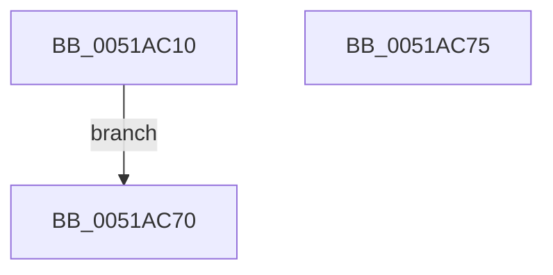

# sub_0051AC10

- RVA: `0x0051AC10`–`0x0051AC76` (길이 `102` bytes)
- VA: `0x000000014051AC10`
- 실행 섹션: `.text`
- PDB 이름 있음: `아니요`; PDB Function 태그: `아니요`
- unwind 정보 RVA: `0x000C2C98`
- 디코드: `28`개 명령, `102/102` bytes 표시
- 미해석 바이트: `0` (있으면 어셈블리에 `.byte`로 보존)

> 이 문서는 커널 이미지의 기계어와 PDB 기호를 분석해 생성했습니다. 4번과 5번은 함수 원형과 자료형을 바이너리 사용 방식에서 추정한 C 해석이며 원본 소스 복구 결과는 아닙니다.

## 1. Dependencies

- 직접 호출 지점: **1**; 고유 호출 대상: **1**
- 직접 호출자로 확인된 함수: **0**
- RIP 상대 이미지 참조: **0**

### Outgoing calls
- `0x0051AC66` → [MmProbeAndLockPages](../23/MmProbeAndLockPages_function_0023B990.md) (function, `0x0023B990`)

### Direct callers
- 이 함수 시작 RVA로 연결되는 직접 call은 확인되지 않았습니다. 간접 호출은 완전히 역산할 수 없습니다.

### Static image references
- 디코드된 RIP-relative 메모리 참조가 없습니다.

## 2. Other-region calls and transfers

- 다른 실행 섹션으로 향하는 call: **0**
- 별도 외부 분기/꼬리 이동을 확인하지 못했습니다.

## 3. Assembly (complete function range)

```asm
0051AC10  48 83 EC 28                     sub rsp, 0x28
0051AC14  45 33 C9                        xor r9d, r9d
0051AC17  4C 89 09                        mov qword ptr [rcx], r9
0051AC1A  0F B7 C2                        movzx eax, dx
0051AC1D  41 BA FF 0F 00 00               mov r10d, 0xfff
0051AC23  66 41 23 C2                     and ax, r10w
0051AC27  41 B8 FF 1F 00 00               mov r8d, 0x1fff
0051AC2D  66 41 03 C0                     add ax, r8w
0051AC31  66 C1 E8 0C                     shr ax, 0xc
0051AC35  66 83 C0 06                     add ax, 6
0051AC39  66 C1 E0 03                     shl ax, 3
0051AC3D  66 89 41 08                     mov word ptr [rcx + 8], ax
0051AC41  66 44 89 49 0A                  mov word ptr [rcx + 0xa], r9w
0051AC46  48 8B C2                        mov rax, rdx
0051AC49  48 25 00 F0 FF FF               and rax, 0xfffffffffffff000
0051AC4F  48 89 41 20                     mov qword ptr [rcx + 0x20], rax
0051AC53  41 23 D2                        and edx, r10d
0051AC56  89 51 2C                        mov dword ptr [rcx + 0x2c], edx
0051AC59  C7 41 28 00 10 00 00            mov dword ptr [rcx + 0x28], 0x1000
0051AC60  33 D2                           xor edx, edx
0051AC62  45 8D 41 02                     lea r8d, [r9 + 2]
0051AC66  E8 25 0D D2 FF                  call 0x14023b990
0051AC6B  90                              nop
0051AC6C  33 C0                           xor eax, eax
0051AC6E  EB 00                           jmp 0x14051ac70
0051AC70  48 83 C4 28                     add rsp, 0x28
0051AC74  C3                              ret
0051AC75  CC                              int3
```

## 4. C-style interpretation (structured pseudocode)

```c
__int64 __fastcall sub_0051AC10(__int64 a1, __int64 a2, __int64 a3, int a4)
{
    __int64 result;
    __int64 v_rsp;

    v_rsp = (v_rsp) - (40);
    a4 = 0;
    *(unsigned __int64 *)(a1) = 0;
    result = (unsigned __int16)(((unsigned __int16)(a2)) & ((unsigned __int16)((unsigned int)(0xFFFULL))));
    result = (unsigned __int16)((result) + ((unsigned __int16)((unsigned int)(0x1FFFULL))));
    result = (unsigned __int16)((result) >> (12));
    result = (unsigned __int16)((result) + (6));
    result = (unsigned __int16)((result) << (3));
    *(unsigned __int16 *)(a1 + 8) = (unsigned __int16)(result);
    *(unsigned __int16 *)(a1 + 10) = 0;
    result = (a2) & (0xFFFFFFFFFFFFF000ULL);
    *(unsigned __int64 *)(a1 + 32) = result;
    a2 = (unsigned int)((a2) & ((unsigned int)((unsigned int)(0xFFFULL))));
    *(unsigned int *)(a1 + 44) = (unsigned int)(a2);
    *(unsigned int *)(a1 + 40) = 0x1000ULL;
    a2 = 0;
    result = MmProbeAndLockPages(a1, a2, a4 + 2, a4);
    result = 0;
    goto loc_0051AC70;
loc_0051AC70:
    v_rsp = (v_rsp) + (40);
    return result;
}
```

## 5. (Beta) C Style

```c
int64_t sub_0051AC10(void *Arg1, int64_t Arg2, int64_t Arg3, int32_t Arg4)
{
    uint8_t *arg1 = (uint8_t *)Arg1;

    int64_t result;
    int64_t local_rsp;

    local_rsp = (local_rsp) - (40);
    Arg4 = 0;
    *(uint64_t *)(arg1) = 0;
    result = (uint16_t)(((uint16_t)(Arg2)) & ((uint16_t)((uint32_t)(0xFFFULL))));
    result = (uint16_t)((result) + ((uint16_t)((uint32_t)(0x1FFFULL))));
    result = (uint16_t)((result) >> (12));
    result = (uint16_t)((result) + (6));
    result = (uint16_t)((result) << (3));
    *(uint16_t *)(arg1 + 0x8) = (uint16_t)(result);
    *(uint16_t *)(arg1 + 0xA) = 0;
    result = (Arg2) & (0xFFFFFFFFFFFFF000ULL);
    *(uint64_t *)(arg1 + 0x20) = result;
    Arg2 = (uint32_t)((Arg2) & ((uint32_t)((uint32_t)(0xFFFULL))));
    *(uint32_t *)(arg1 + 0x2C) = (uint32_t)(Arg2);
    *(uint32_t *)(arg1 + 0x28) = 0x1000ULL;
    Arg2 = 0;
    result = MmProbeAndLockPages(Arg1, Arg2, Arg4 + 2, Arg4);
    result = 0;
    goto loc_0051AC70;
loc_0051AC70:
    local_rsp = (local_rsp) + (40);
    return result;
}
```

### 관측된 메모리 오프셋

구조체 형식이 확인되지 않은 접근은 인자 기준의 오프셋으로만 기록했습니다.

| 기준 인자 | 오프셋 표현 | 폭 (bit) | 접근 |
|---|---:|---:|---|
| `Arg1` | `+ 0x0` | `64` | `W` |
| `Arg1` | `+ 0x8` | `16` | `W` |
| `Arg1` | `+ 0xA` | `16` | `W` |
| `Arg1` | `+ 0x20` | `64` | `W` |
| `Arg1` | `+ 0x28` | `32` | `W` |
| `Arg1` | `+ 0x2C` | `32` | `W` |

## 6. Execution-region graph

[열기: 2D/3D 그래프와 함수 탐색 컨트롤 패널](../../../control-panel.html?section=text&rva=0x0051AC10&view=graph)

- 2D 그래프는 위에서 아래로 흐르고, 3D 그래프는 빈 공간을 드래그해 회전합니다. Shift+드래그는 이동, 휠은 확대·축소, 함수 노드 선택은 대상 보고서 이동입니다.

### Static fallback


