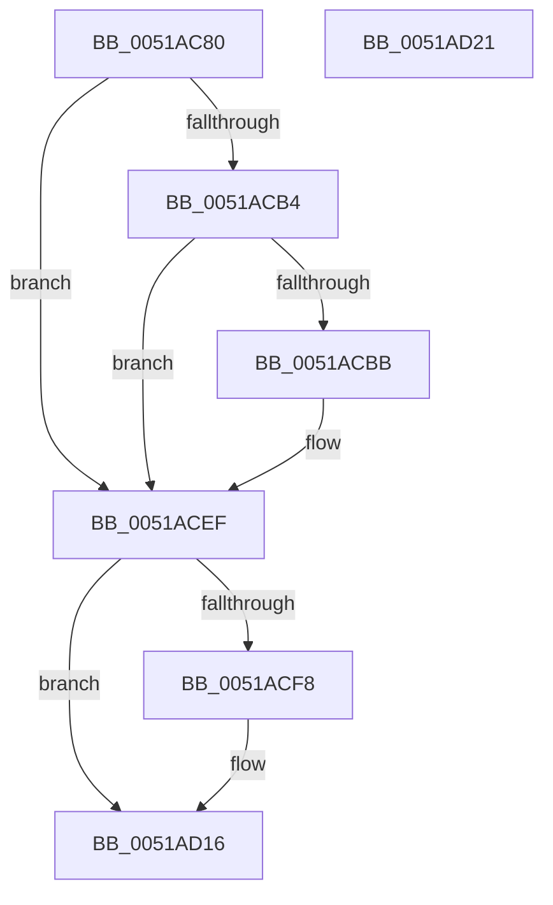

# sub_0051AC80

- RVA: `0x0051AC80`–`0x0051AD22` (길이 `162` bytes)
- VA: `0x000000014051AC80`
- 실행 섹션: `.text`
- PDB 이름 있음: `아니요`; PDB Function 태그: `아니요`
- unwind 정보 RVA: `0x0005CAAC`
- 디코드: `46`개 명령, `162/162` bytes 표시
- 미해석 바이트: `0` (있으면 어셈블리에 `.byte`로 보존)

> 이 문서는 커널 이미지의 기계어와 PDB 기호를 분석해 생성했습니다. 4번과 5번은 함수 원형과 자료형을 바이너리 사용 방식에서 추정한 C 해석이며 원본 소스 복구 결과는 아닙니다.

## 1. Dependencies

- 직접 호출 지점: **8**; 고유 호출 대상: **6**
- 직접 호출자로 확인된 함수: **0**
- RIP 상대 이미지 참조: **1**

### Outgoing calls
- `0x0051AC8D` → [KeExitRetpoline](../46/KeExitRetpoline_function_00468E7C.md) (function, `0x00468E7C`)
- `0x0051AC99` → [KeAcquireSpinLockAtDpcLevel](../20/KeAcquireSpinLockAtDpcLevel_function_00208430.md) (function, `0x00208430`)
- `0x0051ACA5` → [KeReleaseSpinLockFromDpcLevel](../43/KeReleaseSpinLockFromDpcLevel_function_0043FDA0.md) (function, `0x0043FDA0`)
- `0x0051ACC5` → [memset](../6C/memset_function_006C6C40.md) (function, `0x006C6C40`)
- `0x0051ACD2` → [guard_check_icall](../6B/guard_check_icall_function_006BAA80.md) (function, `0x006BAA80`)
- `0x0051ACEA` → `indirect target` (indirect, 간접 대상)
- `0x0051ACF8` → [guard_check_icall](../6B/guard_check_icall_function_006BAA80.md) (function, `0x006BAA80`)
- `0x0051AD11` → `indirect target` (indirect, 간접 대상)

### Direct callers
- 이 함수 시작 RVA로 연결되는 직접 call은 확인되지 않았습니다. 간접 호출은 완전히 역산할 수 없습니다.

### Static image references
- `0x0051AC92` → RVA `0x00EF0E20` (`.data`; read)

## 2. Other-region calls and transfers

- 다른 실행 섹션으로 향하는 call: **0**
- 별도 외부 분기/꼬리 이동을 확인하지 못했습니다.

## 3. Assembly (complete function range)

```asm
0051AC80  48 89 5C 24 08                  mov qword ptr [rsp + 8], rbx
0051AC85  57                              push rdi
0051AC86  48 83 EC 20                     sub rsp, 0x20
0051AC8A  48 8B D9                        mov rbx, rcx
0051AC8D  E8 EA E1 F4 FF                  call 0x140468e7c
0051AC92  48 8D 0D 87 61 9D 00            lea rcx, [rip + 0x9d6187]
0051AC99  E8 92 D7 CE FF                  call 0x140208430
0051AC9E  48 8D 0D 7B 61 9D 00            lea rcx, [rip + 0x9d617b]
0051ACA5  E8 F6 50 F2 FF                  call 0x14043fda0
0051ACAA  48 8B 7B 20                     mov rdi, qword ptr [rbx + 0x20]
0051ACAE  8B 07                           mov eax, dword ptr [rdi]
0051ACB0  85 C0                           test eax, eax
0051ACB2  74 3B                           je 0x14051acef
0051ACB4  83 E8 01                        sub eax, 1
0051ACB7  89 07                           mov dword ptr [rdi], eax
0051ACB9  75 34                           jne 0x14051acef
0051ACBB  33 D2                           xor edx, edx
0051ACBD  48 8D 4F 08                     lea rcx, [rdi + 8]
0051ACC1  44 8D 42 40                     lea r8d, [rdx + 0x40]
0051ACC5  E8 76 BF 1A 00                  call 0x1406c6c40
0051ACCA  48 8B 5F 48                     mov rbx, qword ptr [rdi + 0x48]
0051ACCE  48 8B 4B 18                     mov rcx, qword ptr [rbx + 0x18]
0051ACD2  E8 A9 FD 19 00                  call 0x1406baa80
0051ACD7  48 8B 43 18                     mov rax, qword ptr [rbx + 0x18]
0051ACDB  48 8B CB                        mov rcx, rbx
0051ACDE  4C 8B 4B 30                     mov r9, qword ptr [rbx + 0x30]
0051ACE2  4C 8B 43 28                     mov r8, qword ptr [rbx + 0x28]
0051ACE6  48 8B 53 20                     mov rdx, qword ptr [rbx + 0x20]
0051ACEA  FF D0                           call rax
0051ACEC  0F 1F 00                        nop dword ptr [rax]
0051ACEF  48 8B 4F 20                     mov rcx, qword ptr [rdi + 0x20]
0051ACF3  48 85 C9                        test rcx, rcx
0051ACF6  74 1E                           je 0x14051ad16
0051ACF8  E8 83 FD 19 00                  call 0x1406baa80
0051ACFD  48 8B 47 20                     mov rax, qword ptr [rdi + 0x20]
0051AD01  48 8D 4F 08                     lea rcx, [rdi + 8]
0051AD05  4C 8B 4F 38                     mov r9, qword ptr [rdi + 0x38]
0051AD09  4C 8B 47 30                     mov r8, qword ptr [rdi + 0x30]
0051AD0D  48 8B 57 28                     mov rdx, qword ptr [rdi + 0x28]
0051AD11  FF D0                           call rax
0051AD13  0F 1F 00                        nop dword ptr [rax]
0051AD16  48 8B 5C 24 30                  mov rbx, qword ptr [rsp + 0x30]
0051AD1B  48 83 C4 20                     add rsp, 0x20
0051AD1F  5F                              pop rdi
0051AD20  C3                              ret
0051AD21  CC                              int3
```

## 4. C-style interpretation (structured pseudocode)

```c
__int64 __fastcall sub_0051AC80(__int64 a1, int a2)
{
    __int64 result;
    __int64 v_rbx;
    __int64 v_rsp;
    unsigned __int64 v_stack_p8;

    v_stack_p8 = v_rbx;
    v_rsp = (v_rsp) - (32);
    result = KeExitRetpoline(a1, a2, a3, a4);
    result = KeAcquireSpinLockAtDpcLevel(v_rip + 10314119, a2, a3, a4);
    result = KeReleaseSpinLockFromDpcLevel(v_rip + 10314107, a2, a3, a4);
    if ((unsigned int)((unsigned int)(*(unsigned int *)(*(unsigned __int64 *)(a1 + 32)))) == 0) goto loc_0051ACEF;
    result = (unsigned int)(((unsigned int)(*(unsigned int *)(*(unsigned __int64 *)(a1 + 32)))) - (1));
    *(unsigned int *)(*(unsigned __int64 *)(a1 + 32)) = (unsigned int)(result);
    v_rbx = a1;
    if (!(condition_is_not_equal)) {
        a2 = 0;
        a1 = *(unsigned __int64 *)(a1 + 32) + 8;
        a3 = a2 + 64;
        result = memset(a1, a2, a3, a4);
        v_rbx = *(unsigned __int64 *)(*(unsigned __int64 *)(a1 + 32) + 72);
        a1 = *(unsigned __int64 *)(v_rbx + 24);
        result = guard_check_icall(a1, a2, a3, a4);
        result = *(unsigned __int64 *)(v_rbx + 24);
        a1 = v_rbx;
        a4 = *(unsigned __int64 *)(v_rbx + 48);
        a3 = *(unsigned __int64 *)(v_rbx + 40);
        a2 = *(unsigned __int64 *)(v_rbx + 32);
        result = kernel_indirect_call(a1, a2, a3, a4);
    }
    if (*(unsigned __int64 *)(*(unsigned __int64 *)(a1 + 32) + 32) != 0) {
        result = guard_check_icall(*(unsigned __int64 *)(*(unsigned __int64 *)(a1 + 32) + 32), a2, a3, a4);
        result = *(unsigned __int64 *)(*(unsigned __int64 *)(a1 + 32) + 32);
        a1 = *(unsigned __int64 *)(a1 + 32) + 8;
        a4 = *(unsigned __int64 *)(*(unsigned __int64 *)(a1 + 32) + 56);
        a3 = *(unsigned __int64 *)(*(unsigned __int64 *)(a1 + 32) + 48);
        a2 = *(unsigned __int64 *)(*(unsigned __int64 *)(a1 + 32) + 40);
        result = kernel_indirect_call(a1, a2, a3, a4);
    }
    v_rsp = (v_rsp) + (32);
    return result;
}
```

## 5. (Beta) C Style

```c
int64_t sub_0051AC80(void *Arg1, int32_t Arg2)
{
    uint8_t *arg1 = (uint8_t *)Arg1;

    int64_t result;
    int64_t local_rbx;
    int64_t local_rsp;
    uint64_t v_stack_p8;

    v_stack_p8 = local_rbx;
    local_rsp = (local_rsp) - (32);
    result = KeExitRetpoline(Arg1, Arg2, a3, a4);
    result = KeAcquireSpinLockAtDpcLevel(v_rip + 10314119, Arg2, a3, a4);
    result = KeReleaseSpinLockFromDpcLevel(v_rip + 10314107, Arg2, a3, a4);
    if ((uint32_t)((uint32_t)(*(uint32_t *)(*(uint64_t *)(arg1 + 0x20)))) == 0) goto loc_0051ACEF;
    result = (uint32_t)(((uint32_t)(*(uint32_t *)(*(uint64_t *)(arg1 + 0x20)))) - (1));
    *(uint32_t *)(*(uint64_t *)(arg1 + 0x20)) = (uint32_t)(result);
    local_rbx = Arg1;
    if (!(condition_is_not_equal)) {
        Arg2 = 0;
        Arg1 = *(uint64_t *)(arg1 + 0x20) + 8;
        a3 = Arg2 + 64;
        result = memset(Arg1, Arg2, a3, a4);
        local_rbx = *(uint64_t *)(*(uint64_t *)(arg1 + 0x20) + 0x48);
        Arg1 = *(uint64_t *)(local_rbx + 0x18);
        result = guard_check_icall(Arg1, Arg2, a3, a4);
        result = *(uint64_t *)(local_rbx + 0x18);
        Arg1 = local_rbx;
        a4 = *(uint64_t *)(local_rbx + 0x30);
        a3 = *(uint64_t *)(local_rbx + 0x28);
        Arg2 = *(uint64_t *)(local_rbx + 0x20);
        result = kernel_indirect_call(Arg1, Arg2, a3, a4);
    }
    if (*(uint64_t *)(*(uint64_t *)(arg1 + 0x20) + 0x20) != 0) {
        result = guard_check_icall(*(uint64_t *)(*(uint64_t *)(arg1 + 0x20) + 0x20), Arg2, a3, a4);
        result = *(uint64_t *)(*(uint64_t *)(arg1 + 0x20) + 0x20);
        Arg1 = *(uint64_t *)(arg1 + 0x20) + 8;
        a4 = *(uint64_t *)(*(uint64_t *)(arg1 + 0x20) + 0x38);
        a3 = *(uint64_t *)(*(uint64_t *)(arg1 + 0x20) + 0x30);
        Arg2 = *(uint64_t *)(*(uint64_t *)(arg1 + 0x20) + 0x28);
        result = kernel_indirect_call(Arg1, Arg2, a3, a4);
    }
    local_rsp = (local_rsp) + (32);
    return result;
}
```

### 관측된 메모리 오프셋

구조체 형식이 확인되지 않은 접근은 인자 기준의 오프셋으로만 기록했습니다.

| 기준 인자 | 오프셋 표현 | 폭 (bit) | 접근 |
|---|---:|---:|---|
| `Arg1` | `+ 0x20` | `64` | `R` |

## 6. Execution-region graph

[열기: 2D/3D 그래프와 함수 탐색 컨트롤 패널](../../../control-panel.html?section=text&rva=0x0051AC80&view=graph)

- 2D 그래프는 위에서 아래로 흐르고, 3D 그래프는 빈 공간을 드래그해 회전합니다. Shift+드래그는 이동, 휠은 확대·축소, 함수 노드 선택은 대상 보고서 이동입니다.

### Static fallback


