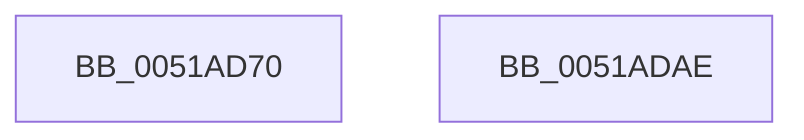

# sub_0051AD70

- RVA: `0x0051AD70`–`0x0051ADAF` (길이 `63` bytes)
- VA: `0x000000014051AD70`
- 실행 섹션: `.text`
- PDB 이름 있음: `아니요`; PDB Function 태그: `아니요`
- unwind 정보 RVA: `0x000DB714`
- 디코드: `16`개 명령, `63/63` bytes 표시
- 미해석 바이트: `0` (있으면 어셈블리에 `.byte`로 보존)

> 이 문서는 커널 이미지의 기계어와 PDB 기호를 분석해 생성했습니다. 4번과 5번은 함수 원형과 자료형을 바이너리 사용 방식에서 추정한 C 해석이며 원본 소스 복구 결과는 아닙니다.

## 1. Dependencies

- 직접 호출 지점: **0**; 고유 호출 대상: **0**
- 직접 호출자로 확인된 함수: **0**
- RIP 상대 이미지 참조: **1**

### Outgoing calls
- 직접 디코드된 call 명령이 없습니다.

### Direct callers
- 이 함수 시작 RVA로 연결되는 직접 call은 확인되지 않았습니다. 간접 호출은 완전히 역산할 수 없습니다.

### Static image references
- `0x0051AD9F` → RVA `0x00028AF0` (`.rdata`; read)

## 2. Other-region calls and transfers

- 다른 실행 섹션으로 향하는 call: **0**
- 별도 외부 분기/꼬리 이동을 확인하지 못했습니다.

## 3. Assembly (complete function range)

```asm
0051AD70  4C 8B 41 18                     mov r8, qword ptr [rcx + 0x18]
0051AD74  FA                              cli
0051AD75  65 48 8B 14 25 20 00 00 00      mov rdx, qword ptr gs:[0x20]
0051AD7E  49 8B 80 58 06 00 00            mov rax, qword ptr [r8 + 0x658]
0051AD85  4C 8B 0C 02                     mov r9, qword ptr [rdx + rax]
0051AD89  FB                              sti
0051AD8A  49 8B 90 28 0A 00 00            mov rdx, qword ptr [r8 + 0xa28]
0051AD91  0F 10 01                        movups xmm0, xmmword ptr [rcx]
0051AD94  0F 11 02                        movups xmmword ptr [rdx], xmm0
0051AD97  0F 10 49 10                     movups xmm1, xmmword ptr [rcx + 0x10]
0051AD9B  0F 11 4A 10                     movups xmmword ptr [rdx + 0x10], xmm1
0051AD9F  48 8B 05 4A DD B0 FF            mov rax, qword ptr [rip - 0x4f22b6]
0051ADA6  48 F7 DA                        neg rdx
0051ADA9  4A 89 14 08                     mov qword ptr [rax + r9], rdx
0051ADAD  C3                              ret
0051ADAE  CC                              int3
```

## 4. C-style interpretation (structured pseudocode)

```c
__int64 __fastcall sub_0051AD70(__int64 a1)
{
    *(unsigned __int64 *)(*(unsigned __int64 *)(*(unsigned __int64 *)(a1 + 24) + 2600)) = v_xmm0;
    *(unsigned __int64 *)(*(unsigned __int64 *)(*(unsigned __int64 *)(a1 + 24) + 2600) + 16) = v_xmm1;
    a2 = -(*(unsigned __int64 *)(*(unsigned __int64 *)(a1 + 24) + 2600));
    *(unsigned __int64 *)(*(unsigned __int64 *)(v_rip - 5186230) + *(unsigned __int64 *)(*(unsigned __int64 *)(gs_base + (0 + 32)) + *(unsigned __int64 *)(*(unsigned __int64 *)(a1 + 24) + 1624) * 1) * 1) = a2;
    return *(unsigned __int64 *)(v_rip - 5186230);
}
```

## 5. (Beta) C Style

```c
int64_t sub_0051AD70(void *Arg1)
{
    uint8_t *arg1 = (uint8_t *)Arg1;

    *(uint64_t *)(*(uint64_t *)(*(uint64_t *)(arg1 + 0x18) + 0xA28)) = v_xmm0;
    *(uint64_t *)(*(uint64_t *)(*(uint64_t *)(arg1 + 0x18) + 0xA28) + 0x10) = v_xmm1;
    a2 = -(*(uint64_t *)(*(uint64_t *)(arg1 + 0x18) + 0xA28));
    *(uint64_t *)(*(uint64_t *)(v_rip - 0x4F22B6) + *(uint64_t *)(*(uint64_t *)(gs_base + (0 + 0x20)) + *(uint64_t *)(*(uint64_t *)(arg1 + 0x18) + 0x658) * 1) * 1) = a2;
    return *(uint64_t *)(v_rip - 0x4F22B6);
}
```

### 관측된 메모리 오프셋

구조체 형식이 확인되지 않은 접근은 인자 기준의 오프셋으로만 기록했습니다.

| 기준 인자 | 오프셋 표현 | 폭 (bit) | 접근 |
|---|---:|---:|---|
| `Arg1` | `+ 0x0` | `128` | `R` |
| `Arg1` | `+ 0x10` | `128` | `R` |
| `Arg1` | `+ 0x18` | `64` | `R` |

## 6. Execution-region graph

[열기: 2D/3D 그래프와 함수 탐색 컨트롤 패널](../../../control-panel.html?section=text&rva=0x0051AD70&view=graph)

- 2D 그래프는 위에서 아래로 흐르고, 3D 그래프는 빈 공간을 드래그해 회전합니다. Shift+드래그는 이동, 휠은 확대·축소, 함수 노드 선택은 대상 보고서 이동입니다.

### Static fallback


