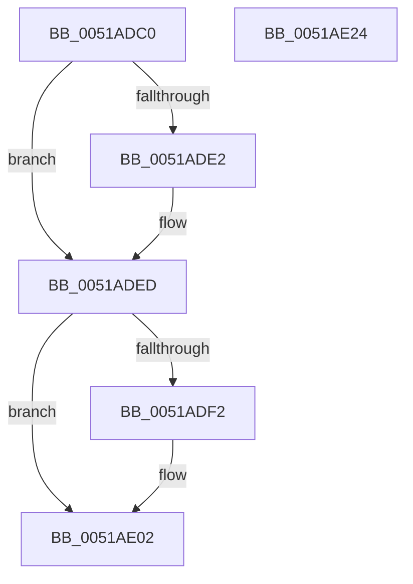

# sub_0051ADC0

- RVA: `0x0051ADC0`–`0x0051AE25` (길이 `101` bytes)
- VA: `0x000000014051ADC0`
- 실행 섹션: `.text`
- PDB 이름 있음: `아니요`; PDB Function 태그: `아니요`
- unwind 정보 RVA: `0x00060BC4`
- 디코드: `30`개 명령, `101/101` bytes 표시
- 미해석 바이트: `0` (있으면 어셈블리에 `.byte`로 보존)

> 이 문서는 커널 이미지의 기계어와 PDB 기호를 분석해 생성했습니다. 4번과 5번은 함수 원형과 자료형을 바이너리 사용 방식에서 추정한 C 해석이며 원본 소스 복구 결과는 아닙니다.

## 1. Dependencies

- 직접 호출 지점: **4**; 고유 호출 대상: **3**
- 직접 호출자로 확인된 함수: **0**
- RIP 상대 이미지 참조: **0**

### Outgoing calls
- `0x0051ADE8` → [MmUnmapReservedMapping](../3E/MmUnmapReservedMapping_function_003E7BE0.md) (function, `0x003E7BE0`)
- `0x0051ADF5` → [MmFreePagesFromMdl](../3F/MmFreePagesFromMdl_function_003F82E0.md) (function, `0x003F82E0`)
- `0x0051ADFD` → [ExFreePool](../../poolcode/B8/ExFreePool_function_00B82850.md) (function, `0x00B82850`)
- `0x0051AE0F` → [ExFreePool](../../poolcode/B8/ExFreePool_function_00B82850.md) (function, `0x00B82850`)

### Direct callers
- 이 함수 시작 RVA로 연결되는 직접 call은 확인되지 않았습니다. 간접 호출은 완전히 역산할 수 없습니다.

### Static image references
- 디코드된 RIP-relative 메모리 참조가 없습니다.

## 2. Other-region calls and transfers

- 다른 실행 섹션으로 향하는 call: **2**
  - `0x0051ADFD` → [ExFreePool](../../poolcode/B8/ExFreePool_function_00B82850.md) (`.text` → `POOLCODE`)
  - `0x0051AE0F` → [ExFreePool](../../poolcode/B8/ExFreePool_function_00B82850.md) (`.text` → `POOLCODE`)
- 별도 외부 분기/꼬리 이동을 확인하지 못했습니다.

## 3. Assembly (complete function range)

```asm
0051ADC0  48 89 5C 24 08                  mov qword ptr [rsp + 8], rbx
0051ADC5  48 89 74 24 10                  mov qword ptr [rsp + 0x10], rsi
0051ADCA  57                              push rdi
0051ADCB  48 83 EC 20                     sub rsp, 0x20
0051ADCF  48 8B D9                        mov rbx, rcx
0051ADD2  48 8B 49 08                     mov rcx, qword ptr [rcx + 8]
0051ADD6  48 8B 3B                        mov rdi, qword ptr [rbx]
0051ADD9  48 8B 73 18                     mov rsi, qword ptr [rbx + 0x18]
0051ADDD  48 85 C9                        test rcx, rcx
0051ADE0  74 0B                           je 0x14051aded
0051ADE2  8B 53 10                        mov edx, dword ptr [rbx + 0x10]
0051ADE5  4C 8B C7                        mov r8, rdi
0051ADE8  E8 F3 CD EC FF                  call 0x1403e7be0
0051ADED  48 85 FF                        test rdi, rdi
0051ADF0  74 10                           je 0x14051ae02
0051ADF2  48 8B CF                        mov rcx, rdi
0051ADF5  E8 E6 D4 ED FF                  call 0x1403f82e0
0051ADFA  48 8B CF                        mov rcx, rdi
0051ADFD  E8 4E 7A 66 00                  call 0x140b82850
0051AE02  0F 57 C0                        xorps xmm0, xmm0
0051AE05  48 8B CE                        mov rcx, rsi
0051AE08  0F 11 03                        movups xmmword ptr [rbx], xmm0
0051AE0B  0F 11 43 10                     movups xmmword ptr [rbx + 0x10], xmm0
0051AE0F  E8 3C 7A 66 00                  call 0x140b82850
0051AE14  48 8B 5C 24 30                  mov rbx, qword ptr [rsp + 0x30]
0051AE19  48 8B 74 24 38                  mov rsi, qword ptr [rsp + 0x38]
0051AE1E  48 83 C4 20                     add rsp, 0x20
0051AE22  5F                              pop rdi
0051AE23  C3                              ret
0051AE24  CC                              int3
```

## 4. C-style interpretation (structured pseudocode)

```c
__int64 __fastcall sub_0051ADC0(__int64 a1)
{
    __int64 result;
    __int64 v_rsp;
    unsigned __int64 v_stack_p10;
    unsigned __int64 v_stack_p8;

    v_stack_p8 = v_rbx;
    v_stack_p10 = v_rsi;
    v_rsp = (v_rsp) - (32);
    if (*(unsigned __int64 *)(a1 + 8) != 0) {
        a2 = *(unsigned int *)(a1 + 16);
        a3 = *(unsigned __int64 *)(a1);
        result = MmUnmapReservedMapping(*(unsigned __int64 *)(a1 + 8), a2, a3, a4);
    }
    if (*(unsigned __int64 *)(a1) != 0) {
        a1 = *(unsigned __int64 *)(a1);
        result = MmFreePagesFromMdl(a1, a2, a3, a4);
        a1 = *(unsigned __int64 *)(a1);
        result = ExFreePool(a1, a2, a3, a4);
    }
    *(unsigned __int64 *)(a1) = v_xmm0;
    *(unsigned __int64 *)(a1 + 16) = v_xmm0;
    result = ExFreePool(*(unsigned __int64 *)(a1 + 24), a2, a3, a4);
    v_rsp = (v_rsp) + (32);
    return result;
}
```

## 5. (Beta) C Style

```c
int64_t sub_0051ADC0(void *Arg1)
{
    uint8_t *arg1 = (uint8_t *)Arg1;

    int64_t result;
    int64_t local_rsp;
    uint64_t v_stack_p10;
    uint64_t v_stack_p8;

    v_stack_p8 = local_rbx;
    v_stack_p10 = local_rsi;
    local_rsp = (local_rsp) - (32);
    if (*(uint64_t *)(arg1 + 0x8) != 0) {
        a2 = *(uint32_t *)(arg1 + 0x10);
        a3 = *(uint64_t *)(arg1);
        result = MmUnmapReservedMapping(*(uint64_t *)(arg1 + 0x8), a2, a3, a4);
    }
    if (*(uint64_t *)(arg1) != 0) {
        Arg1 = *(uint64_t *)(arg1);
        result = MmFreePagesFromMdl(Arg1, a2, a3, a4);
        Arg1 = *(uint64_t *)(arg1);
        result = ExFreePool(Arg1, a2, a3, a4);
    }
    *(uint64_t *)(arg1) = v_xmm0;
    *(uint64_t *)(arg1 + 0x10) = v_xmm0;
    result = ExFreePool(*(uint64_t *)(arg1 + 0x18), a2, a3, a4);
    local_rsp = (local_rsp) + (32);
    return result;
}
```

### 관측된 메모리 오프셋

구조체 형식이 확인되지 않은 접근은 인자 기준의 오프셋으로만 기록했습니다.

| 기준 인자 | 오프셋 표현 | 폭 (bit) | 접근 |
|---|---:|---:|---|
| `Arg1` | `+ 0x0` | `64` | `R` |
| `Arg1` | `+ 0x0` | `128` | `R` |
| `Arg1` | `+ 0x8` | `64` | `R` |
| `Arg1` | `+ 0x10` | `32` | `R` |
| `Arg1` | `+ 0x10` | `128` | `R` |
| `Arg1` | `+ 0x18` | `64` | `R` |

## 6. Execution-region graph

[열기: 2D/3D 그래프와 함수 탐색 컨트롤 패널](../../../control-panel.html?section=text&rva=0x0051ADC0&view=graph)

- 2D 그래프는 위에서 아래로 흐르고, 3D 그래프는 빈 공간을 드래그해 회전합니다. Shift+드래그는 이동, 휠은 확대·축소, 함수 노드 선택은 대상 보고서 이동입니다.

### Static fallback


