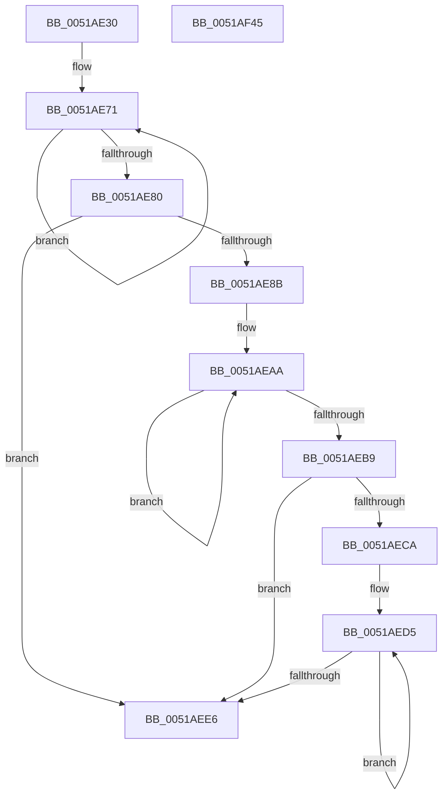

# sub_0051AE30

- RVA: `0x0051AE30`–`0x0051AF46` (길이 `278` bytes)
- VA: `0x000000014051AE30`
- 실행 섹션: `.text`
- PDB 이름 있음: `아니요`; PDB Function 태그: `아니요`
- unwind 정보 RVA: `0x00060BC4`
- 디코드: `78`개 명령, `278/278` bytes 표시
- 미해석 바이트: `0` (있으면 어셈블리에 `.byte`로 보존)

> 이 문서는 커널 이미지의 기계어와 PDB 기호를 분석해 생성했습니다. 4번과 5번은 함수 원형과 자료형을 바이너리 사용 방식에서 추정한 C 해석이며 원본 소스 복구 결과는 아닙니다.

## 1. Dependencies

- 직접 호출 지점: **2**; 고유 호출 대상: **2**
- 직접 호출자로 확인된 함수: **0**
- RIP 상대 이미지 참조: **0**

### Outgoing calls
- `0x0051AEFA` → [MmMapLockedPagesWithReservedMapping](../3E/MmMapLockedPagesWithReservedMapping_function_003E8910.md) (function, `0x003E8910`)
- `0x0051AF27` → [MmSetPageProtection](../4E/MmSetPageProtection_function_004E1580.md) (function, `0x004E1580`)

### Direct callers
- 이 함수 시작 RVA로 연결되는 직접 call은 확인되지 않았습니다. 간접 호출은 완전히 역산할 수 없습니다.

### Static image references
- 디코드된 RIP-relative 메모리 참조가 없습니다.

## 2. Other-region calls and transfers

- 다른 실행 섹션으로 향하는 call: **0**
- 별도 외부 분기/꼬리 이동을 확인하지 못했습니다.

## 3. Assembly (complete function range)

```asm
0051AE30  48 89 5C 24 08                  mov qword ptr [rsp + 8], rbx
0051AE35  48 89 74 24 10                  mov qword ptr [rsp + 0x10], rsi
0051AE3A  57                              push rdi
0051AE3B  48 83 EC 20                     sub rsp, 0x20
0051AE3F  4C 8B CA                        mov r9, rdx
0051AE42  4C 8B DA                        mov r11, rdx
0051AE45  49 C1 C1 11                     rol r9, 0x11
0051AE49  49 BA 01 20 00 04 80 00 10 70   movabs r10, 0x7010008004002001
0051AE53  4C 33 CA                        xor r9, rdx
0051AE56  49 8B C2                        mov rax, r10
0051AE59  49 F7 E1                        mul r9
0051AE5C  49 8B F0                        mov rsi, r8
0051AE5F  48 8B F9                        mov rdi, rcx
0051AE62  48 33 D0                        xor rdx, rax
0051AE65  B9 04 00 00 00                  mov ecx, 4
0051AE6A  4C 8B C2                        mov r8, rdx
0051AE6D  49 8D 43 18                     lea rax, [r11 + 0x18]
0051AE71  4C 31 00                        xor qword ptr [rax], r8
0051AE74  48 8D 40 F8                     lea rax, [rax - 8]
0051AE78  49 D3 C0                        rol r8, cl
0051AE7B  83 E9 01                        sub ecx, 1
0051AE7E  75 F1                           jne 0x14051ae71
0051AE80  4D 8B 0B                        mov r9, qword ptr [r11]
0051AE83  80 E2 0F                        and dl, 0xf
0051AE86  80 FA 07                        cmp dl, 7
0051AE89  73 5B                           jae 0x14051aee6
0051AE8B  49 8B C9                        mov rcx, r9
0051AE8E  49 8B C2                        mov rax, r10
0051AE91  48 C1 C1 11                     rol rcx, 0x11
0051AE95  49 33 C9                        xor rcx, r9
0051AE98  48 F7 E1                        mul rcx
0051AE9B  B9 06 00 00 00                  mov ecx, 6
0051AEA0  48 33 D0                        xor rdx, rax
0051AEA3  49 8D 41 28                     lea rax, [r9 + 0x28]
0051AEA7  4C 03 C2                        add r8, rdx
0051AEAA  4C 31 00                        xor qword ptr [rax], r8
0051AEAD  48 8D 40 F8                     lea rax, [rax - 8]
0051AEB1  49 D3 C0                        rol r8, cl
0051AEB4  83 E9 01                        sub ecx, 1
0051AEB7  75 F1                           jne 0x14051aeaa
0051AEB9  41 0F BF 51 08                  movsx edx, word ptr [r9 + 8]
0051AEBE  48 83 EA 30                     sub rdx, 0x30
0051AEC2  48 C1 EA 03                     shr rdx, 3
0051AEC6  85 D2                           test edx, edx
0051AEC8  74 1C                           je 0x14051aee6
0051AECA  4C 63 D2                        movsxd r10, edx
0051AECD  49 83 C2 05                     add r10, 5
0051AED1  4F 8D 14 D1                     lea r10, [r9 + r10*8]
0051AED5  4D 31 02                        xor qword ptr [r10], r8
0051AED8  8B CA                           mov ecx, edx
0051AEDA  49 D3 C0                        rol r8, cl
0051AEDD  4D 8D 52 F8                     lea r10, [r10 - 8]
0051AEE1  83 EA 01                        sub edx, 1
0051AEE4  75 EF                           jne 0x14051aed5
0051AEE6  49 8B 1B                        mov rbx, qword ptr [r11]
0051AEE9  41 B9 01 00 00 00               mov r9d, 1
0051AEEF  49 8B 4B 08                     mov rcx, qword ptr [r11 + 8]
0051AEF3  4C 8B C3                        mov r8, rbx
0051AEF6  41 8B 53 10                     mov edx, dword ptr [r11 + 0x10]
0051AEFA  E8 11 DA EC FF                  call 0x1403e8910
0051AEFF  8B 53 2C                        mov edx, dword ptr [rbx + 0x2c]
0051AF02  41 B8 40 00 00 00               mov r8d, 0x40
0051AF08  03 53 20                        add edx, dword ptr [rbx + 0x20]
0051AF0B  8B 4B 28                        mov ecx, dword ptr [rbx + 0x28]
0051AF0E  81 E2 FF 0F 00 00               and edx, 0xfff
0051AF14  48 81 C1 FF 0F 00 00            add rcx, 0xfff
0051AF1B  48 03 D1                        add rdx, rcx
0051AF1E  48 8B C8                        mov rcx, rax
0051AF21  81 E2 00 F0 FF FF               and edx, 0xfffff000
0051AF27  E8 54 66 FC FF                  call 0x1404e1580
0051AF2C  48 83 67 28 00                  and qword ptr [rdi + 0x28], 0
0051AF31  48 8B 5C 24 30                  mov rbx, qword ptr [rsp + 0x30]
0051AF36  48 89 77 20                     mov qword ptr [rdi + 0x20], rsi
0051AF3A  48 8B 74 24 38                  mov rsi, qword ptr [rsp + 0x38]
0051AF3F  48 83 C4 20                     add rsp, 0x20
0051AF43  5F                              pop rdi
0051AF44  C3                              ret
0051AF45  CC                              int3
```

## 4. C-style interpretation (structured pseudocode)

```c
__int64 __fastcall sub_0051AE30(__int64 a1, __int64 a2, __int64 a3)
{
    __int64 result;
    __int64 v_r10;
    __int64 v_rsp;
    unsigned __int64 v_stack_p10;
    unsigned __int64 v_stack_p8;

    v_stack_p8 = v_rbx;
    v_stack_p10 = v_rsi;
    v_rsp = (v_rsp) - (32);
    a4 = (a2) ^ (a2);
    a2 = (a2) ^ (v_r10);
loc_0051AE71:
    a1 = (unsigned int)((4) - (1));
    if (condition_is_not_equal) goto loc_0051AE71;
    a2 = (unsigned __int8)((a2) & (15));
    if (((unsigned __int8)(a2)) >= 7) goto loc_0051AEE6;
    a1 = (*(unsigned __int64 *)(a2)) ^ (*(unsigned __int64 *)(a2));
    a2 = (a2) ^ (v_r10);
    a3 = (a2) + (a2);
loc_0051AEAA:
    a1 = (unsigned int)((6) - (1));
    if (condition_is_not_equal) goto loc_0051AEAA;
    a2 = ((__int16)(*(unsigned __int16 *)(*(unsigned __int64 *)(a2) + 8))) - (48);
    a2 = (a2) >> (3);
    if ((unsigned int)(a2) == 0) goto loc_0051AEE6;
    v_r10 = ((int)((unsigned int)(a2))) + (5);
loc_0051AED5:
    a2 = (unsigned int)((a2) - (1));
    if (condition_is_not_equal) goto loc_0051AED5;
loc_0051AEE6:
    result = MmMapLockedPagesWithReservedMapping(*(unsigned __int64 *)(a2 + 8), (unsigned int)(*(unsigned int *)(a2 + 16)), *(unsigned __int64 *)(a2), 1);
    a2 = (unsigned int)(((unsigned int)(*(unsigned int *)(*(unsigned __int64 *)(a2) + 44))) + (*(unsigned int *)(*(unsigned __int64 *)(a2) + 32)));
    a2 = (unsigned int)((a2) & (0xFFFULL));
    a1 = ((unsigned int)(*(unsigned int *)(*(unsigned __int64 *)(a2) + 40))) + (0xFFFULL);
    a2 = (a2) + (a1);
    a2 = (unsigned int)((a2) & (0xFFFFF000ULL));
    result = MmSetPageProtection(result, a2, 64, 1);
    *(unsigned __int64 *)(a1 + 32) = a3;
    v_rsp = (v_rsp) + (32);
    return result;
}
```

## 5. (Beta) C Style

```c
int64_t sub_0051AE30(void *Arg1, void *Arg2, int64_t Arg3)
{
    uint8_t *arg1 = (uint8_t *)Arg1;
    uint8_t *arg2 = (uint8_t *)Arg2;

    int64_t result;
    int64_t local_r10;
    int64_t local_rsp;
    uint64_t v_stack_p10;
    uint64_t v_stack_p8;

    v_stack_p8 = local_rbx;
    v_stack_p10 = local_rsi;
    local_rsp = (local_rsp) - (32);
    a4 = (Arg2) ^ (Arg2);
    Arg2 = (Arg2) ^ (local_r10);
loc_0051AE71:
    Arg1 = (uint32_t)((4) - (1));
    if (condition_is_not_equal) goto loc_0051AE71;
    Arg2 = (uint8_t)((Arg2) & (15));
    if (((uint8_t)(Arg2)) >= 7) goto loc_0051AEE6;
    Arg1 = (*(uint64_t *)(arg2)) ^ (*(uint64_t *)(arg2));
    Arg2 = (Arg2) ^ (local_r10);
    Arg3 = (Arg2) + (Arg2);
loc_0051AEAA:
    Arg1 = (uint32_t)((6) - (1));
    if (condition_is_not_equal) goto loc_0051AEAA;
    Arg2 = ((int16_t)(*(uint16_t *)(*(uint64_t *)(arg2) + 0x8))) - (48);
    Arg2 = (Arg2) >> (3);
    if ((uint32_t)(Arg2) == 0) goto loc_0051AEE6;
    local_r10 = ((int32_t)((uint32_t)(Arg2))) + (5);
loc_0051AED5:
    Arg2 = (uint32_t)((Arg2) - (1));
    if (condition_is_not_equal) goto loc_0051AED5;
loc_0051AEE6:
    result = MmMapLockedPagesWithReservedMapping(*(uint64_t *)(arg2 + 0x8), (uint32_t)(*(uint32_t *)(arg2 + 0x10)), *(uint64_t *)(arg2), 1);
    Arg2 = (uint32_t)(((uint32_t)(*(uint32_t *)(*(uint64_t *)(arg2) + 0x2C))) + (*(uint32_t *)(*(uint64_t *)(arg2) + 0x20)));
    Arg2 = (uint32_t)((Arg2) & (0xFFFULL));
    Arg1 = ((uint32_t)(*(uint32_t *)(*(uint64_t *)(arg2) + 0x28))) + (0xFFFULL);
    Arg2 = (Arg2) + (Arg1);
    Arg2 = (uint32_t)((Arg2) & (0xFFFFF000ULL));
    result = MmSetPageProtection(result, Arg2, 64, 1);
    *(uint64_t *)(arg1 + 0x20) = Arg3;
    local_rsp = (local_rsp) + (32);
    return result;
}
```

### 관측된 메모리 오프셋

구조체 형식이 확인되지 않은 접근은 인자 기준의 오프셋으로만 기록했습니다.

| 기준 인자 | 오프셋 표현 | 폭 (bit) | 접근 |
|---|---:|---:|---|
| `Arg1` | `+ 0x20` | `64` | `W` |
| `Arg1` | `+ 0x28` | `64` | `R/W` |
| `Arg2` | `- 0x8` | `64` | `R` |
| `Arg2` | `+ 0x0` | `64` | `R` |
| `Arg2` | `+ 0x0` | `64` | `R/W` |
| `Arg2` | `+ 0x8` | `64` | `R` |
| `Arg2` | `+ 0x10` | `32` | `R` |
| `Arg2` | `+ 0x18` | `64` | `R` |

## 6. Execution-region graph

[열기: 2D/3D 그래프와 함수 탐색 컨트롤 패널](../../../control-panel.html?section=text&rva=0x0051AE30&view=graph)

- 2D 그래프는 위에서 아래로 흐르고, 3D 그래프는 빈 공간을 드래그해 회전합니다. Shift+드래그는 이동, 휠은 확대·축소, 함수 노드 선택은 대상 보고서 이동입니다.

### Static fallback


