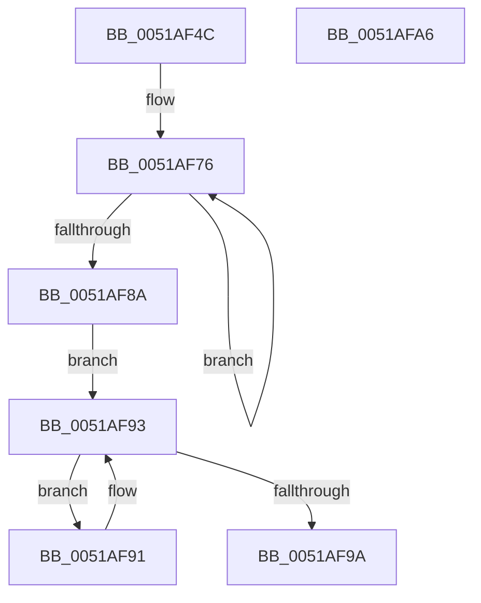

# sub_0051AF4C

- RVA: `0x0051AF4C`–`0x0051AFA7` (길이 `91` bytes)
- VA: `0x000000014051AF4C`
- 실행 섹션: `.text`
- PDB 이름 있음: `아니요`; PDB Function 태그: `아니요`
- unwind 정보 RVA: `0x000697A4`
- 디코드: `30`개 명령, `91/91` bytes 표시
- 미해석 바이트: `0` (있으면 어셈블리에 `.byte`로 보존)

> 이 문서는 커널 이미지의 기계어와 PDB 기호를 분석해 생성했습니다. 4번과 5번은 함수 원형과 자료형을 바이너리 사용 방식에서 추정한 C 해석이며 원본 소스 복구 결과는 아닙니다.

## 1. Dependencies

- 직접 호출 지점: **1**; 고유 호출 대상: **1**
- 직접 호출자로 확인된 함수: **7**
- RIP 상대 이미지 참조: **0**

### Outgoing calls
- `0x0051AF6A` → [KeGuardDispatchICall](../../initkdbg/BE/KeGuardDispatchICall_function_00BEAA60.md) (function, `0x00BEAA60`)

### Direct callers
- [sub_0050C0E0](../50/Unknown_function_0050C0E0.md) at `0x0050CD98`
- [sub_0050C0E0](../50/Unknown_function_0050C0E0.md) at `0x00511F54`
- [sub_0051B034](Unknown_function_0051B034.md) at `0x0051B420`
- [sub_0051C138](Unknown_function_0051C138.md) at `0x0051C48B`
- [FsRtlMdlReadCompleteDevEx](../../initkdbg/BD/FsRtlMdlReadCompleteDevEx_function_00BD1010.md) at `0x00BD2109`
- [FsRtlMdlReadCompleteDevEx](../../initkdbg/BD/FsRtlMdlReadCompleteDevEx_function_00BD1010.md) at `0x00BD23A8`
- [FsRtlMdlReadCompleteDevEx](../../initkdbg/BD/FsRtlMdlReadCompleteDevEx_function_00BD1010.md) at `0x00BD2BF1`
- [FsRtlMdlReadCompleteDevEx](../../initkdbg/BD/FsRtlMdlReadCompleteDevEx_function_00BD1010.md) at `0x00BD7FE6`
- [sub_00BE3A04](../../initkdbg/BE/Unknown_function_00BE3A04.md) at `0x00BE49C4`
- [sub_00BEFF8C](../../init/BE/Unknown_function_00BEFF8C.md) at `0x00BF1101`
- [sub_00BF16D0](../../init/BF/Unknown_function_00BF16D0.md) at `0x00BFA40E`
- [sub_00BF16D0](../../init/BF/Unknown_function_00BF16D0.md) at `0x00BFDAF0`
- [sub_00BF16D0](../../init/BF/Unknown_function_00BF16D0.md) at `0x00C010CD`
- [sub_00BF16D0](../../init/BF/Unknown_function_00BF16D0.md) at `0x00C035A5`
- [sub_00BF16D0](../../init/BF/Unknown_function_00BF16D0.md) at `0x00C0391E`
- [sub_00BF16D0](../../init/BF/Unknown_function_00BF16D0.md) at `0x00C049BB`
- [sub_00BF16D0](../../init/BF/Unknown_function_00BF16D0.md) at `0x00C04CAC`
- [sub_00BF16D0](../../init/BF/Unknown_function_00BF16D0.md) at `0x00C05368`
- [sub_00BF16D0](../../init/BF/Unknown_function_00BF16D0.md) at `0x00C067A6`
- [sub_00BF16D0](../../init/BF/Unknown_function_00BF16D0.md) at `0x00C06B46`
- [sub_00BF16D0](../../init/BF/Unknown_function_00BF16D0.md) at `0x00C06FC7`
- [sub_00BF16D0](../../init/BF/Unknown_function_00BF16D0.md) at `0x00C07A2C`
- [sub_00BF16D0](../../init/BF/Unknown_function_00BF16D0.md) at `0x00C08107`
- [sub_00BF16D0](../../init/BF/Unknown_function_00BF16D0.md) at `0x00C0A3B9`
- [sub_00BF16D0](../../init/BF/Unknown_function_00BF16D0.md) at `0x00C0AA85`
- [sub_00BF16D0](../../init/BF/Unknown_function_00BF16D0.md) at `0x00C0B1FC`
- [sub_00BF16D0](../../init/BF/Unknown_function_00BF16D0.md) at `0x00C0BA3A`
- [sub_00BF16D0](../../init/BF/Unknown_function_00BF16D0.md) at `0x00C0C363`
- [sub_00BF16D0](../../init/BF/Unknown_function_00BF16D0.md) at `0x00C0CBCC`
- [sub_00BF16D0](../../init/BF/Unknown_function_00BF16D0.md) at `0x00C0D0D0`
- [sub_00BF16D0](../../init/BF/Unknown_function_00BF16D0.md) at `0x00C0D58A`
- [sub_00BF16D0](../../init/BF/Unknown_function_00BF16D0.md) at `0x00C0D9FF`
- [sub_00BF16D0](../../init/BF/Unknown_function_00BF16D0.md) at `0x00C0DD5D`
- [sub_00BF16D0](../../init/BF/Unknown_function_00BF16D0.md) at `0x00C0E362`
- [sub_00BF16D0](../../init/BF/Unknown_function_00BF16D0.md) at `0x00C0E8B4`
- [sub_00BF16D0](../../init/BF/Unknown_function_00BF16D0.md) at `0x00C0EAFB`
- [sub_00BF16D0](../../init/BF/Unknown_function_00BF16D0.md) at `0x00C0ED1A`
- [sub_00BF16D0](../../init/BF/Unknown_function_00BF16D0.md) at `0x00C0F970`
- [sub_00BF16D0](../../init/BF/Unknown_function_00BF16D0.md) at `0x00C0FC09`
- [sub_00BF16D0](../../init/BF/Unknown_function_00BF16D0.md) at `0x00C0FE8C`
- [sub_00BF16D0](../../init/BF/Unknown_function_00BF16D0.md) at `0x00C10178`
- [sub_00BF16D0](../../init/BF/Unknown_function_00BF16D0.md) at `0x00C11D42`
- [sub_00BF16D0](../../init/BF/Unknown_function_00BF16D0.md) at `0x00C1671A`
- [sub_00BF16D0](../../init/BF/Unknown_function_00BF16D0.md) at `0x00C16790`
- [sub_00BF16D0](../../init/BF/Unknown_function_00BF16D0.md) at `0x00C167E1`
- [sub_00BF16D0](../../init/BF/Unknown_function_00BF16D0.md) at `0x00C16814`
- [sub_00BF16D0](../../init/BF/Unknown_function_00BF16D0.md) at `0x00C17236`

### Static image references
- 디코드된 RIP-relative 메모리 참조가 없습니다.

## 2. Other-region calls and transfers

- 다른 실행 섹션으로 향하는 call: **1**
  - `0x0051AF6A` → [KeGuardDispatchICall](../../initkdbg/BE/KeGuardDispatchICall_function_00BEAA60.md) (`.text` → `INITKDBG`)
- 별도 외부 분기/꼬리 이동을 확인하지 못했습니다.

## 3. Assembly (complete function range)

```asm
0051AF4C  40 53                           push rbx
0051AF4E  48 83 EC 40                     sub rsp, 0x40
0051AF52  48 8B 81 00 04 00 00            mov rax, qword ptr [rcx + 0x400]
0051AF59  4C 8B D2                        mov r10, rdx
0051AF5C  41 8B D0                        mov edx, r8d
0051AF5F  49 8B CA                        mov rcx, r10
0051AF62  4C 8D 44 24 20                  lea r8, [rsp + 0x20]
0051AF67  49 8B D9                        mov rbx, r9
0051AF6A  E8 F1 FA 6C 00                  call 0x140beaa60
0051AF6F  33 D2                           xor edx, edx
0051AF71  4C 8D 44 24 30                  lea r8, [rsp + 0x30]
0051AF76  41 8B 0C 90                     mov ecx, dword ptr [r8 + rdx*4]
0051AF7A  33 4C 94 20                     xor ecx, dword ptr [rsp + rdx*4 + 0x20]
0051AF7E  89 0C 93                        mov dword ptr [rbx + rdx*4], ecx
0051AF81  48 FF C2                        inc rdx
0051AF84  48 83 FA 04                     cmp rdx, 4
0051AF88  7C EC                           jl 0x14051af76
0051AF8A  8A 43 0F                        mov al, byte ptr [rbx + 0xf]
0051AF8D  8A C8                           mov cl, al
0051AF8F  EB 02                           jmp 0x14051af93
0051AF91  32 C8                           xor cl, al
0051AF93  C0 E8 07                        shr al, 7
0051AF96  84 C0                           test al, al
0051AF98  75 F7                           jne 0x14051af91
0051AF9A  80 E1 7F                        and cl, 0x7f
0051AF9D  88 4B 0F                        mov byte ptr [rbx + 0xf], cl
0051AFA0  48 83 C4 40                     add rsp, 0x40
0051AFA4  5B                              pop rbx
0051AFA5  C3                              ret
0051AFA6  CC                              int3
```

## 4. C-style interpretation (structured pseudocode)

```c
__int64 __fastcall sub_0051AF4C(__int64 a1, __int64 a2, int a3, __int64 a4)
{
    __int64 result;
    __int64 v_rsp;
    unsigned __int64 v_stack_m18;
    unsigned __int64 v_stack_m28;

    v_rsp = (v_rsp) - (64);
    result = KeGuardDispatchICall(a2, (unsigned int)(a3), v_stack_m28, a4);
    a2 = 0;
loc_0051AF76:
    a1 = (unsigned int)(((unsigned int)(*(unsigned int *)(v_stack_m18 + a2 * 4))) ^ (*(unsigned int *)(v_rsp + a2 * 4 + 32)));
    *(unsigned int *)(a4 + a2 * 4) = (unsigned int)(a1);
    a2 = (a2) + 1;
    if (a2 < 4) goto loc_0051AF76;
    goto loc_0051AF93;
loc_0051AF91:
    a1 = (unsigned __int8)(((unsigned __int8)(*(unsigned __int8 *)(a4 + 15))) ^ ((unsigned __int8)(*(unsigned __int8 *)(a4 + 15))));
loc_0051AF93:
    result = (unsigned __int8)((*(unsigned __int8 *)(a4 + 15)) >> (7));
    if ((unsigned __int8)(result) != 0) goto loc_0051AF91;
    a1 = (unsigned __int8)((a1) & (127));
    *(unsigned __int8 *)(a4 + 15) = (unsigned __int8)(a1);
    v_rsp = (v_rsp) + (64);
    return result;
}
```

## 5. (Beta) C Style

```c
int64_t sub_0051AF4C(void *Arg1, int64_t Arg2, int32_t Arg3, void *Arg4)
{
    uint8_t *arg1 = (uint8_t *)Arg1;
    uint8_t *arg4 = (uint8_t *)Arg4;

    int64_t result;
    int64_t local_rsp;
    uint64_t v_stack_m18;
    uint64_t v_stack_m28;

    local_rsp = (local_rsp) - (64);
    result = KeGuardDispatchICall(Arg2, (uint32_t)(Arg3), v_stack_m28, Arg4);
    Arg2 = 0;
loc_0051AF76:
    Arg1 = (uint32_t)(((uint32_t)(*(uint32_t *)(v_stack_m18 + Arg2 * 4))) ^ (*(uint32_t *)(local_rsp + Arg2 * 4 + 0x20)));
    *(uint32_t *)(arg4 + Arg2 * 4) = (uint32_t)(Arg1);
    Arg2 = (Arg2) + 1;
    if (Arg2 < 4) goto loc_0051AF76;
    goto loc_0051AF93;
loc_0051AF91:
    Arg1 = (uint8_t)(((uint8_t)(*(uint8_t *)(arg4 + 0xF))) ^ ((uint8_t)(*(uint8_t *)(arg4 + 0xF))));
loc_0051AF93:
    result = (uint8_t)((*(uint8_t *)(arg4 + 0xF)) >> (7));
    if ((uint8_t)(result) != 0) goto loc_0051AF91;
    Arg1 = (uint8_t)((Arg1) & (127));
    *(uint8_t *)(arg4 + 0xF) = (uint8_t)(Arg1);
    local_rsp = (local_rsp) + (64);
    return result;
}
```

### 관측된 메모리 오프셋

구조체 형식이 확인되지 않은 접근은 인자 기준의 오프셋으로만 기록했습니다.

| 기준 인자 | 오프셋 표현 | 폭 (bit) | 접근 |
|---|---:|---:|---|
| `Arg1` | `+ 0x400` | `64` | `R` |
| `Arg4` | `+ 0x0 + rdx*4` | `32` | `W` |
| `Arg4` | `+ 0xF` | `8` | `R` |
| `Arg4` | `+ 0xF` | `8` | `W` |

## 6. Execution-region graph

[열기: 2D/3D 그래프와 함수 탐색 컨트롤 패널](../../../control-panel.html?section=text&rva=0x0051AF4C&view=graph)

- 2D 그래프는 위에서 아래로 흐르고, 3D 그래프는 빈 공간을 드래그해 회전합니다. Shift+드래그는 이동, 휠은 확대·축소, 함수 노드 선택은 대상 보고서 이동입니다.

### Static fallback


