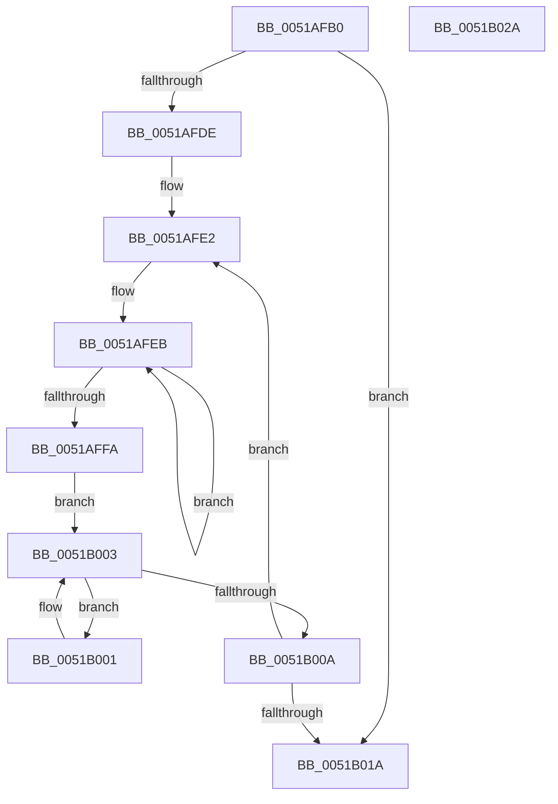

# sub_0051AFB0

- RVA: `0x0051AFB0`–`0x0051B02B` (길이 `123` bytes)
- VA: `0x000000014051AFB0`
- 실행 섹션: `.text`
- PDB 이름 있음: `아니요`; PDB Function 태그: `아니요`
- unwind 정보 RVA: `0x00060BC4`
- 디코드: `39`개 명령, `123/123` bytes 표시
- 미해석 바이트: `0` (있으면 어셈블리에 `.byte`로 보존)

> 이 문서는 커널 이미지의 기계어와 PDB 기호를 분석해 생성했습니다. 4번과 5번은 함수 원형과 자료형을 바이너리 사용 방식에서 추정한 C 해석이며 원본 소스 복구 결과는 아닙니다.

## 1. Dependencies

- 직접 호출 지점: **1**; 고유 호출 대상: **1**
- 직접 호출자로 확인된 함수: **3**
- RIP 상대 이미지 참조: **0**

### Outgoing calls
- `0x0051AFD5` → [KeGuardDispatchICall](../../initkdbg/BE/KeGuardDispatchICall_function_00BEAA60.md) (function, `0x00BEAA60`)

### Direct callers
- [sub_0051B034](Unknown_function_0051B034.md) at `0x0051B8C2`
- [sub_00BEFF8C](../../init/BE/Unknown_function_00BEFF8C.md) at `0x00BF09E1`
- [sub_00BF1290](../../init/BF/Unknown_function_00BF1290.md) at `0x00BF144B`

### Static image references
- 디코드된 RIP-relative 메모리 참조가 없습니다.

## 2. Other-region calls and transfers

- 다른 실행 섹션으로 향하는 call: **1**
  - `0x0051AFD5` → [KeGuardDispatchICall](../../initkdbg/BE/KeGuardDispatchICall_function_00BEAA60.md) (`.text` → `INITKDBG`)
- 별도 외부 분기/꼬리 이동을 확인하지 못했습니다.

## 3. Assembly (complete function range)

```asm
0051AFB0  48 89 5C 24 08                  mov qword ptr [rsp + 8], rbx
0051AFB5  48 89 74 24 10                  mov qword ptr [rsp + 0x10], rsi
0051AFBA  57                              push rdi
0051AFBB  48 83 EC 20                     sub rsp, 0x20
0051AFBF  48 8B 81 08 04 00 00            mov rax, qword ptr [rcx + 0x408]
0051AFC6  48 8B F2                        mov rsi, rdx
0051AFC9  48 8B CE                        mov rcx, rsi
0051AFCC  41 8B D0                        mov edx, r8d
0051AFCF  41 8B D8                        mov ebx, r8d
0051AFD2  41 8B F8                        mov edi, r8d
0051AFD5  E8 86 FA 6C 00                  call 0x140beaa60
0051AFDA  85 DB                           test ebx, ebx
0051AFDC  74 3C                           je 0x14051b01a
0051AFDE  48 8D 56 10                     lea rdx, [rsi + 0x10]
0051AFE2  48 8B CA                        mov rcx, rdx
0051AFE5  41 B8 04 00 00 00               mov r8d, 4
0051AFEB  8B 41 10                        mov eax, dword ptr [rcx + 0x10]
0051AFEE  31 01                           xor dword ptr [rcx], eax
0051AFF0  48 8D 49 04                     lea rcx, [rcx + 4]
0051AFF4  49 83 E8 01                     sub r8, 1
0051AFF8  75 F1                           jne 0x14051afeb
0051AFFA  8A 42 0F                        mov al, byte ptr [rdx + 0xf]
0051AFFD  8A C8                           mov cl, al
0051AFFF  EB 02                           jmp 0x14051b003
0051B001  32 C8                           xor cl, al
0051B003  C0 E8 07                        shr al, 7
0051B006  84 C0                           test al, al
0051B008  75 F7                           jne 0x14051b001
0051B00A  80 E1 7F                        and cl, 0x7f
0051B00D  88 4A 0F                        mov byte ptr [rdx + 0xf], cl
0051B010  48 83 C2 30                     add rdx, 0x30
0051B014  48 83 EF 01                     sub rdi, 1
0051B018  75 C8                           jne 0x14051afe2
0051B01A  48 8B 5C 24 30                  mov rbx, qword ptr [rsp + 0x30]
0051B01F  48 8B 74 24 38                  mov rsi, qword ptr [rsp + 0x38]
0051B024  48 83 C4 20                     add rsp, 0x20
0051B028  5F                              pop rdi
0051B029  C3                              ret
0051B02A  CC                              int3
```

## 4. C-style interpretation (structured pseudocode)

```c
__int64 __fastcall sub_0051AFB0(__int64 a1, __int64 a2, int a3)
{
    __int64 result;
    __int64 v_rdi;
    __int64 v_rsp;
    unsigned __int64 v_stack_p10;
    unsigned __int64 v_stack_p8;

    v_stack_p8 = v_rbx;
    v_stack_p10 = v_rsi;
    v_rsp = (v_rsp) - (32);
    result = KeGuardDispatchICall(a2, (unsigned int)(a3), a3, a4);
    if ((unsigned int)((unsigned int)(a3)) == 0) goto loc_0051B01A;
loc_0051AFE2:
loc_0051AFEB:
    a3 = (4) - (1);
    if (condition_is_not_equal) goto loc_0051AFEB;
    goto loc_0051B003;
loc_0051B001:
    a1 = (unsigned __int8)(((unsigned __int8)(*(unsigned __int8 *)(a2 + 16 + 15))) ^ ((unsigned __int8)(*(unsigned __int8 *)(a2 + 16 + 15))));
loc_0051B003:
    result = (unsigned __int8)((*(unsigned __int8 *)(a2 + 16 + 15)) >> (7));
    if ((unsigned __int8)(result) != 0) goto loc_0051B001;
    a1 = (unsigned __int8)((a1) & (127));
    *(unsigned __int8 *)(a2 + 16 + 15) = (unsigned __int8)(a1);
    a2 = (a2 + 16) + (48);
    v_rdi = ((unsigned int)(a3)) - (1);
    if (condition_is_not_equal) goto loc_0051AFE2;
loc_0051B01A:
    v_rsp = (v_rsp) + (32);
    return result;
}
```

## 5. (Beta) C Style

```c
int64_t sub_0051AFB0(void *Arg1, void *Arg2, int32_t Arg3)
{
    uint8_t *arg1 = (uint8_t *)Arg1;
    uint8_t *arg2 = (uint8_t *)Arg2;

    int64_t result;
    int64_t local_rdi;
    int64_t local_rsp;
    uint64_t v_stack_p10;
    uint64_t v_stack_p8;

    v_stack_p8 = local_rbx;
    v_stack_p10 = local_rsi;
    local_rsp = (local_rsp) - (32);
    result = KeGuardDispatchICall(Arg2, (uint32_t)(Arg3), Arg3, a4);
    if ((uint32_t)((uint32_t)(Arg3)) == 0) goto loc_0051B01A;
loc_0051AFE2:
loc_0051AFEB:
    Arg3 = (4) - (1);
    if (condition_is_not_equal) goto loc_0051AFEB;
    goto loc_0051B003;
loc_0051B001:
    Arg1 = (uint8_t)(((uint8_t)(*(uint8_t *)(arg2 + 0x10 + 0xF))) ^ ((uint8_t)(*(uint8_t *)(arg2 + 0x10 + 0xF))));
loc_0051B003:
    result = (uint8_t)((*(uint8_t *)(arg2 + 0x10 + 0xF)) >> (7));
    if ((uint8_t)(result) != 0) goto loc_0051B001;
    Arg1 = (uint8_t)((Arg1) & (127));
    *(uint8_t *)(arg2 + 0x10 + 0xF) = (uint8_t)(Arg1);
    Arg2 = (Arg2 + 16) + (48);
    local_rdi = ((uint32_t)(Arg3)) - (1);
    if (condition_is_not_equal) goto loc_0051AFE2;
loc_0051B01A:
    local_rsp = (local_rsp) + (32);
    return result;
}
```

### 관측된 메모리 오프셋

구조체 형식이 확인되지 않은 접근은 인자 기준의 오프셋으로만 기록했습니다.

| 기준 인자 | 오프셋 표현 | 폭 (bit) | 접근 |
|---|---:|---:|---|
| `Arg1` | `+ 0x408` | `64` | `R` |
| `Arg2` | `+ 0x0` | `32` | `R/W` |
| `Arg2` | `+ 0x4` | `64` | `R` |
| `Arg2` | `+ 0xF` | `8` | `R` |
| `Arg2` | `+ 0xF` | `8` | `W` |
| `Arg2` | `+ 0x10` | `32` | `R` |
| `Arg2` | `+ 0x10` | `64` | `R` |

## 6. Execution-region graph

[열기: 2D/3D 그래프와 함수 탐색 컨트롤 패널](../../../control-panel.html?section=text&rva=0x0051AFB0&view=graph)

- 2D 그래프는 위에서 아래로 흐르고, 3D 그래프는 빈 공간을 드래그해 회전합니다. Shift+드래그는 이동, 휠은 확대·축소, 함수 노드 선택은 대상 보고서 이동입니다.

### Static fallback


