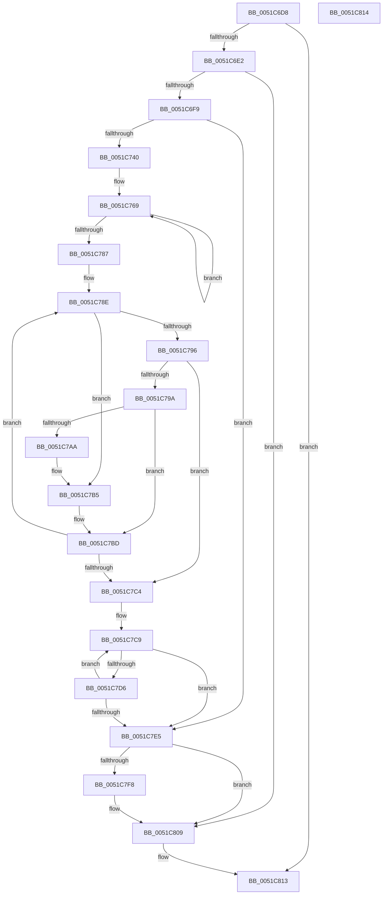

# sub_0051C6D8

- RVA: `0x0051C6D8`–`0x0051C815` (길이 `317` bytes)
- VA: `0x000000014051C6D8`
- 실행 섹션: `.text`
- PDB 이름 있음: `아니요`; PDB Function 태그: `아니요`
- unwind 정보 RVA: `0x000C2B3C`
- 디코드: `81`개 명령, `317/317` bytes 표시
- 미해석 바이트: `0` (있으면 어셈블리에 `.byte`로 보존)

> 이 문서는 커널 이미지의 기계어와 PDB 기호를 분석해 생성했습니다. 4번과 5번은 함수 원형과 자료형을 바이너리 사용 방식에서 추정한 C 해석이며 원본 소스 복구 결과는 아닙니다.

## 1. Dependencies

- 직접 호출 지점: **6**; 고유 호출 대상: **4**
- 직접 호출자로 확인된 함수: **1**
- RIP 상대 이미지 참조: **5**

### Outgoing calls
- `0x0051C6F9` → [KeKvaShadowingActive](../4B/KeKvaShadowingActive_function_004B2CA8.md) (function, `0x004B2CA8`)
- `0x0051C728` → [IoAddTriageDumpDataBlock](../42/IoAddTriageDumpDataBlock_function_00428374.md) (function, `0x00428374`)
- `0x0051C733` → [MmIsAddressValid](../27/MmIsAddressValid_function_0027EC50.md) (function, `0x0027EC50`)
- `0x0051C7DB` → [IoAddTriageDumpDataBlock](../42/IoAddTriageDumpDataBlock_function_00428374.md) (function, `0x00428374`)
- `0x0051C7EF` → [ExQueryBigPoolTag](../65/ExQueryBigPoolTag_function_0065663C.md) (function, `0x0065663C`)
- `0x0051C804` → [IoAddTriageDumpDataBlock](../42/IoAddTriageDumpDataBlock_function_00428374.md) (function, `0x00428374`)

### Direct callers
- [KiMarkBugCheckRegions](../50/KiMarkBugCheckRegions_function_0050A188.md) at `0x0050A526`

### Static image references
- `0x0051C700` → RVA `0x006C4A40` (`KiSystemCall64`; read)
- `0x0051C707` → RVA `0x00BCD200` (`KiSystemCall64Shadow`; read)
- `0x0051C717` → RVA `0x00EF0E28` (`.data`; read)
- `0x0051C740` → RVA `0x00FC54C8` (`ALMOSTRO`; read)
- `0x0051C7E5` → RVA `0x00EF0E18` (`.data`; read)

## 2. Other-region calls and transfers

- 다른 실행 섹션으로 향하는 call: **0**
- 별도 외부 분기/꼬리 이동을 확인하지 못했습니다.

## 3. Assembly (complete function range)

```asm
0051C6D8  41 83 F9 07                     cmp r9d, 7
0051C6DC  0F 85 31 01 00 00               jne 0x14051c813
0051C6E2  48 89 5C 24 08                  mov qword ptr [rsp + 8], rbx
0051C6E7  57                              push rdi
0051C6E8  48 83 EC 40                     sub rsp, 0x40
0051C6EC  41 81 F8 82 00 00 C0            cmp r8d, 0xc0000082
0051C6F3  0F 85 10 01 00 00               jne 0x14051c809
0051C6F9  E8 AA 65 F9 FF                  call 0x1404b2ca8
0051C6FE  85 C0                           test eax, eax
0051C700  48 8D 0D 39 83 1A 00            lea rcx, [rip + 0x1a8339]
0051C707  48 8D 1D F2 0A 6B 00            lea rbx, [rip + 0x6b0af2]
0051C70E  BA 00 10 00 00                  mov edx, 0x1000
0051C713  48 0F 44 D9                     cmove rbx, rcx
0051C717  48 33 1D 0A 47 9D 00            xor rbx, qword ptr [rip + 0x9d470a]
0051C71E  48 81 E3 00 F0 FF FF            and rbx, 0xfffffffffffff000
0051C725  48 8B CB                        mov rcx, rbx
0051C728  E8 47 BC F0 FF                  call 0x140428374
0051C72D  0F AE E8                        lfence
0051C730  48 8B CB                        mov rcx, rbx
0051C733  E8 18 25 D6 FF                  call 0x14027ec50
0051C738  84 C0                           test al, al
0051C73A  0F 84 A5 00 00 00               je 0x14051c7e5
0051C740  48 8B 05 81 8D AA 00            mov rax, qword ptr [rip + 0xaa8d81]
0051C747  48 8B CB                        mov rcx, rbx
0051C74A  48 8D 54 24 20                  lea rdx, [rsp + 0x20]
0051C74F  48 C1 E9 09                     shr rcx, 9
0051C753  49 B9 F8 FF FF FF 7F 00 00 00   movabs r9, 0x7ffffffff8
0051C75D  49 23 C9                        and rcx, r9
0051C760  41 B8 04 00 00 00               mov r8d, 4
0051C766  48 03 C8                        add rcx, rax
0051C769  48 89 0A                        mov qword ptr [rdx], rcx
0051C76C  48 8B 05 55 8D AA 00            mov rax, qword ptr [rip + 0xaa8d55]
0051C773  48 C1 E9 09                     shr rcx, 9
0051C777  48 8D 52 08                     lea rdx, [rdx + 8]
0051C77B  49 23 C9                        and rcx, r9
0051C77E  48 03 C8                        add rcx, rax
0051C781  49 83 E8 01                     sub r8, 1
0051C785  75 E2                           jne 0x14051c769
0051C787  45 33 C9                        xor r9d, r9d
0051C78A  41 8D 50 03                     lea edx, [r8 + 3]
0051C78E  44 8B C2                        mov r8d, edx
0051C791  45 85 C9                        test r9d, r9d
0051C794  75 1F                           jne 0x14051c7b5
0051C796  85 D2                           test edx, edx
0051C798  74 2A                           je 0x14051c7c4
0051C79A  8B C2                           mov eax, edx
0051C79C  48 8B 4C C4 20                  mov rcx, qword ptr [rsp + rax*8 + 0x20]
0051C7A1  8B 01                           mov eax, dword ptr [rcx]
0051C7A3  C0 E8 07                        shr al, 7
0051C7A6  A8 01                           test al, 1
0051C7A8  74 13                           je 0x14051c7bd
0051C7AA  FF CA                           dec edx
0051C7AC  41 B9 01 00 00 00               mov r9d, 1
0051C7B2  44 8B C2                        mov r8d, edx
0051C7B5  8B C2                           mov eax, edx
0051C7B7  48 83 64 C4 20 00               and qword ptr [rsp + rax*8 + 0x20], 0
0051C7BD  FF CA                           dec edx
0051C7BF  45 85 C0                        test r8d, r8d
0051C7C2  75 CA                           jne 0x14051c78e
0051C7C4  BF 04 00 00 00                  mov edi, 4
0051C7C9  8D 47 FF                        lea eax, [rdi - 1]
0051C7CC  48 8B 4C C4 20                  mov rcx, qword ptr [rsp + rax*8 + 0x20]
0051C7D1  48 85 C9                        test rcx, rcx
0051C7D4  74 0F                           je 0x14051c7e5
0051C7D6  BA 08 00 00 00                  mov edx, 8
0051C7DB  E8 94 BB F0 FF                  call 0x140428374
0051C7E0  83 C7 FF                        add edi, -1
0051C7E3  75 E4                           jne 0x14051c7c9
0051C7E5  48 8D 15 2C 46 9D 00            lea rdx, [rip + 0x9d462c]
0051C7EC  48 8B CB                        mov rcx, rbx
0051C7EF  E8 48 9E 13 00                  call 0x14065663c
0051C7F4  85 C0                           test eax, eax
0051C7F6  74 11                           je 0x14051c809
0051C7F8  BA 04 00 00 00                  mov edx, 4
0051C7FD  48 8D 0D 14 46 9D 00            lea rcx, [rip + 0x9d4614]
0051C804  E8 6B BB F0 FF                  call 0x140428374
0051C809  48 8B 5C 24 50                  mov rbx, qword ptr [rsp + 0x50]
0051C80E  48 83 C4 40                     add rsp, 0x40
0051C812  5F                              pop rdi
0051C813  C3                              ret
0051C814  CC                              int3
```

## 4. C-style interpretation (structured pseudocode)

```c
__int64 __fastcall sub_0051C6D8(__int64 a1, __int64 a2, int a3, int a4)
{
    __int64 result;
    __int64 v_rbx;
    __int64 v_rdi;
    __int64 v_rsp;
    unsigned __int64 v_stack_m28;
    unsigned __int64 v_stack_p8;

    if (a4 != 7) goto loc_0051C813;
    v_stack_p8 = v_rbx;
    v_rsp = (v_rsp) - (64);
    if (a3 != 0xC0000082ULL) goto loc_0051C809;
    result = KeKvaShadowingActive(a1, a2, a3, a4);
    v_rbx = v_rip + 7015154;
    if ((unsigned int)(result) == 0) { v_rbx = v_rip + 1737529; }
    v_rbx = (v_rbx) ^ (*(unsigned __int64 *)(v_rip + 10307338));
    v_rbx = (v_rbx) & (0xFFFFFFFFFFFFF000ULL);
    result = IoAddTriageDumpDataBlock(v_rbx, (unsigned int)(0x1000ULL), a3, a4);
    result = MmIsAddressValid(v_rbx, (unsigned int)(0x1000ULL), a3, a4);
    if ((unsigned __int8)(result) == 0) goto loc_0051C7E5;
    a1 = (v_rbx) >> (9);
    a1 = (a1) & (a4);
    a1 = (a1) + (*(unsigned __int64 *)(v_rip + 11177345));
loc_0051C769:
    *(unsigned __int64 *)(v_stack_m28) = a1;
    a1 = (a1) >> (9);
    a1 = (a1) & (a4);
    a1 = (a1) + (*(unsigned __int64 *)(v_rip + 11177301));
    a3 = (4) - (1);
    if (condition_is_not_equal) goto loc_0051C769;
    a4 = 0;
loc_0051C78E:
    if (0 != 0) goto loc_0051C7B5;
    if ((unsigned int)(a3 + 3) == 0) goto loc_0051C7C4;
    result = (unsigned __int8)(((unsigned int)(*(unsigned int *)(*(unsigned __int64 *)(v_rsp + (unsigned int)((unsigned int)(a3 + 3)) * 8 + 32)))) >> (7));
    if ((((unsigned __int8)(result)) & (1)) == 0) goto loc_0051C7BD;
    a2 = (unsigned int)((a3 + 3) - 1);
loc_0051C7B5:
loc_0051C7BD:
    a2 = (unsigned int)((a2) - 1);
    if ((unsigned int)((unsigned int)((unsigned int)(a2))) != 0) goto loc_0051C78E;
loc_0051C7C4:
loc_0051C7C9:
    if (*(unsigned __int64 *)(v_rsp + 4 - 1 * 8 + 32) == 0) goto loc_0051C7E5;
    result = IoAddTriageDumpDataBlock(*(unsigned __int64 *)(v_rsp + 4 - 1 * 8 + 32), 8, (unsigned int)((unsigned int)(a2)), 1);
    v_rdi = (unsigned int)((4) + (-1));
    if (condition_is_not_equal) goto loc_0051C7C9;
loc_0051C7E5:
    result = ExQueryBigPoolTag(v_rbx, v_rip + 10307116, (unsigned int)((unsigned int)(a2)), 1);
    if ((unsigned int)(result) != 0) {
        a2 = 4;
        a1 = v_rip + 10307092;
        result = IoAddTriageDumpDataBlock(a1, a2, (unsigned int)((unsigned int)(a2)), 1);
    }
    v_rsp = (v_rsp) + (64);
loc_0051C813:
    return result;
}
```

## 5. (Beta) C Style

```c
int64_t sub_0051C6D8(int64_t Arg1, int64_t Arg2, int32_t Arg3, int32_t Arg4)
{
    int64_t result;
    int64_t local_rbx;
    int64_t local_rdi;
    int64_t local_rsp;
    uint64_t v_stack_m28;
    uint64_t v_stack_p8;

    if (Arg4 != 7) goto loc_0051C813;
    v_stack_p8 = local_rbx;
    local_rsp = (local_rsp) - (64);
    if (Arg3 != 0xC0000082ULL) goto loc_0051C809;
    result = KeKvaShadowingActive(Arg1, Arg2, Arg3, Arg4);
    local_rbx = v_rip + 7015154;
    if ((uint32_t)(result) == 0) { local_rbx = v_rip + 1737529; }
    local_rbx = (local_rbx) ^ (*(uint64_t *)(v_rip + 0x9D470A));
    local_rbx = (local_rbx) & (0xFFFFFFFFFFFFF000ULL);
    result = IoAddTriageDumpDataBlock(local_rbx, (uint32_t)(0x1000ULL), Arg3, Arg4);
    result = MmIsAddressValid(local_rbx, (uint32_t)(0x1000ULL), Arg3, Arg4);
    if ((uint8_t)(result) == 0) goto loc_0051C7E5;
    Arg1 = (local_rbx) >> (9);
    Arg1 = (Arg1) & (Arg4);
    Arg1 = (Arg1) + (*(uint64_t *)(v_rip + 0xAA8D81));
loc_0051C769:
    *(uint64_t *)(v_stack_m28) = Arg1;
    Arg1 = (Arg1) >> (9);
    Arg1 = (Arg1) & (Arg4);
    Arg1 = (Arg1) + (*(uint64_t *)(v_rip + 0xAA8D55));
    Arg3 = (4) - (1);
    if (condition_is_not_equal) goto loc_0051C769;
    Arg4 = 0;
loc_0051C78E:
    if (0 != 0) goto loc_0051C7B5;
    if ((uint32_t)(Arg3 + 3) == 0) goto loc_0051C7C4;
    result = (uint8_t)(((uint32_t)(*(uint32_t *)(*(uint64_t *)(local_rsp + (uint32_t)((uint32_t)(Arg3 + 0x3)) * 8 + 0x20)))) >> (7));
    if ((((uint8_t)(result)) & (1)) == 0) goto loc_0051C7BD;
    Arg2 = (uint32_t)((Arg3 + 3) - 1);
loc_0051C7B5:
loc_0051C7BD:
    Arg2 = (uint32_t)((Arg2) - 1);
    if ((uint32_t)((uint32_t)((uint32_t)(Arg2))) != 0) goto loc_0051C78E;
loc_0051C7C4:
loc_0051C7C9:
    if (*(uint64_t *)(local_rsp + 0x4 - 0x1 * 8 + 0x20) == 0) goto loc_0051C7E5;
    result = IoAddTriageDumpDataBlock(*(uint64_t *)(local_rsp + 0x4 - 0x1 * 8 + 0x20), 8, (uint32_t)((uint32_t)(Arg2)), 1);
    local_rdi = (uint32_t)((4) + (-1));
    if (condition_is_not_equal) goto loc_0051C7C9;
loc_0051C7E5:
    result = ExQueryBigPoolTag(local_rbx, v_rip + 10307116, (uint32_t)((uint32_t)(Arg2)), 1);
    if ((uint32_t)(result) != 0) {
        Arg2 = 4;
        Arg1 = v_rip + 10307092;
        result = IoAddTriageDumpDataBlock(Arg1, Arg2, (uint32_t)((uint32_t)(Arg2)), 1);
    }
    local_rsp = (local_rsp) + (64);
loc_0051C813:
    return result;
}
```

## 6. Execution-region graph

[열기: 2D/3D 그래프와 함수 탐색 컨트롤 패널](../../../control-panel.html?section=text&rva=0x0051C6D8&view=graph)

- 2D 그래프는 위에서 아래로 흐르고, 3D 그래프는 빈 공간을 드래그해 회전합니다. Shift+드래그는 이동, 휠은 확대·축소, 함수 노드 선택은 대상 보고서 이동입니다.

### Static fallback


