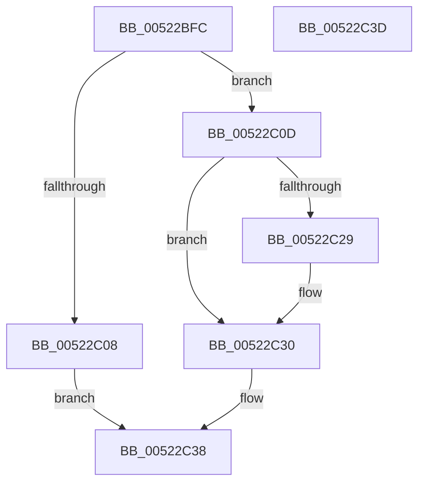

# RtlCopyDeviceMemory

- RVA: `0x00522BFC`–`0x00522C3E` (길이 `66` bytes)
- VA: `0x0000000140522BFC`
- 실행 섹션: `.text`
- PDB 이름 있음: `예`; PDB Function 태그: `아니요`
- unwind 정보 RVA: `0x0005C788`
- 디코드: `22`개 명령, `66/66` bytes 표시
- 미해석 바이트: `0` (있으면 어셈블리에 `.byte`로 보존)

> 이 문서는 커널 이미지의 기계어와 PDB 기호를 분석해 생성했습니다. 4번과 5번은 함수 원형과 자료형을 바이너리 사용 방식에서 추정한 C 해석이며 원본 소스 복구 결과는 아닙니다.

## 1. Dependencies

- 직접 호출 지점: **1**; 고유 호출 대상: **1**
- 직접 호출자로 확인된 함수: **6**
- RIP 상대 이미지 참조: **0**

### Outgoing calls
- `0x00522C33` → [RtlCopyVolatileMemory](../6B/RtlCopyVolatileMemory_function_006BC9D0.md) (function, `0x006BC9D0`)

### Direct callers
- [HalpPreserveNvsArea](../4F/HalpPreserveNvsArea_function_004F8BC4.md) at `0x004F8C08`
- [HalpRestoreNvsArea](../4F/HalpRestoreNvsArea_function_004F8C3C.md) at `0x004F8C80`
- [HalpAcpiCopyBiosTable](../53/HalpAcpiCopyBiosTable_function_0053EDD0.md) at `0x0053EE22`
- [WmipGetSMBiosEventlog](../../page/7B/WmipGetSMBiosEventlog_function_007B2B58.md) at `0x007B2CCE`
- [WmipGetSMBiosTableData](../../page/A4/WmipGetSMBiosTableData_function_00A4F078.md) at `0x00A4F122`
- [HaliQuerySystemInformation](../../pagelk/B7/HaliQuerySystemInformation_function_00B7A990.md) at `0x00B7AA31`

### Static image references
- 디코드된 RIP-relative 메모리 참조가 없습니다.

## 2. Other-region calls and transfers

- 다른 실행 섹션으로 향하는 call: **0**
- 별도 외부 분기/꼬리 이동을 확인하지 못했습니다.

## 3. Assembly (complete function range)

```asm
00522BFC  48 83 EC 28                     sub rsp, 0x28
00522C00  4C 8B C9                        mov r9, rcx
00522C03  4D 85 C0                        test r8, r8
00522C06  75 05                           jne 0x140522c0d
00522C08  48 8B C1                        mov rax, rcx
00522C0B  EB 2B                           jmp 0x140522c38
00522C0D  4C 3B CA                        cmp r9, rdx
00522C10  48 8B CA                        mov rcx, rdx
00522C13  48 8B C2                        mov rax, rdx
00522C16  49 0F 42 C9                     cmovb rcx, r9
00522C1A  49 03 C8                        add rcx, r8
00522C1D  4C 3B CA                        cmp r9, rdx
00522C20  49 0F 43 C1                     cmovae rax, r9
00522C24  48 3B C8                        cmp rcx, rax
00522C27  76 07                           jbe 0x140522c30
00522C29  B9 05 00 00 00                  mov ecx, 5
00522C2E  CD 29                           int 0x29
00522C30  49 8B C9                        mov rcx, r9
00522C33  E8 98 9D 19 00                  call 0x1406bc9d0
00522C38  48 83 C4 28                     add rsp, 0x28
00522C3C  C3                              ret
00522C3D  CC                              int3
```

## 4. C-style interpretation (structured pseudocode)

```c
__int64 __fastcall RtlCopyDeviceMemory(__int64 a1, __int64 a2, __int64 a3)
{
    __int64 result;
    __int64 v_rsp;

    v_rsp = (v_rsp) - (40);
    if (a3 != 0) goto loc_00522C0D;
    goto loc_00522C38;
loc_00522C0D:
    if (a1 < a2) { a2 = a1; }
    a1 = (a2) + (a3);
    if (a1 >= a2) { a2 = a1; }
    if (a1 >= = a2) {
        a1 = 5;
    }
    result = RtlCopyVolatileMemory(a1, a2, a3, a1);
loc_00522C38:
    v_rsp = (v_rsp) + (40);
    return result;
}
```

## 5. (Beta) C Style

```c
int64_t RtlCopyDeviceMemory(int64_t Arg1, int64_t Arg2, int64_t Arg3)
{
    int64_t result;
    int64_t local_rsp;

    local_rsp = (local_rsp) - (40);
    if (Arg3 != 0) goto loc_00522C0D;
    goto loc_00522C38;
loc_00522C0D:
    if (Arg1 < Arg2) { Arg2 = Arg1; }
    Arg1 = (Arg2) + (Arg3);
    if (Arg1 >= Arg2) { Arg2 = Arg1; }
    if (Arg1 >= = Arg2) {
        Arg1 = 5;
    }
    result = RtlCopyVolatileMemory(Arg1, Arg2, Arg3, Arg1);
loc_00522C38:
    local_rsp = (local_rsp) + (40);
    return result;
}
```

## 6. Execution-region graph

[열기: 2D/3D 그래프와 함수 탐색 컨트롤 패널](../../../control-panel.html?section=text&rva=0x00522BFC&view=graph)

- 2D 그래프는 위에서 아래로 흐르고, 3D 그래프는 빈 공간을 드래그해 회전합니다. Shift+드래그는 이동, 휠은 확대·축소, 함수 노드 선택은 대상 보고서 이동입니다.

### Static fallback


