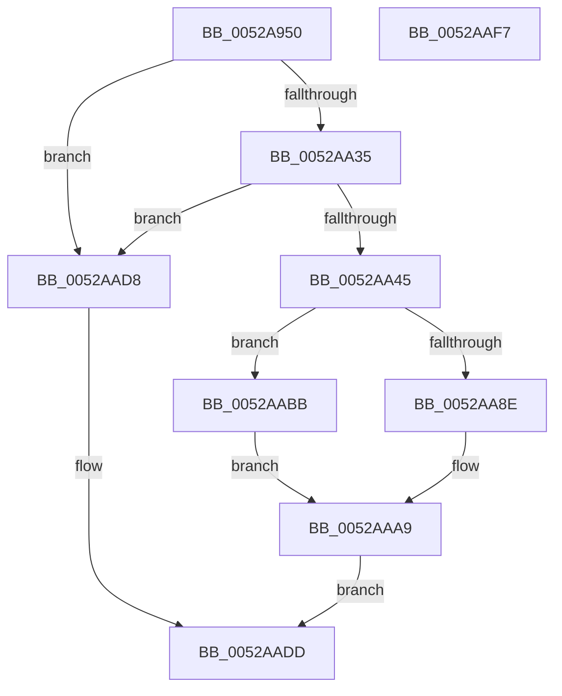

# SymCryptCrtGenerateForTwoCoprimes

- RVA: `0x0052A950`–`0x0052AAF8` (길이 `424` bytes)
- VA: `0x000000014052A950`
- 실행 섹션: `.text`
- PDB 이름 있음: `예`; PDB Function 태그: `아니요`
- unwind 정보 RVA: `0x00086C3C`
- 디코드: `111`개 명령, `424/424` bytes 표시
- 미해석 바이트: `0` (있으면 어셈블리에 `.byte`로 보존)

> 이 문서는 커널 이미지의 기계어와 PDB 기호를 분석해 생성했습니다. 4번과 5번은 함수 원형과 자료형을 바이너리 사용 방식에서 추정한 C 해석이며 원본 소스 복구 결과는 아닙니다.

## 1. Dependencies

- 직접 호출 지점: **16**; 고유 호출 대상: **8**
- 직접 호출자로 확인된 함수: **1**
- RIP 상대 이미지 참조: **0**

### Outgoing calls
- `0x0052A976` → [FsRtlNumberOfRunsInBaseMcb](../45/FsRtlNumberOfRunsInBaseMcb_function_004574D0.md) (function, `0x004574D0`)
- `0x0052A980` → [FsRtlNumberOfRunsInBaseMcb](../45/FsRtlNumberOfRunsInBaseMcb_function_004574D0.md) (function, `0x004574D0`)
- `0x0052A98E` → [FsRtlNumberOfRunsInBaseMcb](../45/FsRtlNumberOfRunsInBaseMcb_function_004574D0.md) (function, `0x004574D0`)
- `0x0052A997` → [SymCryptSizeofIntFromDigits](SymCryptSizeofIntFromDigits_function_00525D24.md) (function, `0x00525D24`)
- `0x0052A9AE` → [SymCryptIntCreate](SymCryptIntCreate_function_0052556C.md) (function, `0x0052556C`)
- `0x0052A9C1` → [SymCryptIntCreate](SymCryptIntCreate_function_0052556C.md) (function, `0x0052556C`)
- `0x0052A9DE` → [SymCryptIntFromModulus](SymCryptIntFromModulus_function_00525608.md) (function, `0x00525608`)
- `0x0052A9E6` → [SymCryptIntGetValueLsbits32](SymCryptIntGetValueLsbits32_function_00525668.md) (function, `0x00525668`)
- `0x0052A9FF` → [SymCryptIntFromModulus](SymCryptIntFromModulus_function_00525608.md) (function, `0x00525608`)
- `0x0052AA16` → [SymCryptIntFromModulus](SymCryptIntFromModulus_function_00525608.md) (function, `0x00525608`)
- `0x0052AA28` → [SymCryptIntIsEqualUint32](SymCryptIntIsEqualUint32_function_005256B0.md) (function, `0x005256B0`)
- `0x0052AA38` → [SymCryptIntGetValueLsbits32](SymCryptIntGetValueLsbits32_function_00525668.md) (function, `0x00525668`)
- `0x0052AA74` → [SymCryptIntExtendedGcd](SymCryptIntExtendedGcd_function_0052AD54.md) (function, `0x0052AD54`)
- `0x0052AA99` → [SymCryptIntToModElement](SymCryptIntToModElement_function_00525804.md) (function, `0x00525804`)
- `0x0052AAB4` → [SymCryptIntToModElement](SymCryptIntToModElement_function_00525804.md) (function, `0x00525804`)
- `0x0052AAC6` → [SymCryptIntToModElement](SymCryptIntToModElement_function_00525804.md) (function, `0x00525804`)

### Direct callers
- [SymCryptCrtGenerateInverses](SymCryptCrtGenerateInverses_function_0052AB00.md) at `0x0052AB37`

### Static image references
- 디코드된 RIP-relative 메모리 참조가 없습니다.

## 2. Other-region calls and transfers

- 다른 실행 섹션으로 향하는 call: **0**
- 별도 외부 분기/꼬리 이동을 확인하지 못했습니다.

## 3. Assembly (complete function range)

```asm
0052A950  48 89 5C 24 08                  mov qword ptr [rsp + 8], rbx
0052A955  4C 89 4C 24 20                  mov qword ptr [rsp + 0x20], r9
0052A95A  44 89 44 24 18                  mov dword ptr [rsp + 0x18], r8d
0052A95F  55                              push rbp
0052A960  56                              push rsi
0052A961  57                              push rdi
0052A962  41 54                           push r12
0052A964  41 55                           push r13
0052A966  41 56                           push r14
0052A968  41 57                           push r15
0052A96A  48 83 EC 50                     sub rsp, 0x50
0052A96E  4C 8B EA                        mov r13, rdx
0052A971  4C 8B E1                        mov r12, rcx
0052A974  33 ED                           xor ebp, ebp
0052A976  E8 55 CB F2 FF                  call 0x1404574d0
0052A97B  49 8B CD                        mov rcx, r13
0052A97E  8B D8                           mov ebx, eax
0052A980  E8 4B CB F2 FF                  call 0x1404574d0
0052A985  3B D8                           cmp ebx, eax
0052A987  49 8B CC                        mov rcx, r12
0052A98A  49 0F 46 CD                     cmovbe rcx, r13
0052A98E  E8 3D CB F2 FF                  call 0x1404574d0
0052A993  8B C8                           mov ecx, eax
0052A995  8B D8                           mov ebx, eax
0052A997  E8 88 B3 FF FF                  call 0x140525d24
0052A99C  48 8B B4 24 B8 00 00 00         mov rsi, qword ptr [rsp + 0xb8]
0052A9A4  44 8B C3                        mov r8d, ebx
0052A9A7  48 8B CE                        mov rcx, rsi
0052A9AA  8B D0                           mov edx, eax
0052A9AC  8B F8                           mov edi, eax
0052A9AE  E8 B9 AB FF FF                  call 0x14052556c
0052A9B3  48 03 F7                        add rsi, rdi
0052A9B6  44 8B C3                        mov r8d, ebx
0052A9B9  48 8B CE                        mov rcx, rsi
0052A9BC  8B D7                           mov edx, edi
0052A9BE  4C 8B F0                        mov r14, rax
0052A9C1  E8 A6 AB FF FF                  call 0x14052556c
0052A9C6  48 8B 9C 24 C0 00 00 00         mov rbx, qword ptr [rsp + 0xc0]
0052A9CE  4C 8B F8                        mov r15, rax
0052A9D1  48 6B C7 FE                     imul rax, rdi, -2
0052A9D5  49 8B CC                        mov rcx, r12
0052A9D8  48 03 F7                        add rsi, rdi
0052A9DB  48 03 D8                        add rbx, rax
0052A9DE  E8 25 AC FF FF                  call 0x140525608
0052A9E3  48 8B C8                        mov rcx, rax
0052A9E6  E8 7D AC FF FF                  call 0x140525668
0052A9EB  8B F8                           mov edi, eax
0052A9ED  49 8B CD                        mov rcx, r13
0052A9F0  40 80 E7 01                     and dil, 1
0052A9F4  89 BC 24 B8 00 00 00            mov dword ptr [rsp + 0xb8], edi
0052A9FB  49 0F 44 CC                     cmove rcx, r12
0052A9FF  E8 04 AC FF FF                  call 0x140525608
0052AA04  40 84 FF                        test dil, dil
0052AA07  48 89 84 24 C0 00 00 00         mov qword ptr [rsp + 0xc0], rax
0052AA0F  49 8B CC                        mov rcx, r12
0052AA12  49 0F 44 CD                     cmove rcx, r13
0052AA16  E8 ED AB FF FF                  call 0x140525608
0052AA1B  48 8B 8C 24 C0 00 00 00         mov rcx, qword ptr [rsp + 0xc0]
0052AA23  33 D2                           xor edx, edx
0052AA25  48 8B F8                        mov rdi, rax
0052AA28  E8 83 AC FF FF                  call 0x1405256b0
0052AA2D  85 C0                           test eax, eax
0052AA2F  0F 85 A3 00 00 00               jne 0x14052aad8
0052AA35  48 8B CF                        mov rcx, rdi
0052AA38  E8 2B AC FF FF                  call 0x140525668
0052AA3D  A8 01                           test al, 1
0052AA3F  0F 84 93 00 00 00               je 0x14052aad8
0052AA45  44 8B 84 24 A0 00 00 00         mov r8d, dword ptr [rsp + 0xa0]
0052AA4D  45 33 C9                        xor r9d, r9d
0052AA50  48 8B 8C 24 C0 00 00 00         mov rcx, qword ptr [rsp + 0xc0]
0052AA58  48 8B D7                        mov rdx, rdi
0052AA5B  48 89 5C 24 40                  mov qword ptr [rsp + 0x40], rbx
0052AA60  48 89 74 24 38                  mov qword ptr [rsp + 0x38], rsi
0052AA65  4C 89 7C 24 30                  mov qword ptr [rsp + 0x30], r15
0052AA6A  4C 89 74 24 28                  mov qword ptr [rsp + 0x28], r14
0052AA6F  48 89 6C 24 20                  mov qword ptr [rsp + 0x20], rbp
0052AA74  E8 DB 02 00 00                  call 0x14052ad54
0052AA79  4C 8B CE                        mov r9, rsi
0052AA7C  48 89 5C 24 20                  mov qword ptr [rsp + 0x20], rbx
0052AA81  49 8B CF                        mov rcx, r15
0052AA84  40 38 AC 24 B8 00 00 00         cmp byte ptr [rsp + 0xb8], bpl
0052AA8C  74 2D                           je 0x14052aabb
0052AA8E  4C 8B 84 24 B0 00 00 00         mov r8, qword ptr [rsp + 0xb0]
0052AA96  49 8B D5                        mov rdx, r13
0052AA99  E8 66 AD FF FF                  call 0x140525804
0052AA9E  4C 8B 84 24 A8 00 00 00         mov r8, qword ptr [rsp + 0xa8]
0052AAA6  49 8B D4                        mov rdx, r12
0052AAA9  4C 8B CE                        mov r9, rsi
0052AAAC  48 89 5C 24 20                  mov qword ptr [rsp + 0x20], rbx
0052AAB1  49 8B CE                        mov rcx, r14
0052AAB4  E8 4B AD FF FF                  call 0x140525804
0052AAB9  EB 22                           jmp 0x14052aadd
0052AABB  4C 8B 84 24 A8 00 00 00         mov r8, qword ptr [rsp + 0xa8]
0052AAC3  49 8B D4                        mov rdx, r12
0052AAC6  E8 39 AD FF FF                  call 0x140525804
0052AACB  4C 8B 84 24 B0 00 00 00         mov r8, qword ptr [rsp + 0xb0]
0052AAD3  49 8B D5                        mov rdx, r13
0052AAD6  EB D1                           jmp 0x14052aaa9
0052AAD8  BD 0E 80 00 00                  mov ebp, 0x800e
0052AADD  48 8B 9C 24 90 00 00 00         mov rbx, qword ptr [rsp + 0x90]
0052AAE5  8B C5                           mov eax, ebp
0052AAE7  48 83 C4 50                     add rsp, 0x50
0052AAEB  41 5F                           pop r15
0052AAED  41 5E                           pop r14
0052AAEF  41 5D                           pop r13
0052AAF1  41 5C                           pop r12
0052AAF3  5F                              pop rdi
0052AAF4  5E                              pop rsi
0052AAF5  5D                              pop rbp
0052AAF6  C3                              ret
0052AAF7  CC                              int3
```

## 4. C-style interpretation (structured pseudocode)

```c
__int64 __fastcall SymCryptCrtGenerateForTwoCoprimes(__int64 a1, __int64 a2, int a3, __int64 a4, __int64 a5, unsigned __int8 a6, __int64 a7)
{
    __int64 result;
    __int64 v_rbp;
    __int64 v_rbx;
    __int64 v_rdi;
    __int64 v_rsi;
    __int64 v_rsp;
    unsigned __int64 v_stack_m48;
    unsigned __int64 v_stack_m50;
    unsigned __int64 v_stack_m58;
    unsigned __int64 v_stack_m60;
    unsigned __int64 v_stack_m68;
    unsigned int v_stack_p18;
    unsigned __int64 v_stack_p20;
    unsigned int v_stack_p30;
    unsigned __int64 v_stack_p38;
    unsigned __int64 v_stack_p8;

    v_stack_p8 = v_rbx;
    v_stack_p20 = a4;
    v_stack_p18 = a3;
    v_rsp = (v_rsp) - (80);
    v_rbp = 0;
    result = FsRtlNumberOfRunsInBaseMcb(a1, a2, a3, a4);
    result = FsRtlNumberOfRunsInBaseMcb(a2, a2, a3, a4);
    if (((unsigned int)((unsigned int)((unsigned int)(result)))) <= ((unsigned int)(result))) { a1 = a2; }
    result = FsRtlNumberOfRunsInBaseMcb(a1, a2, a3, a4);
    result = SymCryptSizeofIntFromDigits((unsigned int)((unsigned int)(result)), a2, a3, a4);
    result = SymCryptIntCreate(a6, (unsigned int)((unsigned int)(result)), (unsigned int)((unsigned int)((unsigned int)((unsigned int)(result)))), a4);
    v_rsi = (a6) + ((unsigned int)((unsigned int)(result)));
    result = SymCryptIntCreate(v_rsi, (unsigned int)((unsigned int)((unsigned int)((unsigned int)(result)))), (unsigned int)((unsigned int)((unsigned int)((unsigned int)(result)))), a4);
    result = (result) * ((unsigned int)((unsigned int)(result)));
    v_rsi = (v_rsi) + ((unsigned int)((unsigned int)(result)));
    v_rbx = (a7) + (result);
    result = SymCryptIntFromModulus(a1, (unsigned int)((unsigned int)((unsigned int)((unsigned int)(result)))), (unsigned int)((unsigned int)((unsigned int)((unsigned int)(result)))), a4);
    result = SymCryptIntGetValueLsbits32(result, (unsigned int)((unsigned int)((unsigned int)((unsigned int)(result)))), (unsigned int)((unsigned int)((unsigned int)((unsigned int)(result)))), a4);
    v_rdi = (unsigned __int8)(((unsigned int)((unsigned int)(result))) & (1));
    v_stack_p30 = (unsigned int)(v_rdi);
    if (condition_is_equal) { a2 = a1; }
    result = SymCryptIntFromModulus(a2, (unsigned int)((unsigned int)((unsigned int)((unsigned int)(result)))), (unsigned int)((unsigned int)((unsigned int)((unsigned int)(result)))), a4);
    v_stack_p38 = result;
    if ((unsigned __int8)(v_rdi) == 0) { a1 = a2; }
    result = SymCryptIntFromModulus(a1, (unsigned int)((unsigned int)((unsigned int)((unsigned int)(result)))), (unsigned int)((unsigned int)((unsigned int)((unsigned int)(result)))), a4);
    a2 = 0;
    result = SymCryptIntIsEqualUint32(a7, a2, (unsigned int)((unsigned int)((unsigned int)((unsigned int)(result)))), a4);
    if ((unsigned int)(result) != 0) goto loc_0052AAD8;
    result = SymCryptIntGetValueLsbits32(result, a2, (unsigned int)((unsigned int)((unsigned int)((unsigned int)(result)))), a4);
    if ((((unsigned __int8)(result)) & (1)) == 0) goto loc_0052AAD8;
    a4 = 0;
    v_stack_m48 = v_rbx;
    v_stack_m50 = v_rsi;
    v_stack_m58 = result;
    v_stack_m60 = result;
    v_stack_m68 = 0;
    result = SymCryptIntExtendedGcd(a7, result, (unsigned int)(v_stack_p18), a4);
    v_stack_m68 = v_rbx;
    if (a6 == 0) goto loc_0052AABB;
    result = SymCryptIntToModElement(result, 0, a5, v_rsi);
loc_0052AAA9:
    v_stack_m68 = v_rbx;
    result = SymCryptIntToModElement(result, a1, v_stack_p20, v_rsi);
    goto loc_0052AADD;
loc_0052AABB:
    result = SymCryptIntToModElement(result, a1, v_stack_p20, v_rsi);
    goto loc_0052AAA9;
loc_0052AAD8:
loc_0052AADD:
    v_rsp = (v_rsp) + (80);
    return (unsigned int)((unsigned int)((unsigned int)(0x800EULL)));
}
```

## 5. (Beta) C Style

```c
int64_t SymCryptCrtGenerateForTwoCoprimes(int64_t Arg1, int64_t Arg2, int32_t Arg3, int64_t Arg4, int64_t Arg5, uint8_t Arg6, int64_t Arg7)
{
    int64_t result;
    int64_t local_rbp;
    int64_t local_rbx;
    int64_t local_rdi;
    int64_t local_rsi;
    int64_t local_rsp;
    uint64_t v_stack_m48;
    uint64_t v_stack_m50;
    uint64_t v_stack_m58;
    uint64_t v_stack_m60;
    uint64_t v_stack_m68;
    uint32_t v_stack_p18;
    uint64_t v_stack_p20;
    uint32_t v_stack_p30;
    uint64_t v_stack_p38;
    uint64_t v_stack_p8;

    v_stack_p8 = local_rbx;
    v_stack_p20 = Arg4;
    v_stack_p18 = Arg3;
    local_rsp = (local_rsp) - (80);
    local_rbp = 0;
    result = FsRtlNumberOfRunsInBaseMcb(Arg1, Arg2, Arg3, Arg4);
    result = FsRtlNumberOfRunsInBaseMcb(Arg2, Arg2, Arg3, Arg4);
    if (((uint32_t)((uint32_t)((uint32_t)(result)))) <= ((uint32_t)(result))) { Arg1 = Arg2; }
    result = FsRtlNumberOfRunsInBaseMcb(Arg1, Arg2, Arg3, Arg4);
    result = SymCryptSizeofIntFromDigits((uint32_t)((uint32_t)(result)), Arg2, Arg3, Arg4);
    result = SymCryptIntCreate(Arg6, (uint32_t)((uint32_t)(result)), (uint32_t)((uint32_t)((uint32_t)((uint32_t)(result)))), Arg4);
    local_rsi = (Arg6) + ((uint32_t)((uint32_t)(result)));
    result = SymCryptIntCreate(local_rsi, (uint32_t)((uint32_t)((uint32_t)((uint32_t)(result)))), (uint32_t)((uint32_t)((uint32_t)((uint32_t)(result)))), Arg4);
    result = (result) * ((uint32_t)((uint32_t)(result)));
    local_rsi = (local_rsi) + ((uint32_t)((uint32_t)(result)));
    local_rbx = (Arg7) + (result);
    result = SymCryptIntFromModulus(Arg1, (uint32_t)((uint32_t)((uint32_t)((uint32_t)(result)))), (uint32_t)((uint32_t)((uint32_t)((uint32_t)(result)))), Arg4);
    result = SymCryptIntGetValueLsbits32(result, (uint32_t)((uint32_t)((uint32_t)((uint32_t)(result)))), (uint32_t)((uint32_t)((uint32_t)((uint32_t)(result)))), Arg4);
    local_rdi = (uint8_t)(((uint32_t)((uint32_t)(result))) & (1));
    v_stack_p30 = (uint32_t)(local_rdi);
    if (condition_is_equal) { Arg2 = Arg1; }
    result = SymCryptIntFromModulus(Arg2, (uint32_t)((uint32_t)((uint32_t)((uint32_t)(result)))), (uint32_t)((uint32_t)((uint32_t)((uint32_t)(result)))), Arg4);
    v_stack_p38 = result;
    if ((uint8_t)(local_rdi) == 0) { Arg1 = Arg2; }
    result = SymCryptIntFromModulus(Arg1, (uint32_t)((uint32_t)((uint32_t)((uint32_t)(result)))), (uint32_t)((uint32_t)((uint32_t)((uint32_t)(result)))), Arg4);
    Arg2 = 0;
    result = SymCryptIntIsEqualUint32(Arg7, Arg2, (uint32_t)((uint32_t)((uint32_t)((uint32_t)(result)))), Arg4);
    if ((uint32_t)(result) != 0) goto loc_0052AAD8;
    result = SymCryptIntGetValueLsbits32(result, Arg2, (uint32_t)((uint32_t)((uint32_t)((uint32_t)(result)))), Arg4);
    if ((((uint8_t)(result)) & (1)) == 0) goto loc_0052AAD8;
    Arg4 = 0;
    v_stack_m48 = local_rbx;
    v_stack_m50 = local_rsi;
    v_stack_m58 = result;
    v_stack_m60 = result;
    v_stack_m68 = 0;
    result = SymCryptIntExtendedGcd(Arg7, result, (uint32_t)(v_stack_p18), Arg4);
    v_stack_m68 = local_rbx;
    if (Arg6 == 0) goto loc_0052AABB;
    result = SymCryptIntToModElement(result, 0, Arg5, local_rsi);
loc_0052AAA9:
    v_stack_m68 = local_rbx;
    result = SymCryptIntToModElement(result, Arg1, v_stack_p20, local_rsi);
    goto loc_0052AADD;
loc_0052AABB:
    result = SymCryptIntToModElement(result, Arg1, v_stack_p20, local_rsi);
    goto loc_0052AAA9;
loc_0052AAD8:
loc_0052AADD:
    local_rsp = (local_rsp) + (80);
    return (uint32_t)((uint32_t)((uint32_t)(0x800EULL)));
}
```

## 6. Execution-region graph

[열기: 2D/3D 그래프와 함수 탐색 컨트롤 패널](../../../control-panel.html?section=text&rva=0x0052A950&view=graph)

- 2D 그래프는 위에서 아래로 흐르고, 3D 그래프는 빈 공간을 드래그해 회전합니다. Shift+드래그는 이동, 휠은 확대·축소, 함수 노드 선택은 대상 보고서 이동입니다.

### Static fallback


