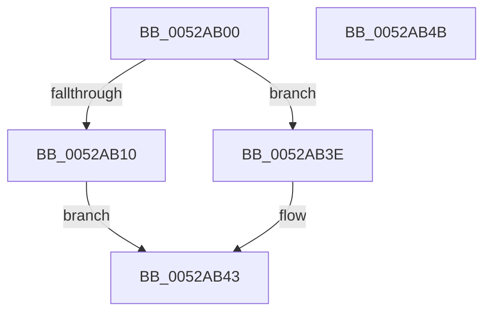

# SymCryptCrtGenerateInverses

- RVA: `0x0052AB00`–`0x0052AB4C` (길이 `76` bytes)
- VA: `0x000000014052AB00`
- 실행 섹션: `.text`
- PDB 이름 있음: `예`; PDB Function 태그: `아니요`
- unwind 정보 RVA: `0x000697A4`
- 디코드: `23`개 명령, `76/76` bytes 표시
- 미해석 바이트: `0` (있으면 어셈블리에 `.byte`로 보존)

> 이 문서는 커널 이미지의 기계어와 PDB 기호를 분석해 생성했습니다. 4번과 5번은 함수 원형과 자료형을 바이너리 사용 방식에서 추정한 C 해석이며 원본 소스 복구 결과는 아닙니다.

## 1. Dependencies

- 직접 호출 지점: **1**; 고유 호출 대상: **1**
- 직접 호출자로 확인된 함수: **1**
- RIP 상대 이미지 참조: **0**

### Outgoing calls
- `0x0052AB37` → [SymCryptCrtGenerateForTwoCoprimes](SymCryptCrtGenerateForTwoCoprimes_function_0052A950.md) (function, `0x0052A950`)

### Direct callers
- [SymCryptRsakeyCalculatePrivateFields](SymCryptRsakeyCalculatePrivateFields_function_0052326C.md) at `0x00523315`

### Static image references
- 디코드된 RIP-relative 메모리 참조가 없습니다.

## 2. Other-region calls and transfers

- 다른 실행 섹션으로 향하는 call: **0**
- 별도 외부 분기/꼬리 이동을 확인하지 못했습니다.

## 3. Assembly (complete function range)

```asm
0052AB00  40 53                           push rbx
0052AB02  48 83 EC 40                     sub rsp, 0x40
0052AB06  33 DB                           xor ebx, ebx
0052AB08  4C 8B D2                        mov r10, rdx
0052AB0B  83 F9 02                        cmp ecx, 2
0052AB0E  75 2E                           jne 0x14052ab3e
0052AB10  48 8B 44 24 78                  mov rax, qword ptr [rsp + 0x78]
0052AB15  48 8B 52 08                     mov rdx, qword ptr [rdx + 8]
0052AB19  49 8B 0A                        mov rcx, qword ptr [r10]
0052AB1C  48 89 44 24 30                  mov qword ptr [rsp + 0x30], rax
0052AB21  48 8B 44 24 70                  mov rax, qword ptr [rsp + 0x70]
0052AB26  48 89 44 24 28                  mov qword ptr [rsp + 0x28], rax
0052AB2B  49 8B 41 08                     mov rax, qword ptr [r9 + 8]
0052AB2F  4D 8B 09                        mov r9, qword ptr [r9]
0052AB32  48 89 44 24 20                  mov qword ptr [rsp + 0x20], rax
0052AB37  E8 14 FE FF FF                  call 0x14052a950
0052AB3C  EB 05                           jmp 0x14052ab43
0052AB3E  BB 0E 80 00 00                  mov ebx, 0x800e
0052AB43  8B C3                           mov eax, ebx
0052AB45  48 83 C4 40                     add rsp, 0x40
0052AB49  5B                              pop rbx
0052AB4A  C3                              ret
0052AB4B  CC                              int3
```

## 4. C-style interpretation (structured pseudocode)

```c
__int64 __fastcall SymCryptCrtGenerateInverses(int a1, __int64 a2, __int64 a3, __int64 a4, __int64 a5, __int64 a6)
{
    __int64 result;
    __int64 v_rbx;
    __int64 v_rsp;
    unsigned __int64 v_stack_m18;
    unsigned __int64 v_stack_m20;
    unsigned __int64 v_stack_m28;

    v_rsp = (v_rsp) - (64);
    v_rbx = 0;
    if (a1 != 2) goto loc_0052AB3E;
    v_stack_m18 = a6;
    v_stack_m20 = a5;
    v_stack_m28 = *(unsigned __int64 *)(a4 + 8);
    result = SymCryptCrtGenerateForTwoCoprimes(*(unsigned __int64 *)(a2), *(unsigned __int64 *)(a2 + 8), a3, *(unsigned __int64 *)(a4));
    goto loc_0052AB43;
loc_0052AB3E:
loc_0052AB43:
    v_rsp = (v_rsp) + (64);
    return (unsigned int)((unsigned int)((unsigned int)(0x800EULL)));
}
```

## 5. (Beta) C Style

```c
int64_t SymCryptCrtGenerateInverses(int32_t Arg1, void *Arg2, int64_t Arg3, void *Arg4, int64_t Arg5, int64_t Arg6)
{
    uint8_t *arg2 = (uint8_t *)Arg2;
    uint8_t *arg4 = (uint8_t *)Arg4;

    int64_t result;
    int64_t local_rbx;
    int64_t local_rsp;
    uint64_t v_stack_m18;
    uint64_t v_stack_m20;
    uint64_t v_stack_m28;

    local_rsp = (local_rsp) - (64);
    local_rbx = 0;
    if (Arg1 != 2) goto loc_0052AB3E;
    v_stack_m18 = Arg6;
    v_stack_m20 = Arg5;
    v_stack_m28 = *(uint64_t *)(arg4 + 0x8);
    result = SymCryptCrtGenerateForTwoCoprimes(*(uint64_t *)(arg2), *(uint64_t *)(arg2 + 0x8), Arg3, *(uint64_t *)(arg4));
    goto loc_0052AB43;
loc_0052AB3E:
loc_0052AB43:
    local_rsp = (local_rsp) + (64);
    return (uint32_t)((uint32_t)((uint32_t)(0x800EULL)));
}
```

### 관측된 메모리 오프셋

구조체 형식이 확인되지 않은 접근은 인자 기준의 오프셋으로만 기록했습니다.

| 기준 인자 | 오프셋 표현 | 폭 (bit) | 접근 |
|---|---:|---:|---|
| `Arg2` | `+ 0x0` | `64` | `R` |
| `Arg2` | `+ 0x8` | `64` | `R` |
| `Arg4` | `+ 0x0` | `64` | `R` |
| `Arg4` | `+ 0x8` | `64` | `R` |

## 6. Execution-region graph

[열기: 2D/3D 그래프와 함수 탐색 컨트롤 패널](../../../control-panel.html?section=text&rva=0x0052AB00&view=graph)

- 2D 그래프는 위에서 아래로 흐르고, 3D 그래프는 빈 공간을 드래그해 회전합니다. Shift+드래그는 이동, 휠은 확대·축소, 함수 노드 선택은 대상 보고서 이동입니다.

### Static fallback


