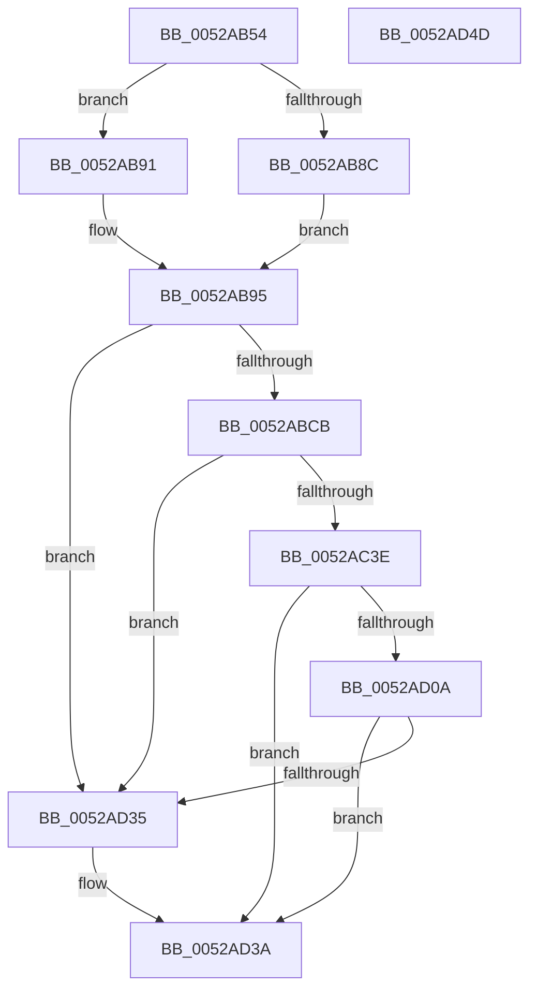

# SymCryptCrtSolve

- RVA: `0x0052AB54`–`0x0052AD4E` (길이 `506` bytes)
- VA: `0x000000014052AB54`
- 실행 섹션: `.text`
- PDB 이름 있음: `예`; PDB Function 태그: `아니요`
- unwind 정보 RVA: `0x000C3398`
- 디코드: `140`개 명령, `506/506` bytes 표시
- 미해석 바이트: `0` (있으면 어셈블리에 `.byte`로 보존)

> 이 문서는 커널 이미지의 기계어와 PDB 기호를 분석해 생성했습니다. 4번과 5번은 함수 원형과 자료형을 바이너리 사용 방식에서 추정한 C 해석이며 원본 소스 복구 결과는 아닙니다.

## 1. Dependencies

- 직접 호출 지점: **19**; 고유 호출 대상: **13**
- 직접 호출자로 확인된 함수: **1**
- RIP 상대 이미지 참조: **0**

### Outgoing calls
- `0x0052AB78` → [FsRtlNumberOfRunsInBaseMcb](../45/FsRtlNumberOfRunsInBaseMcb_function_004574D0.md) (function, `0x004574D0`)
- `0x0052AB83` → [FsRtlNumberOfRunsInBaseMcb](../45/FsRtlNumberOfRunsInBaseMcb_function_004574D0.md) (function, `0x004574D0`)
- `0x0052AB95` → [FsRtlNumberOfRunsInBaseMcb](../45/FsRtlNumberOfRunsInBaseMcb_function_004574D0.md) (function, `0x004574D0`)
- `0x0052AB9E` → [SymCryptSizeofIntFromDigits](SymCryptSizeofIntFromDigits_function_00525D24.md) (function, `0x00525D24`)
- `0x0052ABA8` → [SymCryptSizeofModElementFromModulus](SymCryptSizeofModElementFromModulus_function_00525D3C.md) (function, `0x00525D3C`)
- `0x0052ABBB` → [SymCryptSizeofIntFromDigits](SymCryptSizeofIntFromDigits_function_00525D24.md) (function, `0x00525D24`)
- `0x0052ABDD` → [SymCryptIntCreate](SymCryptIntCreate_function_0052556C.md) (function, `0x0052556C`)
- `0x0052ABF7` → [SymCryptModElementCreate](SymCryptModElementCreate_function_00525900.md) (function, `0x00525900`)
- `0x0052AC13` → [SymCryptIntCreate](SymCryptIntCreate_function_0052556C.md) (function, `0x0052556C`)
- `0x0052AC5A` → [SymCryptModElementToInt](SymCryptModElementToInt_function_00525AB0.md) (function, `0x00525AB0`)
- `0x0052AC78` → [SymCryptIntToModElement](SymCryptIntToModElement_function_00525804.md) (function, `0x00525804`)
- `0x0052AC94` → [SymCryptModSub](SymCryptModSub_function_00525CB8.md) (function, `0x00525CB8`)
- `0x0052ACB7` → [SymCryptModMul](SymCryptModMul_function_00525BA8.md) (function, `0x00525BA8`)
- `0x0052ACCD` → [SymCryptModElementToInt](SymCryptModElementToInt_function_00525AB0.md) (function, `0x00525AB0`)
- `0x0052ACD6` → [SymCryptIntFromModulus](SymCryptIntFromModulus_function_00525608.md) (function, `0x00525608`)
- `0x0052ACEC` → [SymCryptIntMulMixedSize](SymCryptIntMulMixedSize_function_005256F8.md) (function, `0x005256F8`)
- `0x0052ACFF` → [SymCryptIntCopyMixedSize](SymCryptIntCopyMixedSize_function_00525554.md) (function, `0x00525554`)
- `0x0052AD1E` → [SymCryptModElementToInt](SymCryptModElementToInt_function_00525AB0.md) (function, `0x00525AB0`)
- `0x0052AD2C` → [SymCryptIntAddMixedSize](SymCryptIntAddMixedSize_function_00525494.md) (function, `0x00525494`)

### Direct callers
- [SymCryptRsaCoreDecCrt](SymCryptRsaCoreDecCrt_function_005269C4.md) at `0x00526C9D`

### Static image references
- 디코드된 RIP-relative 메모리 참조가 없습니다.

## 2. Other-region calls and transfers

- 다른 실행 섹션으로 향하는 call: **0**
- 별도 외부 분기/꼬리 이동을 확인하지 못했습니다.

## 3. Assembly (complete function range)

```asm
0052AB54  4C 89 4C 24 20                  mov qword ptr [rsp + 0x20], r9
0052AB59  4C 89 44 24 18                  mov qword ptr [rsp + 0x18], r8
0052AB5E  89 4C 24 08                     mov dword ptr [rsp + 8], ecx
0052AB62  53                              push rbx
0052AB63  55                              push rbp
0052AB64  56                              push rsi
0052AB65  57                              push rdi
0052AB66  41 54                           push r12
0052AB68  41 55                           push r13
0052AB6A  41 56                           push r14
0052AB6C  41 57                           push r15
0052AB6E  48 83 EC 38                     sub rsp, 0x38
0052AB72  48 8B 0A                        mov rcx, qword ptr [rdx]
0052AB75  4C 8B F2                        mov r14, rdx
0052AB78  E8 53 C9 F2 FF                  call 0x1404574d0
0052AB7D  49 8B 4E 08                     mov rcx, qword ptr [r14 + 8]
0052AB81  8B D8                           mov ebx, eax
0052AB83  E8 48 C9 F2 FF                  call 0x1404574d0
0052AB88  3B D8                           cmp ebx, eax
0052AB8A  76 05                           jbe 0x14052ab91
0052AB8C  49 8B 0E                        mov rcx, qword ptr [r14]
0052AB8F  EB 04                           jmp 0x14052ab95
0052AB91  49 8B 4E 08                     mov rcx, qword ptr [r14 + 8]
0052AB95  E8 36 C9 F2 FF                  call 0x1404574d0
0052AB9A  8B C8                           mov ecx, eax
0052AB9C  8B D8                           mov ebx, eax
0052AB9E  E8 81 B1 FF FF                  call 0x140525d24
0052ABA3  49 8B 0E                        mov rcx, qword ptr [r14]
0052ABA6  8B F8                           mov edi, eax
0052ABA8  E8 8F B1 FF FF                  call 0x140525d3c
0052ABAD  44 8D 24 1B                     lea r12d, [rbx + rbx]
0052ABB1  89 84 24 88 00 00 00            mov dword ptr [rsp + 0x88], eax
0052ABB8  41 8B CC                        mov ecx, r12d
0052ABBB  E8 64 B1 FF FF                  call 0x140525d24
0052ABC0  44 8B E8                        mov r13d, eax
0052ABC3  85 C0                           test eax, eax
0052ABC5  0F 84 6A 01 00 00               je 0x14052ad35
0052ABCB  48 8B AC 24 B0 00 00 00         mov rbp, qword ptr [rsp + 0xb0]
0052ABD3  44 8B C3                        mov r8d, ebx
0052ABD6  48 8B CD                        mov rcx, rbp
0052ABD9  8B D7                           mov edx, edi
0052ABDB  8B F7                           mov esi, edi
0052ABDD  E8 8A A9 FF FF                  call 0x14052556c
0052ABE2  4D 8B 06                        mov r8, qword ptr [r14]
0052ABE5  48 03 EF                        add rbp, rdi
0052ABE8  8B BC 24 88 00 00 00            mov edi, dword ptr [rsp + 0x88]
0052ABEF  48 8B CD                        mov rcx, rbp
0052ABF2  8B D7                           mov edx, edi
0052ABF4  4C 8B F8                        mov r15, rax
0052ABF7  E8 04 AD FF FF                  call 0x140525900
0052ABFC  48 03 EF                        add rbp, rdi
0052ABFF  48 89 84 24 88 00 00 00         mov qword ptr [rsp + 0x88], rax
0052AC07  48 8B CD                        mov rcx, rbp
0052AC0A  45 8B C4                        mov r8d, r12d
0052AC0D  41 8B D5                        mov edx, r13d
0052AC10  41 8B DD                        mov ebx, r13d
0052AC13  E8 54 A9 FF FF                  call 0x14052556c
0052AC18  48 8D 0C 3B                     lea rcx, [rbx + rdi]
0052AC1C  48 03 EB                        add rbp, rbx
0052AC1F  48 8B BC 24 B8 00 00 00         mov rdi, qword ptr [rsp + 0xb8]
0052AC27  48 03 CE                        add rcx, rsi
0052AC2A  48 2B F9                        sub rdi, rcx
0052AC2D  4C 8B E8                        mov r13, rax
0052AC30  83 BC 24 80 00 00 00 02         cmp dword ptr [rsp + 0x80], 2
0052AC38  0F 85 F7 00 00 00               jne 0x14052ad35
0052AC3E  4C 8B A4 24 98 00 00 00         mov r12, qword ptr [rsp + 0x98]
0052AC46  4C 8B CD                        mov r9, rbp
0052AC49  49 8B 4E 08                     mov rcx, qword ptr [r14 + 8]
0052AC4D  4D 8B C7                        mov r8, r15
0052AC50  48 89 7C 24 20                  mov qword ptr [rsp + 0x20], rdi
0052AC55  49 8B 54 24 08                  mov rdx, qword ptr [r12 + 8]
0052AC5A  E8 51 AE FF FF                  call 0x140525ab0
0052AC5F  48 8B 9C 24 88 00 00 00         mov rbx, qword ptr [rsp + 0x88]
0052AC67  4C 8B CD                        mov r9, rbp
0052AC6A  49 8B 16                        mov rdx, qword ptr [r14]
0052AC6D  4C 8B C3                        mov r8, rbx
0052AC70  49 8B CF                        mov rcx, r15
0052AC73  48 89 7C 24 20                  mov qword ptr [rsp + 0x20], rdi
0052AC78  E8 87 AB FF FF                  call 0x140525804
0052AC7D  49 8B 14 24                     mov rdx, qword ptr [r12]
0052AC81  4C 8B CB                        mov r9, rbx
0052AC84  49 8B 0E                        mov rcx, qword ptr [r14]
0052AC87  4C 8B C3                        mov r8, rbx
0052AC8A  48 89 7C 24 28                  mov qword ptr [rsp + 0x28], rdi
0052AC8F  48 89 6C 24 20                  mov qword ptr [rsp + 0x20], rbp
0052AC94  E8 1F B0 FF FF                  call 0x140525cb8
0052AC99  48 8B 94 24 90 00 00 00         mov rdx, qword ptr [rsp + 0x90]
0052ACA1  4C 8B CB                        mov r9, rbx
0052ACA4  49 8B 0E                        mov rcx, qword ptr [r14]
0052ACA7  4C 8B C3                        mov r8, rbx
0052ACAA  48 89 7C 24 28                  mov qword ptr [rsp + 0x28], rdi
0052ACAF  48 89 6C 24 20                  mov qword ptr [rsp + 0x20], rbp
0052ACB4  48 8B 12                        mov rdx, qword ptr [rdx]
0052ACB7  E8 EC AE FF FF                  call 0x140525ba8
0052ACBC  49 8B 0E                        mov rcx, qword ptr [r14]
0052ACBF  4C 8B CD                        mov r9, rbp
0052ACC2  4D 8B C7                        mov r8, r15
0052ACC5  48 89 7C 24 20                  mov qword ptr [rsp + 0x20], rdi
0052ACCA  48 8B D3                        mov rdx, rbx
0052ACCD  E8 DE AD FF FF                  call 0x140525ab0
0052ACD2  49 8B 4E 08                     mov rcx, qword ptr [r14 + 8]
0052ACD6  E8 2D A9 FF FF                  call 0x140525608
0052ACDB  48 8B D0                        mov rdx, rax
0052ACDE  48 89 7C 24 20                  mov qword ptr [rsp + 0x20], rdi
0052ACE3  4C 8B CD                        mov r9, rbp
0052ACE6  4D 8B C5                        mov r8, r13
0052ACE9  49 8B CF                        mov rcx, r15
0052ACEC  E8 07 AA FF FF                  call 0x1405256f8
0052ACF1  48 8B B4 24 A8 00 00 00         mov rsi, qword ptr [rsp + 0xa8]
0052ACF9  49 8B CD                        mov rcx, r13
0052ACFC  48 8B D6                        mov rdx, rsi
0052ACFF  E8 50 A8 FF FF                  call 0x140525554
0052AD04  8B D8                           mov ebx, eax
0052AD06  85 C0                           test eax, eax
0052AD08  75 30                           jne 0x14052ad3a
0052AD0A  49 8B 54 24 08                  mov rdx, qword ptr [r12 + 8]
0052AD0F  4C 8B CD                        mov r9, rbp
0052AD12  49 8B 4E 08                     mov rcx, qword ptr [r14 + 8]
0052AD16  4D 8B C7                        mov r8, r15
0052AD19  48 89 7C 24 20                  mov qword ptr [rsp + 0x20], rdi
0052AD1E  E8 8D AD FF FF                  call 0x140525ab0
0052AD23  4C 8B C6                        mov r8, rsi
0052AD26  48 8B D6                        mov rdx, rsi
0052AD29  49 8B CF                        mov rcx, r15
0052AD2C  E8 63 A7 FF FF                  call 0x140525494
0052AD31  85 C0                           test eax, eax
0052AD33  74 05                           je 0x14052ad3a
0052AD35  BB 0E 80 00 00                  mov ebx, 0x800e
0052AD3A  8B C3                           mov eax, ebx
0052AD3C  48 83 C4 38                     add rsp, 0x38
0052AD40  41 5F                           pop r15
0052AD42  41 5E                           pop r14
0052AD44  41 5D                           pop r13
0052AD46  41 5C                           pop r12
0052AD48  5F                              pop rdi
0052AD49  5E                              pop rsi
0052AD4A  5D                              pop rbp
0052AD4B  5B                              pop rbx
0052AD4C  C3                              ret
0052AD4D  CC                              int3
```

## 4. C-style interpretation (structured pseudocode)

```c
__int64 __fastcall SymCryptCrtSolve(int a1, __int64 a2, __int64 a3, __int64 a4, __int64 a5, __int64 a6, __int64 a7, __int64 a8)
{
    __int64 result;
    __int64 v_rbp;
    __int64 v_rbx;
    __int64 v_rdi;
    __int64 v_rsp;
    unsigned __int64 v_stack_m50;
    unsigned __int64 v_stack_m58;
    unsigned int v_stack_p10;
    unsigned __int64 v_stack_p18;
    unsigned __int64 v_stack_p20;
    unsigned int v_stack_p8;

    v_stack_p20 = a4;
    v_stack_p18 = a3;
    v_stack_p8 = a1;
    v_rsp = (v_rsp) - (56);
    result = FsRtlNumberOfRunsInBaseMcb(*(unsigned __int64 *)(a2), a2, a3, a4);
    result = FsRtlNumberOfRunsInBaseMcb(*(unsigned __int64 *)(a2 + 8), a2, a3, a4);
    if (((unsigned int)((unsigned int)((unsigned int)(result)))) <= ((unsigned int)(result))) goto loc_0052AB91;
    goto loc_0052AB95;
loc_0052AB91:
loc_0052AB95:
    result = FsRtlNumberOfRunsInBaseMcb(*(unsigned __int64 *)(a2 + 8), a2, a3, a4);
    result = SymCryptSizeofIntFromDigits((unsigned int)((unsigned int)(result)), a2, a3, a4);
    result = SymCryptSizeofModElementFromModulus(*(unsigned __int64 *)(a2), a2, a3, a4);
    v_stack_p10 = (unsigned int)(result);
    result = SymCryptSizeofIntFromDigits((unsigned int)((unsigned int)((unsigned int)((unsigned int)(result)) + (unsigned int)((unsigned int)(result)) * 1)), a2, a3, a4);
    if ((unsigned int)(result) == 0) goto loc_0052AD35;
    result = SymCryptIntCreate(a7, (unsigned int)((unsigned int)((unsigned int)((unsigned int)(result)))), (unsigned int)((unsigned int)((unsigned int)((unsigned int)(result)))), a4);
    v_rbp = (a7) + ((unsigned int)((unsigned int)(result)));
    result = SymCryptModElementCreate(v_rbp, (unsigned int)((unsigned int)((unsigned int)(v_stack_p10))), *(unsigned __int64 *)(a2), a4);
    v_rbp = (v_rbp) + ((unsigned int)(v_stack_p10));
    v_stack_p10 = result;
    result = SymCryptIntCreate(v_rbp, (unsigned int)((unsigned int)((unsigned int)((unsigned int)(result)))), (unsigned int)((unsigned int)((unsigned int)((unsigned int)(result)) + (unsigned int)((unsigned int)(result)) * 1)), a4);
    v_rbp = (v_rbp) + ((unsigned int)((unsigned int)((unsigned int)((unsigned int)(result)))));
    a1 = ((unsigned int)((unsigned int)((unsigned int)((unsigned int)(result)))) + (unsigned int)(v_stack_p10) * 1) + ((unsigned int)((unsigned int)((unsigned int)((unsigned int)(result)))));
    v_rdi = (a8) - (a1);
    if (v_stack_p8 != 2) goto loc_0052AD35;
    v_stack_m58 = v_rdi;
    result = SymCryptModElementToInt(*(unsigned __int64 *)(a2 + 8), *(unsigned __int64 *)(v_stack_p20 + 8), result, v_rbp);
    v_stack_m58 = v_rdi;
    result = SymCryptIntToModElement(result, *(unsigned __int64 *)(a2), v_stack_p10, v_rbp);
    v_stack_m50 = v_rdi;
    v_stack_m58 = v_rbp;
    result = SymCryptModSub(*(unsigned __int64 *)(a2), *(unsigned __int64 *)(v_stack_p20), v_stack_p10, v_stack_p10);
    v_stack_m50 = v_rdi;
    v_stack_m58 = v_rbp;
    result = SymCryptModMul(*(unsigned __int64 *)(a2), *(unsigned __int64 *)(v_stack_p18), v_stack_p10, v_stack_p10);
    v_stack_m58 = v_rdi;
    result = SymCryptModElementToInt(*(unsigned __int64 *)(a2), v_stack_p10, result, v_rbp);
    result = SymCryptIntFromModulus(*(unsigned __int64 *)(a2 + 8), v_stack_p10, result, v_rbp);
    v_stack_m58 = v_rdi;
    result = SymCryptIntMulMixedSize(result, result, result, v_rbp);
    result = SymCryptIntCopyMixedSize(result, a6, result, v_rbp);
    if ((unsigned int)(result) != 0) goto loc_0052AD3A;
    v_stack_m58 = v_rdi;
    result = SymCryptModElementToInt(*(unsigned __int64 *)(a2 + 8), *(unsigned __int64 *)(v_stack_p20 + 8), result, v_rbp);
    result = SymCryptIntAddMixedSize(result, a6, a6, v_rbp);
    v_rbx = (unsigned int)((unsigned int)(result));
    if ((unsigned int)(result) != 0) {
        v_rbx = 0x800EULL;
    }
    v_rsp = (v_rsp) + (56);
    return (unsigned int)((unsigned int)(v_rbx));
}
```

## 5. (Beta) C Style

```c
int64_t SymCryptCrtSolve(int32_t Arg1, void *Arg2, int64_t Arg3, int64_t Arg4, uint64_t Arg5, int64_t Arg6, int64_t Arg7, int64_t Arg8)
{
    uint8_t *arg2 = (uint8_t *)Arg2;

    int64_t result;
    int64_t local_rbp;
    int64_t local_rbx;
    int64_t local_rdi;
    int64_t local_rsp;
    uint64_t v_stack_m50;
    uint64_t v_stack_m58;
    uint32_t v_stack_p10;
    uint64_t v_stack_p18;
    uint64_t v_stack_p20;
    uint32_t v_stack_p8;

    v_stack_p20 = Arg4;
    v_stack_p18 = Arg3;
    v_stack_p8 = Arg1;
    local_rsp = (local_rsp) - (56);
    result = FsRtlNumberOfRunsInBaseMcb(*(uint64_t *)(arg2), Arg2, Arg3, Arg4);
    result = FsRtlNumberOfRunsInBaseMcb(*(uint64_t *)(arg2 + 0x8), Arg2, Arg3, Arg4);
    if (((uint32_t)((uint32_t)((uint32_t)(result)))) <= ((uint32_t)(result))) goto loc_0052AB91;
    goto loc_0052AB95;
loc_0052AB91:
loc_0052AB95:
    result = FsRtlNumberOfRunsInBaseMcb(*(uint64_t *)(arg2 + 0x8), Arg2, Arg3, Arg4);
    result = SymCryptSizeofIntFromDigits((uint32_t)((uint32_t)(result)), Arg2, Arg3, Arg4);
    result = SymCryptSizeofModElementFromModulus(*(uint64_t *)(arg2), Arg2, Arg3, Arg4);
    v_stack_p10 = (uint32_t)(result);
    result = SymCryptSizeofIntFromDigits((uint32_t)((uint32_t)((uint32_t)((uint32_t)(result)) + (uint32_t)((uint32_t)(result)) * 1)), Arg2, Arg3, Arg4);
    if ((uint32_t)(result) == 0) goto loc_0052AD35;
    result = SymCryptIntCreate(Arg7, (uint32_t)((uint32_t)((uint32_t)((uint32_t)(result)))), (uint32_t)((uint32_t)((uint32_t)((uint32_t)(result)))), Arg4);
    local_rbp = (Arg7) + ((uint32_t)((uint32_t)(result)));
    result = SymCryptModElementCreate(local_rbp, (uint32_t)((uint32_t)((uint32_t)(v_stack_p10))), *(uint64_t *)(arg2), Arg4);
    local_rbp = (local_rbp) + ((uint32_t)(v_stack_p10));
    v_stack_p10 = result;
    result = SymCryptIntCreate(local_rbp, (uint32_t)((uint32_t)((uint32_t)((uint32_t)(result)))), (uint32_t)((uint32_t)((uint32_t)((uint32_t)(result)) + (uint32_t)((uint32_t)(result)) * 1)), Arg4);
    local_rbp = (local_rbp) + ((uint32_t)((uint32_t)((uint32_t)((uint32_t)(result)))));
    Arg1 = ((uint32_t)((uint32_t)((uint32_t)((uint32_t)(result)))) + (uint32_t)(v_stack_p10) * 1) + ((uint32_t)((uint32_t)((uint32_t)((uint32_t)(result)))));
    local_rdi = (Arg8) - (Arg1);
    if (v_stack_p8 != 2) goto loc_0052AD35;
    v_stack_m58 = local_rdi;
    result = SymCryptModElementToInt(*(uint64_t *)(arg2 + 0x8), *(uint64_t *)(v_stack_p20 + 0x8), result, local_rbp);
    v_stack_m58 = local_rdi;
    result = SymCryptIntToModElement(result, *(uint64_t *)(arg2), v_stack_p10, local_rbp);
    v_stack_m50 = local_rdi;
    v_stack_m58 = local_rbp;
    result = SymCryptModSub(*(uint64_t *)(arg2), *(uint64_t *)(v_stack_p20), v_stack_p10, v_stack_p10);
    v_stack_m50 = local_rdi;
    v_stack_m58 = local_rbp;
    result = SymCryptModMul(*(uint64_t *)(arg2), *(uint64_t *)(v_stack_p18), v_stack_p10, v_stack_p10);
    v_stack_m58 = local_rdi;
    result = SymCryptModElementToInt(*(uint64_t *)(arg2), v_stack_p10, result, local_rbp);
    result = SymCryptIntFromModulus(*(uint64_t *)(arg2 + 0x8), v_stack_p10, result, local_rbp);
    v_stack_m58 = local_rdi;
    result = SymCryptIntMulMixedSize(result, result, result, local_rbp);
    result = SymCryptIntCopyMixedSize(result, Arg6, result, local_rbp);
    if ((uint32_t)(result) != 0) goto loc_0052AD3A;
    v_stack_m58 = local_rdi;
    result = SymCryptModElementToInt(*(uint64_t *)(arg2 + 0x8), *(uint64_t *)(v_stack_p20 + 0x8), result, local_rbp);
    result = SymCryptIntAddMixedSize(result, Arg6, Arg6, local_rbp);
    local_rbx = (uint32_t)((uint32_t)(result));
    if ((uint32_t)(result) != 0) {
        local_rbx = 0x800EULL;
    }
    local_rsp = (local_rsp) + (56);
    return (uint32_t)((uint32_t)(local_rbx));
}
```

### 관측된 메모리 오프셋

구조체 형식이 확인되지 않은 접근은 인자 기준의 오프셋으로만 기록했습니다.

| 기준 인자 | 오프셋 표현 | 폭 (bit) | 접근 |
|---|---:|---:|---|
| `Arg2` | `+ 0x0` | `64` | `R` |
| `Arg2` | `+ 0x8` | `64` | `R` |

## 6. Execution-region graph

[열기: 2D/3D 그래프와 함수 탐색 컨트롤 패널](../../../control-panel.html?section=text&rva=0x0052AB54&view=graph)

- 2D 그래프는 위에서 아래로 흐르고, 3D 그래프는 빈 공간을 드래그해 회전합니다. Shift+드래그는 이동, 휠은 확대·축소, 함수 노드 선택은 대상 보고서 이동입니다.

### Static fallback


