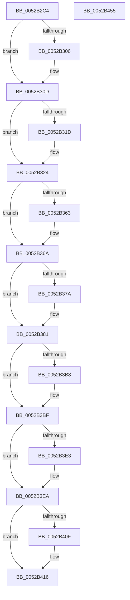

# SymCryptEcDhSecretAgreementSelftest

- RVA: `0x0052B2C4`–`0x0052B456` (길이 `402` bytes)
- VA: `0x000000014052B2C4`
- 실행 섹션: `.text`
- PDB 이름 있음: `예`; PDB Function 태그: `아니요`
- unwind 정보 RVA: `0x000C3428`
- 디코드: `103`개 명령, `402/402` bytes 표시
- 미해석 바이트: `0` (있으면 어셈블리에 `.byte`로 보존)

> 이 문서는 커널 이미지의 기계어와 PDB 기호를 분석해 생성했습니다. 4번과 5번은 함수 원형과 자료형을 바이너리 사용 방식에서 추정한 C 해석이며 원본 소스 복구 결과는 아닙니다.

## 1. Dependencies

- 직접 호출 지점: **19**; 고유 호출 대상: **10**
- 직접 호출자로 확인된 함수: **1**
- RIP 상대 이미지 참조: **7**

### Outgoing calls
- `0x0052B2F4` → [SymCryptEcurveAllocate](SymCryptEcurveAllocate_function_00524074.md) (function, `0x00524074`)
- `0x0052B308` → [SymCryptFatal](../5B/SymCryptFatal_function_005B24E0.md) (function, `0x005B24E0`)
- `0x0052B310` → [SymCryptEckeyAllocate](SymCryptEckeyAllocate_function_00524A0C.md) (function, `0x00524A0C`)
- `0x0052B31F` → [SymCryptFatal](../5B/SymCryptFatal_function_005B24E0.md) (function, `0x005B24E0`)
- `0x0052B35A` → [SymCryptEckeySetValue](SymCryptEckeySetValue_function_00524C34.md) (function, `0x00524C34`)
- `0x0052B365` → [SymCryptFatal](../5B/SymCryptFatal_function_005B24E0.md) (function, `0x005B24E0`)
- `0x0052B36D` → [SymCryptEckeyAllocate](SymCryptEckeyAllocate_function_00524A0C.md) (function, `0x00524A0C`)
- `0x0052B37C` → [SymCryptFatal](../5B/SymCryptFatal_function_005B24E0.md) (function, `0x005B24E0`)
- `0x0052B3AF` → [SymCryptEckeySetValue](SymCryptEckeySetValue_function_00524C34.md) (function, `0x00524C34`)
- `0x0052B3BA` → [SymCryptFatal](../5B/SymCryptFatal_function_005B24E0.md) (function, `0x005B24E0`)
- `0x0052B3DA` → [SymCryptEcDhSecretAgreement](../53/SymCryptEcDhSecretAgreement_function_00537798.md) (function, `0x00537798`)
- `0x0052B3E5` → [SymCryptFatal](../5B/SymCryptFatal_function_005B24E0.md) (function, `0x005B24E0`)
- `0x0052B3F2` → [SymCryptInjectError](../4A/SymCryptInjectError_function_004A4FCC.md) (function, `0x004A4FCC`)
- `0x0052B406` → [memcmp](../6C/memcmp_function_006C6B10.md) (function, `0x006C6B10`)
- `0x0052B411` → [SymCryptFatal](../5B/SymCryptFatal_function_005B24E0.md) (function, `0x005B24E0`)
- `0x0052B419` → [SymCryptEckeyFree](SymCryptEckeyFree_function_00524AF8.md) (function, `0x00524AF8`)
- `0x0052B421` → [SymCryptEckeyFree](SymCryptEckeyFree_function_00524AF8.md) (function, `0x00524AF8`)
- `0x0052B429` → [SymCryptEcurveFree](SymCryptEcurveFree_function_0052417C.md) (function, `0x0052417C`)
- `0x0052B436` → [_security_check_cookie](../6A/_security_check_cookie_function_006AC640.md) (function, `0x006AC640`)

### Direct callers
- [SymCryptEckeySetValue](SymCryptEckeySetValue_function_00524C34.md) at `0x005250C9`

### Static image references
- `0x0052B2DC` → RVA `0x00E0A740` (`.data`; read)
- `0x0052B2EB` → RVA `0x00006BE8` (`.rdata`; read)
- `0x0052B337` → RVA `0x00020500` (`.rdata`; read)
- `0x0052B343` → RVA `0x00020540` (`.rdata`; read)
- `0x0052B386` → RVA `0x000207B0` (`.rdata`; read)
- `0x0052B395` → RVA `0x000207F0` (`.rdata`; read)
- `0x0052B3FA` → RVA `0x00020768` (`.rdata`; read)

## 2. Other-region calls and transfers

- 다른 실행 섹션으로 향하는 call: **0**
- 별도 외부 분기/꼬리 이동을 확인하지 못했습니다.

## 3. Assembly (complete function range)

```asm
0052B2C4  48 89 5C 24 08                  mov qword ptr [rsp + 8], rbx
0052B2C9  48 89 6C 24 10                  mov qword ptr [rsp + 0x10], rbp
0052B2CE  48 89 74 24 18                  mov qword ptr [rsp + 0x18], rsi
0052B2D3  57                              push rdi
0052B2D4  41 56                           push r14
0052B2D6  41 57                           push r15
0052B2D8  48 83 EC 70                     sub rsp, 0x70
0052B2DC  48 8B 05 5D F4 8D 00            mov rax, qword ptr [rip + 0x8df45d]
0052B2E3  48 33 C4                        xor rax, rsp
0052B2E6  48 89 44 24 60                  mov qword ptr [rsp + 0x60], rax
0052B2EB  48 8B 0D F6 B8 AD FF            mov rcx, qword ptr [rip - 0x52470a]
0052B2F2  33 D2                           xor edx, edx
0052B2F4  E8 7B 8D FF FF                  call 0x140524074
0052B2F9  48 8B D8                        mov rbx, rax
0052B2FC  BD 53 50 49 46                  mov ebp, 0x46495053
0052B301  48 85 C0                        test rax, rax
0052B304  75 07                           jne 0x14052b30d
0052B306  8B CD                           mov ecx, ebp
0052B308  E8 D3 71 08 00                  call 0x1405b24e0
0052B30D  48 8B CB                        mov rcx, rbx
0052B310  E8 F7 96 FF FF                  call 0x140524a0c
0052B315  48 8B F8                        mov rdi, rax
0052B318  48 85 C0                        test rax, rax
0052B31B  75 07                           jne 0x14052b324
0052B31D  8B CD                           mov ecx, ebp
0052B31F  E8 BC 71 08 00                  call 0x1405b24e0
0052B324  41 BF 02 00 00 00               mov r15d, 2
0052B32A  48 89 7C 24 38                  mov qword ptr [rsp + 0x38], rdi
0052B32F  C7 44 24 30 00 21 00 00         mov dword ptr [rsp + 0x30], 0x2100
0052B337  4C 8D 05 C2 51 AF FF            lea r8, [rip - 0x50ae3e]
0052B33E  44 89 7C 24 28                  mov dword ptr [rsp + 0x28], r15d
0052B343  48 8D 0D F6 51 AF FF            lea rcx, [rip - 0x50ae0a]
0052B34A  44 89 7C 24 20                  mov dword ptr [rsp + 0x20], r15d
0052B34F  45 8D 77 1E                     lea r14d, [r15 + 0x1e]
0052B353  41 8B D6                        mov edx, r14d
0052B356  45 8D 4F 3E                     lea r9d, [r15 + 0x3e]
0052B35A  E8 D5 98 FF FF                  call 0x140524c34
0052B35F  85 C0                           test eax, eax
0052B361  74 07                           je 0x14052b36a
0052B363  8B CD                           mov ecx, ebp
0052B365  E8 76 71 08 00                  call 0x1405b24e0
0052B36A  48 8B CB                        mov rcx, rbx
0052B36D  E8 9A 96 FF FF                  call 0x140524a0c
0052B372  48 8B F0                        mov rsi, rax
0052B375  48 85 C0                        test rax, rax
0052B378  75 07                           jne 0x14052b381
0052B37A  8B CD                           mov ecx, ebp
0052B37C  E8 5F 71 08 00                  call 0x1405b24e0
0052B381  48 89 74 24 38                  mov qword ptr [rsp + 0x38], rsi
0052B386  4C 8D 05 23 54 AF FF            lea r8, [rip - 0x50abdd]
0052B38D  C7 44 24 30 00 21 00 00         mov dword ptr [rsp + 0x30], 0x2100
0052B395  48 8D 0D 54 54 AF FF            lea rcx, [rip - 0x50abac]
0052B39C  44 89 7C 24 28                  mov dword ptr [rsp + 0x28], r15d
0052B3A1  41 B9 40 00 00 00               mov r9d, 0x40
0052B3A7  49 8B D6                        mov rdx, r14
0052B3AA  44 89 7C 24 20                  mov dword ptr [rsp + 0x20], r15d
0052B3AF  E8 80 98 FF FF                  call 0x140524c34
0052B3B4  85 C0                           test eax, eax
0052B3B6  74 07                           je 0x14052b3bf
0052B3B8  8B CD                           mov ecx, ebp
0052B3BA  E8 21 71 08 00                  call 0x1405b24e0
0052B3BF  48 8D 44 24 40                  lea rax, [rsp + 0x40]
0052B3C4  4C 89 74 24 28                  mov qword ptr [rsp + 0x28], r14
0052B3C9  45 33 C9                        xor r9d, r9d
0052B3CC  48 89 44 24 20                  mov qword ptr [rsp + 0x20], rax
0052B3D1  45 8B C7                        mov r8d, r15d
0052B3D4  48 8B D6                        mov rdx, rsi
0052B3D7  48 8B CF                        mov rcx, rdi
0052B3DA  E8 B9 C3 00 00                  call 0x140537798
0052B3DF  85 C0                           test eax, eax
0052B3E1  74 07                           je 0x14052b3ea
0052B3E3  8B CD                           mov ecx, ebp
0052B3E5  E8 F6 70 08 00                  call 0x1405b24e0
0052B3EA  49 8B D6                        mov rdx, r14
0052B3ED  48 8D 4C 24 40                  lea rcx, [rsp + 0x40]
0052B3F2  E8 D5 9B F7 FF                  call 0x1404a4fcc
0052B3F7  4D 8B C6                        mov r8, r14
0052B3FA  48 8D 15 67 53 AF FF            lea rdx, [rip - 0x50ac99]
0052B401  48 8D 4C 24 40                  lea rcx, [rsp + 0x40]
0052B406  E8 05 B7 19 00                  call 0x1406c6b10
0052B40B  85 C0                           test eax, eax
0052B40D  74 07                           je 0x14052b416
0052B40F  8B CD                           mov ecx, ebp
0052B411  E8 CA 70 08 00                  call 0x1405b24e0
0052B416  48 8B CE                        mov rcx, rsi
0052B419  E8 DA 96 FF FF                  call 0x140524af8
0052B41E  48 8B CF                        mov rcx, rdi
0052B421  E8 D2 96 FF FF                  call 0x140524af8
0052B426  48 8B CB                        mov rcx, rbx
0052B429  E8 4E 8D FF FF                  call 0x14052417c
0052B42E  48 8B 4C 24 60                  mov rcx, qword ptr [rsp + 0x60]
0052B433  48 33 CC                        xor rcx, rsp
0052B436  E8 05 12 18 00                  call 0x1406ac640
0052B43B  4C 8D 5C 24 70                  lea r11, [rsp + 0x70]
0052B440  49 8B 5B 20                     mov rbx, qword ptr [r11 + 0x20]
0052B444  49 8B 6B 28                     mov rbp, qword ptr [r11 + 0x28]
0052B448  49 8B 73 30                     mov rsi, qword ptr [r11 + 0x30]
0052B44C  49 8B E3                        mov rsp, r11
0052B44F  41 5F                           pop r15
0052B451  41 5E                           pop r14
0052B453  5F                              pop rdi
0052B454  C3                              ret
0052B455  CC                              int3
```

## 4. C-style interpretation (structured pseudocode)

```c
__int64 __fastcall SymCryptEcDhSecretAgreementSelftest(__int64 a1, int a2)
{
    __int64 result;
    __int64 v_rsp;
    unsigned __int64 v_stack_m18;
    unsigned __int64 v_stack_m28;
    unsigned __int64 v_stack_m48;
    unsigned __int64 v_stack_m50;
    unsigned int v_stack_m58;
    unsigned int v_stack_m60;
    unsigned int v_stack_m68;
    unsigned __int64 v_stack_p10;
    unsigned __int64 v_stack_p18;
    unsigned __int64 v_stack_p8;

    v_stack_p8 = v_rbx;
    v_stack_p10 = v_rbp;
    v_stack_p18 = v_rsi;
    v_rsp = (v_rsp) - (112);
    result = (*(unsigned __int64 *)(v_rip + 9303133)) ^ (v_rsp);
    v_stack_m28 = result;
    a2 = 0;
    result = SymCryptEcurveAllocate(*(unsigned __int64 *)(v_rip - 5392138), a2, a3, a4);
    if (result == 0) {
        a1 = (unsigned int)((unsigned int)(0x46495053ULL));
        result = SymCryptFatal(a1, a2, a3, a4);
    }
    result = SymCryptEckeyAllocate(result, a2, a3, a4);
    if (result == 0) {
        a1 = (unsigned int)((unsigned int)(0x46495053ULL));
        result = SymCryptFatal(a1, a2, a3, a4);
    }
    v_stack_m50 = result;
    v_stack_m58 = 0x2100ULL;
    v_stack_m60 = 2;
    v_stack_m68 = 2;
    result = SymCryptEckeySetValue(v_rip - 5287434, (unsigned int)((unsigned int)(2 + 30)), v_rip - 5287486, 2 + 62);
    if ((unsigned int)(result) != 0) {
        a1 = (unsigned int)((unsigned int)(0x46495053ULL));
        result = SymCryptFatal(a1, (unsigned int)((unsigned int)(2 + 30)), v_rip - 5287486, 2 + 62);
    }
    result = SymCryptEckeyAllocate(result, (unsigned int)((unsigned int)(2 + 30)), v_rip - 5287486, 2 + 62);
    if (result == 0) {
        a1 = (unsigned int)((unsigned int)(0x46495053ULL));
        result = SymCryptFatal(a1, (unsigned int)((unsigned int)(2 + 30)), v_rip - 5287486, 2 + 62);
    }
    v_stack_m50 = result;
    v_stack_m58 = 0x2100ULL;
    v_stack_m60 = 2;
    v_stack_m68 = 2;
    result = SymCryptEckeySetValue(v_rip - 5286828, 2 + 30, v_rip - 5286877, 64);
    if ((unsigned int)(result) != 0) {
        a1 = (unsigned int)((unsigned int)(0x46495053ULL));
        result = SymCryptFatal(a1, 2 + 30, v_rip - 5286877, 64);
    }
    v_stack_m60 = 2 + 30;
    a4 = 0;
    v_stack_m68 = v_stack_m48;
    result = SymCryptEcDhSecretAgreement(result, result, 2, a4);
    if ((unsigned int)(result) != 0) {
        a1 = (unsigned int)((unsigned int)(0x46495053ULL));
        result = SymCryptFatal(a1, result, 2, a4);
    }
    result = SymCryptInjectError(v_stack_m48, 2 + 30, 2, a4);
    result = memcmp(v_stack_m48, v_rip - 5287065, 2 + 30, a4);
    if ((unsigned int)(result) != 0) {
        a1 = (unsigned int)((unsigned int)(0x46495053ULL));
        result = SymCryptFatal(a1, v_rip - 5287065, 2 + 30, a4);
    }
    result = SymCryptEckeyFree(result, v_rip - 5287065, 2 + 30, a4);
    result = SymCryptEckeyFree(result, v_rip - 5287065, 2 + 30, a4);
    result = SymCryptEcurveFree(result, v_rip - 5287065, 2 + 30, a4);
    a1 = (v_stack_m28) ^ (v_rsp);
    result = _security_check_cookie(a1, v_rip - 5287065, 2 + 30, a4);
    return result;
}
```

## 5. (Beta) C Style

```c
int64_t SymCryptEcDhSecretAgreementSelftest(int64_t Arg1, int32_t Arg2)
{
    int64_t result;
    int64_t local_rsp;
    uint64_t v_stack_m18;
    uint64_t v_stack_m28;
    uint64_t v_stack_m48;
    uint64_t v_stack_m50;
    uint32_t v_stack_m58;
    uint32_t v_stack_m60;
    uint32_t v_stack_m68;
    uint64_t v_stack_p10;
    uint64_t v_stack_p18;
    uint64_t v_stack_p8;

    v_stack_p8 = local_rbx;
    v_stack_p10 = local_rbp;
    v_stack_p18 = local_rsi;
    local_rsp = (local_rsp) - (112);
    result = (*(uint64_t *)(v_rip + 0x8DF45D)) ^ (local_rsp);
    v_stack_m28 = result;
    Arg2 = 0;
    result = SymCryptEcurveAllocate(*(uint64_t *)(v_rip - 0x52470A), Arg2, a3, a4);
    if (result == 0) {
        Arg1 = (uint32_t)((uint32_t)(0x46495053ULL));
        result = SymCryptFatal(Arg1, Arg2, a3, a4);
    }
    result = SymCryptEckeyAllocate(result, Arg2, a3, a4);
    if (result == 0) {
        Arg1 = (uint32_t)((uint32_t)(0x46495053ULL));
        result = SymCryptFatal(Arg1, Arg2, a3, a4);
    }
    v_stack_m50 = result;
    v_stack_m58 = 0x2100ULL;
    v_stack_m60 = 2;
    v_stack_m68 = 2;
    result = SymCryptEckeySetValue(v_rip - 5287434, (uint32_t)((uint32_t)(2 + 30)), v_rip - 5287486, 2 + 62);
    if ((uint32_t)(result) != 0) {
        Arg1 = (uint32_t)((uint32_t)(0x46495053ULL));
        result = SymCryptFatal(Arg1, (uint32_t)((uint32_t)(2 + 30)), v_rip - 5287486, 2 + 62);
    }
    result = SymCryptEckeyAllocate(result, (uint32_t)((uint32_t)(2 + 30)), v_rip - 5287486, 2 + 62);
    if (result == 0) {
        Arg1 = (uint32_t)((uint32_t)(0x46495053ULL));
        result = SymCryptFatal(Arg1, (uint32_t)((uint32_t)(2 + 30)), v_rip - 5287486, 2 + 62);
    }
    v_stack_m50 = result;
    v_stack_m58 = 0x2100ULL;
    v_stack_m60 = 2;
    v_stack_m68 = 2;
    result = SymCryptEckeySetValue(v_rip - 5286828, 2 + 30, v_rip - 5286877, 64);
    if ((uint32_t)(result) != 0) {
        Arg1 = (uint32_t)((uint32_t)(0x46495053ULL));
        result = SymCryptFatal(Arg1, 2 + 30, v_rip - 5286877, 64);
    }
    v_stack_m60 = 2 + 30;
    a4 = 0;
    v_stack_m68 = v_stack_m48;
    result = SymCryptEcDhSecretAgreement(result, result, 2, a4);
    if ((uint32_t)(result) != 0) {
        Arg1 = (uint32_t)((uint32_t)(0x46495053ULL));
        result = SymCryptFatal(Arg1, result, 2, a4);
    }
    result = SymCryptInjectError(v_stack_m48, 2 + 30, 2, a4);
    result = memcmp(v_stack_m48, v_rip - 5287065, 2 + 30, a4);
    if ((uint32_t)(result) != 0) {
        Arg1 = (uint32_t)((uint32_t)(0x46495053ULL));
        result = SymCryptFatal(Arg1, v_rip - 5287065, 2 + 30, a4);
    }
    result = SymCryptEckeyFree(result, v_rip - 5287065, 2 + 30, a4);
    result = SymCryptEckeyFree(result, v_rip - 5287065, 2 + 30, a4);
    result = SymCryptEcurveFree(result, v_rip - 5287065, 2 + 30, a4);
    Arg1 = (v_stack_m28) ^ (local_rsp);
    result = _security_check_cookie(Arg1, v_rip - 5287065, 2 + 30, a4);
    return result;
}
```

## 6. Execution-region graph

[열기: 2D/3D 그래프와 함수 탐색 컨트롤 패널](../../../control-panel.html?section=text&rva=0x0052B2C4&view=graph)

- 2D 그래프는 위에서 아래로 흐르고, 3D 그래프는 빈 공간을 드래그해 회전합니다. Shift+드래그는 이동, 휠은 확대·축소, 함수 노드 선택은 대상 보고서 이동입니다.

### Static fallback


