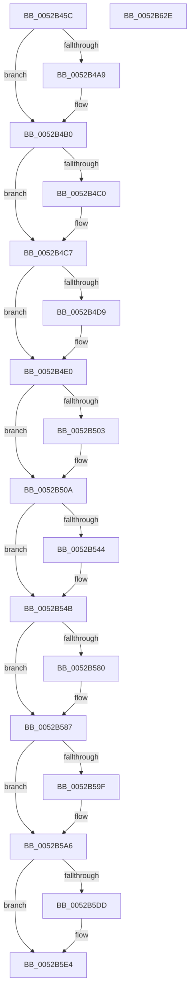

# SymCryptEcDsaSelftest

- RVA: `0x0052B45C`–`0x0052B62F` (길이 `467` bytes)
- VA: `0x000000014052B45C`
- 실행 섹션: `.text`
- PDB 이름 있음: `예`; PDB Function 태그: `아니요`
- unwind 정보 RVA: `0x000C33FC`
- 디코드: `117`개 명령, `467/467` bytes 표시
- 미해석 바이트: `0` (있으면 어셈블리에 `.byte`로 보존)

> 이 문서는 커널 이미지의 기계어와 PDB 기호를 분석해 생성했습니다. 4번과 5번은 함수 원형과 자료형을 바이너리 사용 방식에서 추정한 C 해석이며 원본 소스 복구 결과는 아닙니다.

## 1. Dependencies

- 직접 호출 지점: **21**; 고유 호출 대상: **14**
- 직접 호출자로 확인된 함수: **1**
- RIP 상대 이미지 참조: **7**

### Outgoing calls
- `0x0052B497` → [SymCryptEcurveAllocate](SymCryptEcurveAllocate_function_00524074.md) (function, `0x00524074`)
- `0x0052B4AB` → [SymCryptFatal](../5B/SymCryptFatal_function_005B24E0.md) (function, `0x005B24E0`)
- `0x0052B4B3` → [SymCryptEckeyAllocate](SymCryptEckeyAllocate_function_00524A0C.md) (function, `0x00524A0C`)
- `0x0052B4C2` → [SymCryptFatal](../5B/SymCryptFatal_function_005B24E0.md) (function, `0x005B24E0`)
- `0x0052B4CC` → [SymCryptIntAllocate](SymCryptIntAllocate_function_005254C4.md) (function, `0x005254C4`)
- `0x0052B4DB` → [SymCryptFatal](../5B/SymCryptFatal_function_005B24E0.md) (function, `0x005B24E0`)
- `0x0052B4FA` → [SymCryptIntSetValue](SymCryptIntSetValue_function_00525730.md) (function, `0x00525730`)
- `0x0052B505` → [SymCryptFatal](../5B/SymCryptFatal_function_005B24E0.md) (function, `0x005B24E0`)
- `0x0052B53B` → [SymCryptEckeySetValue](SymCryptEckeySetValue_function_00524C34.md) (function, `0x00524C34`)
- `0x0052B546` → [SymCryptFatal](../5B/SymCryptFatal_function_005B24E0.md) (function, `0x005B24E0`)
- `0x0052B577` → [SymCryptEcDsaSignEx](SymCryptEcDsaSignEx_function_00525D6C.md) (function, `0x00525D6C`)
- `0x0052B582` → [SymCryptFatal](../5B/SymCryptFatal_function_005B24E0.md) (function, `0x005B24E0`)
- `0x0052B596` → [memcmp](../6C/memcmp_function_006C6B10.md) (function, `0x006C6B10`)
- `0x0052B5A1` → [SymCryptFatal](../5B/SymCryptFatal_function_005B24E0.md) (function, `0x005B24E0`)
- `0x0052B5AE` → [SymCryptInjectError](../4A/SymCryptInjectError_function_004A4FCC.md) (function, `0x004A4FCC`)
- `0x0052B5D4` → [SymCryptEcDsaVerify](SymCryptEcDsaVerify_function_00526400.md) (function, `0x00526400`)
- `0x0052B5DF` → [SymCryptFatal](../5B/SymCryptFatal_function_005B24E0.md) (function, `0x005B24E0`)
- `0x0052B5E7` → [SymCryptIntFree](SymCryptIntFree_function_005255C8.md) (function, `0x005255C8`)
- `0x0052B5EF` → [SymCryptEckeyFree](SymCryptEckeyFree_function_00524AF8.md) (function, `0x00524AF8`)
- `0x0052B5F7` → [SymCryptEcurveFree](SymCryptEcurveFree_function_0052417C.md) (function, `0x0052417C`)
- `0x0052B607` → [_security_check_cookie](../6A/_security_check_cookie_function_006AC640.md) (function, `0x006AC640`)

### Direct callers
- [SymCryptEckeySetValue](SymCryptEckeySetValue_function_00524C34.md) at `0x005250A8`

### Static image references
- `0x0052B47C` → RVA `0x00E0A740` (`.data`; read)
- `0x0052B48E` → RVA `0x00006BE8` (`.rdata`; read)
- `0x0052B4E6` → RVA `0x00020788` (`.rdata`; read)
- `0x0052B50F` → RVA `0x00020500` (`.rdata`; read)
- `0x0052B51E` → RVA `0x00020540` (`.rdata`; read)
- `0x0052B55A` → RVA `0x00020850` (`.rdata`; read)
- `0x0052B58A` → RVA `0x00020810` (`.rdata`; read)

## 2. Other-region calls and transfers

- 다른 실행 섹션으로 향하는 call: **0**
- 별도 외부 분기/꼬리 이동을 확인하지 못했습니다.

## 3. Assembly (complete function range)

```asm
0052B45C  48 8B C4                        mov rax, rsp
0052B45F  48 89 58 08                     mov qword ptr [rax + 8], rbx
0052B463  48 89 68 10                     mov qword ptr [rax + 0x10], rbp
0052B467  48 89 70 18                     mov qword ptr [rax + 0x18], rsi
0052B46B  48 89 78 20                     mov qword ptr [rax + 0x20], rdi
0052B46F  41 55                           push r13
0052B471  41 56                           push r14
0052B473  41 57                           push r15
0052B475  48 81 EC 90 00 00 00            sub rsp, 0x90
0052B47C  48 8B 05 BD F2 8D 00            mov rax, qword ptr [rip + 0x8df2bd]
0052B483  48 33 C4                        xor rax, rsp
0052B486  48 89 84 24 80 00 00 00         mov qword ptr [rsp + 0x80], rax
0052B48E  48 8B 0D 53 B7 AD FF            mov rcx, qword ptr [rip - 0x5248ad]
0052B495  33 D2                           xor edx, edx
0052B497  E8 D8 8B FF FF                  call 0x140524074
0052B49C  48 8B F8                        mov rdi, rax
0052B49F  BD 53 50 49 46                  mov ebp, 0x46495053
0052B4A4  48 85 C0                        test rax, rax
0052B4A7  75 07                           jne 0x14052b4b0
0052B4A9  8B CD                           mov ecx, ebp
0052B4AB  E8 30 70 08 00                  call 0x1405b24e0
0052B4B0  48 8B CF                        mov rcx, rdi
0052B4B3  E8 54 95 FF FF                  call 0x140524a0c
0052B4B8  48 8B D8                        mov rbx, rax
0052B4BB  48 85 C0                        test rax, rax
0052B4BE  75 07                           jne 0x14052b4c7
0052B4C0  8B CD                           mov ecx, ebp
0052B4C2  E8 19 70 08 00                  call 0x1405b24e0
0052B4C7  B9 01 00 00 00                  mov ecx, 1
0052B4CC  E8 F3 9F FF FF                  call 0x1405254c4
0052B4D1  48 8B F0                        mov rsi, rax
0052B4D4  48 85 C0                        test rax, rax
0052B4D7  75 07                           jne 0x14052b4e0
0052B4D9  8B CD                           mov ecx, ebp
0052B4DB  E8 00 70 08 00                  call 0x1405b24e0
0052B4E0  41 BE 02 00 00 00               mov r14d, 2
0052B4E6  48 8D 0D 9B 52 AF FF            lea rcx, [rip - 0x50ad65]
0052B4ED  4C 8B CE                        mov r9, rsi
0052B4F0  45 8B C6                        mov r8d, r14d
0052B4F3  45 8D 6E 1E                     lea r13d, [r14 + 0x1e]
0052B4F7  41 8B D5                        mov edx, r13d
0052B4FA  E8 31 A2 FF FF                  call 0x140525730
0052B4FF  85 C0                           test eax, eax
0052B501  74 07                           je 0x14052b50a
0052B503  8B CD                           mov ecx, ebp
0052B505  E8 D6 6F 08 00                  call 0x1405b24e0
0052B50A  48 89 5C 24 38                  mov qword ptr [rsp + 0x38], rbx
0052B50F  4C 8D 05 EA 4F AF FF            lea r8, [rip - 0x50b016]
0052B516  C7 44 24 30 00 11 00 00         mov dword ptr [rsp + 0x30], 0x1100
0052B51E  48 8D 0D 1B 50 AF FF            lea rcx, [rip - 0x50afe5]
0052B525  41 BF 40 00 00 00               mov r15d, 0x40
0052B52B  44 89 74 24 28                  mov dword ptr [rsp + 0x28], r14d
0052B530  45 8B CF                        mov r9d, r15d
0052B533  44 89 74 24 20                  mov dword ptr [rsp + 0x20], r14d
0052B538  49 8B D5                        mov rdx, r13
0052B53B  E8 F4 96 FF FF                  call 0x140524c34
0052B540  85 C0                           test eax, eax
0052B542  74 07                           je 0x14052b54b
0052B544  8B CD                           mov ecx, ebp
0052B546  E8 95 6F 08 00                  call 0x1405b24e0
0052B54B  4C 89 7C 24 38                  mov qword ptr [rsp + 0x38], r15
0052B550  48 8D 44 24 40                  lea rax, [rsp + 0x40]
0052B555  48 89 44 24 30                  mov qword ptr [rsp + 0x30], rax
0052B55A  48 8D 15 EF 52 AF FF            lea rdx, [rip - 0x50ad11]
0052B561  C7 44 24 28 01 00 00 00         mov dword ptr [rsp + 0x28], 1
0052B569  4C 8B CE                        mov r9, rsi
0052B56C  4D 8B C5                        mov r8, r13
0052B56F  44 89 74 24 20                  mov dword ptr [rsp + 0x20], r14d
0052B574  48 8B CB                        mov rcx, rbx
0052B577  E8 F0 A7 FF FF                  call 0x140525d6c
0052B57C  85 C0                           test eax, eax
0052B57E  74 07                           je 0x14052b587
0052B580  8B CD                           mov ecx, ebp
0052B582  E8 59 6F 08 00                  call 0x1405b24e0
0052B587  4D 8B C7                        mov r8, r15
0052B58A  48 8D 15 7F 52 AF FF            lea rdx, [rip - 0x50ad81]
0052B591  48 8D 4C 24 40                  lea rcx, [rsp + 0x40]
0052B596  E8 75 B5 19 00                  call 0x1406c6b10
0052B59B  85 C0                           test eax, eax
0052B59D  74 07                           je 0x14052b5a6
0052B59F  8B CD                           mov ecx, ebp
0052B5A1  E8 3A 6F 08 00                  call 0x1405b24e0
0052B5A6  49 8B D7                        mov rdx, r15
0052B5A9  48 8D 4C 24 40                  lea rcx, [rsp + 0x40]
0052B5AE  E8 19 9A F7 FF                  call 0x1404a4fcc
0052B5B3  83 64 24 30 00                  and dword ptr [rsp + 0x30], 0
0052B5B8  4C 8D 4C 24 40                  lea r9, [rsp + 0x40]
0052B5BD  44 89 74 24 28                  mov dword ptr [rsp + 0x28], r14d
0052B5C2  48 8D 15 87 52 AF FF            lea rdx, [rip - 0x50ad79]
0052B5C9  4D 8B C5                        mov r8, r13
0052B5CC  4C 89 7C 24 20                  mov qword ptr [rsp + 0x20], r15
0052B5D1  48 8B CB                        mov rcx, rbx
0052B5D4  E8 27 AE FF FF                  call 0x140526400
0052B5D9  85 C0                           test eax, eax
0052B5DB  74 07                           je 0x14052b5e4
0052B5DD  8B CD                           mov ecx, ebp
0052B5DF  E8 FC 6E 08 00                  call 0x1405b24e0
0052B5E4  48 8B CE                        mov rcx, rsi
0052B5E7  E8 DC 9F FF FF                  call 0x1405255c8
0052B5EC  48 8B CB                        mov rcx, rbx
0052B5EF  E8 04 95 FF FF                  call 0x140524af8
0052B5F4  48 8B CF                        mov rcx, rdi
0052B5F7  E8 80 8B FF FF                  call 0x14052417c
0052B5FC  48 8B 8C 24 80 00 00 00         mov rcx, qword ptr [rsp + 0x80]
0052B604  48 33 CC                        xor rcx, rsp
0052B607  E8 34 10 18 00                  call 0x1406ac640
0052B60C  4C 8D 9C 24 90 00 00 00         lea r11, [rsp + 0x90]
0052B614  49 8B 5B 20                     mov rbx, qword ptr [r11 + 0x20]
0052B618  49 8B 6B 28                     mov rbp, qword ptr [r11 + 0x28]
0052B61C  49 8B 73 30                     mov rsi, qword ptr [r11 + 0x30]
0052B620  49 8B 7B 38                     mov rdi, qword ptr [r11 + 0x38]
0052B624  49 8B E3                        mov rsp, r11
0052B627  41 5F                           pop r15
0052B629  41 5E                           pop r14
0052B62B  41 5D                           pop r13
0052B62D  C3                              ret
0052B62E  CC                              int3
```

## 4. C-style interpretation (structured pseudocode)

```c
__int64 __fastcall SymCryptEcDsaSelftest(__int64 a1, int a2)
{
    __int64 result;
    __int64 v_rsp;
    unsigned __int64 v_stack_m18;
    unsigned __int64 v_stack_m28;
    unsigned __int64 v_stack_m68;
    unsigned __int64 v_stack_m70;
    unsigned int v_stack_m78;
    unsigned int v_stack_m80;
    unsigned int v_stack_m88;

    *(unsigned __int64 *)(v_rsp + 8) = v_rbx;
    *(unsigned __int64 *)(v_rsp + 16) = v_rbp;
    *(unsigned __int64 *)(v_rsp + 24) = v_rsi;
    *(unsigned __int64 *)(v_rsp + 32) = v_rdi;
    v_rsp = (v_rsp) - (144);
    result = (*(unsigned __int64 *)(v_rip + 9302717)) ^ (v_rsp);
    v_stack_m28 = result;
    a2 = 0;
    result = SymCryptEcurveAllocate(*(unsigned __int64 *)(v_rip - 5392557), a2, a3, a4);
    if (result == 0) {
        a1 = (unsigned int)((unsigned int)(0x46495053ULL));
        result = SymCryptFatal(a1, a2, a3, a4);
    }
    result = SymCryptEckeyAllocate(result, a2, a3, a4);
    if (result == 0) {
        a1 = (unsigned int)((unsigned int)(0x46495053ULL));
        result = SymCryptFatal(a1, a2, a3, a4);
    }
    result = SymCryptIntAllocate(1, a2, a3, a4);
    if (result == 0) {
        a1 = (unsigned int)((unsigned int)(0x46495053ULL));
        result = SymCryptFatal(a1, a2, a3, a4);
    }
    result = SymCryptIntSetValue(v_rip - 5287269, (unsigned int)((unsigned int)(2 + 30)), 2, result);
    if ((unsigned int)(result) != 0) {
        a1 = (unsigned int)((unsigned int)(0x46495053ULL));
        result = SymCryptFatal(a1, (unsigned int)((unsigned int)(2 + 30)), 2, result);
    }
    v_stack_m70 = result;
    v_stack_m78 = 0x1100ULL;
    v_stack_m80 = 2;
    v_stack_m88 = 2;
    result = SymCryptEckeySetValue(v_rip - 5287909, 2 + 30, v_rip - 5287958, 64);
    if ((unsigned int)(result) != 0) {
        a1 = (unsigned int)((unsigned int)(0x46495053ULL));
        result = SymCryptFatal(a1, 2 + 30, v_rip - 5287958, 64);
    }
    v_stack_m70 = 64;
    v_stack_m78 = v_stack_m68;
    v_stack_m80 = 1;
    v_stack_m88 = 2;
    result = SymCryptEcDsaSignEx(result, v_rip - 5287185, 2 + 30, result);
    if ((unsigned int)(result) != 0) {
        a1 = (unsigned int)((unsigned int)(0x46495053ULL));
        result = SymCryptFatal(a1, v_rip - 5287185, 2 + 30, result);
    }
    result = memcmp(v_stack_m68, v_rip - 5287297, 64, result);
    if ((unsigned int)(result) != 0) {
        a1 = (unsigned int)((unsigned int)(0x46495053ULL));
        result = SymCryptFatal(a1, v_rip - 5287297, 64, result);
    }
    result = SymCryptInjectError(v_stack_m68, 64, 64, result);
    v_stack_m80 = 2;
    v_stack_m88 = 64;
    result = SymCryptEcDsaVerify(result, v_rip - 5287289, 2 + 30, v_stack_m68);
    if ((unsigned int)(result) != 0) {
        a1 = (unsigned int)((unsigned int)(0x46495053ULL));
        result = SymCryptFatal(a1, v_rip - 5287289, 2 + 30, v_stack_m68);
    }
    result = SymCryptIntFree(result, v_rip - 5287289, 2 + 30, v_stack_m68);
    result = SymCryptEckeyFree(result, v_rip - 5287289, 2 + 30, v_stack_m68);
    result = SymCryptEcurveFree(result, v_rip - 5287289, 2 + 30, v_stack_m68);
    a1 = (v_stack_m28) ^ (v_rsp);
    result = _security_check_cookie(a1, v_rip - 5287289, 2 + 30, v_stack_m68);
    return result;
}
```

## 5. (Beta) C Style

```c
int64_t SymCryptEcDsaSelftest(int64_t Arg1, int32_t Arg2)
{
    int64_t result;
    int64_t local_rsp;
    uint64_t v_stack_m18;
    uint64_t v_stack_m28;
    uint64_t v_stack_m68;
    uint64_t v_stack_m70;
    uint32_t v_stack_m78;
    uint32_t v_stack_m80;
    uint32_t v_stack_m88;

    *(uint64_t *)(local_rsp + 0x8) = local_rbx;
    *(uint64_t *)(local_rsp + 0x10) = local_rbp;
    *(uint64_t *)(local_rsp + 0x18) = local_rsi;
    *(uint64_t *)(local_rsp + 0x20) = local_rdi;
    local_rsp = (local_rsp) - (144);
    result = (*(uint64_t *)(v_rip + 0x8DF2BD)) ^ (local_rsp);
    v_stack_m28 = result;
    Arg2 = 0;
    result = SymCryptEcurveAllocate(*(uint64_t *)(v_rip - 0x5248AD), Arg2, a3, a4);
    if (result == 0) {
        Arg1 = (uint32_t)((uint32_t)(0x46495053ULL));
        result = SymCryptFatal(Arg1, Arg2, a3, a4);
    }
    result = SymCryptEckeyAllocate(result, Arg2, a3, a4);
    if (result == 0) {
        Arg1 = (uint32_t)((uint32_t)(0x46495053ULL));
        result = SymCryptFatal(Arg1, Arg2, a3, a4);
    }
    result = SymCryptIntAllocate(1, Arg2, a3, a4);
    if (result == 0) {
        Arg1 = (uint32_t)((uint32_t)(0x46495053ULL));
        result = SymCryptFatal(Arg1, Arg2, a3, a4);
    }
    result = SymCryptIntSetValue(v_rip - 5287269, (uint32_t)((uint32_t)(2 + 30)), 2, result);
    if ((uint32_t)(result) != 0) {
        Arg1 = (uint32_t)((uint32_t)(0x46495053ULL));
        result = SymCryptFatal(Arg1, (uint32_t)((uint32_t)(2 + 30)), 2, result);
    }
    v_stack_m70 = result;
    v_stack_m78 = 0x1100ULL;
    v_stack_m80 = 2;
    v_stack_m88 = 2;
    result = SymCryptEckeySetValue(v_rip - 5287909, 2 + 30, v_rip - 5287958, 64);
    if ((uint32_t)(result) != 0) {
        Arg1 = (uint32_t)((uint32_t)(0x46495053ULL));
        result = SymCryptFatal(Arg1, 2 + 30, v_rip - 5287958, 64);
    }
    v_stack_m70 = 64;
    v_stack_m78 = v_stack_m68;
    v_stack_m80 = 1;
    v_stack_m88 = 2;
    result = SymCryptEcDsaSignEx(result, v_rip - 5287185, 2 + 30, result);
    if ((uint32_t)(result) != 0) {
        Arg1 = (uint32_t)((uint32_t)(0x46495053ULL));
        result = SymCryptFatal(Arg1, v_rip - 5287185, 2 + 30, result);
    }
    result = memcmp(v_stack_m68, v_rip - 5287297, 64, result);
    if ((uint32_t)(result) != 0) {
        Arg1 = (uint32_t)((uint32_t)(0x46495053ULL));
        result = SymCryptFatal(Arg1, v_rip - 5287297, 64, result);
    }
    result = SymCryptInjectError(v_stack_m68, 64, 64, result);
    v_stack_m80 = 2;
    v_stack_m88 = 64;
    result = SymCryptEcDsaVerify(result, v_rip - 5287289, 2 + 30, v_stack_m68);
    if ((uint32_t)(result) != 0) {
        Arg1 = (uint32_t)((uint32_t)(0x46495053ULL));
        result = SymCryptFatal(Arg1, v_rip - 5287289, 2 + 30, v_stack_m68);
    }
    result = SymCryptIntFree(result, v_rip - 5287289, 2 + 30, v_stack_m68);
    result = SymCryptEckeyFree(result, v_rip - 5287289, 2 + 30, v_stack_m68);
    result = SymCryptEcurveFree(result, v_rip - 5287289, 2 + 30, v_stack_m68);
    Arg1 = (v_stack_m28) ^ (local_rsp);
    result = _security_check_cookie(Arg1, v_rip - 5287289, 2 + 30, v_stack_m68);
    return result;
}
```

## 6. Execution-region graph

[열기: 2D/3D 그래프와 함수 탐색 컨트롤 패널](../../../control-panel.html?section=text&rva=0x0052B45C&view=graph)

- 2D 그래프는 위에서 아래로 흐르고, 3D 그래프는 빈 공간을 드래그해 회전합니다. Shift+드래그는 이동, 휠은 확대·축소, 함수 노드 선택은 대상 보고서 이동입니다.

### Static fallback


