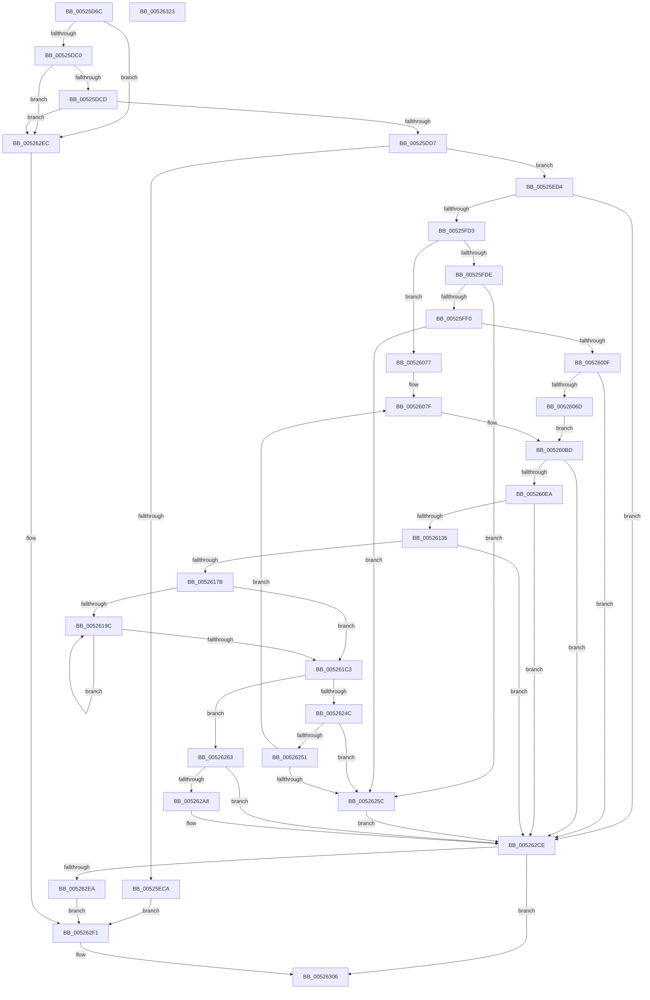

# SymCryptEcDsaSignEx

- RVA: `0x00525D6C`–`0x00526324` (길이 `1,464` bytes)
- VA: `0x0000000140525D6C`
- 실행 섹션: `.text`
- PDB 이름 있음: `예`; PDB Function 태그: `아니요`
- unwind 정보 RVA: `0x000C32AC`
- 디코드: `349`개 명령, `1,464/1,464` bytes 표시
- 미해석 바이트: `0` (있으면 어셈블리에 `.byte`로 보존)

> 이 문서는 커널 이미지의 기계어와 PDB 기호를 분석해 생성했습니다. 4번과 5번은 함수 원형과 자료형을 바이너리 사용 방식에서 추정한 C 해석이며 원본 소스 복구 결과는 아닙니다.

## 1. Dependencies

- 직접 호출 지점: **38**; 고유 호출 대상: **26**
- 직접 호출자로 확인된 함수: **1**
- RIP 상대 이미지 참조: **0**

### Outgoing calls
- `0x00525DE2` → [SymCryptEcurveDigitsofScalarMultiplier](SymCryptEcurveDigitsofScalarMultiplier_function_0052415C.md) (function, `0x0052415C`)
- `0x00525DEF` → [SymCryptSizeofIntFromDigits](SymCryptSizeofIntFromDigits_function_00525D24.md) (function, `0x00525D24`)
- `0x00525DF8` → [SymCryptSizeofIntFromDigits](SymCryptSizeofIntFromDigits_function_00525D24.md) (function, `0x00525D24`)
- `0x00525E02` → [SymCryptSizeofEcpointFromCurve](SymCryptSizeofEcpointFromCurve_function_0052CEF0.md) (function, `0x0052CEF0`)
- `0x00525E10` → [SymCryptSizeofModElementFromModulus](SymCryptSizeofModElementFromModulus_function_00525D3C.md) (function, `0x00525D3C`)
- `0x00525E1F` → [SymCryptEcurveSizeofFieldElement](SymCryptEcurveSizeofFieldElement_function_005247FC.md) (function, `0x005247FC`)
- `0x00525EBD` → [SymCryptCallbackAlloc](../6A/SymCryptCallbackAlloc_function_006AC530.md) (function, `0x006AC530`)
- `0x00525EE3` → [SymCryptIntCreate](SymCryptIntCreate_function_0052556C.md) (function, `0x0052556C`)
- `0x00525EFB` → [SymCryptIntCreate](SymCryptIntCreate_function_0052556C.md) (function, `0x0052556C`)
- `0x00525F14` → [SymCryptEcpointCreate](SymCryptEcpointCreate_function_0052C5A0.md) (function, `0x0052C5A0`)
- `0x00525F34` → [SymCryptModElementCreate](SymCryptModElementCreate_function_00525900.md) (function, `0x00525900`)
- `0x00525F4D` → [SymCryptModElementCreate](SymCryptModElementCreate_function_00525900.md) (function, `0x00525900`)
- `0x00525F66` → [SymCryptModElementCreate](SymCryptModElementCreate_function_00525900.md) (function, `0x00525900`)
- `0x00525F7D` → [SymCryptModElementCreate](SymCryptModElementCreate_function_00525900.md) (function, `0x00525900`)
- `0x00525FC4` → [SymCryptEcDsaTruncateHash](SymCryptEcDsaTruncateHash_function_0052632C.md) (function, `0x0052632C`)
- `0x00525FE3` → [SymCryptIntIsEqualUint32](SymCryptIntIsEqualUint32_function_005256B0.md) (function, `0x005256B0`)
- `0x00525FF7` → [SymCryptIntFromModulus](SymCryptIntFromModulus_function_00525608.md) (function, `0x00525608`)
- `0x00526002` → [SymCryptIntIsLessThan](SymCryptIntIsLessThan_function_005256C8.md) (function, `0x005256C8`)
- `0x0052601D` → [SymCryptIntCopy](SymCryptIntCopy_function_0052553C.md) (function, `0x0052553C`)
- `0x00526039` → [SymCryptIntToModElement](SymCryptIntToModElement_function_00525804.md) (function, `0x00525804`)
- `0x0052605E` → [SymCryptEcpointScalarMul](SymCryptEcpointScalarMul_function_0052D11C.md) (function, `0x0052D11C`)
- `0x00526097` → [SymCryptEcpointSetRandom](SymCryptEcpointSetRandom_function_0052D170.md) (function, `0x0052D170`)
- `0x005260B8` → [SymCryptIntToModElement](SymCryptIntToModElement_function_00525804.md) (function, `0x00525804`)
- `0x005260DB` → [SymCryptModInv](SymCryptModInv_function_00525B6C.md) (function, `0x00525B6C`)
- `0x00526126` → [SymCryptEcpointGetValue](SymCryptEcpointGetValue_function_0052C650.md) (function, `0x0052C650`)
- `0x0052616C` → [SymCryptModElementSetValue](SymCryptModElementSetValue_function_00525994.md) (function, `0x00525994`)
- `0x00526191` → [SymCryptIntToModElement](SymCryptIntToModElement_function_00525804.md) (function, `0x00525804`)
- `0x005261B6` → [SymCryptModAdd](SymCryptModAdd_function_00525868.md) (function, `0x00525868`)
- `0x005261DF` → [SymCryptModMul](SymCryptModMul_function_00525BA8.md) (function, `0x00525BA8`)
- `0x00526200` → [SymCryptModAdd](SymCryptModAdd_function_00525868.md) (function, `0x00525868`)
- `0x00526221` → [SymCryptModMul](SymCryptModMul_function_00525BA8.md) (function, `0x00525BA8`)
- `0x00526230` → [SymCryptModElementIsZero](SymCryptModElementIsZero_function_00525964.md) (function, `0x00525964`)
- `0x00526243` → [SymCryptModElementIsZero](SymCryptModElementIsZero_function_00525964.md) (function, `0x00525964`)
- `0x0052629D` → [SymCryptModElementGetValue](SymCryptModElementGetValue_function_00525918.md) (function, `0x00525918`)
- `0x005262C7` → [SymCryptModElementGetValue](SymCryptModElementGetValue_function_00525918.md) (function, `0x00525918`)
- `0x005262D9` → [SymCryptWipe](../51/SymCryptWipe_function_0051F914.md) (function, `0x0051F914`)
- `0x005262E1` → [SymCryptCallbackFree](../6A/SymCryptCallbackFree_function_006AC568.md) (function, `0x006AC568`)
- `0x00526301` → [SymCryptWipe](../51/SymCryptWipe_function_0051F914.md) (function, `0x0051F914`)

### Direct callers
- [SymCryptEcDsaSelftest](SymCryptEcDsaSelftest_function_0052B45C.md) at `0x0052B577`

### Static image references
- 디코드된 RIP-relative 메모리 참조가 없습니다.

## 2. Other-region calls and transfers

- 다른 실행 섹션으로 향하는 call: **0**
- 별도 외부 분기/꼬리 이동을 확인하지 못했습니다.

## 3. Assembly (complete function range)

```asm
00525D6C  48 8B C4                        mov rax, rsp
00525D6F  48 89 58 20                     mov qword ptr [rax + 0x20], rbx
00525D73  4C 89 40 18                     mov qword ptr [rax + 0x18], r8
00525D77  48 89 50 10                     mov qword ptr [rax + 0x10], rdx
00525D7B  48 89 48 08                     mov qword ptr [rax + 8], rcx
00525D7F  55                              push rbp
00525D80  56                              push rsi
00525D81  57                              push rdi
00525D82  41 54                           push r12
00525D84  41 55                           push r13
00525D86  41 56                           push r14
00525D88  41 57                           push r15
00525D8A  48 81 EC A0 00 00 00            sub rsp, 0xa0
00525D91  4C 8B 71 08                     mov r14, qword ptr [rcx + 8]
00525D95  4D 8B E9                        mov r13, r9
00525D98  44 8B 8C 24 08 01 00 00         mov r9d, dword ptr [rsp + 0x108]
00525DA0  41 8B C1                        mov eax, r9d
00525DA3  83 E0 01                        and eax, 1
00525DA6  89 44 24 60                     mov dword ptr [rsp + 0x60], eax
00525DAA  41 8B C1                        mov eax, r9d
00525DAD  83 E0 08                        and eax, 8
00525DB0  F7 01 00 10 00 00               test dword ptr [rcx], 0x1000
00525DB6  89 44 24 70                     mov dword ptr [rsp + 0x70], eax
00525DBA  0F 84 2C 05 00 00               je 0x1405262ec
00525DC0  41 F7 C1 F6 FF FF FF            test r9d, 0xfffffff6
00525DC7  0F 85 1F 05 00 00               jne 0x1405262ec
00525DCD  80 79 04 00                     cmp byte ptr [rcx + 4], 0
00525DD1  0F 84 15 05 00 00               je 0x1405262ec
00525DD7  41 8B 5E 1C                     mov ebx, dword ptr [r14 + 0x1c]
00525DDB  49 8B CE                        mov rcx, r14
00525DDE  89 5C 24 50                     mov dword ptr [rsp + 0x50], ebx
00525DE2  E8 75 E3 FF FF                  call 0x14052415c
00525DE7  8B CB                           mov ecx, ebx
00525DE9  89 44 24 58                     mov dword ptr [rsp + 0x58], eax
00525DED  8B F8                           mov edi, eax
00525DEF  E8 30 FF FF FF                  call 0x140525d24
00525DF4  8B CF                           mov ecx, edi
00525DF6  8B E8                           mov ebp, eax
00525DF8  E8 27 FF FF FF                  call 0x140525d24
00525DFD  49 8B CE                        mov rcx, r14
00525E00  8B F0                           mov esi, eax
00525E02  E8 E9 70 00 00                  call 0x14052cef0
00525E07  49 8B 8E 70 02 00 00            mov rcx, qword ptr [r14 + 0x270]
00525E0E  8B F8                           mov edi, eax
00525E10  E8 27 FF FF FF                  call 0x140525d3c
00525E15  49 8B CE                        mov rcx, r14
00525E18  89 84 24 08 01 00 00            mov dword ptr [rsp + 0x108], eax
00525E1F  E8 D8 E9 FF FF                  call 0x1405247fc
00525E24  41 8B 4E 34                     mov ecx, dword ptr [r14 + 0x34]
00525E28  44 8B E6                        mov r12d, esi
00525E2B  41 03 4E 30                     add ecx, dword ptr [r14 + 0x30]
00525E2F  45 8B 46 10                     mov r8d, dword ptr [r14 + 0x10]
00525E33  45 8B 56 1C                     mov r10d, dword ptr [r14 + 0x1c]
00525E37  45 8B 7E 38                     mov r15d, dword ptr [r14 + 0x38]
00525E3B  8B D8                           mov ebx, eax
00525E3D  41 8B C2                        mov eax, r10d
00525E40  C1 E0 08                        shl eax, 8
00525E43  44 8B D8                        mov r11d, eax
00525E46  83 C0 40                        add eax, 0x40
00525E49  44 8B C8                        mov r9d, eax
00525E4C  8B D0                           mov edx, eax
00525E4E  49 3B C9                        cmp rcx, r9
00525E51  48 89 9C 24 88 00 00 00         mov qword ptr [rsp + 0x88], rbx
00525E59  0F 47 D1                        cmova edx, ecx
00525E5C  48 89 6C 24 68                  mov qword ptr [rsp + 0x68], rbp
00525E61  41 C1 E0 08                     shl r8d, 8
00525E65  41 83 C0 40                     add r8d, 0x40
00525E69  49 3B D0                        cmp rdx, r8
00525E6C  44 0F 47 C2                     cmova r8d, edx
00525E70  41 C1 E2 06                     shl r10d, 6
00525E74  41 8B CA                        mov ecx, r10d
00525E77  48 83 C1 40                     add rcx, 0x40
00525E7B  48 03 C1                        add rax, rcx
00525E7E  48 8D 04 48                     lea rax, [rax + rcx*2]
00525E82  8B CB                           mov ecx, ebx
00525E84  4C 03 D8                        add r11, rax
00525E87  8B DF                           mov ebx, edi
00525E89  8B 84 24 08 01 00 00            mov eax, dword ptr [rsp + 0x108]
00525E90  4D 3B C3                        cmp r8, r11
00525E93  8B FD                           mov edi, ebp
00525E95  4D 0F 47 D8                     cmova r11, r8
00525E99  4D 3B DF                        cmp r11, r15
00525E9C  4D 0F 47 FB                     cmova r15, r11
00525EA0  C1 E0 02                        shl eax, 2
00525EA3  49 03 C7                        add rax, r15
00525EA6  48 03 C5                        add rax, rbp
00525EA9  48 03 C6                        add rax, rsi
00525EAC  48 03 C3                        add rax, rbx
00525EAF  48 03 C1                        add rax, rcx
00525EB2  48 8B C8                        mov rcx, rax
00525EB5  48 89 84 24 98 00 00 00         mov qword ptr [rsp + 0x98], rax
00525EBD  E8 6E 66 18 00                  call 0x1406ac530
00525EC2  48 8B E8                        mov rbp, rax
00525EC5  48 85 C0                        test rax, rax
00525EC8  75 0A                           jne 0x140525ed4
00525ECA  BB 0F 80 00 00                  mov ebx, 0x800f
00525ECF  E9 1D 04 00 00                  jmp 0x1405262f1
00525ED4  44 8B 44 24 50                  mov r8d, dword ptr [rsp + 0x50]
00525ED9  49 8D 34 07                     lea rsi, [r15 + rax]
00525EDD  48 8B CE                        mov rcx, rsi
00525EE0  48 8B D7                        mov rdx, rdi
00525EE3  E8 84 F6 FF FF                  call 0x14052556c
00525EE8  48 03 74 24 68                  add rsi, qword ptr [rsp + 0x68]
00525EED  49 8B D4                        mov rdx, r12
00525EF0  44 8B 44 24 58                  mov r8d, dword ptr [rsp + 0x58]
00525EF5  48 8B CE                        mov rcx, rsi
00525EF8  48 8B F8                        mov rdi, rax
00525EFB  E8 6C F6 FF FF                  call 0x14052556c
00525F00  49 03 F4                        add rsi, r12
00525F03  48 89 84 24 80 00 00 00         mov qword ptr [rsp + 0x80], rax
00525F0B  48 8B CE                        mov rcx, rsi
00525F0E  4D 8B C6                        mov r8, r14
00525F11  48 8B D3                        mov rdx, rbx
00525F14  E8 87 66 00 00                  call 0x14052c5a0
00525F19  4D 8B 86 70 02 00 00            mov r8, qword ptr [r14 + 0x270]
00525F20  48 03 F3                        add rsi, rbx
00525F23  8B 9C 24 08 01 00 00            mov ebx, dword ptr [rsp + 0x108]
00525F2A  48 8B CE                        mov rcx, rsi
00525F2D  8B D3                           mov edx, ebx
00525F2F  48 89 44 24 78                  mov qword ptr [rsp + 0x78], rax
00525F34  E8 C7 F9 FF FF                  call 0x140525900
00525F39  4D 8B 86 70 02 00 00            mov r8, qword ptr [r14 + 0x270]
00525F40  48 03 F3                        add rsi, rbx
00525F43  48 8B CE                        mov rcx, rsi
00525F46  48 89 44 24 68                  mov qword ptr [rsp + 0x68], rax
00525F4B  8B D3                           mov edx, ebx
00525F4D  E8 AE F9 FF FF                  call 0x140525900
00525F52  4D 8B 86 70 02 00 00            mov r8, qword ptr [r14 + 0x270]
00525F59  48 03 F3                        add rsi, rbx
00525F5C  48 8B CE                        mov rcx, rsi
00525F5F  48 89 44 24 50                  mov qword ptr [rsp + 0x50], rax
00525F64  8B D3                           mov edx, ebx
00525F66  E8 95 F9 FF FF                  call 0x140525900
00525F6B  4D 8B 86 70 02 00 00            mov r8, qword ptr [r14 + 0x270]
00525F72  48 03 F3                        add rsi, rbx
00525F75  48 8B CE                        mov rcx, rsi
00525F78  8B D3                           mov edx, ebx
00525F7A  4C 8B E0                        mov r12, rax
00525F7D  E8 7E F9 FF FF                  call 0x140525900
00525F82  44 8B 4C 24 70                  mov r9d, dword ptr [rsp + 0x70]
00525F87  49 8B CE                        mov rcx, r14
00525F8A  4C 8B 84 24 F0 00 00 00         mov r8, qword ptr [rsp + 0xf0]
00525F92  48 8B 94 24 E8 00 00 00         mov rdx, qword ptr [rsp + 0xe8]
00525F9A  48 89 44 24 58                  mov qword ptr [rsp + 0x58], rax
00525F9F  48 8D 04 33                     lea rax, [rbx + rsi]
00525FA3  4C 89 7C 24 38                  mov qword ptr [rsp + 0x38], r15
00525FA8  48 89 84 24 90 00 00 00         mov qword ptr [rsp + 0x90], rax
00525FB0  48 8B 44 24 68                  mov rax, qword ptr [rsp + 0x68]
00525FB5  48 89 6C 24 30                  mov qword ptr [rsp + 0x30], rbp
00525FBA  48 89 7C 24 28                  mov qword ptr [rsp + 0x28], rdi
00525FBF  48 89 44 24 20                  mov qword ptr [rsp + 0x20], rax
00525FC4  E8 63 03 00 00                  call 0x14052632c
00525FC9  8B D8                           mov ebx, eax
00525FCB  85 C0                           test eax, eax
00525FCD  0F 85 FB 02 00 00               jne 0x1405262ce
00525FD3  33 FF                           xor edi, edi
00525FD5  4D 85 ED                        test r13, r13
00525FD8  0F 84 99 00 00 00               je 0x140526077
00525FDE  33 D2                           xor edx, edx
00525FE0  49 8B CD                        mov rcx, r13
00525FE3  E8 C8 F6 FF FF                  call 0x1405256b0
00525FE8  85 C0                           test eax, eax
00525FEA  0F 85 6C 02 00 00               jne 0x14052625c
00525FF0  49 8B 8E 70 02 00 00            mov rcx, qword ptr [r14 + 0x270]
00525FF7  E8 0C F6 FF FF                  call 0x140525608
00525FFC  48 8B D0                        mov rdx, rax
00525FFF  49 8B CD                        mov rcx, r13
00526002  E8 C1 F6 FF FF                  call 0x1405256c8
00526007  85 C0                           test eax, eax
00526009  0F 84 4D 02 00 00               je 0x14052625c
0052600F  48 8B 9C 24 80 00 00 00         mov rbx, qword ptr [rsp + 0x80]
00526017  49 8B CD                        mov rcx, r13
0052601A  48 8B D3                        mov rdx, rbx
0052601D  E8 1A F5 FF FF                  call 0x14052553c
00526022  4C 8B 44 24 58                  mov r8, qword ptr [rsp + 0x58]
00526027  4C 8B CD                        mov r9, rbp
0052602A  49 8B 96 70 02 00 00            mov rdx, qword ptr [r14 + 0x270]
00526031  48 8B CB                        mov rcx, rbx
00526034  4C 89 7C 24 20                  mov qword ptr [rsp + 0x20], r15
00526039  E8 C6 F7 FF FF                  call 0x140525804
0052603E  4C 8B 44 24 78                  mov r8, qword ptr [rsp + 0x78]
00526043  45 33 C9                        xor r9d, r9d
00526046  4C 89 7C 24 30                  mov qword ptr [rsp + 0x30], r15
0052604B  48 8B D3                        mov rdx, rbx
0052604E  48 89 6C 24 28                  mov qword ptr [rsp + 0x28], rbp
00526053  49 8B CE                        mov rcx, r14
00526056  4C 89 44 24 20                  mov qword ptr [rsp + 0x20], r8
0052605B  45 33 C0                        xor r8d, r8d
0052605E  E8 B9 70 00 00                  call 0x14052d11c
00526063  8B D8                           mov ebx, eax
00526065  85 C0                           test eax, eax
00526067  0F 85 61 02 00 00               jne 0x1405262ce
0052606D  48 8B B4 24 E0 00 00 00         mov rsi, qword ptr [rsp + 0xe0]
00526075  EB 46                           jmp 0x1405260bd
00526077  48 8B B4 24 E0 00 00 00         mov rsi, qword ptr [rsp + 0xe0]
0052607F  4C 8B 44 24 78                  mov r8, qword ptr [rsp + 0x78]
00526084  4C 8B CD                        mov r9, rbp
00526087  48 8B 94 24 80 00 00 00         mov rdx, qword ptr [rsp + 0x80]
0052608F  49 8B CE                        mov rcx, r14
00526092  4C 89 7C 24 20                  mov qword ptr [rsp + 0x20], r15
00526097  E8 D4 70 00 00                  call 0x14052d170
0052609C  4C 8B 44 24 58                  mov r8, qword ptr [rsp + 0x58]
005260A1  4C 8B CD                        mov r9, rbp
005260A4  49 8B 96 70 02 00 00            mov rdx, qword ptr [r14 + 0x270]
005260AB  48 8B 8C 24 80 00 00 00         mov rcx, qword ptr [rsp + 0x80]
005260B3  4C 89 7C 24 20                  mov qword ptr [rsp + 0x20], r15
005260B8  E8 47 F7 FF FF                  call 0x140525804
005260BD  4C 8B 44 24 58                  mov r8, qword ptr [rsp + 0x58]
005260C2  44 8B 4C 24 60                  mov r9d, dword ptr [rsp + 0x60]
005260C7  49 8B D0                        mov rdx, r8
005260CA  49 8B 8E 70 02 00 00            mov rcx, qword ptr [r14 + 0x270]
005260D1  4C 89 7C 24 28                  mov qword ptr [rsp + 0x28], r15
005260D6  48 89 6C 24 20                  mov qword ptr [rsp + 0x20], rbp
005260DB  E8 8C FA FF FF                  call 0x140525b6c
005260E0  8B D8                           mov ebx, eax
005260E2  85 C0                           test eax, eax
005260E4  0F 85 E4 01 00 00               jne 0x1405262ce
005260EA  8B 44 24 60                     mov eax, dword ptr [rsp + 0x60]
005260EE  44 8D 4B 01                     lea r9d, [rbx + 1]
005260F2  48 8B 54 24 78                  mov rdx, qword ptr [rsp + 0x78]
005260F7  44 8D 43 02                     lea r8d, [rbx + 2]
005260FB  4C 89 7C 24 40                  mov qword ptr [rsp + 0x40], r15
00526100  49 8B CE                        mov rcx, r14
00526103  48 89 6C 24 38                  mov qword ptr [rsp + 0x38], rbp
00526108  89 44 24 30                     mov dword ptr [rsp + 0x30], eax
0052610C  48 8B 84 24 88 00 00 00         mov rax, qword ptr [rsp + 0x88]
00526114  48 89 44 24 28                  mov qword ptr [rsp + 0x28], rax
00526119  48 8B 84 24 90 00 00 00         mov rax, qword ptr [rsp + 0x90]
00526121  48 89 44 24 20                  mov qword ptr [rsp + 0x20], rax
00526126  E8 25 65 00 00                  call 0x14052c650
0052612B  8B D8                           mov ebx, eax
0052612D  85 C0                           test eax, eax
0052612F  0F 85 99 01 00 00               jne 0x1405262ce
00526135  48 8B 84 24 98 00 00 00         mov rax, qword ptr [rsp + 0x98]
0052613D  44 8D 43 02                     lea r8d, [rbx + 2]
00526141  4D 8B 8E 70 02 00 00            mov r9, qword ptr [r14 + 0x270]
00526148  48 8B 94 24 88 00 00 00         mov rdx, qword ptr [rsp + 0x88]
00526150  48 8B 8C 24 90 00 00 00         mov rcx, qword ptr [rsp + 0x90]
00526158  48 89 44 24 30                  mov qword ptr [rsp + 0x30], rax
0052615D  48 8B 44 24 50                  mov rax, qword ptr [rsp + 0x50]
00526162  48 89 6C 24 28                  mov qword ptr [rsp + 0x28], rbp
00526167  48 89 44 24 20                  mov qword ptr [rsp + 0x20], rax
0052616C  E8 23 F8 FF FF                  call 0x140525994
00526171  8B D8                           mov ebx, eax
00526173  85 C0                           test eax, eax
00526175  0F 85 53 01 00 00               jne 0x1405262ce
0052617B  49 8B 96 70 02 00 00            mov rdx, qword ptr [r14 + 0x270]
00526182  4C 8B CD                        mov r9, rbp
00526185  48 8B 4E 18                     mov rcx, qword ptr [rsi + 0x18]
00526189  4D 8B C4                        mov r8, r12
0052618C  4C 89 7C 24 20                  mov qword ptr [rsp + 0x20], r15
00526191  E8 6E F6 FF FF                  call 0x140525804
00526196  41 39 5E 40                     cmp dword ptr [r14 + 0x40], ebx
0052619A  76 27                           jbe 0x1405261c3
0052619C  49 8B 8E 70 02 00 00            mov rcx, qword ptr [r14 + 0x270]
005261A3  4D 8B CC                        mov r9, r12
005261A6  4C 89 7C 24 28                  mov qword ptr [rsp + 0x28], r15
005261AB  4D 8B C4                        mov r8, r12
005261AE  49 8B D4                        mov rdx, r12
005261B1  48 89 6C 24 20                  mov qword ptr [rsp + 0x20], rbp
005261B6  E8 AD F6 FF FF                  call 0x140525868
005261BB  FF C3                           inc ebx
005261BD  41 3B 5E 40                     cmp ebx, dword ptr [r14 + 0x40]
005261C1  72 D9                           jb 0x14052619c
005261C3  48 8B 54 24 50                  mov rdx, qword ptr [rsp + 0x50]
005261C8  4D 8B CC                        mov r9, r12
005261CB  49 8B 8E 70 02 00 00            mov rcx, qword ptr [r14 + 0x270]
005261D2  4D 8B C4                        mov r8, r12
005261D5  4C 89 7C 24 28                  mov qword ptr [rsp + 0x28], r15
005261DA  48 89 6C 24 20                  mov qword ptr [rsp + 0x20], rbp
005261DF  E8 C4 F9 FF FF                  call 0x140525ba8
005261E4  48 8B 54 24 68                  mov rdx, qword ptr [rsp + 0x68]
005261E9  4D 8B CC                        mov r9, r12
005261EC  49 8B 8E 70 02 00 00            mov rcx, qword ptr [r14 + 0x270]
005261F3  4D 8B C4                        mov r8, r12
005261F6  4C 89 7C 24 28                  mov qword ptr [rsp + 0x28], r15
005261FB  48 89 6C 24 20                  mov qword ptr [rsp + 0x20], rbp
00526200  E8 63 F6 FF FF                  call 0x140525868
00526205  4C 8B 44 24 58                  mov r8, qword ptr [rsp + 0x58]
0052620A  4D 8B CC                        mov r9, r12
0052620D  49 8B 8E 70 02 00 00            mov rcx, qword ptr [r14 + 0x270]
00526214  49 8B D4                        mov rdx, r12
00526217  4C 89 7C 24 28                  mov qword ptr [rsp + 0x28], r15
0052621C  48 89 6C 24 20                  mov qword ptr [rsp + 0x20], rbp
00526221  E8 82 F9 FF FF                  call 0x140525ba8
00526226  49 8B 8E 70 02 00 00            mov rcx, qword ptr [r14 + 0x270]
0052622D  49 8B D4                        mov rdx, r12
00526230  E8 2F F7 FF FF                  call 0x140525964
00526235  48 8B 54 24 50                  mov rdx, qword ptr [rsp + 0x50]
0052623A  8B D8                           mov ebx, eax
0052623C  49 8B 8E 70 02 00 00            mov rcx, qword ptr [r14 + 0x270]
00526243  E8 1C F7 FF FF                  call 0x140525964
00526248  0B D8                           or ebx, eax
0052624A  74 17                           je 0x140526263
0052624C  4D 85 ED                        test r13, r13
0052624F  75 0B                           jne 0x14052625c
00526251  FF C7                           inc edi
00526253  83 FF 64                        cmp edi, 0x64
00526256  0F 82 23 FE FF FF               jb 0x14052607f
0052625C  BB 0E 80 00 00                  mov ebx, 0x800e
00526261  EB 6B                           jmp 0x1405262ce
00526263  48 8B BC 24 18 01 00 00         mov rdi, qword ptr [rsp + 0x118]
0052626B  4C 8B AC 24 10 01 00 00         mov r13, qword ptr [rsp + 0x110]
00526273  8B B4 24 00 01 00 00            mov esi, dword ptr [rsp + 0x100]
0052627A  4D 8B C5                        mov r8, r13
0052627D  48 8B 54 24 50                  mov rdx, qword ptr [rsp + 0x50]
00526282  49 8B 8E 70 02 00 00            mov rcx, qword ptr [r14 + 0x270]
00526289  4C 89 7C 24 30                  mov qword ptr [rsp + 0x30], r15
0052628E  48 D1 EF                        shr rdi, 1
00526291  4C 8B CF                        mov r9, rdi
00526294  48 89 6C 24 28                  mov qword ptr [rsp + 0x28], rbp
00526299  89 74 24 20                     mov dword ptr [rsp + 0x20], esi
0052629D  E8 76 F6 FF FF                  call 0x140525918
005262A2  8B D8                           mov ebx, eax
005262A4  85 C0                           test eax, eax
005262A6  75 26                           jne 0x1405262ce
005262A8  49 8B 8E 70 02 00 00            mov rcx, qword ptr [r14 + 0x270]
005262AF  4E 8D 04 2F                     lea r8, [rdi + r13]
005262B3  4C 89 7C 24 30                  mov qword ptr [rsp + 0x30], r15
005262B8  4C 8B CF                        mov r9, rdi
005262BB  48 89 6C 24 28                  mov qword ptr [rsp + 0x28], rbp
005262C0  49 8B D4                        mov rdx, r12
005262C3  89 74 24 20                     mov dword ptr [rsp + 0x20], esi
005262C7  E8 4C F6 FF FF                  call 0x140525918
005262CC  8B D8                           mov ebx, eax
005262CE  48 8B 94 24 98 00 00 00         mov rdx, qword ptr [rsp + 0x98]
005262D6  48 8B CD                        mov rcx, rbp
005262D9  E8 36 96 FF FF                  call 0x14051f914
005262DE  48 8B CD                        mov rcx, rbp
005262E1  E8 82 62 18 00                  call 0x1406ac568
005262E6  85 DB                           test ebx, ebx
005262E8  74 1C                           je 0x140526306
005262EA  EB 05                           jmp 0x1405262f1
005262EC  BB 0E 80 00 00                  mov ebx, 0x800e
005262F1  48 8B 94 24 18 01 00 00         mov rdx, qword ptr [rsp + 0x118]
005262F9  48 8B 8C 24 10 01 00 00         mov rcx, qword ptr [rsp + 0x110]
00526301  E8 0E 96 FF FF                  call 0x14051f914
00526306  8B C3                           mov eax, ebx
00526308  48 8B 9C 24 F8 00 00 00         mov rbx, qword ptr [rsp + 0xf8]
00526310  48 81 C4 A0 00 00 00            add rsp, 0xa0
00526317  41 5F                           pop r15
00526319  41 5E                           pop r14
0052631B  41 5D                           pop r13
0052631D  41 5C                           pop r12
0052631F  5F                              pop rdi
00526320  5E                              pop rsi
00526321  5D                              pop rbp
00526322  C3                              ret
00526323  CC                              int3
```

## 4. C-style interpretation (structured pseudocode)

```c
__int64 __fastcall SymCryptEcDsaSignEx(__int64 a1, __int64 a2, __int64 a3, __int64 a4, unsigned int a5, unsigned int a6, __int64 a7, __int64 a8)
{
    __int64 result;
    __int64 v_r10;
    __int64 v_r11;
    __int64 v_r15;
    __int64 v_rbx;
    __int64 v_rdi;
    __int64 v_rsi;
    __int64 v_rsp;
    unsigned __int64 v_stack_m40;
    unsigned __int64 v_stack_m48;
    unsigned __int64 v_stack_m50;
    unsigned __int64 v_stack_m58;
    unsigned __int64 v_stack_m60;
    unsigned int v_stack_m68;
    unsigned __int64 v_stack_m70;
    unsigned int v_stack_m78;
    unsigned int v_stack_m80;
    unsigned int v_stack_m88;
    unsigned __int64 v_stack_m98;
    unsigned __int64 v_stack_mA0;
    unsigned __int64 v_stack_mA8;
    unsigned __int64 v_stack_mB0;
    unsigned __int64 v_stack_mB8;
    unsigned __int64 v_stack_p10;
    unsigned __int64 v_stack_p18;
    unsigned __int64 v_stack_p20;
    unsigned int v_stack_p30;
    unsigned __int64 v_stack_p8;

    *(unsigned __int64 *)(v_rsp + 32) = v_rbx;
    *(unsigned __int64 *)(v_rsp + 24) = a3;
    *(unsigned __int64 *)(v_rsp + 16) = a2;
    *(unsigned __int64 *)(v_rsp + 8) = a1;
    v_rsp = (v_rsp) - (160);
    result = (unsigned int)(((unsigned int)((unsigned int)((unsigned int)(a6)))) & (1));
    v_stack_m78 = (unsigned int)(result);
    result = (unsigned int)(((unsigned int)((unsigned int)((unsigned int)(a6)))) & (8));
    v_stack_m68 = (unsigned int)(result);
    if (((*(unsigned int *)(a1)) & (0x1000ULL)) == 0) goto loc_005262EC;
    if ((((unsigned int)((unsigned int)(a6))) & (0xFFFFFFF6ULL)) != 0) goto loc_005262EC;
    if ((*(unsigned __int8 *)(a1 + 4)) == 0) goto loc_005262EC;
    v_stack_m88 = (unsigned int)((unsigned int)(*(unsigned int *)(*(unsigned __int64 *)(a1 + 8) + 28)));
    result = SymCryptEcurveDigitsofScalarMultiplier(*(unsigned __int64 *)(a1 + 8), a2, a3, (unsigned int)(a6));
    v_stack_m80 = (unsigned int)(result);
    result = SymCryptSizeofIntFromDigits((unsigned int)((unsigned int)((unsigned int)(*(unsigned int *)(*(unsigned __int64 *)(a1 + 8) + 28)))), a2, a3, (unsigned int)(a6));
    result = SymCryptSizeofIntFromDigits((unsigned int)((unsigned int)((unsigned int)((unsigned int)(result)))), a2, a3, (unsigned int)(a6));
    result = SymCryptSizeofEcpointFromCurve(*(unsigned __int64 *)(a1 + 8), a2, a3, (unsigned int)(a6));
    result = SymCryptSizeofModElementFromModulus(*(unsigned __int64 *)(*(unsigned __int64 *)(a1 + 8) + 624), a2, a3, (unsigned int)(a6));
    v_stack_p30 = (unsigned int)(result);
    result = SymCryptEcurveSizeofFieldElement(*(unsigned __int64 *)(a1 + 8), a2, a3, (unsigned int)(a6));
    a1 = (unsigned int)(((unsigned int)(*(unsigned int *)(*(unsigned __int64 *)(a1 + 8) + 52))) + (*(unsigned int *)(*(unsigned __int64 *)(a1 + 8) + 48)));
    result = (unsigned int)(((unsigned int)((unsigned int)((unsigned int)(*(unsigned int *)(*(unsigned __int64 *)(a1 + 8) + 28))))) << (8));
    result = (unsigned int)((result) + (64));
    v_stack_m50 = (unsigned int)((unsigned int)(result));
    a2 = (unsigned int)((unsigned int)(result));
    if (a1 > ((unsigned int)((unsigned int)(result)))) { a2 = (unsigned int)(a1); }
    v_stack_m70 = (unsigned int)((unsigned int)(result));
    a3 = (unsigned int)(((unsigned int)(*(unsigned int *)(*(unsigned __int64 *)(a1 + 8) + 16))) << (8));
    a3 = (unsigned int)((a3) + (64));
    if (a2 > a3) { a3 = (unsigned int)(a2); }
    v_r10 = (unsigned int)(((unsigned int)(*(unsigned int *)(*(unsigned __int64 *)(a1 + 8) + 28))) << (6));
    a1 = ((unsigned int)((unsigned int)(v_r10))) + (64);
    result = (result) + (a1);
    v_r11 = ((unsigned int)((unsigned int)(result))) + (result + a1 * 2);
    if (a3 > v_r11) { v_r11 = a3; }
    v_r15 = (unsigned int)(*(unsigned int *)(*(unsigned __int64 *)(a1 + 8) + 56));
    if (v_r11 > ((unsigned int)(*(unsigned int *)(*(unsigned __int64 *)(a1 + 8) + 56)))) { v_r15 = v_r11; }
    result = (unsigned int)(((unsigned int)(a6)) << (2));
    result = (result) + (v_r15);
    result = (result) + ((unsigned int)((unsigned int)(result)));
    result = (result) + ((unsigned int)((unsigned int)(result)));
    result = (result) + ((unsigned int)((unsigned int)((unsigned int)((unsigned int)(result)))));
    result = (result) + ((unsigned int)((unsigned int)((unsigned int)((unsigned int)(result)))));
    v_stack_m40 = result;
    result = SymCryptCallbackAlloc(result, a2, a3, (unsigned int)((unsigned int)(result)));
    if (result != 0) goto loc_00525ED4;
    goto loc_005262F1;
loc_00525ED4:
    result = SymCryptIntCreate(v_r15 + result * 1, (unsigned int)((unsigned int)((unsigned int)((unsigned int)(result)))), (unsigned int)(v_stack_m88), (unsigned int)((unsigned int)(result)));
    v_rsi = (v_r15 + result * 1) + (v_stack_m70);
    result = SymCryptIntCreate(v_rsi, (unsigned int)((unsigned int)((unsigned int)((unsigned int)(result)))), (unsigned int)(v_stack_m80), (unsigned int)((unsigned int)(result)));
    v_rsi = (v_rsi) + ((unsigned int)((unsigned int)((unsigned int)((unsigned int)(result)))));
    v_stack_m58 = result;
    result = SymCryptEcpointCreate(v_rsi, (unsigned int)(0x800FULL), *(unsigned __int64 *)(a1 + 8), (unsigned int)((unsigned int)(result)));
    v_rsi = (v_rsi) + ((unsigned int)(0x800FULL));
    v_stack_m60 = result;
    result = SymCryptModElementCreate(v_rsi, (unsigned int)((unsigned int)((unsigned int)(a6))), *(unsigned __int64 *)(*(unsigned __int64 *)(a1 + 8) + 624), (unsigned int)((unsigned int)(result)));
    v_rsi = (v_rsi) + ((unsigned int)(a6));
    v_stack_m70 = result;
    result = SymCryptModElementCreate(v_rsi, (unsigned int)((unsigned int)((unsigned int)(a6))), *(unsigned __int64 *)(*(unsigned __int64 *)(a1 + 8) + 624), (unsigned int)((unsigned int)(result)));
    v_rsi = (v_rsi) + ((unsigned int)(a6));
    v_stack_m88 = result;
    result = SymCryptModElementCreate(v_rsi, (unsigned int)((unsigned int)((unsigned int)(a6))), *(unsigned __int64 *)(*(unsigned __int64 *)(a1 + 8) + 624), (unsigned int)((unsigned int)(result)));
    v_rsi = (v_rsi) + ((unsigned int)(a6));
    result = SymCryptModElementCreate(v_rsi, (unsigned int)((unsigned int)((unsigned int)(a6))), *(unsigned __int64 *)(*(unsigned __int64 *)(a1 + 8) + 624), (unsigned int)((unsigned int)(result)));
    v_stack_m80 = result;
    v_stack_mA0 = v_r15;
    v_stack_m48 = (unsigned int)(a6) + v_rsi * 1;
    v_stack_mA8 = result;
    v_stack_mB0 = result;
    v_stack_mB8 = v_stack_m70;
    result = SymCryptEcDsaTruncateHash(*(unsigned __int64 *)(a1 + 8), v_stack_p10, v_stack_p18, (unsigned int)(v_stack_m68));
    if ((unsigned int)(result) != 0) goto loc_005262CE;
    v_rdi = 0;
    if (a4 == 0) goto loc_00526077;
    a2 = 0;
    result = SymCryptIntIsEqualUint32(a4, a2, v_stack_p18, (unsigned int)(v_stack_m68));
    if ((unsigned int)(result) != 0) goto loc_0052625C;
    result = SymCryptIntFromModulus(*(unsigned __int64 *)(*(unsigned __int64 *)(a1 + 8) + 624), a2, v_stack_p18, (unsigned int)(v_stack_m68));
    result = SymCryptIntIsLessThan(a4, result, v_stack_p18, (unsigned int)(v_stack_m68));
    if ((unsigned int)(result) == 0) goto loc_0052625C;
    result = SymCryptIntCopy(a4, v_stack_m58, v_stack_p18, (unsigned int)(v_stack_m68));
    v_stack_mB8 = v_r15;
    result = SymCryptIntToModElement(v_stack_m58, *(unsigned __int64 *)(*(unsigned __int64 *)(a1 + 8) + 624), v_stack_m80, result);
    a4 = 0;
    v_stack_mA8 = v_r15;
    v_stack_mB0 = result;
    v_stack_mB8 = v_stack_m60;
    a3 = 0;
    result = SymCryptEcpointScalarMul(*(unsigned __int64 *)(a1 + 8), v_stack_m58, a3, a4);
    if ((unsigned int)(result) != 0) goto loc_005262CE;
    goto loc_005260BD;
loc_00526077:
loc_0052607F:
    v_stack_mB8 = v_r15;
    result = SymCryptEcpointSetRandom(*(unsigned __int64 *)(a1 + 8), v_stack_m58, v_stack_m60, result);
    v_stack_mB8 = v_r15;
    result = SymCryptIntToModElement(v_stack_m58, *(unsigned __int64 *)(*(unsigned __int64 *)(a1 + 8) + 624), v_stack_m80, result);
loc_005260BD:
    v_stack_mB0 = v_r15;
    v_stack_mB8 = result;
    result = SymCryptModInv(*(unsigned __int64 *)(*(unsigned __int64 *)(a1 + 8) + 624), v_stack_m80, v_stack_m80, (unsigned int)(v_stack_m78));
    if ((unsigned int)(result) != 0) goto loc_005262CE;
    v_stack_m98 = v_r15;
    v_stack_mA0 = result;
    v_stack_mA8 = (unsigned int)((unsigned int)(v_stack_m78));
    v_stack_mB0 = v_stack_m50;
    v_stack_mB8 = v_stack_m48;
    result = SymCryptEcpointGetValue(*(unsigned __int64 *)(a1 + 8), v_stack_m60, (unsigned int)((unsigned int)(result)) + 2, (unsigned int)((unsigned int)(result)) + 1);
    if ((unsigned int)(result) != 0) goto loc_005262CE;
    v_stack_mA8 = v_stack_m40;
    v_stack_mB0 = result;
    v_stack_mB8 = v_stack_m88;
    result = SymCryptModElementSetValue(v_stack_m48, v_stack_m50, (unsigned int)((unsigned int)(result)) + 2, *(unsigned __int64 *)(*(unsigned __int64 *)(a1 + 8) + 624));
    if ((unsigned int)(result) != 0) goto loc_005262CE;
    v_stack_mB8 = v_r15;
    result = SymCryptIntToModElement(*(unsigned __int64 *)(v_stack_p8 + 24), *(unsigned __int64 *)(*(unsigned __int64 *)(a1 + 8) + 624), result, result);
    if ((*(unsigned int *)(*(unsigned __int64 *)(a1 + 8) + 64)) <= ((unsigned int)((unsigned int)((unsigned int)(result))))) goto loc_005261C3;
loc_0052619C:
    v_stack_mB0 = v_r15;
    v_stack_mB8 = result;
    result = SymCryptModAdd(*(unsigned __int64 *)(*(unsigned __int64 *)(a1 + 8) + 624), result, result, result);
    v_rbx = (unsigned int)(((unsigned int)((unsigned int)(result))) + 1);
    if (((unsigned int)(v_rbx)) < (*(unsigned int *)(*(unsigned __int64 *)(a1 + 8) + 64))) goto loc_0052619C;
loc_005261C3:
    v_stack_mB0 = v_r15;
    v_stack_mB8 = result;
    result = SymCryptModMul(*(unsigned __int64 *)(*(unsigned __int64 *)(a1 + 8) + 624), v_stack_m88, result, result);
    v_stack_mB0 = v_r15;
    v_stack_mB8 = result;
    result = SymCryptModAdd(*(unsigned __int64 *)(*(unsigned __int64 *)(a1 + 8) + 624), v_stack_m70, result, result);
    v_stack_mB0 = v_r15;
    v_stack_mB8 = result;
    result = SymCryptModMul(*(unsigned __int64 *)(*(unsigned __int64 *)(a1 + 8) + 624), result, v_stack_m80, result);
    result = SymCryptModElementIsZero(*(unsigned __int64 *)(*(unsigned __int64 *)(a1 + 8) + 624), result, v_stack_m80, result);
    result = SymCryptModElementIsZero(*(unsigned __int64 *)(*(unsigned __int64 *)(a1 + 8) + 624), v_stack_m88, v_stack_m80, result);
    v_rbx = (unsigned int)(((unsigned int)((unsigned int)(result))) | ((unsigned int)(result)));
    if (condition_is_equal) goto loc_00526263;
    if (0 != 0) goto loc_0052625C;
    v_rdi = (unsigned int)((v_rdi) + 1);
    if (((unsigned int)(v_rdi)) < 100) goto loc_0052607F;
loc_0052625C:
    goto loc_005262CE;
loc_00526263:
    v_stack_mA8 = v_r15;
    v_rdi = (a8) >> (1);
    v_stack_mB0 = result;
    v_stack_mB8 = (unsigned int)((unsigned int)(a5));
    result = SymCryptModElementGetValue(*(unsigned __int64 *)(*(unsigned __int64 *)(a1 + 8) + 624), v_stack_m88, a7, v_rdi);
    v_rbx = (unsigned int)((unsigned int)(result));
    if ((unsigned int)(result) == 0) {
        a1 = *(unsigned __int64 *)(*(unsigned __int64 *)(a1 + 8) + 624);
        a3 = v_rdi + a7 * 1;
        v_stack_mA8 = v_r15;
        a4 = v_rdi;
        v_stack_mB0 = result;
        a2 = result;
        v_stack_mB8 = (unsigned int)((unsigned int)(a5));
        result = SymCryptModElementGetValue(a1, a2, a3, a4);
        v_rbx = (unsigned int)(result);
    }
    result = SymCryptWipe(result, v_stack_m40, a3, a4);
    result = SymCryptCallbackFree(result, v_stack_m40, a3, a4);
    if ((unsigned int)(v_rbx) == 0) goto loc_00526306;
    goto loc_005262F1;
loc_005262EC:
loc_005262F1:
    result = SymCryptWipe(a7, a8, a3, a4);
loc_00526306:
    v_rsp = (v_rsp) + (160);
    return (unsigned int)((unsigned int)((unsigned int)(0x800EULL)));
}
```

## 5. (Beta) C Style

```c
int64_t SymCryptEcDsaSignEx(void *Arg1, int64_t Arg2, int64_t Arg3, int64_t Arg4, uint32_t Arg5, void *Arg6, int64_t Arg7, int64_t Arg8)
{
    uint8_t *arg1 = (uint8_t *)Arg1;
    uint8_t *arg6 = (uint8_t *)Arg6;

    int64_t result;
    int64_t local_r10;
    int64_t local_r11;
    int64_t local_r15;
    int64_t local_rbx;
    int64_t local_rdi;
    int64_t local_rsi;
    int64_t local_rsp;
    uint64_t v_stack_m40;
    uint64_t v_stack_m48;
    uint64_t v_stack_m50;
    uint64_t v_stack_m58;
    uint64_t v_stack_m60;
    uint32_t v_stack_m68;
    uint64_t v_stack_m70;
    uint32_t v_stack_m78;
    uint32_t v_stack_m80;
    uint32_t v_stack_m88;
    uint64_t v_stack_m98;
    uint64_t v_stack_mA0;
    uint64_t v_stack_mA8;
    uint64_t v_stack_mB0;
    uint64_t v_stack_mB8;
    uint64_t v_stack_p10;
    uint64_t v_stack_p18;
    uint64_t v_stack_p20;
    uint32_t v_stack_p30;
    uint64_t v_stack_p8;

    *(uint64_t *)(local_rsp + 0x20) = local_rbx;
    *(uint64_t *)(local_rsp + 0x18) = Arg3;
    *(uint64_t *)(local_rsp + 0x10) = Arg2;
    *(void **)(local_rsp + 0x8) = Arg1;
    local_rsp = (local_rsp) - (160);
    result = (uint32_t)(((uint32_t)((uint32_t)((uint32_t)(Arg6)))) & (1));
    v_stack_m78 = (uint32_t)(result);
    result = (uint32_t)(((uint32_t)((uint32_t)((uint32_t)(Arg6)))) & (8));
    v_stack_m68 = (uint32_t)(result);
    if (((*(uint32_t *)(arg1)) & (0x1000ULL)) == 0) goto loc_005262EC;
    if ((((uint32_t)((uint32_t)(Arg6))) & (0xFFFFFFF6ULL)) != 0) goto loc_005262EC;
    if ((*(uint8_t *)(arg1 + 0x4)) == 0) goto loc_005262EC;
    v_stack_m88 = (uint32_t)((uint32_t)(*(uint32_t *)(*(uint64_t *)(arg1 + 0x8) + 0x1C)));
    result = SymCryptEcurveDigitsofScalarMultiplier(*(uint64_t *)(arg1 + 0x8), Arg2, Arg3, (uint32_t)(Arg6));
    v_stack_m80 = (uint32_t)(result);
    result = SymCryptSizeofIntFromDigits((uint32_t)((uint32_t)((uint32_t)(*(uint32_t *)(*(uint64_t *)(arg1 + 0x8) + 0x1C)))), Arg2, Arg3, (uint32_t)(Arg6));
    result = SymCryptSizeofIntFromDigits((uint32_t)((uint32_t)((uint32_t)((uint32_t)(result)))), Arg2, Arg3, (uint32_t)(Arg6));
    result = SymCryptSizeofEcpointFromCurve(*(uint64_t *)(arg1 + 0x8), Arg2, Arg3, (uint32_t)(Arg6));
    result = SymCryptSizeofModElementFromModulus(*(uint64_t *)(*(uint64_t *)(arg1 + 0x8) + 0x270), Arg2, Arg3, (uint32_t)(Arg6));
    v_stack_p30 = (uint32_t)(result);
    result = SymCryptEcurveSizeofFieldElement(*(uint64_t *)(arg1 + 0x8), Arg2, Arg3, (uint32_t)(Arg6));
    Arg1 = (uint32_t)(((uint32_t)(*(uint32_t *)(*(uint64_t *)(arg1 + 0x8) + 0x34))) + (*(uint32_t *)(*(uint64_t *)(arg1 + 0x8) + 0x30)));
    result = (uint32_t)(((uint32_t)((uint32_t)((uint32_t)(*(uint32_t *)(*(uint64_t *)(arg1 + 0x8) + 0x1C))))) << (8));
    result = (uint32_t)((result) + (64));
    v_stack_m50 = (uint32_t)((uint32_t)(result));
    Arg2 = (uint32_t)((uint32_t)(result));
    if (Arg1 > ((uint32_t)((uint32_t)(result)))) { Arg2 = (uint32_t)(Arg1); }
    v_stack_m70 = (uint32_t)((uint32_t)(result));
    Arg3 = (uint32_t)(((uint32_t)(*(uint32_t *)(*(uint64_t *)(arg1 + 0x8) + 0x10))) << (8));
    Arg3 = (uint32_t)((Arg3) + (64));
    if (Arg2 > Arg3) { Arg3 = (uint32_t)(Arg2); }
    local_r10 = (uint32_t)(((uint32_t)(*(uint32_t *)(*(uint64_t *)(arg1 + 0x8) + 0x1C))) << (6));
    Arg1 = ((uint32_t)((uint32_t)(local_r10))) + (64);
    result = (result) + (Arg1);
    local_r11 = ((uint32_t)((uint32_t)(result))) + (result + Arg1 * 2);
    if (Arg3 > local_r11) { local_r11 = Arg3; }
    local_r15 = (uint32_t)(*(uint32_t *)(*(uint64_t *)(arg1 + 0x8) + 0x38));
    if (local_r11 > ((uint32_t)(*(uint32_t *)(*(uint64_t *)(arg1 + 0x8) + 0x38)))) { local_r15 = local_r11; }
    result = (uint32_t)(((uint32_t)(Arg6)) << (2));
    result = (result) + (local_r15);
    result = (result) + ((uint32_t)((uint32_t)(result)));
    result = (result) + ((uint32_t)((uint32_t)(result)));
    result = (result) + ((uint32_t)((uint32_t)((uint32_t)((uint32_t)(result)))));
    result = (result) + ((uint32_t)((uint32_t)((uint32_t)((uint32_t)(result)))));
    v_stack_m40 = result;
    result = SymCryptCallbackAlloc(result, Arg2, Arg3, (uint32_t)((uint32_t)(result)));
    if (result != 0) goto loc_00525ED4;
    goto loc_005262F1;
loc_00525ED4:
    result = SymCryptIntCreate(local_r15 + result * 1, (uint32_t)((uint32_t)((uint32_t)((uint32_t)(result)))), (uint32_t)(v_stack_m88), (uint32_t)((uint32_t)(result)));
    local_rsi = (local_r15 + result * 1) + (v_stack_m70);
    result = SymCryptIntCreate(local_rsi, (uint32_t)((uint32_t)((uint32_t)((uint32_t)(result)))), (uint32_t)(v_stack_m80), (uint32_t)((uint32_t)(result)));
    local_rsi = (local_rsi) + ((uint32_t)((uint32_t)((uint32_t)((uint32_t)(result)))));
    v_stack_m58 = result;
    result = SymCryptEcpointCreate(local_rsi, (uint32_t)(0x800FULL), *(uint64_t *)(arg1 + 0x8), (uint32_t)((uint32_t)(result)));
    local_rsi = (local_rsi) + ((uint32_t)(0x800FULL));
    v_stack_m60 = result;
    result = SymCryptModElementCreate(local_rsi, (uint32_t)((uint32_t)((uint32_t)(Arg6))), *(uint64_t *)(*(uint64_t *)(arg1 + 0x8) + 0x270), (uint32_t)((uint32_t)(result)));
    local_rsi = (local_rsi) + ((uint32_t)(Arg6));
    v_stack_m70 = result;
    result = SymCryptModElementCreate(local_rsi, (uint32_t)((uint32_t)((uint32_t)(Arg6))), *(uint64_t *)(*(uint64_t *)(arg1 + 0x8) + 0x270), (uint32_t)((uint32_t)(result)));
    local_rsi = (local_rsi) + ((uint32_t)(Arg6));
    v_stack_m88 = result;
    result = SymCryptModElementCreate(local_rsi, (uint32_t)((uint32_t)((uint32_t)(Arg6))), *(uint64_t *)(*(uint64_t *)(arg1 + 0x8) + 0x270), (uint32_t)((uint32_t)(result)));
    local_rsi = (local_rsi) + ((uint32_t)(Arg6));
    result = SymCryptModElementCreate(local_rsi, (uint32_t)((uint32_t)((uint32_t)(Arg6))), *(uint64_t *)(*(uint64_t *)(arg1 + 0x8) + 0x270), (uint32_t)((uint32_t)(result)));
    v_stack_m80 = result;
    v_stack_mA0 = local_r15;
    v_stack_m48 = (uint32_t)(Arg6) + local_rsi * 1;
    v_stack_mA8 = result;
    v_stack_mB0 = result;
    v_stack_mB8 = v_stack_m70;
    result = SymCryptEcDsaTruncateHash(*(uint64_t *)(arg1 + 0x8), v_stack_p10, v_stack_p18, (uint32_t)(v_stack_m68));
    if ((uint32_t)(result) != 0) goto loc_005262CE;
    local_rdi = 0;
    if (Arg4 == 0) goto loc_00526077;
    Arg2 = 0;
    result = SymCryptIntIsEqualUint32(Arg4, Arg2, v_stack_p18, (uint32_t)(v_stack_m68));
    if ((uint32_t)(result) != 0) goto loc_0052625C;
    result = SymCryptIntFromModulus(*(uint64_t *)(*(uint64_t *)(arg1 + 0x8) + 0x270), Arg2, v_stack_p18, (uint32_t)(v_stack_m68));
    result = SymCryptIntIsLessThan(Arg4, result, v_stack_p18, (uint32_t)(v_stack_m68));
    if ((uint32_t)(result) == 0) goto loc_0052625C;
    result = SymCryptIntCopy(Arg4, v_stack_m58, v_stack_p18, (uint32_t)(v_stack_m68));
    v_stack_mB8 = local_r15;
    result = SymCryptIntToModElement(v_stack_m58, *(uint64_t *)(*(uint64_t *)(arg1 + 0x8) + 0x270), v_stack_m80, result);
    Arg4 = 0;
    v_stack_mA8 = local_r15;
    v_stack_mB0 = result;
    v_stack_mB8 = v_stack_m60;
    Arg3 = 0;
    result = SymCryptEcpointScalarMul(*(uint64_t *)(arg1 + 0x8), v_stack_m58, Arg3, Arg4);
    if ((uint32_t)(result) != 0) goto loc_005262CE;
    goto loc_005260BD;
loc_00526077:
loc_0052607F:
    v_stack_mB8 = local_r15;
    result = SymCryptEcpointSetRandom(*(uint64_t *)(arg1 + 0x8), v_stack_m58, v_stack_m60, result);
    v_stack_mB8 = local_r15;
    result = SymCryptIntToModElement(v_stack_m58, *(uint64_t *)(*(uint64_t *)(arg1 + 0x8) + 0x270), v_stack_m80, result);
loc_005260BD:
    v_stack_mB0 = local_r15;
    v_stack_mB8 = result;
    result = SymCryptModInv(*(uint64_t *)(*(uint64_t *)(arg1 + 0x8) + 0x270), v_stack_m80, v_stack_m80, (uint32_t)(v_stack_m78));
    if ((uint32_t)(result) != 0) goto loc_005262CE;
    v_stack_m98 = local_r15;
    v_stack_mA0 = result;
    v_stack_mA8 = (uint32_t)((uint32_t)(v_stack_m78));
    v_stack_mB0 = v_stack_m50;
    v_stack_mB8 = v_stack_m48;
    result = SymCryptEcpointGetValue(*(uint64_t *)(arg1 + 0x8), v_stack_m60, (uint32_t)((uint32_t)(result)) + 2, (uint32_t)((uint32_t)(result)) + 1);
    if ((uint32_t)(result) != 0) goto loc_005262CE;
    v_stack_mA8 = v_stack_m40;
    v_stack_mB0 = result;
    v_stack_mB8 = v_stack_m88;
    result = SymCryptModElementSetValue(v_stack_m48, v_stack_m50, (uint32_t)((uint32_t)(result)) + 2, *(uint64_t *)(*(uint64_t *)(arg1 + 0x8) + 0x270));
    if ((uint32_t)(result) != 0) goto loc_005262CE;
    v_stack_mB8 = local_r15;
    result = SymCryptIntToModElement(*(uint64_t *)(v_stack_p8 + 0x18), *(uint64_t *)(*(uint64_t *)(arg1 + 0x8) + 0x270), result, result);
    if ((*(uint32_t *)(*(uint64_t *)(arg1 + 0x8) + 0x40)) <= ((uint32_t)((uint32_t)((uint32_t)(result))))) goto loc_005261C3;
loc_0052619C:
    v_stack_mB0 = local_r15;
    v_stack_mB8 = result;
    result = SymCryptModAdd(*(uint64_t *)(*(uint64_t *)(arg1 + 0x8) + 0x270), result, result, result);
    local_rbx = (uint32_t)(((uint32_t)((uint32_t)(result))) + 1);
    if (((uint32_t)(local_rbx)) < (*(uint32_t *)(*(uint64_t *)(arg1 + 0x8) + 0x40))) goto loc_0052619C;
loc_005261C3:
    v_stack_mB0 = local_r15;
    v_stack_mB8 = result;
    result = SymCryptModMul(*(uint64_t *)(*(uint64_t *)(arg1 + 0x8) + 0x270), v_stack_m88, result, result);
    v_stack_mB0 = local_r15;
    v_stack_mB8 = result;
    result = SymCryptModAdd(*(uint64_t *)(*(uint64_t *)(arg1 + 0x8) + 0x270), v_stack_m70, result, result);
    v_stack_mB0 = local_r15;
    v_stack_mB8 = result;
    result = SymCryptModMul(*(uint64_t *)(*(uint64_t *)(arg1 + 0x8) + 0x270), result, v_stack_m80, result);
    result = SymCryptModElementIsZero(*(uint64_t *)(*(uint64_t *)(arg1 + 0x8) + 0x270), result, v_stack_m80, result);
    result = SymCryptModElementIsZero(*(uint64_t *)(*(uint64_t *)(arg1 + 0x8) + 0x270), v_stack_m88, v_stack_m80, result);
    local_rbx = (uint32_t)(((uint32_t)((uint32_t)(result))) | ((uint32_t)(result)));
    if (condition_is_equal) goto loc_00526263;
    if (0 != 0) goto loc_0052625C;
    local_rdi = (uint32_t)((local_rdi) + 1);
    if (((uint32_t)(local_rdi)) < 100) goto loc_0052607F;
loc_0052625C:
    goto loc_005262CE;
loc_00526263:
    v_stack_mA8 = local_r15;
    local_rdi = (Arg8) >> (1);
    v_stack_mB0 = result;
    v_stack_mB8 = (uint32_t)((uint32_t)(Arg5));
    result = SymCryptModElementGetValue(*(uint64_t *)(*(uint64_t *)(arg1 + 0x8) + 0x270), v_stack_m88, Arg7, local_rdi);
    local_rbx = (uint32_t)((uint32_t)(result));
    if ((uint32_t)(result) == 0) {
        Arg1 = *(uint64_t *)(*(uint64_t *)(arg1 + 0x8) + 0x270);
        Arg3 = local_rdi + Arg7 * 1;
        v_stack_mA8 = local_r15;
        Arg4 = local_rdi;
        v_stack_mB0 = result;
        Arg2 = result;
        v_stack_mB8 = (uint32_t)((uint32_t)(Arg5));
        result = SymCryptModElementGetValue(Arg1, Arg2, Arg3, Arg4);
        local_rbx = (uint32_t)(result);
    }
    result = SymCryptWipe(result, v_stack_m40, Arg3, Arg4);
    result = SymCryptCallbackFree(result, v_stack_m40, Arg3, Arg4);
    if ((uint32_t)(local_rbx) == 0) goto loc_00526306;
    goto loc_005262F1;
loc_005262EC:
loc_005262F1:
    result = SymCryptWipe(Arg7, Arg8, Arg3, Arg4);
loc_00526306:
    local_rsp = (local_rsp) + (160);
    return (uint32_t)((uint32_t)((uint32_t)(0x800EULL)));
}
```

### 관측된 메모리 오프셋

구조체 형식이 확인되지 않은 접근은 인자 기준의 오프셋으로만 기록했습니다.

| 기준 인자 | 오프셋 표현 | 폭 (bit) | 접근 |
|---|---:|---:|---|
| `Arg1` | `+ 0x0` | `32` | `R` |
| `Arg1` | `+ 0x4` | `8` | `R` |
| `Arg1` | `+ 0x8` | `64` | `R` |
| `Arg6` | `+ 0x0 + rsi*1` | `64` | `R` |

## 6. Execution-region graph

[열기: 2D/3D 그래프와 함수 탐색 컨트롤 패널](../../../control-panel.html?section=text&rva=0x00525D6C&view=graph)

- 2D 그래프는 위에서 아래로 흐르고, 3D 그래프는 빈 공간을 드래그해 회전합니다. Shift+드래그는 이동, 휠은 확대·축소, 함수 노드 선택은 대상 보고서 이동입니다.

### Static fallback


