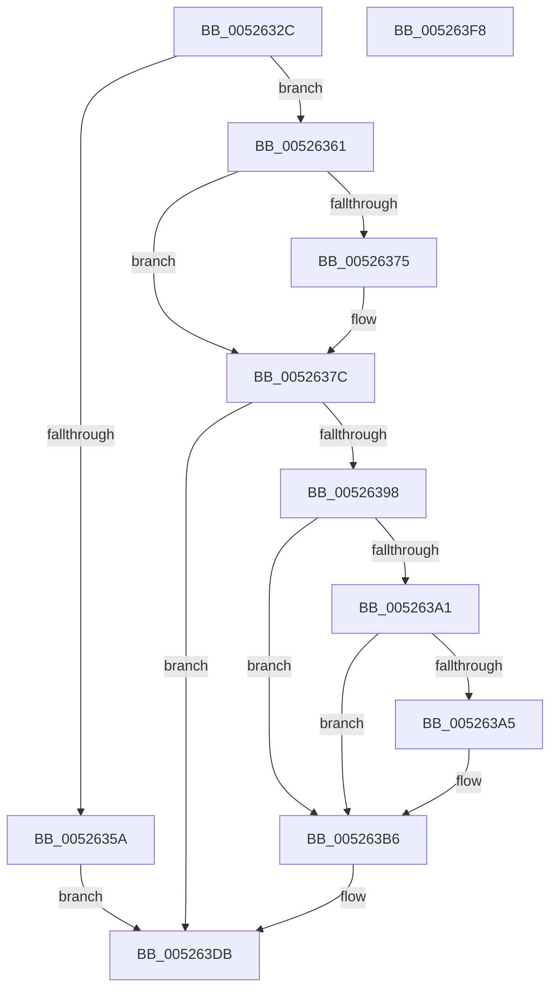

# SymCryptEcDsaTruncateHash

- RVA: `0x0052632C`–`0x005263F9` (길이 `205` bytes)
- VA: `0x000000014052632C`
- 실행 섹션: `.text`
- PDB 이름 있음: `예`; PDB Function 태그: `아니요`
- unwind 정보 RVA: `0x000BDE90`
- 디코드: `56`개 명령, `205/205` bytes 표시
- 미해석 바이트: `0` (있으면 어셈블리에 `.byte`로 보존)

> 이 문서는 커널 이미지의 기계어와 PDB 기호를 분석해 생성했습니다. 4번과 5번은 함수 원형과 자료형을 바이너리 사용 방식에서 추정한 C 해석이며 원본 소스 복구 결과는 아닙니다.

## 1. Dependencies

- 직접 호출 지점: **4**; 고유 호출 대상: **4**
- 직접 호출자로 확인된 함수: **2**
- RIP 상대 이미지 참조: **0**

### Outgoing calls
- `0x00526361` → [SymCryptEcurveBitsizeofGroupOrder](SymCryptEcurveBitsizeofGroupOrder_function_00524144.md) (function, `0x00524144`)
- `0x0052638D` → [SymCryptIntSetValue](SymCryptIntSetValue_function_00525730.md) (function, `0x00525730`)
- `0x005263B1` → [SymCryptIntDivPow2](SymCryptIntDivPow2_function_005255B0.md) (function, `0x005255B0`)
- `0x005263D6` → [SymCryptIntToModElement](SymCryptIntToModElement_function_00525804.md) (function, `0x00525804`)

### Direct callers
- [SymCryptEcDsaSignEx](SymCryptEcDsaSignEx_function_00525D6C.md) at `0x00525FC4`
- [SymCryptEcDsaVerify](SymCryptEcDsaVerify_function_00526400.md) at `0x005267CE`

### Static image references
- 디코드된 RIP-relative 메모리 참조가 없습니다.

## 2. Other-region calls and transfers

- 다른 실행 섹션으로 향하는 call: **0**
- 별도 외부 분기/꼬리 이동을 확인하지 못했습니다.

## 3. Assembly (complete function range)

```asm
0052632C  48 8B C4                        mov rax, rsp
0052632F  48 89 58 08                     mov qword ptr [rax + 8], rbx
00526333  48 89 70 10                     mov qword ptr [rax + 0x10], rsi
00526337  48 89 78 18                     mov qword ptr [rax + 0x18], rdi
0052633B  4C 89 70 20                     mov qword ptr [rax + 0x20], r14
0052633F  41 57                           push r15
00526341  48 83 EC 30                     sub rsp, 0x30
00526345  45 8B F1                        mov r14d, r9d
00526348  49 8B D8                        mov rbx, r8
0052634B  48 8B F2                        mov rsi, rdx
0052634E  4C 8B F9                        mov r15, rcx
00526351  41 F7 C1 F7 FF FF FF            test r9d, 0xfffffff7
00526358  74 07                           je 0x140526361
0052635A  BE 0E 80 00 00                  mov esi, 0x800e
0052635F  EB 7A                           jmp 0x1405263db
00526361  E8 DE DD FF FF                  call 0x140524144
00526366  8B F8                           mov edi, eax
00526368  48 8D 0C DD 00 00 00 00         lea rcx, [rbx*8]
00526370  48 3B CF                        cmp rcx, rdi
00526373  76 07                           jbe 0x14052637c
00526375  8D 5F 07                        lea ebx, [rdi + 7]
00526378  48 C1 EB 03                     shr rbx, 3
0052637C  4C 8B 4C 24 68                  mov r9, qword ptr [rsp + 0x68]
00526381  41 B8 02 00 00 00               mov r8d, 2
00526387  48 8B D3                        mov rdx, rbx
0052638A  48 8B CE                        mov rcx, rsi
0052638D  E8 9E F3 FF FF                  call 0x140525730
00526392  8B F0                           mov esi, eax
00526394  85 C0                           test eax, eax
00526396  75 43                           jne 0x1405263db
00526398  C1 E3 03                        shl ebx, 3
0052639B  41 F6 C6 08                     test r14b, 8
0052639F  75 15                           jne 0x1405263b6
005263A1  3B DF                           cmp ebx, edi
005263A3  76 11                           jbe 0x1405263b6
005263A5  4C 8B 44 24 68                  mov r8, qword ptr [rsp + 0x68]
005263AA  2B DF                           sub ebx, edi
005263AC  8B D3                           mov edx, ebx
005263AE  49 8B C8                        mov rcx, r8
005263B1  E8 FA F1 FF FF                  call 0x1405255b0
005263B6  48 8B 44 24 78                  mov rax, qword ptr [rsp + 0x78]
005263BB  4C 8B 4C 24 70                  mov r9, qword ptr [rsp + 0x70]
005263C0  4C 8B 44 24 60                  mov r8, qword ptr [rsp + 0x60]
005263C5  49 8B 97 70 02 00 00            mov rdx, qword ptr [r15 + 0x270]
005263CC  48 8B 4C 24 68                  mov rcx, qword ptr [rsp + 0x68]
005263D1  48 89 44 24 20                  mov qword ptr [rsp + 0x20], rax
005263D6  E8 29 F4 FF FF                  call 0x140525804
005263DB  48 8B 5C 24 40                  mov rbx, qword ptr [rsp + 0x40]
005263E0  8B C6                           mov eax, esi
005263E2  48 8B 74 24 48                  mov rsi, qword ptr [rsp + 0x48]
005263E7  48 8B 7C 24 50                  mov rdi, qword ptr [rsp + 0x50]
005263EC  4C 8B 74 24 58                  mov r14, qword ptr [rsp + 0x58]
005263F1  48 83 C4 30                     add rsp, 0x30
005263F5  41 5F                           pop r15
005263F7  C3                              ret
005263F8  CC                              int3
```

## 4. C-style interpretation (structured pseudocode)

```c
__int64 __fastcall SymCryptEcDsaTruncateHash(__int64 a1, __int64 a2, __int64 a3, int a4, __int64 a5, __int64 a6, __int64 a7, __int64 a8)
{
    __int64 result;
    __int64 v_rbx;
    __int64 v_rsp;
    unsigned __int64 v_stack_m18;
    unsigned __int64 v_stack_p10;
    unsigned __int64 v_stack_p18;
    unsigned __int64 v_stack_p20;
    unsigned __int64 v_stack_p8;

    *(unsigned __int64 *)(v_rsp + 8) = v_rbx;
    *(unsigned __int64 *)(v_rsp + 16) = v_rsi;
    *(unsigned __int64 *)(v_rsp + 24) = v_rdi;
    *(unsigned __int64 *)(v_rsp + 32) = v_r14;
    v_rsp = (v_rsp) - (48);
    if (((a4) & (0xFFFFFFF7ULL)) == 0) goto loc_00526361;
    goto loc_005263DB;
loc_00526361:
    result = SymCryptEcurveBitsizeofGroupOrder(a1, a2, a3, a4);
    v_rbx = a3;
    if ((a3 * 8) >= = ((unsigned int)((unsigned int)(result)))) {
        v_rbx = (unsigned int)((unsigned int)(result)) + 7;
        v_rbx = (v_rbx) >> (3);
    }
    result = SymCryptIntSetValue((unsigned int)(0x800EULL), v_rbx, 2, a6);
    if ((unsigned int)(result) != 0) goto loc_005263DB;
    v_rbx = (unsigned int)((v_rbx) << (3));
    if ((((unsigned __int8)((unsigned int)(a4))) & (8)) != 0) goto loc_005263B6;
    if (((unsigned int)(v_rbx)) >= = ((unsigned int)((unsigned int)((unsigned int)(result))))) {
        a3 = a6;
        v_rbx = (unsigned int)((v_rbx) - ((unsigned int)((unsigned int)((unsigned int)(result)))));
        a2 = (unsigned int)(v_rbx);
        a1 = a3;
        result = SymCryptIntDivPow2(a1, a2, a3, a6);
    }
    v_stack_m18 = a8;
    result = SymCryptIntToModElement(a6, *(unsigned __int64 *)(a1 + 624), a5, a7);
loc_005263DB:
    v_rsp = (v_rsp) + (48);
    return (unsigned int)((unsigned int)((unsigned int)((unsigned int)(result))));
}
```

## 5. (Beta) C Style

```c
int64_t SymCryptEcDsaTruncateHash(void *Arg1, int64_t Arg2, int64_t Arg3, int32_t Arg4, int64_t Arg5, int64_t Arg6, int64_t Arg7, int64_t Arg8)
{
    uint8_t *arg1 = (uint8_t *)Arg1;

    int64_t result;
    int64_t local_rbx;
    int64_t local_rsp;
    uint64_t v_stack_m18;
    uint64_t v_stack_p10;
    uint64_t v_stack_p18;
    uint64_t v_stack_p20;
    uint64_t v_stack_p8;

    *(uint64_t *)(local_rsp + 0x8) = local_rbx;
    *(uint64_t *)(local_rsp + 0x10) = local_rsi;
    *(uint64_t *)(local_rsp + 0x18) = local_rdi;
    *(uint64_t *)(local_rsp + 0x20) = local_r14;
    local_rsp = (local_rsp) - (48);
    if (((Arg4) & (0xFFFFFFF7ULL)) == 0) goto loc_00526361;
    goto loc_005263DB;
loc_00526361:
    result = SymCryptEcurveBitsizeofGroupOrder(Arg1, Arg2, Arg3, Arg4);
    local_rbx = Arg3;
    if ((Arg3 * 8) >= = ((uint32_t)((uint32_t)(result)))) {
        local_rbx = (uint32_t)((uint32_t)(result)) + 7;
        local_rbx = (local_rbx) >> (3);
    }
    result = SymCryptIntSetValue((uint32_t)(0x800EULL), local_rbx, 2, Arg6);
    if ((uint32_t)(result) != 0) goto loc_005263DB;
    local_rbx = (uint32_t)((local_rbx) << (3));
    if ((((uint8_t)((uint32_t)(Arg4))) & (8)) != 0) goto loc_005263B6;
    if (((uint32_t)(local_rbx)) >= = ((uint32_t)((uint32_t)((uint32_t)(result))))) {
        Arg3 = Arg6;
        local_rbx = (uint32_t)((local_rbx) - ((uint32_t)((uint32_t)((uint32_t)(result)))));
        Arg2 = (uint32_t)(local_rbx);
        Arg1 = Arg3;
        result = SymCryptIntDivPow2(Arg1, Arg2, Arg3, Arg6);
    }
    v_stack_m18 = Arg8;
    result = SymCryptIntToModElement(Arg6, *(uint64_t *)(arg1 + 0x270), Arg5, Arg7);
loc_005263DB:
    local_rsp = (local_rsp) + (48);
    return (uint32_t)((uint32_t)((uint32_t)((uint32_t)(result))));
}
```

### 관측된 메모리 오프셋

구조체 형식이 확인되지 않은 접근은 인자 기준의 오프셋으로만 기록했습니다.

| 기준 인자 | 오프셋 표현 | 폭 (bit) | 접근 |
|---|---:|---:|---|
| `Arg1` | `+ 0x270` | `64` | `R` |

## 6. Execution-region graph

[열기: 2D/3D 그래프와 함수 탐색 컨트롤 패널](../../../control-panel.html?section=text&rva=0x0052632C&view=graph)

- 2D 그래프는 위에서 아래로 흐르고, 3D 그래프는 빈 공간을 드래그해 회전합니다. Shift+드래그는 이동, 휠은 확대·축소, 함수 노드 선택은 대상 보고서 이동입니다.

### Static fallback


