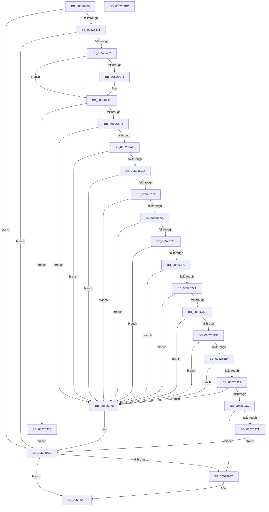

# SymCryptEcDsaVerify

- RVA: `0x00526400`–`0x005269BE` (길이 `1,470` bytes)
- VA: `0x0000000140526400`
- 실행 섹션: `.text`
- PDB 이름 있음: `예`; PDB Function 태그: `아니요`
- unwind 정보 RVA: `0x000C3288`
- 디코드: `355`개 명령, `1,470/1,470` bytes 표시
- 미해석 바이트: `0` (있으면 어셈블리에 `.byte`로 보존)

> 이 문서는 커널 이미지의 기계어와 PDB 기호를 분석해 생성했습니다. 4번과 5번은 함수 원형과 자료형을 바이너리 사용 방식에서 추정한 C 해석이며 원본 소스 복구 결과는 아닙니다.

## 1. Dependencies

- 직접 호출 지점: **43**; 고유 호출 대상: **26**
- 직접 호출자로 확인된 함수: **2**
- RIP 상대 이미지 참조: **1**

### Outgoing calls
- `0x0052649A` → [SymCryptDigitsFromBits](SymCryptDigitsFromBits_function_0052544C.md) (function, `0x0052544C`)
- `0x005264A6` → [SymCryptDigitsFromBits](SymCryptDigitsFromBits_function_0052544C.md) (function, `0x0052544C`)
- `0x005264B1` → [SymCryptEcurveDigitsofScalarMultiplier](SymCryptEcurveDigitsofScalarMultiplier_function_0052415C.md) (function, `0x0052415C`)
- `0x005264BC` → [SymCryptSizeofIntFromDigits](SymCryptSizeofIntFromDigits_function_00525D24.md) (function, `0x00525D24`)
- `0x005264C6` → [SymCryptSizeofIntFromDigits](SymCryptSizeofIntFromDigits_function_00525D24.md) (function, `0x00525D24`)
- `0x005264D4` → [SymCryptSizeofEcpointFromCurve](SymCryptSizeofEcpointFromCurve_function_0052CEF0.md) (function, `0x0052CEF0`)
- `0x005264E4` → [SymCryptSizeofModElementFromModulus](SymCryptSizeofModElementFromModulus_function_00525D3C.md) (function, `0x00525D3C`)
- `0x005264F0` → [SymCryptEcurveSizeofFieldElement](SymCryptEcurveSizeofFieldElement_function_005247FC.md) (function, `0x005247FC`)
- `0x00526591` → [SymCryptCallbackAlloc](../6A/SymCryptCallbackAlloc_function_006AC530.md) (function, `0x006AC530`)
- `0x005265AE` → [SymCryptIntCreate](SymCryptIntCreate_function_0052556C.md) (function, `0x0052556C`)
- `0x005265C5` → [SymCryptIntCreate](SymCryptIntCreate_function_0052556C.md) (function, `0x0052556C`)
- `0x005265DD` → [SymCryptIntCreate](SymCryptIntCreate_function_0052556C.md) (function, `0x0052556C`)
- `0x005265F9` → [SymCryptEcpointCreate](SymCryptEcpointCreate_function_0052C5A0.md) (function, `0x0052C5A0`)
- `0x00526611` → [SymCryptEcpointCreate](SymCryptEcpointCreate_function_0052C5A0.md) (function, `0x0052C5A0`)
- `0x00526629` → [SymCryptModElementCreate](SymCryptModElementCreate_function_00525900.md) (function, `0x00525900`)
- `0x00526642` → [SymCryptModElementCreate](SymCryptModElementCreate_function_00525900.md) (function, `0x00525900`)
- `0x0052665B` → [SymCryptModElementCreate](SymCryptModElementCreate_function_00525900.md) (function, `0x00525900`)
- `0x00526672` → [SymCryptModElementCreate](SymCryptModElementCreate_function_00525900.md) (function, `0x00525900`)
- `0x005266A1` → [SymCryptIntSetValue](SymCryptIntSetValue_function_00525730.md) (function, `0x00525730`)
- `0x005266B5` → [SymCryptIntFromModulus](SymCryptIntFromModulus_function_00525608.md) (function, `0x00525608`)
- `0x005266C0` → [SymCryptIntIsLessThan](SymCryptIntIsLessThan_function_005256C8.md) (function, `0x005256C8`)
- `0x005266E7` → [SymCryptIntToModElement](SymCryptIntToModElement_function_00525804.md) (function, `0x00525804`)
- `0x005266F6` → [SymCryptModElementIsZero](SymCryptModElementIsZero_function_00525964.md) (function, `0x00525964`)
- `0x00526715` → [SymCryptIntSetValue](SymCryptIntSetValue_function_00525730.md) (function, `0x00525730`)
- `0x00526729` → [SymCryptIntFromModulus](SymCryptIntFromModulus_function_00525608.md) (function, `0x00525608`)
- `0x00526734` → [SymCryptIntIsLessThan](SymCryptIntIsLessThan_function_005256C8.md) (function, `0x005256C8`)
- `0x00526756` → [SymCryptIntToModElement](SymCryptIntToModElement_function_00525804.md) (function, `0x00525804`)
- `0x00526765` → [SymCryptModElementIsZero](SymCryptModElementIsZero_function_00525964.md) (function, `0x00525964`)
- `0x0052678D` → [SymCryptModInv](SymCryptModInv_function_00525B6C.md) (function, `0x00525B6C`)
- `0x005267CE` → [SymCryptEcDsaTruncateHash](SymCryptEcDsaTruncateHash_function_0052632C.md) (function, `0x0052632C`)
- `0x005267F5` → [SymCryptModMul](SymCryptModMul_function_00525BA8.md) (function, `0x00525BA8`)
- `0x00526819` → [SymCryptModMul](SymCryptModMul_function_00525BA8.md) (function, `0x00525BA8`)
- `0x0052683B` → [SymCryptModElementToInt](SymCryptModElementToInt_function_00525AB0.md) (function, `0x00525AB0`)
- `0x0052685D` → [SymCryptModElementToInt](SymCryptModElementToInt_function_00525AB0.md) (function, `0x00525AB0`)
- `0x005268BE` → [SymCryptEcpointMultiScalarMul](SymCryptEcpointMultiScalarMul_function_0052D054.md) (function, `0x0052D054`)
- `0x005268D7` → [SymCryptEcpointIsZero](SymCryptEcpointIsZero_function_0052D028.md) (function, `0x0052D028`)
- `0x00526919` → [SymCryptEcpointGetValue](SymCryptEcpointGetValue_function_0052C650.md) (function, `0x0052C650`)
- `0x00526931` → [SymCryptIntSetValue](SymCryptIntSetValue_function_00525730.md) (function, `0x00525730`)
- `0x00526951` → [SymCryptIntToModElement](SymCryptIntToModElement_function_00525804.md) (function, `0x00525804`)
- `0x00526963` → [SymCryptModElementIsEqual](SymCryptModElementIsEqual_function_0052594C.md) (function, `0x0052594C`)
- `0x0052698A` → [SymCryptWipe](../51/SymCryptWipe_function_0051F914.md) (function, `0x0051F914`)
- `0x00526992` → [SymCryptCallbackFree](../6A/SymCryptCallbackFree_function_006AC568.md) (function, `0x006AC568`)
- `0x005269A4` → [_security_check_cookie](../6A/_security_check_cookie_function_006AC640.md) (function, `0x006AC640`)

### Direct callers
- [SymCryptEcDsaSelftest](SymCryptEcDsaSelftest_function_0052B45C.md) at `0x0052B5D4`
- [HashpVerifyEcdsaSignature](../../page/84/HashpVerifyEcdsaSignature_function_00841AF4.md) at `0x00841C2B`

### Static image references
- `0x00526416` → RVA `0x00E0A740` (`.data`; read)

## 2. Other-region calls and transfers

- 다른 실행 섹션으로 향하는 call: **0**
- 별도 외부 분기/꼬리 이동을 확인하지 못했습니다.

## 3. Assembly (complete function range)

```asm
00526400  4C 8B DC                        mov r11, rsp
00526403  53                              push rbx
00526404  55                              push rbp
00526405  56                              push rsi
00526406  57                              push rdi
00526407  41 54                           push r12
00526409  41 55                           push r13
0052640B  41 56                           push r14
0052640D  41 57                           push r15
0052640F  48 81 EC E8 00 00 00            sub rsp, 0xe8
00526416  48 8B 05 23 43 8E 00            mov rax, qword ptr [rip + 0x8e4323]
0052641D  48 33 C4                        xor rax, rsp
00526420  48 89 84 24 D8 00 00 00         mov qword ptr [rsp + 0xd8], rax
00526428  4C 8B AC 24 50 01 00 00         mov r13, qword ptr [rsp + 0x150]
00526430  33 ED                           xor ebp, ebp
00526432  48 8B 71 08                     mov rsi, qword ptr [rcx + 8]
00526436  0F 57 C0                        xorps xmm0, xmm0
00526439  48 89 94 24 88 00 00 00         mov qword ptr [rsp + 0x88], rdx
00526441  0F 57 C9                        xorps xmm1, xmm1
00526444  33 D2                           xor edx, edx
00526446  4C 89 4C 24 78                  mov qword ptr [rsp + 0x78], r9
0052644B  F7 01 00 10 00 00               test dword ptr [rcx], 0x1000
00526451  4C 89 84 24 80 00 00 00         mov qword ptr [rsp + 0x80], r8
00526459  48 89 8C 24 A0 00 00 00         mov qword ptr [rsp + 0xa0], rcx
00526461  41 0F 11 43 A0                  movups xmmword ptr [r11 - 0x60], xmm0
00526466  41 0F 11 4B 90                  movups xmmword ptr [r11 - 0x70], xmm1
0052646B  0F 84 0C 05 00 00               je 0x14052697d
00526471  F7 84 24 60 01 00 00 F7 FF FF FF  test dword ptr [rsp + 0x160], 0xfffffff7
0052647C  0F 85 FB 04 00 00               jne 0x14052697d
00526482  44 8B 7E 10                     mov r15d, dword ptr [rsi + 0x10]
00526486  42 8D 1C AD 00 00 00 00         lea ebx, [r13*4]
0052648E  8B 46 1C                        mov eax, dword ptr [rsi + 0x1c]
00526491  8B CB                           mov ecx, ebx
00526493  44 3B F8                        cmp r15d, eax
00526496  44 0F 46 F8                     cmovbe r15d, eax
0052649A  E8 AD EF FF FF                  call 0x14052544c
0052649F  44 3B F8                        cmp r15d, eax
005264A2  77 0A                           ja 0x1405264ae
005264A4  8B CB                           mov ecx, ebx
005264A6  E8 A1 EF FF FF                  call 0x14052544c
005264AB  44 8B F8                        mov r15d, eax
005264AE  48 8B CE                        mov rcx, rsi
005264B1  E8 A6 DC FF FF                  call 0x14052415c
005264B6  41 8B CF                        mov ecx, r15d
005264B9  44 8B E0                        mov r12d, eax
005264BC  E8 63 F8 FF FF                  call 0x140525d24
005264C1  41 8B CC                        mov ecx, r12d
005264C4  8B F8                           mov edi, eax
005264C6  E8 59 F8 FF FF                  call 0x140525d24
005264CB  48 8B CE                        mov rcx, rsi
005264CE  89 44 24 68                     mov dword ptr [rsp + 0x68], eax
005264D2  8B E8                           mov ebp, eax
005264D4  E8 17 6A 00 00                  call 0x14052cef0
005264D9  48 8B 8E 70 02 00 00            mov rcx, qword ptr [rsi + 0x270]
005264E0  89 44 24 58                     mov dword ptr [rsp + 0x58], eax
005264E4  E8 53 F8 FF FF                  call 0x140525d3c
005264E9  48 8B CE                        mov rcx, rsi
005264EC  89 44 24 60                     mov dword ptr [rsp + 0x60], eax
005264F0  E8 07 E3 FF FF                  call 0x1405247fc
005264F5  8B 56 34                        mov edx, dword ptr [rsi + 0x34]
005264F8  8B 4E 30                        mov ecx, dword ptr [rsi + 0x30]
005264FB  44 8B 56 1C                     mov r10d, dword ptr [rsi + 0x1c]
005264FF  44 8B 76 2C                     mov r14d, dword ptr [rsi + 0x2c]
00526503  8B D8                           mov ebx, eax
00526505  44 8D 04 51                     lea r8d, [rcx + rdx*2]
00526509  48 89 5C 24 70                  mov qword ptr [rsp + 0x70], rbx
0052650E  8B 56 10                        mov edx, dword ptr [rsi + 0x10]
00526511  41 8B CA                        mov ecx, r10d
00526514  C1 E1 08                        shl ecx, 8
00526517  44 8B D9                        mov r11d, ecx
0052651A  44 8D 49 40                     lea r9d, [rcx + 0x40]
0052651E  4D 3B C1                        cmp r8, r9
00526521  45 0F 46 C1                     cmovbe r8d, r9d
00526525  C1 E2 08                        shl edx, 8
00526528  83 C2 40                        add edx, 0x40
0052652B  4C 3B C2                        cmp r8, rdx
0052652E  41 0F 47 D0                     cmova edx, r8d
00526532  41 C1 E2 06                     shl r10d, 6
00526536  44 8B C3                        mov r8d, ebx
00526539  41 8B CA                        mov ecx, r10d
0052653C  48 83 C1 40                     add rcx, 0x40
00526540  8B DF                           mov ebx, edi
00526542  49 8D 04 09                     lea rax, [r9 + rcx]
00526546  48 8D 04 48                     lea rax, [rax + rcx*2]
0052654A  4C 03 D8                        add r11, rax
0052654D  8B 46 38                        mov eax, dword ptr [rsi + 0x38]
00526550  49 3B D3                        cmp rdx, r11
00526553  4C 0F 47 DA                     cmova r11, rdx
00526557  8B 54 24 60                     mov edx, dword ptr [rsp + 0x60]
0052655B  4C 3B D8                        cmp r11, rax
0052655E  4C 0F 46 D8                     cmovbe r11, rax
00526562  8B 44 24 58                     mov eax, dword ptr [rsp + 0x58]
00526566  4D 3B DE                        cmp r11, r14
00526569  4D 0F 47 F3                     cmova r14, r11
0052656D  C1 E2 02                        shl edx, 2
00526570  8D 0C 00                        lea ecx, [rax + rax]
00526573  48 03 CF                        add rcx, rdi
00526576  8D 3C 6D 00 00 00 00            lea edi, [rbp*2]
0052657D  48 03 CA                        add rcx, rdx
00526580  48 03 F9                        add rdi, rcx
00526583  49 03 F8                        add rdi, r8
00526586  49 03 FE                        add rdi, r14
00526589  48 8B CF                        mov rcx, rdi
0052658C  48 89 7C 24 50                  mov qword ptr [rsp + 0x50], rdi
00526591  E8 9A 5F 18 00                  call 0x1406ac530
00526596  48 8B E8                        mov rbp, rax
00526599  48 85 C0                        test rax, rax
0052659C  0F 84 D1 03 00 00               je 0x140526973
005265A2  49 8D 3C 06                     lea rdi, [r14 + rax]
005265A6  45 8B C7                        mov r8d, r15d
005265A9  48 8B CF                        mov rcx, rdi
005265AC  8B D3                           mov edx, ebx
005265AE  E8 B9 EF FF FF                  call 0x14052556c
005265B3  48 03 FB                        add rdi, rbx
005265B6  45 8B C4                        mov r8d, r12d
005265B9  8B 5C 24 68                     mov ebx, dword ptr [rsp + 0x68]
005265BD  48 8B CF                        mov rcx, rdi
005265C0  8B D3                           mov edx, ebx
005265C2  4C 8B F8                        mov r15, rax
005265C5  E8 A2 EF FF FF                  call 0x14052556c
005265CA  48 03 FB                        add rdi, rbx
005265CD  48 89 84 24 90 00 00 00         mov qword ptr [rsp + 0x90], rax
005265D5  48 8B CF                        mov rcx, rdi
005265D8  45 8B C4                        mov r8d, r12d
005265DB  8B D3                           mov edx, ebx
005265DD  E8 8A EF FF FF                  call 0x14052556c
005265E2  48 03 FB                        add rdi, rbx
005265E5  48 89 84 24 98 00 00 00         mov qword ptr [rsp + 0x98], rax
005265ED  8B 5C 24 58                     mov ebx, dword ptr [rsp + 0x58]
005265F1  4C 8B C6                        mov r8, rsi
005265F4  8B D3                           mov edx, ebx
005265F6  48 8B CF                        mov rcx, rdi
005265F9  E8 A2 5F 00 00                  call 0x14052c5a0
005265FE  48 03 FB                        add rdi, rbx
00526601  48 89 84 24 A8 00 00 00         mov qword ptr [rsp + 0xa8], rax
00526609  48 8B CF                        mov rcx, rdi
0052660C  4C 8B C6                        mov r8, rsi
0052660F  8B D3                           mov edx, ebx
00526611  E8 8A 5F 00 00                  call 0x14052c5a0
00526616  4C 8B 86 70 02 00 00            mov r8, qword ptr [rsi + 0x270]
0052661D  48 03 FB                        add rdi, rbx
00526620  8B 5C 24 60                     mov ebx, dword ptr [rsp + 0x60]
00526624  48 8B CF                        mov rcx, rdi
00526627  8B D3                           mov edx, ebx
00526629  E8 D2 F2 FF FF                  call 0x140525900
0052662E  4C 8B 86 70 02 00 00            mov r8, qword ptr [rsi + 0x270]
00526635  48 03 FB                        add rdi, rbx
00526638  48 8B CF                        mov rcx, rdi
0052663B  48 89 44 24 60                  mov qword ptr [rsp + 0x60], rax
00526640  8B D3                           mov edx, ebx
00526642  E8 B9 F2 FF FF                  call 0x140525900
00526647  4C 8B 86 70 02 00 00            mov r8, qword ptr [rsi + 0x270]
0052664E  48 03 FB                        add rdi, rbx
00526651  48 8B CF                        mov rcx, rdi
00526654  48 89 44 24 68                  mov qword ptr [rsp + 0x68], rax
00526659  8B D3                           mov edx, ebx
0052665B  E8 A0 F2 FF FF                  call 0x140525900
00526660  4C 8B 86 70 02 00 00            mov r8, qword ptr [rsi + 0x270]
00526667  48 03 FB                        add rdi, rbx
0052666A  48 8B CF                        mov rcx, rdi
0052666D  8B D3                           mov edx, ebx
0052666F  4C 8B E0                        mov r12, rax
00526672  E8 89 F2 FF FF                  call 0x140525900
00526677  44 8B 84 24 58 01 00 00         mov r8d, dword ptr [rsp + 0x158]
0052667F  4D 8B CF                        mov r9, r15
00526682  48 89 44 24 58                  mov qword ptr [rsp + 0x58], rax
00526687  48 8D 04 3B                     lea rax, [rbx + rdi]
0052668B  48 8B 5C 24 78                  mov rbx, qword ptr [rsp + 0x78]
00526690  49 D1 ED                        shr r13, 1
00526693  48 8B CB                        mov rcx, rbx
00526696  49 8B D5                        mov rdx, r13
00526699  48 89 84 24 B0 00 00 00         mov qword ptr [rsp + 0xb0], rax
005266A1  E8 8A F0 FF FF                  call 0x140525730
005266A6  85 C0                           test eax, eax
005266A8  0F 85 CA 02 00 00               jne 0x140526978
005266AE  48 8B 8E 70 02 00 00            mov rcx, qword ptr [rsi + 0x270]
005266B5  E8 4E EF FF FF                  call 0x140525608
005266BA  48 8B D0                        mov rdx, rax
005266BD  49 8B CF                        mov rcx, r15
005266C0  E8 03 F0 FF FF                  call 0x1405256c8
005266C5  85 C0                           test eax, eax
005266C7  0F 84 AB 02 00 00               je 0x140526978
005266CD  48 8B 7C 24 68                  mov rdi, qword ptr [rsp + 0x68]
005266D2  4C 8B CD                        mov r9, rbp
005266D5  48 8B 96 70 02 00 00            mov rdx, qword ptr [rsi + 0x270]
005266DC  4C 8B C7                        mov r8, rdi
005266DF  49 8B CF                        mov rcx, r15
005266E2  4C 89 74 24 20                  mov qword ptr [rsp + 0x20], r14
005266E7  E8 18 F1 FF FF                  call 0x140525804
005266EC  48 8B 8E 70 02 00 00            mov rcx, qword ptr [rsi + 0x270]
005266F3  48 8B D7                        mov rdx, rdi
005266F6  E8 69 F2 FF FF                  call 0x140525964
005266FB  85 C0                           test eax, eax
005266FD  0F 85 75 02 00 00               jne 0x140526978
00526703  44 8B 84 24 58 01 00 00         mov r8d, dword ptr [rsp + 0x158]
0052670B  4A 8D 0C 2B                     lea rcx, [rbx + r13]
0052670F  4D 8B CF                        mov r9, r15
00526712  49 8B D5                        mov rdx, r13
00526715  E8 16 F0 FF FF                  call 0x140525730
0052671A  85 C0                           test eax, eax
0052671C  0F 85 56 02 00 00               jne 0x140526978
00526722  48 8B 8E 70 02 00 00            mov rcx, qword ptr [rsi + 0x270]
00526729  E8 DA EE FF FF                  call 0x140525608
0052672E  48 8B D0                        mov rdx, rax
00526731  49 8B CF                        mov rcx, r15
00526734  E8 8F EF FF FF                  call 0x1405256c8
00526739  85 C0                           test eax, eax
0052673B  0F 84 37 02 00 00               je 0x140526978
00526741  48 8B 96 70 02 00 00            mov rdx, qword ptr [rsi + 0x270]
00526748  4C 8B CD                        mov r9, rbp
0052674B  4D 8B C4                        mov r8, r12
0052674E  4C 89 74 24 20                  mov qword ptr [rsp + 0x20], r14
00526753  49 8B CF                        mov rcx, r15
00526756  E8 A9 F0 FF FF                  call 0x140525804
0052675B  48 8B 8E 70 02 00 00            mov rcx, qword ptr [rsi + 0x270]
00526762  49 8B D4                        mov rdx, r12
00526765  E8 FA F1 FF FF                  call 0x140525964
0052676A  85 C0                           test eax, eax
0052676C  0F 85 06 02 00 00               jne 0x140526978
00526772  48 8B 8E 70 02 00 00            mov rcx, qword ptr [rsi + 0x270]
00526779  44 8D 48 01                     lea r9d, [rax + 1]
0052677D  4C 89 74 24 28                  mov qword ptr [rsp + 0x28], r14
00526782  4D 8B C4                        mov r8, r12
00526785  49 8B D4                        mov rdx, r12
00526788  48 89 6C 24 20                  mov qword ptr [rsp + 0x20], rbp
0052678D  E8 DA F3 FF FF                  call 0x140525b6c
00526792  85 C0                           test eax, eax
00526794  0F 85 DE 01 00 00               jne 0x140526978
0052679A  48 8B 5C 24 60                  mov rbx, qword ptr [rsp + 0x60]
0052679F  48 8B CE                        mov rcx, rsi
005267A2  44 8B 8C 24 60 01 00 00         mov r9d, dword ptr [rsp + 0x160]
005267AA  4C 8B 84 24 80 00 00 00         mov r8, qword ptr [rsp + 0x80]
005267B2  48 8B 94 24 88 00 00 00         mov rdx, qword ptr [rsp + 0x88]
005267BA  4C 89 74 24 38                  mov qword ptr [rsp + 0x38], r14
005267BF  48 89 6C 24 30                  mov qword ptr [rsp + 0x30], rbp
005267C4  4C 89 7C 24 28                  mov qword ptr [rsp + 0x28], r15
005267C9  48 89 5C 24 20                  mov qword ptr [rsp + 0x20], rbx
005267CE  E8 59 FB FF FF                  call 0x14052632c
005267D3  85 C0                           test eax, eax
005267D5  0F 85 9D 01 00 00               jne 0x140526978
005267DB  48 8B 8E 70 02 00 00            mov rcx, qword ptr [rsi + 0x270]
005267E2  4C 8B CB                        mov r9, rbx
005267E5  4C 89 74 24 28                  mov qword ptr [rsp + 0x28], r14
005267EA  4D 8B C4                        mov r8, r12
005267ED  48 8B D3                        mov rdx, rbx
005267F0  48 89 6C 24 20                  mov qword ptr [rsp + 0x20], rbp
005267F5  E8 AE F3 FF FF                  call 0x140525ba8
005267FA  4C 8B 6C 24 58                  mov r13, qword ptr [rsp + 0x58]
005267FF  4D 8B C4                        mov r8, r12
00526802  48 8B 8E 70 02 00 00            mov rcx, qword ptr [rsi + 0x270]
00526809  4D 8B CD                        mov r9, r13
0052680C  4C 89 74 24 28                  mov qword ptr [rsp + 0x28], r14
00526811  48 8B D7                        mov rdx, rdi
00526814  48 89 6C 24 20                  mov qword ptr [rsp + 0x20], rbp
00526819  E8 8A F3 FF FF                  call 0x140525ba8
0052681E  4C 8B A4 24 90 00 00 00         mov r12, qword ptr [rsp + 0x90]
00526826  4C 8B CD                        mov r9, rbp
00526829  48 8B 8E 70 02 00 00            mov rcx, qword ptr [rsi + 0x270]
00526830  4D 8B C4                        mov r8, r12
00526833  48 8B D3                        mov rdx, rbx
00526836  4C 89 74 24 20                  mov qword ptr [rsp + 0x20], r14
0052683B  E8 70 F2 FF FF                  call 0x140525ab0
00526840  48 8B 9C 24 98 00 00 00         mov rbx, qword ptr [rsp + 0x98]
00526848  4C 8B CD                        mov r9, rbp
0052684B  48 8B 8E 70 02 00 00            mov rcx, qword ptr [rsi + 0x270]
00526852  4C 8B C3                        mov r8, rbx
00526855  49 8B D5                        mov rdx, r13
00526858  4C 89 74 24 20                  mov qword ptr [rsp + 0x20], r14
0052685D  E8 4E F2 FF FF                  call 0x140525ab0
00526862  48 8B 84 24 A0 00 00 00         mov rax, qword ptr [rsp + 0xa0]
0052686A  4C 8D 84 24 C8 00 00 00         lea r8, [rsp + 0xc8]
00526872  4C 89 74 24 38                  mov qword ptr [rsp + 0x38], r14
00526877  48 8D 94 24 B8 00 00 00         lea rdx, [rsp + 0xb8]
0052687F  48 89 9C 24 C0 00 00 00         mov qword ptr [rsp + 0xc0], rbx
00526887  41 B9 02 00 00 00               mov r9d, 2
0052688D  48 8B 9C 24 A8 00 00 00         mov rbx, qword ptr [rsp + 0xa8]
00526895  48 8B CE                        mov rcx, rsi
00526898  48 8B 40 10                     mov rax, qword ptr [rax + 0x10]
0052689C  48 89 6C 24 30                  mov qword ptr [rsp + 0x30], rbp
005268A1  48 89 5C 24 28                  mov qword ptr [rsp + 0x28], rbx
005268A6  48 89 84 24 D0 00 00 00         mov qword ptr [rsp + 0xd0], rax
005268AE  4C 89 A4 24 B8 00 00 00         mov qword ptr [rsp + 0xb8], r12
005268B6  C7 44 24 20 01 00 00 00         mov dword ptr [rsp + 0x20], 1
005268BE  E8 91 67 00 00                  call 0x14052d054
005268C3  85 C0                           test eax, eax
005268C5  0F 85 AD 00 00 00               jne 0x140526978
005268CB  4D 8B CE                        mov r9, r14
005268CE  4C 8B C5                        mov r8, rbp
005268D1  48 8B D3                        mov rdx, rbx
005268D4  48 8B CE                        mov rcx, rsi
005268D7  E8 4C 67 00 00                  call 0x14052d028
005268DC  85 C0                           test eax, eax
005268DE  0F 85 94 00 00 00               jne 0x140526978
005268E4  4C 8B A4 24 B0 00 00 00         mov r12, qword ptr [rsp + 0xb0]
005268EC  8D 48 01                        lea ecx, [rax + 1]
005268EF  48 8B 44 24 70                  mov rax, qword ptr [rsp + 0x70]
005268F4  44 8D 41 01                     lea r8d, [rcx + 1]
005268F8  4C 89 74 24 40                  mov qword ptr [rsp + 0x40], r14
005268FD  44 8B C9                        mov r9d, ecx
00526900  48 89 6C 24 38                  mov qword ptr [rsp + 0x38], rbp
00526905  48 8B D3                        mov rdx, rbx
00526908  89 4C 24 30                     mov dword ptr [rsp + 0x30], ecx
0052690C  48 8B CE                        mov rcx, rsi
0052690F  48 89 44 24 28                  mov qword ptr [rsp + 0x28], rax
00526914  4C 89 64 24 20                  mov qword ptr [rsp + 0x20], r12
00526919  E8 32 5D 00 00                  call 0x14052c650
0052691E  85 C0                           test eax, eax
00526920  75 56                           jne 0x140526978
00526922  48 8B 54 24 70                  mov rdx, qword ptr [rsp + 0x70]
00526927  44 8D 40 02                     lea r8d, [rax + 2]
0052692B  4D 8B CF                        mov r9, r15
0052692E  49 8B CC                        mov rcx, r12
00526931  E8 FA ED FF FF                  call 0x140525730
00526936  8B D8                           mov ebx, eax
00526938  85 C0                           test eax, eax
0052693A  75 3C                           jne 0x140526978
0052693C  48 8B 96 70 02 00 00            mov rdx, qword ptr [rsi + 0x270]
00526943  4C 8B CD                        mov r9, rbp
00526946  4D 8B C5                        mov r8, r13
00526949  4C 89 74 24 20                  mov qword ptr [rsp + 0x20], r14
0052694E  49 8B CF                        mov rcx, r15
00526951  E8 AE EE FF FF                  call 0x140525804
00526956  48 8B 8E 70 02 00 00            mov rcx, qword ptr [rsi + 0x270]
0052695D  4D 8B C5                        mov r8, r13
00526960  48 8B D7                        mov rdx, rdi
00526963  E8 E4 EF FF FF                  call 0x14052594c
00526968  48 8B 54 24 50                  mov rdx, qword ptr [rsp + 0x50]
0052696D  85 C0                           test eax, eax
0052696F  75 16                           jne 0x140526987
00526971  EB 0A                           jmp 0x14052697d
00526973  48 8B D7                        mov rdx, rdi
00526976  EB 05                           jmp 0x14052697d
00526978  48 8B 54 24 50                  mov rdx, qword ptr [rsp + 0x50]
0052697D  BB 10 80 00 00                  mov ebx, 0x8010
00526982  48 85 ED                        test rbp, rbp
00526985  74 10                           je 0x140526997
00526987  48 8B CD                        mov rcx, rbp
0052698A  E8 85 8F FF FF                  call 0x14051f914
0052698F  48 8B CD                        mov rcx, rbp
00526992  E8 D1 5B 18 00                  call 0x1406ac568
00526997  8B C3                           mov eax, ebx
00526999  48 8B 8C 24 D8 00 00 00         mov rcx, qword ptr [rsp + 0xd8]
005269A1  48 33 CC                        xor rcx, rsp
005269A4  E8 97 5C 18 00                  call 0x1406ac640
005269A9  48 81 C4 E8 00 00 00            add rsp, 0xe8
005269B0  41 5F                           pop r15
005269B2  41 5E                           pop r14
005269B4  41 5D                           pop r13
005269B6  41 5C                           pop r12
005269B8  5F                              pop rdi
005269B9  5E                              pop rsi
005269BA  5D                              pop rbp
005269BB  5B                              pop rbx
005269BC  C3                              ret
005269BD  CC                              int3
```

## 4. C-style interpretation (structured pseudocode)

```c
__int64 __fastcall SymCryptEcDsaVerify(__int64 a1, __int64 a2, __int64 a3, __int64 a4, __int64 a5, unsigned int a6, unsigned int a7)
{
    __int64 result;
    __int64 v_r10;
    __int64 v_r11;
    __int64 v_r13;
    __int64 v_r14;
    __int64 v_r15;
    __int64 v_rbp;
    __int64 v_rdi;
    __int64 v_rsp;
    unsigned __int64 v_stack_m100;
    unsigned __int64 v_stack_m108;
    unsigned __int64 v_stack_m50;
    unsigned __int64 v_stack_m58;
    unsigned __int64 v_stack_m60;
    unsigned __int64 v_stack_m68;
    unsigned __int64 v_stack_m70;
    unsigned __int64 v_stack_m78;
    unsigned __int64 v_stack_m80;
    unsigned __int64 v_stack_m88;
    unsigned __int64 v_stack_m90;
    unsigned __int64 v_stack_m98;
    unsigned __int64 v_stack_mA0;
    unsigned __int64 v_stack_mA8;
    unsigned __int64 v_stack_mB0;
    unsigned __int64 v_stack_mB8;
    unsigned int v_stack_mC0;
    unsigned int v_stack_mC8;
    unsigned int v_stack_mD0;
    unsigned __int64 v_stack_mD8;
    unsigned __int64 v_stack_mE8;
    unsigned __int64 v_stack_mF0;
    unsigned __int64 v_stack_mF8;

    v_rsp = (v_rsp) - (232);
    result = (*(unsigned __int64 *)(v_rip + 9323299)) ^ (v_rsp);
    v_stack_m50 = result;
    v_rbp = 0;
    v_stack_mA0 = a2;
    a2 = 0;
    v_stack_mB0 = a4;
    v_stack_mA8 = a3;
    v_stack_m88 = a1;
    *(unsigned __int64 *)(v_rsp - 96) = v_xmm0;
    *(unsigned __int64 *)(v_rsp - 112) = v_xmm1;
    if (((*(unsigned int *)(a1)) & (0x1000ULL)) == 0) goto loc_0052697D;
    if (((a7) & (0xFFFFFFF7ULL)) != 0) goto loc_0052697D;
    v_r15 = (unsigned int)(*(unsigned int *)(*(unsigned __int64 *)(a1 + 8) + 16));
    if (((unsigned int)((unsigned int)(*(unsigned int *)(*(unsigned __int64 *)(a1 + 8) + 16)))) <= ((unsigned int)((unsigned int)(*(unsigned int *)(*(unsigned __int64 *)(a1 + 8) + 28))))) { v_r15 = (unsigned int)((unsigned int)(*(unsigned int *)(*(unsigned __int64 *)(a1 + 8) + 28))); }
    result = SymCryptDigitsFromBits((unsigned int)((unsigned int)(a5 * 4)), a2, a3, a4);
    if (((unsigned int)(v_r15)) <= ((unsigned int)(result))) {
        a1 = (unsigned int)(a5 * 4);
        result = SymCryptDigitsFromBits(a1, a2, a3, a4);
        v_r15 = (unsigned int)(result);
    }
    result = SymCryptEcurveDigitsofScalarMultiplier(*(unsigned __int64 *)(a1 + 8), a2, a3, a4);
    result = SymCryptSizeofIntFromDigits((unsigned int)((unsigned int)(v_r15)), a2, a3, a4);
    result = SymCryptSizeofIntFromDigits((unsigned int)((unsigned int)((unsigned int)((unsigned int)(result)))), a2, a3, a4);
    v_stack_mC0 = (unsigned int)(result);
    result = SymCryptSizeofEcpointFromCurve(*(unsigned __int64 *)(a1 + 8), a2, a3, a4);
    v_stack_mD0 = (unsigned int)(result);
    result = SymCryptSizeofModElementFromModulus(*(unsigned __int64 *)(*(unsigned __int64 *)(a1 + 8) + 624), a2, a3, a4);
    v_stack_mC8 = (unsigned int)(result);
    result = SymCryptEcurveSizeofFieldElement(*(unsigned __int64 *)(a1 + 8), a2, a3, a4);
    v_stack_mB8 = (unsigned int)((unsigned int)(result));
    a1 = (unsigned int)(((unsigned int)((unsigned int)((unsigned int)(*(unsigned int *)(*(unsigned __int64 *)(a1 + 8) + 28))))) << (8));
    a3 = (unsigned int)(*(unsigned int *)(*(unsigned __int64 *)(a1 + 8) + 48)) + (unsigned int)(*(unsigned int *)(*(unsigned __int64 *)(a1 + 8) + 52)) * 2;
    if (((unsigned int)(*(unsigned int *)(*(unsigned __int64 *)(a1 + 8) + 48)) + (unsigned int)(*(unsigned int *)(*(unsigned __int64 *)(a1 + 8) + 52)) * 2) <= (a1 + 64)) { a3 = (unsigned int)(a1 + 64); }
    a2 = (unsigned int)(((unsigned int)(*(unsigned int *)(*(unsigned __int64 *)(a1 + 8) + 16))) << (8));
    a2 = (unsigned int)((a2) + (64));
    if (a3 > a2) { a2 = (unsigned int)(a3); }
    v_r10 = (unsigned int)(((unsigned int)(*(unsigned int *)(*(unsigned __int64 *)(a1 + 8) + 28))) << (6));
    a1 = ((unsigned int)((unsigned int)(v_r10))) + (64);
    v_r11 = ((unsigned int)((unsigned int)(a1))) + (a1 + 64 + a1 * 1 + a1 * 2);
    if (a2 > v_r11) { v_r11 = a2; }
    if (v_r11 <= ((unsigned int)(*(unsigned int *)(*(unsigned __int64 *)(a1 + 8) + 56)))) { v_r11 = (unsigned int)(*(unsigned int *)(*(unsigned __int64 *)(a1 + 8) + 56)); }
    v_r14 = (unsigned int)(*(unsigned int *)(*(unsigned __int64 *)(a1 + 8) + 44));
    if (v_r11 > ((unsigned int)(*(unsigned int *)(*(unsigned __int64 *)(a1 + 8) + 44)))) { v_r14 = v_r11; }
    a2 = (unsigned int)(((unsigned int)(v_stack_mC8)) << (2));
    a1 = ((unsigned int)(v_stack_mD0) + (unsigned int)(v_stack_mD0) * 1) + ((unsigned int)((unsigned int)(result)));
    a1 = (a1) + (a2);
    v_rdi = ((unsigned int)((unsigned int)(result)) * 2) + (a1);
    v_rdi = (v_rdi) + ((unsigned int)((unsigned int)((unsigned int)((unsigned int)(result)))));
    v_rdi = (v_rdi) + (v_r14);
    v_stack_mD8 = v_rdi;
    result = SymCryptCallbackAlloc(v_rdi, a2, (unsigned int)((unsigned int)((unsigned int)((unsigned int)(result)))), a1 + 64);
    if (result == 0) goto loc_00526973;
    result = SymCryptIntCreate(v_r14 + result * 1, (unsigned int)((unsigned int)((unsigned int)((unsigned int)((unsigned int)((unsigned int)(result)))))), (unsigned int)((unsigned int)(v_r15)), a1 + 64);
    v_rdi = (v_r14 + result * 1) + ((unsigned int)((unsigned int)((unsigned int)((unsigned int)(result)))));
    result = SymCryptIntCreate(v_rdi, (unsigned int)((unsigned int)((unsigned int)(v_stack_mC0))), (unsigned int)((unsigned int)((unsigned int)((unsigned int)(result)))), a1 + 64);
    v_rdi = (v_rdi) + ((unsigned int)(v_stack_mC0));
    v_stack_m98 = result;
    result = SymCryptIntCreate(v_rdi, (unsigned int)((unsigned int)((unsigned int)(v_stack_mC0))), (unsigned int)((unsigned int)((unsigned int)((unsigned int)(result)))), a1 + 64);
    v_rdi = (v_rdi) + ((unsigned int)(v_stack_mC0));
    v_stack_m90 = result;
    result = SymCryptEcpointCreate(v_rdi, (unsigned int)((unsigned int)((unsigned int)(v_stack_mD0))), *(unsigned __int64 *)(a1 + 8), a1 + 64);
    v_rdi = (v_rdi) + ((unsigned int)(v_stack_mD0));
    v_stack_m80 = result;
    result = SymCryptEcpointCreate(v_rdi, (unsigned int)((unsigned int)((unsigned int)(v_stack_mD0))), *(unsigned __int64 *)(a1 + 8), a1 + 64);
    v_rdi = (v_rdi) + ((unsigned int)(v_stack_mD0));
    result = SymCryptModElementCreate(v_rdi, (unsigned int)((unsigned int)((unsigned int)(v_stack_mC8))), *(unsigned __int64 *)(*(unsigned __int64 *)(a1 + 8) + 624), a1 + 64);
    v_rdi = (v_rdi) + ((unsigned int)(v_stack_mC8));
    v_stack_mC8 = result;
    result = SymCryptModElementCreate(v_rdi, (unsigned int)((unsigned int)((unsigned int)(v_stack_mC8))), *(unsigned __int64 *)(*(unsigned __int64 *)(a1 + 8) + 624), a1 + 64);
    v_rdi = (v_rdi) + ((unsigned int)(v_stack_mC8));
    v_stack_mC0 = result;
    result = SymCryptModElementCreate(v_rdi, (unsigned int)((unsigned int)((unsigned int)(v_stack_mC8))), *(unsigned __int64 *)(*(unsigned __int64 *)(a1 + 8) + 624), a1 + 64);
    v_rdi = (v_rdi) + ((unsigned int)(v_stack_mC8));
    result = SymCryptModElementCreate(v_rdi, (unsigned int)((unsigned int)((unsigned int)(v_stack_mC8))), *(unsigned __int64 *)(*(unsigned __int64 *)(a1 + 8) + 624), a1 + 64);
    v_stack_mD0 = result;
    v_r13 = (a5) >> (1);
    v_stack_m78 = (unsigned int)(v_stack_mC8) + v_rdi * 1;
    result = SymCryptIntSetValue(v_stack_mB0, v_r13, (unsigned int)(a6), result);
    if ((unsigned int)(result) != 0) goto loc_00526978;
    result = SymCryptIntFromModulus(*(unsigned __int64 *)(*(unsigned __int64 *)(a1 + 8) + 624), v_r13, (unsigned int)(a6), result);
    result = SymCryptIntIsLessThan(result, result, (unsigned int)(a6), result);
    if ((unsigned int)(result) == 0) goto loc_00526978;
    v_stack_m108 = v_r14;
    result = SymCryptIntToModElement(result, *(unsigned __int64 *)(*(unsigned __int64 *)(a1 + 8) + 624), v_stack_mC0, result);
    result = SymCryptModElementIsZero(*(unsigned __int64 *)(*(unsigned __int64 *)(a1 + 8) + 624), v_stack_mC0, v_stack_mC0, result);
    if ((unsigned int)(result) != 0) goto loc_00526978;
    result = SymCryptIntSetValue(v_stack_mB0 + v_r13 * 1, v_r13, (unsigned int)(a6), result);
    if ((unsigned int)(result) != 0) goto loc_00526978;
    result = SymCryptIntFromModulus(*(unsigned __int64 *)(*(unsigned __int64 *)(a1 + 8) + 624), v_r13, (unsigned int)(a6), result);
    result = SymCryptIntIsLessThan(result, result, (unsigned int)(a6), result);
    if ((unsigned int)(result) == 0) goto loc_00526978;
    v_stack_m108 = v_r14;
    result = SymCryptIntToModElement(result, *(unsigned __int64 *)(*(unsigned __int64 *)(a1 + 8) + 624), result, result);
    result = SymCryptModElementIsZero(*(unsigned __int64 *)(*(unsigned __int64 *)(a1 + 8) + 624), result, result, result);
    if ((unsigned int)(result) != 0) goto loc_00526978;
    v_stack_m100 = v_r14;
    v_stack_m108 = result;
    result = SymCryptModInv(*(unsigned __int64 *)(*(unsigned __int64 *)(a1 + 8) + 624), result, result, result + 1);
    if ((unsigned int)(result) != 0) goto loc_00526978;
    v_stack_mF0 = v_r14;
    v_stack_mF8 = result;
    v_stack_m100 = result;
    v_stack_m108 = v_stack_mC8;
    result = SymCryptEcDsaTruncateHash(*(unsigned __int64 *)(a1 + 8), v_stack_mA0, v_stack_mA8, (unsigned int)(a7));
    if ((unsigned int)(result) != 0) goto loc_00526978;
    v_stack_m100 = v_r14;
    v_stack_m108 = result;
    result = SymCryptModMul(*(unsigned __int64 *)(*(unsigned __int64 *)(a1 + 8) + 624), v_stack_mC8, result, v_stack_mC8);
    v_stack_m100 = v_r14;
    v_stack_m108 = result;
    result = SymCryptModMul(*(unsigned __int64 *)(*(unsigned __int64 *)(a1 + 8) + 624), v_stack_mC0, result, v_stack_mD0);
    v_stack_m108 = v_r14;
    result = SymCryptModElementToInt(*(unsigned __int64 *)(*(unsigned __int64 *)(a1 + 8) + 624), v_stack_mC8, v_stack_m98, result);
    v_stack_m108 = v_r14;
    result = SymCryptModElementToInt(*(unsigned __int64 *)(*(unsigned __int64 *)(a1 + 8) + 624), v_stack_mD0, v_stack_m90, result);
    v_stack_mF0 = v_r14;
    v_stack_m68 = v_stack_m90;
    v_stack_mF8 = result;
    v_stack_m100 = v_stack_m80;
    v_stack_m58 = *(unsigned __int64 *)(v_stack_m88 + 16);
    v_stack_m70 = v_stack_m98;
    v_stack_m108 = 1;
    result = SymCryptEcpointMultiScalarMul(*(unsigned __int64 *)(a1 + 8), v_stack_m70, v_stack_m60, 2);
    if ((unsigned int)(result) != 0) goto loc_00526978;
    result = SymCryptEcpointIsZero(*(unsigned __int64 *)(a1 + 8), v_stack_m80, result, v_r14);
    if ((unsigned int)(result) != 0) goto loc_00526978;
    v_stack_mE8 = v_r14;
    v_stack_mF0 = result;
    v_stack_mF8 = (unsigned int)(result + 1);
    v_stack_m100 = v_stack_mB8;
    v_stack_m108 = v_stack_m78;
    result = SymCryptEcpointGetValue(*(unsigned __int64 *)(a1 + 8), v_stack_m80, result + 1 + 1, (unsigned int)((unsigned int)(result + 1)));
    if ((unsigned int)(result) != 0) goto loc_00526978;
    result = SymCryptIntSetValue(v_stack_m78, v_stack_mB8, result + 2, result);
    if ((unsigned int)(result) != 0) goto loc_00526978;
    v_stack_m108 = v_r14;
    result = SymCryptIntToModElement(result, *(unsigned __int64 *)(*(unsigned __int64 *)(a1 + 8) + 624), v_stack_mD0, result);
    result = SymCryptModElementIsEqual(*(unsigned __int64 *)(*(unsigned __int64 *)(a1 + 8) + 624), v_stack_mC0, v_stack_mD0, result);
    if ((unsigned int)(result) != 0) goto loc_00526987;
    goto loc_0052697D;
loc_00526973:
    goto loc_0052697D;
loc_00526978:
loc_0052697D:
    if (result != 0) {
        a1 = result;
        result = SymCryptWipe(a1, v_stack_mD8, v_stack_mD0, result);
        a1 = result;
        result = SymCryptCallbackFree(a1, v_stack_mD8, v_stack_mD0, result);
    }
    a1 = (v_stack_m50) ^ (v_rsp);
    result = _security_check_cookie(a1, v_stack_mD8, v_stack_mD0, result);
    v_rsp = (v_rsp) + (232);
    return result;
}
```

## 5. (Beta) C Style

```c
int64_t SymCryptEcDsaVerify(void *Arg1, int64_t Arg2, int64_t Arg3, int64_t Arg4, int64_t Arg5, uint32_t Arg6, uint32_t Arg7)
{
    uint8_t *arg1 = (uint8_t *)Arg1;

    int64_t result;
    int64_t local_r10;
    int64_t local_r11;
    int64_t local_r13;
    int64_t local_r14;
    int64_t local_r15;
    int64_t local_rbp;
    int64_t local_rdi;
    int64_t local_rsp;
    uint64_t v_stack_m100;
    uint64_t v_stack_m108;
    uint64_t v_stack_m50;
    uint64_t v_stack_m58;
    uint64_t v_stack_m60;
    uint64_t v_stack_m68;
    uint64_t v_stack_m70;
    uint64_t v_stack_m78;
    uint64_t v_stack_m80;
    uint64_t v_stack_m88;
    uint64_t v_stack_m90;
    uint64_t v_stack_m98;
    uint64_t v_stack_mA0;
    uint64_t v_stack_mA8;
    uint64_t v_stack_mB0;
    uint64_t v_stack_mB8;
    uint32_t v_stack_mC0;
    uint32_t v_stack_mC8;
    uint32_t v_stack_mD0;
    uint64_t v_stack_mD8;
    uint64_t v_stack_mE8;
    uint64_t v_stack_mF0;
    uint64_t v_stack_mF8;

    local_rsp = (local_rsp) - (232);
    result = (*(uint64_t *)(v_rip + 0x8E4323)) ^ (local_rsp);
    v_stack_m50 = result;
    local_rbp = 0;
    v_stack_mA0 = Arg2;
    Arg2 = 0;
    v_stack_mB0 = Arg4;
    v_stack_mA8 = Arg3;
    v_stack_m88 = Arg1;
    *(uint64_t *)(local_rsp - 0x60) = v_xmm0;
    *(uint64_t *)(local_rsp - 0x70) = v_xmm1;
    if (((*(uint32_t *)(arg1)) & (0x1000ULL)) == 0) goto loc_0052697D;
    if (((Arg7) & (0xFFFFFFF7ULL)) != 0) goto loc_0052697D;
    local_r15 = (uint32_t)(*(uint32_t *)(*(uint64_t *)(arg1 + 0x8) + 0x10));
    if (((uint32_t)((uint32_t)(*(uint32_t *)(*(uint64_t *)(arg1 + 0x8) + 0x10)))) <= ((uint32_t)((uint32_t)(*(uint32_t *)(*(uint64_t *)(arg1 + 0x8) + 0x1C))))) { local_r15 = (uint32_t)((uint32_t)(*(uint32_t *)(*(uint64_t *)(arg1 + 0x8) + 0x1C))); }
    result = SymCryptDigitsFromBits((uint32_t)((uint32_t)(Arg5 * 4)), Arg2, Arg3, Arg4);
    if (((uint32_t)(local_r15)) <= ((uint32_t)(result))) {
        Arg1 = (uint32_t)(Arg5 * 4);
        result = SymCryptDigitsFromBits(Arg1, Arg2, Arg3, Arg4);
        local_r15 = (uint32_t)(result);
    }
    result = SymCryptEcurveDigitsofScalarMultiplier(*(uint64_t *)(arg1 + 0x8), Arg2, Arg3, Arg4);
    result = SymCryptSizeofIntFromDigits((uint32_t)((uint32_t)(local_r15)), Arg2, Arg3, Arg4);
    result = SymCryptSizeofIntFromDigits((uint32_t)((uint32_t)((uint32_t)((uint32_t)(result)))), Arg2, Arg3, Arg4);
    v_stack_mC0 = (uint32_t)(result);
    result = SymCryptSizeofEcpointFromCurve(*(uint64_t *)(arg1 + 0x8), Arg2, Arg3, Arg4);
    v_stack_mD0 = (uint32_t)(result);
    result = SymCryptSizeofModElementFromModulus(*(uint64_t *)(*(uint64_t *)(arg1 + 0x8) + 0x270), Arg2, Arg3, Arg4);
    v_stack_mC8 = (uint32_t)(result);
    result = SymCryptEcurveSizeofFieldElement(*(uint64_t *)(arg1 + 0x8), Arg2, Arg3, Arg4);
    v_stack_mB8 = (uint32_t)((uint32_t)(result));
    Arg1 = (uint32_t)(((uint32_t)((uint32_t)((uint32_t)(*(uint32_t *)(*(uint64_t *)(arg1 + 0x8) + 0x1C))))) << (8));
    Arg3 = (uint32_t)(*(uint32_t *)(*(uint64_t *)(arg1 + 0x8) + 0x30)) + (uint32_t)(*(uint32_t *)(*(uint64_t *)(arg1 + 0x8) + 0x34)) * 2;
    if (((uint32_t)(*(uint32_t *)(*(uint64_t *)(arg1 + 0x8) + 0x30)) + (uint32_t)(*(uint32_t *)(*(uint64_t *)(arg1 + 0x8) + 0x34)) * 2) <= (Arg1 + 64)) { Arg3 = (uint32_t)(Arg1 + 64); }
    Arg2 = (uint32_t)(((uint32_t)(*(uint32_t *)(*(uint64_t *)(arg1 + 0x8) + 0x10))) << (8));
    Arg2 = (uint32_t)((Arg2) + (64));
    if (Arg3 > Arg2) { Arg2 = (uint32_t)(Arg3); }
    local_r10 = (uint32_t)(((uint32_t)(*(uint32_t *)(*(uint64_t *)(arg1 + 0x8) + 0x1C))) << (6));
    Arg1 = ((uint32_t)((uint32_t)(local_r10))) + (64);
    local_r11 = ((uint32_t)((uint32_t)(Arg1))) + (Arg1 + 64 + Arg1 * 1 + Arg1 * 2);
    if (Arg2 > local_r11) { local_r11 = Arg2; }
    if (local_r11 <= ((uint32_t)(*(uint32_t *)(*(uint64_t *)(arg1 + 0x8) + 0x38)))) { local_r11 = (uint32_t)(*(uint32_t *)(*(uint64_t *)(arg1 + 0x8) + 0x38)); }
    local_r14 = (uint32_t)(*(uint32_t *)(*(uint64_t *)(arg1 + 0x8) + 0x2C));
    if (local_r11 > ((uint32_t)(*(uint32_t *)(*(uint64_t *)(arg1 + 0x8) + 0x2C)))) { local_r14 = local_r11; }
    Arg2 = (uint32_t)(((uint32_t)(v_stack_mC8)) << (2));
    Arg1 = ((uint32_t)(v_stack_mD0) + (uint32_t)(v_stack_mD0) * 1) + ((uint32_t)((uint32_t)(result)));
    Arg1 = (Arg1) + (Arg2);
    local_rdi = ((uint32_t)((uint32_t)(result)) * 2) + (Arg1);
    local_rdi = (local_rdi) + ((uint32_t)((uint32_t)((uint32_t)((uint32_t)(result)))));
    local_rdi = (local_rdi) + (local_r14);
    v_stack_mD8 = local_rdi;
    result = SymCryptCallbackAlloc(local_rdi, Arg2, (uint32_t)((uint32_t)((uint32_t)((uint32_t)(result)))), Arg1 + 64);
    if (result == 0) goto loc_00526973;
    result = SymCryptIntCreate(local_r14 + result * 1, (uint32_t)((uint32_t)((uint32_t)((uint32_t)((uint32_t)((uint32_t)(result)))))), (uint32_t)((uint32_t)(local_r15)), Arg1 + 64);
    local_rdi = (local_r14 + result * 1) + ((uint32_t)((uint32_t)((uint32_t)((uint32_t)(result)))));
    result = SymCryptIntCreate(local_rdi, (uint32_t)((uint32_t)((uint32_t)(v_stack_mC0))), (uint32_t)((uint32_t)((uint32_t)((uint32_t)(result)))), Arg1 + 64);
    local_rdi = (local_rdi) + ((uint32_t)(v_stack_mC0));
    v_stack_m98 = result;
    result = SymCryptIntCreate(local_rdi, (uint32_t)((uint32_t)((uint32_t)(v_stack_mC0))), (uint32_t)((uint32_t)((uint32_t)((uint32_t)(result)))), Arg1 + 64);
    local_rdi = (local_rdi) + ((uint32_t)(v_stack_mC0));
    v_stack_m90 = result;
    result = SymCryptEcpointCreate(local_rdi, (uint32_t)((uint32_t)((uint32_t)(v_stack_mD0))), *(uint64_t *)(arg1 + 0x8), Arg1 + 64);
    local_rdi = (local_rdi) + ((uint32_t)(v_stack_mD0));
    v_stack_m80 = result;
    result = SymCryptEcpointCreate(local_rdi, (uint32_t)((uint32_t)((uint32_t)(v_stack_mD0))), *(uint64_t *)(arg1 + 0x8), Arg1 + 64);
    local_rdi = (local_rdi) + ((uint32_t)(v_stack_mD0));
    result = SymCryptModElementCreate(local_rdi, (uint32_t)((uint32_t)((uint32_t)(v_stack_mC8))), *(uint64_t *)(*(uint64_t *)(arg1 + 0x8) + 0x270), Arg1 + 64);
    local_rdi = (local_rdi) + ((uint32_t)(v_stack_mC8));
    v_stack_mC8 = result;
    result = SymCryptModElementCreate(local_rdi, (uint32_t)((uint32_t)((uint32_t)(v_stack_mC8))), *(uint64_t *)(*(uint64_t *)(arg1 + 0x8) + 0x270), Arg1 + 64);
    local_rdi = (local_rdi) + ((uint32_t)(v_stack_mC8));
    v_stack_mC0 = result;
    result = SymCryptModElementCreate(local_rdi, (uint32_t)((uint32_t)((uint32_t)(v_stack_mC8))), *(uint64_t *)(*(uint64_t *)(arg1 + 0x8) + 0x270), Arg1 + 64);
    local_rdi = (local_rdi) + ((uint32_t)(v_stack_mC8));
    result = SymCryptModElementCreate(local_rdi, (uint32_t)((uint32_t)((uint32_t)(v_stack_mC8))), *(uint64_t *)(*(uint64_t *)(arg1 + 0x8) + 0x270), Arg1 + 64);
    v_stack_mD0 = result;
    local_r13 = (Arg5) >> (1);
    v_stack_m78 = (uint32_t)(v_stack_mC8) + local_rdi * 1;
    result = SymCryptIntSetValue(v_stack_mB0, local_r13, (uint32_t)(Arg6), result);
    if ((uint32_t)(result) != 0) goto loc_00526978;
    result = SymCryptIntFromModulus(*(uint64_t *)(*(uint64_t *)(arg1 + 0x8) + 0x270), local_r13, (uint32_t)(Arg6), result);
    result = SymCryptIntIsLessThan(result, result, (uint32_t)(Arg6), result);
    if ((uint32_t)(result) == 0) goto loc_00526978;
    v_stack_m108 = local_r14;
    result = SymCryptIntToModElement(result, *(uint64_t *)(*(uint64_t *)(arg1 + 0x8) + 0x270), v_stack_mC0, result);
    result = SymCryptModElementIsZero(*(uint64_t *)(*(uint64_t *)(arg1 + 0x8) + 0x270), v_stack_mC0, v_stack_mC0, result);
    if ((uint32_t)(result) != 0) goto loc_00526978;
    result = SymCryptIntSetValue(v_stack_mB0 + local_r13 * 1, local_r13, (uint32_t)(Arg6), result);
    if ((uint32_t)(result) != 0) goto loc_00526978;
    result = SymCryptIntFromModulus(*(uint64_t *)(*(uint64_t *)(arg1 + 0x8) + 0x270), local_r13, (uint32_t)(Arg6), result);
    result = SymCryptIntIsLessThan(result, result, (uint32_t)(Arg6), result);
    if ((uint32_t)(result) == 0) goto loc_00526978;
    v_stack_m108 = local_r14;
    result = SymCryptIntToModElement(result, *(uint64_t *)(*(uint64_t *)(arg1 + 0x8) + 0x270), result, result);
    result = SymCryptModElementIsZero(*(uint64_t *)(*(uint64_t *)(arg1 + 0x8) + 0x270), result, result, result);
    if ((uint32_t)(result) != 0) goto loc_00526978;
    v_stack_m100 = local_r14;
    v_stack_m108 = result;
    result = SymCryptModInv(*(uint64_t *)(*(uint64_t *)(arg1 + 0x8) + 0x270), result, result, result + 1);
    if ((uint32_t)(result) != 0) goto loc_00526978;
    v_stack_mF0 = local_r14;
    v_stack_mF8 = result;
    v_stack_m100 = result;
    v_stack_m108 = v_stack_mC8;
    result = SymCryptEcDsaTruncateHash(*(uint64_t *)(arg1 + 0x8), v_stack_mA0, v_stack_mA8, (uint32_t)(Arg7));
    if ((uint32_t)(result) != 0) goto loc_00526978;
    v_stack_m100 = local_r14;
    v_stack_m108 = result;
    result = SymCryptModMul(*(uint64_t *)(*(uint64_t *)(arg1 + 0x8) + 0x270), v_stack_mC8, result, v_stack_mC8);
    v_stack_m100 = local_r14;
    v_stack_m108 = result;
    result = SymCryptModMul(*(uint64_t *)(*(uint64_t *)(arg1 + 0x8) + 0x270), v_stack_mC0, result, v_stack_mD0);
    v_stack_m108 = local_r14;
    result = SymCryptModElementToInt(*(uint64_t *)(*(uint64_t *)(arg1 + 0x8) + 0x270), v_stack_mC8, v_stack_m98, result);
    v_stack_m108 = local_r14;
    result = SymCryptModElementToInt(*(uint64_t *)(*(uint64_t *)(arg1 + 0x8) + 0x270), v_stack_mD0, v_stack_m90, result);
    v_stack_mF0 = local_r14;
    v_stack_m68 = v_stack_m90;
    v_stack_mF8 = result;
    v_stack_m100 = v_stack_m80;
    v_stack_m58 = *(uint64_t *)(v_stack_m88 + 0x10);
    v_stack_m70 = v_stack_m98;
    v_stack_m108 = 1;
    result = SymCryptEcpointMultiScalarMul(*(uint64_t *)(arg1 + 0x8), v_stack_m70, v_stack_m60, 2);
    if ((uint32_t)(result) != 0) goto loc_00526978;
    result = SymCryptEcpointIsZero(*(uint64_t *)(arg1 + 0x8), v_stack_m80, result, local_r14);
    if ((uint32_t)(result) != 0) goto loc_00526978;
    v_stack_mE8 = local_r14;
    v_stack_mF0 = result;
    v_stack_mF8 = (uint32_t)(result + 1);
    v_stack_m100 = v_stack_mB8;
    v_stack_m108 = v_stack_m78;
    result = SymCryptEcpointGetValue(*(uint64_t *)(arg1 + 0x8), v_stack_m80, result + 1 + 1, (uint32_t)((uint32_t)(result + 1)));
    if ((uint32_t)(result) != 0) goto loc_00526978;
    result = SymCryptIntSetValue(v_stack_m78, v_stack_mB8, result + 2, result);
    if ((uint32_t)(result) != 0) goto loc_00526978;
    v_stack_m108 = local_r14;
    result = SymCryptIntToModElement(result, *(uint64_t *)(*(uint64_t *)(arg1 + 0x8) + 0x270), v_stack_mD0, result);
    result = SymCryptModElementIsEqual(*(uint64_t *)(*(uint64_t *)(arg1 + 0x8) + 0x270), v_stack_mC0, v_stack_mD0, result);
    if ((uint32_t)(result) != 0) goto loc_00526987;
    goto loc_0052697D;
loc_00526973:
    goto loc_0052697D;
loc_00526978:
loc_0052697D:
    if (result != 0) {
        Arg1 = result;
        result = SymCryptWipe(Arg1, v_stack_mD8, v_stack_mD0, result);
        Arg1 = result;
        result = SymCryptCallbackFree(Arg1, v_stack_mD8, v_stack_mD0, result);
    }
    Arg1 = (v_stack_m50) ^ (local_rsp);
    result = _security_check_cookie(Arg1, v_stack_mD8, v_stack_mD0, result);
    local_rsp = (local_rsp) + (232);
    return result;
}
```

### 관측된 메모리 오프셋

구조체 형식이 확인되지 않은 접근은 인자 기준의 오프셋으로만 기록했습니다.

| 기준 인자 | 오프셋 표현 | 폭 (bit) | 접근 |
|---|---:|---:|---|
| `Arg1` | `+ 0x0` | `32` | `R` |
| `Arg1` | `+ 0x8` | `64` | `R` |

## 6. Execution-region graph

[열기: 2D/3D 그래프와 함수 탐색 컨트롤 패널](../../../control-panel.html?section=text&rva=0x00526400&view=graph)

- 2D 그래프는 위에서 아래로 흐르고, 3D 그래프는 빈 공간을 드래그해 회전합니다. Shift+드래그는 이동, 휠은 확대·축소, 함수 노드 선택은 대상 보고서 이동입니다.

### Static fallback


