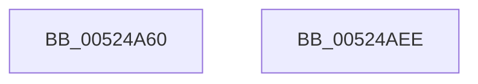

# SymCryptEckeyCreate

- RVA: `0x00524A60`–`0x00524AEF` (길이 `143` bytes)
- VA: `0x0000000140524A60`
- 실행 섹션: `.text`
- PDB 이름 있음: `예`; PDB Function 태그: `아니요`
- unwind 정보 RVA: `0x0005E6B4`
- 디코드: `41`개 명령, `143/143` bytes 표시
- 미해석 바이트: `0` (있으면 어셈블리에 `.byte`로 보존)

> 이 문서는 커널 이미지의 기계어와 PDB 기호를 분석해 생성했습니다. 4번과 5번은 함수 원형과 자료형을 바이너리 사용 방식에서 추정한 C 해석이며 원본 소스 복구 결과는 아닙니다.

## 1. Dependencies

- 직접 호출 지점: **5**; 고유 호출 대상: **5**
- 직접 호출자로 확인된 함수: **1**
- RIP 상대 이미지 참조: **0**

### Outgoing calls
- `0x00524A82` → [SymCryptEcurveDigitsofScalarMultiplier](SymCryptEcurveDigitsofScalarMultiplier_function_0052415C.md) (function, `0x0052415C`)
- `0x00524A8C` → [SymCryptSizeofEcpointFromCurve](SymCryptSizeofEcpointFromCurve_function_0052CEF0.md) (function, `0x0052CEF0`)
- `0x00524A95` → [SymCryptSizeofIntFromDigits](SymCryptSizeofIntFromDigits_function_00525D24.md) (function, `0x00525D24`)
- `0x00524AB2` → [SymCryptEcpointCreate](SymCryptEcpointCreate_function_0052C5A0.md) (function, `0x0052C5A0`)
- `0x00524AC7` → [SymCryptIntCreate](SymCryptIntCreate_function_0052556C.md) (function, `0x0052556C`)

### Direct callers
- [SymCryptEckeyAllocate](SymCryptEckeyAllocate_function_00524A0C.md) at `0x00524A3B`

### Static image references
- 디코드된 RIP-relative 메모리 참조가 없습니다.

## 2. Other-region calls and transfers

- 다른 실행 섹션으로 향하는 call: **0**
- 별도 외부 분기/꼬리 이동을 확인하지 못했습니다.

## 3. Assembly (complete function range)

```asm
00524A60  48 8B C4                        mov rax, rsp
00524A63  48 89 58 08                     mov qword ptr [rax + 8], rbx
00524A67  48 89 68 10                     mov qword ptr [rax + 0x10], rbp
00524A6B  48 89 70 18                     mov qword ptr [rax + 0x18], rsi
00524A6F  48 89 78 20                     mov qword ptr [rax + 0x20], rdi
00524A73  41 56                           push r14
00524A75  48 83 EC 20                     sub rsp, 0x20
00524A79  4C 8B F1                        mov r14, rcx
00524A7C  49 8B F0                        mov rsi, r8
00524A7F  49 8B C8                        mov rcx, r8
00524A82  E8 D5 F6 FF FF                  call 0x14052415c
00524A87  48 8B CE                        mov rcx, rsi
00524A8A  8B E8                           mov ebp, eax
00524A8C  E8 5F 84 00 00                  call 0x14052cef0
00524A91  8B CD                           mov ecx, ebp
00524A93  8B F8                           mov edi, eax
00524A95  E8 8A 12 00 00                  call 0x140525d24
00524A9A  41 83 26 00                     and dword ptr [r14], 0
00524A9E  49 8D 4E 40                     lea rcx, [r14 + 0x40]
00524AA2  4C 8B C6                        mov r8, rsi
00524AA5  8B D8                           mov ebx, eax
00524AA7  8B D7                           mov edx, edi
00524AA9  41 C6 46 04 00                  mov byte ptr [r14 + 4], 0
00524AAE  49 89 76 08                     mov qword ptr [r14 + 8], rsi
00524AB2  E8 E9 7A 00 00                  call 0x14052c5a0
00524AB7  49 8D 4E 40                     lea rcx, [r14 + 0x40]
00524ABB  49 89 46 10                     mov qword ptr [r14 + 0x10], rax
00524ABF  48 03 CF                        add rcx, rdi
00524AC2  44 8B C5                        mov r8d, ebp
00524AC5  8B D3                           mov edx, ebx
00524AC7  E8 A0 0A 00 00                  call 0x14052556c
00524ACC  48 8B 5C 24 30                  mov rbx, qword ptr [rsp + 0x30]
00524AD1  48 8B 6C 24 38                  mov rbp, qword ptr [rsp + 0x38]
00524AD6  48 8B 74 24 40                  mov rsi, qword ptr [rsp + 0x40]
00524ADB  48 8B 7C 24 48                  mov rdi, qword ptr [rsp + 0x48]
00524AE0  49 89 46 18                     mov qword ptr [r14 + 0x18], rax
00524AE4  49 8B C6                        mov rax, r14
00524AE7  48 83 C4 20                     add rsp, 0x20
00524AEB  41 5E                           pop r14
00524AED  C3                              ret
00524AEE  CC                              int3
```

## 4. C-style interpretation (structured pseudocode)

```c
__int64 __fastcall SymCryptEckeyCreate(__int64 a1, __int64 a2, __int64 a3)
{
    __int64 result;
    __int64 v_rsp;
    unsigned __int64 v_stack_p10;
    unsigned __int64 v_stack_p18;
    unsigned __int64 v_stack_p20;
    unsigned __int64 v_stack_p8;

    *(unsigned __int64 *)(v_rsp + 8) = v_rbx;
    *(unsigned __int64 *)(v_rsp + 16) = v_rbp;
    *(unsigned __int64 *)(v_rsp + 24) = v_rsi;
    *(unsigned __int64 *)(v_rsp + 32) = v_rdi;
    v_rsp = (v_rsp) - (32);
    result = SymCryptEcurveDigitsofScalarMultiplier(a3, a2, a3, a4);
    result = SymCryptSizeofEcpointFromCurve(a3, a2, a3, a4);
    result = SymCryptSizeofIntFromDigits((unsigned int)((unsigned int)((unsigned int)((unsigned int)(result)))), a2, a3, a4);
    *(unsigned __int8 *)(a1 + 4) = 0;
    *(unsigned __int64 *)(a1 + 8) = a3;
    result = SymCryptEcpointCreate(a1 + 64, (unsigned int)((unsigned int)((unsigned int)((unsigned int)(result)))), a3, a4);
    *(unsigned __int64 *)(a1 + 16) = result;
    a1 = (a1 + 64) + ((unsigned int)((unsigned int)(result)));
    result = SymCryptIntCreate(a1, (unsigned int)((unsigned int)((unsigned int)((unsigned int)(result)))), (unsigned int)((unsigned int)((unsigned int)((unsigned int)(result)))), a4);
    *(unsigned __int64 *)(a1 + 24) = result;
    v_rsp = (v_rsp) + (32);
    return a1;
}
```

## 5. (Beta) C Style

```c
void *SymCryptEckeyCreate(void *Arg1, int64_t Arg2, int64_t Arg3)
{
    uint8_t *arg1 = (uint8_t *)Arg1;

    int64_t result;
    int64_t local_rsp;
    uint64_t v_stack_p10;
    uint64_t v_stack_p18;
    uint64_t v_stack_p20;
    uint64_t v_stack_p8;

    *(uint64_t *)(local_rsp + 0x8) = local_rbx;
    *(uint64_t *)(local_rsp + 0x10) = local_rbp;
    *(uint64_t *)(local_rsp + 0x18) = local_rsi;
    *(uint64_t *)(local_rsp + 0x20) = local_rdi;
    local_rsp = (local_rsp) - (32);
    result = SymCryptEcurveDigitsofScalarMultiplier(Arg3, Arg2, Arg3, a4);
    result = SymCryptSizeofEcpointFromCurve(Arg3, Arg2, Arg3, a4);
    result = SymCryptSizeofIntFromDigits((uint32_t)((uint32_t)((uint32_t)((uint32_t)(result)))), Arg2, Arg3, a4);
    *(uint8_t *)(arg1 + 0x4) = 0;
    *(uint64_t *)(arg1 + 0x8) = Arg3;
    result = SymCryptEcpointCreate(Arg1 + 64, (uint32_t)((uint32_t)((uint32_t)((uint32_t)(result)))), Arg3, a4);
    *(uint64_t *)(arg1 + 0x10) = result;
    Arg1 = (Arg1 + 64) + ((uint32_t)((uint32_t)(result)));
    result = SymCryptIntCreate(Arg1, (uint32_t)((uint32_t)((uint32_t)((uint32_t)(result)))), (uint32_t)((uint32_t)((uint32_t)((uint32_t)(result)))), a4);
    *(uint64_t *)(arg1 + 0x18) = result;
    local_rsp = (local_rsp) + (32);
    return Arg1;
}
```

### 관측된 메모리 오프셋

구조체 형식이 확인되지 않은 접근은 인자 기준의 오프셋으로만 기록했습니다.

| 기준 인자 | 오프셋 표현 | 폭 (bit) | 접근 |
|---|---:|---:|---|
| `Arg1` | `+ 0x0` | `32` | `R/W` |
| `Arg1` | `+ 0x4` | `8` | `W` |
| `Arg1` | `+ 0x8` | `64` | `W` |
| `Arg1` | `+ 0x10` | `64` | `W` |
| `Arg1` | `+ 0x18` | `64` | `W` |
| `Arg1` | `+ 0x40` | `64` | `R` |

## 6. Execution-region graph

[열기: 2D/3D 그래프와 함수 탐색 컨트롤 패널](../../../control-panel.html?section=text&rva=0x00524A60&view=graph)

- 2D 그래프는 위에서 아래로 흐르고, 3D 그래프는 빈 공간을 드래그해 회전합니다. Shift+드래그는 이동, 휠은 확대·축소, 함수 노드 선택은 대상 보고서 이동입니다.

### Static fallback


