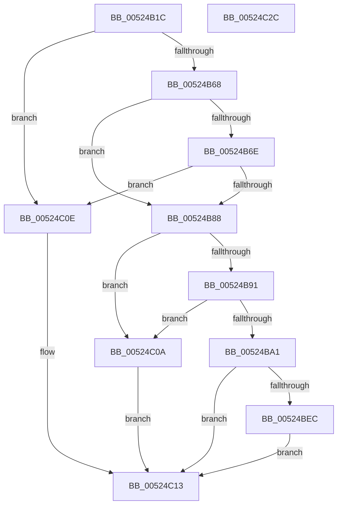

# SymCryptEckeyPerformPublicKeyValidation

- RVA: `0x00524B1C`–`0x00524C2D` (길이 `273` bytes)
- VA: `0x0000000140524B1C`
- 실행 섹션: `.text`
- PDB 이름 있음: `예`; PDB Function 태그: `아니요`
- unwind 정보 RVA: `0x00093E28`
- 디코드: `80`개 명령, `273/273` bytes 표시
- 미해석 바이트: `0` (있으면 어셈블리에 `.byte`로 보존)

> 이 문서는 커널 이미지의 기계어와 PDB 기호를 분석해 생성했습니다. 4번과 5번은 함수 원형과 자료형을 바이너리 사용 방식에서 추정한 C 해석이며 원본 소스 복구 결과는 아닙니다.

## 1. Dependencies

- 직접 호출 지점: **8**; 고유 호출 대상: **7**
- 직접 호출자로 확인된 함수: **1**
- RIP 상대 이미지 참조: **0**

### Outgoing calls
- `0x00524B46` → [SymCryptSizeofEcpointFromCurve](SymCryptSizeofEcpointFromCurve_function_0052CEF0.md) (function, `0x0052CEF0`)
- `0x00524B5B` → [SymCryptEcpointIsZero](SymCryptEcpointIsZero_function_0052D028.md) (function, `0x0052D028`)
- `0x00524B7B` → [SymCryptEcpointOnCurve](SymCryptEcpointOnCurve_function_0052D0F0.md) (function, `0x0052D0F0`)
- `0x00524B98` → [SymCryptIntIsEqualUint32](SymCryptIntIsEqualUint32_function_005256B0.md) (function, `0x005256B0`)
- `0x00524BAD` → [SymCryptEcpointCreate](SymCryptEcpointCreate_function_0052C5A0.md) (function, `0x0052C5A0`)
- `0x00524BC2` → [SymCryptIntFromModulus](SymCryptIntFromModulus_function_00525608.md) (function, `0x00525608`)
- `0x00524BE3` → [SymCryptEcpointScalarMul](SymCryptEcpointScalarMul_function_0052D11C.md) (function, `0x0052D11C`)
- `0x00524BF8` → [SymCryptEcpointIsZero](SymCryptEcpointIsZero_function_0052D028.md) (function, `0x0052D028`)

### Direct callers
- [SymCryptEckeySetValue](SymCryptEckeySetValue_function_00524C34.md) at `0x00524F8B`
- [SymCryptEckeySetValue](SymCryptEckeySetValue_function_00524C34.md) at `0x00525084`

### Static image references
- 디코드된 RIP-relative 메모리 참조가 없습니다.

## 2. Other-region calls and transfers

- 다른 실행 섹션으로 향하는 call: **0**
- 별도 외부 분기/꼬리 이동을 확인하지 못했습니다.

## 3. Assembly (complete function range)

```asm
00524B1C  48 89 5C 24 08                  mov qword ptr [rsp + 8], rbx
00524B21  48 89 6C 24 10                  mov qword ptr [rsp + 0x10], rbp
00524B26  48 89 74 24 18                  mov qword ptr [rsp + 0x18], rsi
00524B2B  57                              push rdi
00524B2C  41 56                           push r14
00524B2E  41 57                           push r15
00524B30  48 83 EC 40                     sub rsp, 0x40
00524B34  48 8B 79 08                     mov rdi, qword ptr [rcx + 8]
00524B38  4C 8B F1                        mov r14, rcx
00524B3B  48 8B CF                        mov rcx, rdi
00524B3E  49 8B E9                        mov rbp, r9
00524B41  49 8B F0                        mov rsi, r8
00524B44  8B DA                           mov ebx, edx
00524B46  E8 A5 83 00 00                  call 0x14052cef0
00524B4B  49 8B 56 10                     mov rdx, qword ptr [r14 + 0x10]
00524B4F  4C 8B CD                        mov r9, rbp
00524B52  4C 8B C6                        mov r8, rsi
00524B55  44 8B F8                        mov r15d, eax
00524B58  48 8B CF                        mov rcx, rdi
00524B5B  E8 C8 84 00 00                  call 0x14052d028
00524B60  85 C0                           test eax, eax
00524B62  0F 85 A6 00 00 00               jne 0x140524c0e
00524B68  83 7F 04 03                     cmp dword ptr [rdi + 4], 3
00524B6C  74 1A                           je 0x140524b88
00524B6E  49 8B 56 10                     mov rdx, qword ptr [r14 + 0x10]
00524B72  4C 8B CD                        mov r9, rbp
00524B75  4C 8B C6                        mov r8, rsi
00524B78  48 8B CF                        mov rcx, rdi
00524B7B  E8 70 85 00 00                  call 0x14052d0f0
00524B80  85 C0                           test eax, eax
00524B82  0F 84 86 00 00 00               je 0x140524c0e
00524B88  BA 01 00 00 00                  mov edx, 1
00524B8D  84 DA                           test dl, bl
00524B8F  74 79                           je 0x140524c0a
00524B91  48 8B 8F 90 02 00 00            mov rcx, qword ptr [rdi + 0x290]
00524B98  E8 13 0B 00 00                  call 0x1405256b0
00524B9D  85 C0                           test eax, eax
00524B9F  75 69                           jne 0x140524c0a
00524BA1  4C 8B C7                        mov r8, rdi
00524BA4  49 8B D7                        mov rdx, r15
00524BA7  48 8B CE                        mov rcx, rsi
00524BAA  49 8B DF                        mov rbx, r15
00524BAD  E8 EE 79 00 00                  call 0x14052c5a0
00524BB2  48 8B 8F 70 02 00 00            mov rcx, qword ptr [rdi + 0x270]
00524BB9  4C 8B F8                        mov r15, rax
00524BBC  48 03 F3                        add rsi, rbx
00524BBF  48 2B EB                        sub rbp, rbx
00524BC2  E8 41 0A 00 00                  call 0x140525608
00524BC7  4D 8B 46 10                     mov r8, qword ptr [r14 + 0x10]
00524BCB  48 8B D0                        mov rdx, rax
00524BCE  48 89 6C 24 30                  mov qword ptr [rsp + 0x30], rbp
00524BD3  45 33 C9                        xor r9d, r9d
00524BD6  48 89 74 24 28                  mov qword ptr [rsp + 0x28], rsi
00524BDB  48 8B CF                        mov rcx, rdi
00524BDE  4C 89 7C 24 20                  mov qword ptr [rsp + 0x20], r15
00524BE3  E8 34 85 00 00                  call 0x14052d11c
00524BE8  85 C0                           test eax, eax
00524BEA  75 27                           jne 0x140524c13
00524BEC  4C 8B CD                        mov r9, rbp
00524BEF  4C 8B C6                        mov r8, rsi
00524BF2  49 8B D7                        mov rdx, r15
00524BF5  48 8B CF                        mov rcx, rdi
00524BF8  E8 2B 84 00 00                  call 0x14052d028
00524BFD  F7 D8                           neg eax
00524BFF  1B C0                           sbb eax, eax
00524C01  F7 D0                           not eax
00524C03  25 0E 80 00 00                  and eax, 0x800e
00524C08  EB 09                           jmp 0x140524c13
00524C0A  33 C0                           xor eax, eax
00524C0C  EB 05                           jmp 0x140524c13
00524C0E  B8 0E 80 00 00                  mov eax, 0x800e
00524C13  48 8B 5C 24 60                  mov rbx, qword ptr [rsp + 0x60]
00524C18  48 8B 6C 24 68                  mov rbp, qword ptr [rsp + 0x68]
00524C1D  48 8B 74 24 70                  mov rsi, qword ptr [rsp + 0x70]
00524C22  48 83 C4 40                     add rsp, 0x40
00524C26  41 5F                           pop r15
00524C28  41 5E                           pop r14
00524C2A  5F                              pop rdi
00524C2B  C3                              ret
00524C2C  CC                              int3
```

## 4. C-style interpretation (structured pseudocode)

```c
__int64 __fastcall SymCryptEckeyPerformPublicKeyValidation(__int64 a1, int a2, __int64 a3, __int64 a4)
{
    __int64 result;
    __int64 v_rbp;
    __int64 v_rsi;
    __int64 v_rsp;
    unsigned __int64 v_stack_m28;
    unsigned __int64 v_stack_m30;
    unsigned __int64 v_stack_m38;
    unsigned __int64 v_stack_p10;
    unsigned __int64 v_stack_p18;
    unsigned __int64 v_stack_p8;

    v_stack_p8 = v_rbx;
    v_stack_p10 = v_rbp;
    v_stack_p18 = v_rsi;
    v_rsp = (v_rsp) - (64);
    result = SymCryptSizeofEcpointFromCurve(*(unsigned __int64 *)(a1 + 8), a2, a3, a4);
    result = SymCryptEcpointIsZero(*(unsigned __int64 *)(a1 + 8), *(unsigned __int64 *)(a1 + 16), a3, a4);
    if ((unsigned int)(result) != 0) goto loc_00524C0E;
    if ((*(unsigned int *)(*(unsigned __int64 *)(a1 + 8) + 4)) == 3) goto loc_00524B88;
    result = SymCryptEcpointOnCurve(*(unsigned __int64 *)(a1 + 8), *(unsigned __int64 *)(a1 + 16), a3, a4);
    if ((unsigned int)(result) == 0) goto loc_00524C0E;
loc_00524B88:
    if (((1) & ((unsigned __int8)((unsigned int)(a2)))) == 0) goto loc_00524C0A;
    result = SymCryptIntIsEqualUint32(*(unsigned __int64 *)(*(unsigned __int64 *)(a1 + 8) + 656), 1, a3, a4);
    if ((unsigned int)(result) != 0) goto loc_00524C0A;
    result = SymCryptEcpointCreate(a3, (unsigned int)((unsigned int)(result)), *(unsigned __int64 *)(a1 + 8), a4);
    v_rsi = (a3) + ((unsigned int)((unsigned int)(result)));
    v_rbp = (a4) - ((unsigned int)((unsigned int)(result)));
    result = SymCryptIntFromModulus(*(unsigned __int64 *)(*(unsigned __int64 *)(a1 + 8) + 624), (unsigned int)((unsigned int)(result)), *(unsigned __int64 *)(a1 + 8), a4);
    v_stack_m28 = v_rbp;
    a4 = 0;
    v_stack_m30 = v_rsi;
    v_stack_m38 = result;
    result = SymCryptEcpointScalarMul(*(unsigned __int64 *)(a1 + 8), result, *(unsigned __int64 *)(a1 + 16), a4);
    if ((unsigned int)(result) != 0) goto loc_00524C13;
    result = SymCryptEcpointIsZero(*(unsigned __int64 *)(a1 + 8), result, v_rsi, v_rbp);
    result = (unsigned int)(-(result));
    result = (unsigned int)(~(result));
    result = (unsigned int)((result) & (0x800EULL));
    goto loc_00524C13;
loc_00524C0A:
    result = 0;
    goto loc_00524C13;
loc_00524C0E:
loc_00524C13:
    v_rsp = (v_rsp) + (64);
    return (unsigned int)(0x800EULL);
}
```

## 5. (Beta) C Style

```c
int64_t SymCryptEckeyPerformPublicKeyValidation(void *Arg1, int32_t Arg2, int64_t Arg3, int64_t Arg4)
{
    uint8_t *arg1 = (uint8_t *)Arg1;

    int64_t result;
    int64_t local_rbp;
    int64_t local_rsi;
    int64_t local_rsp;
    uint64_t v_stack_m28;
    uint64_t v_stack_m30;
    uint64_t v_stack_m38;
    uint64_t v_stack_p10;
    uint64_t v_stack_p18;
    uint64_t v_stack_p8;

    v_stack_p8 = local_rbx;
    v_stack_p10 = local_rbp;
    v_stack_p18 = local_rsi;
    local_rsp = (local_rsp) - (64);
    result = SymCryptSizeofEcpointFromCurve(*(uint64_t *)(arg1 + 0x8), Arg2, Arg3, Arg4);
    result = SymCryptEcpointIsZero(*(uint64_t *)(arg1 + 0x8), *(uint64_t *)(arg1 + 0x10), Arg3, Arg4);
    if ((uint32_t)(result) != 0) goto loc_00524C0E;
    if ((*(uint32_t *)(*(uint64_t *)(arg1 + 0x8) + 0x4)) == 3) goto loc_00524B88;
    result = SymCryptEcpointOnCurve(*(uint64_t *)(arg1 + 0x8), *(uint64_t *)(arg1 + 0x10), Arg3, Arg4);
    if ((uint32_t)(result) == 0) goto loc_00524C0E;
loc_00524B88:
    if (((1) & ((uint8_t)((uint32_t)(Arg2)))) == 0) goto loc_00524C0A;
    result = SymCryptIntIsEqualUint32(*(uint64_t *)(*(uint64_t *)(arg1 + 0x8) + 0x290), 1, Arg3, Arg4);
    if ((uint32_t)(result) != 0) goto loc_00524C0A;
    result = SymCryptEcpointCreate(Arg3, (uint32_t)((uint32_t)(result)), *(uint64_t *)(arg1 + 0x8), Arg4);
    local_rsi = (Arg3) + ((uint32_t)((uint32_t)(result)));
    local_rbp = (Arg4) - ((uint32_t)((uint32_t)(result)));
    result = SymCryptIntFromModulus(*(uint64_t *)(*(uint64_t *)(arg1 + 0x8) + 0x270), (uint32_t)((uint32_t)(result)), *(uint64_t *)(arg1 + 0x8), Arg4);
    v_stack_m28 = local_rbp;
    Arg4 = 0;
    v_stack_m30 = local_rsi;
    v_stack_m38 = result;
    result = SymCryptEcpointScalarMul(*(uint64_t *)(arg1 + 0x8), result, *(uint64_t *)(arg1 + 0x10), Arg4);
    if ((uint32_t)(result) != 0) goto loc_00524C13;
    result = SymCryptEcpointIsZero(*(uint64_t *)(arg1 + 0x8), result, local_rsi, local_rbp);
    result = (uint32_t)(-(result));
    result = (uint32_t)(~(result));
    result = (uint32_t)((result) & (0x800EULL));
    goto loc_00524C13;
loc_00524C0A:
    result = 0;
    goto loc_00524C13;
loc_00524C0E:
loc_00524C13:
    local_rsp = (local_rsp) + (64);
    return (uint32_t)(0x800EULL);
}
```

### 관측된 메모리 오프셋

구조체 형식이 확인되지 않은 접근은 인자 기준의 오프셋으로만 기록했습니다.

| 기준 인자 | 오프셋 표현 | 폭 (bit) | 접근 |
|---|---:|---:|---|
| `Arg1` | `+ 0x8` | `64` | `R` |
| `Arg1` | `+ 0x10` | `64` | `R` |

## 6. Execution-region graph

[열기: 2D/3D 그래프와 함수 탐색 컨트롤 패널](../../../control-panel.html?section=text&rva=0x00524B1C&view=graph)

- 2D 그래프는 위에서 아래로 흐르고, 3D 그래프는 빈 공간을 드래그해 회전합니다. Shift+드래그는 이동, 휠은 확대·축소, 함수 노드 선택은 대상 보고서 이동입니다.

### Static fallback


