# SymCryptEckeySetValue

- RVA: `0x00524C34`–`0x005250F2` (길이 `1,214` bytes)
- VA: `0x0000000140524C34`
- 실행 섹션: `.text`
- PDB 이름 있음: `예`; PDB Function 태그: `아니요`
- unwind 정보 RVA: `0x000C326C`
- 디코드: `305`개 명령, `1,214/1,214` bytes 표시
- 미해석 바이트: `0` (있으면 어셈블리에 `.byte`로 보존)

> 이 문서는 커널 이미지의 기계어와 PDB 기호를 분석해 생성했습니다. 4번과 5번은 함수 원형과 자료형을 바이너리 사용 방식에서 추정한 C 해석이며 원본 소스 복구 결과는 아닙니다.

## 1. Dependencies

- 직접 호출 지점: **31**; 고유 호출 대상: **29**
- 직접 호출자로 확인된 함수: **3**
- RIP 상대 이미지 참조: **3**

### Outgoing calls
- `0x00524C79` → [SymCryptEcurveDigitsofScalarMultiplier](SymCryptEcurveDigitsofScalarMultiplier_function_0052415C.md) (function, `0x0052415C`)
- `0x00524CDE` → [SymCryptEcurveSizeofScalarMultiplier](SymCryptEcurveSizeofScalarMultiplier_function_00524808.md) (function, `0x00524808`)
- `0x00524CF3` → [SymCryptEcurveSizeofFieldElement](SymCryptEcurveSizeofFieldElement_function_005247FC.md) (function, `0x005247FC`)
- `0x00524D1C` → [SymCryptCallbackAlloc](../6A/SymCryptCallbackAlloc_function_006AC530.md) (function, `0x006AC530`)
- `0x00524D43` → [SymCryptSizeofIntFromDigits](SymCryptSizeofIntFromDigits_function_00525D24.md) (function, `0x00525D24`)
- `0x00524D54` → [SymCryptIntCreate](SymCryptIntCreate_function_0052556C.md) (function, `0x0052556C`)
- `0x00524D78` → [SymCryptModElementCreate](SymCryptModElementCreate_function_00525900.md) (function, `0x00525900`)
- `0x00524DB9` → [SymCryptIntSetValue](SymCryptIntSetValue_function_00525730.md) (function, `0x00525730`)
- `0x00524DDB` → [SymCryptIntFromModulus](SymCryptIntFromModulus_function_00525608.md) (function, `0x00525608`)
- `0x00524DE6` → [SymCryptIntIsLessThan](SymCryptIntIsLessThan_function_005256C8.md) (function, `0x005256C8`)
- `0x00524E0D` → [SymCryptIntGetBits](SymCryptIntGetBits_function_00525638.md) (function, `0x00525638`)
- `0x00524E25` → [SymCryptIntGetBits](SymCryptIntGetBits_function_00525638.md) (function, `0x00525638`)
- `0x00524E48` → [SymCryptIntDivPow2](SymCryptIntDivPow2_function_005255B0.md) (function, `0x005255B0`)
- `0x00524E76` → [SymCryptIntToModElement](SymCryptIntToModElement_function_00525804.md) (function, `0x00525804`)
- `0x00524E98` → [SymCryptModDivPow2](SymCryptModDivPow2_function_005258A4.md) (function, `0x005258A4`)
- `0x00524EB4` → [SymCryptModElementToInt](SymCryptModElementToInt_function_00525AB0.md) (function, `0x00525AB0`)
- `0x00524ECE` → [SymCryptDivisorFromModulus](SymCryptDivisorFromModulus_function_0052547C.md) (function, `0x0052547C`)
- `0x00524EE9` → [SymCryptIntDivMod](SymCryptIntDivMod_function_00525584.md) (function, `0x00525584`)
- `0x00524EF3` → [SymCryptIntIsEqualUint32](SymCryptIntIsEqualUint32_function_005256B0.md) (function, `0x005256B0`)
- `0x00524F07` → [SymCryptIntCopy](SymCryptIntCopy_function_0052553C.md) (function, `0x0052553C`)
- `0x00524F6A` → [SymCryptEcpointSetValue](SymCryptEcpointSetValue_function_0052C7E0.md) (function, `0x0052C7E0`)
- `0x00524F8B` → [SymCryptEckeyPerformPublicKeyValidation](SymCryptEckeyPerformPublicKeyValidation_function_00524B1C.md) (function, `0x00524B1C`)
- `0x00524FD2` → [SymCryptSizeofEcpointFromCurve](SymCryptSizeofEcpointFromCurve_function_0052CEF0.md) (function, `0x0052CEF0`)
- `0x00524FE1` → [SymCryptEcpointCreate](SymCryptEcpointCreate_function_0052C5A0.md) (function, `0x0052C5A0`)
- `0x00525029` → [SymCryptEcpointScalarMul](SymCryptEcpointScalarMul_function_0052D11C.md) (function, `0x0052D11C`)
- `0x00525064` → [SymCryptEcpointIsEqual](SymCryptEcpointIsEqual_function_0052CFE8.md) (function, `0x0052CFE8`)
- `0x00525084` → [SymCryptEckeyPerformPublicKeyValidation](SymCryptEckeyPerformPublicKeyValidation_function_00524B1C.md) (function, `0x00524B1C`)
- `0x005250A8` → [SymCryptEcDsaSelftest](SymCryptEcDsaSelftest_function_0052B45C.md) (function, `0x0052B45C`)
- `0x005250C9` → [SymCryptEcDhSecretAgreementSelftest](SymCryptEcDhSecretAgreementSelftest_function_0052B2C4.md) (function, `0x0052B2C4`)
- `0x005250E0` → [SymCryptWipe](../51/SymCryptWipe_function_0051F914.md) (function, `0x0051F914`)
- `0x005250E8` → [SymCryptCallbackFree](../6A/SymCryptCallbackFree_function_006AC568.md) (function, `0x006AC568`)

### Direct callers
- [SymCryptEcDhSecretAgreementSelftest](SymCryptEcDhSecretAgreementSelftest_function_0052B2C4.md) at `0x0052B35A`
- [SymCryptEcDhSecretAgreementSelftest](SymCryptEcDhSecretAgreementSelftest_function_0052B2C4.md) at `0x0052B3AF`
- [SymCryptEcDsaSelftest](SymCryptEcDsaSelftest_function_0052B45C.md) at `0x0052B53B`
- [HashpVerifyEcdsaSignature](../../page/84/HashpVerifyEcdsaSignature_function_00841AF4.md) at `0x00841BF1`

### Static image references
- `0x00524D00` → RVA `0x00020870` (`.rdata`; read)
- `0x0052509E` → RVA `0x00E0F394` (`.data`; read)
- `0x005250AD` → RVA `0x00E0F394` (`.data`; read/write)

## 2. Other-region calls and transfers

- 다른 실행 섹션으로 향하는 call: **0**
- 별도 외부 분기/꼬리 이동을 확인하지 못했습니다.

## 3. Assembly (complete function range)

```asm
00524C34  48 8B C4                        mov rax, rsp
00524C37  4C 89 48 20                     mov qword ptr [rax + 0x20], r9
00524C3B  4C 89 40 18                     mov qword ptr [rax + 0x18], r8
00524C3F  48 89 50 10                     mov qword ptr [rax + 0x10], rdx
00524C43  48 89 48 08                     mov qword ptr [rax + 8], rcx
00524C47  53                              push rbx
00524C48  55                              push rbp
00524C49  56                              push rsi
00524C4A  57                              push rdi
00524C4B  41 54                           push r12
00524C4D  41 55                           push r13
00524C4F  41 56                           push r14
00524C51  41 57                           push r15
00524C53  48 83 EC 68                     sub rsp, 0x68
00524C57  4C 8B B4 24 E8 00 00 00         mov r14, qword ptr [rsp + 0xe8]
00524C5F  49 8B D9                        mov rbx, r9
00524C62  4D 8B E0                        mov r12, r8
00524C65  48 8B FA                        mov rdi, rdx
00524C68  49 8B 76 08                     mov rsi, qword ptr [r14 + 8]
00524C6C  48 8B CE                        mov rcx, rsi
00524C6F  8B 46 24                        mov eax, dword ptr [rsi + 0x24]
00524C72  89 84 24 E8 00 00 00            mov dword ptr [rsp + 0xe8], eax
00524C79  E8 DE F4 FF FF                  call 0x14052415c
00524C7E  8B AC 24 E0 00 00 00            mov ebp, dword ptr [rsp + 0xe0]
00524C85  89 44 24 50                     mov dword ptr [rsp + 0x50], eax
00524C89  F7 C5 FF CC FF FF               test ebp, 0xffffccff
00524C8F  75 30                           jne 0x140524cc1
00524C91  F7 C5 00 30 00 00               test ebp, 0x3000
00524C97  74 28                           je 0x140524cc1
00524C99  8B CD                           mov ecx, ebp
00524C9B  81 E1 00 03 00 00               and ecx, 0x300
00524CA1  81 F9 00 02 00 00               cmp ecx, 0x200
00524CA7  74 18                           je 0x140524cc1
00524CA9  44 8B ED                        mov r13d, ebp
00524CAC  41 C1 ED 08                     shr r13d, 8
00524CB0  41 F7 D5                        not r13d
00524CB3  41 83 E5 01                     and r13d, 1
00524CB7  48 85 FF                        test rdi, rdi
00524CBA  75 1E                           jne 0x140524cda
00524CBC  48 85 DB                        test rbx, rbx
00524CBF  75 2E                           jne 0x140524cef
00524CC1  BB 0E 80 00 00                  mov ebx, 0x800e
00524CC6  8B C3                           mov eax, ebx
00524CC8  48 83 C4 68                     add rsp, 0x68
00524CCC  41 5F                           pop r15
00524CCE  41 5E                           pop r14
00524CD0  41 5D                           pop r13
00524CD2  41 5C                           pop r12
00524CD4  5F                              pop rdi
00524CD5  5E                              pop rsi
00524CD6  5D                              pop rbp
00524CD7  5B                              pop rbx
00524CD8  C3                              ret
00524CD9  CC                              int3
00524CDA  49 8B 4E 08                     mov rcx, qword ptr [r14 + 8]
00524CDE  E8 25 FB FF FF                  call 0x140524808
00524CE3  8B C0                           mov eax, eax
00524CE5  48 3B F8                        cmp rdi, rax
00524CE8  75 D7                           jne 0x140524cc1
00524CEA  48 85 DB                        test rbx, rbx
00524CED  74 21                           je 0x140524d10
00524CEF  49 8B 4E 08                     mov rcx, qword ptr [r14 + 8]
00524CF3  E8 04 FB FF FF                  call 0x1405247fc
00524CF8  48 63 8C 24 D8 00 00 00         movsxd rcx, dword ptr [rsp + 0xd8]
00524D00  48 8D 15 69 BB AF FF            lea rdx, [rip - 0x504497]
00524D07  0F AF 04 8A                     imul eax, dword ptr [rdx + rcx*4]
00524D0B  48 3B D8                        cmp rbx, rax
00524D0E  75 B1                           jne 0x140524cc1
00524D10  8B 7E 3C                        mov edi, dword ptr [rsi + 0x3c]
00524D13  8B CF                           mov ecx, edi
00524D15  89 BC 24 E0 00 00 00            mov dword ptr [rsp + 0xe0], edi
00524D1C  E8 0F 78 18 00                  call 0x1406ac530
00524D21  4C 8B F8                        mov r15, rax
00524D24  48 85 C0                        test rax, rax
00524D27  75 07                           jne 0x140524d30
00524D29  BB 0F 80 00 00                  mov ebx, 0x800f
00524D2E  EB 96                           jmp 0x140524cc6
00524D30  48 83 BC 24 B0 00 00 00 00      cmp qword ptr [rsp + 0xb0], 0
00524D39  0F 84 E9 01 00 00               je 0x140524f28
00524D3F  8B 4C 24 50                     mov ecx, dword ptr [rsp + 0x50]
00524D43  E8 DC 0F 00 00                  call 0x140525d24
00524D48  44 8B 44 24 50                  mov r8d, dword ptr [rsp + 0x50]
00524D4D  49 8B CF                        mov rcx, r15
00524D50  8B D0                           mov edx, eax
00524D52  8B F8                           mov edi, eax
00524D54  E8 13 08 00 00                  call 0x14052556c
00524D59  8B 9C 24 E8 00 00 00            mov ebx, dword ptr [rsp + 0xe8]
00524D60  4C 8B E0                        mov r12, rax
00524D63  4C 8B 86 70 02 00 00            mov r8, qword ptr [rsi + 0x270]
00524D6A  4A 8D 04 3F                     lea rax, [rdi + r15]
00524D6E  48 8B C8                        mov rcx, rax
00524D71  48 89 44 24 50                  mov qword ptr [rsp + 0x50], rax
00524D76  8B D3                           mov edx, ebx
00524D78  E8 83 0B 00 00                  call 0x140525900
00524D7D  44 8B 84 24 D0 00 00 00         mov r8d, dword ptr [rsp + 0xd0]
00524D85  4D 8B CC                        mov r9, r12
00524D88  48 8B 94 24 B8 00 00 00         mov rdx, qword ptr [rsp + 0xb8]
00524D90  48 8B 8C 24 B0 00 00 00         mov rcx, qword ptr [rsp + 0xb0]
00524D98  48 01 5C 24 50                  add qword ptr [rsp + 0x50], rbx
00524D9D  48 89 44 24 58                  mov qword ptr [rsp + 0x58], rax
00524DA2  8B 84 24 E0 00 00 00            mov eax, dword ptr [rsp + 0xe0]
00524DA9  2B 84 24 E8 00 00 00            sub eax, dword ptr [rsp + 0xe8]
00524DB0  2B C7                           sub eax, edi
00524DB2  89 84 24 E8 00 00 00            mov dword ptr [rsp + 0xe8], eax
00524DB9  E8 72 09 00 00                  call 0x140525730
00524DBE  8B D8                           mov ebx, eax
00524DC0  85 C0                           test eax, eax
00524DC2  0F 85 0E 03 00 00               jne 0x1405250d6
00524DC8  0F BA E5 09                     bt ebp, 9
00524DCC  72 61                           jb 0x140524e2f
00524DCE  83 7E 44 01                     cmp dword ptr [rsi + 0x44], 1
00524DD2  75 25                           jne 0x140524df9
00524DD4  48 8B 8E 70 02 00 00            mov rcx, qword ptr [rsi + 0x270]
00524DDB  E8 28 08 00 00                  call 0x140525608
00524DE0  48 8B D0                        mov rdx, rax
00524DE3  49 8B CC                        mov rcx, r12
00524DE6  E8 DD 08 00 00                  call 0x1405256c8
00524DEB  85 C0                           test eax, eax
00524DED  75 0A                           jne 0x140524df9
00524DEF  BB 0E 80 00 00                  mov ebx, 0x800e
00524DF4  E9 DD 02 00 00                  jmp 0x1405250d6
00524DF9  44 8B 46 40                     mov r8d, dword ptr [rsi + 0x40]
00524DFD  45 85 C0                        test r8d, r8d
00524E00  74 14                           je 0x140524e16
00524E02  83 7E 44 03                     cmp dword ptr [rsi + 0x44], 3
00524E06  75 0E                           jne 0x140524e16
00524E08  33 D2                           xor edx, edx
00524E0A  49 8B CC                        mov rcx, r12
00524E0D  E8 26 08 00 00                  call 0x140525638
00524E12  85 C0                           test eax, eax
00524E14  75 D9                           jne 0x140524def
00524E16  44 8B 46 48                     mov r8d, dword ptr [rsi + 0x48]
00524E1A  45 85 C0                        test r8d, r8d
00524E1D  74 10                           je 0x140524e2f
00524E1F  8B 56 4C                        mov edx, dword ptr [rsi + 0x4c]
00524E22  49 8B CC                        mov rcx, r12
00524E25  E8 0E 08 00 00                  call 0x140525638
00524E2A  3B 46 50                        cmp eax, dword ptr [rsi + 0x50]
00524E2D  75 C0                           jne 0x140524def
00524E2F  8B 46 40                        mov eax, dword ptr [rsi + 0x40]
00524E32  85 C0                           test eax, eax
00524E34  0F 84 81 00 00 00               je 0x140524ebb
00524E3A  83 7E 44 03                     cmp dword ptr [rsi + 0x44], 3
00524E3E  75 0D                           jne 0x140524e4d
00524E40  8B D0                           mov edx, eax
00524E42  4D 8B C4                        mov r8, r12
00524E45  49 8B CC                        mov rcx, r12
00524E48  E8 63 07 00 00                  call 0x1405255b0
00524E4D  83 7E 44 01                     cmp dword ptr [rsi + 0x44], 1
00524E51  48 8B 7C 24 50                  mov rdi, qword ptr [rsp + 0x50]
00524E56  75 68                           jne 0x140524ec0
00524E58  8B 9C 24 E8 00 00 00            mov ebx, dword ptr [rsp + 0xe8]
00524E5F  4C 8B CF                        mov r9, rdi
00524E62  4C 8B 44 24 58                  mov r8, qword ptr [rsp + 0x58]
00524E67  49 8B CC                        mov rcx, r12
00524E6A  48 8B 96 70 02 00 00            mov rdx, qword ptr [rsi + 0x270]
00524E71  48 89 5C 24 20                  mov qword ptr [rsp + 0x20], rbx
00524E76  E8 89 09 00 00                  call 0x140525804
00524E7B  4C 8B 4C 24 58                  mov r9, qword ptr [rsp + 0x58]
00524E80  44 8B 46 40                     mov r8d, dword ptr [rsi + 0x40]
00524E84  49 8B D1                        mov rdx, r9
00524E87  48 8B 8E 70 02 00 00            mov rcx, qword ptr [rsi + 0x270]
00524E8E  48 89 5C 24 28                  mov qword ptr [rsp + 0x28], rbx
00524E93  48 89 7C 24 20                  mov qword ptr [rsp + 0x20], rdi
00524E98  E8 07 0A 00 00                  call 0x1405258a4
00524E9D  48 8B 54 24 58                  mov rdx, qword ptr [rsp + 0x58]
00524EA2  4C 8B CF                        mov r9, rdi
00524EA5  48 8B 8E 70 02 00 00            mov rcx, qword ptr [rsi + 0x270]
00524EAC  4D 8B C4                        mov r8, r12
00524EAF  48 89 5C 24 20                  mov qword ptr [rsp + 0x20], rbx
00524EB4  E8 F7 0B 00 00                  call 0x140525ab0
00524EB9  EB 05                           jmp 0x140524ec0
00524EBB  48 8B 7C 24 50                  mov rdi, qword ptr [rsp + 0x50]
00524EC0  48 8B 8E 70 02 00 00            mov rcx, qword ptr [rsi + 0x270]
00524EC7  8B 9C 24 E8 00 00 00            mov ebx, dword ptr [rsp + 0xe8]
00524ECE  E8 A9 05 00 00                  call 0x14052547c
00524ED3  48 8B D0                        mov rdx, rax
00524ED6  48 89 5C 24 28                  mov qword ptr [rsp + 0x28], rbx
00524EDB  4D 8B CC                        mov r9, r12
00524EDE  48 89 7C 24 20                  mov qword ptr [rsp + 0x20], rdi
00524EE3  45 33 C0                        xor r8d, r8d
00524EE6  49 8B CC                        mov rcx, r12
00524EE9  E8 96 06 00 00                  call 0x140525584
00524EEE  33 D2                           xor edx, edx
00524EF0  49 8B CC                        mov rcx, r12
00524EF3  E8 B8 07 00 00                  call 0x1405256b0
00524EF8  85 C0                           test eax, eax
00524EFA  0F 85 EF FE FF FF               jne 0x140524def
00524F00  49 8B 56 18                     mov rdx, qword ptr [r14 + 0x18]
00524F04  49 8B CC                        mov rcx, r12
00524F07  E8 30 06 00 00                  call 0x14052553c
00524F0C  8B BC 24 E0 00 00 00            mov edi, dword ptr [rsp + 0xe0]
00524F13  48 8B 9C 24 C8 00 00 00         mov rbx, qword ptr [rsp + 0xc8]
00524F1B  4C 8B A4 24 C0 00 00 00         mov r12, qword ptr [rsp + 0xc0]
00524F23  41 C6 46 04 01                  mov byte ptr [r14 + 4], 1
00524F28  4D 85 E4                        test r12, r12
00524F2B  0F 84 82 00 00 00               je 0x140524fb3
00524F31  44 8B 8C 24 D0 00 00 00         mov r9d, dword ptr [rsp + 0xd0]
00524F39  4C 8B C3                        mov r8, rbx
00524F3C  8B C7                           mov eax, edi
00524F3E  49 8B D4                        mov rdx, r12
00524F41  48 89 44 24 40                  mov qword ptr [rsp + 0x40], rax
00524F46  48 8B CE                        mov rcx, rsi
00524F49  49 8B 46 10                     mov rax, qword ptr [r14 + 0x10]
00524F4D  4C 89 7C 24 38                  mov qword ptr [rsp + 0x38], r15
00524F52  C7 44 24 30 01 00 00 00         mov dword ptr [rsp + 0x30], 1
00524F5A  48 89 44 24 28                  mov qword ptr [rsp + 0x28], rax
00524F5F  8B 84 24 D8 00 00 00            mov eax, dword ptr [rsp + 0xd8]
00524F66  89 44 24 20                     mov dword ptr [rsp + 0x20], eax
00524F6A  E8 71 78 00 00                  call 0x14052c7e0
00524F6F  8B D8                           mov ebx, eax
00524F71  85 C0                           test eax, eax
00524F73  0F 85 5D 01 00 00               jne 0x1405250d6
00524F79  0F BA E5 09                     bt ebp, 9
00524F7D  72 1B                           jb 0x140524f9a
00524F7F  44 8B CF                        mov r9d, edi
00524F82  4D 8B C7                        mov r8, r15
00524F85  41 8B D5                        mov edx, r13d
00524F88  49 8B CE                        mov rcx, r14
00524F8B  E8 8C FB FF FF                  call 0x140524b1c
00524F90  8B D8                           mov ebx, eax
00524F92  85 C0                           test eax, eax
00524F94  0F 85 3C 01 00 00               jne 0x1405250d6
00524F9A  0F BA E5 08                     bt ebp, 8
00524F9E  0F 82 EB 00 00 00               jb 0x14052508f
00524FA4  48 83 BC 24 B0 00 00 00 00      cmp qword ptr [rsp + 0xb0], 0
00524FAD  0F 84 DC 00 00 00               je 0x14052508f
00524FB3  48 83 BC 24 C0 00 00 00 00      cmp qword ptr [rsp + 0xc0], 0
00524FBC  4D 8B E7                        mov r12, r15
00524FBF  49 8B 4E 10                     mov rcx, qword ptr [r14 + 0x10]
00524FC3  48 89 8C 24 E8 00 00 00         mov qword ptr [rsp + 0xe8], rcx
00524FCB  8B C7                           mov eax, edi
00524FCD  74 36                           je 0x140525005
00524FCF  48 8B CE                        mov rcx, rsi
00524FD2  E8 19 7F 00 00                  call 0x14052cef0
00524FD7  4C 8B C6                        mov r8, rsi
00524FDA  8B D0                           mov edx, eax
00524FDC  49 8B CF                        mov rcx, r15
00524FDF  8B F8                           mov edi, eax
00524FE1  E8 BA 75 00 00                  call 0x14052c5a0
00524FE6  48 8B C8                        mov rcx, rax
00524FE9  48 89 84 24 E8 00 00 00         mov qword ptr [rsp + 0xe8], rax
00524FF1  8B 84 24 E0 00 00 00            mov eax, dword ptr [rsp + 0xe0]
00524FF8  4E 8D 24 3F                     lea r12, [rdi + r15]
00524FFC  2B C7                           sub eax, edi
00524FFE  8B BC 24 E0 00 00 00            mov edi, dword ptr [rsp + 0xe0]
00525005  49 8B 56 18                     mov rdx, qword ptr [r14 + 0x18]
00525009  41 B9 20 00 00 00               mov r9d, 0x20
0052500F  48 89 44 24 30                  mov qword ptr [rsp + 0x30], rax
00525014  45 33 C0                        xor r8d, r8d
00525017  4C 89 64 24 28                  mov qword ptr [rsp + 0x28], r12
0052501C  48 89 4C 24 20                  mov qword ptr [rsp + 0x20], rcx
00525021  48 8B CE                        mov rcx, rsi
00525024  48 89 44 24 58                  mov qword ptr [rsp + 0x58], rax
00525029  E8 EE 80 00 00                  call 0x14052d11c
0052502E  8B D8                           mov ebx, eax
00525030  85 C0                           test eax, eax
00525032  0F 85 9E 00 00 00               jne 0x1405250d6
00525038  48 83 BC 24 C0 00 00 00 00      cmp qword ptr [rsp + 0xc0], 0
00525041  74 2F                           je 0x140525072
00525043  48 8B 44 24 58                  mov rax, qword ptr [rsp + 0x58]
00525048  45 33 C9                        xor r9d, r9d
0052504B  4D 8B 46 10                     mov r8, qword ptr [r14 + 0x10]
0052504F  48 8B CE                        mov rcx, rsi
00525052  48 8B 94 24 E8 00 00 00         mov rdx, qword ptr [rsp + 0xe8]
0052505A  48 89 44 24 28                  mov qword ptr [rsp + 0x28], rax
0052505F  4C 89 64 24 20                  mov qword ptr [rsp + 0x20], r12
00525064  E8 7F 7F 00 00                  call 0x14052cfe8
00525069  85 C0                           test eax, eax
0052506B  75 22                           jne 0x14052508f
0052506D  E9 7D FD FF FF                  jmp 0x140524def
00525072  0F BA E5 09                     bt ebp, 9
00525076  72 17                           jb 0x14052508f
00525078  44 8B CF                        mov r9d, edi
0052507B  4D 8B C7                        mov r8, r15
0052507E  41 8B D5                        mov edx, r13d
00525081  49 8B CE                        mov rcx, r14
00525084  E8 93 FA FF FF                  call 0x140524b1c
00525089  8B D8                           mov ebx, eax
0052508B  85 C0                           test eax, eax
0052508D  75 47                           jne 0x1405250d6
0052508F  41 89 2E                        mov dword ptr [r14], ebp
00525092  0F BA E5 08                     bt ebp, 8
00525096  72 3E                           jb 0x1405250d6
00525098  0F BA E5 0C                     bt ebp, 0xc
0052509C  73 1B                           jae 0x1405250b9
0052509E  8B 05 F0 A2 8E 00               mov eax, dword ptr [rip + 0x8ea2f0]
005250A4  A8 04                           test al, 4
005250A6  75 0D                           jne 0x1405250b5
005250A8  E8 AF 63 00 00                  call 0x14052b45c
005250AD  F0 83 0D DF A2 8E 00 04         lock or dword ptr [rip + 0x8ea2df], 4
005250B5  41 83 0E 01                     or dword ptr [r14], 1
005250B9  0F BA E5 0D                     bt ebp, 0xd
005250BD  73 17                           jae 0x1405250d6
005250BF  8B 05 CF A2 8E 00               mov eax, dword ptr [rip + 0x8ea2cf]
005250C5  A8 20                           test al, 0x20
005250C7  75 0D                           jne 0x1405250d6
005250C9  E8 F6 61 00 00                  call 0x14052b2c4
005250CE  F0 83 0D BE A2 8E 00 20         lock or dword ptr [rip + 0x8ea2be], 0x20
005250D6  8B 94 24 E0 00 00 00            mov edx, dword ptr [rsp + 0xe0]
005250DD  49 8B CF                        mov rcx, r15
005250E0  E8 2F A8 FF FF                  call 0x14051f914
005250E5  49 8B CF                        mov rcx, r15
005250E8  E8 7B 74 18 00                  call 0x1406ac568
005250ED  E9 D4 FB FF FF                  jmp 0x140524cc6
```

## 4. C-style interpretation (structured pseudocode)

```c
__int64 __fastcall SymCryptEckeySetValue(__int64 a1, __int64 a2, __int64 a3, __int64 a4, unsigned int a5, unsigned int a6, unsigned int a7, unsigned int a8)
{
    __int64 result;
    __int64 v_r12;
    __int64 v_r13;
    __int64 v_rdi;
    __int64 v_rsp;
    unsigned int v_stack_m58;
    unsigned __int64 v_stack_p20;
    unsigned __int64 v_stack_p28;
    unsigned int v_stack_p30;
    unsigned __int64 v_stack_p38;
    unsigned int v_stack_p40;
    unsigned int v_stack_p50;
    unsigned __int64 v_stack_p58;
    unsigned __int64 v_stack_pB0;
    unsigned __int64 v_stack_pB8;
    unsigned __int64 v_stack_pC0;
    unsigned __int64 v_stack_pC8;
    unsigned int v_stack_pE0;
    unsigned int v_stack_pE8;

    *(unsigned __int64 *)(v_rsp + 32) = a4;
    *(unsigned __int64 *)(v_rsp + 24) = a3;
    *(unsigned __int64 *)(v_rsp + 16) = a2;
    *(unsigned __int64 *)(v_rsp + 8) = a1;
    v_rsp = (v_rsp) - (104);
    v_stack_p40 = (unsigned int)((unsigned int)(*(unsigned int *)(*(unsigned __int64 *)(a8 + 8) + 36)));
    result = SymCryptEcurveDigitsofScalarMultiplier(*(unsigned __int64 *)(a8 + 8), a2, a3, a4);
    v_stack_m58 = (unsigned int)(result);
    if ((((unsigned int)((unsigned int)(a7))) & (0xFFFFCCFFULL)) != 0) goto loc_00524CC1;
    if ((((unsigned int)((unsigned int)(a7))) & (0x3000ULL)) == 0) goto loc_00524CC1;
    a1 = (unsigned int)(((unsigned int)((unsigned int)((unsigned int)(a7)))) & (768));
    if (((unsigned int)(a1)) == 512) goto loc_00524CC1;
    v_r13 = (unsigned int)(((unsigned int)((unsigned int)((unsigned int)(a7)))) >> (8));
    v_r13 = (unsigned int)(~(v_r13));
    v_r13 = (unsigned int)((v_r13) & (1));
    if (a2 != 0) goto loc_00524CDA;
    if (a4 != 0) goto loc_00524CEF;
loc_00524CC1:
loc_00524CC6:
    v_rsp = (v_rsp) + (104);
    return (unsigned int)((unsigned int)((unsigned int)(0x800EULL)));
loc_00524CDA:
    result = SymCryptEcurveSizeofScalarMultiplier(*(unsigned __int64 *)(a8 + 8), a2, a3, a4);
    if (a2 != ((unsigned int)((unsigned int)(result)))) goto loc_00524CC1;
    if ((unsigned int)(0x800EULL) == 0) goto loc_00524D10;
loc_00524CEF:
    result = SymCryptEcurveSizeofFieldElement(*(unsigned __int64 *)(a8 + 8), a2, a3, a4);
    result = (unsigned int)((result) * (*(unsigned int *)(v_rip - 5260439 + (int)(a6) * 4)));
    if (((unsigned int)(0x800EULL)) != result) goto loc_00524CC1;
loc_00524D10:
    v_stack_pE0 = (unsigned int)((unsigned int)(*(unsigned int *)(*(unsigned __int64 *)(a8 + 8) + 60)));
    result = SymCryptCallbackAlloc((unsigned int)((unsigned int)((unsigned int)(*(unsigned int *)(*(unsigned __int64 *)(a8 + 8) + 60)))), v_rip - 5260439, a3, a4);
    if (result != 0) goto loc_00524D30;
    goto loc_00524CC6;
loc_00524D30:
    if (v_stack_pB0 == 0) goto loc_00524F28;
    result = SymCryptSizeofIntFromDigits((unsigned int)(v_stack_p50), v_rip - 5260439, a3, a4);
    result = SymCryptIntCreate(result, (unsigned int)((unsigned int)(result)), (unsigned int)(v_stack_p50), a4);
    v_stack_p50 = (unsigned int)((unsigned int)(result)) + result * 1;
    result = SymCryptModElementCreate((unsigned int)((unsigned int)(result)) + result * 1, (unsigned int)((unsigned int)((unsigned int)(a8))), *(unsigned __int64 *)(*(unsigned __int64 *)(a8 + 8) + 624), a4);
    v_stack_p58 = result;
    result = (unsigned int)(((unsigned int)(a7)) - (a8));
    result = (unsigned int)((result) - ((unsigned int)((unsigned int)((unsigned int)(result)))));
    v_stack_pE8 = (unsigned int)(result);
    result = SymCryptIntSetValue(v_stack_pB0, v_stack_pB8, (unsigned int)(a5), result);
    if ((unsigned int)(result) != 0) goto loc_005250D6;
    if (condition_is_below) goto loc_00524E2F;
    if ((*(unsigned int *)(*(unsigned __int64 *)(a8 + 8) + 68)) != 1) goto loc_00524DF9;
    result = SymCryptIntFromModulus(*(unsigned __int64 *)(*(unsigned __int64 *)(a8 + 8) + 624), v_stack_pB8, (unsigned int)(a5), result);
    result = SymCryptIntIsLessThan(result, result, (unsigned int)(a5), result);
    if ((unsigned int)(result) != 0) goto loc_00524DF9;
loc_00524DEF:
    goto loc_005250D6;
loc_00524DF9:
    if ((unsigned int)((unsigned int)(*(unsigned int *)(*(unsigned __int64 *)(a8 + 8) + 64))) == 0) goto loc_00524E16;
    if ((*(unsigned int *)(*(unsigned __int64 *)(a8 + 8) + 68)) != 3) goto loc_00524E16;
    a2 = 0;
    result = SymCryptIntGetBits(result, a2, (unsigned int)(*(unsigned int *)(*(unsigned __int64 *)(a8 + 8) + 64)), result);
    if ((unsigned int)(result) != 0) goto loc_00524DEF;
loc_00524E16:
    if ((unsigned int)((unsigned int)(*(unsigned int *)(*(unsigned __int64 *)(a8 + 8) + 72))) == 0) goto loc_00524E2F;
    result = SymCryptIntGetBits(result, (unsigned int)(*(unsigned int *)(*(unsigned __int64 *)(a8 + 8) + 76)), (unsigned int)(*(unsigned int *)(*(unsigned __int64 *)(a8 + 8) + 72)), result);
    if (((unsigned int)(result)) != (*(unsigned int *)(*(unsigned __int64 *)(a8 + 8) + 80))) goto loc_00524DEF;
loc_00524E2F:
    if ((unsigned int)((unsigned int)(*(unsigned int *)(*(unsigned __int64 *)(a8 + 8) + 64))) == 0) goto loc_00524EBB;
    result = (unsigned int)(*(unsigned int *)(*(unsigned __int64 *)(a8 + 8) + 64));
    if ((*(unsigned int *)(*(unsigned __int64 *)(a8 + 8) + 68)) == 3) {
        a2 = (unsigned int)((unsigned int)(*(unsigned int *)(*(unsigned __int64 *)(a8 + 8) + 64)));
        a3 = result;
        a1 = result;
        result = SymCryptIntDivPow2(a1, a2, a3, result);
    }
    if ((*(unsigned int *)(*(unsigned __int64 *)(a8 + 8) + 68)) != 1) goto loc_00524EC0;
    v_stack_p20 = (unsigned int)(a8);
    result = SymCryptIntToModElement(result, *(unsigned __int64 *)(*(unsigned __int64 *)(a8 + 8) + 624), v_stack_p58, v_stack_p50);
    v_stack_p28 = (unsigned int)(a8);
    v_stack_p20 = v_stack_p50;
    result = SymCryptModDivPow2(*(unsigned __int64 *)(*(unsigned __int64 *)(a8 + 8) + 624), v_stack_p58, (unsigned int)(*(unsigned int *)(*(unsigned __int64 *)(a8 + 8) + 64)), v_stack_p58);
    v_stack_p20 = (unsigned int)(a8);
    result = SymCryptModElementToInt(*(unsigned __int64 *)(*(unsigned __int64 *)(a8 + 8) + 624), v_stack_p58, result, v_stack_p50);
    goto loc_00524EC0;
loc_00524EBB:
loc_00524EC0:
    result = SymCryptDivisorFromModulus(*(unsigned __int64 *)(*(unsigned __int64 *)(a8 + 8) + 624), v_stack_p58, result, v_stack_p50);
    v_stack_p28 = (unsigned int)(a8);
    v_stack_p20 = v_stack_p50;
    a3 = 0;
    result = SymCryptIntDivMod(result, result, a3, result);
    a2 = 0;
    result = SymCryptIntIsEqualUint32(result, a2, a3, result);
    if ((unsigned int)(result) != 0) goto loc_00524DEF;
    result = SymCryptIntCopy(result, *(unsigned __int64 *)(a8 + 24), a3, result);
    *(unsigned __int8 *)(a8 + 4) = 1;
loc_00524F28:
    if (v_stack_pC0 == 0) goto loc_00524FB3;
    v_stack_p40 = (unsigned int)((unsigned int)((unsigned int)(a7)));
    v_stack_p38 = result;
    v_stack_p30 = 1;
    v_stack_p28 = *(unsigned __int64 *)(a8 + 16);
    v_stack_p20 = (unsigned int)((unsigned int)(a6));
    result = SymCryptEcpointSetValue(*(unsigned __int64 *)(a8 + 8), v_stack_pC0, v_stack_pC8, (unsigned int)(a5));
    if ((unsigned int)(result) != 0) goto loc_005250D6;
    if (condition_is_below) goto loc_00524F9A;
    result = SymCryptEckeyPerformPublicKeyValidation(a8, (unsigned int)((unsigned int)(v_r13)), result, (unsigned int)((unsigned int)((unsigned int)(a7))));
    if ((unsigned int)(result) != 0) goto loc_005250D6;
loc_00524F9A:
    if (condition_is_below) goto loc_0052508F;
    if (v_stack_pB0 == 0) goto loc_0052508F;
loc_00524FB3:
    v_stack_pE8 = *(unsigned __int64 *)(a8 + 16);
    result = (unsigned int)((unsigned int)((unsigned int)(a7)));
    v_rdi = (unsigned int)(a7);
    v_r12 = result;
    if (v_stack_pC0 != 0) {
        a1 = *(unsigned __int64 *)(a8 + 8);
        result = SymCryptSizeofEcpointFromCurve(a1, (unsigned int)((unsigned int)(v_r13)), result, (unsigned int)((unsigned int)((unsigned int)(a7))));
        a3 = *(unsigned __int64 *)(a8 + 8);
        a2 = (unsigned int)(result);
        a1 = result;
        v_rdi = (unsigned int)(result);
        result = SymCryptEcpointCreate(a1, a2, a3, (unsigned int)((unsigned int)((unsigned int)(a7))));
        a1 = result;
        v_stack_pE8 = result;
        result = a7;
        v_r12 = v_rdi + result * 1;
        result = (unsigned int)((result) - ((unsigned int)(v_rdi)));
        v_rdi = a7;
    }
    v_stack_p30 = result;
    a3 = 0;
    v_stack_p28 = v_r12;
    v_stack_p20 = a1;
    v_stack_p58 = result;
    result = SymCryptEcpointScalarMul(*(unsigned __int64 *)(a8 + 8), *(unsigned __int64 *)(a8 + 24), a3, 32);
    if ((unsigned int)(result) != 0) goto loc_005250D6;
    if (v_stack_pC0 == 0) goto loc_00525072;
    a4 = 0;
    v_stack_p28 = v_stack_p58;
    v_stack_p20 = v_r12;
    result = SymCryptEcpointIsEqual(*(unsigned __int64 *)(a8 + 8), a8, *(unsigned __int64 *)(a8 + 16), a4);
    if ((unsigned int)(result) != 0) goto loc_0052508F;
    goto loc_00524DEF;
loc_00525072:
    if (condition_is_below) goto loc_0052508F;
    result = SymCryptEckeyPerformPublicKeyValidation(a8, (unsigned int)((unsigned int)(v_r13)), result, (unsigned int)((unsigned int)(v_rdi)));
    if ((unsigned int)(result) != 0) goto loc_005250D6;
loc_0052508F:
    *(unsigned int *)(a8) = (unsigned int)((unsigned int)(a7));
    if (condition_is_below) goto loc_005250D6;
    if (condition_is_above_or_equal) goto loc_005250B9;
    result = (unsigned int)(*(unsigned int *)(v_rip + 9347824));
    if ((((unsigned __int8)((unsigned int)(*(unsigned int *)(v_rip + 9347824)))) & (4)) == 0) {
        result = SymCryptEcDsaSelftest(a8, (unsigned int)((unsigned int)(v_r13)), result, (unsigned int)((unsigned int)(v_rdi)));
    }
loc_005250B9:
    if (condition_is_above_or_equal) goto loc_005250D6;
    result = (unsigned int)(*(unsigned int *)(v_rip + 9347791));
    if ((((unsigned __int8)((unsigned int)(*(unsigned int *)(v_rip + 9347791)))) & (32)) == 0) {
        result = SymCryptEcDhSecretAgreementSelftest(a8, (unsigned int)((unsigned int)(v_r13)), result, (unsigned int)((unsigned int)(v_rdi)));
    }
    result = SymCryptWipe(result, (unsigned int)(a7), result, (unsigned int)((unsigned int)(v_rdi)));
    result = SymCryptCallbackFree(result, (unsigned int)(a7), result, (unsigned int)((unsigned int)(v_rdi)));
    goto loc_00524CC6;
}
```

## 5. (Beta) C Style

```c
int64_t SymCryptEckeySetValue(int64_t Arg1, int64_t Arg2, int64_t Arg3, int64_t Arg4, uint32_t Arg5, uint32_t Arg6, uint32_t Arg7, void *Arg8)
{
    uint8_t *arg8 = (uint8_t *)Arg8;

    int64_t result;
    int64_t local_r12;
    int64_t local_r13;
    int64_t local_rdi;
    int64_t local_rsp;
    uint32_t v_stack_m58;
    uint64_t v_stack_p20;
    uint64_t v_stack_p28;
    uint32_t v_stack_p30;
    uint64_t v_stack_p38;
    uint32_t v_stack_p40;
    uint32_t v_stack_p50;
    uint64_t v_stack_p58;
    uint64_t v_stack_pB0;
    uint64_t v_stack_pB8;
    uint64_t v_stack_pC0;
    uint64_t v_stack_pC8;
    uint32_t v_stack_pE0;
    uint32_t v_stack_pE8;

    *(uint64_t *)(local_rsp + 0x20) = Arg4;
    *(uint64_t *)(local_rsp + 0x18) = Arg3;
    *(uint64_t *)(local_rsp + 0x10) = Arg2;
    *(uint64_t *)(local_rsp + 0x8) = Arg1;
    local_rsp = (local_rsp) - (104);
    v_stack_p40 = (uint32_t)((uint32_t)(*(uint32_t *)(*(uint64_t *)(arg8 + 0x8) + 0x24)));
    result = SymCryptEcurveDigitsofScalarMultiplier(*(uint64_t *)(arg8 + 0x8), Arg2, Arg3, Arg4);
    v_stack_m58 = (uint32_t)(result);
    if ((((uint32_t)((uint32_t)(Arg7))) & (0xFFFFCCFFULL)) != 0) goto loc_00524CC1;
    if ((((uint32_t)((uint32_t)(Arg7))) & (0x3000ULL)) == 0) goto loc_00524CC1;
    Arg1 = (uint32_t)(((uint32_t)((uint32_t)((uint32_t)(Arg7)))) & (768));
    if (((uint32_t)(Arg1)) == 512) goto loc_00524CC1;
    local_r13 = (uint32_t)(((uint32_t)((uint32_t)((uint32_t)(Arg7)))) >> (8));
    local_r13 = (uint32_t)(~(local_r13));
    local_r13 = (uint32_t)((local_r13) & (1));
    if (Arg2 != 0) goto loc_00524CDA;
    if (Arg4 != 0) goto loc_00524CEF;
loc_00524CC1:
loc_00524CC6:
    local_rsp = (local_rsp) + (104);
    return (uint32_t)((uint32_t)((uint32_t)(0x800EULL)));
loc_00524CDA:
    result = SymCryptEcurveSizeofScalarMultiplier(*(uint64_t *)(arg8 + 0x8), Arg2, Arg3, Arg4);
    if (Arg2 != ((uint32_t)((uint32_t)(result)))) goto loc_00524CC1;
    if ((uint32_t)(0x800EULL) == 0) goto loc_00524D10;
loc_00524CEF:
    result = SymCryptEcurveSizeofFieldElement(*(uint64_t *)(arg8 + 0x8), Arg2, Arg3, Arg4);
    result = (uint32_t)((result) * (*(uint32_t *)(v_rip - 0x504497 + (int32_t)(Arg6) * 4)));
    if (((uint32_t)(0x800EULL)) != result) goto loc_00524CC1;
loc_00524D10:
    v_stack_pE0 = (uint32_t)((uint32_t)(*(uint32_t *)(*(uint64_t *)(arg8 + 0x8) + 0x3C)));
    result = SymCryptCallbackAlloc((uint32_t)((uint32_t)((uint32_t)(*(uint32_t *)(*(uint64_t *)(arg8 + 0x8) + 0x3C)))), v_rip - 5260439, Arg3, Arg4);
    if (result != 0) goto loc_00524D30;
    goto loc_00524CC6;
loc_00524D30:
    if (v_stack_pB0 == 0) goto loc_00524F28;
    result = SymCryptSizeofIntFromDigits((uint32_t)(v_stack_p50), v_rip - 5260439, Arg3, Arg4);
    result = SymCryptIntCreate(result, (uint32_t)((uint32_t)(result)), (uint32_t)(v_stack_p50), Arg4);
    v_stack_p50 = (uint32_t)((uint32_t)(result)) + result * 1;
    result = SymCryptModElementCreate((uint32_t)((uint32_t)(result)) + result * 1, (uint32_t)((uint32_t)((uint32_t)(Arg8))), *(uint64_t *)(*(uint64_t *)(arg8 + 0x8) + 0x270), Arg4);
    v_stack_p58 = result;
    result = (uint32_t)(((uint32_t)(Arg7)) - (Arg8));
    result = (uint32_t)((result) - ((uint32_t)((uint32_t)((uint32_t)(result)))));
    v_stack_pE8 = (uint32_t)(result);
    result = SymCryptIntSetValue(v_stack_pB0, v_stack_pB8, (uint32_t)(Arg5), result);
    if ((uint32_t)(result) != 0) goto loc_005250D6;
    if (condition_is_below) goto loc_00524E2F;
    if ((*(uint32_t *)(*(uint64_t *)(arg8 + 0x8) + 0x44)) != 1) goto loc_00524DF9;
    result = SymCryptIntFromModulus(*(uint64_t *)(*(uint64_t *)(arg8 + 0x8) + 0x270), v_stack_pB8, (uint32_t)(Arg5), result);
    result = SymCryptIntIsLessThan(result, result, (uint32_t)(Arg5), result);
    if ((uint32_t)(result) != 0) goto loc_00524DF9;
loc_00524DEF:
    goto loc_005250D6;
loc_00524DF9:
    if ((uint32_t)((uint32_t)(*(uint32_t *)(*(uint64_t *)(arg8 + 0x8) + 0x40))) == 0) goto loc_00524E16;
    if ((*(uint32_t *)(*(uint64_t *)(arg8 + 0x8) + 0x44)) != 3) goto loc_00524E16;
    Arg2 = 0;
    result = SymCryptIntGetBits(result, Arg2, (uint32_t)(*(uint32_t *)(*(uint64_t *)(arg8 + 0x8) + 0x40)), result);
    if ((uint32_t)(result) != 0) goto loc_00524DEF;
loc_00524E16:
    if ((uint32_t)((uint32_t)(*(uint32_t *)(*(uint64_t *)(arg8 + 0x8) + 0x48))) == 0) goto loc_00524E2F;
    result = SymCryptIntGetBits(result, (uint32_t)(*(uint32_t *)(*(uint64_t *)(arg8 + 0x8) + 0x4C)), (uint32_t)(*(uint32_t *)(*(uint64_t *)(arg8 + 0x8) + 0x48)), result);
    if (((uint32_t)(result)) != (*(uint32_t *)(*(uint64_t *)(arg8 + 0x8) + 0x50))) goto loc_00524DEF;
loc_00524E2F:
    if ((uint32_t)((uint32_t)(*(uint32_t *)(*(uint64_t *)(arg8 + 0x8) + 0x40))) == 0) goto loc_00524EBB;
    result = (uint32_t)(*(uint32_t *)(*(uint64_t *)(arg8 + 0x8) + 0x40));
    if ((*(uint32_t *)(*(uint64_t *)(arg8 + 0x8) + 0x44)) == 3) {
        Arg2 = (uint32_t)((uint32_t)(*(uint32_t *)(*(uint64_t *)(arg8 + 0x8) + 0x40)));
        Arg3 = result;
        Arg1 = result;
        result = SymCryptIntDivPow2(Arg1, Arg2, Arg3, result);
    }
    if ((*(uint32_t *)(*(uint64_t *)(arg8 + 0x8) + 0x44)) != 1) goto loc_00524EC0;
    v_stack_p20 = (uint32_t)(Arg8);
    result = SymCryptIntToModElement(result, *(uint64_t *)(*(uint64_t *)(arg8 + 0x8) + 0x270), v_stack_p58, v_stack_p50);
    v_stack_p28 = (uint32_t)(Arg8);
    v_stack_p20 = v_stack_p50;
    result = SymCryptModDivPow2(*(uint64_t *)(*(uint64_t *)(arg8 + 0x8) + 0x270), v_stack_p58, (uint32_t)(*(uint32_t *)(*(uint64_t *)(arg8 + 0x8) + 0x40)), v_stack_p58);
    v_stack_p20 = (uint32_t)(Arg8);
    result = SymCryptModElementToInt(*(uint64_t *)(*(uint64_t *)(arg8 + 0x8) + 0x270), v_stack_p58, result, v_stack_p50);
    goto loc_00524EC0;
loc_00524EBB:
loc_00524EC0:
    result = SymCryptDivisorFromModulus(*(uint64_t *)(*(uint64_t *)(arg8 + 0x8) + 0x270), v_stack_p58, result, v_stack_p50);
    v_stack_p28 = (uint32_t)(Arg8);
    v_stack_p20 = v_stack_p50;
    Arg3 = 0;
    result = SymCryptIntDivMod(result, result, Arg3, result);
    Arg2 = 0;
    result = SymCryptIntIsEqualUint32(result, Arg2, Arg3, result);
    if ((uint32_t)(result) != 0) goto loc_00524DEF;
    result = SymCryptIntCopy(result, *(uint64_t *)(arg8 + 0x18), Arg3, result);
    *(uint8_t *)(arg8 + 0x4) = 1;
loc_00524F28:
    if (v_stack_pC0 == 0) goto loc_00524FB3;
    v_stack_p40 = (uint32_t)((uint32_t)((uint32_t)(Arg7)));
    v_stack_p38 = result;
    v_stack_p30 = 1;
    v_stack_p28 = *(uint64_t *)(arg8 + 0x10);
    v_stack_p20 = (uint32_t)((uint32_t)(Arg6));
    result = SymCryptEcpointSetValue(*(uint64_t *)(arg8 + 0x8), v_stack_pC0, v_stack_pC8, (uint32_t)(Arg5));
    if ((uint32_t)(result) != 0) goto loc_005250D6;
    if (condition_is_below) goto loc_00524F9A;
    result = SymCryptEckeyPerformPublicKeyValidation(Arg8, (uint32_t)((uint32_t)(local_r13)), result, (uint32_t)((uint32_t)((uint32_t)(Arg7))));
    if ((uint32_t)(result) != 0) goto loc_005250D6;
loc_00524F9A:
    if (condition_is_below) goto loc_0052508F;
    if (v_stack_pB0 == 0) goto loc_0052508F;
loc_00524FB3:
    v_stack_pE8 = *(uint64_t *)(arg8 + 0x10);
    result = (uint32_t)((uint32_t)((uint32_t)(Arg7)));
    local_rdi = (uint32_t)(Arg7);
    local_r12 = result;
    if (v_stack_pC0 != 0) {
        Arg1 = *(uint64_t *)(arg8 + 0x8);
        result = SymCryptSizeofEcpointFromCurve(Arg1, (uint32_t)((uint32_t)(local_r13)), result, (uint32_t)((uint32_t)((uint32_t)(Arg7))));
        Arg3 = *(uint64_t *)(arg8 + 0x8);
        Arg2 = (uint32_t)(result);
        Arg1 = result;
        local_rdi = (uint32_t)(result);
        result = SymCryptEcpointCreate(Arg1, Arg2, Arg3, (uint32_t)((uint32_t)((uint32_t)(Arg7))));
        Arg1 = result;
        v_stack_pE8 = result;
        result = Arg7;
        local_r12 = local_rdi + result * 1;
        result = (uint32_t)((result) - ((uint32_t)(local_rdi)));
        local_rdi = Arg7;
    }
    v_stack_p30 = result;
    Arg3 = 0;
    v_stack_p28 = local_r12;
    v_stack_p20 = Arg1;
    v_stack_p58 = result;
    result = SymCryptEcpointScalarMul(*(uint64_t *)(arg8 + 0x8), *(uint64_t *)(arg8 + 0x18), Arg3, 32);
    if ((uint32_t)(result) != 0) goto loc_005250D6;
    if (v_stack_pC0 == 0) goto loc_00525072;
    Arg4 = 0;
    v_stack_p28 = v_stack_p58;
    v_stack_p20 = local_r12;
    result = SymCryptEcpointIsEqual(*(uint64_t *)(arg8 + 0x8), Arg8, *(uint64_t *)(arg8 + 0x10), Arg4);
    if ((uint32_t)(result) != 0) goto loc_0052508F;
    goto loc_00524DEF;
loc_00525072:
    if (condition_is_below) goto loc_0052508F;
    result = SymCryptEckeyPerformPublicKeyValidation(Arg8, (uint32_t)((uint32_t)(local_r13)), result, (uint32_t)((uint32_t)(local_rdi)));
    if ((uint32_t)(result) != 0) goto loc_005250D6;
loc_0052508F:
    *(uint32_t *)(arg8) = (uint32_t)((uint32_t)(Arg7));
    if (condition_is_below) goto loc_005250D6;
    if (condition_is_above_or_equal) goto loc_005250B9;
    result = (uint32_t)(*(uint32_t *)(v_rip + 0x8EA2F0));
    if ((((uint8_t)((uint32_t)(*(uint32_t *)(v_rip + 0x8EA2F0)))) & (4)) == 0) {
        result = SymCryptEcDsaSelftest(Arg8, (uint32_t)((uint32_t)(local_r13)), result, (uint32_t)((uint32_t)(local_rdi)));
    }
loc_005250B9:
    if (condition_is_above_or_equal) goto loc_005250D6;
    result = (uint32_t)(*(uint32_t *)(v_rip + 0x8EA2CF));
    if ((((uint8_t)((uint32_t)(*(uint32_t *)(v_rip + 0x8EA2CF)))) & (32)) == 0) {
        result = SymCryptEcDhSecretAgreementSelftest(Arg8, (uint32_t)((uint32_t)(local_r13)), result, (uint32_t)((uint32_t)(local_rdi)));
    }
    result = SymCryptWipe(result, (uint32_t)(Arg7), result, (uint32_t)((uint32_t)(local_rdi)));
    result = SymCryptCallbackFree(result, (uint32_t)(Arg7), result, (uint32_t)((uint32_t)(local_rdi)));
    goto loc_00524CC6;
}
```

### 관측된 메모리 오프셋

구조체 형식이 확인되지 않은 접근은 인자 기준의 오프셋으로만 기록했습니다.

| 기준 인자 | 오프셋 표현 | 폭 (bit) | 접근 |
|---|---:|---:|---|
| `Arg8` | `+ 0x0` | `32` | `R/W` |
| `Arg8` | `+ 0x0` | `32` | `W` |
| `Arg8` | `+ 0x4` | `8` | `W` |
| `Arg8` | `+ 0x8` | `64` | `R` |
| `Arg8` | `+ 0x10` | `64` | `R` |
| `Arg8` | `+ 0x18` | `64` | `R` |

## 6. Execution-region graph

[열기: 2D/3D 그래프와 함수 탐색 컨트롤 패널](../../../control-panel.html?section=text&rva=0x00524C34&view=graph)

- 2D 그래프는 위에서 아래로 흐르고, 3D 그래프는 빈 공간을 드래그해 회전합니다. Shift+드래그는 이동, 휠은 확대·축소, 함수 노드 선택은 대상 보고서 이동입니다.

### Static fallback

```mermaid
flowchart TD
  bb_00524C34[BB_00524C34]
  bb_00524C91[BB_00524C91]
  bb_00524C99[BB_00524C99]
  bb_00524CA9[BB_00524CA9]
  bb_00524CBC[BB_00524CBC]
  bb_00524CC1[BB_00524CC1]
  bb_00524CC6[BB_00524CC6]
  bb_00524CD9[BB_00524CD9]
  bb_00524CDA[BB_00524CDA]
  bb_00524CEA[BB_00524CEA]
  bb_00524CEF[BB_00524CEF]
  bb_00524D10[BB_00524D10]
  bb_00524D29[BB_00524D29]
  bb_00524D30[BB_00524D30]
  bb_00524D3F[BB_00524D3F]
  bb_00524DC8[BB_00524DC8]
  bb_00524DCE[BB_00524DCE]
  bb_00524DD4[BB_00524DD4]
  bb_00524DEF[BB_00524DEF]
  bb_00524DF9[BB_00524DF9]
  bb_00524E02[BB_00524E02]
  bb_00524E08[BB_00524E08]
  bb_00524E16[BB_00524E16]
  bb_00524E1F[BB_00524E1F]
  bb_00524E2F[BB_00524E2F]
  bb_00524E3A[BB_00524E3A]
  bb_00524E40[BB_00524E40]
  bb_00524E4D[BB_00524E4D]
  bb_00524E58[BB_00524E58]
  bb_00524EBB[BB_00524EBB]
  bb_00524EC0[BB_00524EC0]
  bb_00524F00[BB_00524F00]
  bb_00524F28[BB_00524F28]
  bb_00524F31[BB_00524F31]
  bb_00524F79[BB_00524F79]
  bb_00524F7F[BB_00524F7F]
  bb_00524F9A[BB_00524F9A]
  bb_00524FA4[BB_00524FA4]
  bb_00524FB3[BB_00524FB3]
  bb_00524FCF[BB_00524FCF]
  bb_00525005[BB_00525005]
  bb_00525038[BB_00525038]
  bb_00525043[BB_00525043]
  bb_0052506D[BB_0052506D]
  bb_00525072[BB_00525072]
  bb_00525078[BB_00525078]
  bb_0052508F[BB_0052508F]
  bb_00525098[BB_00525098]
  bb_0052509E[BB_0052509E]
  bb_005250A8[BB_005250A8]
  bb_005250B5[BB_005250B5]
  bb_005250B9[BB_005250B9]
  bb_005250BF[BB_005250BF]
  bb_005250C9[BB_005250C9]
  bb_005250D6[BB_005250D6]
  bb_00524C34 -->|branch| bb_00524CC1
  bb_00524C34 -->|fallthrough| bb_00524C91
  bb_00524C91 -->|branch| bb_00524CC1
  bb_00524C91 -->|fallthrough| bb_00524C99
  bb_00524C99 -->|branch| bb_00524CC1
  bb_00524C99 -->|fallthrough| bb_00524CA9
  bb_00524CA9 -->|branch| bb_00524CDA
  bb_00524CA9 -->|fallthrough| bb_00524CBC
  bb_00524CBC -->|branch| bb_00524CEF
  bb_00524CBC -->|fallthrough| bb_00524CC1
  bb_00524CC1 -->|flow| bb_00524CC6
  bb_00524CD9 -->|flow| bb_00524CDA
  bb_00524CDA -->|branch| bb_00524CC1
  bb_00524CDA -->|fallthrough| bb_00524CEA
  bb_00524CEA -->|branch| bb_00524D10
  bb_00524CEA -->|fallthrough| bb_00524CEF
  bb_00524CEF -->|branch| bb_00524CC1
  bb_00524CEF -->|fallthrough| bb_00524D10
  bb_00524D10 -->|branch| bb_00524D30
  bb_00524D10 -->|fallthrough| bb_00524D29
  bb_00524D29 -->|branch| bb_00524CC6
  bb_00524D30 -->|branch| bb_00524F28
  bb_00524D30 -->|fallthrough| bb_00524D3F
  bb_00524D3F -->|branch| bb_005250D6
  bb_00524D3F -->|fallthrough| bb_00524DC8
  bb_00524DC8 -->|branch| bb_00524E2F
  bb_00524DC8 -->|fallthrough| bb_00524DCE
  bb_00524DCE -->|branch| bb_00524DF9
  bb_00524DCE -->|fallthrough| bb_00524DD4
  bb_00524DD4 -->|branch| bb_00524DF9
  bb_00524DD4 -->|fallthrough| bb_00524DEF
  bb_00524DEF -->|branch| bb_005250D6
  bb_00524DF9 -->|branch| bb_00524E16
  bb_00524DF9 -->|fallthrough| bb_00524E02
  bb_00524E02 -->|branch| bb_00524E16
  bb_00524E02 -->|fallthrough| bb_00524E08
  bb_00524E08 -->|branch| bb_00524DEF
  bb_00524E08 -->|fallthrough| bb_00524E16
  bb_00524E16 -->|branch| bb_00524E2F
  bb_00524E16 -->|fallthrough| bb_00524E1F
  bb_00524E1F -->|branch| bb_00524DEF
  bb_00524E1F -->|fallthrough| bb_00524E2F
  bb_00524E2F -->|branch| bb_00524EBB
  bb_00524E2F -->|fallthrough| bb_00524E3A
  bb_00524E3A -->|branch| bb_00524E4D
  bb_00524E3A -->|fallthrough| bb_00524E40
  bb_00524E40 -->|flow| bb_00524E4D
  bb_00524E4D -->|branch| bb_00524EC0
  bb_00524E4D -->|fallthrough| bb_00524E58
  bb_00524E58 -->|branch| bb_00524EC0
  bb_00524EBB -->|flow| bb_00524EC0
  bb_00524EC0 -->|branch| bb_00524DEF
  bb_00524EC0 -->|fallthrough| bb_00524F00
  bb_00524F00 -->|flow| bb_00524F28
  bb_00524F28 -->|branch| bb_00524FB3
  bb_00524F28 -->|fallthrough| bb_00524F31
  bb_00524F31 -->|branch| bb_005250D6
  bb_00524F31 -->|fallthrough| bb_00524F79
  bb_00524F79 -->|branch| bb_00524F9A
  bb_00524F79 -->|fallthrough| bb_00524F7F
  bb_00524F7F -->|branch| bb_005250D6
  bb_00524F7F -->|fallthrough| bb_00524F9A
  bb_00524F9A -->|branch| bb_0052508F
  bb_00524F9A -->|fallthrough| bb_00524FA4
  bb_00524FA4 -->|branch| bb_0052508F
  bb_00524FA4 -->|fallthrough| bb_00524FB3
  bb_00524FB3 -->|branch| bb_00525005
  bb_00524FB3 -->|fallthrough| bb_00524FCF
  bb_00524FCF -->|flow| bb_00525005
  bb_00525005 -->|branch| bb_005250D6
  bb_00525005 -->|fallthrough| bb_00525038
  bb_00525038 -->|branch| bb_00525072
  bb_00525038 -->|fallthrough| bb_00525043
  bb_00525043 -->|branch| bb_0052508F
  bb_00525043 -->|fallthrough| bb_0052506D
  bb_0052506D -->|branch| bb_00524DEF
  bb_00525072 -->|branch| bb_0052508F
  bb_00525072 -->|fallthrough| bb_00525078
  bb_00525078 -->|branch| bb_005250D6
  bb_00525078 -->|fallthrough| bb_0052508F
  bb_0052508F -->|branch| bb_005250D6
  bb_0052508F -->|fallthrough| bb_00525098
  bb_00525098 -->|branch| bb_005250B9
  bb_00525098 -->|fallthrough| bb_0052509E
  bb_0052509E -->|branch| bb_005250B5
  bb_0052509E -->|fallthrough| bb_005250A8
  bb_005250A8 -->|flow| bb_005250B5
  bb_005250B5 -->|flow| bb_005250B9
  bb_005250B9 -->|branch| bb_005250D6
  bb_005250B9 -->|fallthrough| bb_005250BF
  bb_005250BF -->|branch| bb_005250D6
  bb_005250BF -->|fallthrough| bb_005250C9
  bb_005250C9 -->|flow| bb_005250D6
  bb_005250D6 -->|branch| bb_00524CC6
```


