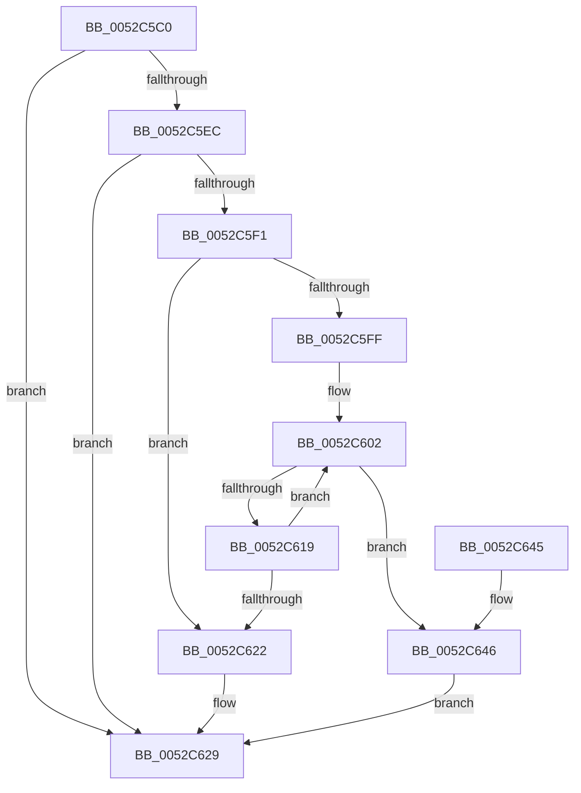

# SymCryptEcpointCreateEx

- RVA: `0x0052C5C0`–`0x0052C64A` (길이 `138` bytes)
- VA: `0x000000014052C5C0`
- 실행 섹션: `.text`
- PDB 이름 있음: `예`; PDB Function 태그: `아니요`
- unwind 정보 RVA: `0x00098958`
- 디코드: `46`개 명령, `138/138` bytes 표시
- 미해석 바이트: `0` (있으면 어셈블리에 `.byte`로 보존)

> 이 문서는 커널 이미지의 기계어와 PDB 기호를 분석해 생성했습니다. 4번과 5번은 함수 원형과 자료형을 바이너리 사용 방식에서 추정한 C 해석이며 원본 소스 복구 결과는 아닙니다.

## 1. Dependencies

- 직접 호출 지점: **1**; 고유 호출 대상: **1**
- 직접 호출자로 확인된 함수: **3**
- RIP 상대 이미지 참조: **0**

### Outgoing calls
- `0x0052C60F` → [SymCryptModElementCreate](SymCryptModElementCreate_function_00525900.md) (function, `0x00525900`)

### Direct callers
- [SymCryptEcpointCreate](SymCryptEcpointCreate_function_0052C5A0.md) at `0x0052C5AC`
- [SymCryptEcpointGetValue](SymCryptEcpointGetValue_function_0052C650.md) at `0x0052C6CD`
- [SymCryptEcpointSetValue](SymCryptEcpointSetValue_function_0052C7E0.md) at `0x0052C8E3`

### Static image references
- 디코드된 RIP-relative 메모리 참조가 없습니다.

## 2. Other-region calls and transfers

- 다른 실행 섹션으로 향하는 call: **0**
- 별도 외부 분기/꼬리 이동을 확인하지 못했습니다.

## 3. Assembly (complete function range)

```asm
0052C5C0  48 89 5C 24 08                  mov qword ptr [rsp + 8], rbx
0052C5C5  48 89 6C 24 10                  mov qword ptr [rsp + 0x10], rbp
0052C5CA  48 89 74 24 18                  mov qword ptr [rsp + 0x18], rsi
0052C5CF  57                              push rdi
0052C5D0  41 56                           push r14
0052C5D2  41 57                           push r15
0052C5D4  48 83 EC 20                     sub rsp, 0x20
0052C5D8  41 8B 40 24                     mov eax, dword ptr [r8 + 0x24]
0052C5DC  33 DB                           xor ebx, ebx
0052C5DE  41 8B E9                        mov ebp, r9d
0052C5E1  4D 8B F0                        mov r14, r8
0052C5E4  48 8B F9                        mov rdi, rcx
0052C5E7  48 85 D2                        test rdx, rdx
0052C5EA  74 3D                           je 0x14052c629
0052C5EC  45 85 C9                        test r9d, r9d
0052C5EF  74 38                           je 0x14052c629
0052C5F1  48 83 C7 20                     add rdi, 0x20
0052C5F5  33 F6                           xor esi, esi
0052C5F7  48 8B D9                        mov rbx, rcx
0052C5FA  45 85 C9                        test r9d, r9d
0052C5FD  74 23                           je 0x14052c622
0052C5FF  44 8B F8                        mov r15d, eax
0052C602  4D 8B 86 68 02 00 00            mov r8, qword ptr [r14 + 0x268]
0052C609  49 8B D7                        mov rdx, r15
0052C60C  48 8B CF                        mov rcx, rdi
0052C60F  E8 EC 92 FF FF                  call 0x140525900
0052C614  48 85 C0                        test rax, rax
0052C617  74 2D                           je 0x14052c646
0052C619  49 03 FF                        add rdi, r15
0052C61C  FF C6                           inc esi
0052C61E  3B F5                           cmp esi, ebp
0052C620  72 E0                           jb 0x14052c602
0052C622  C6 03 00                        mov byte ptr [rbx], 0
0052C625  4C 89 73 08                     mov qword ptr [rbx + 8], r14
0052C629  48 8B 6C 24 48                  mov rbp, qword ptr [rsp + 0x48]
0052C62E  48 8B C3                        mov rax, rbx
0052C631  48 8B 5C 24 40                  mov rbx, qword ptr [rsp + 0x40]
0052C636  48 8B 74 24 50                  mov rsi, qword ptr [rsp + 0x50]
0052C63B  48 83 C4 20                     add rsp, 0x20
0052C63F  41 5F                           pop r15
0052C641  41 5E                           pop r14
0052C643  5F                              pop rdi
0052C644  C3                              ret
0052C645  CC                              int3
0052C646  33 DB                           xor ebx, ebx
0052C648  EB DF                           jmp 0x14052c629
```

## 4. C-style interpretation (structured pseudocode)

```c
__int64 __fastcall SymCryptEcpointCreateEx(__int64 a1, __int64 a2, __int64 a3, int a4)
{
    __int64 result;
    __int64 v_rbx;
    __int64 v_rdi;
    __int64 v_rsi;
    __int64 v_rsp;
    unsigned __int64 v_stack_p10;
    unsigned __int64 v_stack_p18;
    unsigned __int64 v_stack_p8;

    v_stack_p8 = v_rbx;
    v_stack_p10 = v_rbp;
    v_stack_p18 = v_rsi;
    v_rsp = (v_rsp) - (32);
    v_rbx = 0;
    if (a2 == 0) goto loc_0052C629;
    if (a4 == 0) goto loc_0052C629;
    v_rdi = (a1) + (32);
    v_rsi = 0;
    if (a4 == 0) goto loc_0052C622;
loc_0052C602:
    result = SymCryptModElementCreate(v_rdi, (unsigned int)((unsigned int)((unsigned int)(*(unsigned int *)(a3 + 36)))), *(unsigned __int64 *)(a3 + 616), a4);
    if (result == 0) goto loc_0052C646;
    v_rdi = (v_rdi) + ((unsigned int)((unsigned int)((unsigned int)(*(unsigned int *)(a3 + 36)))));
    v_rsi = (unsigned int)((v_rsi) + 1);
    if (((unsigned int)(v_rsi)) < ((unsigned int)((unsigned int)(a4)))) goto loc_0052C602;
loc_0052C622:
    *(unsigned __int8 *)(a1) = 0;
    *(unsigned __int64 *)(a1 + 8) = a3;
loc_0052C629:
    v_rsp = (v_rsp) + (32);
    return a1;
loc_0052C646:
    v_rbx = 0;
    goto loc_0052C629;
}
```

## 5. (Beta) C Style

```c
void *SymCryptEcpointCreateEx(void *Arg1, int64_t Arg2, void *Arg3, int32_t Arg4)
{
    uint8_t *arg1 = (uint8_t *)Arg1;
    uint8_t *arg3 = (uint8_t *)Arg3;

    int64_t result;
    int64_t local_rbx;
    int64_t local_rdi;
    int64_t local_rsi;
    int64_t local_rsp;
    uint64_t v_stack_p10;
    uint64_t v_stack_p18;
    uint64_t v_stack_p8;

    v_stack_p8 = local_rbx;
    v_stack_p10 = local_rbp;
    v_stack_p18 = local_rsi;
    local_rsp = (local_rsp) - (32);
    local_rbx = 0;
    if (Arg2 == 0) goto loc_0052C629;
    if (Arg4 == 0) goto loc_0052C629;
    local_rdi = (Arg1) + (32);
    local_rsi = 0;
    if (Arg4 == 0) goto loc_0052C622;
loc_0052C602:
    result = SymCryptModElementCreate(local_rdi, (uint32_t)((uint32_t)((uint32_t)(*(uint32_t *)(arg3 + 0x24)))), *(uint64_t *)(arg3 + 0x268), Arg4);
    if (result == 0) goto loc_0052C646;
    local_rdi = (local_rdi) + ((uint32_t)((uint32_t)((uint32_t)(*(uint32_t *)(arg3 + 0x24)))));
    local_rsi = (uint32_t)((local_rsi) + 1);
    if (((uint32_t)(local_rsi)) < ((uint32_t)((uint32_t)(Arg4)))) goto loc_0052C602;
loc_0052C622:
    *(uint8_t *)(arg1) = 0;
    *(void **)(arg1 + 0x8) = Arg3;
loc_0052C629:
    local_rsp = (local_rsp) + (32);
    return Arg1;
loc_0052C646:
    local_rbx = 0;
    goto loc_0052C629;
}
```

### 관측된 메모리 오프셋

구조체 형식이 확인되지 않은 접근은 인자 기준의 오프셋으로만 기록했습니다.

| 기준 인자 | 오프셋 표현 | 폭 (bit) | 접근 |
|---|---:|---:|---|
| `Arg1` | `+ 0x0` | `8` | `W` |
| `Arg1` | `+ 0x8` | `64` | `W` |
| `Arg3` | `+ 0x24` | `32` | `R` |
| `Arg3` | `+ 0x268` | `64` | `R` |

## 6. Execution-region graph

[열기: 2D/3D 그래프와 함수 탐색 컨트롤 패널](../../../control-panel.html?section=text&rva=0x0052C5C0&view=graph)

- 2D 그래프는 위에서 아래로 흐르고, 3D 그래프는 빈 공간을 드래그해 회전합니다. Shift+드래그는 이동, 휠은 확대·축소, 함수 노드 선택은 대상 보고서 이동입니다.

### Static fallback


