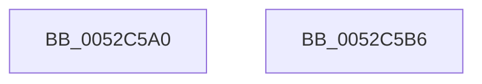

# SymCryptEcpointCreate

- RVA: `0x0052C5A0`–`0x0052C5B7` (길이 `23` bytes)
- VA: `0x000000014052C5A0`
- 실행 섹션: `.text`
- PDB 이름 있음: `예`; PDB Function 태그: `아니요`
- unwind 정보 RVA: `0x0005C788`
- 디코드: `7`개 명령, `23/23` bytes 표시
- 미해석 바이트: `0` (있으면 어셈블리에 `.byte`로 보존)

> 이 문서는 커널 이미지의 기계어와 PDB 기호를 분석해 생성했습니다. 4번과 5번은 함수 원형과 자료형을 바이너리 사용 방식에서 추정한 C 해석이며 원본 소스 복구 결과는 아닙니다.

## 1. Dependencies

- 직접 호출 지점: **1**; 고유 호출 대상: **1**
- 직접 호출자로 확인된 함수: **11**
- RIP 상대 이미지 참조: **0**

### Outgoing calls
- `0x0052C5AC` → [SymCryptEcpointCreateEx](SymCryptEcpointCreateEx_function_0052C5C0.md) (function, `0x0052C5C0`)

### Direct callers
- [SymCryptEcurveInitialize](SymCryptEcurveInitialize_function_005241A4.md) at `0x00524537`
- [SymCryptEcurveInitialize](SymCryptEcurveInitialize_function_005241A4.md) at `0x005245B7`
- [SymCryptEckeyCreate](SymCryptEckeyCreate_function_00524A60.md) at `0x00524AB2`
- [SymCryptEckeyPerformPublicKeyValidation](SymCryptEckeyPerformPublicKeyValidation_function_00524B1C.md) at `0x00524BAD`
- [SymCryptEckeySetValue](SymCryptEckeySetValue_function_00524C34.md) at `0x00524FE1`
- [SymCryptEcDsaSignEx](SymCryptEcDsaSignEx_function_00525D6C.md) at `0x00525F14`
- [SymCryptEcDsaVerify](SymCryptEcDsaVerify_function_00526400.md) at `0x005265F9`
- [SymCryptEcDsaVerify](SymCryptEcDsaVerify_function_00526400.md) at `0x00526611`
- [SymCryptEcpointMultiScalarMulWnafWithInterleaving](SymCryptEcpointMultiScalarMulWnafWithInterleaving_function_0052B920.md) at `0x0052BA7E`
- [SymCryptEcpointMultiScalarMulWnafWithInterleaving](SymCryptEcpointMultiScalarMulWnafWithInterleaving_function_0052B920.md) at `0x0052BAB8`
- [SymCryptEcpointMultiScalarMulWnafWithInterleaving](SymCryptEcpointMultiScalarMulWnafWithInterleaving_function_0052B920.md) at `0x0052BACC`
- [SymCryptEcpointScalarMulFixedWindow](SymCryptEcpointScalarMulFixedWindow_function_0052BE30.md) at `0x0052BF76`
- [SymCryptEcpointScalarMulFixedWindow](SymCryptEcpointScalarMulFixedWindow_function_0052BE30.md) at `0x0052BF99`
- [SymCryptEcpointScalarMulFixedWindow](SymCryptEcpointScalarMulFixedWindow_function_0052BE30.md) at `0x0052BFB5`
- [SymCryptOfflinePrecomputation](SymCryptOfflinePrecomputation_function_0052C450.md) at `0x0052C47C`
- [SymCryptEcDhSecretAgreement](../53/SymCryptEcDhSecretAgreement_function_00537798.md) at `0x00537877`
- [SymCryptShortWeierstrassAdd](../53/SymCryptShortWeierstrassAdd_function_00537BC0.md) at `0x00537C40`
- [SymCryptShortWeierstrassAdd](../53/SymCryptShortWeierstrassAdd_function_00537BC0.md) at `0x00537C54`

### Static image references
- 디코드된 RIP-relative 메모리 참조가 없습니다.

## 2. Other-region calls and transfers

- 다른 실행 섹션으로 향하는 call: **0**
- 별도 외부 분기/꼬리 이동을 확인하지 못했습니다.

## 3. Assembly (complete function range)

```asm
0052C5A0  48 83 EC 28                     sub rsp, 0x28
0052C5A4  45 8B 48 08                     mov r9d, dword ptr [r8 + 8]
0052C5A8  41 83 E1 0F                     and r9d, 0xf
0052C5AC  E8 0F 00 00 00                  call 0x14052c5c0
0052C5B1  48 83 C4 28                     add rsp, 0x28
0052C5B5  C3                              ret
0052C5B6  CC                              int3
```

## 4. C-style interpretation (structured pseudocode)

```c
__int64 __fastcall SymCryptEcpointCreate(__int64 a1, __int64 a2, __int64 a3)
{
    __int64 result;
    __int64 v_rsp;

    v_rsp = (v_rsp) - (40);
    a4 = (unsigned int)(((unsigned int)(*(unsigned int *)(a3 + 8))) & (15));
    result = SymCryptEcpointCreateEx(a1, a2, a3, a4);
    v_rsp = (v_rsp) + (40);
    return result;
}
```

## 5. (Beta) C Style

```c
int64_t SymCryptEcpointCreate(int64_t Arg1, int64_t Arg2, void *Arg3)
{
    uint8_t *arg3 = (uint8_t *)Arg3;

    int64_t result;
    int64_t local_rsp;

    local_rsp = (local_rsp) - (40);
    a4 = (uint32_t)(((uint32_t)(*(uint32_t *)(arg3 + 0x8))) & (15));
    result = SymCryptEcpointCreateEx(Arg1, Arg2, Arg3, a4);
    local_rsp = (local_rsp) + (40);
    return result;
}
```

### 관측된 메모리 오프셋

구조체 형식이 확인되지 않은 접근은 인자 기준의 오프셋으로만 기록했습니다.

| 기준 인자 | 오프셋 표현 | 폭 (bit) | 접근 |
|---|---:|---:|---|
| `Arg3` | `+ 0x8` | `32` | `R` |

## 6. Execution-region graph

[열기: 2D/3D 그래프와 함수 탐색 컨트롤 패널](../../../control-panel.html?section=text&rva=0x0052C5A0&view=graph)

- 2D 그래프는 위에서 아래로 흐르고, 3D 그래프는 빈 공간을 드래그해 회전합니다. Shift+드래그는 이동, 휠은 확대·축소, 함수 노드 선택은 대상 보고서 이동입니다.

### Static fallback


