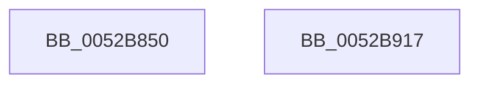

# SymCryptEcpointGenericSetRandom

- RVA: `0x0052B850`–`0x0052B918` (길이 `200` bytes)
- VA: `0x000000014052B850`
- 실행 섹션: `.text`
- PDB 이름 있음: `예`; PDB Function 태그: `아니요`
- unwind 정보 RVA: `0x00093E28`
- 디코드: `52`개 명령, `200/200` bytes 표시
- 미해석 바이트: `0` (있으면 어셈블리에 `.byte`로 보존)

> 이 문서는 커널 이미지의 기계어와 PDB 기호를 분석해 생성했습니다. 4번과 5번은 함수 원형과 자료형을 바이너리 사용 방식에서 추정한 C 해석이며 원본 소스 복구 결과는 아닙니다.

## 1. Dependencies

- 직접 호출 지점: **4**; 고유 호출 대상: **4**
- 직접 호출자로 확인된 함수: **0**
- RIP 상대 이미지 참조: **0**

### Outgoing calls
- `0x0052B881` → [SymCryptModElementCreate](SymCryptModElementCreate_function_00525900.md) (function, `0x00525900`)
- `0x0052B8B4` → [SymCryptModSetRandom](SymCryptModSetRandom_function_00525C18.md) (function, `0x00525C18`)
- `0x0052B8D9` → [SymCryptModElementToInt](SymCryptModElementToInt_function_00525AB0.md) (function, `0x00525AB0`)
- `0x0052B8F9` → [SymCryptEcpointScalarMul](SymCryptEcpointScalarMul_function_0052D11C.md) (function, `0x0052D11C`)

### Direct callers
- 이 함수 시작 RVA로 연결되는 직접 call은 확인되지 않았습니다. 간접 호출은 완전히 역산할 수 없습니다.

### Static image references
- 디코드된 RIP-relative 메모리 참조가 없습니다.

## 2. Other-region calls and transfers

- 다른 실행 섹션으로 향하는 call: **0**
- 별도 외부 분기/꼬리 이동을 확인하지 못했습니다.

## 3. Assembly (complete function range)

```asm
0052B850  48 89 5C 24 08                  mov qword ptr [rsp + 8], rbx
0052B855  48 89 6C 24 10                  mov qword ptr [rsp + 0x10], rbp
0052B85A  48 89 74 24 18                  mov qword ptr [rsp + 0x18], rsi
0052B85F  57                              push rdi
0052B860  41 56                           push r14
0052B862  41 57                           push r15
0052B864  48 83 EC 40                     sub rsp, 0x40
0052B868  49 8B E8                        mov rbp, r8
0052B86B  4C 8B F2                        mov r14, rdx
0052B86E  8B 51 24                        mov edx, dword ptr [rcx + 0x24]
0052B871  4C 8B F9                        mov r15, rcx
0052B874  4C 8B 81 70 02 00 00            mov r8, qword ptr [rcx + 0x270]
0052B87B  49 8B F1                        mov rsi, r9
0052B87E  49 8B C9                        mov rcx, r9
0052B881  E8 7A A0 FF FF                  call 0x140525900
0052B886  45 8B 57 24                     mov r10d, dword ptr [r15 + 0x24]
0052B88A  48 8B D0                        mov rdx, rax
0052B88D  48 8B BC 24 80 00 00 00         mov rdi, qword ptr [rsp + 0x80]
0052B895  48 8B D8                        mov rbx, rax
0052B898  49 8B 8F 70 02 00 00            mov rcx, qword ptr [r15 + 0x270]
0052B89F  4C 8B C7                        mov r8, rdi
0052B8A2  4D 2B C2                        sub r8, r10
0052B8A5  4C 89 44 24 20                  mov qword ptr [rsp + 0x20], r8
0052B8AA  4D 8D 0C 32                     lea r9, [r10 + rsi]
0052B8AE  41 B8 06 00 00 00               mov r8d, 6
0052B8B4  E8 5F A3 FF FF                  call 0x140525c18
0052B8B9  41 8B 4F 24                     mov ecx, dword ptr [r15 + 0x24]
0052B8BD  48 8B D7                        mov rdx, rdi
0052B8C0  48 2B D1                        sub rdx, rcx
0052B8C3  4D 8B C6                        mov r8, r14
0052B8C6  48 89 54 24 20                  mov qword ptr [rsp + 0x20], rdx
0052B8CB  48 8B D3                        mov rdx, rbx
0052B8CE  4C 8D 0C 31                     lea r9, [rcx + rsi]
0052B8D2  49 8B 8F 70 02 00 00            mov rcx, qword ptr [r15 + 0x270]
0052B8D9  E8 D2 A1 FF FF                  call 0x140525ab0
0052B8DE  48 89 7C 24 30                  mov qword ptr [rsp + 0x30], rdi
0052B8E3  45 33 C9                        xor r9d, r9d
0052B8E6  48 89 74 24 28                  mov qword ptr [rsp + 0x28], rsi
0052B8EB  45 33 C0                        xor r8d, r8d
0052B8EE  49 8B D6                        mov rdx, r14
0052B8F1  48 89 6C 24 20                  mov qword ptr [rsp + 0x20], rbp
0052B8F6  49 8B CF                        mov rcx, r15
0052B8F9  E8 1E 18 00 00                  call 0x14052d11c
0052B8FE  48 8B 5C 24 60                  mov rbx, qword ptr [rsp + 0x60]
0052B903  48 8B 6C 24 68                  mov rbp, qword ptr [rsp + 0x68]
0052B908  48 8B 74 24 70                  mov rsi, qword ptr [rsp + 0x70]
0052B90D  48 83 C4 40                     add rsp, 0x40
0052B911  41 5F                           pop r15
0052B913  41 5E                           pop r14
0052B915  5F                              pop rdi
0052B916  C3                              ret
0052B917  CC                              int3
```

## 4. C-style interpretation (structured pseudocode)

```c
__int64 __fastcall SymCryptEcpointGenericSetRandom(__int64 a1, __int64 a2, __int64 a3, __int64 a4, __int64 a5)
{
    __int64 result;
    __int64 v_rsp;
    unsigned __int64 v_stack_m28;
    unsigned __int64 v_stack_m30;
    unsigned __int64 v_stack_m38;
    unsigned __int64 v_stack_p10;
    unsigned __int64 v_stack_p18;
    unsigned __int64 v_stack_p8;

    v_stack_p8 = v_rbx;
    v_stack_p10 = v_rbp;
    v_stack_p18 = v_rsi;
    v_rsp = (v_rsp) - (64);
    result = SymCryptModElementCreate(a4, (unsigned int)(*(unsigned int *)(a1 + 36)), *(unsigned __int64 *)(a1 + 624), a4);
    a3 = (a5) - ((unsigned int)(*(unsigned int *)(a1 + 36)));
    v_stack_m38 = a3;
    result = SymCryptModSetRandom(*(unsigned __int64 *)(a1 + 624), result, 6, (unsigned int)(*(unsigned int *)(a1 + 36)) + a4 * 1);
    a2 = (a5) - ((unsigned int)(*(unsigned int *)(a1 + 36)));
    v_stack_m38 = a2;
    result = SymCryptModElementToInt(*(unsigned __int64 *)(a1 + 624), result, a2, (unsigned int)(*(unsigned int *)(a1 + 36)) + a4 * 1);
    v_stack_m28 = a5;
    a4 = 0;
    v_stack_m30 = 0;
    a3 = 0;
    v_stack_m38 = 0;
    result = SymCryptEcpointScalarMul(a1, a2, a3, a4);
    v_rsp = (v_rsp) + (64);
    return result;
}
```

## 5. (Beta) C Style

```c
int64_t SymCryptEcpointGenericSetRandom(void *Arg1, int64_t Arg2, int64_t Arg3, int64_t Arg4, int64_t Arg5)
{
    uint8_t *arg1 = (uint8_t *)Arg1;

    int64_t result;
    int64_t local_rsp;
    uint64_t v_stack_m28;
    uint64_t v_stack_m30;
    uint64_t v_stack_m38;
    uint64_t v_stack_p10;
    uint64_t v_stack_p18;
    uint64_t v_stack_p8;

    v_stack_p8 = local_rbx;
    v_stack_p10 = local_rbp;
    v_stack_p18 = local_rsi;
    local_rsp = (local_rsp) - (64);
    result = SymCryptModElementCreate(Arg4, (uint32_t)(*(uint32_t *)(arg1 + 0x24)), *(uint64_t *)(arg1 + 0x270), Arg4);
    Arg3 = (Arg5) - ((uint32_t)(*(uint32_t *)(arg1 + 0x24)));
    v_stack_m38 = Arg3;
    result = SymCryptModSetRandom(*(uint64_t *)(arg1 + 0x270), result, 6, (uint32_t)(*(uint32_t *)(arg1 + 0x24)) + Arg4 * 1);
    Arg2 = (Arg5) - ((uint32_t)(*(uint32_t *)(arg1 + 0x24)));
    v_stack_m38 = Arg2;
    result = SymCryptModElementToInt(*(uint64_t *)(arg1 + 0x270), result, Arg2, (uint32_t)(*(uint32_t *)(arg1 + 0x24)) + Arg4 * 1);
    v_stack_m28 = Arg5;
    Arg4 = 0;
    v_stack_m30 = 0;
    Arg3 = 0;
    v_stack_m38 = 0;
    result = SymCryptEcpointScalarMul(Arg1, Arg2, Arg3, Arg4);
    local_rsp = (local_rsp) + (64);
    return result;
}
```

### 관측된 메모리 오프셋

구조체 형식이 확인되지 않은 접근은 인자 기준의 오프셋으로만 기록했습니다.

| 기준 인자 | 오프셋 표현 | 폭 (bit) | 접근 |
|---|---:|---:|---|
| `Arg1` | `+ 0x24` | `32` | `R` |
| `Arg1` | `+ 0x270` | `64` | `R` |

## 6. Execution-region graph

[열기: 2D/3D 그래프와 함수 탐색 컨트롤 패널](../../../control-panel.html?section=text&rva=0x0052B850&view=graph)

- 2D 그래프는 위에서 아래로 흐르고, 3D 그래프는 빈 공간을 드래그해 회전합니다. Shift+드래그는 이동, 휠은 확대·축소, 함수 노드 선택은 대상 보고서 이동입니다.

### Static fallback


