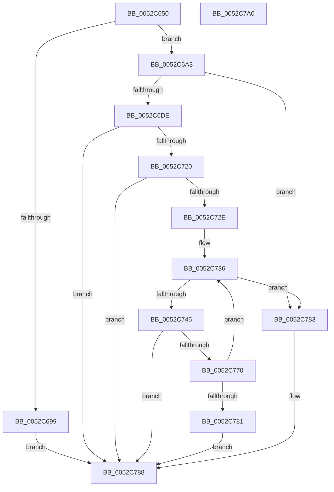

# SymCryptEcpointGetValue

- RVA: `0x0052C650`–`0x0052C7A1` (길이 `337` bytes)
- VA: `0x000000014052C650`
- 실행 섹션: `.text`
- PDB 이름 있음: `예`; PDB Function 태그: `아니요`
- unwind 정보 RVA: `0x000AFEC4`
- 디코드: `92`개 명령, `337/337` bytes 표시
- 미해석 바이트: `0` (있으면 어셈블리에 `.byte`로 보존)

> 이 문서는 커널 이미지의 기계어와 PDB 기호를 분석해 생성했습니다. 4번과 5번은 함수 원형과 자료형을 바이너리 사용 방식에서 추정한 C 해석이며 원본 소스 복구 결과는 아닙니다.

## 1. Dependencies

- 직접 호출 지점: **4**; 고유 호출 대상: **4**
- 직접 호출자로 확인된 함수: **3**
- RIP 상대 이미지 참조: **1**

### Outgoing calls
- `0x0052C681` → [SymCryptEcurveSizeofFieldElement](SymCryptEcurveSizeofFieldElement_function_005247FC.md) (function, `0x005247FC`)
- `0x0052C6CD` → [SymCryptEcpointCreateEx](SymCryptEcpointCreateEx_function_0052C5C0.md) (function, `0x0052C5C0`)
- `0x0052C717` → [SymCryptEcpointTransform](SymCryptEcpointTransform_function_0052C9E8.md) (function, `0x0052C9E8`)
- `0x0052C767` → [SymCryptModElementGetValue](SymCryptModElementGetValue_function_00525918.md) (function, `0x00525918`)

### Direct callers
- [SymCryptEcDsaSignEx](SymCryptEcDsaSignEx_function_00525D6C.md) at `0x00526126`
- [SymCryptEcDsaVerify](SymCryptEcDsaVerify_function_00526400.md) at `0x00526919`
- [SymCryptEcDhSecretAgreement](../53/SymCryptEcDhSecretAgreement_function_00537798.md) at `0x0053792E`

### Static image references
- `0x0052C671` → RVA `0x00020870` (`.rdata`; read)

## 2. Other-region calls and transfers

- 다른 실행 섹션으로 향하는 call: **0**
- 별도 외부 분기/꼬리 이동을 확인하지 못했습니다.

## 3. Assembly (complete function range)

```asm
0052C650  48 89 5C 24 08                  mov qword ptr [rsp + 8], rbx
0052C655  44 89 44 24 18                  mov dword ptr [rsp + 0x18], r8d
0052C65A  48 89 54 24 10                  mov qword ptr [rsp + 0x10], rdx
0052C65F  55                              push rbp
0052C660  56                              push rsi
0052C661  57                              push rdi
0052C662  41 54                           push r12
0052C664  41 55                           push r13
0052C666  41 56                           push r14
0052C668  41 57                           push r15
0052C66A  48 83 EC 40                     sub rsp, 0x40
0052C66E  49 63 D9                        movsxd rbx, r9d
0052C671  48 8D 05 F8 41 AF FF            lea rax, [rip - 0x50be08]
0052C678  48 8B F1                        mov rsi, rcx
0052C67B  48 8B EB                        mov rbp, rbx
0052C67E  8B 3C 98                        mov edi, dword ptr [rax + rbx*4]
0052C681  E8 76 81 FF FF                  call 0x1405247fc
0052C686  0F AF C7                        imul eax, edi
0052C689  44 8B D0                        mov r10d, eax
0052C68C  48 8B 84 24 A8 00 00 00         mov rax, qword ptr [rsp + 0xa8]
0052C694  49 3B C2                        cmp rax, r10
0052C697  74 0A                           je 0x14052c6a3
0052C699  B8 0D 80 00 00                  mov eax, 0x800d
0052C69E  E9 E5 00 00 00                  jmp 0x14052c788
0052C6A3  8B 4E 24                        mov ecx, dword ptr [rsi + 0x24]
0052C6A6  33 D2                           xor edx, edx
0052C6A8  4C 8B AC 24 B8 00 00 00         mov r13, qword ptr [rsp + 0xb8]
0052C6B0  41 B9 04 00 00 00               mov r9d, 4
0052C6B6  48 F7 F7                        div rdi
0052C6B9  8D 0C 8D 20 00 00 00            lea ecx, [rcx*4 + 0x20]
0052C6C0  4C 8B C6                        mov r8, rsi
0052C6C3  8B F9                           mov edi, ecx
0052C6C5  4C 8B F8                        mov r15, rax
0052C6C8  8B D1                           mov edx, ecx
0052C6CA  49 8B CD                        mov rcx, r13
0052C6CD  E8 EE FE FF FF                  call 0x14052c5c0
0052C6D2  4C 8B E0                        mov r12, rax
0052C6D5  48 85 C0                        test rax, rax
0052C6D8  0F 84 A5 00 00 00               je 0x14052c783
0052C6DE  8B 84 24 B0 00 00 00            mov eax, dword ptr [rsp + 0xb0]
0052C6E5  4C 03 EF                        add r13, rdi
0052C6E8  4C 8B B4 24 C0 00 00 00         mov r14, qword ptr [rsp + 0xc0]
0052C6F0  44 8B CB                        mov r9d, ebx
0052C6F3  48 8B 94 24 88 00 00 00         mov rdx, qword ptr [rsp + 0x88]
0052C6FB  4C 2B F7                        sub r14, rdi
0052C6FE  4C 89 74 24 38                  mov qword ptr [rsp + 0x38], r14
0052C703  4D 8B C4                        mov r8, r12
0052C706  4C 89 6C 24 30                  mov qword ptr [rsp + 0x30], r13
0052C70B  48 8B CE                        mov rcx, rsi
0052C70E  89 44 24 28                     mov dword ptr [rsp + 0x28], eax
0052C712  C6 44 24 20 00                  mov byte ptr [rsp + 0x20], 0
0052C717  E8 CC 02 00 00                  call 0x14052c9e8
0052C71C  85 C0                           test eax, eax
0052C71E  75 68                           jne 0x14052c788
0052C720  33 DB                           xor ebx, ebx
0052C722  48 8D 0D 47 41 AF FF            lea rcx, [rip - 0x50beb9]
0052C729  39 1C A9                        cmp dword ptr [rcx + rbp*4], ebx
0052C72C  76 5A                           jbe 0x14052c788
0052C72E  48 8B BC 24 A0 00 00 00         mov rdi, qword ptr [rsp + 0xa0]
0052C736  8B D3                           mov edx, ebx
0052C738  0F AF 56 24                     imul edx, dword ptr [rsi + 0x24]
0052C73C  48 83 C2 20                     add rdx, 0x20
0052C740  49 03 D4                        add rdx, r12
0052C743  74 3E                           je 0x14052c783
0052C745  8B 84 24 90 00 00 00            mov eax, dword ptr [rsp + 0x90]
0052C74C  4D 8B CF                        mov r9, r15
0052C74F  48 8B 8E 68 02 00 00            mov rcx, qword ptr [rsi + 0x268]
0052C756  4C 8B C7                        mov r8, rdi
0052C759  4C 89 74 24 30                  mov qword ptr [rsp + 0x30], r14
0052C75E  4C 89 6C 24 28                  mov qword ptr [rsp + 0x28], r13
0052C763  89 44 24 20                     mov dword ptr [rsp + 0x20], eax
0052C767  E8 AC 91 FF FF                  call 0x140525918
0052C76C  85 C0                           test eax, eax
0052C76E  75 18                           jne 0x14052c788
0052C770  49 03 FF                        add rdi, r15
0052C773  48 8D 0D F6 40 AF FF            lea rcx, [rip - 0x50bf0a]
0052C77A  FF C3                           inc ebx
0052C77C  3B 1C A9                        cmp ebx, dword ptr [rcx + rbp*4]
0052C77F  72 B5                           jb 0x14052c736
0052C781  EB 05                           jmp 0x14052c788
0052C783  B8 0C 80 00 00                  mov eax, 0x800c
0052C788  48 8B 9C 24 80 00 00 00         mov rbx, qword ptr [rsp + 0x80]
0052C790  48 83 C4 40                     add rsp, 0x40
0052C794  41 5F                           pop r15
0052C796  41 5E                           pop r14
0052C798  41 5D                           pop r13
0052C79A  41 5C                           pop r12
0052C79C  5F                              pop rdi
0052C79D  5E                              pop rsi
0052C79E  5D                              pop rbp
0052C79F  C3                              ret
0052C7A0  CC                              int3
```

## 4. C-style interpretation (structured pseudocode)

```c
__int64 __fastcall SymCryptEcpointGetValue(__int64 a1, __int64 a2, int a3, int a4, __int64 a5, __int64 a6, unsigned int a7, __int64 a8, __int64 a9)
{
    __int64 result;
    __int64 v_r13;
    __int64 v_r14;
    __int64 v_rbx;
    __int64 v_rdi;
    __int64 v_rsp;
    unsigned __int64 v_stack_m40;
    unsigned __int64 v_stack_m48;
    unsigned int v_stack_m50;
    unsigned __int8 v_stack_m58;
    unsigned __int64 v_stack_p10;
    unsigned int v_stack_p18;
    unsigned __int64 v_stack_p8;

    v_stack_p8 = v_rbx;
    v_stack_p18 = a3;
    v_stack_p10 = a2;
    v_rsp = (v_rsp) - (64);
    result = SymCryptEcurveSizeofFieldElement(a1, a2, a3, a4);
    result = (unsigned int)((result) * ((unsigned int)((unsigned int)(*(unsigned int *)(v_rip - 5291528 + (int)(a4) * 4)))));
    if (a6 == ((unsigned int)((unsigned int)(result)))) goto loc_0052C6A3;
    goto loc_0052C788;
loc_0052C6A3:
    a2 = 0;
    result = SymCryptEcpointCreateEx(a8, (unsigned int)((unsigned int)((unsigned int)(*(unsigned int *)(a1 + 36)) * 4 + 32)), a1, 4);
    if (result == 0) goto loc_0052C783;
    v_r13 = (a8) + ((unsigned int)((unsigned int)((unsigned int)(*(unsigned int *)(a1 + 36)) * 4 + 32)));
    v_r14 = (a9) - ((unsigned int)((unsigned int)((unsigned int)(*(unsigned int *)(a1 + 36)) * 4 + 32)));
    v_stack_m40 = v_r14;
    v_stack_m48 = v_r13;
    v_stack_m50 = (unsigned int)((unsigned int)(a7));
    v_stack_m58 = 0;
    result = SymCryptEcpointTransform(a1, v_stack_p10, result, (unsigned int)((unsigned int)((int)(a4))));
    if ((unsigned int)(result) != 0) goto loc_0052C788;
    v_rbx = 0;
    if ((*(unsigned int *)(v_rip - 5291705 + (int)(a4) * 4)) <= 0) goto loc_0052C788;
loc_0052C736:
    a2 = (unsigned int)((0) * (*(unsigned int *)(a1 + 36)));
    a2 = (a2) + (32);
    a2 = (a2) + (result);
    if (condition_is_equal) goto loc_0052C783;
    v_stack_m48 = v_r14;
    v_stack_m50 = v_r13;
    v_stack_m58 = (unsigned int)((unsigned int)(v_stack_p18));
    result = SymCryptModElementGetValue(*(unsigned __int64 *)(a1 + 616), a2, a5, (unsigned int)(0x800DULL));
    if ((unsigned int)(result) != 0) goto loc_0052C788;
    v_rdi = (a5) + ((unsigned int)(0x800DULL));
    v_rbx = (unsigned int)((v_rbx) + 1);
    if (((unsigned int)(v_rbx)) < (*(unsigned int *)(v_rip - 5291786 + (int)(a4) * 4))) goto loc_0052C736;
    goto loc_0052C788;
loc_0052C783:
loc_0052C788:
    v_rsp = (v_rsp) + (64);
    return (unsigned int)(0x800CULL);
}
```

## 5. (Beta) C Style

```c
int64_t SymCryptEcpointGetValue(void *Arg1, int64_t Arg2, int32_t Arg3, int32_t Arg4, int64_t Arg5, int64_t Arg6, uint32_t Arg7, int64_t Arg8, int64_t Arg9)
{
    uint8_t *arg1 = (uint8_t *)Arg1;

    int64_t result;
    int64_t local_r13;
    int64_t local_r14;
    int64_t local_rbx;
    int64_t local_rdi;
    int64_t local_rsp;
    uint64_t v_stack_m40;
    uint64_t v_stack_m48;
    uint32_t v_stack_m50;
    uint8_t v_stack_m58;
    uint64_t v_stack_p10;
    uint32_t v_stack_p18;
    uint64_t v_stack_p8;

    v_stack_p8 = local_rbx;
    v_stack_p18 = Arg3;
    v_stack_p10 = Arg2;
    local_rsp = (local_rsp) - (64);
    result = SymCryptEcurveSizeofFieldElement(Arg1, Arg2, Arg3, Arg4);
    result = (uint32_t)((result) * ((uint32_t)((uint32_t)(*(uint32_t *)(v_rip - 0x50BE08 + (int32_t)(Arg4) * 4)))));
    if (Arg6 == ((uint32_t)((uint32_t)(result)))) goto loc_0052C6A3;
    goto loc_0052C788;
loc_0052C6A3:
    Arg2 = 0;
    result = SymCryptEcpointCreateEx(Arg8, (uint32_t)((uint32_t)((uint32_t)(*(uint32_t *)(arg1 + 0x24)) * 4 + 32)), Arg1, 4);
    if (result == 0) goto loc_0052C783;
    local_r13 = (Arg8) + ((uint32_t)((uint32_t)((uint32_t)(*(uint32_t *)(arg1 + 0x24)) * 4 + 32)));
    local_r14 = (Arg9) - ((uint32_t)((uint32_t)((uint32_t)(*(uint32_t *)(arg1 + 0x24)) * 4 + 32)));
    v_stack_m40 = local_r14;
    v_stack_m48 = local_r13;
    v_stack_m50 = (uint32_t)((uint32_t)(Arg7));
    v_stack_m58 = 0;
    result = SymCryptEcpointTransform(Arg1, v_stack_p10, result, (uint32_t)((uint32_t)((int32_t)(Arg4))));
    if ((uint32_t)(result) != 0) goto loc_0052C788;
    local_rbx = 0;
    if ((*(uint32_t *)(v_rip - 0x50BEB9 + (int32_t)(Arg4) * 4)) <= 0) goto loc_0052C788;
loc_0052C736:
    Arg2 = (uint32_t)((0) * (*(uint32_t *)(arg1 + 0x24)));
    Arg2 = (Arg2) + (32);
    Arg2 = (Arg2) + (result);
    if (condition_is_equal) goto loc_0052C783;
    v_stack_m48 = local_r14;
    v_stack_m50 = local_r13;
    v_stack_m58 = (uint32_t)((uint32_t)(v_stack_p18));
    result = SymCryptModElementGetValue(*(uint64_t *)(arg1 + 0x268), Arg2, Arg5, (uint32_t)(0x800DULL));
    if ((uint32_t)(result) != 0) goto loc_0052C788;
    local_rdi = (Arg5) + ((uint32_t)(0x800DULL));
    local_rbx = (uint32_t)((local_rbx) + 1);
    if (((uint32_t)(local_rbx)) < (*(uint32_t *)(v_rip - 0x50BF0A + (int32_t)(Arg4) * 4))) goto loc_0052C736;
    goto loc_0052C788;
loc_0052C783:
loc_0052C788:
    local_rsp = (local_rsp) + (64);
    return (uint32_t)(0x800CULL);
}
```

### 관측된 메모리 오프셋

구조체 형식이 확인되지 않은 접근은 인자 기준의 오프셋으로만 기록했습니다.

| 기준 인자 | 오프셋 표현 | 폭 (bit) | 접근 |
|---|---:|---:|---|
| `Arg1` | `+ 0x24` | `32` | `R` |
| `Arg1` | `+ 0x268` | `64` | `R` |

## 6. Execution-region graph

[열기: 2D/3D 그래프와 함수 탐색 컨트롤 패널](../../../control-panel.html?section=text&rva=0x0052C650&view=graph)

- 2D 그래프는 위에서 아래로 흐르고, 3D 그래프는 빈 공간을 드래그해 회전합니다. Shift+드래그는 이동, 휠은 확대·축소, 함수 노드 선택은 대상 보고서 이동입니다.

### Static fallback


