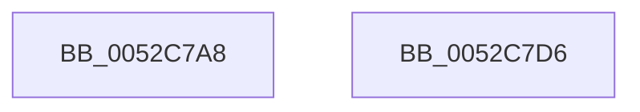

# SymCryptEcpointMaskedCopy

- RVA: `0x0052C7A8`–`0x0052C7D7` (길이 `47` bytes)
- VA: `0x000000014052C7A8`
- 실행 섹션: `.text`
- PDB 이름 있음: `예`; PDB Function 태그: `아니요`
- unwind 정보 RVA: `0x0005C788`
- 디코드: `14`개 명령, `47/47` bytes 표시
- 미해석 바이트: `0` (있으면 어셈블리에 `.byte`로 보존)

> 이 문서는 커널 이미지의 기계어와 PDB 기호를 분석해 생성했습니다. 4번과 5번은 함수 원형과 자료형을 바이너리 사용 방식에서 추정한 C 해석이며 원본 소스 복구 결과는 아닙니다.

## 1. Dependencies

- 직접 호출 지점: **1**; 고유 호출 대상: **1**
- 직접 호출자로 확인된 함수: **2**
- RIP 상대 이미지 참조: **0**

### Outgoing calls
- `0x0052C7CC` → [SymCryptFdefMaskedCopy](../53/SymCryptFdefMaskedCopy_function_00535DB4.md) (function, `0x00535DB4`)

### Direct callers
- [SymCryptEcpointScalarMulFixedWindow](SymCryptEcpointScalarMulFixedWindow_function_0052BE30.md) at `0x0052C17A`
- [SymCryptEcpointScalarMulFixedWindow](SymCryptEcpointScalarMulFixedWindow_function_0052BE30.md) at `0x0052C243`
- [SymCryptEcpointScalarMulFixedWindow](SymCryptEcpointScalarMulFixedWindow_function_0052BE30.md) at `0x0052C322`
- [SymCryptEcpointScalarMulFixedWindow](SymCryptEcpointScalarMulFixedWindow_function_0052BE30.md) at `0x0052C403`
- [SymCryptShortWeierstrassAdd](../53/SymCryptShortWeierstrassAdd_function_00537BC0.md) at `0x00537D18`
- [SymCryptShortWeierstrassAdd](../53/SymCryptShortWeierstrassAdd_function_00537BC0.md) at `0x00537D2B`
- [SymCryptShortWeierstrassAdd](../53/SymCryptShortWeierstrassAdd_function_00537BC0.md) at `0x00537D41`

### Static image references
- 디코드된 RIP-relative 메모리 참조가 없습니다.

## 2. Other-region calls and transfers

- 다른 실행 섹션으로 향하는 call: **0**
- 별도 외부 분기/꼬리 이동을 확인하지 못했습니다.

## 3. Assembly (complete function range)

```asm
0052C7A8  48 83 EC 28                     sub rsp, 0x28
0052C7AC  8A 02                           mov al, byte ptr [rdx]
0052C7AE  4D 8B D0                        mov r10, r8
0052C7B1  41 20 00                        and byte ptr [r8], al
0052C7B4  4C 8B DA                        mov r11, rdx
0052C7B7  44 8B 41 08                     mov r8d, dword ptr [rcx + 8]
0052C7BB  41 83 E0 0F                     and r8d, 0xf
0052C7BF  44 0F AF 41 10                  imul r8d, dword ptr [rcx + 0x10]
0052C7C4  49 8D 52 20                     lea rdx, [r10 + 0x20]
0052C7C8  49 8D 4B 20                     lea rcx, [r11 + 0x20]
0052C7CC  E8 E3 95 00 00                  call 0x140535db4
0052C7D1  48 83 C4 28                     add rsp, 0x28
0052C7D5  C3                              ret
0052C7D6  CC                              int3
```

## 4. C-style interpretation (structured pseudocode)

```c
__int64 __fastcall SymCryptEcpointMaskedCopy(__int64 a1, __int64 a2, __int64 a3)
{
    __int64 result;
    __int64 v_rsp;

    v_rsp = (v_rsp) - (40);
    a3 = (unsigned int)(((unsigned int)(*(unsigned int *)(a1 + 8))) & (15));
    a3 = (unsigned int)((a3) * (*(unsigned int *)(a1 + 16)));
    result = SymCryptFdefMaskedCopy(a2 + 32, a3 + 32, a3, a4);
    v_rsp = (v_rsp) + (40);
    return result;
}
```

## 5. (Beta) C Style

```c
int64_t SymCryptEcpointMaskedCopy(void *Arg1, void *Arg2, void *Arg3)
{
    uint8_t *arg1 = (uint8_t *)Arg1;
    uint8_t *arg2 = (uint8_t *)Arg2;
    uint8_t *arg3 = (uint8_t *)Arg3;

    int64_t result;
    int64_t local_rsp;

    local_rsp = (local_rsp) - (40);
    Arg3 = (uint32_t)(((uint32_t)(*(uint32_t *)(arg1 + 0x8))) & (15));
    Arg3 = (uint32_t)((Arg3) * (*(uint32_t *)(arg1 + 0x10)));
    result = SymCryptFdefMaskedCopy(Arg2 + 32, Arg3 + 32, Arg3, a4);
    local_rsp = (local_rsp) + (40);
    return result;
}
```

### 관측된 메모리 오프셋

구조체 형식이 확인되지 않은 접근은 인자 기준의 오프셋으로만 기록했습니다.

| 기준 인자 | 오프셋 표현 | 폭 (bit) | 접근 |
|---|---:|---:|---|
| `Arg1` | `+ 0x8` | `32` | `R` |
| `Arg1` | `+ 0x10` | `32` | `R` |
| `Arg2` | `+ 0x0` | `8` | `R` |
| `Arg2` | `+ 0x20` | `64` | `R` |
| `Arg3` | `+ 0x0` | `8` | `R/W` |
| `Arg3` | `+ 0x20` | `64` | `R` |

## 6. Execution-region graph

[열기: 2D/3D 그래프와 함수 탐색 컨트롤 패널](../../../control-panel.html?section=text&rva=0x0052C7A8&view=graph)

- 2D 그래프는 위에서 아래로 흐르고, 3D 그래프는 빈 공간을 드래그해 회전합니다. Shift+드래그는 이동, 휠은 확대·축소, 함수 노드 선택은 대상 보고서 이동입니다.

### Static fallback


