# SymCryptEcpointMultiScalarMulWnafWithInterleaving

- RVA: `0x0052B920`–`0x0052BE20` (길이 `1,280` bytes)
- VA: `0x000000014052B920`
- 실행 섹션: `.text`
- PDB 이름 있음: `예`; PDB Function 태그: `아니요`
- unwind 정보 RVA: `0x000C344C`
- 디코드: `319`개 명령, `1,280/1,280` bytes 표시
- 미해석 바이트: `0` (있으면 어셈블리에 `.byte`로 보존)

> 이 문서는 커널 이미지의 기계어와 PDB 기호를 분석해 생성했습니다. 4번과 5번은 함수 원형과 자료형을 바이너리 사용 방식에서 추정한 C 해석이며 원본 소스 복구 결과는 아닙니다.

## 1. Dependencies

- 직접 호출 지점: **24**; 고유 호출 대상: **16**
- 직접 호출자로 확인된 함수: **0**
- RIP 상대 이미지 참조: **1**

### Outgoing calls
- `0x0052B9C7` → [memset](../6C/memset_function_006C6C40.md) (function, `0x006C6C40`)
- `0x0052B9CF` → [SymCryptSizeofEcpointFromCurve](SymCryptSizeofEcpointFromCurve_function_0052CEF0.md) (function, `0x0052CEF0`)
- `0x0052B9DF` → [SymCryptSizeofIntFromDigits](SymCryptSizeofIntFromDigits_function_00525D24.md) (function, `0x00525D24`)
- `0x0052BA7E` → [SymCryptEcpointCreate](SymCryptEcpointCreate_function_0052C5A0.md) (function, `0x0052C5A0`)
- `0x0052BAB8` → [SymCryptEcpointCreate](SymCryptEcpointCreate_function_0052C5A0.md) (function, `0x0052C5A0`)
- `0x0052BACC` → [SymCryptEcpointCreate](SymCryptEcpointCreate_function_0052C5A0.md) (function, `0x0052C5A0`)
- `0x0052BAE8` → [SymCryptIntCreate](SymCryptIntCreate_function_0052556C.md) (function, `0x0052556C`)
- `0x0052BAFF` → [SymCryptIntCreate](SymCryptIntCreate_function_0052556C.md) (function, `0x0052556C`)
- `0x0052BB88` → [SymCryptEcpointIsZero](SymCryptEcpointIsZero_function_0052D028.md) (function, `0x0052D028`)
- `0x0052BB9A` → [SymCryptIntIsEqualUint32](SymCryptIntIsEqualUint32_function_005256B0.md) (function, `0x005256B0`)
- `0x0052BBC2` → [SymCryptIntCopy](SymCryptIntCopy_function_0052553C.md) (function, `0x0052553C`)
- `0x0052BBFD` → [SymCryptWidthNafRecoding](../53/SymCryptWidthNafRecoding_function_00537AE8.md) (function, `0x00537AE8`)
- `0x0052BC2A` → [SymCryptEcpointCopy](SymCryptEcpointCopy_function_0052C564.md) (function, `0x0052C564`)
- `0x0052BC46` → [SymCryptPrecomputation](SymCryptPrecomputation_function_0052C4C0.md) (function, `0x0052C4C0`)
- `0x0052BC75` → [SymCryptEcpointSetZero](SymCryptEcpointSetZero_function_0052D1A4.md) (function, `0x0052D1A4`)
- `0x0052BCA7` → [SymCryptEcpointDouble](SymCryptEcpointDouble_function_0052CFA8.md) (function, `0x0052CFA8`)
- `0x0052BD0D` → [SymCryptEcpointCopy](SymCryptEcpointCopy_function_0052C564.md) (function, `0x0052C564`)
- `0x0052BD34` → [SymCryptEcpointNegate](SymCryptEcpointNegate_function_0052D0BC.md) (function, `0x0052D0BC`)
- `0x0052BD59` → [SymCryptEcpointAdd](SymCryptEcpointAdd_function_0052CF14.md) (function, `0x0052CF14`)
- `0x0052BDB4` → [SymCryptEcpointDouble](SymCryptEcpointDouble_function_0052CFA8.md) (function, `0x0052CFA8`)
- `0x0052BDCC` → [SymCryptEcpointIsZero](SymCryptEcpointIsZero_function_0052D028.md) (function, `0x0052D028`)
- `0x0052BDE1` → [SymCryptEcpointSetZero](SymCryptEcpointSetZero_function_0052D1A4.md) (function, `0x0052D1A4`)
- `0x0052BDF4` → [SymCryptEcpointCopy](SymCryptEcpointCopy_function_0052C564.md) (function, `0x0052C564`)
- `0x0052BE06` → [_security_check_cookie](../6A/_security_check_cookie_function_006AC640.md) (function, `0x006AC640`)

### Direct callers
- 이 함수 시작 RVA로 연결되는 직접 call은 확인되지 않았습니다. 간접 호출은 완전히 역산할 수 없습니다.

### Static image references
- `0x0052B934` → RVA `0x00E0A740` (`.data`; read)

## 2. Other-region calls and transfers

- 다른 실행 섹션으로 향하는 call: **0**
- 별도 외부 분기/꼬리 이동을 확인하지 못했습니다.

## 3. Assembly (complete function range)

```asm
0052B920  40 53                           push rbx
0052B922  55                              push rbp
0052B923  56                              push rsi
0052B924  57                              push rdi
0052B925  41 54                           push r12
0052B927  41 55                           push r13
0052B929  41 56                           push r14
0052B92B  41 57                           push r15
0052B92D  48 81 EC B8 02 00 00            sub rsp, 0x2b8
0052B934  48 8B 05 05 EE 8D 00            mov rax, qword ptr [rip + 0x8dee05]
0052B93B  48 33 C4                        xor rax, rsp
0052B93E  48 89 84 24 A0 02 00 00         mov qword ptr [rsp + 0x2a0], rax
0052B946  48 8B 84 24 28 03 00 00         mov rax, qword ptr [rsp + 0x328]
0052B94E  41 8B D9                        mov ebx, r9d
0052B951  8B 69 5C                        mov ebp, dword ptr [rcx + 0x5c]
0052B954  4D 8B E0                        mov r12, r8
0052B957  4C 8B BC 24 38 03 00 00         mov r15, qword ptr [rsp + 0x338]
0052B95F  48 8B F1                        mov rsi, rcx
0052B962  4C 8B AC 24 30 03 00 00         mov r13, qword ptr [rsp + 0x330]
0052B96A  33 FF                           xor edi, edi
0052B96C  83 4C 24 60 FF                  or dword ptr [rsp + 0x60], 0xffffffff
0052B971  48 89 84 24 90 00 00 00         mov qword ptr [rsp + 0x90], rax
0052B979  8B 41 58                        mov eax, dword ptr [rcx + 0x58]
0052B97C  89 84 24 88 00 00 00            mov dword ptr [rsp + 0x88], eax
0052B983  8B 41 18                        mov eax, dword ptr [rcx + 0x18]
0052B986  48 8D 8C 24 A0 00 00 00         lea rcx, [rsp + 0xa0]
0052B98E  89 84 24 8C 00 00 00            mov dword ptr [rsp + 0x8c], eax
0052B995  FF C0                           inc eax
0052B997  4C 89 44 24 70                  mov qword ptr [rsp + 0x70], r8
0052B99C  41 B8 00 02 00 00               mov r8d, 0x200
0052B9A2  48 89 54 24 78                  mov qword ptr [rsp + 0x78], rdx
0052B9A7  33 D2                           xor edx, edx
0052B9A9  89 44 24 64                     mov dword ptr [rsp + 0x64], eax
0052B9AD  89 5C 24 44                     mov dword ptr [rsp + 0x44], ebx
0052B9B1  4C 89 7C 24 68                  mov qword ptr [rsp + 0x68], r15
0052B9B6  89 6C 24 50                     mov dword ptr [rsp + 0x50], ebp
0052B9BA  48 89 BC 24 98 00 00 00         mov qword ptr [rsp + 0x98], rdi
0052B9C2  40 88 7C 24 40                  mov byte ptr [rsp + 0x40], dil
0052B9C7  E8 74 B2 19 00                  call 0x1406c6c40
0052B9CC  48 8B CE                        mov rcx, rsi
0052B9CF  E8 1C 15 00 00                  call 0x14052cef0
0052B9D4  8B 4E 1C                        mov ecx, dword ptr [rsi + 0x1c]
0052B9D7  44 8B F0                        mov r14d, eax
0052B9DA  4C 89 74 24 48                  mov qword ptr [rsp + 0x48], r14
0052B9DF  E8 40 A3 FF FF                  call 0x140525d24
0052B9E4  F7 84 24 20 03 00 00 DE FF FF FF  test dword ptr [rsp + 0x320], 0xffffffde
0052B9EF  8B C0                           mov eax, eax
0052B9F1  48 89 44 24 58                  mov qword ptr [rsp + 0x58], rax
0052B9F6  74 0A                           je 0x14052ba02
0052B9F8  BF 0E 80 00 00                  mov edi, 0x800e
0052B9FD  E9 F7 03 00 00                  jmp 0x14052bdf9
0052BA02  83 FB 02                        cmp ebx, 2
0052BA05  76 0A                           jbe 0x14052ba11
0052BA07  BF 0B 80 00 00                  mov edi, 0x800b
0052BA0C  E9 E8 03 00 00                  jmp 0x14052bdf9
0052BA11  49 39 3C 24                     cmp qword ptr [r12], rdi
0052BA15  75 10                           jne 0x14052ba27
0052BA17  48 8B 86 88 02 00 00            mov rax, qword ptr [rsi + 0x288]
0052BA1E  49 89 04 24                     mov qword ptr [r12], rax
0052BA22  C6 44 24 40 01                  mov byte ptr [rsp + 0x40], 1
0052BA27  F6 84 24 20 03 00 00 01         test byte ptr [rsp + 0x320], 1
0052BA2F  74 D6                           je 0x14052ba07
0052BA31  0F AF DD                        imul ebx, ebp
0052BA34  8B EF                           mov ebp, edi
0052BA36  85 DB                           test ebx, ebx
0052BA38  74 75                           je 0x14052baaf
0052BA3A  44 8B 64 24 50                  mov r12d, dword ptr [rsp + 0x50]
0052BA3F  48 8D 8C 24 A0 00 00 00         lea rcx, [rsp + 0xa0]
0052BA47  44 8A 7C 24 40                  mov r15b, byte ptr [rsp + 0x40]
0052BA4C  4C 8D B4 24 A0 00 00 00         lea r14, [rsp + 0xa0]
0052BA54  48 8B C6                        mov rax, rsi
0052BA57  48 2B C1                        sub rax, rcx
0052BA5A  48 89 84 24 80 00 00 00         mov qword ptr [rsp + 0x80], rax
0052BA62  41 3B EC                        cmp ebp, r12d
0052BA65  73 0C                           jae 0x14052ba73
0052BA67  45 84 FF                        test r15b, r15b
0052BA6A  74 07                           je 0x14052ba73
0052BA6C  4A 8B 4C 30 68                  mov rcx, qword ptr [rax + r14 + 0x68]
0052BA71  EB 20                           jmp 0x14052ba93
0052BA73  48 8B 54 24 48                  mov rdx, qword ptr [rsp + 0x48]
0052BA78  4C 8B C6                        mov r8, rsi
0052BA7B  49 8B CD                        mov rcx, r13
0052BA7E  E8 1D 0B 00 00                  call 0x14052c5a0
0052BA83  4C 03 6C 24 48                  add r13, qword ptr [rsp + 0x48]
0052BA88  48 8B C8                        mov rcx, rax
0052BA8B  48 8B 84 24 80 00 00 00         mov rax, qword ptr [rsp + 0x80]
0052BA93  49 89 0E                        mov qword ptr [r14], rcx
0052BA96  FF C5                           inc ebp
0052BA98  49 83 C6 08                     add r14, 8
0052BA9C  3B EB                           cmp ebp, ebx
0052BA9E  72 C2                           jb 0x14052ba62
0052BAA0  4C 8B 7C 24 68                  mov r15, qword ptr [rsp + 0x68]
0052BAA5  4C 8B 64 24 70                  mov r12, qword ptr [rsp + 0x70]
0052BAAA  4C 8B 74 24 48                  mov r14, qword ptr [rsp + 0x48]
0052BAAF  4C 8B C6                        mov r8, rsi
0052BAB2  49 8B D6                        mov rdx, r14
0052BAB5  49 8B CD                        mov rcx, r13
0052BAB8  E8 E3 0A 00 00                  call 0x14052c5a0
0052BABD  4D 03 EE                        add r13, r14
0052BAC0  4C 8B C6                        mov r8, rsi
0052BAC3  49 8B CD                        mov rcx, r13
0052BAC6  49 8B D6                        mov rdx, r14
0052BAC9  48 8B E8                        mov rbp, rax
0052BACC  E8 CF 0A 00 00                  call 0x14052c5a0
0052BAD1  44 8B 46 1C                     mov r8d, dword ptr [rsi + 0x1c]
0052BAD5  4D 03 EE                        add r13, r14
0052BAD8  4C 8B 74 24 58                  mov r14, qword ptr [rsp + 0x58]
0052BADD  49 8B CD                        mov rcx, r13
0052BAE0  49 8B D6                        mov rdx, r14
0052BAE3  48 89 44 24 70                  mov qword ptr [rsp + 0x70], rax
0052BAE8  E8 7F 9A FF FF                  call 0x14052556c
0052BAED  44 8B 46 1C                     mov r8d, dword ptr [rsi + 0x1c]
0052BAF1  4D 03 EE                        add r13, r14
0052BAF4  49 8B CD                        mov rcx, r13
0052BAF7  48 89 44 24 68                  mov qword ptr [rsp + 0x68], rax
0052BAFC  49 8B D6                        mov rdx, r14
0052BAFF  E8 68 9A FF FF                  call 0x14052556c
0052BB04  44 8B 44 24 44                  mov r8d, dword ptr [rsp + 0x44]
0052BB09  4D 03 EE                        add r13, r14
0052BB0C  41 8B C0                        mov eax, r8d
0052BB0F  4C 89 AC 24 80 00 00 00         mov qword ptr [rsp + 0x80], r13
0052BB17  0F AF 44 24 64                  imul eax, dword ptr [rsp + 0x64]
0052BB1C  8B C8                           mov ecx, eax
0052BB1E  48 8D 04 85 00 00 00 00         lea rax, [rax*4]
0052BB26  4C 03 E8                        add r13, rax
0052BB29  4C 8D 70 1F                     lea r14, [rax + 0x1f]
0052BB2D  8D 04 09                        lea eax, [rcx + rcx]
0052BB30  4D 03 F5                        add r14, r13
0052BB33  48 8D 14 85 1F 00 00 00         lea rdx, [rax*4 + 0x1f]
0052BB3B  49 83 E6 E0                     and r14, 0xffffffffffffffe0
0052BB3F  48 C1 EA 05                     shr rdx, 5
0052BB43  8D 4B 02                        lea ecx, [rbx + 2]
0052BB46  48 0F AF 4C 24 48               imul rcx, qword ptr [rsp + 0x48]
0052BB4C  48 C1 E2 04                     shl rdx, 4
0052BB50  48 03 54 24 58                  add rdx, qword ptr [rsp + 0x58]
0052BB55  89 7C 24 48                     mov dword ptr [rsp + 0x48], edi
0052BB59  48 8D 04 51                     lea rax, [rcx + rdx*2]
0052BB5D  4C 2B F8                        sub r15, rax
0052BB60  45 85 C0                        test r8d, r8d
0052BB63  0F 84 00 01 00 00               je 0x14052bc69
0052BB69  4C 29 64 24 78                  sub qword ptr [rsp + 0x78], r12
0052BB6E  48 8D 84 24 98 00 00 00         lea rax, [rsp + 0x98]
0052BB76  48 89 44 24 58                  mov qword ptr [rsp + 0x58], rax
0052BB7B  49 8B 14 24                     mov rdx, qword ptr [r12]
0052BB7F  4D 8B CF                        mov r9, r15
0052BB82  4D 8B C6                        mov r8, r14
0052BB85  48 8B CE                        mov rcx, rsi
0052BB88  E8 9B 14 00 00                  call 0x14052d028
0052BB8D  8B D8                           mov ebx, eax
0052BB8F  33 D2                           xor edx, edx
0052BB91  48 8B 44 24 78                  mov rax, qword ptr [rsp + 0x78]
0052BB96  4A 8B 0C 20                     mov rcx, qword ptr [rax + r12]
0052BB9A  E8 11 9B FF FF                  call 0x1405256b0
0052BB9F  48 8B 4C 24 58                  mov rcx, qword ptr [rsp + 0x58]
0052BBA4  0B C3                           or eax, ebx
0052BBA6  21 44 24 60                     and dword ptr [rsp + 0x60], eax
0052BBAA  89 01                           mov dword ptr [rcx], eax
0052BBAC  85 C0                           test eax, eax
0052BBAE  0F 85 97 00 00 00               jne 0x14052bc4b
0052BBB4  48 8B 44 24 78                  mov rax, qword ptr [rsp + 0x78]
0052BBB9  48 8B 54 24 68                  mov rdx, qword ptr [rsp + 0x68]
0052BBBE  4A 8B 0C 20                     mov rcx, qword ptr [rax + r12]
0052BBC2  E8 75 99 FF FF                  call 0x14052553c
0052BBC7  8B 54 24 64                     mov edx, dword ptr [rsp + 0x64]
0052BBCB  8B C2                           mov eax, edx
0052BBCD  8B 5C 24 48                     mov ebx, dword ptr [rsp + 0x48]
0052BBD1  0F AF C3                        imul eax, ebx
0052BBD4  89 54 24 20                     mov dword ptr [rsp + 0x20], edx
0052BBD8  48 8B 54 24 68                  mov rdx, qword ptr [rsp + 0x68]
0052BBDD  8B C8                           mov ecx, eax
0052BBDF  4C 8D 0C 85 00 00 00 00         lea r9, [rax*4]
0052BBE7  48 8B 84 24 80 00 00 00         mov rax, qword ptr [rsp + 0x80]
0052BBEF  4D 03 CD                        add r9, r13
0052BBF2  4C 8D 04 88                     lea r8, [rax + rcx*4]
0052BBF6  8B 8C 24 88 00 00 00            mov ecx, dword ptr [rsp + 0x88]
0052BBFD  E8 E6 BE 00 00                  call 0x140537ae8
0052BC02  85 DB                           test ebx, ebx
0052BC04  75 07                           jne 0x14052bc0d
0052BC06  40 38 7C 24 40                  cmp byte ptr [rsp + 0x40], dil
0052BC0B  75 42                           jne 0x14052bc4f
0052BC0D  8B 44 24 50                     mov eax, dword ptr [rsp + 0x50]
0052BC11  48 8B CE                        mov rcx, rsi
0052BC14  49 8B 14 24                     mov rdx, qword ptr [r12]
0052BC18  0F AF C3                        imul eax, ebx
0052BC1B  48 8D 9C 24 A0 00 00 00         lea rbx, [rsp + 0xa0]
0052BC23  48 8D 1C C3                     lea rbx, [rbx + rax*8]
0052BC27  4C 8B 03                        mov r8, qword ptr [rbx]
0052BC2A  E8 35 09 00 00                  call 0x14052c564
0052BC2F  8B 54 24 50                     mov edx, dword ptr [rsp + 0x50]
0052BC33  4C 8B CD                        mov r9, rbp
0052BC36  4C 8B C3                        mov r8, rbx
0052BC39  4C 89 7C 24 28                  mov qword ptr [rsp + 0x28], r15
0052BC3E  48 8B CE                        mov rcx, rsi
0052BC41  4C 89 74 24 20                  mov qword ptr [rsp + 0x20], r14
0052BC46  E8 75 08 00 00                  call 0x14052c4c0
0052BC4B  8B 5C 24 48                     mov ebx, dword ptr [rsp + 0x48]
0052BC4F  48 83 44 24 58 04               add qword ptr [rsp + 0x58], 4
0052BC55  FF C3                           inc ebx
0052BC57  49 83 C4 08                     add r12, 8
0052BC5B  89 5C 24 48                     mov dword ptr [rsp + 0x48], ebx
0052BC5F  3B 5C 24 44                     cmp ebx, dword ptr [rsp + 0x44]
0052BC63  0F 82 12 FF FF FF               jb 0x14052bb7b
0052BC69  4D 8B CF                        mov r9, r15
0052BC6C  4D 8B C6                        mov r8, r14
0052BC6F  48 8B D5                        mov rdx, rbp
0052BC72  48 8B CE                        mov rcx, rsi
0052BC75  E8 2A 15 00 00                  call 0x14052d1a4
0052BC7A  39 7C 24 60                     cmp dword ptr [rsp + 0x60], edi
0052BC7E  0F 85 03 01 00 00               jne 0x14052bd87
0052BC84  44 8B A4 24 8C 00 00 00         mov r12d, dword ptr [rsp + 0x8c]
0052BC8C  E9 EC 00 00 00                  jmp 0x14052bd7d
0052BC91  4C 89 7C 24 28                  mov qword ptr [rsp + 0x28], r15
0052BC96  45 33 C9                        xor r9d, r9d
0052BC99  4C 8B C5                        mov r8, rbp
0052BC9C  4C 89 74 24 20                  mov qword ptr [rsp + 0x20], r14
0052BCA1  48 8B D5                        mov rdx, rbp
0052BCA4  48 8B CE                        mov rcx, rsi
0052BCA7  E8 FC 12 00 00                  call 0x14052cfa8
0052BCAC  8B DF                           mov ebx, edi
0052BCAE  39 7C 24 44                     cmp dword ptr [rsp + 0x44], edi
0052BCB2  0F 86 C2 00 00 00               jbe 0x14052bd7a
0052BCB8  8B 44 24 44                     mov eax, dword ptr [rsp + 0x44]
0052BCBC  48 8D 8C 24 98 00 00 00         lea rcx, [rsp + 0x98]
0052BCC4  48 89 4C 24 68                  mov qword ptr [rsp + 0x68], rcx
0052BCC9  39 39                           cmp dword ptr [rcx], edi
0052BCCB  0F 85 96 00 00 00               jne 0x14052bd67
0052BCD1  8B 44 24 64                     mov eax, dword ptr [rsp + 0x64]
0052BCD5  0F AF C3                        imul eax, ebx
0052BCD8  41 03 C4                        add eax, r12d
0052BCDB  48 89 44 24 58                  mov qword ptr [rsp + 0x58], rax
0052BCE0  41 39 7C 85 00                  cmp dword ptr [r13 + rax*4], edi
0052BCE5  74 7C                           je 0x14052bd63
0052BCE7  48 8B 8C 24 80 00 00 00         mov rcx, qword ptr [rsp + 0x80]
0052BCEF  4C 8B 44 24 70                  mov r8, qword ptr [rsp + 0x70]
0052BCF4  8B 0C 81                        mov ecx, dword ptr [rcx + rax*4]
0052BCF7  8B 44 24 50                     mov eax, dword ptr [rsp + 0x50]
0052BCFB  D1 E9                           shr ecx, 1
0052BCFD  0F AF C3                        imul eax, ebx
0052BD00  03 C8                           add ecx, eax
0052BD02  48 8B 94 CC A0 00 00 00         mov rdx, qword ptr [rsp + rcx*8 + 0xa0]
0052BD0A  48 8B CE                        mov rcx, rsi
0052BD0D  E8 52 08 00 00                  call 0x14052c564
0052BD12  48 8B 44 24 58                  mov rax, qword ptr [rsp + 0x58]
0052BD17  83 C9 FF                        or ecx, 0xffffffff
0052BD1A  41 39 4C 85 00                  cmp dword ptr [r13 + rax*4], ecx
0052BD1F  75 18                           jne 0x14052bd39
0052BD21  48 8B 54 24 70                  mov rdx, qword ptr [rsp + 0x70]
0052BD26  44 8B C1                        mov r8d, ecx
0052BD29  48 8B CE                        mov rcx, rsi
0052BD2C  4C 89 7C 24 20                  mov qword ptr [rsp + 0x20], r15
0052BD31  4D 8B CE                        mov r9, r14
0052BD34  E8 83 13 00 00                  call 0x14052d0bc
0052BD39  4C 8B 44 24 70                  mov r8, qword ptr [rsp + 0x70]
0052BD3E  4C 8B CD                        mov r9, rbp
0052BD41  4C 89 7C 24 30                  mov qword ptr [rsp + 0x30], r15
0052BD46  48 8B D5                        mov rdx, rbp
0052BD49  4C 89 74 24 28                  mov qword ptr [rsp + 0x28], r14
0052BD4E  48 8B CE                        mov rcx, rsi
0052BD51  C7 44 24 20 01 00 00 00         mov dword ptr [rsp + 0x20], 1
0052BD59  E8 B6 11 00 00                  call 0x14052cf14
0052BD5E  48 8B 4C 24 68                  mov rcx, qword ptr [rsp + 0x68]
0052BD63  8B 44 24 44                     mov eax, dword ptr [rsp + 0x44]
0052BD67  48 83 C1 04                     add rcx, 4
0052BD6B  FF C3                           inc ebx
0052BD6D  48 89 4C 24 68                  mov qword ptr [rsp + 0x68], rcx
0052BD72  3B D8                           cmp ebx, eax
0052BD74  0F 82 4F FF FF FF               jb 0x14052bcc9
0052BD7A  41 FF CC                        dec r12d
0052BD7D  41 83 FC FF                     cmp r12d, -1
0052BD81  0F 8F 0A FF FF FF               jg 0x14052bc91
0052BD87  8B 46 40                        mov eax, dword ptr [rsi + 0x40]
0052BD8A  85 C0                           test eax, eax
0052BD8C  74 32                           je 0x14052bdc0
0052BD8E  F6 84 24 20 03 00 00 20         test byte ptr [rsp + 0x320], 0x20
0052BD96  74 28                           je 0x14052bdc0
0052BD98  8B DF                           mov ebx, edi
0052BD9A  85 C0                           test eax, eax
0052BD9C  74 22                           je 0x14052bdc0
0052BD9E  4C 89 7C 24 28                  mov qword ptr [rsp + 0x28], r15
0052BDA3  45 33 C9                        xor r9d, r9d
0052BDA6  4C 8B C5                        mov r8, rbp
0052BDA9  4C 89 74 24 20                  mov qword ptr [rsp + 0x20], r14
0052BDAE  48 8B D5                        mov rdx, rbp
0052BDB1  48 8B CE                        mov rcx, rsi
0052BDB4  E8 EF 11 00 00                  call 0x14052cfa8
0052BDB9  FF C3                           inc ebx
0052BDBB  3B 5E 40                        cmp ebx, dword ptr [rsi + 0x40]
0052BDBE  72 DE                           jb 0x14052bd9e
0052BDC0  4D 8B CF                        mov r9, r15
0052BDC3  4D 8B C6                        mov r8, r14
0052BDC6  48 8B D5                        mov rdx, rbp
0052BDC9  48 8B CE                        mov rcx, rsi
0052BDCC  E8 57 12 00 00                  call 0x14052d028
0052BDD1  85 C0                           test eax, eax
0052BDD3  74 11                           je 0x14052bde6
0052BDD5  4D 8B CF                        mov r9, r15
0052BDD8  4D 8B C6                        mov r8, r14
0052BDDB  48 8B D5                        mov rdx, rbp
0052BDDE  48 8B CE                        mov rcx, rsi
0052BDE1  E8 BE 13 00 00                  call 0x14052d1a4
0052BDE6  4C 8B 84 24 90 00 00 00         mov r8, qword ptr [rsp + 0x90]
0052BDEE  48 8B D5                        mov rdx, rbp
0052BDF1  48 8B CE                        mov rcx, rsi
0052BDF4  E8 6B 07 00 00                  call 0x14052c564
0052BDF9  8B C7                           mov eax, edi
0052BDFB  48 8B 8C 24 A0 02 00 00         mov rcx, qword ptr [rsp + 0x2a0]
0052BE03  48 33 CC                        xor rcx, rsp
0052BE06  E8 35 08 18 00                  call 0x1406ac640
0052BE0B  48 81 C4 B8 02 00 00            add rsp, 0x2b8
0052BE12  41 5F                           pop r15
0052BE14  41 5E                           pop r14
0052BE16  41 5D                           pop r13
0052BE18  41 5C                           pop r12
0052BE1A  5F                              pop rdi
0052BE1B  5E                              pop rsi
0052BE1C  5D                              pop rbp
0052BE1D  5B                              pop rbx
0052BE1E  C3                              ret
0052BE1F  CC                              int3
```

## 4. C-style interpretation (structured pseudocode)

```c
__int64 __fastcall SymCryptEcpointMultiScalarMulWnafWithInterleaving(__int64 a1, __int64 a2, __int64 a3, int a4, unsigned __int8 a5, __int64 a6, __int64 a7, __int64 a8)
{
    __int64 result;
    __int64 v_r12;
    __int64 v_r13;
    __int64 v_r14;
    __int64 v_r15;
    __int64 v_rbp;
    __int64 v_rbx;
    __int64 v_rdi;
    __int64 v_rsp;
    unsigned __int64 v_stack_m258;
    unsigned __int64 v_stack_m260;
    unsigned __int64 v_stack_m268;
    unsigned int v_stack_m26C;
    unsigned int v_stack_m270;
    unsigned __int64 v_stack_m278;
    unsigned __int64 v_stack_m280;
    unsigned __int64 v_stack_m288;
    unsigned __int64 v_stack_m290;
    unsigned int v_stack_m294;
    unsigned int v_stack_m298;
    unsigned __int64 v_stack_m2A0;
    unsigned int v_stack_m2A8;
    unsigned __int64 v_stack_m2B0;
    unsigned int v_stack_m2B4;
    unsigned __int8 v_stack_m2B8;
    unsigned __int64 v_stack_m2C8;
    unsigned __int64 v_stack_m2D0;
    unsigned int v_stack_m2D8;
    unsigned __int64 v_stack_m58;

    v_rsp = (v_rsp) - (696);
    result = (*(unsigned __int64 *)(v_rip + 9301509)) ^ (v_rsp);
    v_stack_m58 = result;
    v_rdi = 0;
    v_stack_m268 = a6;
    v_stack_m270 = (unsigned int)((unsigned int)(*(unsigned int *)(a1 + 88)));
    v_stack_m26C = (unsigned int)((unsigned int)(*(unsigned int *)(a1 + 24)));
    result = (unsigned int)(((unsigned int)(*(unsigned int *)(a1 + 24))) + 1);
    v_stack_m288 = a3;
    v_stack_m280 = a2;
    a2 = 0;
    v_stack_m294 = (unsigned int)(result);
    v_stack_m2B4 = (unsigned int)((unsigned int)(a4));
    v_stack_m290 = a8;
    v_stack_m2A8 = (unsigned int)((unsigned int)(*(unsigned int *)(a1 + 92)));
    v_stack_m260 = 0;
    v_stack_m2B8 = 0;
    result = memset(v_stack_m258, a2, 512, a4);
    result = SymCryptSizeofEcpointFromCurve(a1, a2, 512, a4);
    v_stack_m2B0 = (unsigned int)((unsigned int)(result));
    result = SymCryptSizeofIntFromDigits((unsigned int)(*(unsigned int *)(a1 + 28)), a2, 512, a4);
    v_stack_m2A0 = (unsigned int)((unsigned int)(result));
    if (((a5) & (0xFFFFFFDEULL)) == 0) goto loc_0052BA02;
    goto loc_0052BDF9;
loc_0052BA02:
    if (((unsigned int)((unsigned int)(a4))) <= 2) goto loc_0052BA11;
loc_0052BA07:
    goto loc_0052BDF9;
loc_0052BA11:
    result = (unsigned int)((unsigned int)(result));
    if ((*(unsigned __int64 *)(a3)) == ((unsigned int)(0x800BULL))) {
        result = *(unsigned __int64 *)(a1 + 648);
        *(unsigned __int64 *)(a3) = result;
        v_stack_m2B8 = 1;
    }
    if (((a5) & (1)) == 0) goto loc_0052BA07;
    v_rbx = (unsigned int)(((unsigned int)(a4)) * ((unsigned int)((unsigned int)(*(unsigned int *)(a1 + 92)))));
    if ((unsigned int)(v_rbx) == 0) goto loc_0052BAAF;
    result = (a1) - (v_stack_m258);
    v_stack_m278 = result;
loc_0052BA62:
    if (((unsigned int)((unsigned int)((unsigned int)((unsigned int)(0x800BULL))))) >= ((unsigned int)((unsigned int)(v_stack_m2A8)))) goto loc_0052BA73;
    if ((unsigned __int8)(v_stack_m2B8) == 0) goto loc_0052BA73;
    goto loc_0052BA93;
loc_0052BA73:
    result = SymCryptEcpointCreate(a7, v_stack_m2B0, a1, a4);
    v_r13 = (a7) + (v_stack_m2B0);
loc_0052BA93:
    *(unsigned __int64 *)(v_stack_m258) = result;
    v_rbp = (unsigned int)(((unsigned int)((unsigned int)((unsigned int)(0x800BULL)))) + 1);
    v_r14 = (v_stack_m258) + (8);
    if (((unsigned int)(v_rbp)) < ((unsigned int)(v_rbx))) goto loc_0052BA62;
loc_0052BAAF:
    result = SymCryptEcpointCreate(v_r13, v_stack_m2B0, a1, a4);
    v_r13 = (v_r13) + (v_stack_m2B0);
    result = SymCryptEcpointCreate(v_r13, v_stack_m2B0, a1, a4);
    v_r13 = (v_r13) + (v_stack_m2B0);
    v_stack_m288 = result;
    result = SymCryptIntCreate(v_r13, v_stack_m2A0, (unsigned int)(*(unsigned int *)(a1 + 28)), a4);
    v_r13 = (v_r13) + (v_stack_m2A0);
    v_stack_m290 = result;
    result = SymCryptIntCreate(v_r13, v_stack_m2A0, (unsigned int)(*(unsigned int *)(a1 + 28)), a4);
    v_r13 = (v_r13) + (v_stack_m2A0);
    v_stack_m278 = v_r13;
    result = (unsigned int)(((unsigned int)((unsigned int)((unsigned int)(v_stack_m2B4)))) * (v_stack_m294));
    v_r13 = (v_r13) + (result * 4);
    v_r14 = (result * 4 + 31) + (v_r13);
    v_r14 = (v_r14) & (-32);
    a2 = ((unsigned int)((unsigned int)(result)) + (unsigned int)((unsigned int)(result)) * 1 * 4 + 31) >> (5);
    a1 = (v_rbx + 2) * (v_stack_m2B0);
    a2 = (a2) << (4);
    a2 = (a2) + (v_stack_m2A0);
    v_stack_m2B0 = (unsigned int)((unsigned int)(0x800BULL));
    v_r15 = (v_stack_m290) - (a1 + a2 * 2);
    if ((unsigned int)((unsigned int)(v_stack_m2B4)) == 0) goto loc_0052BC69;
    v_stack_m2A0 = v_stack_m260;
loc_0052BB7B:
    result = SymCryptEcpointIsZero(a1, *(unsigned __int64 *)(v_stack_m288), v_r14, v_r15);
    a2 = 0;
    result = SymCryptIntIsEqualUint32(*(unsigned __int64 *)(v_stack_m280 + v_stack_m288 * 1), a2, v_r14, v_r15);
    result = (unsigned int)((result) | ((unsigned int)((unsigned int)((unsigned int)(result)))));
    *(unsigned int *)(v_stack_m2A0) = (unsigned int)(result);
    if ((unsigned int)(result) != 0) goto loc_0052BC4B;
    result = SymCryptIntCopy(*(unsigned __int64 *)(v_stack_m280 + v_stack_m288 * 1), v_stack_m290, v_r14, v_r15);
    result = (unsigned int)(((unsigned int)((unsigned int)((unsigned int)(v_stack_m294)))) * ((unsigned int)((unsigned int)(v_stack_m2B0))));
    v_stack_m2D8 = (unsigned int)((unsigned int)(v_stack_m294));
    a4 = (result * 4) + (v_r13);
    result = SymCryptWidthNafRecoding((unsigned int)(v_stack_m270), v_stack_m290, v_stack_m278 + (unsigned int)((unsigned int)(result)) * 4, a4);
    if ((unsigned int)((unsigned int)(v_stack_m2B0)) != 0) goto loc_0052BC0D;
    if (v_stack_m2B8 != ((unsigned __int8)((unsigned int)(0x800BULL)))) goto loc_0052BC4F;
loc_0052BC0D:
    result = (unsigned int)(((unsigned int)(v_stack_m2A8)) * ((unsigned int)((unsigned int)(v_stack_m2B0))));
    result = SymCryptEcpointCopy(a1, *(unsigned __int64 *)(v_stack_m288), *(unsigned __int64 *)(v_stack_m258 + result * 8), a4);
    v_stack_m2D0 = v_r15;
    v_stack_m2D8 = v_r14;
    result = SymCryptPrecomputation(a1, (unsigned int)(v_stack_m2A8), v_stack_m258 + result * 8, result);
loc_0052BC4B:
loc_0052BC4F:
    v_rbx = (unsigned int)(((unsigned int)(v_stack_m2B0)) + 1);
    v_r12 = (v_stack_m288) + (8);
    v_stack_m2B0 = (unsigned int)(v_rbx);
    if (((unsigned int)(v_rbx)) < v_stack_m2B4) goto loc_0052BB7B;
loc_0052BC69:
    result = SymCryptEcpointSetZero(a1, result, v_r14, v_r15);
    if (v_stack_m298 != ((unsigned int)((unsigned int)(0x800BULL)))) goto loc_0052BD87;
    goto loc_0052BD7D;
loc_0052BC91:
    v_stack_m2D0 = v_r15;
    a4 = 0;
    v_stack_m2D8 = v_r14;
    result = SymCryptEcpointDouble(a1, result, result, a4);
    if (v_stack_m2B4 <= ((unsigned int)((unsigned int)(0x800BULL)))) goto loc_0052BD7A;
    v_stack_m290 = v_stack_m260;
loc_0052BCC9:
    if ((*(unsigned int *)(v_stack_m260)) != ((unsigned int)((unsigned int)(0x800BULL)))) goto loc_0052BD67;
    result = (unsigned int)(((unsigned int)(v_stack_m294)) * ((unsigned int)((unsigned int)((unsigned int)((unsigned int)(0x800BULL))))));
    result = (unsigned int)((result) + ((unsigned int)((unsigned int)(v_stack_m26C))));
    v_stack_m2A0 = result;
    if ((*(unsigned int *)(v_r13 + result * 4)) == ((unsigned int)((unsigned int)(0x800BULL)))) goto loc_0052BD63;
    a1 = (unsigned int)(((unsigned int)(*(unsigned int *)(v_stack_m278 + result * 4))) >> (1));
    result = (unsigned int)(((unsigned int)(v_stack_m2A8)) * ((unsigned int)((unsigned int)((unsigned int)((unsigned int)(0x800BULL))))));
    a1 = (unsigned int)((a1) + ((unsigned int)(result)));
    result = SymCryptEcpointCopy(a1, *(unsigned __int64 *)(v_rsp + a1 * 8 + 160), v_stack_m288, a4);
    a1 = (unsigned int)((a1) | (0xFFFFFFFFULL));
    result = v_stack_m2A0;
    if ((*(unsigned int *)(v_r13 + v_stack_m2A0 * 4)) == ((unsigned int)(a1))) {
        a2 = v_stack_m288;
        a3 = (unsigned int)(a1);
        a1 = a1;
        v_stack_m2D8 = v_r15;
        a4 = v_r14;
        result = SymCryptEcpointNegate(a1, a2, a3, a4);
    }
    v_stack_m2C8 = v_r15;
    v_stack_m2D0 = v_r14;
    v_stack_m2D8 = 1;
    result = SymCryptEcpointAdd(a1, result, v_stack_m288, result);
loc_0052BD63:
loc_0052BD67:
    a1 = (v_stack_m290) + (4);
    v_rbx = (unsigned int)(((unsigned int)((unsigned int)((unsigned int)(0x800BULL)))) + 1);
    v_stack_m290 = a1;
    if (((unsigned int)(v_rbx)) < ((unsigned int)((unsigned int)(v_stack_m2B4)))) goto loc_0052BCC9;
loc_0052BD7A:
    v_r12 = (unsigned int)(((unsigned int)(v_stack_m26C)) - 1);
loc_0052BD7D:
    if (((unsigned int)(v_r12)) > -1) goto loc_0052BC91;
loc_0052BD87:
    if ((unsigned int)((unsigned int)(*(unsigned int *)(a1 + 64))) == 0) goto loc_0052BDC0;
    if (((a5) & (32)) == 0) goto loc_0052BDC0;
    if ((unsigned int)((unsigned int)(*(unsigned int *)(a1 + 64))) == 0) goto loc_0052BDC0;
loc_0052BD9E:
    v_stack_m2D0 = v_r15;
    a4 = 0;
    v_stack_m2D8 = v_r14;
    result = SymCryptEcpointDouble(a1, result, result, a4);
    v_rbx = (unsigned int)(((unsigned int)((unsigned int)((unsigned int)(0x800BULL)))) + 1);
    if (((unsigned int)(v_rbx)) < (*(unsigned int *)(a1 + 64))) goto loc_0052BD9E;
loc_0052BDC0:
    result = SymCryptEcpointIsZero(a1, result, v_r14, v_r15);
    if ((unsigned int)(result) != 0) {
        a4 = v_r15;
        a3 = v_r14;
        a2 = result;
        a1 = a1;
        result = SymCryptEcpointSetZero(a1, a2, a3, a4);
    }
    result = SymCryptEcpointCopy(a1, result, v_stack_m268, a4);
loc_0052BDF9:
    a1 = (v_stack_m58) ^ (v_rsp);
    result = _security_check_cookie(a1, result, v_stack_m268, a4);
    v_rsp = (v_rsp) + (696);
    return result;
}
```

## 5. (Beta) C Style

```c
int64_t SymCryptEcpointMultiScalarMulWnafWithInterleaving(void *Arg1, int64_t Arg2, void *Arg3, int32_t Arg4, uint8_t Arg5, int64_t Arg6, void *Arg7, int64_t Arg8)
{
    uint8_t *arg1 = (uint8_t *)Arg1;
    uint8_t *arg3 = (uint8_t *)Arg3;
    uint8_t *arg7 = (uint8_t *)Arg7;

    int64_t result;
    int64_t local_r12;
    int64_t local_r13;
    int64_t local_r14;
    int64_t local_r15;
    int64_t local_rbp;
    int64_t local_rbx;
    int64_t local_rdi;
    int64_t local_rsp;
    uint64_t v_stack_m258;
    uint64_t v_stack_m260;
    uint64_t v_stack_m268;
    uint32_t v_stack_m26C;
    uint32_t v_stack_m270;
    uint64_t v_stack_m278;
    uint64_t v_stack_m280;
    uint64_t v_stack_m288;
    uint64_t v_stack_m290;
    uint32_t v_stack_m294;
    uint32_t v_stack_m298;
    uint64_t v_stack_m2A0;
    uint32_t v_stack_m2A8;
    uint64_t v_stack_m2B0;
    uint32_t v_stack_m2B4;
    uint8_t v_stack_m2B8;
    uint64_t v_stack_m2C8;
    uint64_t v_stack_m2D0;
    uint32_t v_stack_m2D8;
    uint64_t v_stack_m58;

    local_rsp = (local_rsp) - (696);
    result = (*(uint64_t *)(v_rip + 0x8DEE05)) ^ (local_rsp);
    v_stack_m58 = result;
    local_rdi = 0;
    v_stack_m268 = Arg6;
    v_stack_m270 = (uint32_t)((uint32_t)(*(uint32_t *)(arg1 + 0x58)));
    v_stack_m26C = (uint32_t)((uint32_t)(*(uint32_t *)(arg1 + 0x18)));
    result = (uint32_t)(((uint32_t)(*(uint32_t *)(arg1 + 0x18))) + 1);
    v_stack_m288 = Arg3;
    v_stack_m280 = Arg2;
    Arg2 = 0;
    v_stack_m294 = (uint32_t)(result);
    v_stack_m2B4 = (uint32_t)((uint32_t)(Arg4));
    v_stack_m290 = Arg8;
    v_stack_m2A8 = (uint32_t)((uint32_t)(*(uint32_t *)(arg1 + 0x5C)));
    v_stack_m260 = 0;
    v_stack_m2B8 = 0;
    result = memset(v_stack_m258, Arg2, 512, Arg4);
    result = SymCryptSizeofEcpointFromCurve(Arg1, Arg2, 512, Arg4);
    v_stack_m2B0 = (uint32_t)((uint32_t)(result));
    result = SymCryptSizeofIntFromDigits((uint32_t)(*(uint32_t *)(arg1 + 0x1C)), Arg2, 512, Arg4);
    v_stack_m2A0 = (uint32_t)((uint32_t)(result));
    if (((Arg5) & (0xFFFFFFDEULL)) == 0) goto loc_0052BA02;
    goto loc_0052BDF9;
loc_0052BA02:
    if (((uint32_t)((uint32_t)(Arg4))) <= 2) goto loc_0052BA11;
loc_0052BA07:
    goto loc_0052BDF9;
loc_0052BA11:
    result = (uint32_t)((uint32_t)(result));
    if ((*(uint64_t *)(arg3)) == ((uint32_t)(0x800BULL))) {
        result = *(uint64_t *)(arg1 + 0x288);
        *(uint64_t *)(arg3) = result;
        v_stack_m2B8 = 1;
    }
    if (((Arg5) & (1)) == 0) goto loc_0052BA07;
    local_rbx = (uint32_t)(((uint32_t)(Arg4)) * ((uint32_t)((uint32_t)(*(uint32_t *)(arg1 + 0x5C)))));
    if ((uint32_t)(local_rbx) == 0) goto loc_0052BAAF;
    result = (Arg1) - (v_stack_m258);
    v_stack_m278 = result;
loc_0052BA62:
    if (((uint32_t)((uint32_t)((uint32_t)((uint32_t)(0x800BULL))))) >= ((uint32_t)((uint32_t)(v_stack_m2A8)))) goto loc_0052BA73;
    if ((uint8_t)(v_stack_m2B8) == 0) goto loc_0052BA73;
    goto loc_0052BA93;
loc_0052BA73:
    result = SymCryptEcpointCreate(Arg7, v_stack_m2B0, Arg1, Arg4);
    local_r13 = (Arg7) + (v_stack_m2B0);
loc_0052BA93:
    *(uint64_t *)(v_stack_m258) = result;
    local_rbp = (uint32_t)(((uint32_t)((uint32_t)((uint32_t)(0x800BULL)))) + 1);
    local_r14 = (v_stack_m258) + (8);
    if (((uint32_t)(local_rbp)) < ((uint32_t)(local_rbx))) goto loc_0052BA62;
loc_0052BAAF:
    result = SymCryptEcpointCreate(local_r13, v_stack_m2B0, Arg1, Arg4);
    local_r13 = (local_r13) + (v_stack_m2B0);
    result = SymCryptEcpointCreate(local_r13, v_stack_m2B0, Arg1, Arg4);
    local_r13 = (local_r13) + (v_stack_m2B0);
    v_stack_m288 = result;
    result = SymCryptIntCreate(local_r13, v_stack_m2A0, (uint32_t)(*(uint32_t *)(arg1 + 0x1C)), Arg4);
    local_r13 = (local_r13) + (v_stack_m2A0);
    v_stack_m290 = result;
    result = SymCryptIntCreate(local_r13, v_stack_m2A0, (uint32_t)(*(uint32_t *)(arg1 + 0x1C)), Arg4);
    local_r13 = (local_r13) + (v_stack_m2A0);
    v_stack_m278 = local_r13;
    result = (uint32_t)(((uint32_t)((uint32_t)((uint32_t)(v_stack_m2B4)))) * (v_stack_m294));
    local_r13 = (local_r13) + (result * 4);
    local_r14 = (result * 4 + 31) + (local_r13);
    local_r14 = (local_r14) & (-32);
    Arg2 = ((uint32_t)((uint32_t)(result)) + (uint32_t)((uint32_t)(result)) * 1 * 4 + 31) >> (5);
    Arg1 = (local_rbx + 2) * (v_stack_m2B0);
    Arg2 = (Arg2) << (4);
    Arg2 = (Arg2) + (v_stack_m2A0);
    v_stack_m2B0 = (uint32_t)((uint32_t)(0x800BULL));
    local_r15 = (v_stack_m290) - (Arg1 + Arg2 * 2);
    if ((uint32_t)((uint32_t)(v_stack_m2B4)) == 0) goto loc_0052BC69;
    v_stack_m2A0 = v_stack_m260;
loc_0052BB7B:
    result = SymCryptEcpointIsZero(Arg1, *(uint64_t *)(v_stack_m288), local_r14, local_r15);
    Arg2 = 0;
    result = SymCryptIntIsEqualUint32(*(uint64_t *)(v_stack_m280 + v_stack_m288 * 1), Arg2, local_r14, local_r15);
    result = (uint32_t)((result) | ((uint32_t)((uint32_t)((uint32_t)(result)))));
    *(uint32_t *)(v_stack_m2A0) = (uint32_t)(result);
    if ((uint32_t)(result) != 0) goto loc_0052BC4B;
    result = SymCryptIntCopy(*(uint64_t *)(v_stack_m280 + v_stack_m288 * 1), v_stack_m290, local_r14, local_r15);
    result = (uint32_t)(((uint32_t)((uint32_t)((uint32_t)(v_stack_m294)))) * ((uint32_t)((uint32_t)(v_stack_m2B0))));
    v_stack_m2D8 = (uint32_t)((uint32_t)(v_stack_m294));
    Arg4 = (result * 4) + (local_r13);
    result = SymCryptWidthNafRecoding((uint32_t)(v_stack_m270), v_stack_m290, v_stack_m278 + (uint32_t)((uint32_t)(result)) * 4, Arg4);
    if ((uint32_t)((uint32_t)(v_stack_m2B0)) != 0) goto loc_0052BC0D;
    if (v_stack_m2B8 != ((uint8_t)((uint32_t)(0x800BULL)))) goto loc_0052BC4F;
loc_0052BC0D:
    result = (uint32_t)(((uint32_t)(v_stack_m2A8)) * ((uint32_t)((uint32_t)(v_stack_m2B0))));
    result = SymCryptEcpointCopy(Arg1, *(uint64_t *)(v_stack_m288), *(uint64_t *)(v_stack_m258 + result * 8), Arg4);
    v_stack_m2D0 = local_r15;
    v_stack_m2D8 = local_r14;
    result = SymCryptPrecomputation(Arg1, (uint32_t)(v_stack_m2A8), v_stack_m258 + result * 8, result);
loc_0052BC4B:
loc_0052BC4F:
    local_rbx = (uint32_t)(((uint32_t)(v_stack_m2B0)) + 1);
    local_r12 = (v_stack_m288) + (8);
    v_stack_m2B0 = (uint32_t)(local_rbx);
    if (((uint32_t)(local_rbx)) < v_stack_m2B4) goto loc_0052BB7B;
loc_0052BC69:
    result = SymCryptEcpointSetZero(Arg1, result, local_r14, local_r15);
    if (v_stack_m298 != ((uint32_t)((uint32_t)(0x800BULL)))) goto loc_0052BD87;
    goto loc_0052BD7D;
loc_0052BC91:
    v_stack_m2D0 = local_r15;
    Arg4 = 0;
    v_stack_m2D8 = local_r14;
    result = SymCryptEcpointDouble(Arg1, result, result, Arg4);
    if (v_stack_m2B4 <= ((uint32_t)((uint32_t)(0x800BULL)))) goto loc_0052BD7A;
    v_stack_m290 = v_stack_m260;
loc_0052BCC9:
    if ((*(uint32_t *)(v_stack_m260)) != ((uint32_t)((uint32_t)(0x800BULL)))) goto loc_0052BD67;
    result = (uint32_t)(((uint32_t)(v_stack_m294)) * ((uint32_t)((uint32_t)((uint32_t)((uint32_t)(0x800BULL))))));
    result = (uint32_t)((result) + ((uint32_t)((uint32_t)(v_stack_m26C))));
    v_stack_m2A0 = result;
    if ((*(uint32_t *)(local_r13 + result * 4)) == ((uint32_t)((uint32_t)(0x800BULL)))) goto loc_0052BD63;
    Arg1 = (uint32_t)(((uint32_t)(*(uint32_t *)(v_stack_m278 + result * 4))) >> (1));
    result = (uint32_t)(((uint32_t)(v_stack_m2A8)) * ((uint32_t)((uint32_t)((uint32_t)((uint32_t)(0x800BULL))))));
    Arg1 = (uint32_t)((Arg1) + ((uint32_t)(result)));
    result = SymCryptEcpointCopy(Arg1, *(uint64_t *)(local_rsp + arg1 * 8 + 0xA0), v_stack_m288, Arg4);
    Arg1 = (uint32_t)((Arg1) | (0xFFFFFFFFULL));
    result = v_stack_m2A0;
    if ((*(uint32_t *)(local_r13 + v_stack_m2A0 * 4)) == ((uint32_t)(Arg1))) {
        Arg2 = v_stack_m288;
        Arg3 = (uint32_t)(Arg1);
        Arg1 = Arg1;
        v_stack_m2D8 = local_r15;
        Arg4 = local_r14;
        result = SymCryptEcpointNegate(Arg1, Arg2, Arg3, Arg4);
    }
    v_stack_m2C8 = local_r15;
    v_stack_m2D0 = local_r14;
    v_stack_m2D8 = 1;
    result = SymCryptEcpointAdd(Arg1, result, v_stack_m288, result);
loc_0052BD63:
loc_0052BD67:
    Arg1 = (v_stack_m290) + (4);
    local_rbx = (uint32_t)(((uint32_t)((uint32_t)((uint32_t)(0x800BULL)))) + 1);
    v_stack_m290 = Arg1;
    if (((uint32_t)(local_rbx)) < ((uint32_t)((uint32_t)(v_stack_m2B4)))) goto loc_0052BCC9;
loc_0052BD7A:
    local_r12 = (uint32_t)(((uint32_t)(v_stack_m26C)) - 1);
loc_0052BD7D:
    if (((uint32_t)(local_r12)) > -1) goto loc_0052BC91;
loc_0052BD87:
    if ((uint32_t)((uint32_t)(*(uint32_t *)(arg1 + 0x40))) == 0) goto loc_0052BDC0;
    if (((Arg5) & (32)) == 0) goto loc_0052BDC0;
    if ((uint32_t)((uint32_t)(*(uint32_t *)(arg1 + 0x40))) == 0) goto loc_0052BDC0;
loc_0052BD9E:
    v_stack_m2D0 = local_r15;
    Arg4 = 0;
    v_stack_m2D8 = local_r14;
    result = SymCryptEcpointDouble(Arg1, result, result, Arg4);
    local_rbx = (uint32_t)(((uint32_t)((uint32_t)((uint32_t)(0x800BULL)))) + 1);
    if (((uint32_t)(local_rbx)) < (*(uint32_t *)(arg1 + 0x40))) goto loc_0052BD9E;
loc_0052BDC0:
    result = SymCryptEcpointIsZero(Arg1, result, local_r14, local_r15);
    if ((uint32_t)(result) != 0) {
        Arg4 = local_r15;
        Arg3 = local_r14;
        Arg2 = result;
        Arg1 = Arg1;
        result = SymCryptEcpointSetZero(Arg1, Arg2, Arg3, Arg4);
    }
    result = SymCryptEcpointCopy(Arg1, result, v_stack_m268, Arg4);
loc_0052BDF9:
    Arg1 = (v_stack_m58) ^ (local_rsp);
    result = _security_check_cookie(Arg1, result, v_stack_m268, Arg4);
    local_rsp = (local_rsp) + (696);
    return result;
}
```

### 관측된 메모리 오프셋

구조체 형식이 확인되지 않은 접근은 인자 기준의 오프셋으로만 기록했습니다.

| 기준 인자 | 오프셋 표현 | 폭 (bit) | 접근 |
|---|---:|---:|---|
| `Arg1` | `+ 0x18` | `32` | `R` |
| `Arg1` | `+ 0x1C` | `32` | `R` |
| `Arg1` | `+ 0x40` | `32` | `R` |
| `Arg1` | `+ 0x58` | `32` | `R` |
| `Arg1` | `+ 0x5C` | `32` | `R` |
| `Arg1` | `+ 0x288` | `64` | `R` |
| `Arg3` | `+ 0x0` | `64` | `R` |
| `Arg3` | `+ 0x0` | `64` | `W` |
| `Arg7` | `+ 0x0 + rax*4` | `32` | `R` |

## 6. Execution-region graph

[열기: 2D/3D 그래프와 함수 탐색 컨트롤 패널](../../../control-panel.html?section=text&rva=0x0052B920&view=graph)

- 2D 그래프는 위에서 아래로 흐르고, 3D 그래프는 빈 공간을 드래그해 회전합니다. Shift+드래그는 이동, 휠은 확대·축소, 함수 노드 선택은 대상 보고서 이동입니다.

### Static fallback

```mermaid
flowchart TD
  bb_0052B920[BB_0052B920]
  bb_0052B9F8[BB_0052B9F8]
  bb_0052BA02[BB_0052BA02]
  bb_0052BA07[BB_0052BA07]
  bb_0052BA11[BB_0052BA11]
  bb_0052BA17[BB_0052BA17]
  bb_0052BA27[BB_0052BA27]
  bb_0052BA31[BB_0052BA31]
  bb_0052BA3A[BB_0052BA3A]
  bb_0052BA62[BB_0052BA62]
  bb_0052BA67[BB_0052BA67]
  bb_0052BA6C[BB_0052BA6C]
  bb_0052BA73[BB_0052BA73]
  bb_0052BA93[BB_0052BA93]
  bb_0052BAA0[BB_0052BAA0]
  bb_0052BAAF[BB_0052BAAF]
  bb_0052BB69[BB_0052BB69]
  bb_0052BB7B[BB_0052BB7B]
  bb_0052BBB4[BB_0052BBB4]
  bb_0052BC06[BB_0052BC06]
  bb_0052BC0D[BB_0052BC0D]
  bb_0052BC4B[BB_0052BC4B]
  bb_0052BC4F[BB_0052BC4F]
  bb_0052BC69[BB_0052BC69]
  bb_0052BC84[BB_0052BC84]
  bb_0052BC91[BB_0052BC91]
  bb_0052BCB8[BB_0052BCB8]
  bb_0052BCC9[BB_0052BCC9]
  bb_0052BCD1[BB_0052BCD1]
  bb_0052BCE7[BB_0052BCE7]
  bb_0052BD21[BB_0052BD21]
  bb_0052BD39[BB_0052BD39]
  bb_0052BD63[BB_0052BD63]
  bb_0052BD67[BB_0052BD67]
  bb_0052BD7A[BB_0052BD7A]
  bb_0052BD7D[BB_0052BD7D]
  bb_0052BD87[BB_0052BD87]
  bb_0052BD8E[BB_0052BD8E]
  bb_0052BD98[BB_0052BD98]
  bb_0052BD9E[BB_0052BD9E]
  bb_0052BDC0[BB_0052BDC0]
  bb_0052BDD5[BB_0052BDD5]
  bb_0052BDE6[BB_0052BDE6]
  bb_0052BDF9[BB_0052BDF9]
  bb_0052BE1F[BB_0052BE1F]
  bb_0052B920 -->|branch| bb_0052BA02
  bb_0052B920 -->|fallthrough| bb_0052B9F8
  bb_0052B9F8 -->|branch| bb_0052BDF9
  bb_0052BA02 -->|branch| bb_0052BA11
  bb_0052BA02 -->|fallthrough| bb_0052BA07
  bb_0052BA07 -->|branch| bb_0052BDF9
  bb_0052BA11 -->|branch| bb_0052BA27
  bb_0052BA11 -->|fallthrough| bb_0052BA17
  bb_0052BA17 -->|flow| bb_0052BA27
  bb_0052BA27 -->|branch| bb_0052BA07
  bb_0052BA27 -->|fallthrough| bb_0052BA31
  bb_0052BA31 -->|branch| bb_0052BAAF
  bb_0052BA31 -->|fallthrough| bb_0052BA3A
  bb_0052BA3A -->|flow| bb_0052BA62
  bb_0052BA62 -->|branch| bb_0052BA73
  bb_0052BA62 -->|fallthrough| bb_0052BA67
  bb_0052BA67 -->|branch| bb_0052BA73
  bb_0052BA67 -->|fallthrough| bb_0052BA6C
  bb_0052BA6C -->|branch| bb_0052BA93
  bb_0052BA73 -->|flow| bb_0052BA93
  bb_0052BA93 -->|branch| bb_0052BA62
  bb_0052BA93 -->|fallthrough| bb_0052BAA0
  bb_0052BAA0 -->|flow| bb_0052BAAF
  bb_0052BAAF -->|branch| bb_0052BC69
  bb_0052BAAF -->|fallthrough| bb_0052BB69
  bb_0052BB69 -->|flow| bb_0052BB7B
  bb_0052BB7B -->|branch| bb_0052BC4B
  bb_0052BB7B -->|fallthrough| bb_0052BBB4
  bb_0052BBB4 -->|branch| bb_0052BC0D
  bb_0052BBB4 -->|fallthrough| bb_0052BC06
  bb_0052BC06 -->|branch| bb_0052BC4F
  bb_0052BC06 -->|fallthrough| bb_0052BC0D
  bb_0052BC0D -->|flow| bb_0052BC4B
  bb_0052BC4B -->|flow| bb_0052BC4F
  bb_0052BC4F -->|branch| bb_0052BB7B
  bb_0052BC4F -->|fallthrough| bb_0052BC69
  bb_0052BC69 -->|branch| bb_0052BD87
  bb_0052BC69 -->|fallthrough| bb_0052BC84
  bb_0052BC84 -->|branch| bb_0052BD7D
  bb_0052BC91 -->|branch| bb_0052BD7A
  bb_0052BC91 -->|fallthrough| bb_0052BCB8
  bb_0052BCB8 -->|flow| bb_0052BCC9
  bb_0052BCC9 -->|branch| bb_0052BD67
  bb_0052BCC9 -->|fallthrough| bb_0052BCD1
  bb_0052BCD1 -->|branch| bb_0052BD63
  bb_0052BCD1 -->|fallthrough| bb_0052BCE7
  bb_0052BCE7 -->|branch| bb_0052BD39
  bb_0052BCE7 -->|fallthrough| bb_0052BD21
  bb_0052BD21 -->|flow| bb_0052BD39
  bb_0052BD39 -->|flow| bb_0052BD63
  bb_0052BD63 -->|flow| bb_0052BD67
  bb_0052BD67 -->|branch| bb_0052BCC9
  bb_0052BD67 -->|fallthrough| bb_0052BD7A
  bb_0052BD7A -->|flow| bb_0052BD7D
  bb_0052BD7D -->|branch| bb_0052BC91
  bb_0052BD7D -->|fallthrough| bb_0052BD87
  bb_0052BD87 -->|branch| bb_0052BDC0
  bb_0052BD87 -->|fallthrough| bb_0052BD8E
  bb_0052BD8E -->|branch| bb_0052BDC0
  bb_0052BD8E -->|fallthrough| bb_0052BD98
  bb_0052BD98 -->|branch| bb_0052BDC0
  bb_0052BD98 -->|fallthrough| bb_0052BD9E
  bb_0052BD9E -->|branch| bb_0052BD9E
  bb_0052BD9E -->|fallthrough| bb_0052BDC0
  bb_0052BDC0 -->|branch| bb_0052BDE6
  bb_0052BDC0 -->|fallthrough| bb_0052BDD5
  bb_0052BDD5 -->|flow| bb_0052BDE6
  bb_0052BDE6 -->|flow| bb_0052BDF9
```


