# SymCryptEcpointScalarMulFixedWindow

- RVA: `0x0052BE30`–`0x0052C449` (길이 `1,561` bytes)
- VA: `0x000000014052BE30`
- 실행 섹션: `.text`
- PDB 이름 있음: `예`; PDB Function 태그: `아니요`
- unwind 정보 RVA: `0x000C3470`
- 디코드: `393`개 명령, `1,561/1,561` bytes 표시
- 미해석 바이트: `0` (있으면 어셈블리에 `.byte`로 보존)

> 이 문서는 커널 이미지의 기계어와 PDB 기호를 분석해 생성했습니다. 4번과 5번은 함수 원형과 자료형을 바이너리 사용 방식에서 추정한 C 해석이며 원본 소스 복구 결과는 아닙니다.

## 1. Dependencies

- 직접 호출 지점: **35**; 고유 호출 대상: **23**
- 직접 호출자로 확인된 함수: **0**
- RIP 상대 이미지 참조: **1**

### Outgoing calls
- `0x0052BEDB` → [memset](../6C/memset_function_006C6C40.md) (function, `0x006C6C40`)
- `0x0052BEE3` → [SymCryptSizeofEcpointFromCurve](SymCryptSizeofEcpointFromCurve_function_0052CEF0.md) (function, `0x0052CEF0`)
- `0x0052BEF3` → [SymCryptSizeofIntFromDigits](SymCryptSizeofIntFromDigits_function_00525D24.md) (function, `0x00525D24`)
- `0x0052BF30` → [SymCryptModElementCreate](SymCryptModElementCreate_function_00525900.md) (function, `0x00525900`)
- `0x0052BF76` → [SymCryptEcpointCreate](SymCryptEcpointCreate_function_0052C5A0.md) (function, `0x0052C5A0`)
- `0x0052BF99` → [SymCryptEcpointCreate](SymCryptEcpointCreate_function_0052C5A0.md) (function, `0x0052C5A0`)
- `0x0052BFB5` → [SymCryptEcpointCreate](SymCryptEcpointCreate_function_0052C5A0.md) (function, `0x0052C5A0`)
- `0x0052BFD1` → [SymCryptIntCreate](SymCryptIntCreate_function_0052556C.md) (function, `0x0052556C`)
- `0x0052BFE6` → [SymCryptIntCreate](SymCryptIntCreate_function_0052556C.md) (function, `0x0052556C`)
- `0x0052C069` → [SymCryptIntCopy](SymCryptIntCopy_function_0052553C.md) (function, `0x0052553C`)
- `0x0052C073` → [SymCryptIntIsEqualUint32](SymCryptIntIsEqualUint32_function_005256B0.md) (function, `0x005256B0`)
- `0x0052C08D` → [SymCryptEcpointIsZero](SymCryptEcpointIsZero_function_0052D028.md) (function, `0x0052D028`)
- `0x0052C09B` → [SymCryptIntGetBit](SymCryptIntGetBit_function_00525620.md) (function, `0x00525620`)
- `0x0052C0B7` → [SymCryptIntFromModulus](SymCryptIntFromModulus_function_00525608.md) (function, `0x00525608`)
- `0x0052C0C5` → [SymCryptIntSubSameSize](SymCryptIntSubSameSize_function_005257A8.md) (function, `0x005257A8`)
- `0x0052C0D5` → [SymCryptIntMaskedCopy](SymCryptIntMaskedCopy_function_005256E0.md) (function, `0x005256E0`)
- `0x0052C0F6` → [SymCryptFixedWindowRecoding](../53/SymCryptFixedWindowRecoding_function_0053798C.md) (function, `0x0053798C`)
- `0x0052C118` → [SymCryptEcpointCopy](SymCryptEcpointCopy_function_0052C564.md) (function, `0x0052C564`)
- `0x0052C13B` → [SymCryptPrecomputation](SymCryptPrecomputation_function_0052C4C0.md) (function, `0x0052C4C0`)
- `0x0052C17A` → [SymCryptEcpointMaskedCopy](SymCryptEcpointMaskedCopy_function_0052C7A8.md) (function, `0x0052C7A8`)
- `0x0052C1FA` → [SymCryptEcpointDouble](SymCryptEcpointDouble_function_0052CFA8.md) (function, `0x0052CFA8`)
- `0x0052C243` → [SymCryptEcpointMaskedCopy](SymCryptEcpointMaskedCopy_function_0052C7A8.md) (function, `0x0052C7A8`)
- `0x0052C281` → [SymCryptEcpointNegate](SymCryptEcpointNegate_function_0052D0BC.md) (function, `0x0052D0BC`)
- `0x0052C29C` → [SymCryptEcpointAddDiffNonZero](SymCryptEcpointAddDiffNonZero_function_0052CF68.md) (function, `0x0052CF68`)
- `0x0052C2E1` → [SymCryptEcpointDouble](SymCryptEcpointDouble_function_0052CFA8.md) (function, `0x0052CFA8`)
- `0x0052C322` → [SymCryptEcpointMaskedCopy](SymCryptEcpointMaskedCopy_function_0052C7A8.md) (function, `0x0052C7A8`)
- `0x0052C35D` → [SymCryptEcpointNegate](SymCryptEcpointNegate_function_0052D0BC.md) (function, `0x0052D0BC`)
- `0x0052C37C` → [SymCryptEcpointAdd](SymCryptEcpointAdd_function_0052CF14.md) (function, `0x0052CF14`)
- `0x0052C394` → [SymCryptEcpointNegate](SymCryptEcpointNegate_function_0052D0BC.md) (function, `0x0052D0BC`)
- `0x0052C3C3` → [SymCryptEcpointDouble](SymCryptEcpointDouble_function_0052CFA8.md) (function, `0x0052CFA8`)
- `0x0052C3DB` → [SymCryptEcpointIsZero](SymCryptEcpointIsZero_function_0052D028.md) (function, `0x0052D028`)
- `0x0052C3F2` → [SymCryptEcpointSetZero](SymCryptEcpointSetZero_function_0052D1A4.md) (function, `0x0052D1A4`)
- `0x0052C403` → [SymCryptEcpointMaskedCopy](SymCryptEcpointMaskedCopy_function_0052C7A8.md) (function, `0x0052C7A8`)
- `0x0052C416` → [SymCryptEcpointCopy](SymCryptEcpointCopy_function_0052C564.md) (function, `0x0052C564`)
- `0x0052C428` → [_security_check_cookie](../6A/_security_check_cookie_function_006AC640.md) (function, `0x006AC640`)

### Direct callers
- 이 함수 시작 RVA로 연결되는 직접 call은 확인되지 않았습니다. 간접 호출은 완전히 역산할 수 없습니다.

### Static image references
- `0x0052BE47` → RVA `0x00E0A740` (`.data`; read)

## 2. Other-region calls and transfers

- 다른 실행 섹션으로 향하는 call: **0**
- 별도 외부 분기/꼬리 이동을 확인하지 못했습니다.

## 3. Assembly (complete function range)

```asm
0052BE30  48 89 5C 24 20                  mov qword ptr [rsp + 0x20], rbx
0052BE35  55                              push rbp
0052BE36  56                              push rsi
0052BE37  57                              push rdi
0052BE38  41 54                           push r12
0052BE3A  41 55                           push r13
0052BE3C  41 56                           push r14
0052BE3E  41 57                           push r15
0052BE40  48 81 EC D0 02 00 00            sub rsp, 0x2d0
0052BE47  48 8B 05 F2 E8 8D 00            mov rax, qword ptr [rip + 0x8de8f2]
0052BE4E  48 33 C4                        xor rax, rsp
0052BE51  48 89 84 24 C0 02 00 00         mov qword ptr [rsp + 0x2c0], rax
0052BE59  44 8B 61 5C                     mov r12d, dword ptr [rcx + 0x5c]
0052BE5D  48 8B F1                        mov rsi, rcx
0052BE60  48 8B 84 24 30 03 00 00         mov rax, qword ptr [rsp + 0x330]
0052BE68  49 8B D8                        mov rbx, r8
0052BE6B  48 8B B9 68 02 00 00            mov rdi, qword ptr [rcx + 0x268]
0052BE72  41 8B E9                        mov ebp, r9d
0052BE75  4C 8B AC 24 38 03 00 00         mov r13, qword ptr [rsp + 0x338]
0052BE7D  48 89 94 24 98 00 00 00         mov qword ptr [rsp + 0x98], rdx
0052BE85  8B 51 58                        mov edx, dword ptr [rcx + 0x58]
0052BE88  48 89 84 24 B0 00 00 00         mov qword ptr [rsp + 0xb0], rax
0052BE90  8B 46 18                        mov eax, dword ptr [rsi + 0x18]
0052BE93  89 54 24 58                     mov dword ptr [rsp + 0x58], edx
0052BE97  8D 4A FF                        lea ecx, [rdx - 1]
0052BE9A  4C 89 84 24 A0 00 00 00         mov qword ptr [rsp + 0xa0], r8
0052BEA2  83 C2 FE                        add edx, -2
0052BEA5  89 4C 24 4C                     mov dword ptr [rsp + 0x4c], ecx
0052BEA9  03 C2                           add eax, edx
0052BEAB  44 89 4C 24 78                  mov dword ptr [rsp + 0x78], r9d
0052BEB0  33 D2                           xor edx, edx
0052BEB2  48 89 9C 24 80 00 00 00         mov qword ptr [rsp + 0x80], rbx
0052BEBA  F7 F1                           div ecx
0052BEBC  33 D2                           xor edx, edx
0052BEBE  44 89 64 24 48                  mov dword ptr [rsp + 0x48], r12d
0052BEC3  89 44 24 44                     mov dword ptr [rsp + 0x44], eax
0052BEC7  48 8D 8C 24 C0 00 00 00         lea rcx, [rsp + 0xc0]
0052BECF  FF C0                           inc eax
0052BED1  41 B8 00 02 00 00               mov r8d, 0x200
0052BED7  89 44 24 40                     mov dword ptr [rsp + 0x40], eax
0052BEDB  E8 60 AD 19 00                  call 0x1406c6c40
0052BEE0  48 8B CE                        mov rcx, rsi
0052BEE3  E8 08 10 00 00                  call 0x14052cef0
0052BEE8  8B 4E 1C                        mov ecx, dword ptr [rsi + 0x1c]
0052BEEB  44 8B F8                        mov r15d, eax
0052BEEE  4C 89 7C 24 70                  mov qword ptr [rsp + 0x70], r15
0052BEF3  E8 2C 9E FF FF                  call 0x140525d24
0052BEF8  8B C0                           mov eax, eax
0052BEFA  48 89 44 24 50                  mov qword ptr [rsp + 0x50], rax
0052BEFF  F7 C5 DF FF FF FF               test ebp, 0xffffffdf
0052BF05  74 0A                           je 0x14052bf11
0052BF07  BD 0E 80 00 00                  mov ebp, 0x800e
0052BF0C  E9 0A 05 00 00                  jmp 0x14052c41b
0052BF11  33 ED                           xor ebp, ebp
0052BF13  48 85 DB                        test rbx, rbx
0052BF16  75 0F                           jne 0x14052bf27
0052BF18  48 8B 86 88 02 00 00            mov rax, qword ptr [rsi + 0x288]
0052BF1F  48 89 84 24 80 00 00 00         mov qword ptr [rsp + 0x80], rax
0052BF27  8B 56 24                        mov edx, dword ptr [rsi + 0x24]
0052BF2A  4C 8B C7                        mov r8, rdi
0052BF2D  49 8B CD                        mov rcx, r13
0052BF30  E8 CB 99 FF FF                  call 0x140525900
0052BF35  8B 46 24                        mov eax, dword ptr [rsi + 0x24]
0052BF38  4C 03 E8                        add r13, rax
0052BF3B  45 85 E4                        test r12d, r12d
0052BF3E  74 50                           je 0x14052bf90
0052BF40  48 8D 84 24 C0 00 00 00         lea rax, [rsp + 0xc0]
0052BF48  48 8B FE                        mov rdi, rsi
0052BF4B  4D 8B F4                        mov r14, r12
0052BF4E  48 8D 9C 24 C0 00 00 00         lea rbx, [rsp + 0xc0]
0052BF56  4C 8B A4 24 A0 00 00 00         mov r12, qword ptr [rsp + 0xa0]
0052BF5E  48 2B F8                        sub rdi, rax
0052BF61  4D 85 E4                        test r12, r12
0052BF64  75 07                           jne 0x14052bf6d
0052BF66  48 8B 44 1F 68                  mov rax, qword ptr [rdi + rbx + 0x68]
0052BF6B  EB 11                           jmp 0x14052bf7e
0052BF6D  4C 8B C6                        mov r8, rsi
0052BF70  49 8B D7                        mov rdx, r15
0052BF73  49 8B CD                        mov rcx, r13
0052BF76  E8 25 06 00 00                  call 0x14052c5a0
0052BF7B  4D 03 EF                        add r13, r15
0052BF7E  48 89 03                        mov qword ptr [rbx], rax
0052BF81  48 83 C3 08                     add rbx, 8
0052BF85  49 83 EE 01                     sub r14, 1
0052BF89  75 D6                           jne 0x14052bf61
0052BF8B  44 8B 64 24 48                  mov r12d, dword ptr [rsp + 0x48]
0052BF90  4C 8B C6                        mov r8, rsi
0052BF93  49 8B D7                        mov rdx, r15
0052BF96  49 8B CD                        mov rcx, r13
0052BF99  E8 02 06 00 00                  call 0x14052c5a0
0052BF9E  4D 03 EF                        add r13, r15
0052BFA1  48 89 84 24 A8 00 00 00         mov qword ptr [rsp + 0xa8], rax
0052BFA9  49 8B CD                        mov rcx, r13
0052BFAC  4C 8B C6                        mov r8, rsi
0052BFAF  49 8B D7                        mov rdx, r15
0052BFB2  4C 8B F0                        mov r14, rax
0052BFB5  E8 E6 05 00 00                  call 0x14052c5a0
0052BFBA  44 8B 46 1C                     mov r8d, dword ptr [rsi + 0x1c]
0052BFBE  4D 03 EF                        add r13, r15
0052BFC1  4C 8B 7C 24 50                  mov r15, qword ptr [rsp + 0x50]
0052BFC6  49 8B CD                        mov rcx, r13
0052BFC9  49 8B D7                        mov rdx, r15
0052BFCC  48 89 44 24 60                  mov qword ptr [rsp + 0x60], rax
0052BFD1  E8 96 95 FF FF                  call 0x14052556c
0052BFD6  44 8B 46 1C                     mov r8d, dword ptr [rsi + 0x1c]
0052BFDA  4D 03 EF                        add r13, r15
0052BFDD  49 8B CD                        mov rcx, r13
0052BFE0  49 8B D7                        mov rdx, r15
0052BFE3  48 8B F8                        mov rdi, rax
0052BFE6  E8 81 95 FF FF                  call 0x14052556c
0052BFEB  4D 03 EF                        add r13, r15
0052BFEE  48 8B D8                        mov rbx, rax
0052BFF1  8B 44 24 40                     mov eax, dword ptr [rsp + 0x40]
0052BFF5  8B C8                           mov ecx, eax
0052BFF7  4C 89 6C 24 68                  mov qword ptr [rsp + 0x68], r13
0052BFFC  48 C1 E1 02                     shl rcx, 2
0052C000  4C 03 E9                        add r13, rcx
0052C003  4C 89 AC 24 90 00 00 00         mov qword ptr [rsp + 0x90], r13
0052C00B  4C 8D 79 1F                     lea r15, [rcx + 0x1f]
0052C00F  8D 0C 00                        lea ecx, [rax + rax]
0052C012  4D 03 FD                        add r15, r13
0052C015  8B 46 24                        mov eax, dword ptr [rsi + 0x24]
0052C018  48 8D 14 8D 1F 00 00 00         lea rdx, [rcx*4 + 0x1f]
0052C020  48 C1 EA 05                     shr rdx, 5
0052C024  41 8D 4C 24 02                  lea ecx, [r12 + 2]
0052C029  48 0F AF 4C 24 70               imul rcx, qword ptr [rsp + 0x70]
0052C02F  4C 8B A4 24 40 03 00 00         mov r12, qword ptr [rsp + 0x340]
0052C037  49 83 E7 E0                     and r15, 0xffffffffffffffe0
0052C03B  48 C1 E2 04                     shl rdx, 4
0052C03F  48 03 54 24 50                  add rdx, qword ptr [rsp + 0x50]
0052C044  4C 89 BC 24 88 00 00 00         mov qword ptr [rsp + 0x88], r15
0052C04C  48 8D 14 51                     lea rdx, [rcx + rdx*2]
0052C050  48 8B 8C 24 98 00 00 00         mov rcx, qword ptr [rsp + 0x98]
0052C058  48 03 D0                        add rdx, rax
0052C05B  4C 2B E2                        sub r12, rdx
0052C05E  48 8B D7                        mov rdx, rdi
0052C061  4C 89 A4 24 40 03 00 00         mov qword ptr [rsp + 0x340], r12
0052C069  E8 CE 94 FF FF                  call 0x14052553c
0052C06E  33 D2                           xor edx, edx
0052C070  48 8B CF                        mov rcx, rdi
0052C073  E8 38 96 FF FF                  call 0x1405256b0
0052C078  48 8B 94 24 80 00 00 00         mov rdx, qword ptr [rsp + 0x80]
0052C080  4D 8B CC                        mov r9, r12
0052C083  4D 8B C7                        mov r8, r15
0052C086  89 44 24 50                     mov dword ptr [rsp + 0x50], eax
0052C08A  48 8B CE                        mov rcx, rsi
0052C08D  E8 96 0F 00 00                  call 0x14052d028
0052C092  09 44 24 50                     or dword ptr [rsp + 0x50], eax
0052C096  33 D2                           xor edx, edx
0052C098  48 8B CF                        mov rcx, rdi
0052C09B  E8 80 95 FF FF                  call 0x140525620
0052C0A0  48 8B 8E 70 02 00 00            mov rcx, qword ptr [rsi + 0x270]
0052C0A7  8B C0                           mov eax, eax
0052C0A9  48 F7 D8                        neg rax
0052C0AC  48 C1 E8 20                     shr rax, 0x20
0052C0B0  F7 D0                           not eax
0052C0B2  48 89 44 24 70                  mov qword ptr [rsp + 0x70], rax
0052C0B7  E8 4C 95 FF FF                  call 0x140525608
0052C0BC  48 8B C8                        mov rcx, rax
0052C0BF  4C 8B C3                        mov r8, rbx
0052C0C2  48 8B D7                        mov rdx, rdi
0052C0C5  E8 DE 96 FF FF                  call 0x1405257a8
0052C0CA  44 8B 44 24 70                  mov r8d, dword ptr [rsp + 0x70]
0052C0CF  48 8B D7                        mov rdx, rdi
0052C0D2  48 8B CB                        mov rcx, rbx
0052C0D5  E8 06 96 FF FF                  call 0x1405256e0
0052C0DA  8B 44 24 40                     mov eax, dword ptr [rsp + 0x40]
0052C0DE  4C 8B 4C 24 68                  mov r9, qword ptr [rsp + 0x68]
0052C0E3  4C 8B C3                        mov r8, rbx
0052C0E6  8B 4C 24 58                     mov ecx, dword ptr [rsp + 0x58]
0052C0EA  48 8B D7                        mov rdx, rdi
0052C0ED  89 44 24 28                     mov dword ptr [rsp + 0x28], eax
0052C0F1  4C 89 6C 24 20                  mov qword ptr [rsp + 0x20], r13
0052C0F6  E8 91 B8 00 00                  call 0x14053798c
0052C0FB  48 39 AC 24 A0 00 00 00         cmp qword ptr [rsp + 0xa0], rbp
0052C103  74 3D                           je 0x14052c142
0052C105  4C 8B 84 24 C0 00 00 00         mov r8, qword ptr [rsp + 0xc0]
0052C10D  48 8B CE                        mov rcx, rsi
0052C110  48 8B 94 24 80 00 00 00         mov rdx, qword ptr [rsp + 0x80]
0052C118  E8 47 04 00 00                  call 0x14052c564
0052C11D  8B 5C 24 48                     mov ebx, dword ptr [rsp + 0x48]
0052C121  4C 8D 84 24 C0 00 00 00         lea r8, [rsp + 0xc0]
0052C129  4D 8B CE                        mov r9, r14
0052C12C  4C 89 64 24 28                  mov qword ptr [rsp + 0x28], r12
0052C131  8B D3                           mov edx, ebx
0052C133  4C 89 7C 24 20                  mov qword ptr [rsp + 0x20], r15
0052C138  48 8B CE                        mov rcx, rsi
0052C13B  E8 80 03 00 00                  call 0x14052c4c0
0052C140  EB 04                           jmp 0x14052c146
0052C142  8B 5C 24 48                     mov ebx, dword ptr [rsp + 0x48]
0052C146  8B FD                           mov edi, ebp
0052C148  85 DB                           test ebx, ebx
0052C14A  74 55                           je 0x14052c1a1
0052C14C  44 8B 6C 24 44                  mov r13d, dword ptr [rsp + 0x44]
0052C151  4C 8D BC 24 C0 00 00 00         lea r15, [rsp + 0xc0]
0052C159  4C 8B 64 24 68                  mov r12, qword ptr [rsp + 0x68]
0052C15E  47 8B 0C AC                     mov r9d, dword ptr [r12 + r13*4]
0052C162  4D 8B C6                        mov r8, r14
0052C165  49 8B 17                        mov rdx, qword ptr [r15]
0052C168  48 8B CE                        mov rcx, rsi
0052C16B  8B C7                           mov eax, edi
0052C16D  4C 33 C8                        xor r9, rax
0052C170  49 F7 D9                        neg r9
0052C173  49 C1 E9 20                     shr r9, 0x20
0052C177  41 F7 D1                        not r9d
0052C17A  E8 29 06 00 00                  call 0x14052c7a8
0052C17F  FF C7                           inc edi
0052C181  4D 8D 7F 08                     lea r15, [r15 + 8]
0052C185  3B FB                           cmp edi, ebx
0052C187  72 D5                           jb 0x14052c15e
0052C189  4C 8B BC 24 88 00 00 00         mov r15, qword ptr [rsp + 0x88]
0052C191  4C 8B A4 24 40 03 00 00         mov r12, qword ptr [rsp + 0x340]
0052C199  4C 8B AC 24 90 00 00 00         mov r13, qword ptr [rsp + 0x90]
0052C1A1  8B 4C 24 40                     mov ecx, dword ptr [rsp + 0x40]
0052C1A5  48 8B 7C 24 60                  mov rdi, qword ptr [rsp + 0x60]
0052C1AA  83 C1 FE                        add ecx, -2
0052C1AD  89 4C 24 40                     mov dword ptr [rsp + 0x40], ecx
0052C1B1  0F 84 0A 01 00 00               je 0x14052c2c1
0052C1B7  48 8D 04 8D 00 00 00 00         lea rax, [rcx*4]
0052C1BF  48 8B 4C 24 68                  mov rcx, qword ptr [rsp + 0x68]
0052C1C4  49 03 C5                        add rax, r13
0052C1C7  49 2B CD                        sub rcx, r13
0052C1CA  48 89 44 24 58                  mov qword ptr [rsp + 0x58], rax
0052C1CF  44 8B 6C 24 4C                  mov r13d, dword ptr [rsp + 0x4c]
0052C1D4  48 89 8C 24 98 00 00 00         mov qword ptr [rsp + 0x98], rcx
0052C1DC  45 85 ED                        test r13d, r13d
0052C1DF  74 29                           je 0x14052c20a
0052C1E1  41 8B FD                        mov edi, r13d
0052C1E4  4C 89 64 24 28                  mov qword ptr [rsp + 0x28], r12
0052C1E9  45 33 C9                        xor r9d, r9d
0052C1EC  4D 8B C6                        mov r8, r14
0052C1EF  4C 89 7C 24 20                  mov qword ptr [rsp + 0x20], r15
0052C1F4  49 8B D6                        mov rdx, r14
0052C1F7  48 8B CE                        mov rcx, rsi
0052C1FA  E8 A9 0D 00 00                  call 0x14052cfa8
0052C1FF  48 83 EF 01                     sub rdi, 1
0052C203  75 DF                           jne 0x14052c1e4
0052C205  48 8B 7C 24 60                  mov rdi, qword ptr [rsp + 0x60]
0052C20A  85 DB                           test ebx, ebx
0052C20C  74 5D                           je 0x14052c26b
0052C20E  4C 8B 74 24 58                  mov r14, qword ptr [rsp + 0x58]
0052C213  4C 8D BC 24 C0 00 00 00         lea r15, [rsp + 0xc0]
0052C21B  44 8B ED                        mov r13d, ebp
0052C21E  48 8B AC 24 98 00 00 00         mov rbp, qword ptr [rsp + 0x98]
0052C226  45 8B 0C 2E                     mov r9d, dword ptr [r14 + rbp]
0052C22A  4C 8B C7                        mov r8, rdi
0052C22D  49 8B 17                        mov rdx, qword ptr [r15]
0052C230  48 8B CE                        mov rcx, rsi
0052C233  41 8B C5                        mov eax, r13d
0052C236  4C 33 C8                        xor r9, rax
0052C239  49 F7 D9                        neg r9
0052C23C  49 C1 E9 20                     shr r9, 0x20
0052C240  41 F7 D1                        not r9d
0052C243  E8 60 05 00 00                  call 0x14052c7a8
0052C248  41 FF C5                        inc r13d
0052C24B  4D 8D 7F 08                     lea r15, [r15 + 8]
0052C24F  44 3B EB                        cmp r13d, ebx
0052C252  72 D2                           jb 0x14052c226
0052C254  4C 8B B4 24 A8 00 00 00         mov r14, qword ptr [rsp + 0xa8]
0052C25C  33 ED                           xor ebp, ebp
0052C25E  4C 8B BC 24 88 00 00 00         mov r15, qword ptr [rsp + 0x88]
0052C266  44 8B 6C 24 4C                  mov r13d, dword ptr [rsp + 0x4c]
0052C26B  4C 8B 44 24 58                  mov r8, qword ptr [rsp + 0x58]
0052C270  4D 8B CF                        mov r9, r15
0052C273  48 8B D7                        mov rdx, rdi
0052C276  4C 89 64 24 20                  mov qword ptr [rsp + 0x20], r12
0052C27B  48 8B CE                        mov rcx, rsi
0052C27E  45 8B 00                        mov r8d, dword ptr [r8]
0052C281  E8 36 0E 00 00                  call 0x14052d0bc
0052C286  4D 8B CE                        mov r9, r14
0052C289  4C 89 64 24 28                  mov qword ptr [rsp + 0x28], r12
0052C28E  4C 8B C7                        mov r8, rdi
0052C291  4C 89 7C 24 20                  mov qword ptr [rsp + 0x20], r15
0052C296  49 8B D6                        mov rdx, r14
0052C299  48 8B CE                        mov rcx, rsi
0052C29C  E8 C7 0C 00 00                  call 0x14052cf68
0052C2A1  8B 4C 24 40                     mov ecx, dword ptr [rsp + 0x40]
0052C2A5  48 83 6C 24 58 04               sub qword ptr [rsp + 0x58], 4
0052C2AB  FF C9                           dec ecx
0052C2AD  89 4C 24 40                     mov dword ptr [rsp + 0x40], ecx
0052C2B1  85 C9                           test ecx, ecx
0052C2B3  0F 85 23 FF FF FF               jne 0x14052c1dc
0052C2B9  4C 8B AC 24 90 00 00 00         mov r13, qword ptr [rsp + 0x90]
0052C2C1  8B 44 24 4C                     mov eax, dword ptr [rsp + 0x4c]
0052C2C5  85 C0                           test eax, eax
0052C2C7  74 28                           je 0x14052c2f1
0052C2C9  8B F8                           mov edi, eax
0052C2CB  4C 89 64 24 28                  mov qword ptr [rsp + 0x28], r12
0052C2D0  45 33 C9                        xor r9d, r9d
0052C2D3  4D 8B C6                        mov r8, r14
0052C2D6  4C 89 7C 24 20                  mov qword ptr [rsp + 0x20], r15
0052C2DB  49 8B D6                        mov rdx, r14
0052C2DE  48 8B CE                        mov rcx, rsi
0052C2E1  E8 C2 0C 00 00                  call 0x14052cfa8
0052C2E6  48 83 EF 01                     sub rdi, 1
0052C2EA  75 DF                           jne 0x14052c2cb
0052C2EC  48 8B 7C 24 60                  mov rdi, qword ptr [rsp + 0x60]
0052C2F1  85 DB                           test ebx, ebx
0052C2F3  74 56                           je 0x14052c34b
0052C2F5  4C 8B 7C 24 68                  mov r15, qword ptr [rsp + 0x68]
0052C2FA  4C 8D AC 24 C0 00 00 00         lea r13, [rsp + 0xc0]
0052C302  44 8B F5                        mov r14d, ebp
0052C305  45 8B 0F                        mov r9d, dword ptr [r15]
0052C308  4C 8B C7                        mov r8, rdi
0052C30B  49 8B 55 00                     mov rdx, qword ptr [r13]
0052C30F  48 8B CE                        mov rcx, rsi
0052C312  41 8B C6                        mov eax, r14d
0052C315  4C 33 C8                        xor r9, rax
0052C318  49 F7 D9                        neg r9
0052C31B  49 C1 E9 20                     shr r9, 0x20
0052C31F  41 F7 D1                        not r9d
0052C322  E8 81 04 00 00                  call 0x14052c7a8
0052C327  41 FF C6                        inc r14d
0052C32A  4D 8D 6D 08                     lea r13, [r13 + 8]
0052C32E  44 3B F3                        cmp r14d, ebx
0052C331  72 D2                           jb 0x14052c305
0052C333  4C 8B B4 24 A8 00 00 00         mov r14, qword ptr [rsp + 0xa8]
0052C33B  4C 8B BC 24 88 00 00 00         mov r15, qword ptr [rsp + 0x88]
0052C343  4C 8B AC 24 90 00 00 00         mov r13, qword ptr [rsp + 0x90]
0052C34B  45 8B 45 00                     mov r8d, dword ptr [r13]
0052C34F  4D 8B CF                        mov r9, r15
0052C352  48 8B D7                        mov rdx, rdi
0052C355  4C 89 64 24 20                  mov qword ptr [rsp + 0x20], r12
0052C35A  48 8B CE                        mov rcx, rsi
0052C35D  E8 5A 0D 00 00                  call 0x14052d0bc
0052C362  4C 89 64 24 30                  mov qword ptr [rsp + 0x30], r12
0052C367  4D 8B CE                        mov r9, r14
0052C36A  4C 89 7C 24 28                  mov qword ptr [rsp + 0x28], r15
0052C36F  4C 8B C7                        mov r8, rdi
0052C372  49 8B D6                        mov rdx, r14
0052C375  89 6C 24 20                     mov dword ptr [rsp + 0x20], ebp
0052C379  48 8B CE                        mov rcx, rsi
0052C37C  E8 93 0B 00 00                  call 0x14052cf14
0052C381  44 8B 44 24 70                  mov r8d, dword ptr [rsp + 0x70]
0052C386  4D 8B CF                        mov r9, r15
0052C389  49 8B D6                        mov rdx, r14
0052C38C  4C 89 64 24 20                  mov qword ptr [rsp + 0x20], r12
0052C391  48 8B CE                        mov rcx, rsi
0052C394  E8 23 0D 00 00                  call 0x14052d0bc
0052C399  8B 46 40                        mov eax, dword ptr [rsi + 0x40]
0052C39C  85 C0                           test eax, eax
0052C39E  74 2F                           je 0x14052c3cf
0052C3A0  F6 44 24 78 20                  test byte ptr [rsp + 0x78], 0x20
0052C3A5  74 28                           je 0x14052c3cf
0052C3A7  8B DD                           mov ebx, ebp
0052C3A9  85 C0                           test eax, eax
0052C3AB  74 22                           je 0x14052c3cf
0052C3AD  4C 89 64 24 28                  mov qword ptr [rsp + 0x28], r12
0052C3B2  45 33 C9                        xor r9d, r9d
0052C3B5  4D 8B C6                        mov r8, r14
0052C3B8  4C 89 7C 24 20                  mov qword ptr [rsp + 0x20], r15
0052C3BD  49 8B D6                        mov rdx, r14
0052C3C0  48 8B CE                        mov rcx, rsi
0052C3C3  E8 E0 0B 00 00                  call 0x14052cfa8
0052C3C8  FF C3                           inc ebx
0052C3CA  3B 5E 40                        cmp ebx, dword ptr [rsi + 0x40]
0052C3CD  72 DE                           jb 0x14052c3ad
0052C3CF  4D 8B CC                        mov r9, r12
0052C3D2  4D 8B C7                        mov r8, r15
0052C3D5  49 8B D6                        mov rdx, r14
0052C3D8  48 8B CE                        mov rcx, rsi
0052C3DB  E8 48 0C 00 00                  call 0x14052d028
0052C3E0  8B 5C 24 50                     mov ebx, dword ptr [rsp + 0x50]
0052C3E4  4D 8B CC                        mov r9, r12
0052C3E7  4D 8B C7                        mov r8, r15
0052C3EA  48 8B D7                        mov rdx, rdi
0052C3ED  48 8B CE                        mov rcx, rsi
0052C3F0  0B D8                           or ebx, eax
0052C3F2  E8 AD 0D 00 00                  call 0x14052d1a4
0052C3F7  44 8B CB                        mov r9d, ebx
0052C3FA  4D 8B C6                        mov r8, r14
0052C3FD  48 8B D7                        mov rdx, rdi
0052C400  48 8B CE                        mov rcx, rsi
0052C403  E8 A0 03 00 00                  call 0x14052c7a8
0052C408  4C 8B 84 24 B0 00 00 00         mov r8, qword ptr [rsp + 0xb0]
0052C410  49 8B D6                        mov rdx, r14
0052C413  48 8B CE                        mov rcx, rsi
0052C416  E8 49 01 00 00                  call 0x14052c564
0052C41B  8B C5                           mov eax, ebp
0052C41D  48 8B 8C 24 C0 02 00 00         mov rcx, qword ptr [rsp + 0x2c0]
0052C425  48 33 CC                        xor rcx, rsp
0052C428  E8 13 02 18 00                  call 0x1406ac640
0052C42D  48 8B 9C 24 28 03 00 00         mov rbx, qword ptr [rsp + 0x328]
0052C435  48 81 C4 D0 02 00 00            add rsp, 0x2d0
0052C43C  41 5F                           pop r15
0052C43E  41 5E                           pop r14
0052C440  41 5D                           pop r13
0052C442  41 5C                           pop r12
0052C444  5F                              pop rdi
0052C445  5E                              pop rsi
0052C446  5D                              pop rbp
0052C447  C3                              ret
0052C448  CC                              int3
```

## 4. C-style interpretation (structured pseudocode)

```c
__int64 __fastcall SymCryptEcpointScalarMulFixedWindow(__int64 a1, __int64 a2, __int64 a3, int a4, __int64 a5, __int64 a6, __int64 a7)
{
    __int64 result;
    __int64 v_r12;
    __int64 v_r13;
    __int64 v_r14;
    __int64 v_r15;
    __int64 v_rbp;
    __int64 v_rbx;
    __int64 v_rdi;
    __int64 v_rsp;
    unsigned __int64 v_stack_m248;
    unsigned __int64 v_stack_m258;
    unsigned __int64 v_stack_m260;
    unsigned __int64 v_stack_m268;
    unsigned __int64 v_stack_m270;
    unsigned __int64 v_stack_m278;
    unsigned __int64 v_stack_m280;
    unsigned __int64 v_stack_m288;
    unsigned int v_stack_m290;
    unsigned __int64 v_stack_m298;
    unsigned __int64 v_stack_m2A0;
    unsigned __int64 v_stack_m2A8;
    unsigned int v_stack_m2B0;
    unsigned __int64 v_stack_m2B8;
    unsigned int v_stack_m2BC;
    unsigned int v_stack_m2C0;
    unsigned int v_stack_m2C4;
    unsigned int v_stack_m2C8;
    unsigned __int64 v_stack_m2D8;
    unsigned int v_stack_m2E0;
    unsigned __int64 v_stack_m2E8;
    unsigned __int64 v_stack_m48;
    unsigned __int64 v_stack_p20;
    unsigned __int64 v_stack_p38;

    v_stack_p20 = v_rbx;
    v_rsp = (v_rsp) - (720);
    result = (*(unsigned __int64 *)(v_rip + 9300210)) ^ (v_rsp);
    v_stack_m48 = result;
    v_stack_m270 = a2;
    v_stack_m258 = a5;
    v_stack_m2B0 = (unsigned int)((unsigned int)(*(unsigned int *)(a1 + 88)));
    v_stack_m268 = a3;
    a2 = (unsigned int)(((unsigned int)(*(unsigned int *)(a1 + 88))) + (-2));
    v_stack_m2BC = (unsigned int)((unsigned int)(*(unsigned int *)(a1 + 88)) - 1);
    result = (unsigned int)(((unsigned int)(*(unsigned int *)(a1 + 24))) + ((unsigned int)(a2)));
    v_stack_m290 = a4;
    a2 = 0;
    v_stack_m288 = a3;
    a2 = 0;
    v_stack_m2C0 = (unsigned int)((unsigned int)(*(unsigned int *)(a1 + 92)));
    v_stack_m2C4 = (unsigned int)(result);
    result = (unsigned int)((result) + 1);
    v_stack_m2C8 = (unsigned int)(result);
    result = memset(v_stack_m248, a2, 512, a4);
    result = SymCryptSizeofEcpointFromCurve(a1, a2, 512, a4);
    v_stack_m298 = (unsigned int)((unsigned int)(result));
    result = SymCryptSizeofIntFromDigits((unsigned int)(*(unsigned int *)(a1 + 28)), a2, 512, a4);
    v_stack_m2B8 = (unsigned int)((unsigned int)(result));
    if ((((unsigned int)((unsigned int)(a4))) & (0xFFFFFFDFULL)) == 0) goto loc_0052BF11;
    goto loc_0052C41B;
loc_0052BF11:
    v_rbp = 0;
    result = (unsigned int)((unsigned int)(result));
    if (a3 == 0) {
        result = *(unsigned __int64 *)(a1 + 648);
        v_stack_m288 = result;
    }
    result = SymCryptModElementCreate(a6, (unsigned int)(*(unsigned int *)(a1 + 36)), *(unsigned __int64 *)(a1 + 616), a4);
    v_r13 = (a6) + ((unsigned int)(*(unsigned int *)(a1 + 36)));
    if ((unsigned int)((unsigned int)(*(unsigned int *)(a1 + 92))) == 0) goto loc_0052BF90;
    v_rdi = (a1) - (v_stack_m248);
loc_0052BF61:
    if (v_stack_m268 != 0) goto loc_0052BF6D;
    goto loc_0052BF7E;
loc_0052BF6D:
    result = SymCryptEcpointCreate(v_r13, (unsigned int)((unsigned int)(result)), a1, a4);
    v_r13 = (v_r13) + ((unsigned int)((unsigned int)(result)));
loc_0052BF7E:
    *(unsigned __int64 *)(v_stack_m248) = result;
    v_rbx = (v_stack_m248) + (8);
    v_r14 = ((unsigned int)(*(unsigned int *)(a1 + 92))) - (1);
    if (condition_is_not_equal) goto loc_0052BF61;
loc_0052BF90:
    result = SymCryptEcpointCreate(v_r13, (unsigned int)((unsigned int)(result)), a1, a4);
    v_r13 = (v_r13) + ((unsigned int)((unsigned int)(result)));
    v_stack_m260 = result;
    result = SymCryptEcpointCreate(v_r13, (unsigned int)((unsigned int)(result)), a1, a4);
    v_r13 = (v_r13) + ((unsigned int)((unsigned int)(result)));
    v_stack_m2A8 = result;
    result = SymCryptIntCreate(v_r13, v_stack_m2B8, (unsigned int)(*(unsigned int *)(a1 + 28)), a4);
    v_r13 = (v_r13) + (v_stack_m2B8);
    result = SymCryptIntCreate(v_r13, v_stack_m2B8, (unsigned int)(*(unsigned int *)(a1 + 28)), a4);
    v_r13 = (v_r13) + (v_stack_m2B8);
    v_stack_m2A0 = v_r13;
    a1 = ((unsigned int)((unsigned int)((unsigned int)(v_stack_m2C8)))) << (2);
    v_r13 = (v_r13) + (a1);
    v_stack_m278 = v_r13;
    v_r15 = (a1 + 31) + (v_r13);
    a2 = ((unsigned int)(v_stack_m2C8) + (unsigned int)(v_stack_m2C8) * 1 * 4 + 31) >> (5);
    a1 = ((unsigned int)(v_stack_m2C0) + 2) * (v_stack_m298);
    v_r15 = (v_r15) & (-32);
    a2 = (a2) << (4);
    a2 = (a2) + (v_stack_m2B8);
    v_stack_m280 = v_r15;
    a2 = (a1 + a2 * 2) + ((unsigned int)(*(unsigned int *)(a1 + 36)));
    v_r12 = (a7) - (a2);
    v_stack_p38 = v_r12;
    result = SymCryptIntCopy(v_stack_m270, result, (unsigned int)(*(unsigned int *)(a1 + 28)), a4);
    a2 = 0;
    result = SymCryptIntIsEqualUint32(result, a2, (unsigned int)(*(unsigned int *)(a1 + 28)), a4);
    v_stack_m2B8 = (unsigned int)(result);
    result = SymCryptEcpointIsZero(a1, v_stack_m288, v_r15, v_r12);
    a2 = 0;
    result = SymCryptIntGetBit(result, a2, v_r15, v_r12);
    result = -((unsigned int)((unsigned int)(result)));
    result = (result) >> (32);
    result = (unsigned int)(~(result));
    v_stack_m298 = result;
    result = SymCryptIntFromModulus(*(unsigned __int64 *)(a1 + 624), a2, v_r15, v_r12);
    result = SymCryptIntSubSameSize(result, result, result, v_r12);
    result = SymCryptIntMaskedCopy(result, result, (unsigned int)(v_stack_m298), v_r12);
    v_stack_m2E0 = (unsigned int)((unsigned int)(v_stack_m2C8));
    v_stack_m2E8 = v_r13;
    result = SymCryptFixedWindowRecoding((unsigned int)(v_stack_m2B0), result, result, v_stack_m2A0);
    if (v_stack_m268 == 0) goto loc_0052C142;
    result = SymCryptEcpointCopy(a1, v_stack_m288, v_stack_m248, v_stack_m2A0);
    v_stack_m2E0 = v_r12;
    v_stack_m2E8 = v_r15;
    result = SymCryptPrecomputation(a1, (unsigned int)((unsigned int)((unsigned int)(v_stack_m2C0))), v_stack_m248, result);
    goto loc_0052C146;
loc_0052C142:
loc_0052C146:
    if ((unsigned int)((unsigned int)(v_stack_m2C0)) == 0) goto loc_0052C1A1;
loc_0052C15E:
    a4 = ((unsigned int)(*(unsigned int *)(v_stack_m2A0 + (unsigned int)(v_stack_m2C4) * 4))) ^ (0);
    a4 = -(a4);
    a4 = (a4) >> (32);
    a4 = (unsigned int)(~(a4));
    result = SymCryptEcpointMaskedCopy(a1, *(unsigned __int64 *)(v_stack_m248), result, a4);
    v_rdi = (unsigned int)((0) + 1);
    if (((unsigned int)(v_rdi)) < ((unsigned int)((unsigned int)(v_stack_m2C0)))) goto loc_0052C15E;
loc_0052C1A1:
    a1 = (unsigned int)(((unsigned int)(v_stack_m2C8)) + (-2));
    v_stack_m2C8 = (unsigned int)(a1);
    if (condition_is_equal) goto loc_0052C2C1;
    result = (a1 * 4) + (v_stack_m278);
    a1 = (v_stack_m2A0) - (v_stack_m278);
    v_stack_m2B0 = result;
    v_stack_m270 = a1;
loc_0052C1DC:
    if ((unsigned int)((unsigned int)(v_stack_m2BC)) == 0) goto loc_0052C20A;
loc_0052C1E4:
    v_stack_m2E0 = a7;
    a4 = 0;
    v_stack_m2E8 = v_stack_m280;
    result = SymCryptEcpointDouble(a1, result, result, a4);
    v_rdi = ((unsigned int)((unsigned int)((unsigned int)(v_stack_m2BC)))) - (1);
    if (condition_is_not_equal) goto loc_0052C1E4;
loc_0052C20A:
    if ((unsigned int)((unsigned int)(v_stack_m2C0)) == 0) goto loc_0052C26B;
loc_0052C226:
    a4 = ((unsigned int)(*(unsigned int *)(v_stack_m2B0 + v_stack_m270 * 1))) ^ (0);
    a4 = -(a4);
    a4 = (a4) >> (32);
    a4 = (unsigned int)(~(a4));
    result = SymCryptEcpointMaskedCopy(a1, *(unsigned __int64 *)(v_stack_m248), v_stack_m2A8, a4);
    v_r13 = (unsigned int)((0) + 1);
    if (((unsigned int)(v_r13)) < ((unsigned int)((unsigned int)(v_stack_m2C0)))) goto loc_0052C226;
    v_rbp = 0;
loc_0052C26B:
    v_stack_m2E8 = a7;
    result = SymCryptEcpointNegate(a1, v_stack_m2A8, (unsigned int)(*(unsigned int *)(v_stack_m2B0)), v_stack_m280);
    v_stack_m2E0 = a7;
    v_stack_m2E8 = v_stack_m280;
    result = SymCryptEcpointAddDiffNonZero(a1, v_stack_m260, v_stack_m2A8, v_stack_m260);
    a1 = (unsigned int)(((unsigned int)(v_stack_m2C8)) - 1);
    v_stack_m2C8 = (unsigned int)(a1);
    if ((unsigned int)(a1) != 0) goto loc_0052C1DC;
loc_0052C2C1:
    if ((unsigned int)((unsigned int)(v_stack_m2BC)) == 0) goto loc_0052C2F1;
loc_0052C2CB:
    v_stack_m2E0 = a7;
    a4 = 0;
    v_stack_m2E8 = v_stack_m280;
    result = SymCryptEcpointDouble(a1, v_stack_m260, v_stack_m260, a4);
    v_rdi = ((unsigned int)((unsigned int)((unsigned int)(v_stack_m2BC)))) - (1);
    if (condition_is_not_equal) goto loc_0052C2CB;
loc_0052C2F1:
    if ((unsigned int)((unsigned int)(v_stack_m2C0)) == 0) goto loc_0052C34B;
loc_0052C305:
    a4 = ((unsigned int)(*(unsigned int *)(v_stack_m2A0))) ^ (0);
    a4 = -(a4);
    a4 = (a4) >> (32);
    a4 = (unsigned int)(~(a4));
    result = SymCryptEcpointMaskedCopy(a1, *(unsigned __int64 *)(v_stack_m248), v_stack_m2A8, a4);
    v_r14 = (unsigned int)((0) + 1);
    if (((unsigned int)(v_r14)) < ((unsigned int)((unsigned int)(v_stack_m2C0)))) goto loc_0052C305;
loc_0052C34B:
    v_stack_m2E8 = a7;
    result = SymCryptEcpointNegate(a1, v_stack_m2A8, (unsigned int)(*(unsigned int *)(v_stack_m278)), v_stack_m280);
    v_stack_m2D8 = a7;
    v_stack_m2E0 = v_stack_m280;
    v_stack_m2E8 = 0;
    result = SymCryptEcpointAdd(a1, v_stack_m260, v_stack_m2A8, v_stack_m260);
    v_stack_m2E8 = a7;
    result = SymCryptEcpointNegate(a1, v_stack_m260, (unsigned int)(v_stack_m298), v_stack_m280);
    if ((unsigned int)((unsigned int)(*(unsigned int *)(a1 + 64))) == 0) goto loc_0052C3CF;
    if (((v_stack_m290) & (32)) == 0) goto loc_0052C3CF;
    if ((unsigned int)((unsigned int)(*(unsigned int *)(a1 + 64))) == 0) goto loc_0052C3CF;
loc_0052C3AD:
    v_stack_m2E0 = a7;
    a4 = 0;
    v_stack_m2E8 = v_stack_m280;
    result = SymCryptEcpointDouble(a1, v_stack_m260, v_stack_m260, a4);
    v_rbx = (unsigned int)((0) + 1);
    if (((unsigned int)(v_rbx)) < (*(unsigned int *)(a1 + 64))) goto loc_0052C3AD;
loc_0052C3CF:
    result = SymCryptEcpointIsZero(a1, v_stack_m260, v_stack_m280, a7);
    v_rbx = (unsigned int)(((unsigned int)(v_stack_m2B8)) | ((unsigned int)(result)));
    result = SymCryptEcpointSetZero(a1, v_stack_m2A8, v_stack_m280, a7);
    result = SymCryptEcpointMaskedCopy(a1, v_stack_m2A8, v_stack_m260, (unsigned int)((unsigned int)(v_rbx)));
    result = SymCryptEcpointCopy(a1, v_stack_m260, v_stack_m258, (unsigned int)((unsigned int)(v_rbx)));
loc_0052C41B:
    a1 = (v_stack_m48) ^ (v_rsp);
    result = _security_check_cookie(a1, v_stack_m260, v_stack_m258, (unsigned int)((unsigned int)(v_rbx)));
    v_rsp = (v_rsp) + (720);
    return result;
}
```

## 5. (Beta) C Style

```c
int64_t SymCryptEcpointScalarMulFixedWindow(void *Arg1, int64_t Arg2, int64_t Arg3, int32_t Arg4, int64_t Arg5, int64_t Arg6, int64_t Arg7)
{
    uint8_t *arg1 = (uint8_t *)Arg1;

    int64_t result;
    int64_t local_r12;
    int64_t local_r13;
    int64_t local_r14;
    int64_t local_r15;
    int64_t local_rbp;
    int64_t local_rbx;
    int64_t local_rdi;
    int64_t local_rsp;
    uint64_t v_stack_m248;
    uint64_t v_stack_m258;
    uint64_t v_stack_m260;
    uint64_t v_stack_m268;
    uint64_t v_stack_m270;
    uint64_t v_stack_m278;
    uint64_t v_stack_m280;
    uint64_t v_stack_m288;
    uint32_t v_stack_m290;
    uint64_t v_stack_m298;
    uint64_t v_stack_m2A0;
    uint64_t v_stack_m2A8;
    uint32_t v_stack_m2B0;
    uint64_t v_stack_m2B8;
    uint32_t v_stack_m2BC;
    uint32_t v_stack_m2C0;
    uint32_t v_stack_m2C4;
    uint32_t v_stack_m2C8;
    uint64_t v_stack_m2D8;
    uint32_t v_stack_m2E0;
    uint64_t v_stack_m2E8;
    uint64_t v_stack_m48;
    uint64_t v_stack_p20;
    uint64_t v_stack_p38;

    v_stack_p20 = local_rbx;
    local_rsp = (local_rsp) - (720);
    result = (*(uint64_t *)(v_rip + 0x8DE8F2)) ^ (local_rsp);
    v_stack_m48 = result;
    v_stack_m270 = Arg2;
    v_stack_m258 = Arg5;
    v_stack_m2B0 = (uint32_t)((uint32_t)(*(uint32_t *)(arg1 + 0x58)));
    v_stack_m268 = Arg3;
    Arg2 = (uint32_t)(((uint32_t)(*(uint32_t *)(arg1 + 0x58))) + (-2));
    v_stack_m2BC = (uint32_t)((uint32_t)(*(uint32_t *)(arg1 + 0x58)) - 1);
    result = (uint32_t)(((uint32_t)(*(uint32_t *)(arg1 + 0x18))) + ((uint32_t)(Arg2)));
    v_stack_m290 = Arg4;
    Arg2 = 0;
    v_stack_m288 = Arg3;
    Arg2 = 0;
    v_stack_m2C0 = (uint32_t)((uint32_t)(*(uint32_t *)(arg1 + 0x5C)));
    v_stack_m2C4 = (uint32_t)(result);
    result = (uint32_t)((result) + 1);
    v_stack_m2C8 = (uint32_t)(result);
    result = memset(v_stack_m248, Arg2, 512, Arg4);
    result = SymCryptSizeofEcpointFromCurve(Arg1, Arg2, 512, Arg4);
    v_stack_m298 = (uint32_t)((uint32_t)(result));
    result = SymCryptSizeofIntFromDigits((uint32_t)(*(uint32_t *)(arg1 + 0x1C)), Arg2, 512, Arg4);
    v_stack_m2B8 = (uint32_t)((uint32_t)(result));
    if ((((uint32_t)((uint32_t)(Arg4))) & (0xFFFFFFDFULL)) == 0) goto loc_0052BF11;
    goto loc_0052C41B;
loc_0052BF11:
    local_rbp = 0;
    result = (uint32_t)((uint32_t)(result));
    if (Arg3 == 0) {
        result = *(uint64_t *)(arg1 + 0x288);
        v_stack_m288 = result;
    }
    result = SymCryptModElementCreate(Arg6, (uint32_t)(*(uint32_t *)(arg1 + 0x24)), *(uint64_t *)(arg1 + 0x268), Arg4);
    local_r13 = (Arg6) + ((uint32_t)(*(uint32_t *)(arg1 + 0x24)));
    if ((uint32_t)((uint32_t)(*(uint32_t *)(arg1 + 0x5C))) == 0) goto loc_0052BF90;
    local_rdi = (Arg1) - (v_stack_m248);
loc_0052BF61:
    if (v_stack_m268 != 0) goto loc_0052BF6D;
    goto loc_0052BF7E;
loc_0052BF6D:
    result = SymCryptEcpointCreate(local_r13, (uint32_t)((uint32_t)(result)), Arg1, Arg4);
    local_r13 = (local_r13) + ((uint32_t)((uint32_t)(result)));
loc_0052BF7E:
    *(uint64_t *)(v_stack_m248) = result;
    local_rbx = (v_stack_m248) + (8);
    local_r14 = ((uint32_t)(*(uint32_t *)(arg1 + 0x5C))) - (1);
    if (condition_is_not_equal) goto loc_0052BF61;
loc_0052BF90:
    result = SymCryptEcpointCreate(local_r13, (uint32_t)((uint32_t)(result)), Arg1, Arg4);
    local_r13 = (local_r13) + ((uint32_t)((uint32_t)(result)));
    v_stack_m260 = result;
    result = SymCryptEcpointCreate(local_r13, (uint32_t)((uint32_t)(result)), Arg1, Arg4);
    local_r13 = (local_r13) + ((uint32_t)((uint32_t)(result)));
    v_stack_m2A8 = result;
    result = SymCryptIntCreate(local_r13, v_stack_m2B8, (uint32_t)(*(uint32_t *)(arg1 + 0x1C)), Arg4);
    local_r13 = (local_r13) + (v_stack_m2B8);
    result = SymCryptIntCreate(local_r13, v_stack_m2B8, (uint32_t)(*(uint32_t *)(arg1 + 0x1C)), Arg4);
    local_r13 = (local_r13) + (v_stack_m2B8);
    v_stack_m2A0 = local_r13;
    Arg1 = ((uint32_t)((uint32_t)((uint32_t)(v_stack_m2C8)))) << (2);
    local_r13 = (local_r13) + (Arg1);
    v_stack_m278 = local_r13;
    local_r15 = (Arg1 + 31) + (local_r13);
    Arg2 = ((uint32_t)(v_stack_m2C8) + (uint32_t)(v_stack_m2C8) * 1 * 4 + 31) >> (5);
    Arg1 = ((uint32_t)(v_stack_m2C0) + 2) * (v_stack_m298);
    local_r15 = (local_r15) & (-32);
    Arg2 = (Arg2) << (4);
    Arg2 = (Arg2) + (v_stack_m2B8);
    v_stack_m280 = local_r15;
    Arg2 = (Arg1 + Arg2 * 2) + ((uint32_t)(*(uint32_t *)(arg1 + 0x24)));
    local_r12 = (Arg7) - (Arg2);
    v_stack_p38 = local_r12;
    result = SymCryptIntCopy(v_stack_m270, result, (uint32_t)(*(uint32_t *)(arg1 + 0x1C)), Arg4);
    Arg2 = 0;
    result = SymCryptIntIsEqualUint32(result, Arg2, (uint32_t)(*(uint32_t *)(arg1 + 0x1C)), Arg4);
    v_stack_m2B8 = (uint32_t)(result);
    result = SymCryptEcpointIsZero(Arg1, v_stack_m288, local_r15, local_r12);
    Arg2 = 0;
    result = SymCryptIntGetBit(result, Arg2, local_r15, local_r12);
    result = -((uint32_t)((uint32_t)(result)));
    result = (result) >> (32);
    result = (uint32_t)(~(result));
    v_stack_m298 = result;
    result = SymCryptIntFromModulus(*(uint64_t *)(arg1 + 0x270), Arg2, local_r15, local_r12);
    result = SymCryptIntSubSameSize(result, result, result, local_r12);
    result = SymCryptIntMaskedCopy(result, result, (uint32_t)(v_stack_m298), local_r12);
    v_stack_m2E0 = (uint32_t)((uint32_t)(v_stack_m2C8));
    v_stack_m2E8 = local_r13;
    result = SymCryptFixedWindowRecoding((uint32_t)(v_stack_m2B0), result, result, v_stack_m2A0);
    if (v_stack_m268 == 0) goto loc_0052C142;
    result = SymCryptEcpointCopy(Arg1, v_stack_m288, v_stack_m248, v_stack_m2A0);
    v_stack_m2E0 = local_r12;
    v_stack_m2E8 = local_r15;
    result = SymCryptPrecomputation(Arg1, (uint32_t)((uint32_t)((uint32_t)(v_stack_m2C0))), v_stack_m248, result);
    goto loc_0052C146;
loc_0052C142:
loc_0052C146:
    if ((uint32_t)((uint32_t)(v_stack_m2C0)) == 0) goto loc_0052C1A1;
loc_0052C15E:
    Arg4 = ((uint32_t)(*(uint32_t *)(v_stack_m2A0 + (uint32_t)(v_stack_m2C4) * 4))) ^ (0);
    Arg4 = -(Arg4);
    Arg4 = (Arg4) >> (32);
    Arg4 = (uint32_t)(~(Arg4));
    result = SymCryptEcpointMaskedCopy(Arg1, *(uint64_t *)(v_stack_m248), result, Arg4);
    local_rdi = (uint32_t)((0) + 1);
    if (((uint32_t)(local_rdi)) < ((uint32_t)((uint32_t)(v_stack_m2C0)))) goto loc_0052C15E;
loc_0052C1A1:
    Arg1 = (uint32_t)(((uint32_t)(v_stack_m2C8)) + (-2));
    v_stack_m2C8 = (uint32_t)(Arg1);
    if (condition_is_equal) goto loc_0052C2C1;
    result = (Arg1 * 4) + (v_stack_m278);
    Arg1 = (v_stack_m2A0) - (v_stack_m278);
    v_stack_m2B0 = result;
    v_stack_m270 = Arg1;
loc_0052C1DC:
    if ((uint32_t)((uint32_t)(v_stack_m2BC)) == 0) goto loc_0052C20A;
loc_0052C1E4:
    v_stack_m2E0 = Arg7;
    Arg4 = 0;
    v_stack_m2E8 = v_stack_m280;
    result = SymCryptEcpointDouble(Arg1, result, result, Arg4);
    local_rdi = ((uint32_t)((uint32_t)((uint32_t)(v_stack_m2BC)))) - (1);
    if (condition_is_not_equal) goto loc_0052C1E4;
loc_0052C20A:
    if ((uint32_t)((uint32_t)(v_stack_m2C0)) == 0) goto loc_0052C26B;
loc_0052C226:
    Arg4 = ((uint32_t)(*(uint32_t *)(v_stack_m2B0 + v_stack_m270 * 1))) ^ (0);
    Arg4 = -(Arg4);
    Arg4 = (Arg4) >> (32);
    Arg4 = (uint32_t)(~(Arg4));
    result = SymCryptEcpointMaskedCopy(Arg1, *(uint64_t *)(v_stack_m248), v_stack_m2A8, Arg4);
    local_r13 = (uint32_t)((0) + 1);
    if (((uint32_t)(local_r13)) < ((uint32_t)((uint32_t)(v_stack_m2C0)))) goto loc_0052C226;
    local_rbp = 0;
loc_0052C26B:
    v_stack_m2E8 = Arg7;
    result = SymCryptEcpointNegate(Arg1, v_stack_m2A8, (uint32_t)(*(uint32_t *)(v_stack_m2B0)), v_stack_m280);
    v_stack_m2E0 = Arg7;
    v_stack_m2E8 = v_stack_m280;
    result = SymCryptEcpointAddDiffNonZero(Arg1, v_stack_m260, v_stack_m2A8, v_stack_m260);
    Arg1 = (uint32_t)(((uint32_t)(v_stack_m2C8)) - 1);
    v_stack_m2C8 = (uint32_t)(Arg1);
    if ((uint32_t)(Arg1) != 0) goto loc_0052C1DC;
loc_0052C2C1:
    if ((uint32_t)((uint32_t)(v_stack_m2BC)) == 0) goto loc_0052C2F1;
loc_0052C2CB:
    v_stack_m2E0 = Arg7;
    Arg4 = 0;
    v_stack_m2E8 = v_stack_m280;
    result = SymCryptEcpointDouble(Arg1, v_stack_m260, v_stack_m260, Arg4);
    local_rdi = ((uint32_t)((uint32_t)((uint32_t)(v_stack_m2BC)))) - (1);
    if (condition_is_not_equal) goto loc_0052C2CB;
loc_0052C2F1:
    if ((uint32_t)((uint32_t)(v_stack_m2C0)) == 0) goto loc_0052C34B;
loc_0052C305:
    Arg4 = ((uint32_t)(*(uint32_t *)(v_stack_m2A0))) ^ (0);
    Arg4 = -(Arg4);
    Arg4 = (Arg4) >> (32);
    Arg4 = (uint32_t)(~(Arg4));
    result = SymCryptEcpointMaskedCopy(Arg1, *(uint64_t *)(v_stack_m248), v_stack_m2A8, Arg4);
    local_r14 = (uint32_t)((0) + 1);
    if (((uint32_t)(local_r14)) < ((uint32_t)((uint32_t)(v_stack_m2C0)))) goto loc_0052C305;
loc_0052C34B:
    v_stack_m2E8 = Arg7;
    result = SymCryptEcpointNegate(Arg1, v_stack_m2A8, (uint32_t)(*(uint32_t *)(v_stack_m278)), v_stack_m280);
    v_stack_m2D8 = Arg7;
    v_stack_m2E0 = v_stack_m280;
    v_stack_m2E8 = 0;
    result = SymCryptEcpointAdd(Arg1, v_stack_m260, v_stack_m2A8, v_stack_m260);
    v_stack_m2E8 = Arg7;
    result = SymCryptEcpointNegate(Arg1, v_stack_m260, (uint32_t)(v_stack_m298), v_stack_m280);
    if ((uint32_t)((uint32_t)(*(uint32_t *)(arg1 + 0x40))) == 0) goto loc_0052C3CF;
    if (((v_stack_m290) & (32)) == 0) goto loc_0052C3CF;
    if ((uint32_t)((uint32_t)(*(uint32_t *)(arg1 + 0x40))) == 0) goto loc_0052C3CF;
loc_0052C3AD:
    v_stack_m2E0 = Arg7;
    Arg4 = 0;
    v_stack_m2E8 = v_stack_m280;
    result = SymCryptEcpointDouble(Arg1, v_stack_m260, v_stack_m260, Arg4);
    local_rbx = (uint32_t)((0) + 1);
    if (((uint32_t)(local_rbx)) < (*(uint32_t *)(arg1 + 0x40))) goto loc_0052C3AD;
loc_0052C3CF:
    result = SymCryptEcpointIsZero(Arg1, v_stack_m260, v_stack_m280, Arg7);
    local_rbx = (uint32_t)(((uint32_t)(v_stack_m2B8)) | ((uint32_t)(result)));
    result = SymCryptEcpointSetZero(Arg1, v_stack_m2A8, v_stack_m280, Arg7);
    result = SymCryptEcpointMaskedCopy(Arg1, v_stack_m2A8, v_stack_m260, (uint32_t)((uint32_t)(local_rbx)));
    result = SymCryptEcpointCopy(Arg1, v_stack_m260, v_stack_m258, (uint32_t)((uint32_t)(local_rbx)));
loc_0052C41B:
    Arg1 = (v_stack_m48) ^ (local_rsp);
    result = _security_check_cookie(Arg1, v_stack_m260, v_stack_m258, (uint32_t)((uint32_t)(local_rbx)));
    local_rsp = (local_rsp) + (720);
    return result;
}
```

### 관측된 메모리 오프셋

구조체 형식이 확인되지 않은 접근은 인자 기준의 오프셋으로만 기록했습니다.

| 기준 인자 | 오프셋 표현 | 폭 (bit) | 접근 |
|---|---:|---:|---|
| `Arg1` | `+ 0x18` | `32` | `R` |
| `Arg1` | `+ 0x1C` | `32` | `R` |
| `Arg1` | `+ 0x24` | `32` | `R` |
| `Arg1` | `+ 0x40` | `32` | `R` |
| `Arg1` | `+ 0x58` | `32` | `R` |
| `Arg1` | `+ 0x5C` | `32` | `R` |
| `Arg1` | `+ 0x68 + rbx*1` | `64` | `R` |
| `Arg1` | `+ 0x268` | `64` | `R` |
| `Arg1` | `+ 0x270` | `64` | `R` |
| `Arg1` | `+ 0x288` | `64` | `R` |

## 6. Execution-region graph

[열기: 2D/3D 그래프와 함수 탐색 컨트롤 패널](../../../control-panel.html?section=text&rva=0x0052BE30&view=graph)

- 2D 그래프는 위에서 아래로 흐르고, 3D 그래프는 빈 공간을 드래그해 회전합니다. Shift+드래그는 이동, 휠은 확대·축소, 함수 노드 선택은 대상 보고서 이동입니다.

### Static fallback

```mermaid
flowchart TD
  bb_0052BE30[BB_0052BE30]
  bb_0052BF07[BB_0052BF07]
  bb_0052BF11[BB_0052BF11]
  bb_0052BF18[BB_0052BF18]
  bb_0052BF27[BB_0052BF27]
  bb_0052BF40[BB_0052BF40]
  bb_0052BF61[BB_0052BF61]
  bb_0052BF66[BB_0052BF66]
  bb_0052BF6D[BB_0052BF6D]
  bb_0052BF7E[BB_0052BF7E]
  bb_0052BF8B[BB_0052BF8B]
  bb_0052BF90[BB_0052BF90]
  bb_0052C105[BB_0052C105]
  bb_0052C142[BB_0052C142]
  bb_0052C146[BB_0052C146]
  bb_0052C14C[BB_0052C14C]
  bb_0052C15E[BB_0052C15E]
  bb_0052C189[BB_0052C189]
  bb_0052C1A1[BB_0052C1A1]
  bb_0052C1B7[BB_0052C1B7]
  bb_0052C1DC[BB_0052C1DC]
  bb_0052C1E1[BB_0052C1E1]
  bb_0052C1E4[BB_0052C1E4]
  bb_0052C205[BB_0052C205]
  bb_0052C20A[BB_0052C20A]
  bb_0052C20E[BB_0052C20E]
  bb_0052C226[BB_0052C226]
  bb_0052C254[BB_0052C254]
  bb_0052C26B[BB_0052C26B]
  bb_0052C2B9[BB_0052C2B9]
  bb_0052C2C1[BB_0052C2C1]
  bb_0052C2C9[BB_0052C2C9]
  bb_0052C2CB[BB_0052C2CB]
  bb_0052C2EC[BB_0052C2EC]
  bb_0052C2F1[BB_0052C2F1]
  bb_0052C2F5[BB_0052C2F5]
  bb_0052C305[BB_0052C305]
  bb_0052C333[BB_0052C333]
  bb_0052C34B[BB_0052C34B]
  bb_0052C3A0[BB_0052C3A0]
  bb_0052C3A7[BB_0052C3A7]
  bb_0052C3AD[BB_0052C3AD]
  bb_0052C3CF[BB_0052C3CF]
  bb_0052C41B[BB_0052C41B]
  bb_0052C448[BB_0052C448]
  bb_0052BE30 -->|branch| bb_0052BF11
  bb_0052BE30 -->|fallthrough| bb_0052BF07
  bb_0052BF07 -->|branch| bb_0052C41B
  bb_0052BF11 -->|branch| bb_0052BF27
  bb_0052BF11 -->|fallthrough| bb_0052BF18
  bb_0052BF18 -->|flow| bb_0052BF27
  bb_0052BF27 -->|branch| bb_0052BF90
  bb_0052BF27 -->|fallthrough| bb_0052BF40
  bb_0052BF40 -->|flow| bb_0052BF61
  bb_0052BF61 -->|branch| bb_0052BF6D
  bb_0052BF61 -->|fallthrough| bb_0052BF66
  bb_0052BF66 -->|branch| bb_0052BF7E
  bb_0052BF6D -->|flow| bb_0052BF7E
  bb_0052BF7E -->|branch| bb_0052BF61
  bb_0052BF7E -->|fallthrough| bb_0052BF8B
  bb_0052BF8B -->|flow| bb_0052BF90
  bb_0052BF90 -->|branch| bb_0052C142
  bb_0052BF90 -->|fallthrough| bb_0052C105
  bb_0052C105 -->|branch| bb_0052C146
  bb_0052C142 -->|flow| bb_0052C146
  bb_0052C146 -->|branch| bb_0052C1A1
  bb_0052C146 -->|fallthrough| bb_0052C14C
  bb_0052C14C -->|flow| bb_0052C15E
  bb_0052C15E -->|branch| bb_0052C15E
  bb_0052C15E -->|fallthrough| bb_0052C189
  bb_0052C189 -->|flow| bb_0052C1A1
  bb_0052C1A1 -->|branch| bb_0052C2C1
  bb_0052C1A1 -->|fallthrough| bb_0052C1B7
  bb_0052C1B7 -->|flow| bb_0052C1DC
  bb_0052C1DC -->|branch| bb_0052C20A
  bb_0052C1DC -->|fallthrough| bb_0052C1E1
  bb_0052C1E1 -->|flow| bb_0052C1E4
  bb_0052C1E4 -->|branch| bb_0052C1E4
  bb_0052C1E4 -->|fallthrough| bb_0052C205
  bb_0052C205 -->|flow| bb_0052C20A
  bb_0052C20A -->|branch| bb_0052C26B
  bb_0052C20A -->|fallthrough| bb_0052C20E
  bb_0052C20E -->|flow| bb_0052C226
  bb_0052C226 -->|branch| bb_0052C226
  bb_0052C226 -->|fallthrough| bb_0052C254
  bb_0052C254 -->|flow| bb_0052C26B
  bb_0052C26B -->|branch| bb_0052C1DC
  bb_0052C26B -->|fallthrough| bb_0052C2B9
  bb_0052C2B9 -->|flow| bb_0052C2C1
  bb_0052C2C1 -->|branch| bb_0052C2F1
  bb_0052C2C1 -->|fallthrough| bb_0052C2C9
  bb_0052C2C9 -->|flow| bb_0052C2CB
  bb_0052C2CB -->|branch| bb_0052C2CB
  bb_0052C2CB -->|fallthrough| bb_0052C2EC
  bb_0052C2EC -->|flow| bb_0052C2F1
  bb_0052C2F1 -->|branch| bb_0052C34B
  bb_0052C2F1 -->|fallthrough| bb_0052C2F5
  bb_0052C2F5 -->|flow| bb_0052C305
  bb_0052C305 -->|branch| bb_0052C305
  bb_0052C305 -->|fallthrough| bb_0052C333
  bb_0052C333 -->|flow| bb_0052C34B
  bb_0052C34B -->|branch| bb_0052C3CF
  bb_0052C34B -->|fallthrough| bb_0052C3A0
  bb_0052C3A0 -->|branch| bb_0052C3CF
  bb_0052C3A0 -->|fallthrough| bb_0052C3A7
  bb_0052C3A7 -->|branch| bb_0052C3CF
  bb_0052C3A7 -->|fallthrough| bb_0052C3AD
  bb_0052C3AD -->|branch| bb_0052C3AD
  bb_0052C3AD -->|fallthrough| bb_0052C3CF
  bb_0052C3CF -->|flow| bb_0052C41B
```


