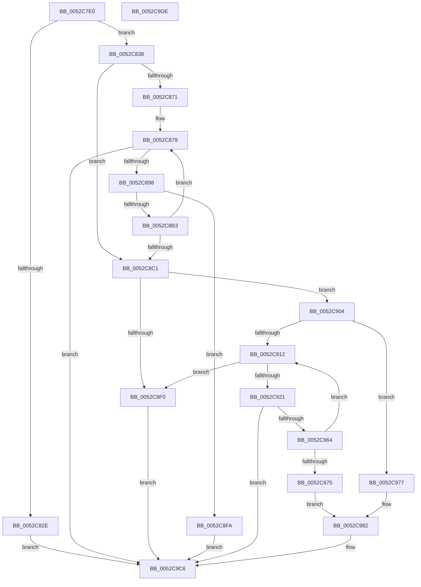

# SymCryptEcpointSetValue

- RVA: `0x0052C7E0`–`0x0052C9DF` (길이 `511` bytes)
- VA: `0x000000014052C7E0`
- 실행 섹션: `.text`
- PDB 이름 있음: `예`; PDB Function 태그: `아니요`
- unwind 정보 RVA: `0x000BBDE4`
- 디코드: `133`개 명령, `511/511` bytes 표시
- 미해석 바이트: `0` (있으면 어셈블리에 `.byte`로 보존)

> 이 문서는 커널 이미지의 기계어와 PDB 기호를 분석해 생성했습니다. 4번과 5번은 함수 원형과 자료형을 바이너리 사용 방식에서 추정한 C 해석이며 원본 소스 복구 결과는 아닙니다.

## 1. Dependencies

- 직접 호출 지점: **10**; 고유 호출 대상: **10**
- 직접 호출자로 확인된 함수: **2**
- RIP 상대 이미지 참조: **1**

### Outgoing calls
- `0x0052C802` → [SymCryptEcurveDigitsofFieldElement](SymCryptEcurveDigitsofFieldElement_function_00524150.md) (function, `0x00524150`)
- `0x0052C81F` → [SymCryptEcurveSizeofFieldElement](SymCryptEcurveSizeofFieldElement_function_005247FC.md) (function, `0x005247FC`)
- `0x0052C846` → [SymCryptSizeofIntFromDigits](SymCryptSizeofIntFromDigits_function_00525D24.md) (function, `0x00525D24`)
- `0x0052C85B` → [SymCryptIntCreate](SymCryptIntCreate_function_0052556C.md) (function, `0x0052556C`)
- `0x0052C88B` → [SymCryptIntSetValue](SymCryptIntSetValue_function_00525730.md) (function, `0x00525730`)
- `0x0052C89F` → [SymCryptIntFromModulus](SymCryptIntFromModulus_function_00525608.md) (function, `0x00525608`)
- `0x0052C8AA` → [SymCryptIntIsLessThan](SymCryptIntIsLessThan_function_005256C8.md) (function, `0x005256C8`)
- `0x0052C8E3` → [SymCryptEcpointCreateEx](SymCryptEcpointCreateEx_function_0052C5C0.md) (function, `0x0052C5C0`)
- `0x0052C95B` → [SymCryptModElementSetValue](SymCryptModElementSetValue_function_00525994.md) (function, `0x00525994`)
- `0x0052C9C1` → [SymCryptEcpointTransform](SymCryptEcpointTransform_function_0052C9E8.md) (function, `0x0052C9E8`)

### Direct callers
- [SymCryptEcurveInitialize](SymCryptEcurveInitialize_function_005241A4.md) at `0x0052457F`
- [SymCryptEckeySetValue](SymCryptEckeySetValue_function_00524C34.md) at `0x00524F6A`

### Static image references
- `0x0052C812` → RVA `0x00020870` (`.rdata`; read)

## 2. Other-region calls and transfers

- 다른 실행 섹션으로 향하는 call: **0**
- 별도 외부 분기/꼬리 이동을 확인하지 못했습니다.

## 3. Assembly (complete function range)

```asm
0052C7E0  48 89 5C 24 08                  mov qword ptr [rsp + 8], rbx
0052C7E5  44 89 4C 24 20                  mov dword ptr [rsp + 0x20], r9d
0052C7EA  55                              push rbp
0052C7EB  56                              push rsi
0052C7EC  57                              push rdi
0052C7ED  41 54                           push r12
0052C7EF  41 55                           push r13
0052C7F1  41 56                           push r14
0052C7F3  41 57                           push r15
0052C7F5  48 83 EC 40                     sub rsp, 0x40
0052C7F9  49 8B D8                        mov rbx, r8
0052C7FC  4C 8B E2                        mov r12, rdx
0052C7FF  48 8B F9                        mov rdi, rcx
0052C802  E8 49 79 FF FF                  call 0x140524150
0052C807  48 63 AC 24 A0 00 00 00         movsxd rbp, dword ptr [rsp + 0xa0]
0052C80F  44 8B F0                        mov r14d, eax
0052C812  48 8D 05 57 40 AF FF            lea rax, [rip - 0x50bfa9]
0052C819  48 8B CF                        mov rcx, rdi
0052C81C  8B 34 A8                        mov esi, dword ptr [rax + rbp*4]
0052C81F  E8 D8 7F FF FF                  call 0x1405247fc
0052C824  0F AF C6                        imul eax, esi
0052C827  8B C8                           mov ecx, eax
0052C829  48 3B D9                        cmp rbx, rcx
0052C82C  74 0A                           je 0x14052c838
0052C82E  B8 0D 80 00 00                  mov eax, 0x800d
0052C833  E9 8E 01 00 00                  jmp 0x14052c9c6
0052C838  33 D2                           xor edx, edx
0052C83A  48 8B C3                        mov rax, rbx
0052C83D  48 F7 F6                        div rsi
0052C840  41 8B CE                        mov ecx, r14d
0052C843  4C 8B E8                        mov r13, rax
0052C846  E8 D9 94 FF FF                  call 0x140525d24
0052C84B  4C 8B BC 24 B8 00 00 00         mov r15, qword ptr [rsp + 0xb8]
0052C853  45 8B C6                        mov r8d, r14d
0052C856  49 8B CF                        mov rcx, r15
0052C859  8B D0                           mov edx, eax
0052C85B  E8 0C 8D FF FF                  call 0x14052556c
0052C860  48 8B F0                        mov rsi, rax
0052C863  33 DB                           xor ebx, ebx
0052C865  48 8D 05 04 40 AF FF            lea rax, [rip - 0x50bffc]
0052C86C  39 1C A8                        cmp dword ptr [rax + rbp*4], ebx
0052C86F  76 50                           jbe 0x14052c8c1
0052C871  44 8B B4 24 98 00 00 00         mov r14d, dword ptr [rsp + 0x98]
0052C879  8B CB                           mov ecx, ebx
0052C87B  4C 8B CE                        mov r9, rsi
0052C87E  49 0F AF CD                     imul rcx, r13
0052C882  45 8B C6                        mov r8d, r14d
0052C885  49 8B D5                        mov rdx, r13
0052C888  49 03 CC                        add rcx, r12
0052C88B  E8 A0 8E FF FF                  call 0x140525730
0052C890  85 C0                           test eax, eax
0052C892  0F 85 2E 01 00 00               jne 0x14052c9c6
0052C898  48 8B 8F 68 02 00 00            mov rcx, qword ptr [rdi + 0x268]
0052C89F  E8 64 8D FF FF                  call 0x140525608
0052C8A4  48 8B D0                        mov rdx, rax
0052C8A7  48 8B CE                        mov rcx, rsi
0052C8AA  E8 19 8E FF FF                  call 0x1405256c8
0052C8AF  85 C0                           test eax, eax
0052C8B1  74 47                           je 0x14052c8fa
0052C8B3  FF C3                           inc ebx
0052C8B5  48 8D 05 B4 3F AF FF            lea rax, [rip - 0x50c04c]
0052C8BC  3B 1C A8                        cmp ebx, dword ptr [rax + rbp*4]
0052C8BF  72 B8                           jb 0x14052c879
0052C8C1  8B 47 24                        mov eax, dword ptr [rdi + 0x24]
0052C8C4  41 B9 04 00 00 00               mov r9d, 4
0052C8CA  4C 8B C7                        mov r8, rdi
0052C8CD  49 8B CF                        mov rcx, r15
0052C8D0  8D 04 85 20 00 00 00            lea eax, [rax*4 + 0x20]
0052C8D7  8B D0                           mov edx, eax
0052C8D9  89 84 24 90 00 00 00            mov dword ptr [rsp + 0x90], eax
0052C8E0  44 8B F0                        mov r14d, eax
0052C8E3  E8 D8 FC FF FF                  call 0x14052c5c0
0052C8E8  4C 8B F8                        mov r15, rax
0052C8EB  48 85 C0                        test rax, rax
0052C8EE  75 14                           jne 0x14052c904
0052C8F0  B8 0C 80 00 00                  mov eax, 0x800c
0052C8F5  E9 CC 00 00 00                  jmp 0x14052c9c6
0052C8FA  B8 0E 80 00 00                  mov eax, 0x800e
0052C8FF  E9 C2 00 00 00                  jmp 0x14052c9c6
0052C904  33 F6                           xor esi, esi
0052C906  48 8D 05 63 3F AF FF            lea rax, [rip - 0x50c09d]
0052C90D  39 34 A8                        cmp dword ptr [rax + rbp*4], esi
0052C910  76 65                           jbe 0x14052c977
0052C912  8B CE                           mov ecx, esi
0052C914  0F AF 4F 24                     imul ecx, dword ptr [rdi + 0x24]
0052C918  48 83 C1 20                     add rcx, 0x20
0052C91C  49 03 CF                        add rcx, r15
0052C91F  74 CF                           je 0x14052c8f0
0052C921  48 8B 9C 24 C0 00 00 00         mov rbx, qword ptr [rsp + 0xc0]
0052C929  49 8B D5                        mov rdx, r13
0052C92C  48 8B 84 24 B8 00 00 00         mov rax, qword ptr [rsp + 0xb8]
0052C934  49 2B DE                        sub rbx, r14
0052C937  4C 8B 8F 68 02 00 00            mov r9, qword ptr [rdi + 0x268]
0052C93E  49 03 C6                        add rax, r14
0052C941  44 8B 84 24 98 00 00 00         mov r8d, dword ptr [rsp + 0x98]
0052C949  48 89 5C 24 30                  mov qword ptr [rsp + 0x30], rbx
0052C94E  48 89 44 24 28                  mov qword ptr [rsp + 0x28], rax
0052C953  48 89 4C 24 20                  mov qword ptr [rsp + 0x20], rcx
0052C958  49 8B CC                        mov rcx, r12
0052C95B  E8 34 90 FF FF                  call 0x140525994
0052C960  85 C0                           test eax, eax
0052C962  75 62                           jne 0x14052c9c6
0052C964  4D 03 E5                        add r12, r13
0052C967  48 8D 05 02 3F AF FF            lea rax, [rip - 0x50c0fe]
0052C96E  FF C6                           inc esi
0052C970  3B 34 A8                        cmp esi, dword ptr [rax + rbp*4]
0052C973  72 9D                           jb 0x14052c912
0052C975  EB 0B                           jmp 0x14052c982
0052C977  48 8B 9C 24 C0 00 00 00         mov rbx, qword ptr [rsp + 0xc0]
0052C97F  49 2B DE                        sub rbx, r14
0052C982  8B 84 24 90 00 00 00            mov eax, dword ptr [rsp + 0x90]
0052C989  49 8B D7                        mov rdx, r15
0052C98C  48 03 84 24 B8 00 00 00         add rax, qword ptr [rsp + 0xb8]
0052C994  48 8B CF                        mov rcx, rdi
0052C997  44 8B 8C 24 A0 00 00 00         mov r9d, dword ptr [rsp + 0xa0]
0052C99F  4C 8B 84 24 A8 00 00 00         mov r8, qword ptr [rsp + 0xa8]
0052C9A7  48 89 5C 24 38                  mov qword ptr [rsp + 0x38], rbx
0052C9AC  48 89 44 24 30                  mov qword ptr [rsp + 0x30], rax
0052C9B1  8B 84 24 B0 00 00 00            mov eax, dword ptr [rsp + 0xb0]
0052C9B8  89 44 24 28                     mov dword ptr [rsp + 0x28], eax
0052C9BC  C6 44 24 20 01                  mov byte ptr [rsp + 0x20], 1
0052C9C1  E8 22 00 00 00                  call 0x14052c9e8
0052C9C6  48 8B 9C 24 80 00 00 00         mov rbx, qword ptr [rsp + 0x80]
0052C9CE  48 83 C4 40                     add rsp, 0x40
0052C9D2  41 5F                           pop r15
0052C9D4  41 5E                           pop r14
0052C9D6  41 5D                           pop r13
0052C9D8  41 5C                           pop r12
0052C9DA  5F                              pop rdi
0052C9DB  5E                              pop rsi
0052C9DC  5D                              pop rbp
0052C9DD  C3                              ret
0052C9DE  CC                              int3
```

## 4. C-style interpretation (structured pseudocode)

```c
__int64 __fastcall SymCryptEcpointSetValue(__int64 a1, __int64 a2, __int64 a3, int a4, unsigned int a5, __int64 a6, unsigned int a7, __int64 a8, __int64 a9)
{
    __int64 result;
    __int64 v_r12;
    __int64 v_rbx;
    __int64 v_rsi;
    __int64 v_rsp;
    unsigned __int64 v_stack_m40;
    unsigned __int64 v_stack_m48;
    unsigned __int64 v_stack_m50;
    unsigned __int64 v_stack_m58;
    unsigned int v_stack_p18;
    unsigned int v_stack_p20;
    unsigned __int64 v_stack_p8;

    v_stack_p8 = v_rbx;
    v_stack_p20 = a4;
    v_rsp = (v_rsp) - (64);
    result = SymCryptEcurveDigitsofFieldElement(a1, a2, a3, a4);
    result = SymCryptEcurveSizeofFieldElement(a1, a2, a3, a4);
    result = (unsigned int)((result) * ((unsigned int)((unsigned int)(*(unsigned int *)(v_rip - 5291945 + (int)(a5) * 4)))));
    if (a3 == ((unsigned int)((unsigned int)(result)))) goto loc_0052C838;
    goto loc_0052C9C6;
loc_0052C838:
    a2 = 0;
    result = SymCryptSizeofIntFromDigits((unsigned int)((unsigned int)((unsigned int)((unsigned int)(result)))), a2, a3, a4);
    result = SymCryptIntCreate(a8, (unsigned int)((unsigned int)(result)), (unsigned int)((unsigned int)((unsigned int)((unsigned int)(result)))), a4);
    v_rbx = 0;
    if ((*(unsigned int *)(v_rip - 5292028 + (int)(a5) * 4)) <= 0) goto loc_0052C8C1;
loc_0052C879:
    a1 = (0) * (a3);
    a1 = (a1) + (0);
    result = SymCryptIntSetValue(a1, a3, (unsigned int)((unsigned int)((unsigned int)(v_stack_p20))), result);
    if ((unsigned int)(result) != 0) goto loc_0052C9C6;
    result = SymCryptIntFromModulus(*(unsigned __int64 *)(a1 + 616), a3, (unsigned int)((unsigned int)((unsigned int)(v_stack_p20))), result);
    result = SymCryptIntIsLessThan(result, result, (unsigned int)((unsigned int)((unsigned int)(v_stack_p20))), result);
    if ((unsigned int)(result) == 0) goto loc_0052C8FA;
    v_rbx = (unsigned int)((v_rbx) + 1);
    if (((unsigned int)(v_rbx)) < (*(unsigned int *)(v_rip - 5292108 + (int)(a5) * 4))) goto loc_0052C879;
loc_0052C8C1:
    v_stack_p18 = (unsigned int)((unsigned int)(*(unsigned int *)(a1 + 36)) * 4 + 32);
    result = SymCryptEcpointCreateEx(a8, (unsigned int)((unsigned int)((unsigned int)(*(unsigned int *)(a1 + 36)) * 4 + 32)), a1, 4);
    if (result != 0) goto loc_0052C904;
loc_0052C8F0:
    goto loc_0052C9C6;
loc_0052C8FA:
    goto loc_0052C9C6;
loc_0052C904:
    v_rsi = 0;
    if ((*(unsigned int *)(v_rip - 5292189 + (int)(a5) * 4)) <= 0) goto loc_0052C977;
loc_0052C912:
    a1 = (unsigned int)((0) * (*(unsigned int *)(a1 + 36)));
    a1 = (a1) + (32);
    a1 = (a1) + (result);
    if (condition_is_equal) goto loc_0052C8F0;
    v_rbx = (a9) - ((unsigned int)((unsigned int)((unsigned int)(*(unsigned int *)(a1 + 36)) * 4 + 32)));
    result = (a8) + ((unsigned int)((unsigned int)((unsigned int)(*(unsigned int *)(a1 + 36)) * 4 + 32)));
    v_stack_m48 = v_rbx;
    v_stack_m50 = result;
    v_stack_m58 = a1;
    result = SymCryptModElementSetValue(0, a3, (unsigned int)(v_stack_p20), *(unsigned __int64 *)(a1 + 616));
    if ((unsigned int)(result) != 0) goto loc_0052C9C6;
    v_r12 = (a2) + (a3);
    v_rsi = (unsigned int)((v_rsi) + 1);
    if (((unsigned int)(v_rsi)) < (*(unsigned int *)(v_rip - 5292286 + (int)(a5) * 4))) goto loc_0052C912;
    goto loc_0052C982;
loc_0052C977:
    v_rbx = (a9) - ((unsigned int)((unsigned int)((unsigned int)(*(unsigned int *)(a1 + 36)) * 4 + 32)));
loc_0052C982:
    result = ((unsigned int)(v_stack_p18)) + (a8);
    v_stack_m40 = v_rbx;
    v_stack_m48 = result;
    v_stack_m50 = (unsigned int)((unsigned int)(a7));
    v_stack_m58 = 1;
    result = SymCryptEcpointTransform(a1, result, a6, (unsigned int)(a5));
loc_0052C9C6:
    v_rsp = (v_rsp) + (64);
    return result;
}
```

## 5. (Beta) C Style

```c
int64_t SymCryptEcpointSetValue(void *Arg1, int64_t Arg2, int64_t Arg3, int32_t Arg4, uint32_t Arg5, int64_t Arg6, uint32_t Arg7, int64_t Arg8, int64_t Arg9)
{
    uint8_t *arg1 = (uint8_t *)Arg1;

    int64_t result;
    int64_t local_r12;
    int64_t local_rbx;
    int64_t local_rsi;
    int64_t local_rsp;
    uint64_t v_stack_m40;
    uint64_t v_stack_m48;
    uint64_t v_stack_m50;
    uint64_t v_stack_m58;
    uint32_t v_stack_p18;
    uint32_t v_stack_p20;
    uint64_t v_stack_p8;

    v_stack_p8 = local_rbx;
    v_stack_p20 = Arg4;
    local_rsp = (local_rsp) - (64);
    result = SymCryptEcurveDigitsofFieldElement(Arg1, Arg2, Arg3, Arg4);
    result = SymCryptEcurveSizeofFieldElement(Arg1, Arg2, Arg3, Arg4);
    result = (uint32_t)((result) * ((uint32_t)((uint32_t)(*(uint32_t *)(v_rip - 0x50BFA9 + (int32_t)(Arg5) * 4)))));
    if (Arg3 == ((uint32_t)((uint32_t)(result)))) goto loc_0052C838;
    goto loc_0052C9C6;
loc_0052C838:
    Arg2 = 0;
    result = SymCryptSizeofIntFromDigits((uint32_t)((uint32_t)((uint32_t)((uint32_t)(result)))), Arg2, Arg3, Arg4);
    result = SymCryptIntCreate(Arg8, (uint32_t)((uint32_t)(result)), (uint32_t)((uint32_t)((uint32_t)((uint32_t)(result)))), Arg4);
    local_rbx = 0;
    if ((*(uint32_t *)(v_rip - 0x50BFFC + (int32_t)(Arg5) * 4)) <= 0) goto loc_0052C8C1;
loc_0052C879:
    Arg1 = (0) * (Arg3);
    Arg1 = (Arg1) + (0);
    result = SymCryptIntSetValue(Arg1, Arg3, (uint32_t)((uint32_t)((uint32_t)(v_stack_p20))), result);
    if ((uint32_t)(result) != 0) goto loc_0052C9C6;
    result = SymCryptIntFromModulus(*(uint64_t *)(arg1 + 0x268), Arg3, (uint32_t)((uint32_t)((uint32_t)(v_stack_p20))), result);
    result = SymCryptIntIsLessThan(result, result, (uint32_t)((uint32_t)((uint32_t)(v_stack_p20))), result);
    if ((uint32_t)(result) == 0) goto loc_0052C8FA;
    local_rbx = (uint32_t)((local_rbx) + 1);
    if (((uint32_t)(local_rbx)) < (*(uint32_t *)(v_rip - 0x50C04C + (int32_t)(Arg5) * 4))) goto loc_0052C879;
loc_0052C8C1:
    v_stack_p18 = (uint32_t)((uint32_t)(*(uint32_t *)(arg1 + 0x24)) * 4 + 32);
    result = SymCryptEcpointCreateEx(Arg8, (uint32_t)((uint32_t)((uint32_t)(*(uint32_t *)(arg1 + 0x24)) * 4 + 32)), Arg1, 4);
    if (result != 0) goto loc_0052C904;
loc_0052C8F0:
    goto loc_0052C9C6;
loc_0052C8FA:
    goto loc_0052C9C6;
loc_0052C904:
    local_rsi = 0;
    if ((*(uint32_t *)(v_rip - 0x50C09D + (int32_t)(Arg5) * 4)) <= 0) goto loc_0052C977;
loc_0052C912:
    Arg1 = (uint32_t)((0) * (*(uint32_t *)(arg1 + 0x24)));
    Arg1 = (Arg1) + (32);
    Arg1 = (Arg1) + (result);
    if (condition_is_equal) goto loc_0052C8F0;
    local_rbx = (Arg9) - ((uint32_t)((uint32_t)((uint32_t)(*(uint32_t *)(arg1 + 0x24)) * 4 + 32)));
    result = (Arg8) + ((uint32_t)((uint32_t)((uint32_t)(*(uint32_t *)(arg1 + 0x24)) * 4 + 32)));
    v_stack_m48 = local_rbx;
    v_stack_m50 = result;
    v_stack_m58 = Arg1;
    result = SymCryptModElementSetValue(0, Arg3, (uint32_t)(v_stack_p20), *(uint64_t *)(arg1 + 0x268));
    if ((uint32_t)(result) != 0) goto loc_0052C9C6;
    local_r12 = (Arg2) + (Arg3);
    local_rsi = (uint32_t)((local_rsi) + 1);
    if (((uint32_t)(local_rsi)) < (*(uint32_t *)(v_rip - 0x50C0FE + (int32_t)(Arg5) * 4))) goto loc_0052C912;
    goto loc_0052C982;
loc_0052C977:
    local_rbx = (Arg9) - ((uint32_t)((uint32_t)((uint32_t)(*(uint32_t *)(arg1 + 0x24)) * 4 + 32)));
loc_0052C982:
    result = ((uint32_t)(v_stack_p18)) + (Arg8);
    v_stack_m40 = local_rbx;
    v_stack_m48 = result;
    v_stack_m50 = (uint32_t)((uint32_t)(Arg7));
    v_stack_m58 = 1;
    result = SymCryptEcpointTransform(Arg1, result, Arg6, (uint32_t)(Arg5));
loc_0052C9C6:
    local_rsp = (local_rsp) + (64);
    return result;
}
```

### 관측된 메모리 오프셋

구조체 형식이 확인되지 않은 접근은 인자 기준의 오프셋으로만 기록했습니다.

| 기준 인자 | 오프셋 표현 | 폭 (bit) | 접근 |
|---|---:|---:|---|
| `Arg1` | `+ 0x24` | `32` | `R` |
| `Arg1` | `+ 0x268` | `64` | `R` |

## 6. Execution-region graph

[열기: 2D/3D 그래프와 함수 탐색 컨트롤 패널](../../../control-panel.html?section=text&rva=0x0052C7E0&view=graph)

- 2D 그래프는 위에서 아래로 흐르고, 3D 그래프는 빈 공간을 드래그해 회전합니다. Shift+드래그는 이동, 휠은 확대·축소, 함수 노드 선택은 대상 보고서 이동입니다.

### Static fallback


