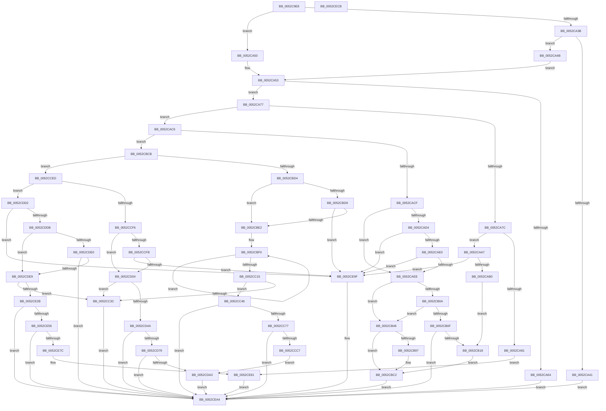

# SymCryptEcpointTransform

- RVA: `0x0052C9E8`–`0x0052CECC` (길이 `1,252` bytes)
- VA: `0x000000014052C9E8`
- 실행 섹션: `.text`
- PDB 이름 있음: `예`; PDB Function 태그: `아니요`
- unwind 정보 RVA: `0x000C3498`
- 디코드: `307`개 명령, `1,252/1,252` bytes 표시
- 미해석 바이트: `0` (있으면 어셈블리에 `.byte`로 보존)

> 이 문서는 커널 이미지의 기계어와 PDB 기호를 분석해 생성했습니다. 4번과 5번은 함수 원형과 자료형을 바이너리 사용 방식에서 추정한 C 해석이며 원본 소스 복구 결과는 아닙니다.

## 1. Dependencies

- 직접 호출 지점: **25**; 고유 호출 대상: **8**
- 직접 호출자로 확인된 함수: **2**
- RIP 상대 이미지 참조: **1**

### Outgoing calls
- `0x0052CA6D` → [SymCryptEcpointCopy](SymCryptEcpointCopy_function_0052C564.md) (function, `0x0052C564`)
- `0x0052CA90` → [SymCryptModElementCopy](SymCryptModElementCopy_function_005258E8.md) (function, `0x005258E8`)
- `0x0052CABF` → [SymCryptModElementCopy](SymCryptModElementCopy_function_005258E8.md) (function, `0x005258E8`)
- `0x0052CB00` → [SymCryptModElementCopy](SymCryptModElementCopy_function_005258E8.md) (function, `0x005258E8`)
- `0x0052CB3F` → [SymCryptModElementSetValueUint32](SymCryptModElementSetValueUint32_function_00525A40.md) (function, `0x00525A40`)
- `0x0052CB5E` → [SymCryptModElementCopy](SymCryptModElementCopy_function_005258E8.md) (function, `0x005258E8`)
- `0x0052CB8D` → [SymCryptModElementSetValueUint32](SymCryptModElementSetValueUint32_function_00525A40.md) (function, `0x00525A40`)
- `0x0052CBBD` → [SymCryptModMul](SymCryptModMul_function_00525BA8.md) (function, `0x00525BA8`)
- `0x0052CBFD` → [SymCryptModElementCreate](SymCryptModElementCreate_function_00525900.md) (function, `0x00525900`)
- `0x0052CC33` → [SymCryptModElementIsZero](SymCryptModElementIsZero_function_00525964.md) (function, `0x00525964`)
- `0x0052CC68` → [SymCryptModInv](SymCryptModInv_function_00525B6C.md) (function, `0x00525B6C`)
- `0x0052CC98` → [SymCryptModMul](SymCryptModMul_function_00525BA8.md) (function, `0x00525BA8`)
- `0x0052CCB9` → [SymCryptModMul](SymCryptModMul_function_00525BA8.md) (function, `0x00525BA8`)
- `0x0052CCE3` → [SymCryptModMul](SymCryptModMul_function_00525BA8.md) (function, `0x00525BA8`)
- `0x0052CD11` → [SymCryptModElementCreate](SymCryptModElementCreate_function_00525900.md) (function, `0x00525900`)
- `0x0052CD3D` → [SymCryptModElementIsZero](SymCryptModElementIsZero_function_00525964.md) (function, `0x00525964`)
- `0x0052CD6A` → [SymCryptModInv](SymCryptModInv_function_00525B6C.md) (function, `0x00525B6C`)
- `0x0052CD95` → [SymCryptModMul](SymCryptModMul_function_00525BA8.md) (function, `0x00525BA8`)
- `0x0052CDC8` → [SymCryptModMul](SymCryptModMul_function_00525BA8.md) (function, `0x00525BA8`)
- `0x0052CDF6` → [SymCryptModElementCreate](SymCryptModElementCreate_function_00525900.md) (function, `0x00525900`)
- `0x0052CE1E` → [SymCryptModElementIsZero](SymCryptModElementIsZero_function_00525964.md) (function, `0x00525964`)
- `0x0052CE4B` → [SymCryptModInv](SymCryptModInv_function_00525B6C.md) (function, `0x00525B6C`)
- `0x0052CE72` → [SymCryptModMul](SymCryptModMul_function_00525BA8.md) (function, `0x00525BA8`)
- `0x0052CE98` → [SymCryptModElementSetValueUint32](SymCryptModElementSetValueUint32_function_00525A40.md) (function, `0x00525A40`)
- `0x0052CEAE` → [_security_check_cookie](../6A/_security_check_cookie_function_006AC640.md) (function, `0x006AC640`)

### Direct callers
- [SymCryptEcpointGetValue](SymCryptEcpointGetValue_function_0052C650.md) at `0x0052C717`
- [SymCryptEcpointSetValue](SymCryptEcpointSetValue_function_0052C7E0.md) at `0x0052C9C1`

### Static image references
- `0x0052C9FC` → RVA `0x00E0A740` (`.data`; read)

## 2. Other-region calls and transfers

- 다른 실행 섹션으로 향하는 call: **0**
- 별도 외부 분기/꼬리 이동을 확인하지 못했습니다.

## 3. Assembly (complete function range)

```asm
0052C9E8  48 89 5C 24 20                  mov qword ptr [rsp + 0x20], rbx
0052C9ED  55                              push rbp
0052C9EE  56                              push rsi
0052C9EF  57                              push rdi
0052C9F0  41 54                           push r12
0052C9F2  41 55                           push r13
0052C9F4  41 56                           push r14
0052C9F6  41 57                           push r15
0052C9F8  48 83 EC 50                     sub rsp, 0x50
0052C9FC  48 8B 05 3D DD 8D 00            mov rax, qword ptr [rip + 0x8ddd3d]
0052CA03  48 33 C4                        xor rax, rsp
0052CA06  48 89 44 24 40                  mov qword ptr [rsp + 0x40], rax
0052CA0B  48 8B AC 24 C0 00 00 00         mov rbp, qword ptr [rsp + 0xc0]
0052CA13  33 DB                           xor ebx, ebx
0052CA15  0F 57 C0                        xorps xmm0, xmm0
0052CA18  4D 8B F0                        mov r14, r8
0052CA1B  4C 8B FA                        mov r15, rdx
0052CA1E  8A 94 24 B0 00 00 00            mov dl, byte ptr [rsp + 0xb0]
0052CA25  48 8B F9                        mov rdi, rcx
0052CA28  44 8D 53 11                     lea r10d, [rbx + 0x11]
0052CA2C  44 8D 43 22                     lea r8d, [rbx + 0x22]
0052CA30  0F 11 44 24 30                  movups xmmword ptr [rsp + 0x30], xmm0
0052CA35  41 83 E9 01                     sub r9d, 1
0052CA39  74 15                           je 0x14052ca50
0052CA3B  41 83 F9 01                     cmp r9d, 1
0052CA3F  74 0A                           je 0x14052ca4b
0052CA41  BB 0E 80 00 00                  mov ebx, 0x800e
0052CA46  E9 59 04 00 00                  jmp 0x14052cea4
0052CA4B  41 8B C8                        mov ecx, r8d
0052CA4E  EB 03                           jmp 0x14052ca53
0052CA50  41 8B CA                        mov ecx, r10d
0052CA53  8B 47 08                        mov eax, dword ptr [rdi + 8]
0052CA56  84 D2                           test dl, dl
0052CA58  8B F0                           mov esi, eax
0052CA5A  0F 44 F1                        cmove esi, ecx
0052CA5D  0F 44 C8                        cmove ecx, eax
0052CA60  3B CE                           cmp ecx, esi
0052CA62  75 13                           jne 0x14052ca77
0052CA64  4D 8B C6                        mov r8, r14
0052CA67  49 8B D7                        mov rdx, r15
0052CA6A  48 8B CF                        mov rcx, rdi
0052CA6D  E8 F2 FA FF FF                  call 0x14052c564
0052CA72  E9 2D 04 00 00                  jmp 0x14052cea4
0052CA77  41 3B CA                        cmp ecx, r10d
0052CA7A  75 4A                           jne 0x14052cac6
0052CA7C  41 3B F0                        cmp esi, r8d
0052CA7F  75 26                           jne 0x14052caa7
0052CA81  48 8B 8F 68 02 00 00            mov rcx, qword ptr [rdi + 0x268]
0052CA88  4D 8D 46 20                     lea r8, [r14 + 0x20]
0052CA8C  49 8D 57 20                     lea rdx, [r15 + 0x20]
0052CA90  E8 53 8E FF FF                  call 0x1405258e8
0052CA95  48 8B 84 24 C8 00 00 00         mov rax, qword ptr [rsp + 0xc8]
0052CA9D  48 89 44 24 20                  mov qword ptr [rsp + 0x20], rax
0052CAA2  E9 DA 03 00 00                  jmp 0x14052ce81
0052CAA7  83 FE 62                        cmp esi, 0x62
0052CAAA  0F 85 EF 03 00 00               jne 0x14052ce9f
0052CAB0  48 8B 8F 68 02 00 00            mov rcx, qword ptr [rdi + 0x268]
0052CAB7  4D 8D 46 20                     lea r8, [r14 + 0x20]
0052CABB  49 8D 57 20                     lea rdx, [r15 + 0x20]
0052CABF  E8 24 8E FF FF                  call 0x1405258e8
0052CAC4  EB 52                           jmp 0x14052cb18
0052CAC6  41 3B C8                        cmp ecx, r8d
0052CAC9  0F 85 FC 00 00 00               jne 0x14052cbcb
0052CACF  41 3B F2                        cmp esi, r10d
0052CAD2  74 1A                           je 0x14052caee
0052CAD4  8D 46 BD                        lea eax, [rsi - 0x43]
0052CAD7  83 F8 1F                        cmp eax, 0x1f
0052CADA  0F 87 BF 03 00 00               ja 0x14052ce9f
0052CAE0  B9 01 00 02 80                  mov ecx, 0x80020001
0052CAE5  0F A3 C1                        bt ecx, eax
0052CAE8  0F 83 B1 03 00 00               jae 0x14052ce9f
0052CAEE  48 8B 8F 68 02 00 00            mov rcx, qword ptr [rdi + 0x268]
0052CAF5  4D 8D 67 20                     lea r12, [r15 + 0x20]
0052CAF9  49 8B D4                        mov rdx, r12
0052CAFC  4D 8D 46 20                     lea r8, [r14 + 0x20]
0052CB00  E8 E3 8D FF FF                  call 0x1405258e8
0052CB05  83 FE 43                        cmp esi, 0x43
0052CB08  74 3C                           je 0x14052cb46
0052CB0A  83 FE 54                        cmp esi, 0x54
0052CB0D  74 37                           je 0x14052cb46
0052CB0F  83 FE 62                        cmp esi, 0x62
0052CB12  0F 85 8C 03 00 00               jne 0x14052cea4
0052CB18  44 8B 47 24                     mov r8d, dword ptr [rdi + 0x24]
0052CB1C  4C 8B CD                        mov r9, rbp
0052CB1F  48 8B 84 24 C8 00 00 00         mov rax, qword ptr [rsp + 0xc8]
0052CB27  49 83 C0 20                     add r8, 0x20
0052CB2B  48 8B 97 68 02 00 00            mov rdx, qword ptr [rdi + 0x268]
0052CB32  4D 03 C6                        add r8, r14
0052CB35  B9 01 00 00 00                  mov ecx, 1
0052CB3A  48 89 44 24 20                  mov qword ptr [rsp + 0x20], rax
0052CB3F  E8 FC 8E FF FF                  call 0x140525a40
0052CB44  EB 7C                           jmp 0x14052cbc2
0052CB46  8B 47 24                        mov eax, dword ptr [rdi + 0x24]
0052CB49  48 8B 8F 68 02 00 00            mov rcx, qword ptr [rdi + 0x268]
0052CB50  4C 03 F8                        add r15, rax
0052CB53  4C 8D 40 20                     lea r8, [rax + 0x20]
0052CB57  4D 03 C6                        add r8, r14
0052CB5A  49 8D 57 20                     lea rdx, [r15 + 0x20]
0052CB5E  E8 85 8D FF FF                  call 0x1405258e8
0052CB63  8B 47 24                        mov eax, dword ptr [rdi + 0x24]
0052CB66  4C 8B CD                        mov r9, rbp
0052CB69  4C 8B AC 24 C8 00 00 00         mov r13, qword ptr [rsp + 0xc8]
0052CB71  B9 01 00 00 00                  mov ecx, 1
0052CB76  48 8B 97 68 02 00 00            mov rdx, qword ptr [rdi + 0x268]
0052CB7D  4C 89 6C 24 20                  mov qword ptr [rsp + 0x20], r13
0052CB82  44 8D 04 00                     lea r8d, [rax + rax]
0052CB86  49 83 C0 20                     add r8, 0x20
0052CB8A  4D 03 C6                        add r8, r14
0052CB8D  E8 AE 8E FF FF                  call 0x140525a40
0052CB92  83 FE 54                        cmp esi, 0x54
0052CB95  75 2B                           jne 0x14052cbc2
0052CB97  8B 47 24                        mov eax, dword ptr [rdi + 0x24]
0052CB9A  4D 8D 47 20                     lea r8, [r15 + 0x20]
0052CB9E  48 8B 8F 68 02 00 00            mov rcx, qword ptr [rdi + 0x268]
0052CBA5  49 8B D4                        mov rdx, r12
0052CBA8  4C 89 6C 24 28                  mov qword ptr [rsp + 0x28], r13
0052CBAD  48 89 6C 24 20                  mov qword ptr [rsp + 0x20], rbp
0052CBB2  44 8D 0C 40                     lea r9d, [rax + rax*2]
0052CBB6  49 83 C1 20                     add r9, 0x20
0052CBBA  4D 03 CE                        add r9, r14
0052CBBD  E8 E6 8F FF FF                  call 0x140525ba8
0052CBC2  41 C6 06 01                     mov byte ptr [r14], 1
0052CBC6  E9 D9 02 00 00                  jmp 0x14052cea4
0052CBCB  83 F9 43                        cmp ecx, 0x43
0052CBCE  0F 85 19 01 00 00               jne 0x14052cced
0052CBD4  41 3B F2                        cmp esi, r10d
0052CBD7  74 09                           je 0x14052cbe2
0052CBD9  41 3B F0                        cmp esi, r8d
0052CBDC  0F 85 BD 02 00 00               jne 0x14052ce9f
0052CBE2  8B 47 24                        mov eax, dword ptr [rdi + 0x24]
0052CBE5  48 8D 5C 24 30                  lea rbx, [rsp + 0x30]
0052CBEA  41 BC 02 00 00 00               mov r12d, 2
0052CBF0  4C 8B 87 68 02 00 00            mov r8, qword ptr [rdi + 0x268]
0052CBF7  48 8B D0                        mov rdx, rax
0052CBFA  48 8B CD                        mov rcx, rbp
0052CBFD  E8 FE 8C FF FF                  call 0x140525900
0052CC02  48 89 03                        mov qword ptr [rbx], rax
0052CC05  48 8D 5B 08                     lea rbx, [rbx + 8]
0052CC09  8B 47 24                        mov eax, dword ptr [rdi + 0x24]
0052CC0C  48 03 E8                        add rbp, rax
0052CC0F  49 83 EC 01                     sub r12, 1
0052CC13  75 DB                           jne 0x14052cbf0
0052CC15  4C 8B A4 24 C8 00 00 00         mov r12, qword ptr [rsp + 0xc8]
0052CC1D  03 C0                           add eax, eax
0052CC1F  8B C8                           mov ecx, eax
0052CC21  4C 2B E1                        sub r12, rcx
0052CC24  48 8B 8F 68 02 00 00            mov rcx, qword ptr [rdi + 0x268]
0052CC2B  4A 8D 1C 38                     lea rbx, [rax + r15]
0052CC2F  48 8D 53 20                     lea rdx, [rbx + 0x20]
0052CC33  E8 2C 8D FF FF                  call 0x140525964
0052CC38  85 C0                           test eax, eax
0052CC3A  74 0A                           je 0x14052cc46
0052CC3C  BB 11 80 00 00                  mov ebx, 0x8011
0052CC41  E9 5E 02 00 00                  jmp 0x14052cea4
0052CC46  44 8B 8C 24 B8 00 00 00         mov r9d, dword ptr [rsp + 0xb8]
0052CC4E  48 8D 53 20                     lea rdx, [rbx + 0x20]
0052CC52  4C 8B 44 24 30                  mov r8, qword ptr [rsp + 0x30]
0052CC57  48 8B 8F 68 02 00 00            mov rcx, qword ptr [rdi + 0x268]
0052CC5E  4C 89 64 24 28                  mov qword ptr [rsp + 0x28], r12
0052CC63  48 89 6C 24 20                  mov qword ptr [rsp + 0x20], rbp
0052CC68  E8 FF 8E FF FF                  call 0x140525b6c
0052CC6D  8B D8                           mov ebx, eax
0052CC6F  85 C0                           test eax, eax
0052CC71  0F 85 2D 02 00 00               jne 0x14052cea4
0052CC77  4C 8B 44 24 30                  mov r8, qword ptr [rsp + 0x30]
0052CC7C  4C 8B 6C 24 38                  mov r13, qword ptr [rsp + 0x38]
0052CC81  49 8B D0                        mov rdx, r8
0052CC84  48 8B 8F 68 02 00 00            mov rcx, qword ptr [rdi + 0x268]
0052CC8B  4D 8B CD                        mov r9, r13
0052CC8E  4C 89 64 24 28                  mov qword ptr [rsp + 0x28], r12
0052CC93  48 89 6C 24 20                  mov qword ptr [rsp + 0x20], rbp
0052CC98  E8 0B 8F FF FF                  call 0x140525ba8
0052CC9D  48 8B 8F 68 02 00 00            mov rcx, qword ptr [rdi + 0x268]
0052CCA4  4D 8D 4E 20                     lea r9, [r14 + 0x20]
0052CCA8  49 8D 57 20                     lea rdx, [r15 + 0x20]
0052CCAC  4C 89 64 24 28                  mov qword ptr [rsp + 0x28], r12
0052CCB1  4D 8B C5                        mov r8, r13
0052CCB4  48 89 6C 24 20                  mov qword ptr [rsp + 0x20], rbp
0052CCB9  E8 EA 8E FF FF                  call 0x140525ba8
0052CCBE  83 FE 22                        cmp esi, 0x22
0052CCC1  0F 85 DD 01 00 00               jne 0x14052cea4
0052CCC7  48 8B 54 24 30                  mov rdx, qword ptr [rsp + 0x30]
0052CCCC  4D 8B CD                        mov r9, r13
0052CCCF  48 8B 8F 68 02 00 00            mov rcx, qword ptr [rdi + 0x268]
0052CCD6  4D 8B C5                        mov r8, r13
0052CCD9  4C 89 64 24 28                  mov qword ptr [rsp + 0x28], r12
0052CCDE  48 89 6C 24 20                  mov qword ptr [rsp + 0x20], rbp
0052CCE3  E8 C0 8E FF FF                  call 0x140525ba8
0052CCE8  E9 B6 00 00 00                  jmp 0x14052cda3
0052CCED  83 F9 54                        cmp ecx, 0x54
0052CCF0  0F 85 DC 00 00 00               jne 0x14052cdd2
0052CCF6  41 3B F2                        cmp esi, r10d
0052CCF9  74 09                           je 0x14052cd04
0052CCFB  41 3B F0                        cmp esi, r8d
0052CCFE  0F 85 9B 01 00 00               jne 0x14052ce9f
0052CD04  8B 57 24                        mov edx, dword ptr [rdi + 0x24]
0052CD07  48 8B CD                        mov rcx, rbp
0052CD0A  4C 8B 87 68 02 00 00            mov r8, qword ptr [rdi + 0x268]
0052CD11  E8 EA 8B FF FF                  call 0x140525900
0052CD16  8B 4F 24                        mov ecx, dword ptr [rdi + 0x24]
0052CD19  4C 8B E8                        mov r13, rax
0052CD1C  4C 8B A4 24 C8 00 00 00         mov r12, qword ptr [rsp + 0xc8]
0052CD24  48 03 E9                        add rbp, rcx
0052CD27  03 C9                           add ecx, ecx
0052CD29  8B D1                           mov edx, ecx
0052CD2B  4C 2B E2                        sub r12, rdx
0052CD2E  4A 8D 1C 39                     lea rbx, [rcx + r15]
0052CD32  48 8B 8F 68 02 00 00            mov rcx, qword ptr [rdi + 0x268]
0052CD39  48 8D 53 20                     lea rdx, [rbx + 0x20]
0052CD3D  E8 22 8C FF FF                  call 0x140525964
0052CD42  85 C0                           test eax, eax
0052CD44  0F 85 F2 FE FF FF               jne 0x14052cc3c
0052CD4A  44 8B 8C 24 B8 00 00 00         mov r9d, dword ptr [rsp + 0xb8]
0052CD52  48 8D 53 20                     lea rdx, [rbx + 0x20]
0052CD56  48 8B 8F 68 02 00 00            mov rcx, qword ptr [rdi + 0x268]
0052CD5D  4D 8B C5                        mov r8, r13
0052CD60  4C 89 64 24 28                  mov qword ptr [rsp + 0x28], r12
0052CD65  48 89 6C 24 20                  mov qword ptr [rsp + 0x20], rbp
0052CD6A  E8 FD 8D FF FF                  call 0x140525b6c
0052CD6F  8B D8                           mov ebx, eax
0052CD71  85 C0                           test eax, eax
0052CD73  0F 85 2B 01 00 00               jne 0x14052cea4
0052CD79  48 8B 8F 68 02 00 00            mov rcx, qword ptr [rdi + 0x268]
0052CD80  4D 8D 4E 20                     lea r9, [r14 + 0x20]
0052CD84  49 8D 57 20                     lea rdx, [r15 + 0x20]
0052CD88  4C 89 64 24 28                  mov qword ptr [rsp + 0x28], r12
0052CD8D  4D 8B C5                        mov r8, r13
0052CD90  48 89 6C 24 20                  mov qword ptr [rsp + 0x20], rbp
0052CD95  E8 0E 8E FF FF                  call 0x140525ba8
0052CD9A  83 FE 22                        cmp esi, 0x22
0052CD9D  0F 85 01 01 00 00               jne 0x14052cea4
0052CDA3  8B 47 24                        mov eax, dword ptr [rdi + 0x24]
0052CDA6  4D 8D 4E 20                     lea r9, [r14 + 0x20]
0052CDAA  48 8B 8F 68 02 00 00            mov rcx, qword ptr [rdi + 0x268]
0052CDB1  4C 03 C8                        add r9, rax
0052CDB4  4C 89 64 24 28                  mov qword ptr [rsp + 0x28], r12
0052CDB9  4D 8B C5                        mov r8, r13
0052CDBC  48 89 6C 24 20                  mov qword ptr [rsp + 0x20], rbp
0052CDC1  48 8D 50 20                     lea rdx, [rax + 0x20]
0052CDC5  49 03 D7                        add rdx, r15
0052CDC8  E8 DB 8D FF FF                  call 0x140525ba8
0052CDCD  E9 D2 00 00 00                  jmp 0x14052cea4
0052CDD2  83 F9 62                        cmp ecx, 0x62
0052CDD5  0F 85 C4 00 00 00               jne 0x14052ce9f
0052CDDB  41 3B F2                        cmp esi, r10d
0052CDDE  74 09                           je 0x14052cde9
0052CDE0  41 3B F0                        cmp esi, r8d
0052CDE3  0F 85 BB 00 00 00               jne 0x14052cea4
0052CDE9  8B 57 24                        mov edx, dword ptr [rdi + 0x24]
0052CDEC  48 8B CD                        mov rcx, rbp
0052CDEF  4C 8B 87 68 02 00 00            mov r8, qword ptr [rdi + 0x268]
0052CDF6  E8 05 8B FF FF                  call 0x140525900
0052CDFB  8B 4F 24                        mov ecx, dword ptr [rdi + 0x24]
0052CDFE  4C 8B E8                        mov r13, rax
0052CE01  4C 8B A4 24 C8 00 00 00         mov r12, qword ptr [rsp + 0xc8]
0052CE09  48 03 E9                        add rbp, rcx
0052CE0C  4C 2B E1                        sub r12, rcx
0052CE0F  4A 8D 1C 39                     lea rbx, [rcx + r15]
0052CE13  48 8B 8F 68 02 00 00            mov rcx, qword ptr [rdi + 0x268]
0052CE1A  48 8D 53 20                     lea rdx, [rbx + 0x20]
0052CE1E  E8 41 8B FF FF                  call 0x140525964
0052CE23  85 C0                           test eax, eax
0052CE25  0F 85 11 FE FF FF               jne 0x14052cc3c
0052CE2B  44 8B 8C 24 B8 00 00 00         mov r9d, dword ptr [rsp + 0xb8]
0052CE33  48 8D 53 20                     lea rdx, [rbx + 0x20]
0052CE37  48 8B 8F 68 02 00 00            mov rcx, qword ptr [rdi + 0x268]
0052CE3E  4D 8B C5                        mov r8, r13
0052CE41  4C 89 64 24 28                  mov qword ptr [rsp + 0x28], r12
0052CE46  48 89 6C 24 20                  mov qword ptr [rsp + 0x20], rbp
0052CE4B  E8 1C 8D FF FF                  call 0x140525b6c
0052CE50  8B D8                           mov ebx, eax
0052CE52  85 C0                           test eax, eax
0052CE54  75 4E                           jne 0x14052cea4
0052CE56  48 8B 8F 68 02 00 00            mov rcx, qword ptr [rdi + 0x268]
0052CE5D  4D 8D 4E 20                     lea r9, [r14 + 0x20]
0052CE61  49 8D 57 20                     lea rdx, [r15 + 0x20]
0052CE65  4C 89 64 24 28                  mov qword ptr [rsp + 0x28], r12
0052CE6A  4D 8B C5                        mov r8, r13
0052CE6D  48 89 6C 24 20                  mov qword ptr [rsp + 0x20], rbp
0052CE72  E8 31 8D FF FF                  call 0x140525ba8
0052CE77  83 FE 22                        cmp esi, 0x22
0052CE7A  75 28                           jne 0x14052cea4
0052CE7C  4C 89 64 24 20                  mov qword ptr [rsp + 0x20], r12
0052CE81  44 8B 47 24                     mov r8d, dword ptr [rdi + 0x24]
0052CE85  4C 8B CD                        mov r9, rbp
0052CE88  48 8B 97 68 02 00 00            mov rdx, qword ptr [rdi + 0x268]
0052CE8F  49 83 C0 20                     add r8, 0x20
0052CE93  4D 03 C6                        add r8, r14
0052CE96  33 C9                           xor ecx, ecx
0052CE98  E8 A3 8B FF FF                  call 0x140525a40
0052CE9D  EB 05                           jmp 0x14052cea4
0052CE9F  BB 0B 80 00 00                  mov ebx, 0x800b
0052CEA4  8B C3                           mov eax, ebx
0052CEA6  48 8B 4C 24 40                  mov rcx, qword ptr [rsp + 0x40]
0052CEAB  48 33 CC                        xor rcx, rsp
0052CEAE  E8 8D F7 17 00                  call 0x1406ac640
0052CEB3  48 8B 9C 24 A8 00 00 00         mov rbx, qword ptr [rsp + 0xa8]
0052CEBB  48 83 C4 50                     add rsp, 0x50
0052CEBF  41 5F                           pop r15
0052CEC1  41 5E                           pop r14
0052CEC3  41 5D                           pop r13
0052CEC5  41 5C                           pop r12
0052CEC7  5F                              pop rdi
0052CEC8  5E                              pop rsi
0052CEC9  5D                              pop rbp
0052CECA  C3                              ret
0052CECB  CC                              int3
```

## 4. C-style interpretation (structured pseudocode)

```c
__int64 __fastcall SymCryptEcpointTransform(__int64 a1, __int64 a2, __int64 a3, int a4, unsigned __int8 a5, unsigned int a6, __int64 a7, __int64 a8)
{
    __int64 result;
    __int64 v_r12;
    __int64 v_r15;
    __int64 v_rbp;
    __int64 v_rbx;
    __int64 v_rsi;
    __int64 v_rsp;
    unsigned __int64 v_stack_m48;
    unsigned __int64 v_stack_m50;
    unsigned __int64 v_stack_m58;
    unsigned __int64 v_stack_m60;
    unsigned __int64 v_stack_m68;
    unsigned __int64 v_stack_p20;

    v_stack_p20 = v_rbx;
    v_rsp = (v_rsp) - (80);
    result = (*(unsigned __int64 *)(v_rip + 9297213)) ^ (v_rsp);
    v_stack_m48 = result;
    v_rbx = 0;
    v_stack_m58 = v_xmm0;
    a4 = (unsigned int)((a4) - (1));
    if (condition_is_equal) goto loc_0052CA50;
    if (a4 == 1) goto loc_0052CA4B;
    goto loc_0052CEA4;
loc_0052CA4B:
    goto loc_0052CA53;
loc_0052CA50:
loc_0052CA53:
    v_rsi = (unsigned int)((unsigned int)((unsigned int)(*(unsigned int *)(a1 + 8))));
    if (a5 == 0) { v_rsi = (unsigned int)((unsigned int)((unsigned int)(v_rbx + 17))); }
    a1 = (unsigned int)((unsigned int)(v_rbx + 17));
    if (a5 == 0) { a1 = (unsigned int)((unsigned int)(*(unsigned int *)(a1 + 8))); }
    if (((unsigned int)(a1)) != ((unsigned int)(v_rsi))) goto loc_0052CA77;
    result = SymCryptEcpointCopy(a1, a2, a3, a4);
    goto loc_0052CEA4;
loc_0052CA77:
    if (((unsigned int)(a1)) != ((unsigned int)(v_rbx + 17))) goto loc_0052CAC6;
    if (((unsigned int)(v_rsi)) != ((unsigned int)(a3))) goto loc_0052CAA7;
    result = SymCryptModElementCopy(*(unsigned __int64 *)(a1 + 616), a2 + 32, a3 + 32, a4);
    v_stack_m68 = a8;
    goto loc_0052CE81;
loc_0052CAA7:
    if (((unsigned int)(v_rsi)) != 98) goto loc_0052CE9F;
    result = SymCryptModElementCopy(*(unsigned __int64 *)(a1 + 616), a2 + 32, a3 + 32, a4);
    goto loc_0052CB18;
loc_0052CAC6:
    if (((unsigned int)(*(unsigned __int64 *)(a1 + 616))) != ((unsigned int)(a3 + 32))) goto loc_0052CBCB;
    if (((unsigned int)(v_rsi)) == ((unsigned int)(v_rbx + 17))) goto loc_0052CAEE;
    if (((unsigned int)(v_rsi - 67)) > 31) goto loc_0052CE9F;
    if (((unsigned int)(v_rsi - 67)) >= 31) goto loc_0052CE9F;
loc_0052CAEE:
    result = SymCryptModElementCopy(*(unsigned __int64 *)(a1 + 616), a2 + 32, a3 + 32, a4);
    if (((unsigned int)(v_rsi)) == 67) goto loc_0052CB46;
    if (((unsigned int)(v_rsi)) == 84) goto loc_0052CB46;
    if (((unsigned int)(v_rsi)) != 98) goto loc_0052CEA4;
loc_0052CB18:
    a3 = ((unsigned int)(*(unsigned int *)(a1 + 36))) + (32);
    a3 = (a3) + (a3);
    v_stack_m68 = a8;
    result = SymCryptModElementSetValueUint32(1, *(unsigned __int64 *)(a1 + 616), a3, a7);
    goto loc_0052CBC2;
loc_0052CB46:
    v_r15 = (a2) + ((unsigned int)(*(unsigned int *)(a1 + 36)));
    a3 = ((unsigned int)(*(unsigned int *)(a1 + 36)) + 32) + (a3);
    result = SymCryptModElementCopy(*(unsigned __int64 *)(a1 + 616), v_r15 + 32, a3, a7);
    v_stack_m68 = a8;
    a3 = ((unsigned int)(*(unsigned int *)(a1 + 36)) + (unsigned int)(*(unsigned int *)(a1 + 36)) * 1) + (32);
    a3 = (a3) + (a3);
    result = SymCryptModElementSetValueUint32(1, *(unsigned __int64 *)(a1 + 616), a3, a7);
    if (((unsigned int)(v_rsi)) == 84) {
        result = *(unsigned int *)(a1 + 36);
        a3 = v_r15 + 32;
        a1 = *(unsigned __int64 *)(a1 + 616);
        a2 = a2 + 32;
        v_stack_m60 = a8;
        v_stack_m68 = a7;
        a4 = result + result * 2;
        a4 = (a4) + (32);
        a4 = (a4) + (a3);
        result = SymCryptModMul(a1, a2, a3, a4);
    }
    *(unsigned __int8 *)(a3) = 1;
    goto loc_0052CEA4;
loc_0052CBCB:
    if (((unsigned int)(a1)) != 67) goto loc_0052CCED;
    if (((unsigned int)(v_rsi)) == ((unsigned int)(v_rbx + 17))) goto loc_0052CBE2;
    if (((unsigned int)(v_rsi)) != ((unsigned int)(a3))) goto loc_0052CE9F;
loc_0052CBE2:
loc_0052CBF0:
    result = SymCryptModElementCreate(a7, (unsigned int)(*(unsigned int *)(a1 + 36)), *(unsigned __int64 *)(a1 + 616), a4);
    *(unsigned __int64 *)(v_stack_m58) = result;
    v_rbp = (a7) + ((unsigned int)(*(unsigned int *)(a1 + 36)));
    v_r12 = (2) - (1);
    if (condition_is_not_equal) goto loc_0052CBF0;
    result = (unsigned int)(((unsigned int)(*(unsigned int *)(a1 + 36))) + ((unsigned int)((unsigned int)(*(unsigned int *)(a1 + 36)))));
    v_r12 = (a8) - ((unsigned int)((unsigned int)(result)));
    result = SymCryptModElementIsZero(*(unsigned __int64 *)(a1 + 616), result + v_r15 * 1 + 32, *(unsigned __int64 *)(a1 + 616), a4);
    if ((unsigned int)(result) == 0) goto loc_0052CC46;
loc_0052CC3C:
    goto loc_0052CEA4;
loc_0052CC46:
    v_stack_m60 = v_r12;
    v_stack_m68 = v_rbp;
    result = SymCryptModInv(*(unsigned __int64 *)(a1 + 616), (unsigned int)(0x8011ULL) + 32, v_stack_m58, (unsigned int)(a6));
    if ((unsigned int)(result) != 0) goto loc_0052CEA4;
    v_stack_m60 = v_r12;
    v_stack_m68 = v_rbp;
    result = SymCryptModMul(*(unsigned __int64 *)(a1 + 616), v_stack_m58, v_stack_m58, v_stack_m50);
    v_stack_m60 = v_r12;
    v_stack_m68 = v_rbp;
    result = SymCryptModMul(*(unsigned __int64 *)(a1 + 616), v_r15 + 32, v_stack_m50, a3 + 32);
    if (((unsigned int)(v_rsi)) != 34) goto loc_0052CEA4;
    v_stack_m60 = v_r12;
    v_stack_m68 = v_rbp;
    result = SymCryptModMul(*(unsigned __int64 *)(a1 + 616), v_stack_m58, v_stack_m50, v_stack_m50);
    goto loc_0052CDA3;
loc_0052CCED:
    if (((unsigned int)(*(unsigned __int64 *)(a1 + 616))) != 84) goto loc_0052CDD2;
    if (((unsigned int)(v_rsi)) == ((unsigned int)(v_rbx + 17))) goto loc_0052CD04;
    if (((unsigned int)(v_rsi)) != ((unsigned int)(v_stack_m50))) goto loc_0052CE9F;
loc_0052CD04:
    result = SymCryptModElementCreate(v_rbp, (unsigned int)(*(unsigned int *)(a1 + 36)), *(unsigned __int64 *)(a1 + 616), v_stack_m50);
    v_rbp = (v_rbp) + ((unsigned int)(*(unsigned int *)(a1 + 36)));
    a1 = (unsigned int)(((unsigned int)(*(unsigned int *)(a1 + 36))) + ((unsigned int)((unsigned int)(*(unsigned int *)(a1 + 36)))));
    v_r12 = (a8) - ((unsigned int)((unsigned int)(a1)));
    result = SymCryptModElementIsZero(*(unsigned __int64 *)(a1 + 616), a1 + v_r15 * 1 + 32, *(unsigned __int64 *)(a1 + 616), v_stack_m50);
    if ((unsigned int)(result) != 0) goto loc_0052CC3C;
    v_stack_m60 = v_r12;
    v_stack_m68 = v_rbp;
    result = SymCryptModInv(*(unsigned __int64 *)(a1 + 616), a1 + v_r15 * 1 + 32, result, (unsigned int)(a6));
    if ((unsigned int)(result) != 0) goto loc_0052CEA4;
    v_stack_m60 = v_r12;
    v_stack_m68 = v_rbp;
    result = SymCryptModMul(*(unsigned __int64 *)(a1 + 616), v_r15 + 32, result, a3 + 32);
    if (((unsigned int)(v_rsi)) != 34) goto loc_0052CEA4;
loc_0052CDA3:
    a4 = (a3 + 32) + ((unsigned int)(*(unsigned int *)(a1 + 36)));
    v_stack_m60 = v_r12;
    v_stack_m68 = v_rbp;
    a2 = ((unsigned int)(*(unsigned int *)(a1 + 36)) + 32) + (v_r15);
    result = SymCryptModMul(*(unsigned __int64 *)(a1 + 616), a2, result, a4);
    goto loc_0052CEA4;
loc_0052CDD2:
    if (((unsigned int)(*(unsigned __int64 *)(a1 + 616))) != 98) goto loc_0052CE9F;
    if (((unsigned int)(v_rsi)) == ((unsigned int)(v_rbx + 17))) goto loc_0052CDE9;
    if (((unsigned int)(v_rsi)) != ((unsigned int)(result))) goto loc_0052CEA4;
loc_0052CDE9:
    result = SymCryptModElementCreate(v_rbp, (unsigned int)(*(unsigned int *)(a1 + 36)), *(unsigned __int64 *)(a1 + 616), a4);
    v_rbp = (v_rbp) + ((unsigned int)(*(unsigned int *)(a1 + 36)));
    v_r12 = (a8) - ((unsigned int)(*(unsigned int *)(a1 + 36)));
    result = SymCryptModElementIsZero(*(unsigned __int64 *)(a1 + 616), (unsigned int)(*(unsigned int *)(a1 + 36)) + v_r15 * 1 + 32, *(unsigned __int64 *)(a1 + 616), a4);
    if ((unsigned int)(result) != 0) goto loc_0052CC3C;
    v_stack_m60 = v_r12;
    v_stack_m68 = v_rbp;
    result = SymCryptModInv(*(unsigned __int64 *)(a1 + 616), (unsigned int)(*(unsigned int *)(a1 + 36)) + v_r15 * 1 + 32, result, (unsigned int)(a6));
    if ((unsigned int)(result) != 0) goto loc_0052CEA4;
    v_stack_m60 = v_r12;
    v_stack_m68 = v_rbp;
    result = SymCryptModMul(*(unsigned __int64 *)(a1 + 616), v_r15 + 32, result, a3 + 32);
    if (((unsigned int)(v_rsi)) != 34) goto loc_0052CEA4;
    v_stack_m68 = v_r12;
loc_0052CE81:
    a3 = ((unsigned int)(*(unsigned int *)(a1 + 36))) + (32);
    a3 = (a3) + (a3);
    a1 = 0;
    result = SymCryptModElementSetValueUint32(a1, *(unsigned __int64 *)(a1 + 616), a3, v_rbp);
    goto loc_0052CEA4;
loc_0052CE9F:
loc_0052CEA4:
    a1 = (v_stack_m48) ^ (v_rsp);
    result = _security_check_cookie(a1, *(unsigned __int64 *)(a1 + 616), a3, v_rbp);
    v_rsp = (v_rsp) + (80);
    return result;
}
```

## 5. (Beta) C Style

```c
int64_t SymCryptEcpointTransform(void *Arg1, void *Arg2, void *Arg3, int32_t Arg4, uint8_t Arg5, uint32_t Arg6, int64_t Arg7, int64_t Arg8)
{
    uint8_t *arg1 = (uint8_t *)Arg1;
    uint8_t *arg2 = (uint8_t *)Arg2;
    uint8_t *arg3 = (uint8_t *)Arg3;

    int64_t result;
    int64_t local_r12;
    int64_t local_r15;
    int64_t local_rbp;
    int64_t local_rbx;
    int64_t local_rsi;
    int64_t local_rsp;
    uint64_t v_stack_m48;
    uint64_t v_stack_m50;
    uint64_t v_stack_m58;
    uint64_t v_stack_m60;
    uint64_t v_stack_m68;
    uint64_t v_stack_p20;

    v_stack_p20 = local_rbx;
    local_rsp = (local_rsp) - (80);
    result = (*(uint64_t *)(v_rip + 0x8DDD3D)) ^ (local_rsp);
    v_stack_m48 = result;
    local_rbx = 0;
    v_stack_m58 = v_xmm0;
    Arg4 = (uint32_t)((Arg4) - (1));
    if (condition_is_equal) goto loc_0052CA50;
    if (Arg4 == 1) goto loc_0052CA4B;
    goto loc_0052CEA4;
loc_0052CA4B:
    goto loc_0052CA53;
loc_0052CA50:
loc_0052CA53:
    local_rsi = (uint32_t)((uint32_t)((uint32_t)(*(uint32_t *)(arg1 + 0x8))));
    if (Arg5 == 0) { local_rsi = (uint32_t)((uint32_t)((uint32_t)(local_rbx + 17))); }
    Arg1 = (uint32_t)((uint32_t)(local_rbx + 17));
    if (Arg5 == 0) { Arg1 = (uint32_t)((uint32_t)(*(uint32_t *)(arg1 + 0x8))); }
    if (((uint32_t)(Arg1)) != ((uint32_t)(local_rsi))) goto loc_0052CA77;
    result = SymCryptEcpointCopy(Arg1, Arg2, Arg3, Arg4);
    goto loc_0052CEA4;
loc_0052CA77:
    if (((uint32_t)(Arg1)) != ((uint32_t)(local_rbx + 17))) goto loc_0052CAC6;
    if (((uint32_t)(local_rsi)) != ((uint32_t)(Arg3))) goto loc_0052CAA7;
    result = SymCryptModElementCopy(*(uint64_t *)(arg1 + 0x268), Arg2 + 32, Arg3 + 32, Arg4);
    v_stack_m68 = Arg8;
    goto loc_0052CE81;
loc_0052CAA7:
    if (((uint32_t)(local_rsi)) != 98) goto loc_0052CE9F;
    result = SymCryptModElementCopy(*(uint64_t *)(arg1 + 0x268), Arg2 + 32, Arg3 + 32, Arg4);
    goto loc_0052CB18;
loc_0052CAC6:
    if (((uint32_t)(*(uint64_t *)(arg1 + 0x268))) != ((uint32_t)(Arg3 + 32))) goto loc_0052CBCB;
    if (((uint32_t)(local_rsi)) == ((uint32_t)(local_rbx + 17))) goto loc_0052CAEE;
    if (((uint32_t)(local_rsi - 67)) > 31) goto loc_0052CE9F;
    if (((uint32_t)(local_rsi - 67)) >= 31) goto loc_0052CE9F;
loc_0052CAEE:
    result = SymCryptModElementCopy(*(uint64_t *)(arg1 + 0x268), Arg2 + 32, Arg3 + 32, Arg4);
    if (((uint32_t)(local_rsi)) == 67) goto loc_0052CB46;
    if (((uint32_t)(local_rsi)) == 84) goto loc_0052CB46;
    if (((uint32_t)(local_rsi)) != 98) goto loc_0052CEA4;
loc_0052CB18:
    Arg3 = ((uint32_t)(*(uint32_t *)(arg1 + 0x24))) + (32);
    Arg3 = (Arg3) + (Arg3);
    v_stack_m68 = Arg8;
    result = SymCryptModElementSetValueUint32(1, *(uint64_t *)(arg1 + 0x268), Arg3, Arg7);
    goto loc_0052CBC2;
loc_0052CB46:
    local_r15 = (Arg2) + ((uint32_t)(*(uint32_t *)(arg1 + 0x24)));
    Arg3 = ((uint32_t)(*(uint32_t *)(arg1 + 0x24)) + 32) + (Arg3);
    result = SymCryptModElementCopy(*(uint64_t *)(arg1 + 0x268), local_r15 + 32, Arg3, Arg7);
    v_stack_m68 = Arg8;
    Arg3 = ((uint32_t)(*(uint32_t *)(arg1 + 0x24)) + (uint32_t)(*(uint32_t *)(arg1 + 0x24)) * 1) + (32);
    Arg3 = (Arg3) + (Arg3);
    result = SymCryptModElementSetValueUint32(1, *(uint64_t *)(arg1 + 0x268), Arg3, Arg7);
    if (((uint32_t)(local_rsi)) == 84) {
        result = *(uint32_t *)(arg1 + 0x24);
        Arg3 = local_r15 + 32;
        Arg1 = *(uint64_t *)(arg1 + 0x268);
        Arg2 = Arg2 + 32;
        v_stack_m60 = Arg8;
        v_stack_m68 = Arg7;
        Arg4 = result + result * 2;
        Arg4 = (Arg4) + (32);
        Arg4 = (Arg4) + (Arg3);
        result = SymCryptModMul(Arg1, Arg2, Arg3, Arg4);
    }
    *(uint8_t *)(arg3) = 1;
    goto loc_0052CEA4;
loc_0052CBCB:
    if (((uint32_t)(Arg1)) != 67) goto loc_0052CCED;
    if (((uint32_t)(local_rsi)) == ((uint32_t)(local_rbx + 17))) goto loc_0052CBE2;
    if (((uint32_t)(local_rsi)) != ((uint32_t)(Arg3))) goto loc_0052CE9F;
loc_0052CBE2:
loc_0052CBF0:
    result = SymCryptModElementCreate(Arg7, (uint32_t)(*(uint32_t *)(arg1 + 0x24)), *(uint64_t *)(arg1 + 0x268), Arg4);
    *(uint64_t *)(v_stack_m58) = result;
    local_rbp = (Arg7) + ((uint32_t)(*(uint32_t *)(arg1 + 0x24)));
    local_r12 = (2) - (1);
    if (condition_is_not_equal) goto loc_0052CBF0;
    result = (uint32_t)(((uint32_t)(*(uint32_t *)(arg1 + 0x24))) + ((uint32_t)((uint32_t)(*(uint32_t *)(arg1 + 0x24)))));
    local_r12 = (Arg8) - ((uint32_t)((uint32_t)(result)));
    result = SymCryptModElementIsZero(*(uint64_t *)(arg1 + 0x268), result + local_r15 * 1 + 32, *(uint64_t *)(arg1 + 0x268), Arg4);
    if ((uint32_t)(result) == 0) goto loc_0052CC46;
loc_0052CC3C:
    goto loc_0052CEA4;
loc_0052CC46:
    v_stack_m60 = local_r12;
    v_stack_m68 = local_rbp;
    result = SymCryptModInv(*(uint64_t *)(arg1 + 0x268), (uint32_t)(0x8011ULL) + 32, v_stack_m58, (uint32_t)(Arg6));
    if ((uint32_t)(result) != 0) goto loc_0052CEA4;
    v_stack_m60 = local_r12;
    v_stack_m68 = local_rbp;
    result = SymCryptModMul(*(uint64_t *)(arg1 + 0x268), v_stack_m58, v_stack_m58, v_stack_m50);
    v_stack_m60 = local_r12;
    v_stack_m68 = local_rbp;
    result = SymCryptModMul(*(uint64_t *)(arg1 + 0x268), local_r15 + 32, v_stack_m50, Arg3 + 32);
    if (((uint32_t)(local_rsi)) != 34) goto loc_0052CEA4;
    v_stack_m60 = local_r12;
    v_stack_m68 = local_rbp;
    result = SymCryptModMul(*(uint64_t *)(arg1 + 0x268), v_stack_m58, v_stack_m50, v_stack_m50);
    goto loc_0052CDA3;
loc_0052CCED:
    if (((uint32_t)(*(uint64_t *)(arg1 + 0x268))) != 84) goto loc_0052CDD2;
    if (((uint32_t)(local_rsi)) == ((uint32_t)(local_rbx + 17))) goto loc_0052CD04;
    if (((uint32_t)(local_rsi)) != ((uint32_t)(v_stack_m50))) goto loc_0052CE9F;
loc_0052CD04:
    result = SymCryptModElementCreate(local_rbp, (uint32_t)(*(uint32_t *)(arg1 + 0x24)), *(uint64_t *)(arg1 + 0x268), v_stack_m50);
    local_rbp = (local_rbp) + ((uint32_t)(*(uint32_t *)(arg1 + 0x24)));
    Arg1 = (uint32_t)(((uint32_t)(*(uint32_t *)(arg1 + 0x24))) + ((uint32_t)((uint32_t)(*(uint32_t *)(arg1 + 0x24)))));
    local_r12 = (Arg8) - ((uint32_t)((uint32_t)(Arg1)));
    result = SymCryptModElementIsZero(*(uint64_t *)(arg1 + 0x268), Arg1 + local_r15 * 1 + 32, *(uint64_t *)(arg1 + 0x268), v_stack_m50);
    if ((uint32_t)(result) != 0) goto loc_0052CC3C;
    v_stack_m60 = local_r12;
    v_stack_m68 = local_rbp;
    result = SymCryptModInv(*(uint64_t *)(arg1 + 0x268), Arg1 + local_r15 * 1 + 32, result, (uint32_t)(Arg6));
    if ((uint32_t)(result) != 0) goto loc_0052CEA4;
    v_stack_m60 = local_r12;
    v_stack_m68 = local_rbp;
    result = SymCryptModMul(*(uint64_t *)(arg1 + 0x268), local_r15 + 32, result, Arg3 + 32);
    if (((uint32_t)(local_rsi)) != 34) goto loc_0052CEA4;
loc_0052CDA3:
    Arg4 = (Arg3 + 32) + ((uint32_t)(*(uint32_t *)(arg1 + 0x24)));
    v_stack_m60 = local_r12;
    v_stack_m68 = local_rbp;
    Arg2 = ((uint32_t)(*(uint32_t *)(arg1 + 0x24)) + 32) + (local_r15);
    result = SymCryptModMul(*(uint64_t *)(arg1 + 0x268), Arg2, result, Arg4);
    goto loc_0052CEA4;
loc_0052CDD2:
    if (((uint32_t)(*(uint64_t *)(arg1 + 0x268))) != 98) goto loc_0052CE9F;
    if (((uint32_t)(local_rsi)) == ((uint32_t)(local_rbx + 17))) goto loc_0052CDE9;
    if (((uint32_t)(local_rsi)) != ((uint32_t)(result))) goto loc_0052CEA4;
loc_0052CDE9:
    result = SymCryptModElementCreate(local_rbp, (uint32_t)(*(uint32_t *)(arg1 + 0x24)), *(uint64_t *)(arg1 + 0x268), Arg4);
    local_rbp = (local_rbp) + ((uint32_t)(*(uint32_t *)(arg1 + 0x24)));
    local_r12 = (Arg8) - ((uint32_t)(*(uint32_t *)(arg1 + 0x24)));
    result = SymCryptModElementIsZero(*(uint64_t *)(arg1 + 0x268), (uint32_t)(*(uint32_t *)(arg1 + 0x24)) + local_r15 * 1 + 32, *(uint64_t *)(arg1 + 0x268), Arg4);
    if ((uint32_t)(result) != 0) goto loc_0052CC3C;
    v_stack_m60 = local_r12;
    v_stack_m68 = local_rbp;
    result = SymCryptModInv(*(uint64_t *)(arg1 + 0x268), (uint32_t)(*(uint32_t *)(arg1 + 0x24)) + local_r15 * 1 + 32, result, (uint32_t)(Arg6));
    if ((uint32_t)(result) != 0) goto loc_0052CEA4;
    v_stack_m60 = local_r12;
    v_stack_m68 = local_rbp;
    result = SymCryptModMul(*(uint64_t *)(arg1 + 0x268), local_r15 + 32, result, Arg3 + 32);
    if (((uint32_t)(local_rsi)) != 34) goto loc_0052CEA4;
    v_stack_m68 = local_r12;
loc_0052CE81:
    Arg3 = ((uint32_t)(*(uint32_t *)(arg1 + 0x24))) + (32);
    Arg3 = (Arg3) + (Arg3);
    Arg1 = 0;
    result = SymCryptModElementSetValueUint32(Arg1, *(uint64_t *)(arg1 + 0x268), Arg3, local_rbp);
    goto loc_0052CEA4;
loc_0052CE9F:
loc_0052CEA4:
    Arg1 = (v_stack_m48) ^ (local_rsp);
    result = _security_check_cookie(Arg1, *(uint64_t *)(arg1 + 0x268), Arg3, local_rbp);
    local_rsp = (local_rsp) + (80);
    return result;
}
```

### 관측된 메모리 오프셋

구조체 형식이 확인되지 않은 접근은 인자 기준의 오프셋으로만 기록했습니다.

| 기준 인자 | 오프셋 표현 | 폭 (bit) | 접근 |
|---|---:|---:|---|
| `Arg1` | `+ 0x8` | `32` | `R` |
| `Arg1` | `+ 0x24` | `32` | `R` |
| `Arg1` | `+ 0x268` | `64` | `R` |
| `Arg2` | `+ 0x20` | `64` | `R` |
| `Arg3` | `+ 0x0` | `8` | `W` |
| `Arg3` | `+ 0x20` | `64` | `R` |

## 6. Execution-region graph

[열기: 2D/3D 그래프와 함수 탐색 컨트롤 패널](../../../control-panel.html?section=text&rva=0x0052C9E8&view=graph)

- 2D 그래프는 위에서 아래로 흐르고, 3D 그래프는 빈 공간을 드래그해 회전합니다. Shift+드래그는 이동, 휠은 확대·축소, 함수 노드 선택은 대상 보고서 이동입니다.

### Static fallback


