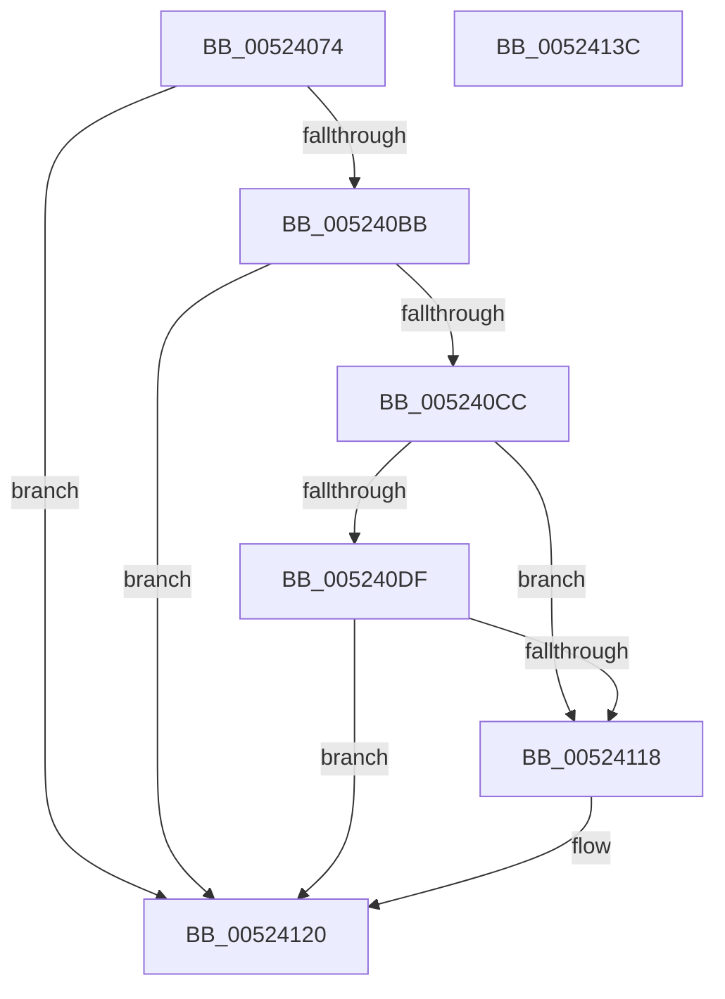

# SymCryptEcurveAllocate

- RVA: `0x00524074`–`0x0052413D` (길이 `201` bytes)
- VA: `0x0000000140524074`
- 실행 섹션: `.text`
- PDB 이름 있음: `예`; PDB Function 태그: `아니요`
- unwind 정보 RVA: `0x000C3250`
- 디코드: `64`개 명령, `201/201` bytes 표시
- 미해석 바이트: `0` (있으면 어셈블리에 `.byte`로 보존)

> 이 문서는 커널 이미지의 기계어와 PDB 기호를 분석해 생성했습니다. 4번과 5번은 함수 원형과 자료형을 바이너리 사용 방식에서 추정한 C 해석이며 원본 소스 복구 결과는 아닙니다.

## 1. Dependencies

- 직접 호출 지점: **7**; 고유 호출 대상: **5**
- 직접 호출자로 확인된 함수: **3**
- RIP 상대 이미지 참조: **0**

### Outgoing calls
- `0x005240B2` → [SymCryptEcurveValidateAndComputeSizes](SymCryptEcurveValidateAndComputeSizes_function_00524814.md) (function, `0x00524814`)
- `0x005240BF` → [SymCryptCallbackAlloc](../6A/SymCryptCallbackAlloc_function_006AC530.md) (function, `0x006AC530`)
- `0x005240D2` → [SymCryptCallbackAlloc](../6A/SymCryptCallbackAlloc_function_006AC530.md) (function, `0x006AC530`)
- `0x005240F2` → [SymCryptEcurveInitialize](SymCryptEcurveInitialize_function_005241A4.md) (function, `0x005241A4`)
- `0x00524106` → [SymCryptWipe](../51/SymCryptWipe_function_0051F914.md) (function, `0x0051F914`)
- `0x0052410E` → [SymCryptCallbackFree](../6A/SymCryptCallbackFree_function_006AC568.md) (function, `0x006AC568`)
- `0x0052411B` → [SymCryptCallbackFree](../6A/SymCryptCallbackFree_function_006AC568.md) (function, `0x006AC568`)

### Direct callers
- [SymCryptEcDhSecretAgreementSelftest](SymCryptEcDhSecretAgreementSelftest_function_0052B2C4.md) at `0x0052B2F4`
- [SymCryptEcDsaSelftest](SymCryptEcDsaSelftest_function_0052B45C.md) at `0x0052B497`
- [HashpVerifyEcdsaSignature](../../page/84/HashpVerifyEcdsaSignature_function_00841AF4.md) at `0x00841B86`

### Static image references
- 디코드된 RIP-relative 메모리 참조가 없습니다.

## 2. Other-region calls and transfers

- 다른 실행 섹션으로 향하는 call: **0**
- 별도 외부 분기/꼬리 이동을 확인하지 못했습니다.

## 3. Assembly (complete function range)

```asm
00524074  4C 8B DC                        mov r11, rsp
00524077  49 89 5B 08                     mov qword ptr [r11 + 8], rbx
0052407B  49 89 6B 10                     mov qword ptr [r11 + 0x10], rbp
0052407F  56                              push rsi
00524080  57                              push rdi
00524081  41 54                           push r12
00524083  41 56                           push r14
00524085  41 57                           push r15
00524087  48 83 EC 60                     sub rsp, 0x60
0052408B  0F 57 C0                        xorps xmm0, xmm0
0052408E  33 C0                           xor eax, eax
00524090  0F 11 44 24 30                  movups xmmword ptr [rsp + 0x30], xmm0
00524095  44 8B FA                        mov r15d, edx
00524098  45 33 E4                        xor r12d, r12d
0052409B  0F 11 44 24 40                  movups xmmword ptr [rsp + 0x40], xmm0
005240A0  49 89 43 C8                     mov qword ptr [r11 - 0x38], rax
005240A4  49 8D 53 A8                     lea rdx, [r11 - 0x58]
005240A8  89 44 24 58                     mov dword ptr [rsp + 0x58], eax
005240AC  4C 8B F1                        mov r14, rcx
005240AF  41 8B FC                        mov edi, r12d
005240B2  E8 5D 07 00 00                  call 0x140524814
005240B7  84 C0                           test al, al
005240B9  74 65                           je 0x140524120
005240BB  8B 4C 24 3C                     mov ecx, dword ptr [rsp + 0x3c]
005240BF  E8 6C 84 18 00                  call 0x1406ac530
005240C4  48 8B D8                        mov rbx, rax
005240C7  48 85 C0                        test rax, rax
005240CA  74 54                           je 0x140524120
005240CC  8B 6C 24 54                     mov ebp, dword ptr [rsp + 0x54]
005240D0  8B CD                           mov ecx, ebp
005240D2  E8 59 84 18 00                  call 0x1406ac530
005240D7  48 8B F0                        mov rsi, rax
005240DA  48 85 C0                        test rax, rax
005240DD  74 39                           je 0x140524118
005240DF  4C 8B CB                        mov r9, rbx
005240E2  48 89 44 24 20                  mov qword ptr [rsp + 0x20], rax
005240E7  4C 8D 44 24 30                  lea r8, [rsp + 0x30]
005240EC  41 8B D7                        mov edx, r15d
005240EF  49 8B CE                        mov rcx, r14
005240F2  E8 AD 00 00 00                  call 0x1405241a4
005240F7  48 85 C0                        test rax, rax
005240FA  48 8B F8                        mov rdi, rax
005240FD  49 0F 45 DC                     cmovne rbx, r12
00524101  8B D5                           mov edx, ebp
00524103  48 8B CE                        mov rcx, rsi
00524106  E8 09 B8 FF FF                  call 0x14051f914
0052410B  48 8B CE                        mov rcx, rsi
0052410E  E8 55 84 18 00                  call 0x1406ac568
00524113  48 85 DB                        test rbx, rbx
00524116  74 08                           je 0x140524120
00524118  48 8B CB                        mov rcx, rbx
0052411B  E8 48 84 18 00                  call 0x1406ac568
00524120  4C 8D 5C 24 60                  lea r11, [rsp + 0x60]
00524125  48 8B C7                        mov rax, rdi
00524128  49 8B 5B 30                     mov rbx, qword ptr [r11 + 0x30]
0052412C  49 8B 6B 38                     mov rbp, qword ptr [r11 + 0x38]
00524130  49 8B E3                        mov rsp, r11
00524133  41 5F                           pop r15
00524135  41 5E                           pop r14
00524137  41 5C                           pop r12
00524139  5F                              pop rdi
0052413A  5E                              pop rsi
0052413B  C3                              ret
0052413C  CC                              int3
```

## 4. C-style interpretation (structured pseudocode)

```c
__int64 __fastcall SymCryptEcurveAllocate(__int64 a1, int a2)
{
    __int64 result;
    __int64 v_r12;
    __int64 v_rbx;
    __int64 v_rsp;
    unsigned __int64 v_stack_m28;
    unsigned int v_stack_m30;
    unsigned int v_stack_m34;
    unsigned __int64 v_stack_m48;
    unsigned int v_stack_m4C;
    unsigned __int64 v_stack_m58;
    unsigned __int64 v_stack_m68;

    *(unsigned __int64 *)(v_rsp + 8) = v_rbx;
    *(unsigned __int64 *)(v_rsp + 16) = v_rbp;
    v_rsp = (v_rsp) - (96);
    result = 0;
    v_stack_m58 = v_xmm0;
    v_r12 = 0;
    v_stack_m48 = v_xmm0;
    *(unsigned __int64 *)(v_rsp - 56) = 0;
    v_stack_m30 = 0;
    result = SymCryptEcurveValidateAndComputeSizes(a1, v_rsp - 88, a3, a4);
    if ((unsigned __int8)(result) == 0) goto loc_00524120;
    result = SymCryptCallbackAlloc((unsigned int)(v_stack_m4C), v_rsp - 88, a3, a4);
    if (result == 0) goto loc_00524120;
    result = SymCryptCallbackAlloc((unsigned int)((unsigned int)((unsigned int)(v_stack_m34))), v_rsp - 88, a3, a4);
    if (result == 0) goto loc_00524118;
    v_stack_m68 = result;
    result = SymCryptEcurveInitialize(a1, (unsigned int)((unsigned int)((unsigned int)(a2))), v_stack_m58, result);
    v_rbx = result;
    if (result != 0) { v_rbx = 0; }
    result = SymCryptWipe(result, (unsigned int)((unsigned int)((unsigned int)(v_stack_m34))), v_stack_m58, result);
    result = SymCryptCallbackFree(result, (unsigned int)((unsigned int)((unsigned int)(v_stack_m34))), v_stack_m58, result);
    if (v_rbx != 0) {
        a1 = v_rbx;
        result = SymCryptCallbackFree(a1, (unsigned int)((unsigned int)((unsigned int)(v_stack_m34))), v_stack_m58, result);
    }
    return result;
}
```

## 5. (Beta) C Style

```c
int64_t SymCryptEcurveAllocate(int64_t Arg1, int32_t Arg2)
{
    int64_t result;
    int64_t local_r12;
    int64_t local_rbx;
    int64_t local_rsp;
    uint64_t v_stack_m28;
    uint32_t v_stack_m30;
    uint32_t v_stack_m34;
    uint64_t v_stack_m48;
    uint32_t v_stack_m4C;
    uint64_t v_stack_m58;
    uint64_t v_stack_m68;

    *(uint64_t *)(local_rsp + 0x8) = local_rbx;
    *(uint64_t *)(local_rsp + 0x10) = local_rbp;
    local_rsp = (local_rsp) - (96);
    result = 0;
    v_stack_m58 = v_xmm0;
    local_r12 = 0;
    v_stack_m48 = v_xmm0;
    *(uint64_t *)(local_rsp - 0x38) = 0;
    v_stack_m30 = 0;
    result = SymCryptEcurveValidateAndComputeSizes(Arg1, local_rsp - 88, a3, a4);
    if ((uint8_t)(result) == 0) goto loc_00524120;
    result = SymCryptCallbackAlloc((uint32_t)(v_stack_m4C), local_rsp - 88, a3, a4);
    if (result == 0) goto loc_00524120;
    result = SymCryptCallbackAlloc((uint32_t)((uint32_t)((uint32_t)(v_stack_m34))), local_rsp - 88, a3, a4);
    if (result == 0) goto loc_00524118;
    v_stack_m68 = result;
    result = SymCryptEcurveInitialize(Arg1, (uint32_t)((uint32_t)((uint32_t)(Arg2))), v_stack_m58, result);
    local_rbx = result;
    if (result != 0) { local_rbx = 0; }
    result = SymCryptWipe(result, (uint32_t)((uint32_t)((uint32_t)(v_stack_m34))), v_stack_m58, result);
    result = SymCryptCallbackFree(result, (uint32_t)((uint32_t)((uint32_t)(v_stack_m34))), v_stack_m58, result);
    if (local_rbx != 0) {
        Arg1 = local_rbx;
        result = SymCryptCallbackFree(Arg1, (uint32_t)((uint32_t)((uint32_t)(v_stack_m34))), v_stack_m58, result);
    }
    return result;
}
```

## 6. Execution-region graph

[열기: 2D/3D 그래프와 함수 탐색 컨트롤 패널](../../../control-panel.html?section=text&rva=0x00524074&view=graph)

- 2D 그래프는 위에서 아래로 흐르고, 3D 그래프는 빈 공간을 드래그해 회전합니다. Shift+드래그는 이동, 휠은 확대·축소, 함수 노드 선택은 대상 보고서 이동입니다.

### Static fallback


