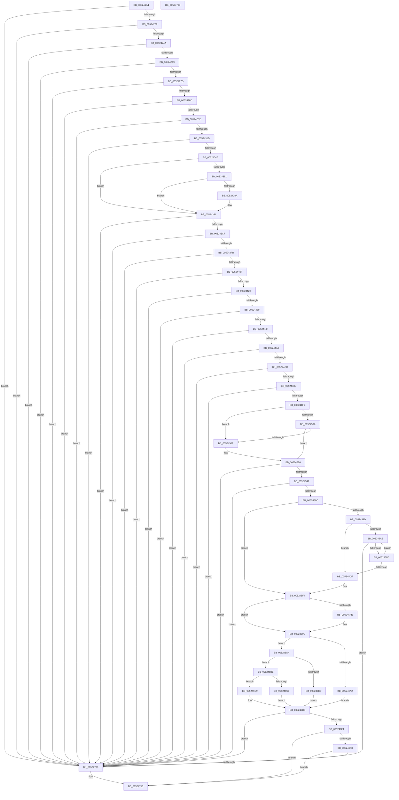

# SymCryptEcurveInitialize

- RVA: `0x005241A4`–`0x00524735` (길이 `1,425` bytes)
- VA: `0x00000001405241A4`
- 실행 섹션: `.text`
- PDB 이름 있음: `예`; PDB Function 태그: `예`
- unwind 정보 RVA: `0x000C3AF8`
- 디코드: `361`개 명령, `1,425/1,425` bytes 표시
- 미해석 바이트: `0` (있으면 어셈블리에 `.byte`로 보존)

> 이 문서는 커널 이미지의 기계어와 PDB 기호를 분석해 생성했습니다. 4번과 5번은 함수 원형과 자료형을 바이너리 사용 방식에서 추정한 C 해석이며 원본 소스 복구 결과는 아닙니다.

## 1. Dependencies

- 직접 호출 지점: **32**; 고유 호출 대상: **20**
- 직접 호출자로 확인된 함수: **1**
- RIP 상대 이미지 참조: **3**

### Outgoing calls
- `0x00524221` → [SymCryptModulusCreate](SymCryptModulusCreate_function_00525CF4.md) (function, `0x00525CF4`)
- `0x00524239` → [SymCryptIntFromModulus](SymCryptIntFromModulus_function_00525608.md) (function, `0x00525608`)
- `0x0052425C` → [SymCryptIntSetValue](SymCryptIntSetValue_function_00525730.md) (function, `0x00525730`)
- `0x0052426C` → [SymCryptIntBitsizeOfValue](SymCryptIntBitsizeOfValue_function_005254F4.md) (function, `0x005254F4`)
- `0x00524280` → [SymCryptIntGetValueLsbits32](SymCryptIntGetValueLsbits32_function_00525668.md) (function, `0x00525668`)
- `0x005242B8` → [SymCryptIntToModulus](SymCryptIntToModulus_function_00525824.md) (function, `0x00525824`)
- `0x005242D6` → [SymCryptModElementCreate](SymCryptModElementCreate_function_00525900.md) (function, `0x00525900`)
- `0x00524310` → [SymCryptModElementSetValue](SymCryptModElementSetValue_function_00525994.md) (function, `0x00525994`)
- `0x00524333` → [SymCryptModElementCreate](SymCryptModElementCreate_function_00525900.md) (function, `0x00525900`)
- `0x00524367` → [SymCryptModElementSetValueNegUint32](SymCryptModElementSetValueNegUint32_function_00525A20.md) (function, `0x00525A20`)
- `0x00524381` → [SymCryptModElementIsEqual](SymCryptModElementIsEqual_function_0052594C.md) (function, `0x0052594C`)
- `0x005243BA` → [SymCryptModElementSetValue](SymCryptModElementSetValue_function_00525994.md) (function, `0x00525994`)
- `0x005243E6` → [SymCryptModulusCreate](SymCryptModulusCreate_function_00525CF4.md) (function, `0x00525CF4`)
- `0x005243FE` → [SymCryptIntFromModulus](SymCryptIntFromModulus_function_00525608.md) (function, `0x00525608`)
- `0x0052441E` → [SymCryptIntSetValue](SymCryptIntSetValue_function_00525730.md) (function, `0x00525730`)
- `0x0052442E` → [SymCryptIntBitsizeOfValue](SymCryptIntBitsizeOfValue_function_005254F4.md) (function, `0x005254F4`)
- `0x00524442` → [SymCryptIntGetValueLsbits32](SymCryptIntGetValueLsbits32_function_00525668.md) (function, `0x00525668`)
- `0x00524470` → [SymCryptIntToModulus](SymCryptIntToModulus_function_00525824.md) (function, `0x00525824`)
- `0x0052448B` → [SymCryptIntCreate](SymCryptIntCreate_function_0052556C.md) (function, `0x0052556C`)
- `0x005244AF` → [SymCryptIntSetValue](SymCryptIntSetValue_function_00525730.md) (function, `0x00525730`)
- `0x005244C3` → [SymCryptIntBitsizeOfValue](SymCryptIntBitsizeOfValue_function_005254F4.md) (function, `0x005254F4`)
- `0x005244E9` → [SymCryptIntIsEqualUint32](SymCryptIntIsEqualUint32_function_005256B0.md) (function, `0x005256B0`)
- `0x00524529` → [SymCryptEcurveFillScratchSpaces](SymCryptEcurveFillScratchSpaces_function_0052D1D0.md) (function, `0x0052D1D0`)
- `0x00524537` → [SymCryptEcpointCreate](SymCryptEcpointCreate_function_0052C5A0.md) (function, `0x0052C5A0`)
- `0x0052457F` → [SymCryptEcpointSetValue](SymCryptEcpointSetValue_function_0052C7E0.md) (function, `0x0052C7E0`)
- `0x005245B7` → [SymCryptEcpointCreate](SymCryptEcpointCreate_function_0052C5A0.md) (function, `0x0052C5A0`)
- `0x005245E9` → [SymCryptOfflinePrecomputation](SymCryptOfflinePrecomputation_function_0052C450.md) (function, `0x0052C450`)
- `0x0052460B` → [SymCryptModElementCreate](SymCryptModElementCreate_function_00525900.md) (function, `0x00525900`)
- `0x00524634` → [SymCryptModElementSetValueUint32](SymCryptModElementSetValueUint32_function_00525A40.md) (function, `0x00525A40`)
- `0x00524664` → [SymCryptModAdd](SymCryptModAdd_function_00525868.md) (function, `0x00525868`)
- `0x00524697` → [SymCryptModDivPow2](SymCryptModDivPow2_function_005258A4.md) (function, `0x005258A4`)
- `0x0052470C` → [SymCryptWipe](../51/SymCryptWipe_function_0051F914.md) (function, `0x0051F914`)

### Direct callers
- [SymCryptEcurveAllocate](SymCryptEcurveAllocate_function_00524074.md) at `0x005240F2`

### Static image references
- `0x005246B2` → RVA `0x00006BE0` (`.rdata`; read)
- `0x005246C0` → RVA `0x00006BD0` (`.rdata`; read)
- `0x005246CE` → RVA `0x00006BF0` (`.rdata`; read)

## 2. Other-region calls and transfers

- 다른 실행 섹션으로 향하는 call: **0**
- 별도 외부 분기/꼬리 이동을 확인하지 못했습니다.

## 3. Assembly (complete function range)

```asm
005241A4  48 89 5C 24 08                  mov qword ptr [rsp + 8], rbx
005241A9  48 89 6C 24 10                  mov qword ptr [rsp + 0x10], rbp
005241AE  48 89 74 24 18                  mov qword ptr [rsp + 0x18], rsi
005241B3  57                              push rdi
005241B4  41 54                           push r12
005241B6  41 55                           push r13
005241B8  41 56                           push r14
005241BA  41 57                           push r15
005241BC  48 83 EC 50                     sub rsp, 0x50
005241C0  41 C7 01 01 00 00 00            mov dword ptr [r9], 1
005241C7  49 8D 99 A0 02 00 00            lea rbx, [r9 + 0x2a0]
005241CE  8B 41 04                        mov eax, dword ptr [rcx + 4]
005241D1  4C 8D 71 1C                     lea r14, [rcx + 0x1c]
005241D5  41 89 41 04                     mov dword ptr [r9 + 4], eax
005241D9  49 8B F0                        mov rsi, r8
005241DC  41 8B 40 28                     mov eax, dword ptr [r8 + 0x28]
005241E0  48 8B E9                        mov rbp, rcx
005241E3  41 89 41 08                     mov dword ptr [r9 + 8], eax
005241E7  49 8B F9                        mov rdi, r9
005241EA  41 8B 00                        mov eax, dword ptr [r8]
005241ED  41 89 41 10                     mov dword ptr [r9 + 0x10], eax
005241F1  41 8B 40 04                     mov eax, dword ptr [r8 + 4]
005241F5  41 89 41 1C                     mov dword ptr [r9 + 0x1c], eax
005241F9  8B 41 0C                        mov eax, dword ptr [rcx + 0xc]
005241FC  41 89 41 14                     mov dword ptr [r9 + 0x14], eax
00524200  8B 41 10                        mov eax, dword ptr [rcx + 0x10]
00524203  48 8B CB                        mov rcx, rbx
00524206  41 89 41 20                     mov dword ptr [r9 + 0x20], eax
0052420A  41 8B 40 14                     mov eax, dword ptr [r8 + 0x14]
0052420E  41 89 41 24                     mov dword ptr [r9 + 0x24], eax
00524212  41 8B 40 0C                     mov eax, dword ptr [r8 + 0xc]
00524216  41 89 41 28                     mov dword ptr [r9 + 0x28], eax
0052421A  41 8B 50 10                     mov edx, dword ptr [r8 + 0x10]
0052421E  45 8B 00                        mov r8d, dword ptr [r8]
00524221  E8 CE 1A 00 00                  call 0x140525cf4
00524226  48 89 87 68 02 00 00            mov qword ptr [rdi + 0x268], rax
0052422D  48 85 C0                        test rax, rax
00524230  0F 84 D0 04 00 00               je 0x140524706
00524236  48 8B C8                        mov rcx, rax
00524239  E8 CA 13 00 00                  call 0x140525608
0052423E  4C 8B F8                        mov r15, rax
00524241  48 85 C0                        test rax, rax
00524244  0F 84 BC 04 00 00               je 0x140524706
0052424A  8B 55 0C                        mov edx, dword ptr [rbp + 0xc]
0052424D  41 BD 02 00 00 00               mov r13d, 2
00524253  45 8B C5                        mov r8d, r13d
00524256  4C 8B C8                        mov r9, rax
00524259  49 8B CE                        mov rcx, r14
0052425C  E8 CF 14 00 00                  call 0x140525730
00524261  85 C0                           test eax, eax
00524263  0F 85 9D 04 00 00               jne 0x140524706
00524269  49 8B CF                        mov rcx, r15
0052426C  E8 83 12 00 00                  call 0x1405254f4
00524271  89 47 0C                        mov dword ptr [rdi + 0xc], eax
00524274  83 F8 20                        cmp eax, 0x20
00524277  0F 82 89 04 00 00               jb 0x140524706
0052427D  49 8B CF                        mov rcx, r15
00524280  E8 E3 13 00 00                  call 0x140525668
00524285  A8 01                           test al, 1
00524287  0F 84 79 04 00 00               je 0x140524706
0052428D  8B 46 24                        mov eax, dword ptr [rsi + 0x24]
00524290  45 8D 4D 07                     lea r9d, [r13 + 7]
00524294  44 69 45 0C 20 03 00 00         imul r8d, dword ptr [rbp + 0xc], 0x320
0052429C  49 8B CF                        mov rcx, r15
0052429F  4C 8B A4 24 A0 00 00 00         mov r12, qword ptr [rsp + 0xa0]
005242A7  48 8B 97 68 02 00 00            mov rdx, qword ptr [rdi + 0x268]
005242AE  48 89 44 24 28                  mov qword ptr [rsp + 0x28], rax
005242B3  4C 89 64 24 20                  mov qword ptr [rsp + 0x20], r12
005242B8  E8 67 15 00 00                  call 0x140525824
005242BD  8B 46 10                        mov eax, dword ptr [rsi + 0x10]
005242C0  8B 56 14                        mov edx, dword ptr [rsi + 0x14]
005242C3  48 03 D8                        add rbx, rax
005242C6  8B 45 0C                        mov eax, dword ptr [rbp + 0xc]
005242C9  48 8B CB                        mov rcx, rbx
005242CC  4C 8B 87 68 02 00 00            mov r8, qword ptr [rdi + 0x268]
005242D3  4C 03 F0                        add r14, rax
005242D6  E8 25 16 00 00                  call 0x140525900
005242DB  48 89 87 78 02 00 00            mov qword ptr [rdi + 0x278], rax
005242E2  48 8B C8                        mov rcx, rax
005242E5  48 85 C0                        test rax, rax
005242E8  0F 84 18 04 00 00               je 0x140524706
005242EE  8B 46 24                        mov eax, dword ptr [rsi + 0x24]
005242F1  45 8B C5                        mov r8d, r13d
005242F4  8B 55 0C                        mov edx, dword ptr [rbp + 0xc]
005242F7  4C 8B 8F 68 02 00 00            mov r9, qword ptr [rdi + 0x268]
005242FE  48 89 44 24 30                  mov qword ptr [rsp + 0x30], rax
00524303  4C 89 64 24 28                  mov qword ptr [rsp + 0x28], r12
00524308  48 89 4C 24 20                  mov qword ptr [rsp + 0x20], rcx
0052430D  49 8B CE                        mov rcx, r14
00524310  E8 7F 16 00 00                  call 0x140525994
00524315  85 C0                           test eax, eax
00524317  0F 85 E9 03 00 00               jne 0x140524706
0052431D  8B 56 14                        mov edx, dword ptr [rsi + 0x14]
00524320  8B 45 0C                        mov eax, dword ptr [rbp + 0xc]
00524323  48 03 DA                        add rbx, rdx
00524326  4C 8B 87 68 02 00 00            mov r8, qword ptr [rdi + 0x268]
0052432D  48 8B CB                        mov rcx, rbx
00524330  4C 03 F0                        add r14, rax
00524333  E8 C8 15 00 00                  call 0x140525900
00524338  48 89 87 80 02 00 00            mov qword ptr [rdi + 0x280], rax
0052433F  4C 8B C0                        mov r8, rax
00524342  48 85 C0                        test rax, rax
00524345  0F 84 BB 03 00 00               je 0x140524706
0052434B  83 7D 04 01                     cmp dword ptr [rbp + 4], 1
0052434F  75 40                           jne 0x140524391
00524351  8B 46 24                        mov eax, dword ptr [rsi + 0x24]
00524354  41 8D 4D 01                     lea ecx, [r13 + 1]
00524358  48 8B 97 68 02 00 00            mov rdx, qword ptr [rdi + 0x268]
0052435F  4D 8B CC                        mov r9, r12
00524362  48 89 44 24 20                  mov qword ptr [rsp + 0x20], rax
00524367  E8 B4 16 00 00                  call 0x140525a20
0052436C  4C 8B 87 80 02 00 00            mov r8, qword ptr [rdi + 0x280]
00524373  48 8B 97 78 02 00 00            mov rdx, qword ptr [rdi + 0x278]
0052437A  48 8B 8F 68 02 00 00            mov rcx, qword ptr [rdi + 0x268]
00524381  E8 C6 15 00 00                  call 0x14052594c
00524386  85 C0                           test eax, eax
00524388  74 07                           je 0x140524391
0052438A  C7 47 04 04 00 00 00            mov dword ptr [rdi + 4], 4
00524391  8B 46 24                        mov eax, dword ptr [rsi + 0x24]
00524394  45 8B C5                        mov r8d, r13d
00524397  8B 55 0C                        mov edx, dword ptr [rbp + 0xc]
0052439A  49 8B CE                        mov rcx, r14
0052439D  4C 8B 8F 68 02 00 00            mov r9, qword ptr [rdi + 0x268]
005243A4  48 89 44 24 30                  mov qword ptr [rsp + 0x30], rax
005243A9  48 8B 87 80 02 00 00            mov rax, qword ptr [rdi + 0x280]
005243B0  4C 89 64 24 28                  mov qword ptr [rsp + 0x28], r12
005243B5  48 89 44 24 20                  mov qword ptr [rsp + 0x20], rax
005243BA  E8 D5 15 00 00                  call 0x140525994
005243BF  85 C0                           test eax, eax
005243C1  0F 85 3F 03 00 00               jne 0x140524706
005243C7  8B 46 14                        mov eax, dword ptr [rsi + 0x14]
005243CA  8B 56 1C                        mov edx, dword ptr [rsi + 0x1c]
005243CD  48 03 D8                        add rbx, rax
005243D0  8B 45 0C                        mov eax, dword ptr [rbp + 0xc]
005243D3  44 8B 46 04                     mov r8d, dword ptr [rsi + 4]
005243D7  4C 03 F0                        add r14, rax
005243DA  4D 8B EE                        mov r13, r14
005243DD  8D 0C 00                        lea ecx, [rax + rax]
005243E0  4C 03 F1                        add r14, rcx
005243E3  48 8B CB                        mov rcx, rbx
005243E6  E8 09 19 00 00                  call 0x140525cf4
005243EB  48 89 87 70 02 00 00            mov qword ptr [rdi + 0x270], rax
005243F2  48 85 C0                        test rax, rax
005243F5  0F 84 0B 03 00 00               je 0x140524706
005243FB  48 8B C8                        mov rcx, rax
005243FE  E8 05 12 00 00                  call 0x140525608
00524403  4C 8B F8                        mov r15, rax
00524406  48 85 C0                        test rax, rax
00524409  0F 84 F7 02 00 00               je 0x140524706
0052440F  8B 55 10                        mov edx, dword ptr [rbp + 0x10]
00524412  4C 8B C8                        mov r9, rax
00524415  41 B8 02 00 00 00               mov r8d, 2
0052441B  49 8B CE                        mov rcx, r14
0052441E  E8 0D 13 00 00                  call 0x140525730
00524423  85 C0                           test eax, eax
00524425  0F 85 DB 02 00 00               jne 0x140524706
0052442B  49 8B CF                        mov rcx, r15
0052442E  E8 C1 10 00 00                  call 0x1405254f4
00524433  89 47 18                        mov dword ptr [rdi + 0x18], eax
00524436  83 F8 20                        cmp eax, 0x20
00524439  0F 82 C7 02 00 00               jb 0x140524706
0052443F  49 8B CF                        mov rcx, r15
00524442  E8 21 12 00 00                  call 0x140525668
00524447  A8 01                           test al, 1
00524449  0F 84 B7 02 00 00               je 0x140524706
0052444F  8B 46 24                        mov eax, dword ptr [rsi + 0x24]
00524452  41 B9 09 00 00 00               mov r9d, 9
00524458  48 8B 97 70 02 00 00            mov rdx, qword ptr [rdi + 0x270]
0052445F  49 8B CF                        mov rcx, r15
00524462  48 89 44 24 28                  mov qword ptr [rsp + 0x28], rax
00524467  4C 89 64 24 20                  mov qword ptr [rsp + 0x20], r12
0052446C  45 8D 41 F8                     lea r8d, [r9 - 8]
00524470  E8 AF 13 00 00                  call 0x140525824
00524475  8B 46 1C                        mov eax, dword ptr [rsi + 0x1c]
00524478  8B 56 20                        mov edx, dword ptr [rsi + 0x20]
0052447B  48 03 D8                        add rbx, rax
0052447E  8B 45 10                        mov eax, dword ptr [rbp + 0x10]
00524481  48 8B CB                        mov rcx, rbx
00524484  44 8B 46 08                     mov r8d, dword ptr [rsi + 8]
00524488  4C 03 F0                        add r14, rax
0052448B  E8 DC 10 00 00                  call 0x14052556c
00524490  48 89 87 90 02 00 00            mov qword ptr [rdi + 0x290], rax
00524497  48 85 C0                        test rax, rax
0052449A  0F 84 66 02 00 00               je 0x140524706
005244A0  8B 55 14                        mov edx, dword ptr [rbp + 0x14]
005244A3  4C 8B C8                        mov r9, rax
005244A6  41 B8 02 00 00 00               mov r8d, 2
005244AC  49 8B CE                        mov rcx, r14
005244AF  E8 7C 12 00 00                  call 0x140525730
005244B4  85 C0                           test eax, eax
005244B6  0F 85 4A 02 00 00               jne 0x140524706
005244BC  48 8B 8F 90 02 00 00            mov rcx, qword ptr [rdi + 0x290]
005244C3  E8 2C 10 00 00                  call 0x1405254f4
005244C8  8D 48 FF                        lea ecx, [rax - 1]
005244CB  89 4F 40                        mov dword ptr [rdi + 0x40], ecx
005244CE  83 F9 08                        cmp ecx, 8
005244D1  0F 87 2F 02 00 00               ja 0x140524706
005244D7  41 BF 01 00 00 00               mov r15d, 1
005244DD  41 8B D7                        mov edx, r15d
005244E0  D3 E2                           shl edx, cl
005244E2  48 8B 8F 90 02 00 00            mov rcx, qword ptr [rdi + 0x290]
005244E9  E8 C2 11 00 00                  call 0x1405256b0
005244EE  85 C0                           test eax, eax
005244F0  0F 84 10 02 00 00               je 0x140524706
005244F6  8B 46 20                        mov eax, dword ptr [rsi + 0x20]
005244F9  48 03 D8                        add rbx, rax
005244FC  8B 45 14                        mov eax, dword ptr [rbp + 0x14]
005244FF  4C 03 F0                        add r14, rax
00524502  8B 45 04                        mov eax, dword ptr [rbp + 4]
00524505  41 3B C7                        cmp eax, r15d
00524508  74 05                           je 0x14052450f
0052450A  83 F8 02                        cmp eax, 2
0052450D  75 17                           jne 0x140524526
0052450F  8B 47 18                        mov eax, dword ptr [rdi + 0x18]
00524512  41 03 C7                        add eax, r15d
00524515  C7 47 5C 10 00 00 00            mov dword ptr [rdi + 0x5c], 0x10
0052451C  89 47 60                        mov dword ptr [rdi + 0x60], eax
0052451F  C7 47 58 06 00 00 00            mov dword ptr [rdi + 0x58], 6
00524526  48 8B CF                        mov rcx, rdi
00524529  E8 A2 8C 00 00                  call 0x14052d1d0
0052452E  8B 56 18                        mov edx, dword ptr [rsi + 0x18]
00524531  4C 8B C7                        mov r8, rdi
00524534  48 8B CB                        mov rcx, rbx
00524537  E8 64 80 00 00                  call 0x14052c5a0
0052453C  48 89 87 88 02 00 00            mov qword ptr [rdi + 0x288], rax
00524543  4C 8B C8                        mov r9, rax
00524546  48 85 C0                        test rax, rax
00524549  0F 84 B7 01 00 00               je 0x140524706
0052454F  8B 45 0C                        mov eax, dword ptr [rbp + 0xc]
00524552  49 8B D5                        mov rdx, r13
00524555  8B 4E 24                        mov ecx, dword ptr [rsi + 0x24]
00524558  48 89 4C 24 40                  mov qword ptr [rsp + 0x40], rcx
0052455D  48 8B CF                        mov rcx, rdi
00524560  4C 89 64 24 38                  mov qword ptr [rsp + 0x38], r12
00524565  44 8D 04 00                     lea r8d, [rax + rax]
00524569  44 89 7C 24 30                  mov dword ptr [rsp + 0x30], r15d
0052456E  B8 02 00 00 00                  mov eax, 2
00524573  4C 89 4C 24 28                  mov qword ptr [rsp + 0x28], r9
00524578  44 8B C8                        mov r9d, eax
0052457B  89 44 24 20                     mov dword ptr [rsp + 0x20], eax
0052457F  E8 5C 82 00 00                  call 0x14052c7e0
00524584  85 C0                           test eax, eax
00524586  0F 85 7A 01 00 00               jne 0x140524706
0052458C  8B 46 18                        mov eax, dword ptr [rsi + 0x18]
0052458F  48 03 D8                        add rbx, rax
00524592  8B 45 04                        mov eax, dword ptr [rbp + 4]
00524595  41 2B C7                        sub eax, r15d
00524598  41 3B C7                        cmp eax, r15d
0052459B  77 57                           ja 0x1405245f4
0052459D  48 8B 87 88 02 00 00            mov rax, qword ptr [rdi + 0x288]
005245A4  48 89 47 68                     mov qword ptr [rdi + 0x68], rax
005245A8  44 39 7F 5C                     cmp dword ptr [rdi + 0x5c], r15d
005245AC  76 31                           jbe 0x1405245df
005245AE  8B 56 18                        mov edx, dword ptr [rsi + 0x18]
005245B1  4C 8B C7                        mov r8, rdi
005245B4  48 8B CB                        mov rcx, rbx
005245B7  E8 E4 7F 00 00                  call 0x14052c5a0
005245BC  48 8B C8                        mov rcx, rax
005245BF  41 8B C7                        mov eax, r15d
005245C2  48 89 4C C7 68                  mov qword ptr [rdi + rax*8 + 0x68], rcx
005245C7  48 85 C9                        test rcx, rcx
005245CA  0F 84 36 01 00 00               je 0x140524706
005245D0  8B 46 18                        mov eax, dword ptr [rsi + 0x18]
005245D3  41 FF C7                        inc r15d
005245D6  48 03 D8                        add rbx, rax
005245D9  44 3B 7F 5C                     cmp r15d, dword ptr [rdi + 0x5c]
005245DD  72 CF                           jb 0x1405245ae
005245DF  44 8B 46 24                     mov r8d, dword ptr [rsi + 0x24]
005245E3  49 8B D4                        mov rdx, r12
005245E6  48 8B CF                        mov rcx, rdi
005245E9  E8 62 7E 00 00                  call 0x14052c450
005245EE  41 BF 01 00 00 00               mov r15d, 1
005245F4  83 7D 04 03                     cmp dword ptr [rbp + 4], 3
005245F8  0F 85 9E 00 00 00               jne 0x14052469c
005245FE  8B 56 14                        mov edx, dword ptr [rsi + 0x14]
00524601  49 8B CC                        mov rcx, r12
00524604  4C 8B 87 68 02 00 00            mov r8, qword ptr [rdi + 0x268]
0052460B  E8 F0 12 00 00                  call 0x140525900
00524610  44 8B 4E 14                     mov r9d, dword ptr [rsi + 0x14]
00524614  4C 8B C0                        mov r8, rax
00524617  8B 4E 24                        mov ecx, dword ptr [rsi + 0x24]
0052461A  48 8B D8                        mov rbx, rax
0052461D  48 8B 97 68 02 00 00            mov rdx, qword ptr [rdi + 0x268]
00524624  41 2B C9                        sub ecx, r9d
00524627  48 89 4C 24 20                  mov qword ptr [rsp + 0x20], rcx
0052462C  4D 03 CC                        add r9, r12
0052462F  B9 02 00 00 00                  mov ecx, 2
00524634  E8 07 14 00 00                  call 0x140525a40
00524639  8B 4E 24                        mov ecx, dword ptr [rsi + 0x24]
0052463C  44 8B 46 14                     mov r8d, dword ptr [rsi + 0x14]
00524640  48 8B 97 78 02 00 00            mov rdx, qword ptr [rdi + 0x278]
00524647  41 2B C8                        sub ecx, r8d
0052464A  4D 03 C4                        add r8, r12
0052464D  48 89 4C 24 28                  mov qword ptr [rsp + 0x28], rcx
00524652  48 8B 8F 68 02 00 00            mov rcx, qword ptr [rdi + 0x268]
00524659  4C 8B CA                        mov r9, rdx
0052465C  4C 89 44 24 20                  mov qword ptr [rsp + 0x20], r8
00524661  4C 8B C3                        mov r8, rbx
00524664  E8 FF 11 00 00                  call 0x140525868
00524669  8B 4E 24                        mov ecx, dword ptr [rsi + 0x24]
0052466C  44 8B 46 14                     mov r8d, dword ptr [rsi + 0x14]
00524670  48 8B 97 78 02 00 00            mov rdx, qword ptr [rdi + 0x278]
00524677  41 2B C8                        sub ecx, r8d
0052467A  4D 03 C4                        add r8, r12
0052467D  48 89 4C 24 28                  mov qword ptr [rsp + 0x28], rcx
00524682  48 8B 8F 68 02 00 00            mov rcx, qword ptr [rdi + 0x268]
00524689  4C 8B CA                        mov r9, rdx
0052468C  4C 89 44 24 20                  mov qword ptr [rsp + 0x20], r8
00524691  41 B8 02 00 00 00               mov r8d, 2
00524697  E8 08 12 00 00                  call 0x1405258a4
0052469C  83 7D 00 02                     cmp dword ptr [rbp], 2
005246A0  75 08                           jne 0x1405246aa
005246A2  8B 4D 18                        mov ecx, dword ptr [rbp + 0x18]
005246A5  49 03 CE                        add rcx, r14
005246A8  EB 2C                           jmp 0x1405246d6
005246AA  8B 45 04                        mov eax, dword ptr [rbp + 4]
005246AD  41 3B C7                        cmp eax, r15d
005246B0  75 09                           jne 0x1405246bb
005246B2  48 8B 0D 27 25 AE FF            mov rcx, qword ptr [rip - 0x51dad9]
005246B9  EB 1B                           jmp 0x1405246d6
005246BB  83 F8 02                        cmp eax, 2
005246BE  75 09                           jne 0x1405246c9
005246C0  48 8B 0D 09 25 AE FF            mov rcx, qword ptr [rip - 0x51daf7]
005246C7  EB 0D                           jmp 0x1405246d6
005246C9  33 C9                           xor ecx, ecx
005246CB  83 F8 03                        cmp eax, 3
005246CE  48 0F 44 0D 1A 25 AE FF         cmove rcx, qword ptr [rip - 0x51dae6]
005246D6  8B 01                           mov eax, dword ptr [rcx]
005246D8  89 47 44                        mov dword ptr [rdi + 0x44], eax
005246DB  8B 51 04                        mov edx, dword ptr [rcx + 4]
005246DE  89 57 48                        mov dword ptr [rdi + 0x48], edx
005246E1  44 8B 41 08                     mov r8d, dword ptr [rcx + 8]
005246E5  44 89 47 4C                     mov dword ptr [rdi + 0x4c], r8d
005246E9  8B 41 0C                        mov eax, dword ptr [rcx + 0xc]
005246EC  89 47 50                        mov dword ptr [rdi + 0x50], eax
005246EF  83 FA 20                        cmp edx, 0x20
005246F2  77 12                           ja 0x140524706
005246F4  85 D2                           test edx, edx
005246F6  74 1B                           je 0x140524713
005246F8  8B 47 40                        mov eax, dword ptr [rdi + 0x40]
005246FB  42 8D 0C 02                     lea ecx, [rdx + r8]
005246FF  03 47 18                        add eax, dword ptr [rdi + 0x18]
00524702  3B C8                           cmp ecx, eax
00524704  76 0D                           jbe 0x140524713
00524706  8B 56 0C                        mov edx, dword ptr [rsi + 0xc]
00524709  48 8B CF                        mov rcx, rdi
0052470C  E8 03 B2 FF FF                  call 0x14051f914
00524711  33 FF                           xor edi, edi
00524713  4C 8D 5C 24 50                  lea r11, [rsp + 0x50]
00524718  48 8B C7                        mov rax, rdi
0052471B  49 8B 5B 30                     mov rbx, qword ptr [r11 + 0x30]
0052471F  49 8B 6B 38                     mov rbp, qword ptr [r11 + 0x38]
00524723  49 8B 73 40                     mov rsi, qword ptr [r11 + 0x40]
00524727  49 8B E3                        mov rsp, r11
0052472A  41 5F                           pop r15
0052472C  41 5E                           pop r14
0052472E  41 5D                           pop r13
00524730  41 5C                           pop r12
00524732  5F                              pop rdi
00524733  C3                              ret
00524734  CC                              int3
```

## 4. C-style interpretation (structured pseudocode)

```c
__int64 __fastcall SymCryptEcurveInitialize(__int64 a1, __int64 a2, __int64 a3, __int64 a4, __int64 a5)
{
    __int64 result;
    __int64 v_r14;
    __int64 v_r15;
    __int64 v_rbx;
    __int64 v_rdi;
    __int64 v_rsp;
    unsigned __int64 v_stack_m28;
    unsigned __int64 v_stack_m38;
    unsigned __int64 v_stack_m40;
    unsigned __int64 v_stack_m48;
    unsigned __int64 v_stack_m50;
    unsigned __int64 v_stack_m58;
    unsigned __int64 v_stack_p10;
    unsigned __int64 v_stack_p18;
    unsigned __int64 v_stack_p8;

    v_stack_p8 = v_rbx;
    v_stack_p10 = v_rbp;
    v_stack_p18 = v_rsi;
    v_rsp = (v_rsp) - (80);
    *(unsigned int *)(a4) = 1;
    *(unsigned int *)(a4 + 4) = (unsigned int)((unsigned int)(*(unsigned int *)(a1 + 4)));
    *(unsigned int *)(a4 + 8) = (unsigned int)((unsigned int)(*(unsigned int *)(a3 + 40)));
    *(unsigned int *)(a4 + 16) = (unsigned int)((unsigned int)(*(unsigned int *)(a3)));
    *(unsigned int *)(a4 + 28) = (unsigned int)((unsigned int)(*(unsigned int *)(a3 + 4)));
    *(unsigned int *)(a4 + 20) = (unsigned int)((unsigned int)(*(unsigned int *)(a1 + 12)));
    *(unsigned int *)(a4 + 32) = (unsigned int)((unsigned int)(*(unsigned int *)(a1 + 16)));
    *(unsigned int *)(a4 + 36) = (unsigned int)((unsigned int)(*(unsigned int *)(a3 + 20)));
    *(unsigned int *)(a4 + 40) = (unsigned int)((unsigned int)(*(unsigned int *)(a3 + 12)));
    result = SymCryptModulusCreate(a4 + 672, (unsigned int)(*(unsigned int *)(a3 + 16)), (unsigned int)(*(unsigned int *)(a3)), a4);
    *(unsigned __int64 *)(a4 + 616) = result;
    if (result == 0) goto loc_00524706;
    result = SymCryptIntFromModulus(result, (unsigned int)(*(unsigned int *)(a3 + 16)), (unsigned int)(*(unsigned int *)(a3)), a4);
    if (result == 0) goto loc_00524706;
    result = SymCryptIntSetValue(a1 + 28, (unsigned int)(*(unsigned int *)(a1 + 12)), 2, result);
    if ((unsigned int)(result) != 0) goto loc_00524706;
    result = SymCryptIntBitsizeOfValue(result, (unsigned int)(*(unsigned int *)(a1 + 12)), 2, result);
    *(unsigned int *)(a4 + 12) = (unsigned int)(result);
    if (((unsigned int)(result)) < 32) goto loc_00524706;
    result = SymCryptIntGetValueLsbits32(result, (unsigned int)(*(unsigned int *)(a1 + 12)), 2, result);
    if ((((unsigned __int8)(result)) & (1)) == 0) goto loc_00524706;
    a3 = (unsigned int)((2) * (*(unsigned int *)(a1 + 12)));
    v_stack_m50 = (unsigned int)(*(unsigned int *)(a3 + 36));
    v_stack_m58 = a5;
    result = SymCryptIntToModulus(result, *(unsigned __int64 *)(a4 + 616), a3, 2 + 7);
    v_rbx = (a4 + 672) + ((unsigned int)(*(unsigned int *)(a3 + 16)));
    v_r14 = (a1 + 28) + ((unsigned int)(*(unsigned int *)(a1 + 12)));
    result = SymCryptModElementCreate(v_rbx, (unsigned int)(*(unsigned int *)(a3 + 20)), *(unsigned __int64 *)(a4 + 616), 2 + 7);
    *(unsigned __int64 *)(a4 + 632) = result;
    if (result == 0) goto loc_00524706;
    v_stack_m48 = (unsigned int)(*(unsigned int *)(a3 + 36));
    v_stack_m50 = a5;
    v_stack_m58 = result;
    result = SymCryptModElementSetValue(v_r14, (unsigned int)(*(unsigned int *)(a1 + 12)), 2, *(unsigned __int64 *)(a4 + 616));
    if ((unsigned int)(result) != 0) goto loc_00524706;
    v_rbx = (v_rbx) + ((unsigned int)(*(unsigned int *)(a3 + 20)));
    v_r14 = (v_r14) + ((unsigned int)(*(unsigned int *)(a1 + 12)));
    result = SymCryptModElementCreate(v_rbx, (unsigned int)(*(unsigned int *)(a3 + 20)), *(unsigned __int64 *)(a4 + 616), *(unsigned __int64 *)(a4 + 616));
    *(unsigned __int64 *)(a4 + 640) = result;
    if (result == 0) goto loc_00524706;
    if ((*(unsigned int *)(a1 + 4)) != 1) goto loc_00524391;
    v_stack_m58 = (unsigned int)(*(unsigned int *)(a3 + 36));
    result = SymCryptModElementSetValueNegUint32(2 + 1, *(unsigned __int64 *)(a4 + 616), result, a5);
    result = SymCryptModElementIsEqual(*(unsigned __int64 *)(a4 + 616), *(unsigned __int64 *)(a4 + 632), *(unsigned __int64 *)(a4 + 640), a5);
    if ((unsigned int)(result) != 0) {
        *(unsigned int *)(a4 + 4) = 4;
    }
    v_stack_m48 = (unsigned int)(*(unsigned int *)(a3 + 36));
    v_stack_m50 = a5;
    v_stack_m58 = *(unsigned __int64 *)(a4 + 640);
    result = SymCryptModElementSetValue(v_r14, (unsigned int)(*(unsigned int *)(a1 + 12)), 2, *(unsigned __int64 *)(a4 + 616));
    if ((unsigned int)(result) != 0) goto loc_00524706;
    v_rbx = (v_rbx) + ((unsigned int)(*(unsigned int *)(a3 + 20)));
    v_r14 = (v_r14) + ((unsigned int)(*(unsigned int *)(a1 + 12)));
    v_r14 = (v_r14) + ((unsigned int)(*(unsigned int *)(a1 + 12)) + (unsigned int)(*(unsigned int *)(a1 + 12)) * 1);
    result = SymCryptModulusCreate(v_rbx, (unsigned int)(*(unsigned int *)(a3 + 28)), (unsigned int)(*(unsigned int *)(a3 + 4)), *(unsigned __int64 *)(a4 + 616));
    *(unsigned __int64 *)(a4 + 624) = result;
    if (result == 0) goto loc_00524706;
    result = SymCryptIntFromModulus(result, (unsigned int)(*(unsigned int *)(a3 + 28)), (unsigned int)(*(unsigned int *)(a3 + 4)), *(unsigned __int64 *)(a4 + 616));
    if (result == 0) goto loc_00524706;
    result = SymCryptIntSetValue(v_r14, (unsigned int)(*(unsigned int *)(a1 + 16)), 2, result);
    if ((unsigned int)(result) != 0) goto loc_00524706;
    result = SymCryptIntBitsizeOfValue(result, (unsigned int)(*(unsigned int *)(a1 + 16)), 2, result);
    *(unsigned int *)(a4 + 24) = (unsigned int)(result);
    if (((unsigned int)(result)) < 32) goto loc_00524706;
    result = SymCryptIntGetValueLsbits32(result, (unsigned int)(*(unsigned int *)(a1 + 16)), 2, result);
    if ((((unsigned __int8)(result)) & (1)) == 0) goto loc_00524706;
    v_stack_m50 = (unsigned int)(*(unsigned int *)(a3 + 36));
    v_stack_m58 = a5;
    result = SymCryptIntToModulus(result, *(unsigned __int64 *)(a4 + 624), 9 - 8, 9);
    v_rbx = (v_rbx) + ((unsigned int)(*(unsigned int *)(a3 + 28)));
    v_r14 = (v_r14) + ((unsigned int)(*(unsigned int *)(a1 + 16)));
    result = SymCryptIntCreate(v_rbx, (unsigned int)(*(unsigned int *)(a3 + 32)), (unsigned int)(*(unsigned int *)(a3 + 8)), 9);
    *(unsigned __int64 *)(a4 + 656) = result;
    if (result == 0) goto loc_00524706;
    result = SymCryptIntSetValue(v_r14, (unsigned int)(*(unsigned int *)(a1 + 20)), 2, result);
    if ((unsigned int)(result) != 0) goto loc_00524706;
    result = SymCryptIntBitsizeOfValue(*(unsigned __int64 *)(a4 + 656), (unsigned int)(*(unsigned int *)(a1 + 20)), 2, result);
    *(unsigned int *)(a4 + 64) = (unsigned int)(result - 1);
    if (((unsigned int)(result - 1)) > 8) goto loc_00524706;
    a2 = (unsigned int)((1) << ((unsigned __int8)(result - 1)));
    result = SymCryptIntIsEqualUint32(*(unsigned __int64 *)(a4 + 656), a2, 2, result);
    if ((unsigned int)(result) == 0) goto loc_00524706;
    v_rbx = (v_rbx) + ((unsigned int)(*(unsigned int *)(a3 + 32)));
    v_r14 = (v_r14) + ((unsigned int)(*(unsigned int *)(a1 + 20)));
    if (((unsigned int)((unsigned int)(*(unsigned int *)(a1 + 4)))) == 1) goto loc_0052450F;
    result = (unsigned int)(*(unsigned int *)(a1 + 4));
    if (((unsigned int)((unsigned int)(*(unsigned int *)(a1 + 4)))) == 2) {
        result = *(unsigned int *)(a4 + 24);
        result = (unsigned int)((result) + (1));
        *(unsigned int *)(a4 + 92) = 16;
        *(unsigned int *)(a4 + 96) = (unsigned int)(result);
        *(unsigned int *)(a4 + 88) = 6;
    }
    result = SymCryptEcurveFillScratchSpaces(a4, a2, 2, result);
    result = SymCryptEcpointCreate(v_rbx, (unsigned int)(*(unsigned int *)(a3 + 24)), a4, result);
    *(unsigned __int64 *)(a4 + 648) = result;
    if (result == 0) goto loc_00524706;
    v_stack_m38 = (unsigned int)(*(unsigned int *)(a3 + 36));
    v_stack_m40 = a5;
    v_stack_m48 = 1;
    v_stack_m50 = result;
    v_stack_m58 = 2;
    result = SymCryptEcpointSetValue(a4, v_r14, (unsigned int)(*(unsigned int *)(a1 + 12)) + (unsigned int)(*(unsigned int *)(a1 + 12)) * 1, 2);
    if ((unsigned int)(result) != 0) goto loc_00524706;
    v_rbx = (v_rbx) + ((unsigned int)(*(unsigned int *)(a3 + 24)));
    result = (unsigned int)(((unsigned int)(*(unsigned int *)(a1 + 4))) - (1));
    if (((unsigned int)(result)) > 1) goto loc_005245F4;
    *(unsigned __int64 *)(a4 + 104) = *(unsigned __int64 *)(a4 + 648);
    if ((*(unsigned int *)(a4 + 92)) <= 1) goto loc_005245DF;
loc_005245AE:
    result = SymCryptEcpointCreate(v_rbx, (unsigned int)(*(unsigned int *)(a3 + 24)), a4, 2);
    *(unsigned __int64 *)(a4 + 1 * 8 + 104) = result;
    if (result == 0) goto loc_00524706;
    v_r15 = (unsigned int)((1) + 1);
    v_rbx = (v_rbx) + ((unsigned int)(*(unsigned int *)(a3 + 24)));
    if (((unsigned int)(v_r15)) < (*(unsigned int *)(a4 + 92))) goto loc_005245AE;
loc_005245DF:
    result = SymCryptOfflinePrecomputation(a4, a5, (unsigned int)(*(unsigned int *)(a3 + 36)), 2);
loc_005245F4:
    if ((*(unsigned int *)(a1 + 4)) == 3) {
        a2 = *(unsigned int *)(a3 + 20);
        a1 = a5;
        a3 = *(unsigned __int64 *)(a4 + 616);
        result = SymCryptModElementCreate(a1, a2, a3, 2);
        a4 = *(unsigned int *)(a3 + 20);
        a3 = result;
        a1 = *(unsigned int *)(a3 + 36);
        v_rbx = result;
        a2 = *(unsigned __int64 *)(a4 + 616);
        a1 = (unsigned int)((a1) - ((unsigned int)(a4)));
        v_stack_m58 = a1;
        a4 = (a4) + (a5);
        a1 = 2;
        result = SymCryptModElementSetValueUint32(a1, a2, a3, a4);
        a1 = *(unsigned int *)(a3 + 36);
        a3 = *(unsigned int *)(a3 + 20);
        a2 = *(unsigned __int64 *)(a4 + 632);
        a1 = (unsigned int)((a1) - ((unsigned int)(a3)));
        a3 = (a3) + (a5);
        v_stack_m50 = a1;
        a1 = *(unsigned __int64 *)(a4 + 616);
        a4 = a2;
        v_stack_m58 = a3;
        a3 = v_rbx;
        result = SymCryptModAdd(a1, a2, a3, a4);
        a1 = *(unsigned int *)(a3 + 36);
        a3 = *(unsigned int *)(a3 + 20);
        a2 = *(unsigned __int64 *)(a4 + 632);
        a1 = (unsigned int)((a1) - ((unsigned int)(a3)));
        a3 = (a3) + (a5);
        v_stack_m50 = a1;
        a1 = *(unsigned __int64 *)(a4 + 616);
        a4 = a2;
        v_stack_m58 = a3;
        a3 = 2;
        result = SymCryptModDivPow2(a1, a2, a3, a4);
    }
    if ((*(unsigned int *)(a1)) != 2) goto loc_005246AA;
    a1 = ((unsigned int)(*(unsigned int *)(a1 + 24))) + (v_r14);
    goto loc_005246D6;
loc_005246AA:
    if (((unsigned int)((unsigned int)(*(unsigned int *)(a1 + 4)))) != 1) goto loc_005246BB;
    goto loc_005246D6;
loc_005246BB:
    if (((unsigned int)((unsigned int)(*(unsigned int *)(a1 + 4)))) != 2) goto loc_005246C9;
    goto loc_005246D6;
loc_005246C9:
    a1 = 0;
    if (((unsigned int)((unsigned int)(*(unsigned int *)(a1 + 4)))) == 3) { a1 = *(unsigned __int64 *)(v_rip - 5364454); }
loc_005246D6:
    *(unsigned int *)(a4 + 68) = (unsigned int)((unsigned int)(*(unsigned int *)(a1)));
    *(unsigned int *)(a4 + 72) = (unsigned int)((unsigned int)(*(unsigned int *)(a1 + 4)));
    *(unsigned int *)(a4 + 76) = (unsigned int)((unsigned int)(*(unsigned int *)(a1 + 8)));
    *(unsigned int *)(a4 + 80) = (unsigned int)((unsigned int)(*(unsigned int *)(a1 + 12)));
    if (((unsigned int)((unsigned int)(*(unsigned int *)(a1 + 4)))) > 32) goto loc_00524706;
    if ((unsigned int)((unsigned int)(*(unsigned int *)(a1 + 4))) == 0) goto loc_00524713;
    result = (unsigned int)(((unsigned int)(*(unsigned int *)(a4 + 64))) + (*(unsigned int *)(a4 + 24)));
    v_rdi = a4;
    if (((unsigned int)((unsigned int)(*(unsigned int *)(a1 + 4)) + (unsigned int)(*(unsigned int *)(a1 + 8)) * 1)) >= = ((unsigned int)(result))) {
        a2 = *(unsigned int *)(a3 + 12);
        a1 = a4;
        result = SymCryptWipe(a1, a2, (unsigned int)(*(unsigned int *)(a1 + 8)), a4);
        v_rdi = 0;
    }
    return 0;
}
```

## 5. (Beta) C Style

```c
int64_t SymCryptEcurveInitialize(void *Arg1, int64_t Arg2, void *Arg3, void *Arg4, int64_t Arg5)
{
    uint8_t *arg1 = (uint8_t *)Arg1;
    uint8_t *arg3 = (uint8_t *)Arg3;
    uint8_t *arg4 = (uint8_t *)Arg4;

    int64_t result;
    int64_t local_r14;
    int64_t local_r15;
    int64_t local_rbx;
    int64_t local_rdi;
    int64_t local_rsp;
    uint64_t v_stack_m28;
    uint64_t v_stack_m38;
    uint64_t v_stack_m40;
    uint64_t v_stack_m48;
    uint64_t v_stack_m50;
    uint64_t v_stack_m58;
    uint64_t v_stack_p10;
    uint64_t v_stack_p18;
    uint64_t v_stack_p8;

    v_stack_p8 = local_rbx;
    v_stack_p10 = local_rbp;
    v_stack_p18 = local_rsi;
    local_rsp = (local_rsp) - (80);
    *(uint32_t *)(arg4) = 1;
    *(uint32_t *)(arg4 + 0x4) = (uint32_t)((uint32_t)(*(uint32_t *)(arg1 + 0x4)));
    *(uint32_t *)(arg4 + 0x8) = (uint32_t)((uint32_t)(*(uint32_t *)(arg3 + 0x28)));
    *(uint32_t *)(arg4 + 0x10) = (uint32_t)((uint32_t)(*(uint32_t *)(arg3)));
    *(uint32_t *)(arg4 + 0x1C) = (uint32_t)((uint32_t)(*(uint32_t *)(arg3 + 0x4)));
    *(uint32_t *)(arg4 + 0x14) = (uint32_t)((uint32_t)(*(uint32_t *)(arg1 + 0xC)));
    *(uint32_t *)(arg4 + 0x20) = (uint32_t)((uint32_t)(*(uint32_t *)(arg1 + 0x10)));
    *(uint32_t *)(arg4 + 0x24) = (uint32_t)((uint32_t)(*(uint32_t *)(arg3 + 0x14)));
    *(uint32_t *)(arg4 + 0x28) = (uint32_t)((uint32_t)(*(uint32_t *)(arg3 + 0xC)));
    result = SymCryptModulusCreate(Arg4 + 672, (uint32_t)(*(uint32_t *)(arg3 + 0x10)), (uint32_t)(*(uint32_t *)(arg3)), Arg4);
    *(uint64_t *)(arg4 + 0x268) = result;
    if (result == 0) goto loc_00524706;
    result = SymCryptIntFromModulus(result, (uint32_t)(*(uint32_t *)(arg3 + 0x10)), (uint32_t)(*(uint32_t *)(arg3)), Arg4);
    if (result == 0) goto loc_00524706;
    result = SymCryptIntSetValue(Arg1 + 28, (uint32_t)(*(uint32_t *)(arg1 + 0xC)), 2, result);
    if ((uint32_t)(result) != 0) goto loc_00524706;
    result = SymCryptIntBitsizeOfValue(result, (uint32_t)(*(uint32_t *)(arg1 + 0xC)), 2, result);
    *(uint32_t *)(arg4 + 0xC) = (uint32_t)(result);
    if (((uint32_t)(result)) < 32) goto loc_00524706;
    result = SymCryptIntGetValueLsbits32(result, (uint32_t)(*(uint32_t *)(arg1 + 0xC)), 2, result);
    if ((((uint8_t)(result)) & (1)) == 0) goto loc_00524706;
    Arg3 = (uint32_t)((2) * (*(uint32_t *)(arg1 + 0xC)));
    v_stack_m50 = (uint32_t)(*(uint32_t *)(arg3 + 0x24));
    v_stack_m58 = Arg5;
    result = SymCryptIntToModulus(result, *(uint64_t *)(arg4 + 0x268), Arg3, 2 + 7);
    local_rbx = (Arg4 + 672) + ((uint32_t)(*(uint32_t *)(arg3 + 0x10)));
    local_r14 = (Arg1 + 28) + ((uint32_t)(*(uint32_t *)(arg1 + 0xC)));
    result = SymCryptModElementCreate(local_rbx, (uint32_t)(*(uint32_t *)(arg3 + 0x14)), *(uint64_t *)(arg4 + 0x268), 2 + 7);
    *(uint64_t *)(arg4 + 0x278) = result;
    if (result == 0) goto loc_00524706;
    v_stack_m48 = (uint32_t)(*(uint32_t *)(arg3 + 0x24));
    v_stack_m50 = Arg5;
    v_stack_m58 = result;
    result = SymCryptModElementSetValue(local_r14, (uint32_t)(*(uint32_t *)(arg1 + 0xC)), 2, *(uint64_t *)(arg4 + 0x268));
    if ((uint32_t)(result) != 0) goto loc_00524706;
    local_rbx = (local_rbx) + ((uint32_t)(*(uint32_t *)(arg3 + 0x14)));
    local_r14 = (local_r14) + ((uint32_t)(*(uint32_t *)(arg1 + 0xC)));
    result = SymCryptModElementCreate(local_rbx, (uint32_t)(*(uint32_t *)(arg3 + 0x14)), *(uint64_t *)(arg4 + 0x268), *(uint64_t *)(arg4 + 0x268));
    *(uint64_t *)(arg4 + 0x280) = result;
    if (result == 0) goto loc_00524706;
    if ((*(uint32_t *)(arg1 + 0x4)) != 1) goto loc_00524391;
    v_stack_m58 = (uint32_t)(*(uint32_t *)(arg3 + 0x24));
    result = SymCryptModElementSetValueNegUint32(2 + 1, *(uint64_t *)(arg4 + 0x268), result, Arg5);
    result = SymCryptModElementIsEqual(*(uint64_t *)(arg4 + 0x268), *(uint64_t *)(arg4 + 0x278), *(uint64_t *)(arg4 + 0x280), Arg5);
    if ((uint32_t)(result) != 0) {
        *(uint32_t *)(arg4 + 0x4) = 4;
    }
    v_stack_m48 = (uint32_t)(*(uint32_t *)(arg3 + 0x24));
    v_stack_m50 = Arg5;
    v_stack_m58 = *(uint64_t *)(arg4 + 0x280);
    result = SymCryptModElementSetValue(local_r14, (uint32_t)(*(uint32_t *)(arg1 + 0xC)), 2, *(uint64_t *)(arg4 + 0x268));
    if ((uint32_t)(result) != 0) goto loc_00524706;
    local_rbx = (local_rbx) + ((uint32_t)(*(uint32_t *)(arg3 + 0x14)));
    local_r14 = (local_r14) + ((uint32_t)(*(uint32_t *)(arg1 + 0xC)));
    local_r14 = (local_r14) + ((uint32_t)(*(uint32_t *)(arg1 + 0xC)) + (uint32_t)(*(uint32_t *)(arg1 + 0xC)) * 1);
    result = SymCryptModulusCreate(local_rbx, (uint32_t)(*(uint32_t *)(arg3 + 0x1C)), (uint32_t)(*(uint32_t *)(arg3 + 0x4)), *(uint64_t *)(arg4 + 0x268));
    *(uint64_t *)(arg4 + 0x270) = result;
    if (result == 0) goto loc_00524706;
    result = SymCryptIntFromModulus(result, (uint32_t)(*(uint32_t *)(arg3 + 0x1C)), (uint32_t)(*(uint32_t *)(arg3 + 0x4)), *(uint64_t *)(arg4 + 0x268));
    if (result == 0) goto loc_00524706;
    result = SymCryptIntSetValue(local_r14, (uint32_t)(*(uint32_t *)(arg1 + 0x10)), 2, result);
    if ((uint32_t)(result) != 0) goto loc_00524706;
    result = SymCryptIntBitsizeOfValue(result, (uint32_t)(*(uint32_t *)(arg1 + 0x10)), 2, result);
    *(uint32_t *)(arg4 + 0x18) = (uint32_t)(result);
    if (((uint32_t)(result)) < 32) goto loc_00524706;
    result = SymCryptIntGetValueLsbits32(result, (uint32_t)(*(uint32_t *)(arg1 + 0x10)), 2, result);
    if ((((uint8_t)(result)) & (1)) == 0) goto loc_00524706;
    v_stack_m50 = (uint32_t)(*(uint32_t *)(arg3 + 0x24));
    v_stack_m58 = Arg5;
    result = SymCryptIntToModulus(result, *(uint64_t *)(arg4 + 0x270), 9 - 8, 9);
    local_rbx = (local_rbx) + ((uint32_t)(*(uint32_t *)(arg3 + 0x1C)));
    local_r14 = (local_r14) + ((uint32_t)(*(uint32_t *)(arg1 + 0x10)));
    result = SymCryptIntCreate(local_rbx, (uint32_t)(*(uint32_t *)(arg3 + 0x20)), (uint32_t)(*(uint32_t *)(arg3 + 0x8)), 9);
    *(uint64_t *)(arg4 + 0x290) = result;
    if (result == 0) goto loc_00524706;
    result = SymCryptIntSetValue(local_r14, (uint32_t)(*(uint32_t *)(arg1 + 0x14)), 2, result);
    if ((uint32_t)(result) != 0) goto loc_00524706;
    result = SymCryptIntBitsizeOfValue(*(uint64_t *)(arg4 + 0x290), (uint32_t)(*(uint32_t *)(arg1 + 0x14)), 2, result);
    *(uint32_t *)(arg4 + 0x40) = (uint32_t)(result - 1);
    if (((uint32_t)(result - 1)) > 8) goto loc_00524706;
    Arg2 = (uint32_t)((1) << ((uint8_t)(result - 1)));
    result = SymCryptIntIsEqualUint32(*(uint64_t *)(arg4 + 0x290), Arg2, 2, result);
    if ((uint32_t)(result) == 0) goto loc_00524706;
    local_rbx = (local_rbx) + ((uint32_t)(*(uint32_t *)(arg3 + 0x20)));
    local_r14 = (local_r14) + ((uint32_t)(*(uint32_t *)(arg1 + 0x14)));
    if (((uint32_t)((uint32_t)(*(uint32_t *)(arg1 + 0x4)))) == 1) goto loc_0052450F;
    result = (uint32_t)(*(uint32_t *)(arg1 + 0x4));
    if (((uint32_t)((uint32_t)(*(uint32_t *)(arg1 + 0x4)))) == 2) {
        result = *(uint32_t *)(arg4 + 0x18);
        result = (uint32_t)((result) + (1));
        *(uint32_t *)(arg4 + 0x5C) = 16;
        *(uint32_t *)(arg4 + 0x60) = (uint32_t)(result);
        *(uint32_t *)(arg4 + 0x58) = 6;
    }
    result = SymCryptEcurveFillScratchSpaces(Arg4, Arg2, 2, result);
    result = SymCryptEcpointCreate(local_rbx, (uint32_t)(*(uint32_t *)(arg3 + 0x18)), Arg4, result);
    *(uint64_t *)(arg4 + 0x288) = result;
    if (result == 0) goto loc_00524706;
    v_stack_m38 = (uint32_t)(*(uint32_t *)(arg3 + 0x24));
    v_stack_m40 = Arg5;
    v_stack_m48 = 1;
    v_stack_m50 = result;
    v_stack_m58 = 2;
    result = SymCryptEcpointSetValue(Arg4, local_r14, (uint32_t)(*(uint32_t *)(arg1 + 0xC)) + (uint32_t)(*(uint32_t *)(arg1 + 0xC)) * 1, 2);
    if ((uint32_t)(result) != 0) goto loc_00524706;
    local_rbx = (local_rbx) + ((uint32_t)(*(uint32_t *)(arg3 + 0x18)));
    result = (uint32_t)(((uint32_t)(*(uint32_t *)(arg1 + 0x4))) - (1));
    if (((uint32_t)(result)) > 1) goto loc_005245F4;
    *(uint64_t *)(arg4 + 0x68) = *(uint64_t *)(arg4 + 0x288);
    if ((*(uint32_t *)(arg4 + 0x5C)) <= 1) goto loc_005245DF;
loc_005245AE:
    result = SymCryptEcpointCreate(local_rbx, (uint32_t)(*(uint32_t *)(arg3 + 0x18)), Arg4, 2);
    *(uint64_t *)(arg4 + 0x1 * 8 + 0x68) = result;
    if (result == 0) goto loc_00524706;
    local_r15 = (uint32_t)((1) + 1);
    local_rbx = (local_rbx) + ((uint32_t)(*(uint32_t *)(arg3 + 0x18)));
    if (((uint32_t)(local_r15)) < (*(uint32_t *)(arg4 + 0x5C))) goto loc_005245AE;
loc_005245DF:
    result = SymCryptOfflinePrecomputation(Arg4, Arg5, (uint32_t)(*(uint32_t *)(arg3 + 0x24)), 2);
loc_005245F4:
    if ((*(uint32_t *)(arg1 + 0x4)) == 3) {
        Arg2 = *(uint32_t *)(arg3 + 0x14);
        Arg1 = Arg5;
        Arg3 = *(uint64_t *)(arg4 + 0x268);
        result = SymCryptModElementCreate(Arg1, Arg2, Arg3, 2);
        Arg4 = *(uint32_t *)(arg3 + 0x14);
        Arg3 = result;
        Arg1 = *(uint32_t *)(arg3 + 0x24);
        local_rbx = result;
        Arg2 = *(uint64_t *)(arg4 + 0x268);
        Arg1 = (uint32_t)((Arg1) - ((uint32_t)(Arg4)));
        v_stack_m58 = Arg1;
        Arg4 = (Arg4) + (Arg5);
        Arg1 = 2;
        result = SymCryptModElementSetValueUint32(Arg1, Arg2, Arg3, Arg4);
        Arg1 = *(uint32_t *)(arg3 + 0x24);
        Arg3 = *(uint32_t *)(arg3 + 0x14);
        Arg2 = *(uint64_t *)(arg4 + 0x278);
        Arg1 = (uint32_t)((Arg1) - ((uint32_t)(Arg3)));
        Arg3 = (Arg3) + (Arg5);
        v_stack_m50 = Arg1;
        Arg1 = *(uint64_t *)(arg4 + 0x268);
        Arg4 = Arg2;
        v_stack_m58 = Arg3;
        Arg3 = local_rbx;
        result = SymCryptModAdd(Arg1, Arg2, Arg3, Arg4);
        Arg1 = *(uint32_t *)(arg3 + 0x24);
        Arg3 = *(uint32_t *)(arg3 + 0x14);
        Arg2 = *(uint64_t *)(arg4 + 0x278);
        Arg1 = (uint32_t)((Arg1) - ((uint32_t)(Arg3)));
        Arg3 = (Arg3) + (Arg5);
        v_stack_m50 = Arg1;
        Arg1 = *(uint64_t *)(arg4 + 0x268);
        Arg4 = Arg2;
        v_stack_m58 = Arg3;
        Arg3 = 2;
        result = SymCryptModDivPow2(Arg1, Arg2, Arg3, Arg4);
    }
    if ((*(uint32_t *)(arg1)) != 2) goto loc_005246AA;
    Arg1 = ((uint32_t)(*(uint32_t *)(arg1 + 0x18))) + (local_r14);
    goto loc_005246D6;
loc_005246AA:
    if (((uint32_t)((uint32_t)(*(uint32_t *)(arg1 + 0x4)))) != 1) goto loc_005246BB;
    goto loc_005246D6;
loc_005246BB:
    if (((uint32_t)((uint32_t)(*(uint32_t *)(arg1 + 0x4)))) != 2) goto loc_005246C9;
    goto loc_005246D6;
loc_005246C9:
    Arg1 = 0;
    if (((uint32_t)((uint32_t)(*(uint32_t *)(arg1 + 0x4)))) == 3) { Arg1 = *(uint64_t *)(v_rip - 0x51DAE6); }
loc_005246D6:
    *(uint32_t *)(arg4 + 0x44) = (uint32_t)((uint32_t)(*(uint32_t *)(arg1)));
    *(uint32_t *)(arg4 + 0x48) = (uint32_t)((uint32_t)(*(uint32_t *)(arg1 + 0x4)));
    *(uint32_t *)(arg4 + 0x4C) = (uint32_t)((uint32_t)(*(uint32_t *)(arg1 + 0x8)));
    *(uint32_t *)(arg4 + 0x50) = (uint32_t)((uint32_t)(*(uint32_t *)(arg1 + 0xC)));
    if (((uint32_t)((uint32_t)(*(uint32_t *)(arg1 + 0x4)))) > 32) goto loc_00524706;
    if ((uint32_t)((uint32_t)(*(uint32_t *)(arg1 + 0x4))) == 0) goto loc_00524713;
    result = (uint32_t)(((uint32_t)(*(uint32_t *)(arg4 + 0x40))) + (*(uint32_t *)(arg4 + 0x18)));
    local_rdi = Arg4;
    if (((uint32_t)((uint32_t)(*(uint32_t *)(arg1 + 0x4)) + (uint32_t)(*(uint32_t *)(arg1 + 0x8)) * 1)) >= = ((uint32_t)(result))) {
        Arg2 = *(uint32_t *)(arg3 + 0xC);
        Arg1 = Arg4;
        result = SymCryptWipe(Arg1, Arg2, (uint32_t)(*(uint32_t *)(arg1 + 0x8)), Arg4);
        local_rdi = 0;
    }
    return 0;
}
```

### 관측된 메모리 오프셋

구조체 형식이 확인되지 않은 접근은 인자 기준의 오프셋으로만 기록했습니다.

| 기준 인자 | 오프셋 표현 | 폭 (bit) | 접근 |
|---|---:|---:|---|
| `Arg1` | `+ 0x0` | `32` | `R` |
| `Arg1` | `+ 0x4` | `32` | `R` |
| `Arg1` | `+ 0xC` | `32` | `R` |
| `Arg1` | `+ 0x10` | `32` | `R` |
| `Arg1` | `+ 0x14` | `32` | `R` |
| `Arg1` | `+ 0x18` | `32` | `R` |
| `Arg1` | `+ 0x1C` | `64` | `R` |
| `Arg3` | `+ 0x0` | `32` | `R` |
| `Arg3` | `+ 0x4` | `32` | `R` |
| `Arg3` | `+ 0x8` | `32` | `R` |
| `Arg3` | `+ 0xC` | `32` | `R` |
| `Arg3` | `+ 0x10` | `32` | `R` |
| `Arg3` | `+ 0x14` | `32` | `R` |
| `Arg3` | `+ 0x18` | `32` | `R` |
| `Arg3` | `+ 0x1C` | `32` | `R` |
| `Arg3` | `+ 0x20` | `32` | `R` |
| `Arg3` | `+ 0x24` | `32` | `R` |
| `Arg3` | `+ 0x28` | `32` | `R` |
| `Arg4` | `+ 0x0` | `32` | `W` |
| `Arg4` | `+ 0x4` | `32` | `W` |
| `Arg4` | `+ 0x8` | `32` | `W` |
| `Arg4` | `+ 0xC` | `32` | `W` |
| `Arg4` | `+ 0x10` | `32` | `W` |
| `Arg4` | `+ 0x14` | `32` | `W` |
| `Arg4` | `+ 0x18` | `32` | `R` |
| `Arg4` | `+ 0x18` | `32` | `W` |
| `Arg4` | `+ 0x1C` | `32` | `W` |
| `Arg4` | `+ 0x20` | `32` | `W` |
| `Arg4` | `+ 0x24` | `32` | `W` |
| `Arg4` | `+ 0x28` | `32` | `W` |
| `Arg4` | `+ 0x40` | `32` | `R` |
| `Arg4` | `+ 0x40` | `32` | `W` |

추가 오프셋 23개는 표에서 생략했습니다.

## 6. Execution-region graph

[열기: 2D/3D 그래프와 함수 탐색 컨트롤 패널](../../../control-panel.html?section=text&rva=0x005241A4&view=graph)

- 2D 그래프는 위에서 아래로 흐르고, 3D 그래프는 빈 공간을 드래그해 회전합니다. Shift+드래그는 이동, 휠은 확대·축소, 함수 노드 선택은 대상 보고서 이동입니다.

### Static fallback


