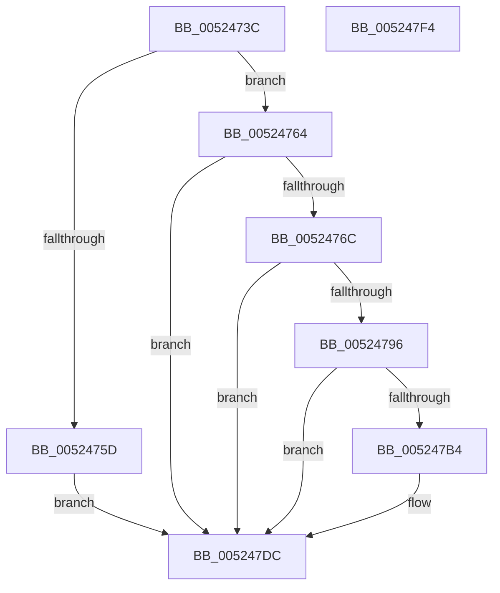

# SymCryptEcurveIsSame

- RVA: `0x0052473C`–`0x005247F5` (길이 `185` bytes)
- VA: `0x000000014052473C`
- 실행 섹션: `.text`
- PDB 이름 있음: `예`; PDB Function 태그: `아니요`
- unwind 정보 RVA: `0x0005C954`
- 디코드: `47`개 명령, `185/185` bytes 표시
- 미해석 바이트: `0` (있으면 어셈블리에 `.byte`로 보존)

> 이 문서는 커널 이미지의 기계어와 PDB 기호를 분석해 생성했습니다. 4번과 5번은 함수 원형과 자료형을 바이너리 사용 방식에서 추정한 C 해석이며 원본 소스 복구 결과는 아닙니다.

## 1. Dependencies

- 직접 호출 지점: **5**; 고유 호출 대상: **3**
- 직접 호출자로 확인된 함수: **1**
- RIP 상대 이미지 참조: **0**

### Outgoing calls
- `0x00524773` → [SymCryptIntFromModulus](SymCryptIntFromModulus_function_00525608.md) (function, `0x00525608`)
- `0x00524782` → [SymCryptIntFromModulus](SymCryptIntFromModulus_function_00525608.md) (function, `0x00525608`)
- `0x0052478D` → [SymCryptIntIsEqual](SymCryptIntIsEqual_function_00525698.md) (function, `0x00525698`)
- `0x005247AB` → [SymCryptModElementIsEqual](SymCryptModElementIsEqual_function_0052594C.md) (function, `0x0052594C`)
- `0x005247C9` → [SymCryptModElementIsEqual](SymCryptModElementIsEqual_function_0052594C.md) (function, `0x0052594C`)

### Direct callers
- [SymCryptEcDhSecretAgreement](../53/SymCryptEcDhSecretAgreement_function_00537798.md) at `0x005377E6`

### Static image references
- 디코드된 RIP-relative 메모리 참조가 없습니다.

## 2. Other-region calls and transfers

- 다른 실행 섹션으로 향하는 call: **0**
- 별도 외부 분기/꼬리 이동을 확인하지 못했습니다.

## 3. Assembly (complete function range)

```asm
0052473C  48 89 5C 24 08                  mov qword ptr [rsp + 8], rbx
00524741  48 89 6C 24 10                  mov qword ptr [rsp + 0x10], rbp
00524746  48 89 74 24 18                  mov qword ptr [rsp + 0x18], rsi
0052474B  57                              push rdi
0052474C  48 83 EC 20                     sub rsp, 0x20
00524750  33 FF                           xor edi, edi
00524752  48 8B EA                        mov rbp, rdx
00524755  48 8B F1                        mov rsi, rcx
00524758  48 3B CA                        cmp rcx, rdx
0052475B  75 07                           jne 0x140524764
0052475D  BF 01 00 00 00                  mov edi, 1
00524762  EB 78                           jmp 0x1405247dc
00524764  8B 42 04                        mov eax, dword ptr [rdx + 4]
00524767  39 41 04                        cmp dword ptr [rcx + 4], eax
0052476A  75 70                           jne 0x1405247dc
0052476C  48 8B 8A 68 02 00 00            mov rcx, qword ptr [rdx + 0x268]
00524773  E8 90 0E 00 00                  call 0x140525608
00524778  48 8B 8E 68 02 00 00            mov rcx, qword ptr [rsi + 0x268]
0052477F  48 8B D8                        mov rbx, rax
00524782  E8 81 0E 00 00                  call 0x140525608
00524787  48 8B C8                        mov rcx, rax
0052478A  48 8B D3                        mov rdx, rbx
0052478D  E8 06 0F 00 00                  call 0x140525698
00524792  85 C0                           test eax, eax
00524794  74 46                           je 0x1405247dc
00524796  4C 8B 85 78 02 00 00            mov r8, qword ptr [rbp + 0x278]
0052479D  48 8B 96 78 02 00 00            mov rdx, qword ptr [rsi + 0x278]
005247A4  48 8B 8E 68 02 00 00            mov rcx, qword ptr [rsi + 0x268]
005247AB  E8 9C 11 00 00                  call 0x14052594c
005247B0  85 C0                           test eax, eax
005247B2  74 28                           je 0x1405247dc
005247B4  4C 8B 85 80 02 00 00            mov r8, qword ptr [rbp + 0x280]
005247BB  48 8B 96 80 02 00 00            mov rdx, qword ptr [rsi + 0x280]
005247C2  48 8B 8E 68 02 00 00            mov rcx, qword ptr [rsi + 0x268]
005247C9  E8 7E 11 00 00                  call 0x14052594c
005247CE  85 C0                           test eax, eax
005247D0  40 0F B6 FF                     movzx edi, dil
005247D4  BA 01 00 00 00                  mov edx, 1
005247D9  0F 45 FA                        cmovne edi, edx
005247DC  48 8B 5C 24 30                  mov rbx, qword ptr [rsp + 0x30]
005247E1  40 8A C7                        mov al, dil
005247E4  48 8B 6C 24 38                  mov rbp, qword ptr [rsp + 0x38]
005247E9  48 8B 74 24 40                  mov rsi, qword ptr [rsp + 0x40]
005247EE  48 83 C4 20                     add rsp, 0x20
005247F2  5F                              pop rdi
005247F3  C3                              ret
005247F4  CC                              int3
```

## 4. C-style interpretation (structured pseudocode)

```c
__int64 __fastcall SymCryptEcurveIsSame(__int64 a1, __int64 a2)
{
    __int64 result;
    __int64 v_rdi;
    __int64 v_rsp;
    unsigned __int64 v_stack_p10;
    unsigned __int64 v_stack_p18;
    unsigned __int64 v_stack_p8;

    v_stack_p8 = v_rbx;
    v_stack_p10 = v_rbp;
    v_stack_p18 = v_rsi;
    v_rsp = (v_rsp) - (32);
    v_rdi = 0;
    if (a1 != a2) goto loc_00524764;
    goto loc_005247DC;
loc_00524764:
    if ((*(unsigned int *)(a1 + 4)) != ((unsigned int)((unsigned int)(*(unsigned int *)(a2 + 4))))) goto loc_005247DC;
    result = SymCryptIntFromModulus(*(unsigned __int64 *)(a2 + 616), a2, a3, a4);
    result = SymCryptIntFromModulus(*(unsigned __int64 *)(a1 + 616), a2, a3, a4);
    result = SymCryptIntIsEqual(result, result, a3, a4);
    if ((unsigned int)(result) == 0) goto loc_005247DC;
    result = SymCryptModElementIsEqual(*(unsigned __int64 *)(a1 + 616), *(unsigned __int64 *)(a1 + 632), *(unsigned __int64 *)(a2 + 632), a4);
    v_rdi = 1;
    if ((unsigned int)(result) != 0) {
        a3 = *(unsigned __int64 *)(a2 + 640);
        a2 = *(unsigned __int64 *)(a1 + 640);
        a1 = *(unsigned __int64 *)(a1 + 616);
        result = SymCryptModElementIsEqual(a1, a2, a3, a4);
        v_rdi = 1;
        a2 = 1;
        if ((unsigned int)(result) != 0) { v_rdi = (unsigned int)(a2); }
    }
    v_rsp = (v_rsp) + (32);
    return (unsigned __int8)(v_rdi);
}
```

## 5. (Beta) C Style

```c
int64_t SymCryptEcurveIsSame(void *Arg1, void *Arg2)
{
    uint8_t *arg1 = (uint8_t *)Arg1;
    uint8_t *arg2 = (uint8_t *)Arg2;

    int64_t result;
    int64_t local_rdi;
    int64_t local_rsp;
    uint64_t v_stack_p10;
    uint64_t v_stack_p18;
    uint64_t v_stack_p8;

    v_stack_p8 = local_rbx;
    v_stack_p10 = local_rbp;
    v_stack_p18 = local_rsi;
    local_rsp = (local_rsp) - (32);
    local_rdi = 0;
    if (Arg1 != Arg2) goto loc_00524764;
    goto loc_005247DC;
loc_00524764:
    if ((*(uint32_t *)(arg1 + 0x4)) != ((uint32_t)((uint32_t)(*(uint32_t *)(arg2 + 0x4))))) goto loc_005247DC;
    result = SymCryptIntFromModulus(*(uint64_t *)(arg2 + 0x268), Arg2, a3, a4);
    result = SymCryptIntFromModulus(*(uint64_t *)(arg1 + 0x268), Arg2, a3, a4);
    result = SymCryptIntIsEqual(result, result, a3, a4);
    if ((uint32_t)(result) == 0) goto loc_005247DC;
    result = SymCryptModElementIsEqual(*(uint64_t *)(arg1 + 0x268), *(uint64_t *)(arg1 + 0x278), *(uint64_t *)(arg2 + 0x278), a4);
    local_rdi = 1;
    if ((uint32_t)(result) != 0) {
        a3 = *(uint64_t *)(arg2 + 0x280);
        Arg2 = *(uint64_t *)(arg1 + 0x280);
        Arg1 = *(uint64_t *)(arg1 + 0x268);
        result = SymCryptModElementIsEqual(Arg1, Arg2, a3, a4);
        local_rdi = 1;
        Arg2 = 1;
        if ((uint32_t)(result) != 0) { local_rdi = (uint32_t)(Arg2); }
    }
    local_rsp = (local_rsp) + (32);
    return (uint8_t)(local_rdi);
}
```

### 관측된 메모리 오프셋

구조체 형식이 확인되지 않은 접근은 인자 기준의 오프셋으로만 기록했습니다.

| 기준 인자 | 오프셋 표현 | 폭 (bit) | 접근 |
|---|---:|---:|---|
| `Arg1` | `+ 0x268` | `64` | `R` |
| `Arg1` | `+ 0x278` | `64` | `R` |
| `Arg1` | `+ 0x280` | `64` | `R` |
| `Arg2` | `+ 0x4` | `32` | `R` |
| `Arg2` | `+ 0x268` | `64` | `R` |
| `Arg2` | `+ 0x278` | `64` | `R` |
| `Arg2` | `+ 0x280` | `64` | `R` |

## 6. Execution-region graph

[열기: 2D/3D 그래프와 함수 탐색 컨트롤 패널](../../../control-panel.html?section=text&rva=0x0052473C&view=graph)

- 2D 그래프는 위에서 아래로 흐르고, 3D 그래프는 빈 공간을 드래그해 회전합니다. Shift+드래그는 이동, 휠은 확대·축소, 함수 노드 선택은 대상 보고서 이동입니다.

### Static fallback


