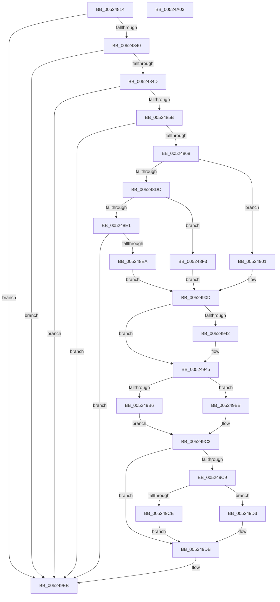

# SymCryptEcurveValidateAndComputeSizes

- RVA: `0x00524814`–`0x00524A04` (길이 `496` bytes)
- VA: `0x0000000140524814`
- 실행 섹션: `.text`
- PDB 이름 있음: `예`; PDB Function 태그: `예`
- unwind 정보 RVA: `0x0005C954`
- 디코드: `142`개 명령, `496/496` bytes 표시
- 미해석 바이트: `0` (있으면 어셈블리에 `.byte`로 보존)

> 이 문서는 커널 이미지의 기계어와 PDB 기호를 분석해 생성했습니다. 4번과 5번은 함수 원형과 자료형을 바이너리 사용 방식에서 추정한 C 해석이며 원본 소스 복구 결과는 아닙니다.

## 1. Dependencies

- 직접 호출 지점: **8**; 고유 호출 대상: **4**
- 직접 호출자로 확인된 함수: **1**
- RIP 상대 이미지 참조: **0**

### Outgoing calls
- `0x0052486B` → [SymCryptDigitsFromBits](SymCryptDigitsFromBits_function_0052544C.md) (function, `0x0052544C`)
- `0x00524878` → [SymCryptDigitsFromBits](SymCryptDigitsFromBits_function_0052544C.md) (function, `0x0052544C`)
- `0x00524886` → [SymCryptDigitsFromBits](SymCryptDigitsFromBits_function_0052544C.md) (function, `0x0052544C`)
- `0x00524890` → [SymCryptSizeofModulusFromDigits](SymCryptSizeofModulusFromDigits_function_00525D54.md) (function, `0x00525D54`)
- `0x0052489B` → [SymCryptSizeofModulusFromDigits](SymCryptSizeofModulusFromDigits_function_00525D54.md) (function, `0x00525D54`)
- `0x005248A6` → [SymCryptSizeofIntFromDigits](SymCryptSizeofIntFromDigits_function_00525D24.md) (function, `0x00525D24`)
- `0x00524912` → [SymCryptSizeofEcpointEx](SymCryptSizeofEcpointEx_function_0052CED4.md) (function, `0x0052CED4`)
- `0x00524974` → [SymCryptSizeofEcpointEx](SymCryptSizeofEcpointEx_function_0052CED4.md) (function, `0x0052CED4`)

### Direct callers
- [SymCryptEcurveAllocate](SymCryptEcurveAllocate_function_00524074.md) at `0x005240B2`

### Static image references
- 디코드된 RIP-relative 메모리 참조가 없습니다.

## 2. Other-region calls and transfers

- 다른 실행 섹션으로 향하는 call: **0**
- 별도 외부 분기/꼬리 이동을 확인하지 못했습니다.

## 3. Assembly (complete function range)

```asm
00524814  48 89 5C 24 08                  mov qword ptr [rsp + 8], rbx
00524819  48 89 6C 24 10                  mov qword ptr [rsp + 0x10], rbp
0052481E  48 89 74 24 18                  mov qword ptr [rsp + 0x18], rsi
00524823  57                              push rdi
00524824  48 83 EC 20                     sub rsp, 0x20
00524828  48 8B D9                        mov rbx, rcx
0052482B  40 32 ED                        xor bpl, bpl
0052482E  8B 49 0C                        mov ecx, dword ptr [rcx + 0xc]
00524831  48 8B F2                        mov rsi, rdx
00524834  81 F9 80 00 00 00               cmp ecx, 0x80
0052483A  0F 87 AB 01 00 00               ja 0x1405249eb
00524840  81 7B 10 81 00 00 00            cmp dword ptr [rbx + 0x10], 0x81
00524847  0F 87 9E 01 00 00               ja 0x1405249eb
0052484D  BF 02 00 00 00                  mov edi, 2
00524852  39 7B 14                        cmp dword ptr [rbx + 0x14], edi
00524855  0F 87 90 01 00 00               ja 0x1405249eb
0052485B  81 7B 18 00 01 00 00            cmp dword ptr [rbx + 0x18], 0x100
00524862  0F 87 83 01 00 00               ja 0x1405249eb
00524868  C1 E1 03                        shl ecx, 3
0052486B  E8 DC 0B 00 00                  call 0x14052544c
00524870  89 06                           mov dword ptr [rsi], eax
00524872  8B 4B 10                        mov ecx, dword ptr [rbx + 0x10]
00524875  C1 E1 03                        shl ecx, 3
00524878  E8 CF 0B 00 00                  call 0x14052544c
0052487D  89 46 04                        mov dword ptr [rsi + 4], eax
00524880  8B 4B 14                        mov ecx, dword ptr [rbx + 0x14]
00524883  C1 E1 03                        shl ecx, 3
00524886  E8 C1 0B 00 00                  call 0x14052544c
0052488B  8B 0E                           mov ecx, dword ptr [rsi]
0052488D  89 46 08                        mov dword ptr [rsi + 8], eax
00524890  E8 BF 14 00 00                  call 0x140525d54
00524895  8B 4E 04                        mov ecx, dword ptr [rsi + 4]
00524898  89 46 10                        mov dword ptr [rsi + 0x10], eax
0052489B  E8 B4 14 00 00                  call 0x140525d54
005248A0  8B 4E 08                        mov ecx, dword ptr [rsi + 8]
005248A3  89 46 1C                        mov dword ptr [rsi + 0x1c], eax
005248A6  E8 79 14 00 00                  call 0x140525d24
005248AB  89 46 20                        mov dword ptr [rsi + 0x20], eax
005248AE  B9 FF 01 00 00                  mov ecx, 0x1ff
005248B3  8B 43 0C                        mov eax, dword ptr [rbx + 0xc]
005248B6  C1 E0 03                        shl eax, 3
005248B9  44 8B C0                        mov r8d, eax
005248BC  C1 E8 09                        shr eax, 9
005248BF  44 23 C1                        and r8d, ecx
005248C2  44 03 C1                        add r8d, ecx
005248C5  41 C1 E8 09                     shr r8d, 9
005248C9  44 03 C0                        add r8d, eax
005248CC  41 C1 E0 06                     shl r8d, 6
005248D0  44 89 46 14                     mov dword ptr [rsi + 0x14], r8d
005248D4  8B 4B 04                        mov ecx, dword ptr [rbx + 4]
005248D7  83 E9 01                        sub ecx, 1
005248DA  74 25                           je 0x140524901
005248DC  83 E9 01                        sub ecx, 1
005248DF  74 12                           je 0x1405248f3
005248E1  83 F9 01                        cmp ecx, 1
005248E4  0F 85 01 01 00 00               jne 0x1405249eb
005248EA  C7 46 28 62 00 00 00            mov dword ptr [rsi + 0x28], 0x62
005248F1  EB 1A                           jmp 0x14052490d
005248F3  C7 46 28 54 00 00 00            mov dword ptr [rsi + 0x28], 0x54
005248FA  BF 04 00 00 00                  mov edi, 4
005248FF  EB 0C                           jmp 0x14052490d
00524901  C7 46 28 43 00 00 00            mov dword ptr [rsi + 0x28], 0x43
00524908  BF 03 00 00 00                  mov edi, 3
0052490D  8B D7                           mov edx, edi
0052490F  41 8B C8                        mov ecx, r8d
00524912  E8 BD 85 00 00                  call 0x14052ced4
00524917  8B 56 10                        mov edx, dword ptr [rsi + 0x10]
0052491A  BD 01 00 00 00                  mov ebp, 1
0052491F  44 8B 4E 14                     mov r9d, dword ptr [rsi + 0x14]
00524923  81 C2 A0 02 00 00               add edx, 0x2a0
00524929  89 46 18                        mov dword ptr [rsi + 0x18], eax
0052492C  42 8D 14 4A                     lea edx, [rdx + r9*2]
00524930  03 56 20                        add edx, dword ptr [rsi + 0x20]
00524933  03 56 1C                        add edx, dword ptr [rsi + 0x1c]
00524936  89 56 0C                        mov dword ptr [rsi + 0xc], edx
00524939  8B 4B 04                        mov ecx, dword ptr [rbx + 4]
0052493C  2B CD                           sub ecx, ebp
0052493E  3B CD                           cmp ecx, ebp
00524940  77 03                           ja 0x140524945
00524942  C1 E0 04                        shl eax, 4
00524945  03 C2                           add eax, edx
00524947  41 8B C9                        mov ecx, r9d
0052494A  89 46 0C                        mov dword ptr [rsi + 0xc], eax
0052494D  BA 04 00 00 00                  mov edx, 4
00524952  44 8B 06                        mov r8d, dword ptr [rsi]
00524955  41 8B C0                        mov eax, r8d
00524958  C1 E0 08                        shl eax, 8
0052495B  8B F8                           mov edi, eax
0052495D  83 C0 40                        add eax, 0x40
00524960  8B D8                           mov ebx, eax
00524962  41 C1 E0 06                     shl r8d, 6
00524966  49 83 C0 40                     add r8, 0x40
0052496A  49 03 C0                        add rax, r8
0052496D  4A 8D 04 40                     lea rax, [rax + r8*2]
00524971  48 03 F8                        add rdi, rax
00524974  E8 5B 85 00 00                  call 0x14052ced4
00524979  8B 4E 14                        mov ecx, dword ptr [rsi + 0x14]
0052497C  48 3B DF                        cmp rbx, rdi
0052497F  44 8B 0E                        mov r9d, dword ptr [rsi]
00524982  41 BB C0 00 00 00               mov r11d, 0xc0
00524988  0F 46 DF                        cmovbe ebx, edi
0052498B  03 C3                           add eax, ebx
0052498D  8D 14 C8                        lea edx, [rax + rcx*8]
00524990  8B 46 04                        mov eax, dword ptr [rsi + 4]
00524993  44 3B C8                        cmp r9d, eax
00524996  41 8B C9                        mov ecx, r9d
00524999  0F 46 C8                        cmovbe ecx, eax
0052499C  44 8B D1                        mov r10d, ecx
0052499F  44 8B C1                        mov r8d, ecx
005249A2  41 C1 E2 08                     shl r10d, 8
005249A6  41 81 C2 C0 00 00 00            add r10d, 0xc0
005249AD  41 C1 E0 04                     shl r8d, 4
005249B1  45 3B C2                        cmp r8d, r10d
005249B4  76 05                           jbe 0x1405249bb
005249B6  41 8B C0                        mov eax, r8d
005249B9  EB 08                           jmp 0x1405249c3
005249BB  8B C1                           mov eax, ecx
005249BD  C1 E0 08                        shl eax, 8
005249C0  41 03 C3                        add eax, r11d
005249C3  03 C9                           add ecx, ecx
005249C5  3B D0                           cmp edx, eax
005249C7  77 12                           ja 0x1405249db
005249C9  45 3B C2                        cmp r8d, r10d
005249CC  76 05                           jbe 0x1405249d3
005249CE  41 8B D0                        mov edx, r8d
005249D1  EB 08                           jmp 0x1405249db
005249D3  8B D1                           mov edx, ecx
005249D5  C1 E2 07                        shl edx, 7
005249D8  41 03 D3                        add edx, r11d
005249DB  41 C1 E1 08                     shl r9d, 8
005249DF  41 8D 49 40                     lea ecx, [r9 + 0x40]
005249E3  3B D1                           cmp edx, ecx
005249E5  0F 46 D1                        cmovbe edx, ecx
005249E8  89 56 24                        mov dword ptr [rsi + 0x24], edx
005249EB  48 8B 5C 24 30                  mov rbx, qword ptr [rsp + 0x30]
005249F0  40 8A C5                        mov al, bpl
005249F3  48 8B 6C 24 38                  mov rbp, qword ptr [rsp + 0x38]
005249F8  48 8B 74 24 40                  mov rsi, qword ptr [rsp + 0x40]
005249FD  48 83 C4 20                     add rsp, 0x20
00524A01  5F                              pop rdi
00524A02  C3                              ret
00524A03  CC                              int3
```

## 4. C-style interpretation (structured pseudocode)

```c
__int64 __fastcall SymCryptEcurveValidateAndComputeSizes(__int64 a1, __int64 a2)
{
    __int64 result;
    __int64 v_r10;
    __int64 v_rbp;
    __int64 v_rbx;
    __int64 v_rdi;
    __int64 v_rsp;
    unsigned __int64 v_stack_p10;
    unsigned __int64 v_stack_p18;
    unsigned __int64 v_stack_p8;

    v_stack_p8 = v_rbx;
    v_stack_p10 = v_rbp;
    v_stack_p18 = v_rsi;
    v_rsp = (v_rsp) - (32);
    v_rbp = 0;
    if (((unsigned int)((unsigned int)(*(unsigned int *)(a1 + 12)))) > 128) goto loc_005249EB;
    if ((*(unsigned int *)(a1 + 16)) > 129) goto loc_005249EB;
    if ((*(unsigned int *)(a1 + 20)) > 2) goto loc_005249EB;
    if ((*(unsigned int *)(a1 + 24)) > 256) goto loc_005249EB;
    a1 = (unsigned int)(((unsigned int)(*(unsigned int *)(a1 + 12))) << (3));
    result = SymCryptDigitsFromBits(a1, a2, a3, a4);
    *(unsigned int *)(a2) = (unsigned int)(result);
    a1 = (unsigned int)(((unsigned int)(*(unsigned int *)(a1 + 16))) << (3));
    result = SymCryptDigitsFromBits(a1, a2, a3, a4);
    *(unsigned int *)(a2 + 4) = (unsigned int)(result);
    a1 = (unsigned int)(((unsigned int)(*(unsigned int *)(a1 + 20))) << (3));
    result = SymCryptDigitsFromBits(a1, a2, a3, a4);
    *(unsigned int *)(a2 + 8) = (unsigned int)(result);
    result = SymCryptSizeofModulusFromDigits((unsigned int)(*(unsigned int *)(a2)), a2, a3, a4);
    *(unsigned int *)(a2 + 16) = (unsigned int)(result);
    result = SymCryptSizeofModulusFromDigits((unsigned int)(*(unsigned int *)(a2 + 4)), a2, a3, a4);
    *(unsigned int *)(a2 + 28) = (unsigned int)(result);
    result = SymCryptSizeofIntFromDigits((unsigned int)(*(unsigned int *)(a2 + 8)), a2, a3, a4);
    *(unsigned int *)(a2 + 32) = (unsigned int)(result);
    result = (unsigned int)(((unsigned int)(*(unsigned int *)(a1 + 12))) << (3));
    result = (unsigned int)((result) >> (9));
    a3 = (unsigned int)(((unsigned int)((unsigned int)(result))) & (511));
    a3 = (unsigned int)((a3) + (511));
    a3 = (unsigned int)((a3) >> (9));
    a3 = (unsigned int)((a3) + ((unsigned int)(result)));
    a3 = (unsigned int)((a3) << (6));
    *(unsigned int *)(a2 + 20) = (unsigned int)(a3);
    a1 = (unsigned int)(((unsigned int)(*(unsigned int *)(a1 + 4))) - (1));
    if (condition_is_equal) goto loc_00524901;
    a1 = (unsigned int)((a1) - (1));
    if (condition_is_equal) goto loc_005248F3;
    if (((unsigned int)(a1)) != 1) goto loc_005249EB;
    *(unsigned int *)(a2 + 40) = 98;
    goto loc_0052490D;
loc_005248F3:
    *(unsigned int *)(a2 + 40) = 84;
    goto loc_0052490D;
loc_00524901:
    *(unsigned int *)(a2 + 40) = 67;
loc_0052490D:
    result = SymCryptSizeofEcpointEx((unsigned int)((unsigned int)(a3)), 3, a3, a4);
    a2 = (unsigned int)(((unsigned int)(*(unsigned int *)(a2 + 16))) + (672));
    *(unsigned int *)(a2 + 24) = (unsigned int)(result);
    a2 = (unsigned int)((a2 + (unsigned int)(*(unsigned int *)(a2 + 20)) * 2) + (*(unsigned int *)(a2 + 32)));
    a2 = (unsigned int)((a2) + (*(unsigned int *)(a2 + 28)));
    *(unsigned int *)(a2 + 12) = (unsigned int)(a2);
    a1 = (unsigned int)(((unsigned int)(*(unsigned int *)(a1 + 4))) - (1));
    if (((unsigned int)(a1)) <= 1) {
        result = (unsigned int)((result) << (4));
    }
    result = (unsigned int)((result) + ((unsigned int)(a2)));
    *(unsigned int *)(a2 + 12) = (unsigned int)(result);
    result = (unsigned int)(((unsigned int)((unsigned int)((unsigned int)(*(unsigned int *)(a2))))) << (8));
    result = (unsigned int)((result) + (64));
    a3 = (unsigned int)(((unsigned int)(*(unsigned int *)(a2))) << (6));
    a3 = (a3) + (64);
    result = (result) + (a3);
    v_rdi = ((unsigned int)((unsigned int)(result))) + (result + a3 * 2);
    result = SymCryptSizeofEcpointEx((unsigned int)((unsigned int)((unsigned int)(*(unsigned int *)(a2 + 20)))), 4, a3, (unsigned int)(*(unsigned int *)(a2 + 20)));
    v_rbx = (unsigned int)((unsigned int)(result));
    if (((unsigned int)((unsigned int)(result))) <= v_rdi) { v_rbx = (unsigned int)(v_rdi); }
    result = (unsigned int)((result) + ((unsigned int)(v_rbx)));
    a1 = (unsigned int)((unsigned int)((unsigned int)(*(unsigned int *)(a2))));
    if (((unsigned int)((unsigned int)(*(unsigned int *)(a2)))) <= ((unsigned int)((unsigned int)(*(unsigned int *)(a2 + 4))))) { a1 = (unsigned int)((unsigned int)(*(unsigned int *)(a2 + 4))); }
    v_r10 = (unsigned int)(((unsigned int)((unsigned int)(a1))) << (8));
    v_r10 = (unsigned int)((v_r10) + (192));
    a3 = (unsigned int)(((unsigned int)((unsigned int)(a1))) << (4));
    if (((unsigned int)(a3)) <= ((unsigned int)(v_r10))) goto loc_005249BB;
    goto loc_005249C3;
loc_005249BB:
    result = (unsigned int)(((unsigned int)((unsigned int)(a1))) << (8));
    result = (unsigned int)((result) + (192));
loc_005249C3:
    a1 = (unsigned int)((a1) + ((unsigned int)(a1)));
    if (((unsigned int)(result + (unsigned int)(*(unsigned int *)(a2 + 20)) * 8)) > ((unsigned int)(result))) goto loc_005249DB;
    if (((unsigned int)(a3)) <= ((unsigned int)(v_r10))) goto loc_005249D3;
    goto loc_005249DB;
loc_005249D3:
    a2 = (unsigned int)(((unsigned int)((unsigned int)(a1))) << (7));
    a2 = (unsigned int)((a2) + (192));
loc_005249DB:
    a4 = (unsigned int)(((unsigned int)(*(unsigned int *)(a2))) << (8));
    if (((unsigned int)(a2)) <= ((unsigned int)(a4 + 64))) { a2 = (unsigned int)(a4 + 64); }
    *(unsigned int *)(a2 + 36) = (unsigned int)(a2);
loc_005249EB:
    v_rsp = (v_rsp) + (32);
    return 1;
}
```

## 5. (Beta) C Style

```c
int64_t SymCryptEcurveValidateAndComputeSizes(void *Arg1, void *Arg2)
{
    uint8_t *arg1 = (uint8_t *)Arg1;
    uint8_t *arg2 = (uint8_t *)Arg2;

    int64_t result;
    int64_t local_r10;
    int64_t local_rbp;
    int64_t local_rbx;
    int64_t local_rdi;
    int64_t local_rsp;
    uint64_t v_stack_p10;
    uint64_t v_stack_p18;
    uint64_t v_stack_p8;

    v_stack_p8 = local_rbx;
    v_stack_p10 = local_rbp;
    v_stack_p18 = local_rsi;
    local_rsp = (local_rsp) - (32);
    local_rbp = 0;
    if (((uint32_t)((uint32_t)(*(uint32_t *)(arg1 + 0xC)))) > 128) goto loc_005249EB;
    if ((*(uint32_t *)(arg1 + 0x10)) > 129) goto loc_005249EB;
    if ((*(uint32_t *)(arg1 + 0x14)) > 2) goto loc_005249EB;
    if ((*(uint32_t *)(arg1 + 0x18)) > 256) goto loc_005249EB;
    Arg1 = (uint32_t)(((uint32_t)(*(uint32_t *)(arg1 + 0xC))) << (3));
    result = SymCryptDigitsFromBits(Arg1, Arg2, a3, a4);
    *(uint32_t *)(arg2) = (uint32_t)(result);
    Arg1 = (uint32_t)(((uint32_t)(*(uint32_t *)(arg1 + 0x10))) << (3));
    result = SymCryptDigitsFromBits(Arg1, Arg2, a3, a4);
    *(uint32_t *)(arg2 + 0x4) = (uint32_t)(result);
    Arg1 = (uint32_t)(((uint32_t)(*(uint32_t *)(arg1 + 0x14))) << (3));
    result = SymCryptDigitsFromBits(Arg1, Arg2, a3, a4);
    *(uint32_t *)(arg2 + 0x8) = (uint32_t)(result);
    result = SymCryptSizeofModulusFromDigits((uint32_t)(*(uint32_t *)(arg2)), Arg2, a3, a4);
    *(uint32_t *)(arg2 + 0x10) = (uint32_t)(result);
    result = SymCryptSizeofModulusFromDigits((uint32_t)(*(uint32_t *)(arg2 + 0x4)), Arg2, a3, a4);
    *(uint32_t *)(arg2 + 0x1C) = (uint32_t)(result);
    result = SymCryptSizeofIntFromDigits((uint32_t)(*(uint32_t *)(arg2 + 0x8)), Arg2, a3, a4);
    *(uint32_t *)(arg2 + 0x20) = (uint32_t)(result);
    result = (uint32_t)(((uint32_t)(*(uint32_t *)(arg1 + 0xC))) << (3));
    result = (uint32_t)((result) >> (9));
    a3 = (uint32_t)(((uint32_t)((uint32_t)(result))) & (511));
    a3 = (uint32_t)((a3) + (511));
    a3 = (uint32_t)((a3) >> (9));
    a3 = (uint32_t)((a3) + ((uint32_t)(result)));
    a3 = (uint32_t)((a3) << (6));
    *(uint32_t *)(arg2 + 0x14) = (uint32_t)(a3);
    Arg1 = (uint32_t)(((uint32_t)(*(uint32_t *)(arg1 + 0x4))) - (1));
    if (condition_is_equal) goto loc_00524901;
    Arg1 = (uint32_t)((Arg1) - (1));
    if (condition_is_equal) goto loc_005248F3;
    if (((uint32_t)(Arg1)) != 1) goto loc_005249EB;
    *(uint32_t *)(arg2 + 0x28) = 98;
    goto loc_0052490D;
loc_005248F3:
    *(uint32_t *)(arg2 + 0x28) = 84;
    goto loc_0052490D;
loc_00524901:
    *(uint32_t *)(arg2 + 0x28) = 67;
loc_0052490D:
    result = SymCryptSizeofEcpointEx((uint32_t)((uint32_t)(a3)), 3, a3, a4);
    Arg2 = (uint32_t)(((uint32_t)(*(uint32_t *)(arg2 + 0x10))) + (672));
    *(uint32_t *)(arg2 + 0x18) = (uint32_t)(result);
    Arg2 = (uint32_t)((Arg2 + (uint32_t)(*(uint32_t *)(arg2 + 0x14)) * 2) + (*(uint32_t *)(arg2 + 0x20)));
    Arg2 = (uint32_t)((Arg2) + (*(uint32_t *)(arg2 + 0x1C)));
    *(uint32_t *)(arg2 + 0xC) = (uint32_t)(Arg2);
    Arg1 = (uint32_t)(((uint32_t)(*(uint32_t *)(arg1 + 0x4))) - (1));
    if (((uint32_t)(Arg1)) <= 1) {
        result = (uint32_t)((result) << (4));
    }
    result = (uint32_t)((result) + ((uint32_t)(Arg2)));
    *(uint32_t *)(arg2 + 0xC) = (uint32_t)(result);
    result = (uint32_t)(((uint32_t)((uint32_t)((uint32_t)(*(uint32_t *)(arg2))))) << (8));
    result = (uint32_t)((result) + (64));
    a3 = (uint32_t)(((uint32_t)(*(uint32_t *)(arg2))) << (6));
    a3 = (a3) + (64);
    result = (result) + (a3);
    local_rdi = ((uint32_t)((uint32_t)(result))) + (result + a3 * 2);
    result = SymCryptSizeofEcpointEx((uint32_t)((uint32_t)((uint32_t)(*(uint32_t *)(arg2 + 0x14)))), 4, a3, (uint32_t)(*(uint32_t *)(arg2 + 0x14)));
    local_rbx = (uint32_t)((uint32_t)(result));
    if (((uint32_t)((uint32_t)(result))) <= local_rdi) { local_rbx = (uint32_t)(local_rdi); }
    result = (uint32_t)((result) + ((uint32_t)(local_rbx)));
    Arg1 = (uint32_t)((uint32_t)((uint32_t)(*(uint32_t *)(arg2))));
    if (((uint32_t)((uint32_t)(*(uint32_t *)(arg2)))) <= ((uint32_t)((uint32_t)(*(uint32_t *)(arg2 + 0x4))))) { Arg1 = (uint32_t)((uint32_t)(*(uint32_t *)(arg2 + 0x4))); }
    local_r10 = (uint32_t)(((uint32_t)((uint32_t)(Arg1))) << (8));
    local_r10 = (uint32_t)((local_r10) + (192));
    a3 = (uint32_t)(((uint32_t)((uint32_t)(Arg1))) << (4));
    if (((uint32_t)(a3)) <= ((uint32_t)(local_r10))) goto loc_005249BB;
    goto loc_005249C3;
loc_005249BB:
    result = (uint32_t)(((uint32_t)((uint32_t)(Arg1))) << (8));
    result = (uint32_t)((result) + (192));
loc_005249C3:
    Arg1 = (uint32_t)((Arg1) + ((uint32_t)(Arg1)));
    if (((uint32_t)(result + (uint32_t)(*(uint32_t *)(arg2 + 0x14)) * 8)) > ((uint32_t)(result))) goto loc_005249DB;
    if (((uint32_t)(a3)) <= ((uint32_t)(local_r10))) goto loc_005249D3;
    goto loc_005249DB;
loc_005249D3:
    Arg2 = (uint32_t)(((uint32_t)((uint32_t)(Arg1))) << (7));
    Arg2 = (uint32_t)((Arg2) + (192));
loc_005249DB:
    a4 = (uint32_t)(((uint32_t)(*(uint32_t *)(arg2))) << (8));
    if (((uint32_t)(Arg2)) <= ((uint32_t)(a4 + 64))) { Arg2 = (uint32_t)(a4 + 64); }
    *(uint32_t *)(arg2 + 0x24) = (uint32_t)(Arg2);
loc_005249EB:
    local_rsp = (local_rsp) + (32);
    return 1;
}
```

### 관측된 메모리 오프셋

구조체 형식이 확인되지 않은 접근은 인자 기준의 오프셋으로만 기록했습니다.

| 기준 인자 | 오프셋 표현 | 폭 (bit) | 접근 |
|---|---:|---:|---|
| `Arg1` | `+ 0x4` | `32` | `R` |
| `Arg1` | `+ 0xC` | `32` | `R` |
| `Arg1` | `+ 0x10` | `32` | `R` |
| `Arg1` | `+ 0x14` | `32` | `R` |
| `Arg1` | `+ 0x18` | `32` | `R` |
| `Arg2` | `+ 0x0` | `32` | `R` |
| `Arg2` | `+ 0x0` | `32` | `W` |
| `Arg2` | `+ 0x4` | `32` | `R` |
| `Arg2` | `+ 0x4` | `32` | `W` |
| `Arg2` | `+ 0x8` | `32` | `R` |
| `Arg2` | `+ 0x8` | `32` | `W` |
| `Arg2` | `+ 0xC` | `32` | `W` |
| `Arg2` | `+ 0x10` | `32` | `R` |
| `Arg2` | `+ 0x10` | `32` | `W` |
| `Arg2` | `+ 0x14` | `32` | `R` |
| `Arg2` | `+ 0x14` | `32` | `W` |
| `Arg2` | `+ 0x18` | `32` | `W` |
| `Arg2` | `+ 0x1C` | `32` | `R` |
| `Arg2` | `+ 0x1C` | `32` | `W` |
| `Arg2` | `+ 0x20` | `32` | `R` |
| `Arg2` | `+ 0x20` | `32` | `W` |
| `Arg2` | `+ 0x24` | `32` | `W` |
| `Arg2` | `+ 0x28` | `32` | `W` |

## 6. Execution-region graph

[열기: 2D/3D 그래프와 함수 탐색 컨트롤 패널](../../../control-panel.html?section=text&rva=0x00524814&view=graph)

- 2D 그래프는 위에서 아래로 흐르고, 3D 그래프는 빈 공간을 드래그해 회전합니다. Shift+드래그는 이동, 휠은 확대·축소, 함수 노드 선택은 대상 보고서 이동입니다.

### Static fallback


