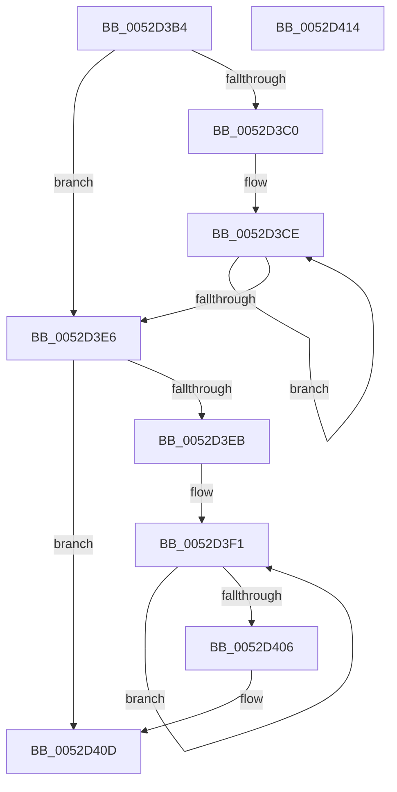

# SymCryptEqual

- RVA: `0x0052D3B4`–`0x0052D415` (길이 `97` bytes)
- VA: `0x000000014052D3B4`
- 실행 섹션: `.text`
- PDB 이름 있음: `예`; PDB Function 태그: `아니요`
- unwind 정보 RVA: `0x000DB714`
- 디코드: `33`개 명령, `97/97` bytes 표시
- 미해석 바이트: `0` (있으면 어셈블리에 `.byte`로 보존)

> 이 문서는 커널 이미지의 기계어와 PDB 기호를 분석해 생성했습니다. 4번과 5번은 함수 원형과 자료형을 바이너리 사용 방식에서 추정한 C 해석이며 원본 소스 복구 결과는 아닙니다.

## 1. Dependencies

- 직접 호출 지점: **0**; 고유 호출 대상: **0**
- 직접 호출자로 확인된 함수: **1**
- RIP 상대 이미지 참조: **0**

### Outgoing calls
- 직접 디코드된 call 명령이 없습니다.

### Direct callers
- [SymCryptRsaPkcs1CheckSignaturePadding](SymCryptRsaPkcs1CheckSignaturePadding_function_005252A8.md) at `0x0052531F`

### Static image references
- 디코드된 RIP-relative 메모리 참조가 없습니다.

## 2. Other-region calls and transfers

- 다른 실행 섹션으로 향하는 call: **0**
- 별도 외부 분기/꼬리 이동을 확인하지 못했습니다.

## 3. Assembly (complete function range)

```asm
0052D3B4  45 33 D2                        xor r10d, r10d
0052D3B7  4C 8B C9                        mov r9, rcx
0052D3BA  49 83 F8 04                     cmp r8, 4
0052D3BE  72 26                           jb 0x14052d3e6
0052D3C0  4D 8B D8                        mov r11, r8
0052D3C3  49 C1 EB 02                     shr r11, 2
0052D3C7  49 6B C3 FC                     imul rax, r11, -4
0052D3CB  4C 03 C0                        add r8, rax
0052D3CE  8B 0A                           mov ecx, dword ptr [rdx]
0052D3D0  48 83 C2 04                     add rdx, 4
0052D3D4  41 8B 01                        mov eax, dword ptr [r9]
0052D3D7  33 C8                           xor ecx, eax
0052D3D9  44 0B D1                        or r10d, ecx
0052D3DC  49 83 C1 04                     add r9, 4
0052D3E0  49 83 EB 01                     sub r11, 1
0052D3E4  75 E8                           jne 0x14052d3ce
0052D3E6  4D 85 C0                        test r8, r8
0052D3E9  74 22                           je 0x14052d40d
0052D3EB  45 32 DB                        xor r11b, r11b
0052D3EE  49 2B D1                        sub rdx, r9
0052D3F1  42 8A 0C 0A                     mov cl, byte ptr [rdx + r9]
0052D3F5  41 8A 01                        mov al, byte ptr [r9]
0052D3F8  49 FF C1                        inc r9
0052D3FB  32 C8                           xor cl, al
0052D3FD  44 0A D9                        or r11b, cl
0052D400  49 83 E8 01                     sub r8, 1
0052D404  75 EB                           jne 0x14052d3f1
0052D406  41 0F B6 C3                     movzx eax, r11b
0052D40A  44 0B D0                        or r10d, eax
0052D40D  45 85 D2                        test r10d, r10d
0052D410  0F 94 C0                        sete al
0052D413  C3                              ret
0052D414  CC                              int3
```

## 4. C-style interpretation (structured pseudocode)

```c
__int64 __fastcall SymCryptEqual(__int64 a1, __int64 a2, __int64 a3)
{
    __int64 result;
    __int64 v_r10;
    __int64 v_r11;

    v_r10 = 0;
    if (a3 < 4) goto loc_0052D3E6;
    v_r11 = (a3) >> (2);
    result = (result) * (v_r11);
    a3 = (a3) + (result);
loc_0052D3CE:
    a2 = (a2) + (4);
    a1 = (unsigned int)(((unsigned int)(*(unsigned int *)(a2))) ^ ((unsigned int)((unsigned int)(*(unsigned int *)(a1)))));
    v_r10 = (unsigned int)((v_r10) | ((unsigned int)(a1)));
    a4 = (a1) + (4);
    v_r11 = (v_r11) - (1);
    if (condition_is_not_equal) goto loc_0052D3CE;
loc_0052D3E6:
    if (a3 == 0) goto loc_0052D40D;
    v_r11 = 0;
    a2 = (a2) - (a4);
loc_0052D3F1:
    a4 = (a4) + 1;
    a1 = (unsigned __int8)((*(unsigned __int8 *)(a2 + a4 * 1)) ^ ((unsigned __int8)(*(unsigned __int8 *)(a4))));
    v_r11 = (unsigned __int8)((v_r11) | ((unsigned __int8)(a1)));
    a3 = (a3) - (1);
    if (condition_is_not_equal) goto loc_0052D3F1;
    v_r10 = (unsigned int)((v_r10) | ((unsigned int)((unsigned __int8)(v_r11))));
loc_0052D40D:
    result = ((unsigned int)(v_r10) == 0) ? 1 : 0;
    return result;
}
```

## 5. (Beta) C Style

```c
int64_t SymCryptEqual(void *Arg1, void *Arg2, int64_t Arg3)
{
    uint8_t *arg1 = (uint8_t *)Arg1;
    uint8_t *arg2 = (uint8_t *)Arg2;

    int64_t result;
    int64_t local_r10;
    int64_t local_r11;

    local_r10 = 0;
    if (Arg3 < 4) goto loc_0052D3E6;
    local_r11 = (Arg3) >> (2);
    result = (result) * (local_r11);
    Arg3 = (Arg3) + (result);
loc_0052D3CE:
    Arg2 = (Arg2) + (4);
    Arg1 = (uint32_t)(((uint32_t)(*(uint32_t *)(arg2))) ^ ((uint32_t)((uint32_t)(*(uint32_t *)(arg1)))));
    local_r10 = (uint32_t)((local_r10) | ((uint32_t)(Arg1)));
    a4 = (Arg1) + (4);
    local_r11 = (local_r11) - (1);
    if (condition_is_not_equal) goto loc_0052D3CE;
loc_0052D3E6:
    if (Arg3 == 0) goto loc_0052D40D;
    local_r11 = 0;
    Arg2 = (Arg2) - (a4);
loc_0052D3F1:
    a4 = (a4) + 1;
    Arg1 = (uint8_t)((*(uint8_t *)(arg2 + a4 * 1)) ^ ((uint8_t)(*(uint8_t *)(a4))));
    local_r11 = (uint8_t)((local_r11) | ((uint8_t)(Arg1)));
    Arg3 = (Arg3) - (1);
    if (condition_is_not_equal) goto loc_0052D3F1;
    local_r10 = (uint32_t)((local_r10) | ((uint32_t)((uint8_t)(local_r11))));
loc_0052D40D:
    result = ((uint32_t)(local_r10) == 0) ? 1 : 0;
    return result;
}
```

### 관측된 메모리 오프셋

구조체 형식이 확인되지 않은 접근은 인자 기준의 오프셋으로만 기록했습니다.

| 기준 인자 | 오프셋 표현 | 폭 (bit) | 접근 |
|---|---:|---:|---|
| `Arg1` | `+ 0x0` | `32` | `R` |
| `Arg2` | `+ 0x0` | `32` | `R` |
| `Arg2` | `+ 0x0 + r9*1` | `8` | `R` |

## 6. Execution-region graph

[열기: 2D/3D 그래프와 함수 탐색 컨트롤 패널](../../../control-panel.html?section=text&rva=0x0052D3B4&view=graph)

- 2D 그래프는 위에서 아래로 흐르고, 3D 그래프는 빈 공간을 드래그해 회전합니다. Shift+드래그는 이동, 휠은 확대·축소, 함수 노드 선택은 대상 보고서 이동입니다.

### Static fallback


