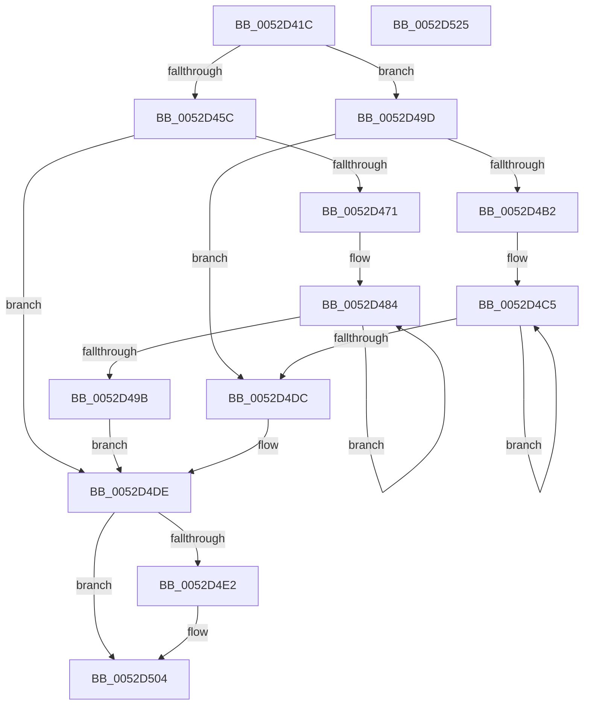

# SymCryptFdefIntAddMixedSize

- RVA: `0x0052D41C`–`0x0052D526` (길이 `266` bytes)
- VA: `0x000000014052D41C`
- 실행 섹션: `.text`
- PDB 이름 있음: `예`; PDB Function 태그: `아니요`
- unwind 정보 RVA: `0x0008A350`
- 디코드: `88`개 명령, `266/266` bytes 표시
- 미해석 바이트: `0` (있으면 어셈블리에 `.byte`로 보존)

> 이 문서는 커널 이미지의 기계어와 PDB 기호를 분석해 생성했습니다. 4번과 5번은 함수 원형과 자료형을 바이너리 사용 방식에서 추정한 C 해석이며 원본 소스 복구 결과는 아닙니다.

## 1. Dependencies

- 직접 호출 지점: **3**; 고유 호출 대상: **2**
- 직접 호출자로 확인된 함수: **1**
- RIP 상대 이미지 참조: **0**

### Outgoing calls
- `0x0052D45F` → [SymCryptFdefRawAddAsm](../53/SymCryptFdefRawAddAsm_function_00536510.md) (function, `0x00536510`)
- `0x0052D4A0` → [SymCryptFdefRawAddAsm](../53/SymCryptFdefRawAddAsm_function_00536510.md) (function, `0x00536510`)
- `0x0052D4F8` → [SymCryptWipe](../51/SymCryptWipe_function_0051F914.md) (function, `0x0051F914`)

### Direct callers
- [SymCryptIntAddMixedSize](SymCryptIntAddMixedSize_function_00525494.md) at `0x00525498`

### Static image references
- 디코드된 RIP-relative 메모리 참조가 없습니다.

## 2. Other-region calls and transfers

- 다른 실행 섹션으로 향하는 call: **0**
- 별도 외부 분기/꼬리 이동을 확인하지 못했습니다.

## 3. Assembly (complete function range)

```asm
0052D41C  48 8B C4                        mov rax, rsp
0052D41F  48 89 58 08                     mov qword ptr [rax + 8], rbx
0052D423  48 89 68 10                     mov qword ptr [rax + 0x10], rbp
0052D427  48 89 70 18                     mov qword ptr [rax + 0x18], rsi
0052D42B  48 89 78 20                     mov qword ptr [rax + 0x20], rdi
0052D42F  41 55                           push r13
0052D431  41 56                           push r14
0052D433  41 57                           push r15
0052D435  48 83 EC 20                     sub rsp, 0x20
0052D439  8B 59 04                        mov ebx, dword ptr [rcx + 4]
0052D43C  4D 8B F0                        mov r14, r8
0052D43F  8B 72 04                        mov esi, dword ptr [rdx + 4]
0052D442  4C 8B FA                        mov r15, rdx
0052D445  41 8B 68 04                     mov ebp, dword ptr [r8 + 4]
0052D449  4C 8B E9                        mov r13, rcx
0052D44C  49 83 C0 20                     add r8, 0x20
0052D450  48 83 C2 20                     add rdx, 0x20
0052D454  48 83 C1 20                     add rcx, 0x20
0052D458  3B DE                           cmp ebx, esi
0052D45A  73 41                           jae 0x14052d49d
0052D45C  44 8B CB                        mov r9d, ebx
0052D45F  E8 AC 90 00 00                  call 0x140536510
0052D464  8B D6                           mov edx, esi
0052D466  8B F8                           mov edi, eax
0052D468  2B D3                           sub edx, ebx
0052D46A  C1 E2 04                        shl edx, 4
0052D46D  85 D2                           test edx, edx
0052D46F  74 6D                           je 0x14052d4de
0052D471  C1 E3 04                        shl ebx, 4
0052D474  8B CB                           mov ecx, ebx
0052D476  48 83 C1 08                     add rcx, 8
0052D47A  44 8B C2                        mov r8d, edx
0052D47D  4D 2B FE                        sub r15, r14
0052D480  49 8D 0C 8E                     lea rcx, [r14 + rcx*4]
0052D484  41 8B 04 0F                     mov eax, dword ptr [r15 + rcx]
0052D488  48 03 F8                        add rdi, rax
0052D48B  89 39                           mov dword ptr [rcx], edi
0052D48D  48 8D 49 04                     lea rcx, [rcx + 4]
0052D491  48 C1 EF 20                     shr rdi, 0x20
0052D495  49 83 E8 01                     sub r8, 1
0052D499  75 E9                           jne 0x14052d484
0052D49B  EB 41                           jmp 0x14052d4de
0052D49D  44 8B CE                        mov r9d, esi
0052D4A0  E8 6B 90 00 00                  call 0x140536510
0052D4A5  8B D3                           mov edx, ebx
0052D4A7  8B F8                           mov edi, eax
0052D4A9  2B D6                           sub edx, esi
0052D4AB  C1 E2 04                        shl edx, 4
0052D4AE  85 D2                           test edx, edx
0052D4B0  74 2A                           je 0x14052d4dc
0052D4B2  C1 E6 04                        shl esi, 4
0052D4B5  8B CE                           mov ecx, esi
0052D4B7  48 83 C1 08                     add rcx, 8
0052D4BB  44 8B C2                        mov r8d, edx
0052D4BE  4D 2B EE                        sub r13, r14
0052D4C1  49 8D 0C 8E                     lea rcx, [r14 + rcx*4]
0052D4C5  42 8B 04 29                     mov eax, dword ptr [rcx + r13]
0052D4C9  48 03 F8                        add rdi, rax
0052D4CC  89 39                           mov dword ptr [rcx], edi
0052D4CE  48 8D 49 04                     lea rcx, [rcx + 4]
0052D4D2  48 C1 EF 20                     shr rdi, 0x20
0052D4D6  49 83 E8 01                     sub r8, 1
0052D4DA  75 E9                           jne 0x14052d4c5
0052D4DC  8B F3                           mov esi, ebx
0052D4DE  3B F5                           cmp esi, ebp
0052D4E0  73 22                           jae 0x14052d504
0052D4E2  8B C6                           mov eax, esi
0052D4E4  49 8D 4E 20                     lea rcx, [r14 + 0x20]
0052D4E8  C1 E0 04                        shl eax, 4
0052D4EB  2B EE                           sub ebp, esi
0052D4ED  C1 E5 06                        shl ebp, 6
0052D4F0  8B D5                           mov edx, ebp
0052D4F2  8B D8                           mov ebx, eax
0052D4F4  48 8D 0C 81                     lea rcx, [rcx + rax*4]
0052D4F8  E8 17 24 FF FF                  call 0x14051f914
0052D4FD  41 89 7C 9E 20                  mov dword ptr [r14 + rbx*4 + 0x20], edi
0052D502  33 FF                           xor edi, edi
0052D504  48 8B 5C 24 40                  mov rbx, qword ptr [rsp + 0x40]
0052D509  8B C7                           mov eax, edi
0052D50B  48 8B 7C 24 58                  mov rdi, qword ptr [rsp + 0x58]
0052D510  48 8B 6C 24 48                  mov rbp, qword ptr [rsp + 0x48]
0052D515  48 8B 74 24 50                  mov rsi, qword ptr [rsp + 0x50]
0052D51A  48 83 C4 20                     add rsp, 0x20
0052D51E  41 5F                           pop r15
0052D520  41 5E                           pop r14
0052D522  41 5D                           pop r13
0052D524  C3                              ret
0052D525  CC                              int3
```

## 4. C-style interpretation (structured pseudocode)

```c
__int64 __fastcall SymCryptFdefIntAddMixedSize(__int64 a1, __int64 a2, __int64 a3)
{
    __int64 result;
    __int64 v_r13;
    __int64 v_r15;
    __int64 v_rbp;
    __int64 v_rbx;
    __int64 v_rdi;
    __int64 v_rsi;
    __int64 v_rsp;
    unsigned __int64 v_stack_p10;
    unsigned __int64 v_stack_p18;
    unsigned __int64 v_stack_p20;
    unsigned __int64 v_stack_p8;

    *(unsigned __int64 *)(v_rsp + 8) = v_rbx;
    *(unsigned __int64 *)(v_rsp + 16) = v_rbp;
    *(unsigned __int64 *)(v_rsp + 24) = v_rsi;
    *(unsigned __int64 *)(v_rsp + 32) = v_rdi;
    v_rsp = (v_rsp) - (32);
    a3 = (a3) + (32);
    a2 = (a2) + (32);
    a1 = (a1) + (32);
    if (((unsigned int)((unsigned int)(*(unsigned int *)(a1 + 4)))) >= ((unsigned int)((unsigned int)(*(unsigned int *)(a2 + 4))))) goto loc_0052D49D;
    result = SymCryptFdefRawAddAsm(a1, a2, a3, (unsigned int)((unsigned int)((unsigned int)(*(unsigned int *)(a1 + 4)))));
    a2 = (unsigned int)(((unsigned int)((unsigned int)((unsigned int)(*(unsigned int *)(a2 + 4))))) - ((unsigned int)((unsigned int)(*(unsigned int *)(a1 + 4)))));
    a2 = (unsigned int)((a2) << (4));
    if ((unsigned int)(a2) == 0) goto loc_0052D4DE;
    v_rbx = (unsigned int)(((unsigned int)(*(unsigned int *)(a1 + 4))) << (4));
    a1 = ((unsigned int)((unsigned int)(v_rbx))) + (8);
    v_r15 = (a2) - (a3);
loc_0052D484:
    v_rdi = ((unsigned int)((unsigned int)(result))) + ((unsigned int)(*(unsigned int *)(v_r15 + a3 + a1 * 4 * 1)));
    *(unsigned int *)(a3 + a1 * 4) = (unsigned int)(v_rdi);
    v_rdi = (v_rdi) >> (32);
    a3 = ((unsigned int)((unsigned int)(a2))) - (1);
    if (condition_is_not_equal) goto loc_0052D484;
    goto loc_0052D4DE;
loc_0052D49D:
    result = SymCryptFdefRawAddAsm(a3 + a1 * 4 + 4, a2, a3, (unsigned int)((unsigned int)((unsigned int)(*(unsigned int *)(a2 + 4)))));
    a2 = (unsigned int)(((unsigned int)((unsigned int)(v_rbx))) - ((unsigned int)((unsigned int)(*(unsigned int *)(a2 + 4)))));
    a2 = (unsigned int)((a2) << (4));
    if ((unsigned int)(a2) == 0) goto loc_0052D4DC;
    v_rsi = (unsigned int)(((unsigned int)(*(unsigned int *)(a2 + 4))) << (4));
    a1 = ((unsigned int)((unsigned int)(v_rsi))) + (8);
    v_r13 = (a1) - (a3);
loc_0052D4C5:
    v_rdi = ((unsigned int)((unsigned int)(result))) + ((unsigned int)(*(unsigned int *)(a3 + a1 * 4 + v_r13 * 1)));
    *(unsigned int *)(a3 + a1 * 4) = (unsigned int)(v_rdi);
    v_rdi = (v_rdi) >> (32);
    a3 = ((unsigned int)((unsigned int)(a2))) - (1);
    if (condition_is_not_equal) goto loc_0052D4C5;
loc_0052D4DC:
loc_0052D4DE:
    result = (unsigned int)(*(unsigned int *)(a3 + a1 * 4 + v_r13 * 1));
    v_rbp = (unsigned int)(*(unsigned int *)(a3 + 4));
    if (((unsigned int)((unsigned int)((unsigned int)(v_rbx)))) < ((unsigned int)((unsigned int)(*(unsigned int *)(a3 + 4))))) {
        result = (unsigned int)((unsigned int)((unsigned int)(v_rbx)));
        a1 = a3 + 32;
        result = (unsigned int)((result) << (4));
        v_rbp = (unsigned int)(((unsigned int)(*(unsigned int *)(a3 + 4))) - ((unsigned int)((unsigned int)((unsigned int)(v_rbx)))));
        v_rbp = (unsigned int)((v_rbp) << (6));
        a2 = (unsigned int)(v_rbp);
        v_rbx = (unsigned int)(result);
        a1 = a1 + result * 4;
        result = SymCryptWipe(a1, a2, a3, (unsigned int)((unsigned int)((unsigned int)(*(unsigned int *)(a2 + 4)))));
        *(unsigned int *)(a3 + v_rbx * 4 + 32) = (unsigned int)(v_rdi);
        v_rdi = 0;
    }
    v_rsp = (v_rsp) + (32);
    return 0;
}
```

## 5. (Beta) C Style

```c
int64_t SymCryptFdefIntAddMixedSize(void *Arg1, void *Arg2, void *Arg3)
{
    uint8_t *arg1 = (uint8_t *)Arg1;
    uint8_t *arg2 = (uint8_t *)Arg2;
    uint8_t *arg3 = (uint8_t *)Arg3;

    int64_t result;
    int64_t local_r13;
    int64_t local_r15;
    int64_t local_rbp;
    int64_t local_rbx;
    int64_t local_rdi;
    int64_t local_rsi;
    int64_t local_rsp;
    uint64_t v_stack_p10;
    uint64_t v_stack_p18;
    uint64_t v_stack_p20;
    uint64_t v_stack_p8;

    *(uint64_t *)(local_rsp + 0x8) = local_rbx;
    *(uint64_t *)(local_rsp + 0x10) = local_rbp;
    *(uint64_t *)(local_rsp + 0x18) = local_rsi;
    *(uint64_t *)(local_rsp + 0x20) = local_rdi;
    local_rsp = (local_rsp) - (32);
    Arg3 = (Arg3) + (32);
    Arg2 = (Arg2) + (32);
    Arg1 = (Arg1) + (32);
    if (((uint32_t)((uint32_t)(*(uint32_t *)(arg1 + 0x4)))) >= ((uint32_t)((uint32_t)(*(uint32_t *)(arg2 + 0x4))))) goto loc_0052D49D;
    result = SymCryptFdefRawAddAsm(Arg1, Arg2, Arg3, (uint32_t)((uint32_t)((uint32_t)(*(uint32_t *)(arg1 + 0x4)))));
    Arg2 = (uint32_t)(((uint32_t)((uint32_t)((uint32_t)(*(uint32_t *)(arg2 + 0x4))))) - ((uint32_t)((uint32_t)(*(uint32_t *)(arg1 + 0x4)))));
    Arg2 = (uint32_t)((Arg2) << (4));
    if ((uint32_t)(Arg2) == 0) goto loc_0052D4DE;
    local_rbx = (uint32_t)(((uint32_t)(*(uint32_t *)(arg1 + 0x4))) << (4));
    Arg1 = ((uint32_t)((uint32_t)(local_rbx))) + (8);
    local_r15 = (Arg2) - (Arg3);
loc_0052D484:
    local_rdi = ((uint32_t)((uint32_t)(result))) + ((uint32_t)(*(uint32_t *)(local_r15 + arg3 + arg1 * 4 * 1)));
    *(uint32_t *)(arg3 + arg1 * 4) = (uint32_t)(local_rdi);
    local_rdi = (local_rdi) >> (32);
    Arg3 = ((uint32_t)((uint32_t)(Arg2))) - (1);
    if (condition_is_not_equal) goto loc_0052D484;
    goto loc_0052D4DE;
loc_0052D49D:
    result = SymCryptFdefRawAddAsm(Arg3 + Arg1 * 4 + 4, Arg2, Arg3, (uint32_t)((uint32_t)((uint32_t)(*(uint32_t *)(arg2 + 0x4)))));
    Arg2 = (uint32_t)(((uint32_t)((uint32_t)(local_rbx))) - ((uint32_t)((uint32_t)(*(uint32_t *)(arg2 + 0x4)))));
    Arg2 = (uint32_t)((Arg2) << (4));
    if ((uint32_t)(Arg2) == 0) goto loc_0052D4DC;
    local_rsi = (uint32_t)(((uint32_t)(*(uint32_t *)(arg2 + 0x4))) << (4));
    Arg1 = ((uint32_t)((uint32_t)(local_rsi))) + (8);
    local_r13 = (Arg1) - (Arg3);
loc_0052D4C5:
    local_rdi = ((uint32_t)((uint32_t)(result))) + ((uint32_t)(*(uint32_t *)(arg3 + arg1 * 4 + local_r13 * 1)));
    *(uint32_t *)(arg3 + arg1 * 4) = (uint32_t)(local_rdi);
    local_rdi = (local_rdi) >> (32);
    Arg3 = ((uint32_t)((uint32_t)(Arg2))) - (1);
    if (condition_is_not_equal) goto loc_0052D4C5;
loc_0052D4DC:
loc_0052D4DE:
    result = (uint32_t)(*(uint32_t *)(arg3 + arg1 * 4 + local_r13 * 1));
    local_rbp = (uint32_t)(*(uint32_t *)(arg3 + 0x4));
    if (((uint32_t)((uint32_t)((uint32_t)(local_rbx)))) < ((uint32_t)((uint32_t)(*(uint32_t *)(arg3 + 0x4))))) {
        result = (uint32_t)((uint32_t)((uint32_t)(local_rbx)));
        Arg1 = Arg3 + 32;
        result = (uint32_t)((result) << (4));
        local_rbp = (uint32_t)(((uint32_t)(*(uint32_t *)(arg3 + 0x4))) - ((uint32_t)((uint32_t)((uint32_t)(local_rbx)))));
        local_rbp = (uint32_t)((local_rbp) << (6));
        Arg2 = (uint32_t)(local_rbp);
        local_rbx = (uint32_t)(result);
        Arg1 = Arg1 + result * 4;
        result = SymCryptWipe(Arg1, Arg2, Arg3, (uint32_t)((uint32_t)((uint32_t)(*(uint32_t *)(arg2 + 0x4)))));
        *(uint32_t *)(arg3 + local_rbx * 4 + 0x20) = (uint32_t)(local_rdi);
        local_rdi = 0;
    }
    local_rsp = (local_rsp) + (32);
    return 0;
}
```

### 관측된 메모리 오프셋

구조체 형식이 확인되지 않은 접근은 인자 기준의 오프셋으로만 기록했습니다.

| 기준 인자 | 오프셋 표현 | 폭 (bit) | 접근 |
|---|---:|---:|---|
| `Arg1` | `+ 0x4` | `32` | `R` |
| `Arg2` | `+ 0x0 + rcx*1` | `32` | `R` |
| `Arg2` | `+ 0x4` | `32` | `R` |
| `Arg3` | `+ 0x0` | `32` | `W` |
| `Arg3` | `+ 0x0 + r13*1` | `32` | `R` |
| `Arg3` | `+ 0x0 + rax*4` | `64` | `R` |
| `Arg3` | `+ 0x0 + rcx*4` | `64` | `R` |
| `Arg3` | `+ 0x4` | `32` | `R` |
| `Arg3` | `+ 0x4` | `64` | `R` |
| `Arg3` | `+ 0x20` | `64` | `R` |
| `Arg3` | `+ 0x20 + rbx*4` | `32` | `W` |

## 6. Execution-region graph

[열기: 2D/3D 그래프와 함수 탐색 컨트롤 패널](../../../control-panel.html?section=text&rva=0x0052D41C&view=graph)

- 2D 그래프는 위에서 아래로 흐르고, 3D 그래프는 빈 공간을 드래그해 회전합니다. Shift+드래그는 이동, 휠은 확대·축소, 함수 노드 선택은 대상 보고서 이동입니다.

### Static fallback


