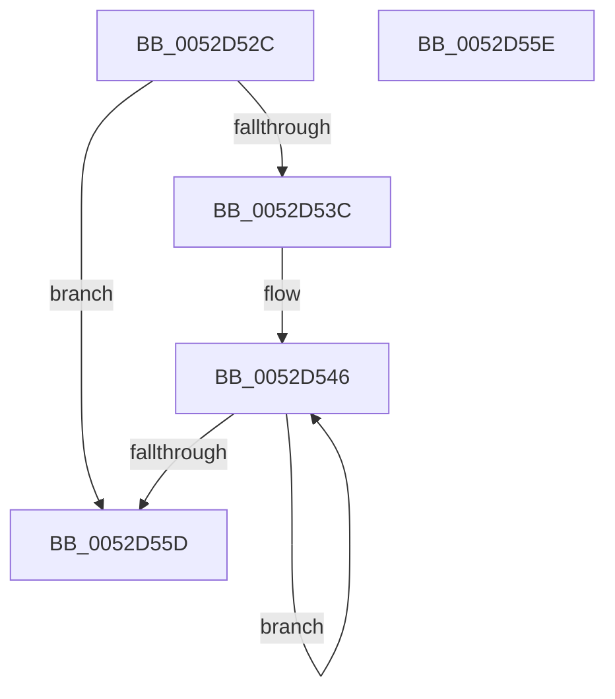

# SymCryptFdefIntAddUint32

- RVA: `0x0052D52C`–`0x0052D55F` (길이 `51` bytes)
- VA: `0x000000014052D52C`
- 실행 섹션: `.text`
- PDB 이름 있음: `예`; PDB Function 태그: `아니요`
- unwind 정보 RVA: `0x000DB714`
- 디코드: `18`개 명령, `51/51` bytes 표시
- 미해석 바이트: `0` (있으면 어셈블리에 `.byte`로 보존)

> 이 문서는 커널 이미지의 기계어와 PDB 기호를 분석해 생성했습니다. 4번과 5번은 함수 원형과 자료형을 바이너리 사용 방식에서 추정한 C 해석이며 원본 소스 복구 결과는 아닙니다.

## 1. Dependencies

- 직접 호출 지점: **0**; 고유 호출 대상: **0**
- 직접 호출자로 확인된 함수: **1**
- RIP 상대 이미지 참조: **0**

### Outgoing calls
- 직접 디코드된 call 명령이 없습니다.

### Direct callers
- [SymCryptIntAddUint32](SymCryptIntAddUint32_function_005254AC.md) at `0x005254B0`

### Static image references
- 디코드된 RIP-relative 메모리 참조가 없습니다.

## 2. Other-region calls and transfers

- 다른 실행 섹션으로 향하는 call: **0**
- 별도 외부 분기/꼬리 이동을 확인하지 못했습니다.

## 3. Assembly (complete function range)

```asm
0052D52C  4C 8B C9                        mov r9, rcx
0052D52F  8B C2                           mov eax, edx
0052D531  41 8B 48 04                     mov ecx, dword ptr [r8 + 4]
0052D535  C1 E1 04                        shl ecx, 4
0052D538  85 C9                           test ecx, ecx
0052D53A  74 21                           je 0x14052d55d
0052D53C  49 8D 50 20                     lea rdx, [r8 + 0x20]
0052D540  4D 2B C8                        sub r9, r8
0052D543  44 8B C1                        mov r8d, ecx
0052D546  41 8B 0C 11                     mov ecx, dword ptr [r9 + rdx]
0052D54A  48 03 C1                        add rax, rcx
0052D54D  89 02                           mov dword ptr [rdx], eax
0052D54F  48 8D 52 04                     lea rdx, [rdx + 4]
0052D553  48 C1 E8 20                     shr rax, 0x20
0052D557  49 83 E8 01                     sub r8, 1
0052D55B  75 E9                           jne 0x14052d546
0052D55D  C3                              ret
0052D55E  CC                              int3
```

## 4. C-style interpretation (structured pseudocode)

```c
__int64 __fastcall SymCryptFdefIntAddUint32(__int64 a1, int a2, __int64 a3)
{
    __int64 result;

    a1 = (unsigned int)(((unsigned int)(*(unsigned int *)(a3 + 4))) << (4));
    if ((unsigned int)(a1) == 0) goto loc_0052D55D;
    a4 = (a1) - (a3);
loc_0052D546:
    result = ((unsigned int)(a2)) + ((unsigned int)(*(unsigned int *)(a4 + a3 + 32 * 1)));
    *(unsigned int *)(a3 + 32) = (unsigned int)(result);
    result = (result) >> (32);
    a3 = ((unsigned int)((unsigned int)(a1))) - (1);
    if (condition_is_not_equal) goto loc_0052D546;
loc_0052D55D:
    return result;
}
```

## 5. (Beta) C Style

```c
int64_t SymCryptFdefIntAddUint32(void *Arg1, int32_t Arg2, void *Arg3)
{
    uint8_t *arg1 = (uint8_t *)Arg1;
    uint8_t *arg3 = (uint8_t *)Arg3;

    int64_t result;

    Arg1 = (uint32_t)(((uint32_t)(*(uint32_t *)(arg3 + 0x4))) << (4));
    if ((uint32_t)(Arg1) == 0) goto loc_0052D55D;
    a4 = (Arg1) - (Arg3);
loc_0052D546:
    result = ((uint32_t)(Arg2)) + ((uint32_t)(*(uint32_t *)(a4 + arg3 + 0x20 * 1)));
    *(uint32_t *)(arg3 + 0x20) = (uint32_t)(result);
    result = (result) >> (32);
    Arg3 = ((uint32_t)((uint32_t)(Arg1))) - (1);
    if (condition_is_not_equal) goto loc_0052D546;
loc_0052D55D:
    return result;
}
```

### 관측된 메모리 오프셋

구조체 형식이 확인되지 않은 접근은 인자 기준의 오프셋으로만 기록했습니다.

| 기준 인자 | 오프셋 표현 | 폭 (bit) | 접근 |
|---|---:|---:|---|
| `Arg1` | `+ 0x0 + rdx*1` | `32` | `R` |
| `Arg3` | `+ 0x0` | `32` | `W` |
| `Arg3` | `+ 0x4` | `32` | `R` |
| `Arg3` | `+ 0x4` | `64` | `R` |
| `Arg3` | `+ 0x20` | `64` | `R` |

## 6. Execution-region graph

[열기: 2D/3D 그래프와 함수 탐색 컨트롤 패널](../../../control-panel.html?section=text&rva=0x0052D52C&view=graph)

- 2D 그래프는 위에서 아래로 흐르고, 3D 그래프는 빈 공간을 드래그해 회전합니다. Shift+드래그는 이동, 휠은 확대·축소, 함수 노드 선택은 대상 보고서 이동입니다.

### Static fallback


