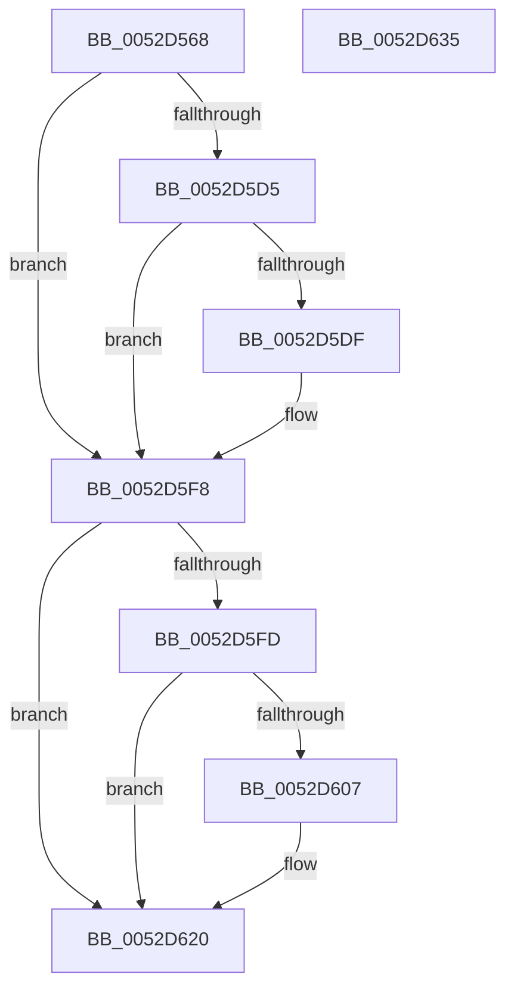

# SymCryptFdefIntDivMod

- RVA: `0x0052D568`–`0x0052D636` (길이 `206` bytes)
- VA: `0x000000014052D568`
- 실행 섹션: `.text`
- PDB 이름 있음: `예`; PDB Function 태그: `아니요`
- unwind 정보 RVA: `0x0007D3C0`
- 디코드: `63`개 명령, `206/206` bytes 표시
- 미해석 바이트: `0` (있으면 어셈블리에 `.byte`로 보존)

> 이 문서는 커널 이미지의 기계어와 PDB 기호를 분석해 생성했습니다. 4번과 5번은 함수 원형과 자료형을 바이너리 사용 방식에서 추정한 C 해석이며 원본 소스 복구 결과는 아닙니다.

## 1. Dependencies

- 직접 호출 지점: **3**; 고유 호출 대상: **2**
- 직접 호출자로 확인된 함수: **1**
- RIP 상대 이미지 참조: **0**

### Outgoing calls
- `0x0052D5CB` → [SymCryptFdefRawDivMod](SymCryptFdefRawDivMod_function_0052DC30.md) (function, `0x0052DC30`)
- `0x0052D5F3` → [SymCryptWipe](../51/SymCryptWipe_function_0051F914.md) (function, `0x0051F914`)
- `0x0052D61B` → [SymCryptWipe](../51/SymCryptWipe_function_0051F914.md) (function, `0x0051F914`)

### Direct callers
- [SymCryptIntDivMod](SymCryptIntDivMod_function_00525584.md) at `0x0052559C`

### Static image references
- 디코드된 RIP-relative 메모리 참조가 없습니다.

## 2. Other-region calls and transfers

- 다른 실행 섹션으로 향하는 call: **0**
- 별도 외부 분기/꼬리 이동을 확인하지 못했습니다.

## 3. Assembly (complete function range)

```asm
0052D568  48 89 5C 24 08                  mov qword ptr [rsp + 8], rbx
0052D56D  48 89 6C 24 10                  mov qword ptr [rsp + 0x10], rbp
0052D572  48 89 74 24 18                  mov qword ptr [rsp + 0x18], rsi
0052D577  57                              push rdi
0052D578  48 83 EC 40                     sub rsp, 0x40
0052D57C  4D 8D 51 20                     lea r10, [r9 + 0x20]
0052D580  49 8B C1                        mov rax, r9
0052D583  48 F7 D8                        neg rax
0052D586  48 8B F1                        mov rsi, rcx
0052D589  49 8B C0                        mov rax, r8
0052D58C  49 8B D9                        mov rbx, r9
0052D58F  4D 1B DB                        sbb r11, r11
0052D592  49 8B F8                        mov rdi, r8
0052D595  4D 23 DA                        and r11, r10
0052D598  48 8B EA                        mov rbp, rdx
0052D59B  48 F7 D8                        neg rax
0052D59E  4D 8D 50 20                     lea r10, [r8 + 0x20]
0052D5A2  48 8B 44 24 78                  mov rax, qword ptr [rsp + 0x78]
0052D5A7  4C 8B C2                        mov r8, rdx
0052D5AA  8B 56 04                        mov edx, dword ptr [rsi + 4]
0052D5AD  4D 1B C9                        sbb r9, r9
0052D5B0  48 89 44 24 30                  mov qword ptr [rsp + 0x30], rax
0052D5B5  4D 23 CA                        and r9, r10
0052D5B8  48 8B 44 24 70                  mov rax, qword ptr [rsp + 0x70]
0052D5BD  48 83 C1 20                     add rcx, 0x20
0052D5C1  48 89 44 24 28                  mov qword ptr [rsp + 0x28], rax
0052D5C6  4C 89 5C 24 20                  mov qword ptr [rsp + 0x20], r11
0052D5CB  E8 60 06 00 00                  call 0x14052dc30
0052D5D0  48 85 FF                        test rdi, rdi
0052D5D3  74 23                           je 0x14052d5f8
0052D5D5  8B 47 04                        mov eax, dword ptr [rdi + 4]
0052D5D8  8B 4E 04                        mov ecx, dword ptr [rsi + 4]
0052D5DB  3B C1                           cmp eax, ecx
0052D5DD  76 19                           jbe 0x14052d5f8
0052D5DF  2B C1                           sub eax, ecx
0052D5E1  C1 E1 04                        shl ecx, 4
0052D5E4  C1 E0 06                        shl eax, 6
0052D5E7  8B D0                           mov edx, eax
0052D5E9  8B C1                           mov eax, ecx
0052D5EB  48 83 C0 08                     add rax, 8
0052D5EF  48 8D 0C 87                     lea rcx, [rdi + rax*4]
0052D5F3  E8 1C 23 FF FF                  call 0x14051f914
0052D5F8  48 85 DB                        test rbx, rbx
0052D5FB  74 23                           je 0x14052d620
0052D5FD  8B 43 04                        mov eax, dword ptr [rbx + 4]
0052D600  8B 4D 04                        mov ecx, dword ptr [rbp + 4]
0052D603  3B C1                           cmp eax, ecx
0052D605  76 19                           jbe 0x14052d620
0052D607  2B C1                           sub eax, ecx
0052D609  C1 E1 04                        shl ecx, 4
0052D60C  C1 E0 06                        shl eax, 6
0052D60F  8B D0                           mov edx, eax
0052D611  8B C1                           mov eax, ecx
0052D613  48 83 C0 08                     add rax, 8
0052D617  48 8D 0C 83                     lea rcx, [rbx + rax*4]
0052D61B  E8 F4 22 FF FF                  call 0x14051f914
0052D620  48 8B 5C 24 50                  mov rbx, qword ptr [rsp + 0x50]
0052D625  48 8B 6C 24 58                  mov rbp, qword ptr [rsp + 0x58]
0052D62A  48 8B 74 24 60                  mov rsi, qword ptr [rsp + 0x60]
0052D62F  48 83 C4 40                     add rsp, 0x40
0052D633  5F                              pop rdi
0052D634  C3                              ret
0052D635  CC                              int3
```

## 4. C-style interpretation (structured pseudocode)

```c
__int64 __fastcall SymCryptFdefIntDivMod(__int64 a1, __int64 a2, __int64 a3, __int64 a4, __int64 a5, __int64 a6)
{
    __int64 result;
    __int64 v_r11;
    __int64 v_rsp;
    unsigned __int64 v_stack_m18;
    unsigned __int64 v_stack_m20;
    unsigned __int64 v_stack_m28;
    unsigned __int64 v_stack_p10;
    unsigned __int64 v_stack_p18;
    unsigned __int64 v_stack_p8;

    v_stack_p8 = v_rbx;
    v_stack_p10 = v_rbp;
    v_stack_p18 = v_rsi;
    v_rsp = (v_rsp) - (64);
    result = -(a4);
    v_r11 = (v_r11) & (a4 + 32);
    result = -(a3);
    v_stack_m18 = a6;
    a4 = (a4) & (a3 + 32);
    a1 = (a1) + (32);
    v_stack_m20 = a5;
    v_stack_m28 = v_r11;
    result = SymCryptFdefRawDivMod(a1, (unsigned int)(*(unsigned int *)(a1 + 4)), a2, a4);
    if (a3 == 0) goto loc_0052D5F8;
    result = (unsigned int)(*(unsigned int *)(a3 + 4));
    if (((unsigned int)((unsigned int)(*(unsigned int *)(a3 + 4)))) >= = ((unsigned int)((unsigned int)(*(unsigned int *)(a1 + 4))))) {
        result = (unsigned int)(((unsigned int)(*(unsigned int *)(a3 + 4))) - ((unsigned int)((unsigned int)(*(unsigned int *)(a1 + 4)))));
        a1 = (unsigned int)(((unsigned int)(*(unsigned int *)(a1 + 4))) << (4));
        result = (unsigned int)((result) << (6));
        a2 = (unsigned int)(result);
        result = (unsigned int)(a1);
        result = (result) + (8);
        a1 = a3 + result * 4;
        result = SymCryptWipe(a1, a2, a2, a4);
    }
    if (a4 == 0) goto loc_0052D620;
    result = (unsigned int)(*(unsigned int *)(a4 + 4));
    if (((unsigned int)((unsigned int)(*(unsigned int *)(a4 + 4)))) >= = ((unsigned int)((unsigned int)(*(unsigned int *)(a2 + 4))))) {
        result = (unsigned int)(((unsigned int)(*(unsigned int *)(a4 + 4))) - ((unsigned int)((unsigned int)(*(unsigned int *)(a2 + 4)))));
        a1 = (unsigned int)(((unsigned int)(*(unsigned int *)(a2 + 4))) << (4));
        result = (unsigned int)((result) << (6));
        a2 = (unsigned int)(result);
        result = (unsigned int)(a1);
        result = (result) + (8);
        a1 = a4 + result * 4;
        result = SymCryptWipe(a1, a2, a2, a4);
    }
    v_rsp = (v_rsp) + (64);
    return result;
}
```

## 5. (Beta) C Style

```c
int64_t SymCryptFdefIntDivMod(void *Arg1, void *Arg2, void *Arg3, void *Arg4, int64_t Arg5, int64_t Arg6)
{
    uint8_t *arg1 = (uint8_t *)Arg1;
    uint8_t *arg2 = (uint8_t *)Arg2;
    uint8_t *arg3 = (uint8_t *)Arg3;
    uint8_t *arg4 = (uint8_t *)Arg4;

    int64_t result;
    int64_t local_r11;
    int64_t local_rsp;
    uint64_t v_stack_m18;
    uint64_t v_stack_m20;
    uint64_t v_stack_m28;
    uint64_t v_stack_p10;
    uint64_t v_stack_p18;
    uint64_t v_stack_p8;

    v_stack_p8 = local_rbx;
    v_stack_p10 = local_rbp;
    v_stack_p18 = local_rsi;
    local_rsp = (local_rsp) - (64);
    result = -(Arg4);
    local_r11 = (local_r11) & (Arg4 + 32);
    result = -(Arg3);
    v_stack_m18 = Arg6;
    Arg4 = (Arg4) & (Arg3 + 32);
    Arg1 = (Arg1) + (32);
    v_stack_m20 = Arg5;
    v_stack_m28 = local_r11;
    result = SymCryptFdefRawDivMod(Arg1, (uint32_t)(*(uint32_t *)(arg1 + 0x4)), Arg2, Arg4);
    if (Arg3 == NULL) goto loc_0052D5F8;
    result = (uint32_t)(*(uint32_t *)(arg3 + 0x4));
    if (((uint32_t)((uint32_t)(*(uint32_t *)(arg3 + 0x4)))) >= = ((uint32_t)((uint32_t)(*(uint32_t *)(arg1 + 0x4))))) {
        result = (uint32_t)(((uint32_t)(*(uint32_t *)(arg3 + 0x4))) - ((uint32_t)((uint32_t)(*(uint32_t *)(arg1 + 0x4)))));
        Arg1 = (uint32_t)(((uint32_t)(*(uint32_t *)(arg1 + 0x4))) << (4));
        result = (uint32_t)((result) << (6));
        Arg2 = (uint32_t)(result);
        result = (uint32_t)(Arg1);
        result = (result) + (8);
        Arg1 = Arg3 + result * 4;
        result = SymCryptWipe(Arg1, Arg2, Arg2, Arg4);
    }
    if (Arg4 == NULL) goto loc_0052D620;
    result = (uint32_t)(*(uint32_t *)(arg4 + 0x4));
    if (((uint32_t)((uint32_t)(*(uint32_t *)(arg4 + 0x4)))) >= = ((uint32_t)((uint32_t)(*(uint32_t *)(arg2 + 0x4))))) {
        result = (uint32_t)(((uint32_t)(*(uint32_t *)(arg4 + 0x4))) - ((uint32_t)((uint32_t)(*(uint32_t *)(arg2 + 0x4)))));
        Arg1 = (uint32_t)(((uint32_t)(*(uint32_t *)(arg2 + 0x4))) << (4));
        result = (uint32_t)((result) << (6));
        Arg2 = (uint32_t)(result);
        result = (uint32_t)(Arg1);
        result = (result) + (8);
        Arg1 = Arg4 + result * 4;
        result = SymCryptWipe(Arg1, Arg2, Arg2, Arg4);
    }
    local_rsp = (local_rsp) + (64);
    return result;
}
```

### 관측된 메모리 오프셋

구조체 형식이 확인되지 않은 접근은 인자 기준의 오프셋으로만 기록했습니다.

| 기준 인자 | 오프셋 표현 | 폭 (bit) | 접근 |
|---|---:|---:|---|
| `Arg1` | `+ 0x4` | `32` | `R` |
| `Arg2` | `+ 0x4` | `32` | `R` |
| `Arg3` | `+ 0x20` | `64` | `R` |
| `Arg4` | `+ 0x20` | `64` | `R` |

## 6. Execution-region graph

[열기: 2D/3D 그래프와 함수 탐색 컨트롤 패널](../../../control-panel.html?section=text&rva=0x0052D568&view=graph)

- 2D 그래프는 위에서 아래로 흐르고, 3D 그래프는 빈 공간을 드래그해 회전합니다. Shift+드래그는 이동, 휠은 확대·축소, 함수 노드 선택은 대상 보고서 이동입니다.

### Static fallback


